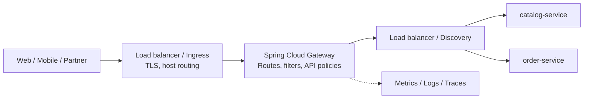
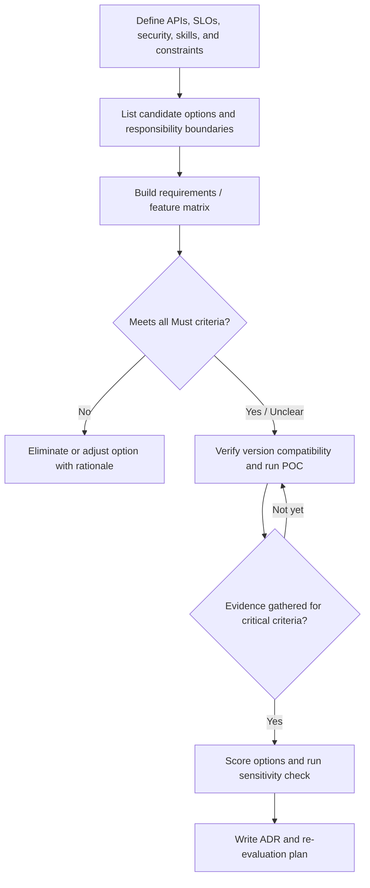

# Building a Feature Matrix Before Choosing a Gateway Architecture

Choosing an **API Gateway** should not start with the question "Should we use Spring Cloud Gateway WebFlux or MVC?" or "Do we need Kubernetes Ingress?". It should start with: **What does the system need the entry point to do, which criteria are mandatory, and what evidence shows a given option can meet them?**

In the **Spring Cloud Gateway** ecosystem, capabilities such as route predicates, filter chains, URL/header transformations, service discovery, authentication, rate limiting, circuit breakers, retries, TLS, and request observability can involve many different dependencies, deployment components, and operational policies. An option that passes a simple routing example is not guaranteed to satisfy requirements for security, load, availability, or maintainability.

This lesson belongs to the **Versions and Variants** chapter. Its goal is to construct a verifiable **feature matrix**, then use that matrix to choose a gateway architecture and compatible version set tailored to a specific context.

## 1. What Is a Feature Matrix and Why Build It First?

A **feature matrix** is a table mapping each system requirement against candidate architectural options. Beyond "yes/no" cells, a useful matrix records priority, prerequisites, limitations, evidence, and the owner responsible for verification.

For example, checking off "supports rate limiting" is not enough. You must answer:

- Limit by IP, account, API key, or route?
- Does a user hitting **multiple gateway instances** share a single quota?
- What status code is returned when quota is exhausted, and are response headers needed?
- Where are counters stored, and what happens if the counter store becomes unavailable?
- Is that capability built into the target variant and version, or does it require extra dependencies, plugins, or custom code?

A feature matrix prevents four common mistakes:

1. **Comparing by product marketing names:** seeing "has circuit breaker" in multiple docs and assuming identical integration depth and configuration.
2. **Confusing features with operability:** configuring JWT validation without key rotation, auth failure monitoring, or handling identity-provider outages.
3. **Picking a variant before surveying needs:** choosing reactive thinking "it's faster" even though the team only operates MVC and has no requirement demanding that execution model.
4. **Locking architecture before locking versions:** for example, applying configuration from an older guide to a different Spring Boot/Spring Cloud version set, resulting in incompatible starters, properties, or filters.

The **desired output** of building the matrix is a traceable decision: which requirements drove which choice, how that choice was verified, and what risks remain.

## 2. Identifying the Right Options to Compare

Before filling out the matrix, separate **gateway application variants** from **surrounding gateway infrastructure architecture**. These two decisions are related, not identical.

### 2.1. Application and Infrastructure Options

| Option | Nature | Usually Worth Considering When |
| --- | --- | --- |
| **Spring Cloud Gateway Server WebFlux** | Gateway running on the Spring WebFlux stack, handling HTTP with a reactive model. | You want a customizable Spring-based gateway and have the skills to develop/operate the WebFlux stack. |
| **Spring Cloud Gateway Server Web MVC** | Gateway using the Spring MVC/Servlet stack, with APIs and a feature catalog for that product line. | The team is experienced in Spring MVC, needs Servlet-stack integrations, or prefers a familiar model. |
| **Edge Ingress/reverse proxy** | Infrastructure component receiving and routing HTTP(S), sitting in front of apps in Kubernetes or other environments. | You primarily need TLS termination, host/path routing, and traffic distribution; advanced policies depend on the product/controller. |
| **Managed API gateway service** | Vendor-managed platform typically offering routing, auth, quotas, and monitoring tools per tier. | You want to reduce operational burden or need a partner-facing API portal, provided control and cost requirements fit. |
| **Hybrid architecture** | Load balancer/Ingress sits in front of Spring Cloud Gateway instances; gateway sits in front of microservices. | You need to separate edge infrastructure duties from custom API policies and scale layers independently. |

A hybrid option can look like this:



In this model, ingress or a load balancer does not necessarily replace Spring Cloud Gateway. Clearly divide where CORS, TLS, authentication, rate limiting, and request-origin headers are handled to avoid duplicate work or security gaps.

### 2.2. Differences to Understand Between WebFlux and Web MVC

| Perspective | Gateway Server WebFlux | Gateway Server Web MVC |
| --- | --- | --- |
| Underlying stack | Spring WebFlux, reactive APIs | Spring Web MVC, Servlet |
| Custom processing extensions | Requires understanding reactive streams and avoiding blocking on the event loop | Uses extension points aligned with the MVC/servlet model |
| Routes and filters | Provides routes/predicates/filters; registration and catalog follow the WebFlux line | Also provides routes/predicates/filters, but APIs, filter names, and parity must be checked against the MVC version |
| Spring Security integration | Uses configuration fitting the reactive stack | Uses configuration fitting the servlet stack |
| Operational advantage | Fits teams with reactive experience where high-concurrency I/O load is a measured target | Fits teams standardized on MVC aiming to minimize new-technology learning risk |
| Risk of choosing wrong | Calling blocking libraries directly in reactive handlers; misjudging debugging and tracing | Copying WebFlux DSL/filter code; estimating performance from assumptions rather than benchmarks |

Never conclude that WebFlux is **always** faster than Web MVC or that MVC **cannot** handle complex gateways. Performance depends on connection settings, traffic patterns, filter work, hardware resources, backpressure, downstream backends, and measurement methodology. Features must also be verified on the **exact release** selected.

## 3. Gathering Requirements Before Filling Feature Cells

A good feature matrix starts from testable requirements. State **who** needs the capability, **why**, and the **acceptance criterion** instead of listing only technical buzzwords.

### 3.1. Illustrative Scenario Context

An e-commerce system has:

- Web and mobile clients calling a single public API hostname: `api.shop.example`.
- Three backends: `catalog-service`, `order-service`, and `identity-service`.
- Multiple `catalog-service` instances, changing during scaling/deployments.
- Catalog API allows public access; Order API requires a JWT and resource-level authorization.
- Operations wants rate limiting, visibility into which upstream failed, per-route latency, and end-to-end request tracing across services.

This is an **illustrative scenario**, not metrics from a real system. Load and latency targets below serve as examples of how to write acceptance criteria; real projects must substitute agreed measurements and requirements.

### 3.2. Baseline Requirements Matrix

| ID | Required Capability | Sample Acceptance Criterion | Priority |
| --- | --- | --- | --- |
| R01 | Route predicates | `GET /api/catalog/**` reaches catalog accurately; mismatched methods/paths are not misrouted. | **Must** |
| R02 | Path/header transformation | Strips `/api/catalog` prefix, preserves query strings; internal headers added/removed per rules. | **Must** |
| R03 | Service discovery/load balancing | When a catalog instance is removed from availability, new requests route to remaining healthy instances within allowed convergence time. | **Must** |
| R04 | Authentication | Valid JWTs are accepted per policy; missing/invalid tokens are rejected with appropriate auth responses. | **Must** |
| R05 | Authorization | User A cannot view User B's orders even when authenticated; enforced by the business service. | **Must** |
| R06 | Rate limiting | Requests exceeding per-user/API-key quota are rejected; quotas are consistent across multiple gateway instances. | **Must** |
| R07 | Timeout/circuit breaker | Slow or failing upstreams do not hold connections indefinitely; responses and metrics reflect the failure type accurately. | **Must** |
| R08 | Retry | Retries only under declared safe operations and conditions; capped retry count and total duration. | **Must** |
| R09 | TLS and header protection | HTTPS from clients; proxy headers and identity are trusted only from controlled sources. | **Must** |
| R10 | Request observability | Measures error rates, per-route latency, and links gateway → backend traces. | **Must** |
| R11 | WebSocket/streaming | Runs end-to-end with long-lived connections if the application actually requires it. | **Should if needed** |
| R12 | Policy changeability | New routes/filters can be deployed, tested, rolled back, and audited via team workflow. | **Should** |

**Must** is non-negotiable and cannot be traded off for high scores elsewhere. **Should** is a prioritized need adjustable to context; **Could** is nice-to-have if cost is reasonable. A requirement should carry the Must label only when failing to meet it renders the option unusable.

For example, with R05: the gateway can validate the token, but only `order-service` knows which orders belong to which user. Therefore, do not wrongly write "gateway enforces all authorization" in the matrix; clearly define **gateway responsibilities** vs. **backend responsibilities**.

### 3.3. Adding Measurable Non-Functional Criteria

Beyond features, the team must add:

| Category | Questions to Answer | How to Clarify |
| --- | --- | --- |
| **Performance** | What RPS, concurrency, p95/p99 latency, and payload sizes? | Representative load including routes, JWT, rate limits, and production-like filters. |
| **Availability** | How much downtime is acceptable, how many instances, how does failover work? | Inject simulated failures for both gateway and upstreams. |
| **Resilience** | How do timeouts, retries, and circuit breakers interact? | Set a total time budget and measure request amplification. |
| **Security** | Where do JWTs come from, how are keys rotated, where does TLS terminate? | Threat model, verify trust boundaries and error responses. |
| **Operations** | Who is on-call, who monitors SLOs, handles incidents, upgrades, and rollbacks? | Define on-call rotation, dashboards, runbooks, and deployment procedures. |
| **Cost** | Infrastructure, certificates, Redis, tracing, licenses, bandwidth costs? | Estimate at current load and projected growth. |
| **Compatibility** | Are JDK, Spring Boot, Spring Cloud, Spring Security, discovery, and observability aligned? | Cross-check BOM, dependencies, and docs for the exact release train. |

An illustrative threshold might be "adds no more than 30 ms to p95 latency at 3,000 requests/second on the described test request mix." That number is **not a guarantee from Spring Cloud Gateway**; it must be measured on your concrete environment alongside hardware, configuration, caching, and overhead calculation method.

## 4. Creating a Feature Comparison Matrix Across Options

You can start with the preliminary table below. Notation:

- **Built-in (Core):** capability inherent to the approach; still requires proper dependencies/config.
- **Integration:** requires extra libraries, supporting services, or operational configuration.
- **Verify:** do not assume variants/products share identical APIs, behavior, or support levels; verify via docs and POC.
- **Product-dependent:** depends on the specific vendor or ingress controller.

| Criterion | Gateway WebFlux | Gateway Web MVC | Ingress / reverse proxy | Managed Gateway |
| --- | --- | --- | --- | --- |
| Routing by path/method/host | **Built-in** | **Built-in**, different API | Host/path usually built-in; method **product-dependent** | **Product-dependent** |
| Custom route filters and chains | **Built-in** | **Built-in**, **verify** specific filters | Plugins/middleware **product-dependent** | Policies/plugins **product-dependent** |
| Path strip/rewrite, header manipulation | **Built-in** | **Built-in**, **verify** syntax | **Product/controller-dependent** | **Product-dependent** |
| Instance lookup via service discovery | **Integration** Spring Cloud LoadBalancer/discovery | **Integration**, **verify** per release | Usually uses infra upstreams/services | Uses provider backend targets/integrations |
| JWT/OAuth 2.0 authentication | **Integration** Spring Security reactive | **Integration** Spring Security servlet | **Controller/plugin-dependent** | **Product/tier-dependent** |
| Distributed quota/rate limiting | **Integration** limiter and suitable state store | **Verify** capabilities/filters and store in target version | **Controller/plugin-dependent** | **Product/tier-dependent** |
| Circuit breaker and timeouts | **Integration** and configuration | **Integration/verify** | **Product-dependent** | **Product-dependent** |
| Conditional retries | **Yes**, verify behavior/filters | **Verify** on MVC line | **Product-dependent** | **Product-dependent** |
| Per-hop TLS/mTLS | Depends on server and topology | Depends on server and topology | Usually an edge responsibility | **Product-dependent** |
| Metrics, tracing, access logs | **Integration** Actuator/Micrometer/observability | **Integration**, **verify** signals | **Product/controller-dependent** | **Product/tier-dependent** |
| WebSocket/streaming | **Verify** traffic type and matching routes | **Verify** traffic type and version | **Controller-dependent** | **Product-dependent** |
| Scaling and availability model | Self-operated multiple instances | Self-operated multiple instances | Managed by infrastructure layer | Per provider SLA and configuration |

**Note:** This table is an investigation checklist, **not a claim that every version contains every feature**. For example, WebFlux having `RequestRateLimiter` or `Retry` in one doc does not mean you can copy the exact filter name, bean, property, or behavior to Server Web MVC. Lock the release and test key policies.

### Examples of Turning Requirements into Verifiable Evidence

| Requirement | Acceptable Evidence | Insufficient Conclusion |
| --- | --- | --- |
| R02 – rewrite path | POC proves path, query string, encoding, and headers are accurate across normal/edge cases. | "Saw a RewritePath example in the docs." |
| R03 – discovery | Routed to 2 instances, removed 1 instance, and observed behavior per health/discovery. | "Put `lb://` in the config." |
| R04 – JWT | Tested missing, invalid signature, expired, and wrong issuer/audience tokens (if policy requires). | "Added Spring Security." |
| R06 – rate limit | Two gateway instances enforce a shared quota for the same identity; measured behavior when store fails. | "There's a filter named RateLimiter." |
| R07 – circuit breaker | Intentionally injected errors/timeouts; observed state transitions, fallback if configured, and matching traces/metrics. | "Configured a resilience library." |
| R09 – TLS | Mapped every TLS hop, certificate source, trust store, and trusted proxies explicitly. | "The public URL uses `https://`." |
| R10 – tracing | Single request carries the same trace context across gateway and backend; dashboard tags the route accurately. | "Gateway logs have a request ID." |

Without evidence, mark the status as **Unverified**. Never mark "pass" based merely on a feature existing in marketing lists.

## 5. Locking Versions Before Evaluating Capabilities

**"Spring Cloud Gateway version" cannot be evaluated separately from "Spring Boot and Spring Cloud versions".** Spring Cloud uses **release trains** to coordinate compatible version sets; Gateway is part of that ecosystem. JDK, starters, APIs, configuration, and long-term support are also selection constraints.

### 5.1. Compatibility Verification Checklist Template

| Item | Info to Record in Decision Log | How to Verify |
| --- | --- | --- |
| Spring Boot | Target runtime version | Check the official compatibility matrix against the Spring Cloud release train. |
| Spring Cloud release train | Train and support/maintenance status | Cross-check release announcements, support timelines, and BOM. |
| Spring Cloud Gateway | BOM-managed version; Server WebFlux or Server Web MVC | Cross-check docs for the **exact** Gateway line and matching starter. |
| JDK | JDK version required by Spring Boot and libraries | Check baseline/runtime, build tool, and CI/CD. |
| Spring Security | JWT/resource server support and compatible filter chain | Use dependencies matching the reactive or servlet stack. |
| LoadBalancer/discovery | Instance source: static, Eureka/Consul/Kubernetes, or other mechanism | Verify starters, config, health checks, and disconnected instance handling. |
| Rate limiter/resilience | Redis, CircuitBreaker/Resilience4j, or equivalent component | Verify filter set, APIs, dependencies, and support in the chosen variant. |
| Actuator/observability | Metrics, tracing, log correlation | Verify meter names, context propagation, exporters, and dashboards in test env. |
| Lifecycle & risk | Support end date, CVEs, upgrade and rollback paths | Track compatible patches and non-breaking upgrade paths. |

**Do not infer compatibility from similar version numbers.** A newer Gateway release may require a different Spring Boot or Spring Framework; MVC and WebFlux variants can change starter names, property names, and route/filter configuration over time.

### 5.2. Process for Choosing a Version Set

1. Document environmental constraints: JDK, current Spring Boot, deployment platform, support lifecycle.
2. Select a Spring Cloud release train that **officially supports** that Spring Boot version and aligns with desired operational longevity.
3. Use a BOM/Dependency Management mechanism to manage Spring Cloud dependencies; avoid pinning individual libraries that cause version drift.
4. Choose **Gateway Server WebFlux** or **Gateway Server Web MVC** per target architecture; verify exact starters/DSLs/properties in the variant's docs.
5. On a POC branch, build key scenarios such as JWT, Redis rate limits, circuit breakers, discovery, and tracing; update the matrix if capabilities depend on version.
6. Record the verified version set in the decision log and schedule re-verification upon upgrades.

When reading examples online, never blindly copy property names from an old blog post. Spring Cloud Gateway has evolved how products and configuration prefixes are organized across releases; open the **Configuration Properties** and **Starter** sections for your exact target version. Lock the environment with a BOM and inspect actual resolved dependencies in the build.

Official references to keep in the decision record: [Spring Cloud Gateway Reference](https://docs.spring.io/spring-cloud-gateway/reference/), [Spring Cloud Project](https://spring.io/projects/spring-cloud), [Spring Boot Reference](https://docs.spring.io/spring-boot/reference/), and [Spring Cloud Supported Versions](https://github.com/spring-cloud/spring-cloud-release/wiki/Supported-Versions).

## 6. Weighted Scoring After Passing Mandatory Gates

**Must** features should act as **hard gates (elimination criteria)**. Only advance options that pass all relevant hard gates into weighted scoring. For example, if a regulatory rule mandates keeping logs in a dedicated data region that a managed service does not permit, a high performance score will not fix that disqualifier.

For remaining eligible options, assign weights to criteria by project impact. You can score from 1 to 5:

- **1:** very poor fit or hard to operate.
- **2:** workable only with heavy customization/investment.
- **3:** acceptable fit with notable risks.
- **4:** good fit, few caveats or already tested.
- **5:** strong fit for requirements and team in this context.

Weighted total score:

```text
Option Score = Σ(Criterion Weight × Criterion Score) / Σ(Weights)
```

### 6.1. Illustrative Scoring Table Example

The table below **only illustrates the method**, with hypothetical scores invented by a project team. It is not a benchmark result, objective product evaluation, or default recommendation.

| Criterion | Weight (%) | WebFlux (1–5) | Web MVC (1–5) | Hypothetical Managed Gateway (1–5) |
| --- | ---: | ---: | ---: | ---: |
| Custom routes/filters | 20 | 5 | 4 | 3 |
| Security and access control | 15 | 4 | 4 | 4 |
| Timeout, retry, circuit breaker | 10 | 4 | 4 | 3 |
| Discovery and backend integration | 10 | 5 | 5 | 3 |
| Metrics, tracing, operations | 15 | 4 | 4 | 5 |
| Current team skillset | 10 | 3 | 5 | 4 |
| Fit with load requirements | 10 | 5 | 3 | 4 |
| Cost and vendor lock-in | 10 | 4 | 4 | 3 |
| **Weighted total** | **100** | **4.30/5** | **4.10/5** | **3.65/5** |

Example calculation for WebFlux:

```text
(20×5 + 15×4 + 10×4 + 10×5 + 15×4 + 10×3 + 10×5 + 10×4) / 100
= 430 / 100
= 4.30 points
```

In this hypothetical scenario, WebFlux leads Web MVC by **0.20 points**. That margin is too small to pick WebFlux automatically: if the team lacks reactive experience, load tests have not proven a difference, or rate limiting is still "Unverified", keep the decision open.

### 6.2. Sensitivity Analysis Before Making the Decision

Weights can shift as business priorities shift. Test at least two scenarios:

1. **Prioritize fast time-to-market:** raise weights on team skills and operational effort. MVC or a managed gateway may become stronger fits.
2. **Prioritize custom gateway and heavy I/O load:** raise weights on filter extensibility, observability, and measured load metrics. WebFlux may pull ahead if tests confirm the hypothesis.

If the ranking flips with small weight tweaks, treat it as an **assumption-sensitive decision**. Run an additional POC or favor the more reversible option, rather than presenting a single score as absolute truth.

## 7. Designing a POC to Turn "Unverified" Cells into Evidence

A **Proof of Concept (POC)** should be narrow enough to build quickly yet realistic enough to expose disqualifying gaps. You do not need to build the whole e-commerce app; two mock backends with normal, slow, and failing endpoints suffice.

### 7.1. Minimal Verification Test Suite

| Case | Setup | Action | Expected Observation |
| --- | --- | --- | --- |
| P01 – Route | Public path `/api/catalog/products/42` | Send GET and POST | Matching method/path reaches right backend; non-matching routes do not misroute. |
| P02 – Rewrite | Backend exposes `/products/42` | Call via public prefix with query string | Backend receives exact rewritten/stripped path and query. |
| P03 – Discovery | Two catalog instances | Send multiple requests, stop one instance | Gateway updates targets per health/discovery; measure convergence time. |
| P04 – Security | Valid, invalid, expired, missing JWTs | Call orders API | Invalid cases blocked; backend still enforces ownership on specific orders. |
| P05 – Rate limit | Two gateway instances, same user/API key | Send burst exceeding quota | Quota enforced globally per policy, rejections recorded, verify 429 status. |
| P06 – Resilience | Intentionally slow upstream, 5xx errors, or dropped connection | Call safe endpoint to test failures | Timeout/circuit breaker/retry behave per rules without unbounded amplification. |
| P07 – TLS | Clear TLS diagram and proxy trust config | Test HTTPS and spoofed forwarded headers | Valid certs; client-spoofed headers are never treated as trusted. |
| P08 – Observability | Tracing/metrics enabled on gateway + backend | Send a multi-hop request | Trace correlates end-to-end; distinguishes routes, upstreams, errors, and latency. |
| P09 – Performance | Agreed request mix and sample load | Run repeatable load test | Record throughput, p50/p95/p99, CPU, RAM, connections, and errors in same environment. |
| P10 – Deployment | At least two gateway instances | Shut down instances one at a time | Load balancer/ingress shifts traffic; health/readiness and rollback behave as expected. |

Special requirements such as WebSocket, streaming, gRPC, or mutual TLS must have dedicated POCs if they genuinely exist in the system. Never make them Must criteria just because another app uses them.

### 7.2. Sample Path and Authentication Check Scenario

Suppose the public API is `http://localhost:8080/api/catalog/products/42` locally. Initial routing can be checked with:

```bash
curl -i "http://localhost:8080/api/catalog/products/42?currency=VND"
```

In the mock backend, logs or an echo endpoint should show the corresponding request arriving at `/products/42?currency=VND` if the requirement specifies stripping the leading `api` and `catalog` segments.

For a protected endpoint:

```bash
# Missing Authorization: expected to be rejected per security policy
curl -i "http://localhost:8080/api/orders/123"

# Valid token issued by the test identity provider
curl -i \
  -H "Authorization: Bearer <VALID_ACCESS_TOKEN>" \
  "http://localhost:8080/api/orders/123"
```

Configure test variables/tokens properly in the POC environment; never commit real tokens into files or logs. Status `401`/`403` depends on authentication vs. authorization: missing or invalid tokens typically yield **401** at the enforcement boundary; authenticated users lacking permission to view a resource typically receive **403** from application or backend policies.

### 7.3. Fair Comparison Between Variants

When benchmarking, both options must use identical:

- Runtime versions and equivalent resources as far as possible.
- Number of routes, filters, and identical JWT/rate limiting/retry semantics.
- Mock backends, response latencies, payload sizes, and network paths.
- Warm-up procedure, iteration counts, and load-testing tools.
- Reporting criteria for p95/p99, 4xx/5xx errors, CPU/RAM usage, connection pool pressure, and upstream impact.

**Never compare** a WebFlux gateway running trivial filters against an MVC gateway with JWT validation, tracing, and Redis rate limiting enabled and then declare one faster. Likewise, local benchmark numbers do not predict production performance.

### 7.4. Evidence Record Template per Cell

```text
REQ_ID: R06
OPTION: Spring Cloud Gateway Server WebFlux
VERSION: [fill in actual JDK + Spring Boot + Spring Cloud + Gateway set]
FEATURE: Distributed identity-based rate limiting
RESULT: PASS / FAIL / UNVERIFIED
EVIDENCE: [link to test run, POC commit, dashboard, or sanitized logs]
CONDITIONS: [2 gateway instances, 1 quota store, load scenario]
LIMITATIONS: [behavior when quota store disconnects]
VERIFIED_BY: [owner]
VERIFIED_DATE: [date]
```

A **PASS** cell is trustworthy only when tested conditions are recorded. When upgrading the release train, changing limiters, or altering ingress topology, identify which cells must be re-verified.

## 8. Connecting the Feature Matrix to Architectural Decisions

A feature matrix is not just for choosing WebFlux vs. MVC; it also determines **which layer owns each policy**. Take a hybrid ingress + Spring Cloud Gateway architecture as an example:

| Responsibility | Target Layer | Rationale and Verification Points |
| --- | --- | --- |
| Public TLS, load balancing into gateway | Ingress/load balancer | Convenient certificate management and instance scaling; define the next TLS hop. |
| Public API routing and path rewriting | Spring Cloud Gateway | Tied to the client-facing API contract. |
| Edge JWT validation | Gateway or chosen auth layer | Needs one consistent policy to avoid two layers interpreting tokens differently. |
| Order-level authorization | `order-service` | Backend knows ownership and business rules. |
| Per-user/API-key rate limiting | Gateway or explicit edge policy | Pick one place to hold quota logic; ensure synchronization across instances. |
| Circuit breaker/retries | Layer calling upstream, within total budget | Avoid stacked retries across layers multiplying requests. |
| Metrics/tracing | Across ingress, gateway, and backend | Must propagate trace context and isolate errors per layer. |
| Backend instance discovery | Platform-appropriate load balancing/discovery | Avoid hardcoded hostnames/instances if the system needs dynamic scaling. |

Pay special attention to **multi-layer retries**. If ingress retries twice and gateway retries three times, a single original request can trigger far more backend calls than intended. For state-mutating requests like placing orders or payments, this can create duplicate transactions without idempotency mechanisms at the business processor.

### Overall Decision Workflow



## 9. Architecture Decision Record (ADR) Template

Once the matrix and POC are complete, document the decision concisely so future engineers understand **why** the system uses that variant and topology. Example:

```markdown
# ADR-00X: Selecting the API Gateway for the E-Commerce System

## Context
- 3 backends; web and mobile share a public API.
- Requires JWT, distributed rate limiting, discovery, timeouts, and tracing.
- JDK/Spring Boot/Spring Cloud constraints: [fill in]
- Measurable SLOs/load targets: [fill in]

## Options Considered
- A: Spring Cloud Gateway Server WebFlux
- B: Spring Cloud Gateway Server Web MVC
- C: Ingress/reverse proxy or managed gateway
- Hybrid topology if needed: [fill in]

## Evidence
- Feature matrix: [link]
- Hard gate verification: [PASS/FAIL per requirement]
- POC and benchmarks: [link, test conditions, results]
- Support/compatibility check: [version links]

## Decision
- Selected option: [fill in after verification]
- Locked versions/stack: [fill in]
- Ingress/gateway/backend split: [fill in]

## Consequences and Risks
- Benefits: [fill in]
- Risks: [fill in]
- Unverified items and owners: [fill in]
- Rollback, operations, and upgrade plan: [fill in]

## Revisit When
- Upgrading Spring Boot/Spring Cloud/Gateway.
- New traffic patterns appear such as WebSocket/streaming.
- SLOs/load or security policies change significantly.
```

The optimal decision is not always the option with the most features. If you only need host/path routing, TLS, and basic metrics and already have a capable ingress, adding an application gateway can introduce an unnecessary operational layer. Conversely, when needing custom filters, Spring Security/discovery integration, and specialized API policies, Spring Cloud Gateway can deliver better overall cost and maintainability.

## 10. Common Mistakes When Building a Feature Matrix

### "Yes/No" Without Qualification or Evidence

A feature may exist in documentation yet only work under specific configurations or dependencies. Record **Conditional**, **Unverified**, an evidence link, and a verifier instead of marking "yes" by default.

### Confusing Variant with Version

WebFlux and MVC are two deployment stacks/architectures; they do not mean "old" and "new". The same filter name or purpose can have different APIs/configurations across the two stacks and across releases. Lock the variant, release train, and starter before bringing config examples into the product.

### Mistaking "Supports TLS" for "Entire System Is Secure"

TLS from browser to load balancer does not confirm whether traffic from load balancer to gateway and from gateway to backend is protected. Explicitly document TLS hops, trust boundaries, forwarded-header policies, secret management, and authentication points.

### Folding Business Authorization into the Gateway

A gateway can authenticate and reject early; deciding "can this user edit that order?" must be checked inside the service holding the business data. If the matrix marks the gateway as the sole guard for all APIs, the design risks leaving internal call paths unprotected.

### Scoring Before Checking Hard Gates

An option that fails a mandatory requirement does not become valid just by scoring high on other criteria. Similarly, an unverified cell cannot be counted as passing.

### Evaluating Only Day-One Deployment

Upgrade procedures, security support, certificate rotation, rate-limiting dependency backups, CI/CD, debugging, and on-call burden heavily impact long-term cost. The feature matrix should include rows for operations and change management.

## 11. Output Checklist Before Finalizing Architecture

By decision time, verify:

- [ ] Described clients, backends, topology, and why an API Gateway is needed.
- [ ] Listed requirements for routes/predicates, filters, paths/headers, discovery, security, rate limits, resilience, TLS, and observability.
- [ ] Assigned owners, Must/Should/Could priorities, and measurable acceptance criteria to every key requirement.
- [ ] Distinguished WebFlux, MVC, ingress/reverse proxy, managed gateway, and hybrid topology options.
- [ ] Documented compatible JDK, Spring Boot, Spring Cloud release train, Spring Cloud Gateway, and dependencies for each option.
- [ ] Backed Must cells with evidence or marked them Unverified—never defaulted to PASS.
- [ ] Ran POCs covering security, load, retries, instance loss, TLS, and relevant request tracing.
- [ ] Scored options passing hard gates and ran weight sensitivity checks.
- [ ] Defined clear responsibility boundaries across ingress, gateway, and backends.
- [ ] Recorded an ADR, remaining risks, operations plan, rollback plan, and revisit triggers.

## 12. Self-Check

1. A project has used Spring MVC for years, handles moderate traffic, and needs path rewriting, JWT, and basic metrics. What criteria would you use to compare Gateway Server Web MVC against WebFlux?
2. Why can't you conclude a variant "supports distributed rate limiting" solely because the documentation lists a filter named `RequestRateLimiter`?
3. If both ingress and gateway support retries, what additional risk should the feature matrix capture?
4. Why must you lock the Spring Boot/Spring Cloud release train before using a YAML gateway configuration snippet found online?
5. If two options have close total scores but one has not passed the security POC, can you pick the winner based on the score right away?

**Key takeaway:** Choose your Spring Cloud Gateway architecture through an evidence-backed decision chain: **testable requirements → clear options and versions → feature matrix → hard-gate filtering → POC → weighted scoring → ADR**. This helps the team pick a microservices entry point suited to today's needs with a solid basis for safe evolution as the system grows.
