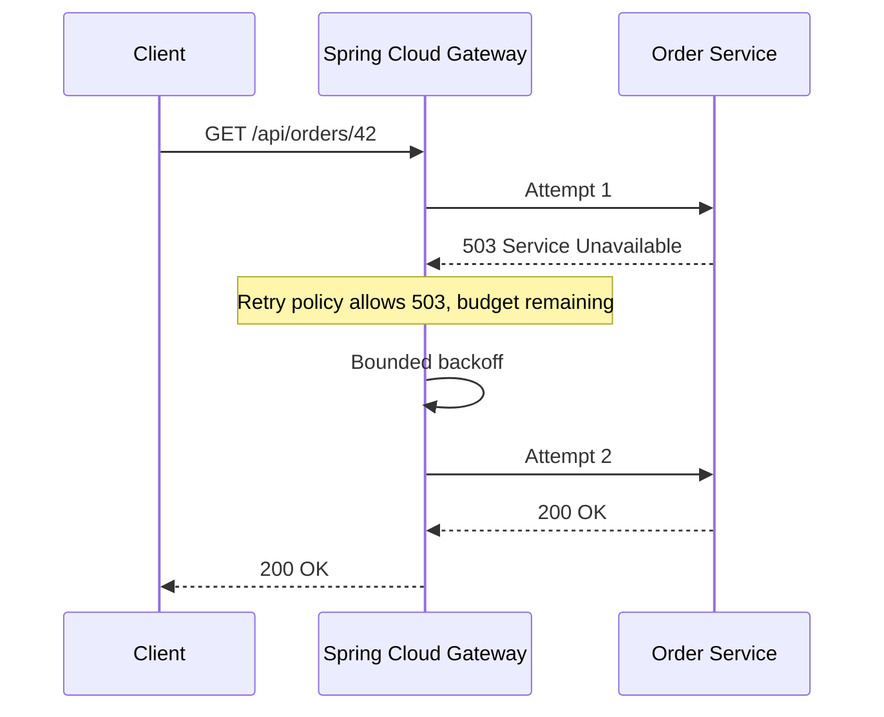
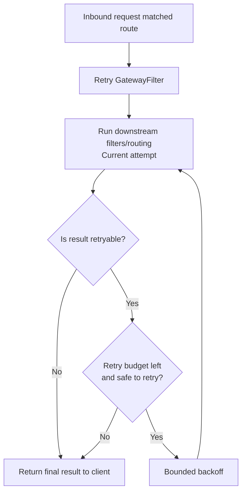

# Retry Filter and Retryable Error Types

## Learning Objectives

In the **Request Retries** chapter, this lesson guides you through using the **`Retry` GatewayFilter Factory** of **Spring Cloud Gateway Server WebFlux** to recover from certain transient failures when the Gateway calls a microservice. You will learn **which errors can be retried, which errors should not be retried, the conditions for safe retries**, and how to prevent a simple recovery mechanism from turning into a source of overload or duplicate transactions.

After this lesson, you will be able to:

- Distinguish between **HTTP response status** and **connection/reactive publisher exceptions** when deciding to retry.
- Read and configure the `retries`, `statuses`, `series`, `methods`, `exceptions`, and `backoff` parameters of the `Retry` filter.
- Explain why **`retries: 2` means at most two retries after the initial attempt**, not two total calls.
- Analyze the **safe/idempotent** semantics of GET, HEAD, PUT, and DELETE, and the risks with POST/PATCH.
- Design a **retry budget**, exponential backoff, deadline, and timeout, and coordinate with `CircuitBreaker`.
- Understand retry limitations when the **response is already committed**, when a **request body** is present, when using `forward:`, and with streaming.
- Observe **how many outbound attempts a single inbound request generates**, especially with multiple Gateway replicas, load balancing, and client retries.
- Perform controlled testing for cases where the backend returns 503 then 200, connection errors, 400/401 errors, timeouts, and write operations requiring idempotency.

> **Scope:** Spring Cloud Gateway **Server WebFlux** uses Reactor and Netty routing. Server MVC has different mechanisms/implementation classes. The YAML syntax uses the `spring.cloud.gateway.routes` namespace common in many Gateway Server WebFlux 4.x versions; newer versions may migrate to `spring.cloud.gateway.server.webflux.routes`. Always verify the dependency version you are running and confirm that the route/filter is actually loaded.

## 1. Why Does an API Gateway Need Retries?

Suppose the frontend calls:

```http
GET /api/orders/42 HTTP/1.1
Host: api.example.com
Authorization: Bearer <access-token>
```

The Gateway routes to `order-service`. At that moment, a backend instance restarts, a network connection briefly drops, or the service returns `503 Service Unavailable` due to overload. If **the same operation can be safely executed again**, retrying after a short wait can let the user get a result without having to manually press reload.



From the client's perspective, there is **one HTTP request sent to the Gateway**. From the backend's perspective, there are **two outbound HTTP attempts**. Retries occur within the filter/routing chain, so they can be affected by filters placed before or after them.

Retries help with **transient errors**. They usually do not solve:

- Wrong password, expired token, or insufficient permissions.
- Non-existent URL or malformed JSON request.
- Logic bugs in backend code that persist across every attempt.
- Prolonged database overload where retrying only adds more load.
- A POST transaction that was already executed, while the Gateway did not receive the response; resending it can create a **second transaction**.

**Principle:** retry only when there is **reason to believe the next attempt can succeed** and **the consequences of repeating the operation are controlled**.

## 2. How Retry, Timeout, Circuit Breaker, and Rate Limiter Differ

| Mechanism | Primary Question | Example |
| --- | --- | --- |
| **Retry** | Should a failed call be **tried again**? | After 503, wait 100 ms and call again |
| **Timeout** | How long is a call allowed to **wait**? | Stop waiting for a response after 2 seconds |
| **Circuit breaker** | Should we **keep calling an unhealthy upstream**? | When error rate is high, OPEN and fail fast |
| **Rate limiter** | At what **rate** can a client/tenant send requests? | 20 RPS average, with burst |
| **Concurrency limit / bulkhead** | How many tasks can be processed **concurrently**? | Maximum 30 in-flight |
| **Idempotency** | Does calling the same operation again cause unintended side effects? | Same key creates at most one order |

A Gateway can use **all of the above mechanisms**. They do not replace each other:

```text
Client
  ↓
Gateway: authentication, authorization, and rate limits
  ↓
Retry policy (attempt count + backoff)
  ↓
Circuit breaker / timeout per architecture
  ↓
Load balancing + HTTP routing
  ↓
Backend
```

This is a **logical model**, not the default filter order for every application. The actual order depends on `Ordered`, route filters, `GlobalFilter`, and the publisher scope wrapped by each filter. Placing Retry outside or inside CircuitBreaker can change **whether the circuit counts each attempt or the outcome after multiple attempts**.

## 3. Where Does the `Retry` GatewayFilter Factory Operate?

In **Spring Cloud Gateway Server WebFlux**, a route has:

- **Predicates:** determine whether a request matches that route (`Path`, `Method`, `Host`...).
- **Filters:** process the request/response, including `Retry`, `RewritePath`, `StripPrefix`, `RequestRateLimiter`, `CircuitBreaker`.
- **URI:** the routing destination, for example `http://localhost:9001` or `lb://order-service`.

The `Retry` filter is attached to **a route** or configured as a default filter when intentional. When a run of the **downstream part** finishes with a result matching the retry condition, the filter can create a new subscription/attempt according to the policy.



A request blocked by **Spring Security WebFilterChain** before route matching may **never reach** the route's `Retry` filter. Similarly, an HTTP response whose headers are already committed or whose body stream has already been partially sent cannot arbitrarily be "recalled" to emit a new response. Therefore, retry is not a blanket wrapper for every error occurring anywhere in the system.

### 3.1. `retries` Counts Retry Attempts, Not Total Attempts

Suppose:

```yaml
retries: 2
```

Then the maximum number of attempts when every retry is permitted is:

```text
Attempt 1: initial call
Attempt 2: retry 1
Attempt 3: retry 2

Maximum total: 1 + 2 = 3 attempts
```

Not every request executes three attempts. If the first attempt succeeds, there is only **one** call. If the error is non-retryable, or another constraint prevents repeating, the chain can terminate early.

### 3.2. What Does Retry Inspect?

`Retry` typically evaluates:

1. **HTTP status or status series** of the downstream response.
2. **Exceptions** emitted in the reactive chain.
3. Whether the **HTTP method** is in the allowed set.
4. **Remaining retries** and the backoff policy.

A 503 status and a `ConnectException` are **not the same kind of signal**:

```text
HTTP 503:
  An HTTP response was received from upstream/proxy,
  with a status code indicating the service is unavailable.

ConnectException:
  A connection to the target could not be established,
  so there may not be an HTTP response at all.
```

This matters when writing a policy: if you only configure statuses while the real error is a connection exception, or vice versa, the request may not be retried as expected.

## 4. Basic Retry Configuration for a GET API

Example `orders-read` route dedicated to read requests:

```yaml
spring:
  cloud:
    gateway:
      routes:
        - id: orders-read
          uri: lb://order-service
          predicates:
            - Path=/api/orders/**
            - Method=GET
          filters:
            - StripPrefix=1
            - name: Retry
              args:
                retries: 2
                series:
                  - SERVER_ERROR
                methods:
                  - GET
                backoff:
                  firstBackoff: 100ms
                  maxBackoff: 1s
                  factor: 2
                  basedOnPreviousValue: false
```

Expected flow:

1. Client calls `GET /api/orders/42`, and route `orders-read` is selected.
2. `StripPrefix=1` adjusts the path to `/orders/42` to match the example backend.
3. `Retry` allows up to **two retries** when the result belongs to the **5xx status series** inspected by the filter and the method is in the allowed set.
4. `lb://order-service` is resolved via LoadBalancer when appropriate dependencies/instances are configured.
5. For retry attempts, the filter waits for the backoff duration before trying again.
6. The client receives the final response: either 200 if recovered, or the final response/error according to how the Gateway handles it.

**Environment prerequisites:** Spring Cloud Gateway Server WebFlux dependency; an instance list source for `order-service` if using `lb://`; a backend that can return 503 for testing. If you only want to study retry in isolation, you can replace `uri` with `http://localhost:9001` and spin up a stub backend.

### 4.1. What Does `series: SERVER_ERROR` Mean?

`SERVER_ERROR` is the **5xx** group. With this configuration, `Retry` can retry errors in the server errors group that it recognizes and that have not exceeded the budget. This is **broader** than only retrying 502/503/504.

An HTTP 500 can arise from a **code bug or data error that cannot self-recover**. Retrying all 5xx errors without observing real behavior can multiply load on the backend. In production, you should select specific statuses and exceptions with justification, or carefully examine the semantics of the 5xx group.

### 4.2. Fields to Remember in the `Retry` Filter

| Field | Purpose | Example |
| --- | --- | --- |
| `retries` | Number of **retries after the initial call** | `2` |
| `statuses` | Specific retryable HTTP statuses | `BAD_GATEWAY`, `SERVICE_UNAVAILABLE` |
| `series` | Retryable HTTP status groups | `SERVER_ERROR` |
| `methods` | HTTP methods allowed to retry | `GET`, `HEAD` |
| `exceptions` | List of retryable exception classes | `java.io.IOException` |
| `backoff.firstBackoff` | Initial wait duration | `100ms` |
| `backoff.maxBackoff` | Upper bound for wait duration | `1s` |
| `backoff.factor` | Backoff growth multiplier | `2` |
| `backoff.basedOnPreviousValue` | Whether to compute from the previous backoff | `false` |

In common versions, `Retry` has defaults for retry count, status series, methods, and exceptions. **Do not rely on defaults when designing a policy with specific requirements.** In particular, when you want to retry **only** certain `statuses`, check whether `series` still defaults to 5xx and configure an empty list or override appropriate for your version.

### 4.3. Retrying Only Specific Transient Statuses

Example policy targeting `502`, `503`, and `504`:

```yaml
filters:
  - name: Retry
    args:
      retries: 2
      statuses:
        - BAD_GATEWAY
        - SERVICE_UNAVAILABLE
        - GATEWAY_TIMEOUT
      series: []
      methods:
        - GET
      backoff:
        firstBackoff: 200ms
        maxBackoff: 1s
        factor: 2
        basedOnPreviousValue: false
```

`series: []` expresses the **intent not to include the entire 5xx group**. Empty list binding and how `series`/`statuses` combine must be verified against the factory version you are running. If the system still retries 500, check the effective configuration, `default-filters`, other routes, and any HTTP clients that perform internal retries.

**Do not include 429 in the same list by default.** Rate limiting has its own semantics, often requiring reading `Retry-After`, respecting tenant thresholds, and avoiding extra traffic when the system asks to slow down.

## 5. Which HTTP Statuses Are Retryable?

There is no universally safe retry list for every API. You must evaluate **error semantics**, **recoverability**, **HTTP method**, and **consequences of re-execution**.

| Status | Common Meaning | Recommendation |
| --- | --- | --- |
| `200` / `201` / `204` | Success | Do not retry |
| `400 Bad Request` | Invalid request | **Do not retry** the same request |
| `401 Unauthorized` | Missing or invalid authentication | Do not retry with the same token; refresh credentials separately if appropriate |
| `403 Forbidden` | Insufficient permissions | Do not retry; fix permissions/policy |
| `404 Not Found` | Resource does not exist | Usually do not retry; only consider if the API has clear eventual consistency |
| `408 Request Timeout` | Server did not receive the complete request in time | Can consider; **must evaluate method and whether the server already executed anything** |
| `409 Conflict` | State conflict | Usually requires changing conditions/version, not blind repetition |
| `412 Precondition Failed` | `If-Match` precondition not met | Do not retry verbatim; client needs to read/reconcile version |
| `422 Unprocessable Content` | Business validation failure | Do not retry |
| `425 Too Early` | Server refuses request with early replay risk | Retry only per appropriate HTTP/TLS semantics; do not bypass replay safety |
| `429 Too Many Requests` | Rate limited | May retry after `Retry-After` **under a bounded policy**; do not retry immediately in a loop |
| `500 Internal Server Error` | Generic server error | Could be transient or a persistent bug; do not blindly retry all 500s |
| `502 Bad Gateway` | Upstream gateway/proxy received an invalid response | **Common candidate** for bounded retry |
| `503 Service Unavailable` | Upstream temporarily unavailable/overloaded | **Common candidate**, though retries can amplify load |
| `504 Gateway Timeout` | Gateway/proxy did not receive upstream response in time | Can retry if operation is safe; **no guarantee the backend did not execute it** |

Key point: **a status code cannot by itself prove that retrying has no side effects**. A POST returning 503 may have already written data to the database and only failed while sending the response. If the Gateway retries POST without an idempotency protocol, the client may get two orders or two charges.

### 5.1. `503` Does Not Mean "Retry Immediately"

When a service is overloaded:

```http
HTTP/1.1 503 Service Unavailable
Retry-After: 5
```

Operationally, the server is asking callers to wait before retrying. However, configuring `Retry` with a fixed exponential backoff **does not automatically guarantee reading and honoring `Retry-After`** across all responses and versions. If product policy requires honoring that header, you must **explicitly design a retry control mechanism** or let the upstream client handle it appropriately.

Do not treat `Retry-After: 5` as a command to retry even when the request has already passed its deadline, was cancelled by the client, or cannot be replayed safely.

### 5.2. Why 404 Sometimes Needs a Mechanism Other Than Retry

A system that just wrote data and then reads from a replica with replication lag might temporarily return 404. However, enabling the Retry filter for **all 404s** increases traffic for resources that genuinely do not exist.

Instead, you should:

- Define the API's read-after-write contract.
- Fix routing, consistency, or caching if this is a common issue.
- Use bounded retries only on a clearly defined business flow, not across wildcard routes.
- Never turn a 404 caused by **missing permissions** or a non-existent resource into a fake 200.

## 6. Which Exceptions Are Retryable?

Beyond HTTP statuses, errors at the connection/reactive flow layer can occur **before any valid HTTP response exists**.

| Signal Type | Example | Assessment |
| --- | --- | --- |
| Connection cannot be established | `ConnectException`, some `IOException`s | Often a candidate for a short retry if other backends/recovery conditions exist |
| Connection reset/closed abnormally | `IOException`, connection reset | Safe to retry read requests; for writes, the backend may have partially processed it |
| Connection/response timeout | `TimeoutException` or HTTP client-specific exception | Can be retried with limits; **does not prove the operation was not executed** |
| Temporary DNS/service discovery failure | Specific resolver/load balancer error | Consider recovery time; do not retry infinitely when no instances exist |
| TLS handshake/trust failure | Expired certificate, untrusted CA, hostname mismatch | **Do not retry to fix cert configuration**; fix trust chain/TLS |
| JSON validation / business exception | Invalid payload | Do not retry verbatim |
| Authorization failure | `401`/`403` or security exception | Do not retry as an infrastructure error |
| Client cancellation | Request was cancelled | Do not start new work beyond the lifecycle |
| Circuit OPEN | `CallNotPermittedException` | Usually **should not repeatedly retry** against an OPEN circuit |

Actual errors also depend on Netty, Reactor, proxies, clients, and how libraries wrap exceptions. A deeply nested wrapped exception may **not match directly** against a simple `exceptions` list; test the actual exception type received rather than guessing from log names.

### 6.1. Configuring Exceptions

Illustrative example:

```yaml
filters:
  - name: Retry
    args:
      retries: 2
      series:
        - SERVER_ERROR
      methods:
        - GET
      exceptions:
        - java.io.IOException
        - java.util.concurrent.TimeoutException
```

`java.io.IOException` covers many I/O errors; `java.util.concurrent.TimeoutException` is a common timeout type in reactive flows, yet **not every timeout error uses that exact class**.

Depending on the path, errors from Resilience4j TimeLimiter, Netty connect timeout, read timeout, or a proxy may be emitted under distinct types. You should:

1. Create a backend stub capable of reproducing the exact error type to test.
2. Inspect the exception **class** with sensitive details redacted.
3. Configure retryable exceptions according to the contract.
4. Run tests verifying that the request is retried the **exact number of times** and stops on schedule.
5. Never add broad `Exception`/`Throwable` unconditionally.

### 6.2. Failure Before Sending vs. Failure After Processing

For a pure read GET, retrying after a connection reset is usually fairly safe. For a payment POST:

```text
Gateway sends POST /payments/charge
  ↓
Backend records payment successfully
  ↓
Connection drops before response returns to Gateway
  ↓
Gateway only sees timeout/connection reset
```

The Gateway **cannot know for sure** whether the backend already persisted the charge. Retrying an identical POST can cause a double charge. Therefore, you need an idempotency key/backend deduplication or a business status check mechanism, not just `exceptions: IOException`.

## 7. HTTP Methods: Safe, Idempotent, and Replayable

Do not decide retries solely from status/exception; consider the **HTTP method** and **API contract**.

| Method | Safe per HTTP Semantics? | Idempotent per HTTP Semantics? | Retry Notes |
| --- | --- | --- | --- |
| **GET** | Yes | Yes | Good candidate when backend is genuinely read-only |
| **HEAD** | Yes | Yes | Retryable when it produces no side effects |
| **OPTIONS** | Yes | Yes | CORS preflight needs separate handling and usually shouldn't trigger multiple backend attempts |
| **PUT** | No | Yes | Retryable if the operation is truly idempotent and the body replays safely |
| **DELETE** | No | Yes | Idempotent in intended effect, though status codes across calls may differ |
| **POST** | No | Not by default | Retry only when idempotency is guaranteed by contract |
| **PATCH** | No | Not by default | Retry only if the patch operation/condition prevents duplicate application |

**Idempotent does not mean free of side effects.** PUT can write data, DELETE can remove resources; the requirement is that repeating the same operation does not amplify the **intended effect** beyond one execution. A real implementation with side effects like sending emails or debiting funds still requires dedicated verification, even when using an HTTP method nominally defined as idempotent.

### 7.1. Example That Should Be Retried

```http
GET /api/catalog/items/42
```

Assuming this is a read-only API, and the backend returns 502 then 200 due to a network flap, retrying 1–2 times with backoff is reasonable if the latency budget allows.

### 7.2. Example That Should Not Be Retried by Default

```http
POST /api/payments/charge
Content-Type: application/json

{"orderId":"42","amount":500000}
```

On a timeout, the Gateway cannot be certain whether the payment was captured. Do not add `POST` to `methods` just to "lower error rates" without safeguards against duplicate transactions.

### 7.3. Example of a POST with an Idempotency Contract

```http
POST /api/orders
Idempotency-Key: <stable-operation-key>
Authorization: Bearer <access-token>
Content-Type: application/json

{"itemId":"BOOK-42","quantity":1}
```

A system can allow retrying POST **if the backend genuinely enforces** the contract:

- The key is unique within the **principal/tenant + operation** scope and has an appropriate retention TTL.
- Key lookup/creation is **atomic** before performing the write, preventing two concurrent attempts from creating two orders.
- Reusing the same key with a different payload must be rejected or handled per an explicit contract.
- Once the operation completes, repeated attempts return the **stored result** without executing the side effect a second time.
- Must account for in-flight first requests, timeouts, crashes, and concurrent arrivals from another client/Gateway.
- Requires authentication/authorization and protection against leaking keys in logs/metrics.

**Simply sending an `Idempotency-Key` header does not automatically make a backend idempotent.** If the backend ignores the header, the risk of duplicate data remains.

## 8. Exponential Backoff and Retry Budget

If you retry immediately while the backend is overloaded, retries can worsen the outage. **Backoff** inserts wait time between attempts.

Example:

```yaml
backoff:
  firstBackoff: 100ms
  maxBackoff: 1s
  factor: 2
  basedOnPreviousValue: false
```

Wait growth concept:

```text
Before retry 1: ~100ms
Before retry 2: ~200ms
Before retry 3: ~400ms
...
Capped at maxBackoff according to the active version's calculation.
```

For example, with `retries: 2`, there are at most **two backoff intervals** in the retry logic; there is no third wait after retries are exhausted.

### 8.1. Estimating the Time Budget

If:

```text
Retries = 2
Max timeout per attempt = 1.5 seconds
Backoff before retry 1 = 0.1 seconds
Backoff before retry 2 = 0.2 seconds
```

In a sequential model, the worst-case time budget can be roughly:

\[
3 \times 1.5\ \mathrm{s}
+ 0.1\ \mathrm{s}
+ 0.2\ \mathrm{s}
= 4.8\ \mathrm{s}
\]

This excludes time for route matching, load balancing, body serialization, scheduling, or upstream proxies. If a mobile client only waits **3 seconds**, a policy that can take **4.8 seconds** is already unsuitable.

**Do not set timeouts and retries independently.** You must determine:

- **Client deadline:** how long will the user/client wait?
- **Gateway overall budget:** total time allowed for a single inbound request.
- **Per-attempt timeout:** maximum time for a single upstream call.
- **Retry count/backoff:** number of additional tries and wait durations.
- **Circuit breaker TimeLimiter:** does it wrap all attempts combined or each attempt individually?

When the overall deadline is nearly exhausted, additional retries may no longer be useful even if retry tokens remain. Not every `Retry` GatewayFilter automatically enforces an overall deadline; that needs to be **a separate, verified policy component**.

### 8.2. Jitter Reduces Thundering Herd

Imagine 10,000 clients sending requests simultaneously, all receiving 503, and all waiting exactly 1 second before retrying. As soon as the clock hits 1 second, the backend gets hit by another massive wave.

**Jitter** randomly spreads wait times across clients/requests:

```text
Without jitter: 100ms, 200ms, 400ms
With jitter:    ~83ms, ~246ms, ~367ms  (example)
```

Basic Gateway `backoff` parameters should not be **assumed to include full jitter by default** across all versions. If your system requires jitter by policy, verify the actual implementation or use a retry component with explicitly configured and tested jitter.

### 8.3. Load-Based Retry Budget

`retries: 2` bounds retries **per request**, but does not directly cap the **total number of retries across millions of requests**. During a widespread backend outage:

```text
1,000 requests/s into Gateway
× up to 3 attempts/request
= up to ~3,000 outbound attempts/s
```

This is a **theoretical ceiling when every request exhausts all three attempts**, not a claim that the system always hits 3,000 RPS. It illustrates **retry amplification**.

A sound operational policy can add:

- Caps on total retry attempts per service, route, or time window.
- Circuit breakers/bulkheads to shed calls during sustained service failures.
- Backoff with jitter and an overall deadline.
- No retries on non-recoverable status codes.
- Cached/stale data or graceful degradation notices instead of endless retries.

## 9. Retrying Requests with a Body: Replay and Memory Issues

In WebFlux, the request body is typically a **`Flux<DataBuffer>`** and cannot necessarily be re-read arbitrarily. When retrying a request with a payload, the Gateway must **replay the content** for subsequent attempts.

If you attempt to retry:

```http
POST /api/files/upload
Content-Type: multipart/form-data

<large multipart body>
```

you cannot simply assume the request body will replay safely with zero memory cost.

Some `Retry` filter execution paths may **cache the request body** in an exchange attribute when retrying HTTP methods with bodies, potentially using an attribute such as:

```java
ServerWebExchangeUtils.CACHED_REQUEST_BODY_ATTR
```

Consequences:

- Large bodies can consume substantial memory as concurrency grows.
- `DataBuffer` has lifecycle and reference counting; mishandling can cause leaks or read errors.
- Multipart uploads/streaming may be unsuitable for buffering and replay.
- `Content-Type`, `Content-Length`, and `Content-Encoding` must stay consistent with the re-sent bytes.
- `ModifyRequestBody`, custom decorators, and filter ordering can determine **whether the body is encoded once or multiple times**, as well as what gets replayed.

**Do not enable POST/PUT/PATCH retries broadly just because `methods` allows them.** First resolve **idempotency**, **body replay**, **resource limits**, **timeouts**, and **application semantics**.

### 9.1. What About Retrying GET with a Request Body?

Although some HTTP stacks accept a payload on GET, GET body semantics are not defined as a universal contract. Do not rely on a GET body to carry side effects or assume every proxy/router/cache can replay that payload properly.

For read APIs, prefer placing search criteria in the URI/query within safe limits, or design a POST search API with an explicit contract if data is too large or sensitive for URLs. When using POST search, allow retries only if the operation is genuinely read-only/idempotent and body replay is verified.

### 9.2. Request Reached Backend, Response Lost

A difficult scenario:

```text
Attempt 1
  Gateway → sends full POST body
  Backend → commits transaction
  Backend → writes 201 response
  Connection → resets before Gateway receives response

Retry
  Gateway → resends POST body
```

The HTTP layer lacks enough information to know whether the backend committed. Retrying in this scenario is only safe with an **end-to-end idempotency protocol**, or an operation designed to be genuinely idempotent.

## 10. Uncommitted Responses and Streaming Cases

When the Gateway wants to retry based on HTTP status, it must make that decision **before an irrevocable response has been sent to the client**. A response whose headers are committed or whose body has already been partially flushed cannot arbitrarily be replaced by another attempt's response.

| Scenario | Is Retry Appropriate? | Explanation |
| --- | --- | --- |
| Backend returns 503 before Gateway sends response | Possibly | Filter still has a chance to inspect status and rerun downstream |
| Connection error before response arrives | Possibly | Requires exception policy and method safety |
| Backend sends half a file then disconnects | Usually **do not** retry full response | Client already received bytes; appending a new response can corrupt the file |
| Long-lived SSE `text/event-stream` | Do not blindly enable generic HTTP response retry | Stream/offset/event ID requires a dedicated reconnect policy |
| WebSocket after `101 Switching Protocols` | Do not treat as a normal HTTP GET response for retry | Already upgraded to a bidirectional frame protocol |
| HTTP/2 stream reset mid-payload | Requires specific streaming/client-layer policy | Full request retry can duplicate data/side effects |

If a service emits a long-running stream, Gateway retries can hold buffers, connections, and memory longer than expected. For SSE, recovery typically involves `Last-Event-ID`, checkpoints, and client-initiated reconnects; for file downloads, it may involve **Range/ETag** rather than restarting a whole new body inside the same response.

**HTTP Gateway retries do not automatically provide exactly-once delivery or stream resume.**

## 11. Caution When Combining Retry with `forward:`

Besides routing to HTTP backends, the Gateway can use `forward:` routes to internal handlers. With `Retry` and `forward:`, a critical detail is that **the handler should not commit an error response before the retry mechanism has a chance to act**.

Illustrative flow:

```text
GET /api/test
  ↓
Gateway route + Retry
  ↓
forward:/internal/test
  ↓
WebFlux handler
```

A handler returning `ResponseEntity.status(500)` can trigger **response commit** depending on how it is processed. Once the response is committed, the Gateway cannot send a completely different response even if filter code wants to retry.

If retries are needed when the handler fails, the handler should **emit an exception signal in the publisher** prior to commit according to an appropriate contract, for example:

```java
@GetMapping("/internal/test")
Mono<String> internalTest() {
    return Mono.error(new IllegalStateException("temporary failure"));
}
```

**This is only an example for testing exception emission**, not advice to throw fake errors in production. Retrying with `forward:` easily behaves differently from HTTP routing because WebFlux handlers, error handling, and response commit semantics are involved.

A `forward:` call does not mean a backend received an HTTP request; observe carefully what is actually being retried. If the forward handler has side effects, the same idempotency risks apply as with HTTP service calls.

## 12. Ordering Retry with CircuitBreaker, Load Balancing, and Other Filters

### 12.1. Retry Outside CircuitBreaker

Model:

```text
Retry
  └─ CircuitBreaker
       └─ LoadBalancer
            └─ HTTP routing
```

When `CircuitBreaker → Routing` fails according to policy, an outer retry can **re-run** the downstream segment. The circuit can record the outcome of each executed attempt.

Risk: if the circuit is already OPEN and Retry keeps repeating calls rejected with `CallNotPermittedException`, the system wastes attempts with no chance of reaching the real backend. Do not configure `CallNotPermittedException` to be retried repeatedly.

### 12.2. CircuitBreaker Outside Retry

Model:

```text
CircuitBreaker
  └─ Retry
       └─ LoadBalancer
            └─ HTTP routing
```

An outer circuit breaker can observe the **final outcome** of a group of attempts rather than every intermediate failure. If the third attempt succeeds, the circuit may see one successful operation even though the upstream failed twice.

This is a conceptual view of **publisher scope**. In a real Gateway, exactly which filter wraps which also depends on `GlobalFilter`/`GatewayFilter` ordering, `Ordered`, and version. Do not rely purely on YAML line order to assert how the circuit counts calls; test `retry attempts`, `circuit recorded calls`, and the final response.

### 12.3. Does Retry Pick a Different Backend Instance?

With:

```yaml
uri: lb://order-service
```

The load balancer can select across multiple instances. However, **you must not assume Retry guarantees the next attempt hits a different instance**.

Depending on the architecture:

- The load balancer may resolve an instance per attempt or retain a URI resolved in an earlier stage.
- Instance selection policies, service discovery caching, and unhealthy node eviction can vary.
- Retrying the same instance does not help if that instance is persistently failing.

Proper failover requires LoadBalancer **instance selection policies**, health checks, service registry integration, and integration tests recording the instance ID receiving each attempt. The `Retry` filter alone is not a complete client-side failover algorithm.

### 12.4. Rate Limiting and Quota: Inbound Requests vs. Outbound Attempts?

```text
Client: 1 inbound request
  ↓
RequestRateLimiter: counted once per user
  ↓
Retry: up to 3 attempts
  ↓
Order Service: 1–3 outbound calls
```

If `RequestRateLimiter` sits **outside** the retry scope and runs once, customer budget can be counted per inbound request. If a limiter or quota sits **inside the resubscribed scope**, each attempt may be counted again.

For financial quotas:

- Define a **logical operation ID**.
- Use atomic reserve/settle or an idempotent ledger.
- Never deduct quota **three times** just because the Gateway had to call the backend three times.
- Separately, an outbound attempt budget may need per-attempt accounting to protect the backend.

Do not assume `Retry` replays the entire inbound HTTP request: which exact filters re-execute depends on the reactive chain scope.

### 12.5. Rewrite, Authentication, CORS, and TLS

- `RewritePath`/`StripPrefix` alters the request path; verify the URI sent to the backend on **each attempt** to avoid erroneous repeated rewrites.
- Spring Security WebFlux normally authenticates before Gateway route filters; outbound retries do not re-authenticate a user with a fresh JWT.
- CORS preflight OPTIONS is a separate request; it should not be repeated like a business GET just because a route has `Retry`.
- TLS handshake or CA/hostname errors in the outbound HTTP client cannot be "fixed" by infinite retries; fix the certificate/trust/endpoint.
- `Authorization`/cookie/token headers must not be logged raw on each attempt. Idempotency keys should also be protected.

## 13. Retry Is Not a Solution for Every HTTP Error

### 13.1. 4xx Client Errors

Example:

```http
HTTP/1.1 401 Unauthorized
WWW-Authenticate: Bearer ...
```

If the token is invalid, retrying with **the same token** only generates extra traffic. The client may need a separate token-refresh flow, which is not the job of a backend-recovery `Retry` filter.

A `403` due to a missing scope will not change on retry. Neither will a `400` from malformed JSON. For `404`, know whether the API has eventual consistency; do not treat every 404 as transient.

### 13.2. `429` Under Rate Limiting

When the backend or Gateway returns 429, the signal means **slow down**. If the Retry filter immediately keeps calling, the client may be counted and rejected repeatedly, or add load to the system requesting throttling.

Determine:

- Who emitted 429: ingress, Gateway's `RequestRateLimiter`, or the backend?
- Does the response include `Retry-After`, and is there enough overall deadline left?
- Does the Retry filter wrap the component emitting 429?
- Should 429 be passed straight back so the client backs off instead of retrying inside the Gateway?

In many systems, **returning 429 to the client** is the better choice over retrying inside the Gateway.

### 13.3. `500` from Deterministic Logic Bugs

If every request to `/api/reports/42` triggers a `NullPointerException` in the backend, retrying three times will not fix the bug. It also increases load, inflates logs, holds more connections, and can trip the circuit breaker faster.

Do not put `series: SERVER_ERROR` on every route out of habit; measure which status codes are genuinely transient.

## 14. Testing the Retry Filter

A good test must observe the **actual number of outbound attempts**, not just the final status received by the client.

### 14.1. Scripted Backend Stub

Design a stub for the endpoint:

```text
GET /orders/42

Call 1 -> 503
Call 2 -> 200 {"id":42}

Total stub calls = 2
```

With `retries: 2`, `statuses: [SERVICE_UNAVAILABLE]`, `methods: [GET]`, expected results:

- Client sends **one** request to the Gateway.
- Backend stub receives **two** calls if the route/policy is active.
- Client receives **200** with the body from the successful attempt.
- Total duration may include one backoff interval.

Test next:

```text
Call 1 -> 503
Call 2 -> 503
Call 3 -> 503
```

Expect **at most three attempts**; the final response may be 503 or handled via another error/fallback policy. Do not assume the status is always 503 if the Gateway also has a `CircuitBreaker`, global exception handler, or custom filters.

### 14.2. Testing with curl

Suppose the Gateway is running on `localhost:8080` and the stub can be configured with sequences:

```bash
curl -i "http://localhost:8080/api/orders/42"
```

`curl` only observes the response outside the Gateway. **You cannot prove the filter retried** from a single 200 response alone, because the backend could have succeeded on the first call. Check the backend stub's call counter/recorded requests or trace outbound attempts.

If the route requires a JWT, provide a **valid** token in the test environment; a 401 rejected before route matching proves nothing about the Retry GatewayFilter.

### 14.3. Assertions with WebTestClient

Example test scaffold, assuming the backend stub is configured for 503 then 200 and the Gateway is running:

```java
import org.junit.jupiter.api.Test;
import org.springframework.beans.factory.annotation.Autowired;
import org.springframework.test.web.reactive.server.WebTestClient;

class RetryGatewayIntegrationTest {

    @Autowired
    WebTestClient webTestClient;

    @Test
    void retriesTransient503ThenReturns200() {
        // Test setup: backend stub returns 503 for the first call,
        // then returns 200 with JSON { "id": 42 }.
        webTestClient.get()
            .uri("/api/orders/42")
            .exchange()
            .expectStatus().isOk()
            .expectBody()
            .jsonPath("$.id")
            .isEqualTo(42);

        // In addition to HTTP assertions, verify stub receivedCalls == 2.
    }
}
```

This is **not a standalone runnable test class**. You need a Spring Boot test context, version-appropriate route/config, a backend stub with a call counter, and matching test authentication. If using `lb://`, provide a service instance source for tests or switch to a static HTTP URI.

Avoid millisecond-exact timing assertions when backoff/schedulers and CI environments introduce jitter/variance; use reasonable timeouts and assert the **attempt count**, status, body, method, path, and headers actually received.

### 14.4. Minimum Test Matrix

| Scenario | Attempt 1 | Expected |
| --- | --- | --- |
| GET succeeds | 200 | One attempt, no retry |
| GET 503 then 200 | 503, 200 | Two attempts; client gets 200 |
| GET always 503 | Continuous 503 | Stops when retry budget is exhausted |
| GET 400 | 400 | No retry if policy selects only server errors |
| GET 401/403 | 401/403 | No retry; security/authorization remains enforced |
| GET 404 | 404 | No retry if 404 is not selected |
| GET 500 when only 502/503/504 selected | 500 | No retry if `series` is properly disabled |
| GET 502 | 502 then 200 | Retries when status is selected |
| GET 504 | 504 then 200 | Retries when status is selected and deadline remains |
| GET connection reset | Exception then 200 | Retries when exception class matches policy |
| GET TLS hostname mismatch | TLS error | No retry per safe policy |
| GET slow response | Timeout | Retries up to deadline and matching exception type |
| POST without idempotency | Timeout after backend write | No retry by default |
| POST with key and backend dedupe | Timeout then retry | Business operation occurs only once |
| Streaming response partially sent | Mid-stream error | Does not automatically replay whole response in same HTTP stream |
| `forward:` handler error | Exception before commit | Retries only if factory/handler coordinate properly |
| Retry + CircuitBreaker | Consecutive backend 503 | Does not wastefully retry when circuit is OPEN |
| Retry + rate/quota | One inbound request, multiple attempts | Does not double-charge logical request |
| Two Gateway replicas | Same route/config | Per-request budget; observe attempts per replica |

### 14.5. Testing Request Body Replay

If a team decides to retry a PUT or POST proven to be idempotent:

1. Send a JSON body with Unicode or a sufficiently large payload within **safe test limits**.
2. Have the backend receive attempt 1 and intentionally reset the connection in a controlled test.
3. Verify attempt 2 receives the **same bytes/semantics** per contract.
4. Measure memory/buffering, `Content-Length`, `Content-Encoding`, and `DataBuffer` resources.
5. Verify the backend creates no duplicate side effects.
6. Test cancellation and timeouts: no buffers/permits remain leaked after the request ends.

For file uploads/multipart/streaming, consider **not using Retry filter body replay** and instead using a dedicated upload protocol with checkpoints/resume support.

## 15. Observability: Distinguishing Requests from Attempts

From the frontend perspective:

```text
HTTP requests to Gateway = 1
```

From the backend perspective:

```text
Attempt 1: 503
Attempt 2: 503
Attempt 3: 200
```

If you only measure final statuses at the Gateway, dashboards may show **100% 200 responses** and hide that the backend failed twice. Conversely, backend metrics may record three requests and accidentally inflate apparent traffic to 3x client traffic.

### 15.1. Key Metrics

| Signal | Question to Answer |
| --- | --- |
| Inbound requests per route | How many requests did clients send? |
| Outbound attempts per backend/route | How many calls did each request generate? |
| Retry attempts / retry outcomes | Did retries recover or exhaust budget? |
| Attempt status/exception category | Which transient errors dominate? |
| End-to-end latency p50/p95/p99 | How much do retries/backoff slow users down? |
| Backend latency per instance | Is one node failing or the whole service? |
| Circuit state/not-permitted | Are retries hitting an OPEN circuit? |
| Rate limiter/quota denied count | Are requests blocked before Retry? |
| Timeout/cancellation | Are clients disconnecting before Retry finishes? |
| Request body buffering/memory | Do non-GET retries cause memory pressure? |

**Never** use user IDs, JWTs, cookies, full URIs/queries, or exception messages containing secrets as metric labels. Use route ID, outcome, status class, and normalized exception categories.

### 15.2. Traces and Logs

A helpful trace might look like:

```text
trace: inbound GET /api/orders/42
  ├─ outbound attempt=1: 503
  ├─ retry backoff
  └─ outbound attempt=2: 200
```

Depending on instrumentation, spans for outbound calls may vary. Do not assume `attempt=2` is an automatic built-in field in every Spring Cloud Gateway release; if needed, add controlled instrumentation or use corresponding HTTP client/observability hooks.

A safe log line:

```text
route=orders-read outcome=retry-recovered
attempts=2 finalStatus=200 traceId=<trace-id>
```

Avoid:

```text
Authorization: Bearer ...
Cookie: SESSION=...
exceptionMessage=<raw-error-containing-sensitive-data>
```

### 15.3. Evaluating Net Benefit

Do not measure only "how many requests were successfully retried." Compare:

- **Request failure rate before and after Retry**.
- Whether **p95/p99 latency** increases past the SLO.
- **Outbound traffic amplification** during upstream incidents.
- **Circuit OPEN, timeout, and cache/fallback rates**.
- **Impact of retries on backend DB/CPU/thread pools/connection pools**.

A policy that cuts 503 errors from 3% to 1% while pushing p99 latency from 1s to 15s and doubling backend traffic may **not be a net improvement** against product goals.

## 16. Common Misconfigurations and Fixes

### 16.1. Retry Configured, Yet No Retries Observed

**Possible causes:** route does not match, method is missing from `methods`, error is not in `statuses`/`series`/`exceptions`, defaults were misunderstood, or the response already committed.

**Fix:** inspect route ID, `Method`/`Path` predicates, effective filters, actual status/exception, and attempt count at a backend stub; do not rely solely on client status.

### 16.2. POST Creates Two Orders

**Cause:** Retry is enabled for POST while the backend lacks deduplication/idempotency; the first attempt persisted data and the response was lost.

**Fix:** disable unsafe POST retries, implement an atomic idempotency protocol in the backend, persist and replay results by key, and handle still-running first attempts.

### 16.3. All 500s Are Retried Even Though Only 503 Was Intended

**Possible causes:** `series: SERVER_ERROR` is still active, or another route/default filter also enables Retry.

**Fix:** check `series`, `statuses`, and the effective filter list; test with a stub returning 500 and 503 in turn to prove the policy. An explicit empty series list may be required depending on version.

### 16.4. Backend Degrades Further When Retry Is Enabled

**Cause:** high request volume generates many attempts, backoff is too short, multiple retry layers stack (client → Gateway → service HTTP client), or CircuitBreaker does not cap load appropriately.

**Fix:** lower retries, enforce a retry budget, timeouts, jitter, circuit breaker/bulkhead, and consider safe fallbacks. Establish a single **retry owner** per hop.

### 16.5. Retry Does Not Fix TLS Errors

**Cause:** untrusted CA, expired certificate, wrong SAN, SNI mismatch, or upstream using HTTP instead of HTTPS.

**Fix:** repair certificate/keystore/trust configuration, backend URI, and TLS policy; never disable certificate verification or retry infinitely.

### 16.6. Retries Hit the Same Failing Instance

**Cause:** load balancing selection does not switch instances, or the target URI is preserved across attempts.

**Fix:** inspect LB/discovery/health checks, configure appropriate failover, and log the instance ID per attempt. Never assume `lb://` automatically picks a new node on retry.

### 16.7. Partial Response Sent, Client Receives Corrupted Body

**Cause:** a custom retry/body filter ran after response commit, or the stream broke mid-transfer.

**Fix:** enforce retry policies before the commit point and never replay a partially sent response. Design a dedicated resumable protocol for streams/downloads if required.

### 16.8. Multiple Attempts Appear in Logs Even With Retry Disabled

**Cause:** an external client, ingress/service mesh, backend HTTP client, or LoadBalancer has its own retry policy; two hops are being conflated.

**Fix:** map **every layer capable of retrying**, identify the retry owner, and compare inbound vs. outbound counts at each hop.

## 17. Production Deployment Checklist

| Item | Verification Question |
| --- | --- |
| **Route** | Are predicates and backend URI accurate; is retry applied only to routes that need it? |
| **Method** | Restricted to GET/HEAD or operations proven idempotent/replayable? |
| **Status** | Only justified codes like 502/503/504 selected; never retrying 400/401/403? |
| **Exception** | Exact runtime exception classes verified rather than catching/retrying `Throwable`? |
| **Budget** | Are `retries`, backoff, and timeouts within client/SLO deadlines? |
| **Jitter** | Is there a risk of synchronized retry storms; has jitter behavior been verified? |
| **Retry-After** | If servers return 429/503 with this header, does the policy handle it explicitly or let clients retry? |
| **Idempotency** | Does the backend atomically deduplicate write operations, even on client resends? |
| **Body** | Does the request body need replay; are codec/memory/streaming controlled? |
| **Response** | No retries after the response has committed or a stream has partially flushed? |
| **Security** | Auth failures not retried; headers/tokens never logged; backend still authorizes? |
| **Load balancing** | Target instance measured per attempt; policy does not blindly assume node switching? |
| **CircuitBreaker** | Retries do not amplify load when breaker is OPEN; thresholds/budgets align? |
| **Rate/quota** | A single logical request is not accidentally charged multiple times by retries? |
| **Observability** | Are inbound requests, outbound attempts, retries, final status, and latency separated? |
| **Testing** | Tested 200, 503→200, persistent 503, 400/401, timeouts, POST duplicates, cancellation? |
| **Version** | YAML namespace, `Retry` factory, and defaults match the Spring Cloud Gateway release? |

## 18. Practice Exercises with Answers

### Scenario

An API Gateway has two routes:

```text
GET  /api/catalog/items/42  → Catalog Service (read-only)
POST /api/payments/charge    → Payment Service (write transaction)
```

On the GET route:

```yaml
filters:
  - name: Retry
    args:
      retries: 2
      statuses:
        - BAD_GATEWAY
        - SERVICE_UNAVAILABLE
      series: []
      methods:
        - GET
      backoff:
        firstBackoff: 100ms
        maxBackoff: 1s
        factor: 2
        basedOnPreviousValue: false
```

**Questions:**

1. If Catalog Service returns 503 on the first call and 200 on the second, what are the maximum possible and actual total attempts?
2. If the service returns 503 on all three calls, should the Gateway make a fourth attempt?
3. If the service returns 400, will it retry under this policy?
4. If the service returns 500, `series: []` is bound properly, and 500 is not in `statuses`, will it retry?
5. If a payment POST request times out after the backend already debited the account, is retrying immediately safe?
6. Does an `Idempotency-Key` header by itself guarantee the backend will not charge twice?
7. If the Gateway has two replicas, can a single inbound request still generate multiple outbound attempts?
8. If CircuitBreaker is OPEN, does repeatedly retrying `CallNotPermittedException` help the upstream recover faster?
9. In a model with a 1.5-second max timeout per attempt and two backoffs of 0.1s + 0.2s, roughly what is the sequential worst-case duration?
10. If the frontend receives 200 after Retry, why might backend metrics still show 503?
11. Should a stream that already sent half its content be automatically retried from the start in the same HTTP response?
12. If an API returns 429 with `Retry-After`, should you retry immediately while ignoring the header and deadline?

**Suggested Answers:**

1. `retries: 2` allows **at most three attempts**, while succeeding on the second means **two** actual attempts.
2. **No.** The retry budget is exhausted after the initial call plus two retries.
3. **No.** 400 is a client error, is not in the status policy, and invalid requests should not be retried.
4. **No**, provided the series list is genuinely empty and only 502/503 are selected.
5. **Not by default.** The Gateway does not know whether the backend executed the write; idempotency and reconciliation are needed.
6. **No.** The backend must atomically store/check the key, scope it properly, and replay the stored result.
7. **Yes** if retry is enabled; per-request state does not inherently change due to multiple replicas, while route load balancing may or may not pick another node.
8. **No.** OPEN rejects calls to protect the backend; immediate retries usually just waste resources.
9. Around **4.8 seconds**, excluding other overhead.
10. Because the Gateway called the backend twice: 503 on the first attempt and 200 on the next; the client sees the final outcome.
11. **No** under normal HTTP responses; a dedicated resumable/reconnect mechanism is required to avoid data corruption.
12. **No.** A backoff/`Retry-After` policy and deadline check are required; returning 429 to the client is often appropriate.

## Summary

The **`Retry` GatewayFilter Factory** in **Spring Cloud Gateway Server WebFlux** lets you retry downstream processing when responses match configured **`statuses`/`series`** or the reactive chain emits selected **`exceptions`**, bounded by **`methods`**, **`retries`**, and **`backoff`**. `retries: 2` means **at most two retries after the initial attempt**.

What matters most is not "how many times to retry" but **when repeating is safe and beneficial**. For truly read-only GETs, transient 502/503/504 responses or connection errors can be worth retrying within a tight time budget. For POST/PATCH/PUT/DELETE operations with side effects, verify **idempotency, body replay, timeouts, and response commit state** before enabling retries. When combining retries with Spring Security, load balancing, rate limiting, `CircuitBreaker`, TLS, and observability, measure **inbound requests and outbound attempts** separately to avoid overloading the backend or creating duplicate transactions. A bounded, intentional retry policy tested against real failure modes is what enables safe API Gateway recovery.
