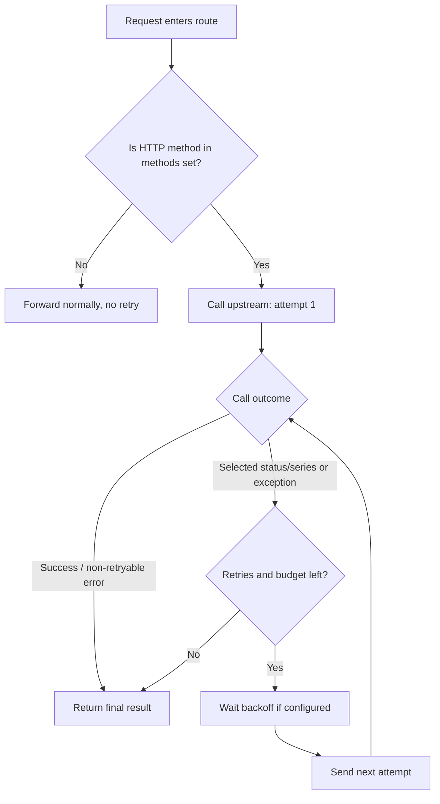
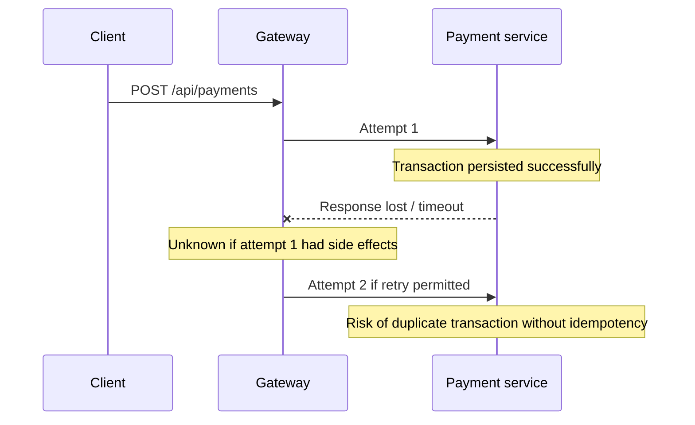

# Limiting Retry Attempts by Method, Status, and Exception

A request passing through **Spring Cloud Gateway** can fail because a backend is starting up, an instance just left the cluster, a TCP connection was reset, or a service temporarily returned `503 Service Unavailable`. Resending the request can sometimes give the client a successful response without manual intervention. However, **retry must not be a default reflex for every error**: it can repeat write operations, multiply load on an already overloaded backend, and stretch response latency past the client's deadline.

In the **Request Retries** chapter, this lesson explains how to configure the **`Retry` GatewayFilter Factory** across three main condition groups: **HTTP method**, **HTTP response status/series**, and **exception**; while defining the **maximum number of retries**, backoff, request body boundaries, and how to test the actual number of requests reaching the upstream. The examples use Spring Cloud Gateway in a microservices architecture with route predicates, filter chains, discovery via `lb://`, Spring Security, rate limiting, circuit breakers, TLS, and observability.

> **Scope:** This material illustrates **Spring Cloud Gateway Server WebFlux**. Property names, default values, and filter interaction behavior may differ depending on the Spring Cloud Gateway/Spring Framework version. Retry thresholds in the examples are **practice policies**, not optimal production defaults for every API.

## 1. What Does Retry Mean Within a Gateway Request?

**A single client call** can generate **multiple sends to the backend**. For example:

```text
Client: GET /api/catalog/items/42
    |
    v
Spring Cloud Gateway
    |-- Attempt 1 --> catalog-service --> HTTP 503
    |-- Attempt 2 --> catalog-service --> HTTP 502
    |-- Attempt 3 --> catalog-service --> HTTP 200
    |
    +--> Client receives HTTP 200
```

In the scenario above:

- **Client request count = 1**.
- **Upstream attempt count = 3**.
- **Retries executed = 2** (after the initial attempt).
- The final result sent to the client is `200` even though the two earlier upstream calls failed.

### The `retries` Parameter Is Not the Total Call Count

In Gateway `Retry` configuration, `retries` specifies the **number of retry attempts** in addition to the initial call.

\[
\text{Max attempts} = 1 + \text{retries}
\]

With `retries: 2`, the expected maximum number of attempts is **3**, provided each failure satisfies the retry conditions and the request is not timed out, cancelled, or blocked by another filter.

| `retries` | Initial Attempt | Max Retries | Max Total Attempts |
| ---: | ---: | ---: | ---: |
| 0 | 1 | 0 | 1 |
| 1 | 1 | 1 | 2 |
| 2 | 1 | 2 | 3 |
| 3 | 1 | 3 | 4 |

**Not every request reaches the maximum attempt count.** If the first call succeeds, the Gateway finishes immediately. If the method is ineligible or the status/exception is outside the policy, the request will not retry either. When the client cancels, the deadline expires, the response is already committed, or another filter rejects early, the actual attempt count may be lower.

## 2. The Three Condition Groups: Method, Status, and Exception

You can think of the Retry filter's decision logic in two layers:

1. **Is the method allowed to retry?** Is it `GET`, `HEAD`, or another configured method?
2. **Did the call fail in a selected way?** Did the response have a retryable status/series **or** did the publisher terminate with a matching exception?



The diagram depicts **decision logic**; reactive execution may re-subscribe to the processing chain and is affected by filter ordering. Do not assume that every retry automatically picks a different backend instance or opens a new TCP connection.

### Summary Table of the Three Groups

| Group | Retry Filter Setting | Meaning |
| --- | --- | --- |
| Method | `methods` | **Restricts which requests** are eligible for retry |
| Exact status | `statuses` | Specific HTTP statuses that can trigger a retry |
| Status series | `series` | HTTP status groups such as `SERVER_ERROR` that can trigger a retry |
| Exception | `exceptions` | Exception classes from the retried execution segment that can trigger a retry |
| Count | `retries` | Maximum retries after the initial attempt |
| Wait duration | `backoff` | Delay before the next retry attempt, if configured |

**Do not confuse the condition sets:** `methods` is the eligibility gate, while `statuses`/`series`/`exceptions` define **which failures are worth retrying**. In common versions, `statuses` and `series` are HTTP status matchers that can **coexist**; simply adding `statuses` does not guarantee disabling a defaulted `series`.

## 3. Minimal Retry Configuration for a Read Route

Suppose the Gateway receives `GET /api/catalog/items/42` and routes it to `catalog-service`:

```yaml
spring:
  cloud:
    gateway:
      routes:
        - id: catalog-read
          uri: lb://catalog-service
          predicates:
            - Path=/api/catalog/**
            - Method=GET,HEAD
          filters:
            - StripPrefix=1
            - name: Retry
              args:
                retries: 2
                methods:
                  - GET
                  - HEAD
                series:
                  - SERVER_ERROR
```

Meaning:

1. `Path` and `Method` predicates match the route for public `GET`/`HEAD` requests.
2. `StripPrefix=1` turns `/api/catalog/items/42` into `/catalog/items/42`.
3. `Retry` allows up to **two retries** (at most three attempts) for the two listed HTTP methods.
4. `series: SERVER_ERROR` selects the HTTP `5xx` group as the status condition.
5. `lb://catalog-service` is resolved via Spring Cloud LoadBalancer; requires the corresponding dependency and service instance source.

**Why only GET/HEAD in the introductory example?** They are HTTP methods with **safe** semantics (not intended to create side effects). Retrying them is generally much less risky than a `POST` that creates resources or charges money, though you still must bound backoff/deadlines because mass-retrying failing GETs can still cause overload.

### Version-Dependent Configuration

`spring.cloud.gateway.routes` is the familiar prefix in traditional Gateway Server WebFlux releases. Some newer versions/starters move to `spring.cloud.gateway.server.webflux.routes`. Check your actual dependencies and configuration metadata, and verify that the route and filter are loaded.

**Defaults can matter:** Some versions of the Retry GatewayFilter Factory have defaults for `retries`, `methods`, `series`, and `exceptions`. Therefore, when strict control is required, **explicitly declare each group you want to apply and check the remaining ones**; do not assume a single `statuses` entry clears other default behaviors.

## 4. Limiting by HTTP Method

Each HTTP method has distinct properties regarding **safety** and **idempotency**:

| Method | Typical HTTP Semantics | When to Retry? |
| --- | --- | --- |
| `GET` | Read resource; safe and idempotent | Can be retried with limits on transient errors |
| `HEAD` | Read headers; safe and idempotent | Similar to GET |
| `OPTIONS` | Query capabilities or CORS preflight | Usually handled by the CORS layer; do not blindly retry |
| `PUT` | Replace/create resource state; defined as idempotent | Only when the backend enforces the contract and tolerates duplicate attempts |
| `DELETE` | Delete resource; defined as idempotent in intended effect | Consider status/contract differences on repeat and races with other tasks |
| `POST` | Typically creates resources/triggers business logic | Only with an explicit idempotency policy and dedicated testing |
| `PATCH` | Partial update; not idempotent by default | Must prove the operation can be replayed safely |

**Idempotent does not mean responses are always identical.** For example, `DELETE /items/42` may return `204` the first time and `404` the second time; the desired end state may still be deleted. Conversely, an application that misimplements `GET` with state-mutating logic may be unsafe even though the HTTP method is defined as safe.

### Two Method Layers Act at Different Stages

Example:

```yaml
predicates:
  - Path=/api/catalog/**
  - Method=GET,POST
filters:
  - name: Retry
    args:
      retries: 2
      methods:
        - GET
```

- `Method=GET,POST` in the **route predicate** allows both GET and POST to **match the route**.
- `methods: [GET]` in the **Retry filter** allows only **GET to be eligible for retry**.
- `POST` is still proxied normally, just without filter retries.

Changing the `Method` predicate to GET-only will prevent POST from **entering the route**, rather than merely disabling retries. This is a common mistake when intending to restrict retries by editing the route predicate by accident.

### Example: Separating Policies by Endpoint

```yaml
spring:
  cloud:
    gateway:
      routes:
        - id: catalog-read
          uri: http://localhost:8081
          predicates:
            - Path=/api/catalog/**
            - Method=GET,HEAD
          filters:
            - StripPrefix=1
            - name: Retry
              args:
                retries: 2
                methods: [GET, HEAD]
                series: [SERVER_ERROR]

        - id: orders-create
          uri: http://localhost:8082
          predicates:
            - Path=/api/orders
            - Method=POST
          filters:
            - StripPrefix=1
```

The order creation route `orders-create` **does not have a Retry filter attached**. This is the safe starting point for write operations before idempotency keys and reconciliation logic are proven.

## 5. Limiting by HTTP Status: `statuses` and `series`

### An HTTP Response Status Is Not an Exception

A backend can return:

```http
HTTP/1.1 503 Service Unavailable
Retry-After: 10
Content-Type: application/json

{"code":"TEMPORARY_UNAVAILABLE"}
```

This is a **real HTTP response** with status `503`. Reactor Netty can receive this response without the publisher throwing a connection exception. Thus `statuses`/`series` select retries by **HTTP response status**, distinct from `exceptions`.

Codes to evaluate:

| HTTP Status | Typical Meaning | Should It Be Retried? |
| --- | --- | --- |
| `500 Internal Server Error` | Application/backend error | Only if determined to be potentially transient; logic bugs will keep repeating |
| `502 Bad Gateway` | Downstream proxy/gateway received invalid response | Bounded retry possible for safe operations |
| `503 Service Unavailable` | Backend temporarily unavailable | Common candidate for retry with backoff/deadline |
| `504 Gateway Timeout` | Proxy did not receive response in time | Safe operations may retry, though backend may have already processed it |
| `429 Too Many Requests` | Quota exceeded | Do not retry immediately; check `Retry-After` and client/quota policy |
| `408 Request Timeout` | Request timeout in server context | Only per contract/body replayability |
| `400 Bad Request` | Malformed request | No; fix input instead of retrying |
| `401 Unauthorized` | Unauthenticated/bad credentials | Do not retry with the same token without handling auth |
| `403 Forbidden` | Insufficient permissions | No; retrying does not grant permissions |
| `404 Not Found` | Resource not found | Usually no; retry only if API has an explicit eventual consistency contract |
| `409 Conflict` | State conflict | Requires business handling, not unconditional retry |

### `series: SERVER_ERROR` Can Be Too Broad

If you configure:

```yaml
filters:
  - name: Retry
    args:
      retries: 2
      methods: [GET]
      series: [SERVER_ERROR]
```

the status condition matches the entire **5xx** group, not just `502`/`503`. A deterministic `500` code bug can be retried twice even though retrying accomplishes nothing.

When you want a policy for **only specific codes**, you can express it as:

```yaml
filters:
  - name: Retry
    args:
      retries: 2
      methods: [GET, HEAD]
      series: []
      statuses:
        - BAD_GATEWAY
        - SERVICE_UNAVAILABLE
        - GATEWAY_TIMEOUT
```

**Verify version and binding:** Configuring `series: []` indicates the intent to select no additional status group. On versions that default to `SERVER_ERROR`, verify that the property binder actually replaces the default with an empty list. Test both `500` (not retried under the status whitelist) and `503` (retried) to confirm. If your version does not support overriding it this way as expected, use supported configuration/programmatic customization instead of assuming YAML tightened the condition.

### `statuses` and `series` Are Not an Intersection

If both are specified:

```yaml
series: [SERVER_ERROR]
statuses: [TOO_MANY_REQUESTS]
```

the response retry condition can match **5xx or 429**, not "only 429 inside 5xx" (which is impossible). Both settings should be understood as independent trigger sources depending on how the factory implements matching.

**Do not retry all 429s by default.** A backend's `Retry-After` header may specify a wait duration before trying again; do not assume `Retry` GatewayFilter Factory automatically parses and honors that header across all versions. With rate limiting, returning `429` to the client so the client applies its own retry policy is often more appropriate.

## 6. Limiting by Exception

Some errors occur **before receiving a valid HTTP status**, such as failed DNS lookups, TCP connect timeouts, connection resets, or timeouts where the reactive chain throws an exception.

```text
Client -> Gateway -> HTTP client -> upstream
                           |
                           +-- ConnectException before response
                           +-- TimeoutException before/mid-response
                           +-- IOException or library-created wrapper
                           |
                           v
                    onError (exception)
```

`Retry` can match retries against a list of exception classes:

```yaml
filters:
  - name: Retry
    args:
      retries: 2
      methods:
        - GET
        - HEAD
      exceptions:
        - java.io.IOException
        - java.util.concurrent.TimeoutException
```

**Note:** The exceptions above are illustrative examples. The actual exception seen by the Retry filter depends on Reactor Netty, WebFlux, the load balancer, filter ordering, and how exceptions are **wrapped**. For instance, a connection error may surface as a Netty-specific type or inside a cause. Do not assert that every timeout is `java.util.concurrent.TimeoutException` or every connection reset is strictly `java.io.IOException` across the entire chain.

### Three Checks to Perform

1. **Does the exception reach the Retry filter as an `onError` signal?** If another filter already handled it with a `200` fallback or an HTTP `503` response, the `exceptions` policy will not see the original error.
2. **Does the exception type match the list?** Inspect the actual exception class received by the filter, including wrappers and causes per your version's matcher semantics.
3. **Is the method allowed to retry?** A connect timeout on `POST` will not automatically retry if `methods` only contains GET/HEAD.

### Avoid Overly Broad Configuration

Avoid adding by default:

```yaml
exceptions:
  - java.lang.Exception
```

Reason: overly broad matching can retry programming bugs, validation failures, authorization errors, or unrecoverable errors, making clients wait longer and generating wasted load. Select exceptions that represent verified **transient failures** likely to succeed upon retry.

If you genuinely need to retry transient DNS failures, check the exception type and **negative DNS caching** first; immediate retries may just get the same stale error from cache. If the error is an invalid TLS certificate or hostname mismatch, fast retries will not fix the certificate.

### Error Status vs. Error Signal

| Upstream Call | HTTP/Reactive Layer Result | Condition Group to Check |
| --- | --- | --- |
| Backend sends `503` and closes response normally | HTTP `503` response exists | `statuses`/`series` |
| Cannot connect to backend port | `onError` connection exception | `exceptions` |
| Backend returns valid `401` | HTTP `401` | Usually **do not retry** |
| Circuit breaker rejects call because OPEN | `CallNotPermittedException` or integration fallback | Do not retry by default |
| A filter converts response to a `200` fallback | HTTP `200` after that filter | Retry may no longer see the original failure |
| Browser cancels request | `cancel` in reactive pipeline | **Cancellation is not a retry-eligible exception** |

For streaming responses, some bytes may already have been sent to the client before an error happens. Once the response is committed, the Gateway **cannot guarantee redoing the entire HTTP response** without breaking the protocol; avoid treating retry as a post-commit error repair mechanism.

## 7. Combining Conditions: Exact Decision Table

Suppose a route has:

```yaml
filters:
  - name: Retry
    args:
      retries: 2
      methods: [GET, HEAD]
      series: []
      statuses: [BAD_GATEWAY, SERVICE_UNAVAILABLE]
      exceptions:
        - java.io.IOException
```

The goal is to retry only GET/HEAD on HTTP `502`/`503` or a recognized `IOException` within Retry's boundary. The following table assumes an empty `series` list is supported as intended by your version:

| Inbound Method | First Attempt Outcome | Retry? | Reason |
| --- | --- | --- | --- |
| `GET` | HTTP `503` | **Yes** | Both method and status qualify |
| `HEAD` | HTTP `502` | **Yes** | Both method and status qualify |
| `GET` | HTTP `500` | No | Not in `statuses`; `series` is empty |
| `GET` | HTTP `404` | No | Not a selected error |
| `POST` | HTTP `503` | No | Method not allowed to retry |
| `POST` | `IOException` | No | Method not allowed to retry |
| `GET` | `IOException` | **Yes** | Exception is in selected set |
| `GET` | Unmatched `IllegalArgumentException` | No | Exception not in selected set |
| `GET` | HTTP `200` | No | Attempt already succeeded |
| `GET` | Blocked by Security `401` before route | No | Route's Retry filter never runs |

**Important testing tip:** Test **non-retry cases as well**. A test that only proves `503` gets retried will fail to catch a config that accidentally retries all 5xx codes or every exception.

## 8. Backoff: Do Not Retry Immediately

If every retry is dispatched the instant the backend returns `503`, the Gateway can inadvertently pile on extra load right when the backend is most resource-starved. **Backoff** spaces out attempts.

Illustrative configuration:

```yaml
filters:
  - name: Retry
    args:
      retries: 2
      methods: [GET, HEAD]
      series: [SERVER_ERROR]
      backoff:
        firstBackoff: 100ms
        maxBackoff: 500ms
        factor: 2
        basedOnPreviousValue: false
```

Explanation:

| Property | Meaning |
| --- | --- |
| `firstBackoff` | Initial wait duration before retrying |
| `maxBackoff` | Upper bound for wait duration set by backoff config |
| `factor` | Growth multiplier for wait duration |
| `basedOnPreviousValue` | Controls how the next wait interval is computed in the active version's backoff logic |

An easy-to-visualize ideal sequence with first = 100 ms, factor = 2, max = 500 ms is **100 → 200 → 400 → 500 ms** if enough retries exist. However, the exact formula and interpretation of `basedOnPreviousValue` in the Gateway factory should be checked against your version's source/docs rather than treating an illustrative table as a millisecond-exact timer guarantee.

### Overall Deadline and Backoff Must Work Together

For example, a request has:

- 1 initial attempt + 2 retries.
- Each attempt can wait up to 2 seconds before timing out.
- Backoff between attempts is 100 ms and 200 ms.

A worst-case failure sequence can consume nearly:

\[
T_{\text{total}} \approx 3 \times 2\,\text{s} + 0.1\,\text{s} + 0.2\,\text{s} = 6.3\,\text{s}
\]

This excludes DNS, scheduling, serialization, and filter overhead. If the frontend only waits 4 seconds, a policy like this can fire wasted attempts after the client no longer cares about the result.

Design must combine **connection timeout**, **response timeout**, **retry count**, **backoff**, and **overall request deadline**. Do not assume `retries: 2` by itself caps total response latency.

### Retry Storm

Suppose the Gateway receives 1,000 requests/second and all initial backend attempts return `503`. With `retries: 2`, theoretical load could climb to nearly **3,000 upstream attempts/second** if every request hits the limit, before accounting for backoff, cancellation, and circuit breakers.

Backoff with jitter, rate limiting, circuit breakers, admission control, and budgets are tools to mitigate **thundering herd**. Never increase `retries` just to mask an unavailable backend; that is a recipe for amplifying an outage.

## 9. When Can You Retry POST, PUT, PATCH, or DELETE?

### Dangerous Case: One-Time Payment Creation

Client sends:

```http
POST /api/payments HTTP/1.1
Content-Type: application/json

{"orderId":"o-42","amount":250000}
```

Attempt 1 may have reached the backend and created the transaction, yet the Gateway lost the connection **before receiving the response**. If the Gateway sends attempt 2, the backend could create a second transaction. A timeout at the Gateway **does not prove the business operation rolled back**.



### Idempotency Key and Deduplication Contract

A safer approach for APIs supporting idempotency:

```http
POST /api/payments HTTP/1.1
Content-Type: application/json
Idempotency-Key: pay-o-42-attempt-group-1

{"orderId":"o-42","amount":250000}
```

The backend must store/reconcile results keyed by **key + principal/tenant + request fingerprint** per contract, manage concurrency and TTL, return an equivalent result for same-key attempts, and avoid executing side effects a second time.

**Simply adding an `Idempotency-Key` header does not automatically create idempotency.** The backend must enforce atomic deduplication, race protection, and "in-progress"/"completed" handling. The Gateway must **preserve the exact same key** across all attempts of one request rather than generating a fresh key per retry.

### Conditions to Consider Before Enabling POST Retries

1. The backend guarantees idempotency, or the specific operation is inherently idempotent in business semantics.
2. The body can be replayed intact.
3. Selected status codes/exceptions are genuinely recoverable.
4. Retry count and deadline are bounded.
5. Tracing correlates the same request ID/idempotency key across attempts.
6. Tests prove one client request never triggers multiple side effects even when the first attempt's response is lost.

`PUT` and `DELETE` are idempotent by HTTP definition, yet real backends may still execute extra side effects such as sending emails, emitting events, billing, or incrementing counters. **Verify the implementation**, not just the method name.

## 10. Request Body and Memory During Retries

WebFlux request bodies are typically represented as `Flux<DataBuffer>`. This can be a single-consumption stream. To retry a `POST`/`PUT` with a body, the Gateway needs a **replayable** data source.

The Spring Cloud Gateway Retry filter may **cache the request body** for methods with bodies to enable replay, depending on the version and factory mechanism. This increases heap/direct memory pressure, especially when many large requests are waiting during backoff or retries.

Example: 500 concurrent requests with an average 2 MiB body require nearly **1 GiB** for body data alone before overhead. High retry rates cause those buffers to be retained longer.

| Risk | Symptom | Mitigation |
| --- | --- | --- |
| Body cannot be replayed | Attempt 2 receives empty/incomplete body | Use official caching/replay mechanisms; test upstream byte-for-byte |
| Buffers retained too long | Direct memory grows, Netty leak warnings | Follow framework DataBuffer ownership/lifecycle rules |
| Large bodies and high concurrency | Gateway OOM or degraded throughput | Cap payload size/concurrency; avoid retrying large uploads |
| Retry after response commit | Client gets truncated response/connection reset | Never attempt retry after sending data to client |
| JSON body mutates between attempts | Idempotency key no longer matches fingerprint | Keep payload and relevant headers immutable |
| Client cancels during backoff | Tasks/buffers leak if code is buggy | Return the reactive chain and handle cancellation cleanly |

Never manually call `subscribe()` in a custom Gateway filter to store the body out-of-band. Never arbitrarily `retain`/`release` pooled `DataBuffer` instances owned internally by Retry/caching filters. When you need to transform a body before retry, use `ModifyRequestBody`/appropriate body filters, understand their ordering, and test success, error, and cancellation paths.

**Body size limits do not appear automatically just because Retry is enabled.** Configure payload size limits at ingress/Gateway/codec layers as appropriate, and consider **disabling retries** for uploads, streams, or overly large payloads.

## 11. Combining Retry with CircuitBreaker: Order Affects Metrics

Suppose a route has both `Retry` and `CircuitBreaker`. If the backend fails twice and succeeds on the third try, there are two ways to view the result:

```text
Client request: GET /api/catalog/items/42

Upstream:
  Attempt 1 -> 503
  Attempt 2 -> 503
  Attempt 3 -> 200

Client final result: 200
```

The breaker may record:

- **One final outcome** if Retry is completely **inside the section protected by CircuitBreaker**.
- **Three outcomes** if each attempt passes through CircuitBreaker as a separate protected call.

Actual behavior depends on filter ordering, reactive re-subscription, and how the Spring Cloud CircuitBreaker/Resilience4j integration wraps the execution segment. **Do not claim YAML listing order alone proves** whether the breaker counts 1 or 3 calls; verify via metrics/event tests.

### Common Pitfall When the Breaker Is OPEN

If CircuitBreaker rejects an attempt with `CallNotPermittedException`, a Retry filter overly broadly configured with `exceptions: [java.lang.Exception]` might immediately try to retry a request **already rejected by the breaker**. That will not heal the backend; it just repeats useless work and can cause extra fallback churn.

Do not treat `CallNotPermittedException` as a recoverable network error by default. An OPEN breaker needs its own recovery lifecycle via HALF_OPEN/fallback, not bursts of immediate retries.

### RateLimiter and Retry Attempts

A client/principal rate limiter placed before retry may count **one incoming request** while the backend receives three attempts. If the system quotas by upstream operations, consider where counting/metrics occur. Do not treat a `429` quota rejection from the Gateway as a signal to retry immediately.

## 12. Service Discovery and Load Balancing Do Not Guarantee Switching Instances

For route `lb://catalog-service`, suppose instances A/B/C exist:

```text
Discovery sees: [A, B, C]
Attempt 1: A -> 503
Attempt 2: ? 
Attempt 3: ?
```

A subsequent attempt might be load balanced to B, C, or even A again, depending on how the Gateway filter chain is re-invoked, the LoadBalancer, sticky/session affinity, and instance caching.

**`Retry` alone makes no guarantee of "switching nodes on retry."** If your goal is avoiding the instance that just failed, you need an explicitly integrated and tested instance-aware retry or health-aware load balancing mechanism. Lowering discovery TTL, swapping DNS, or using `lb://` does not by itself ensure the next attempt avoids A.

If the LoadBalancer finds no instances and the Gateway generates an error, determine whether that manifests as an **HTTP response status** or an **exception** within Retry's actual boundary; route matching and discovery/caching are separate layers. Retry does not replace readiness probes and connection draining during pod scale-in or rolling deploys.

## 13. Timeout, TLS, and Security During Retries

### Timeouts and Exception Classification

Failures can happen at multiple stages:

| Stage | Error Type | Retryable? |
| --- | --- | --- |
| DNS resolution | Unknown host, DNS query timeout | Only if transient; negative caching/typos render retries useless |
| TCP connect | Connect timeout/refused | Bounded retry possible if request was not sent and method is safe |
| TLS handshake | Wrong cert SAN/truststore | No; fix security config rather than disabling verification |
| HTTP request write | Connection reset mid-body | Backend may have received partial data; needs replay/idempotency |
| HTTP response wait | Response timeout | Backend **may have already processed**; be cautious with side effects |
| HTTP response status | `503`/`502` | Retry per `statuses`/`series` and backoff if selected |
| Client cancel | Subscriber cancels | Do not start new attempts after the user cancelled |

It is essential to distinguish **recoverability** from **safe repeatability**. An error likely to clear on retry may still be unsafe for POST.

### Security and OAuth2 TokenRelay

Spring Security usually authenticates before Gateway route matching. A `401` caused by a missing JWT never enters the route's Retry filter. If the upstream returns `401` due to wrong audience or an expired token, do not retry the exact same request three times; resolve token validation/authorization or refresh/relay per OAuth2 policy.

Never log raw `Authorization`, session cookies, or tokens while diagnosing retries. Never unconditionally use `AddRequestHeader=Authorization` to "fix 401 errors" between attempts.

### TLS Failures Cannot Be Fixed by Increasing Retries

If the backend has an expired certificate, host/SNI mismatch, or invalid mTLS client certificate, subsequent attempts will very likely fail the same way. Retry is not a substitute for TLS hostname verification, service discovery, DNS, and truststore configuration.

## 14. Java DSL Illustrating Retry Conditions

Besides YAML, Gateway Server WebFlux provides a route builder DSL supporting the Retry filter. Illustrative example:

```java
@Configuration
public class CatalogRetryRoutes {

    @Bean
    RouteLocator catalogRoutes(RouteLocatorBuilder builder) {
        return builder.routes()
            .route("catalog-read", route -> route
                .path("/api/catalog/**")
                .filters(filters -> filters
                    .stripPrefix(1)
                    .retry(config -> config
                        .setRetries(2)
                        .setMethods(HttpMethod.GET, HttpMethod.HEAD)
                        .setStatuses(
                            HttpStatus.BAD_GATEWAY,
                            HttpStatus.SERVICE_UNAVAILABLE)))
                .uri("http://localhost:8081"))
            .build();
    }
}
```

This is an example of the **DSL API in certain Gateway WebFlux versions**; exact overload/method names on `RetryConfig` must be checked against your active version, especially when adjusting default `series` and exception lists. The Java DSL does not alter the core distinctions: `retries=2` means **two retries**; `methods` controls eligible methods, and `statuses` and `exceptions` are failure triggers.

If you need strict control over the status list, verify that default `series`/`exceptions` settings do not inadvertently widen the policy inside the builder-created `RetryConfig`; write integration tests to prove it.

## 15. Testing with curl and a Mock Upstream

To evaluate retries, observing a `200` response alone is **insufficient**. You must know **how many times** the upstream received the request and under what conditions.

Suppose the Gateway runs at `http://localhost:8080` and a mock upstream runs at `http://localhost:8081`. Route `/api/catalog/**` has `StripPrefix=1` and Retry configured for up to 2 retries on GET for `503`.

### Scenario A — `503 → 200`

```text
Attempt 1: GET /catalog/items/42 -> 503
Attempt 2: GET /catalog/items/42 -> 200

Expected:
  Client receives 200
  Upstream receives exactly 2 GET requests
  Retries executed = 1
```

Illustrative WireMock/WebTestClient test:

```java
@Test
void retriesGetAfterTemporary503() {
    wireMockServer.stubFor(
        get(urlEqualTo("/catalog/items/42"))
            .inScenario("recover")
            .whenScenarioStateIs(Scenario.STARTED)
            .willReturn(aResponse().withStatus(503))
            .willSetStateTo("ready"));

    wireMockServer.stubFor(
        get(urlEqualTo("/catalog/items/42"))
            .inScenario("recover")
            .whenScenarioStateIs("ready")
            .willReturn(aResponse()
                .withStatus(200)
                .withBody("{\"id\":42}")));

    webTestClient.get()
        .uri("/api/catalog/items/42")
        .exchange()
        .expectStatus().isOk();

    wireMockServer.verify(2,
        getRequestedFor(urlEqualTo("/catalog/items/42")));
}
```

This is an **illustrative test snippet** requiring corresponding route configuration, `WebTestClient`, WireMock, `wireMockServer`, static imports, and test fixtures. If the Gateway uses `lb://`, the test also needs discovery/LoadBalancer wired to WireMock. With Spring Security, the request needs a valid test identity; a `401` before the route is not a Retry test.

### Scenario B — `503 → 503 → 503`

With `retries: 2`, if all three responses are retry-eligible `503`s:

```text
Attempt 1: 503
Attempt 2: 503
Attempt 3: 503
=> Retry budget exhausted, upstream received 3 requests
=> Client receives final error per HTTP/filter policy
```

If another fallback/circuit breaker is present, the final status may differ from `503`; assertions should follow the **final response contract** and count upstream calls.

### Scenario C — GET Returns 400

```bash
curl -i 'http://localhost:8080/api/catalog/items/bad-id'
```

If the policy only retries 5xx, a `400` from the backend results in only **1 request** at the upstream. You can inspect the WireMock request journal afterward. A `400` is an input error; retrying identical data will not make it valid.

### Scenario D — POST Returns 503 but Is Not Retried

Suppose the route allows POST through while Retry specifies `methods: [GET]`:

```bash
curl -i -X POST 'http://localhost:8080/api/catalog' \
  -H 'Content-Type: application/json' \
  -d '{"name":"new-item"}'
```

If the backend returns `503`, expect **no second POST** from the Retry filter. Check the upstream request count rather than just inspecting the returned status.

### Scenario E — Selected Exception

Have the mock backend close the connection early or trigger a controlled timeout. Tests should verify:

1. The exception actually enters the Retry filter with the expected type.
2. The method is allowed to retry.
3. Exact maximum attempt count.
4. Deadlines/cancellations prevent exceeding the budget.
5. No buffer leaks or corrupted request bodies.

Do not merely throw an exception from a Java stub and assume it equates to a Reactor Netty TCP error; if your goal is verifying network exception matching, test through a real HTTP client or network-level fixture.

## 16. Test Matrix Sufficient to Catch Unintended Broadening

| Test | Method | First Upstream Outcome | Expected with GET/HEAD, 502/503, and `IOException` Policy |
| --- | --- | --- | --- |
| T1 | GET | `200` | 1 attempt |
| T2 | GET | `503` then `200` | 2 attempts |
| T3 | GET | `502` then `502` then `200` | 3 attempts |
| T4 | GET | Consecutive `503` | Max 3 attempts when `retries=2` |
| T5 | GET | `500` | 1 attempt **if `series` is properly disabled** |
| T6 | HEAD | `503` then `200` | 2 attempts |
| T7 | POST | `503` | 1 attempt if route allows POST but Retry does not |
| T8 | PUT | `503` | 1 attempt |
| T9 | GET | `404` | 1 attempt |
| T10 | GET | `429` | 1 attempt if 429 is not whitelisted |
| T11 | GET | `IOException` then success | Retries if exception type matches |
| T12 | GET | Non-matching exception | No retry |
| T13 | GET | Client cancels mid-backoff | Stops further attempts outside lifecycle |
| T14 | POST with idempotency key, dedicated policy | Timeout after backend writes data | If retried, produces no duplicate side effects |
| T15 | GET after CircuitBreaker OPEN | Breaker rejection | Does not turn into a retry loop |
| T16 | GET, streaming upstream response committed | Stream later errors | Does not construct a new response post-commit |
| T17 | GET, LoadBalancer has no instances | No-instance error | Distinguishes status/exception and retry logic |
| T18 | GET, backend IP changes during rollout | Transient connect exception/503 | Observe instance chosen on each attempt |

**Every test should assert at least:** client status, upstream call count, method/path/body, retry timing (if testing backoff), triggering status/exception class, and resource cleanup.

## 17. Observing Retries in Production

A route with Retry makes Gateway and backend metrics **not balance 1:1 automatically**. If 100 client requests produce 160 backend attempts, that can signal heavy retrying.

Fields to observe:

| Field/Metric | Meaning |
| --- | --- |
| Gateway route ID | Which route handled the request |
| HTTP method | Which methods are being retried |
| Final client outcome | Whether clients actually see 200, 503, or 504 |
| Upstream status per attempt | Which errors trigger retries |
| Exception class/cause per attempt | Network/timeout vs. application error |
| Total attempts per client request | `1 + actual retries` |
| Backoff delay | Time spent waiting |
| End-to-end latency | User-facing deadline impact |
| Selected service instance | Whether attempts hit the same instance |
| Circuit breaker state/not-permitted | Whether requests are blocked before upstream |
| Retry exhausted count | How many requests exhausted the retry budget |
| Client cancellation | Whether waiting attempts are being cancelled |
| Request ID/trace ID | Correlates multiple attempts to one logical request |

Actual metric names depend on Gateway version, Micrometer/Actuator, and custom instrumentation; do not assume every metric above is emitted out-of-the-box by a single starter. Tracing should preserve the **same correlation ID** for the logical request while creating spans/attributes distinguishing attempts where infrastructure allows.

**Do not put user IDs, tokens, full URLs/queries with PII, or raw idempotency keys in metric labels**: this explodes cardinality or leaks sensitive data. Do not log `Authorization`, cookies, or request bodies in debug logs just to count retries.

### Separating Retry Count from Error Rate

Suppose 1,000 client requests occur:

- 900 succeed on attempt 1.
- 80 succeed after one retry.
- 20 fail after three total attempts.

The backend attempt count is:

\[
900 \times 1 + 80 \times 2 + 20 \times 3 = 1,120
\]

Meanwhile, the client sees **980 successes, 20 failures**. Looking only at the 98% client success rate hides the 120 extra attempts, added cost, and signs of backend instability.

Do not count every retry as "a new user request" when measuring user-facing error rates, and do not count one client request as "one backend call" when sizing capacity.

## 18. Common Misconfigurations

| Symptom | Possible Cause | Resolution |
| --- | --- | --- |
| `retries: 2` yet 3 backend requests appear | Counting **initial attempt + 2 retries** | Interpret the parameter correctly |
| GET `500` still retries despite `statuses: [SERVICE_UNAVAILABLE]` | `series: SERVER_ERROR` is still active | Check/override `series` and write a 500 test |
| POST does not retry | `methods` omits POST | Confirm this is intentional policy; do not rush to enable POST |
| POST retry creates duplicate records | Missing idempotency | Implement backend idempotency and body control |
| Upstream returns 503 without retry | Route/Method mismatch, status unselected, response already committed, or another filter intervened | Inspect filter chain and response lifecycle |
| Connect timeout does not retry | Exception differs from configured class or is wrapped/handled by fallback | Safely log exception class; test exception matching |
| Retries repeat authentication failures | Exception matcher too broad / 401 selected | Tighten statuses and exceptions; fix token policy |
| Client waits too long | Attempts + timeouts + backoff exceed deadline | Set an overall retry budget and timeout |
| Gateway memory spikes after enabling POST retries | Request bodies cached/replayed concurrently | Limit payload size/concurrency; prefer not retrying POST |
| CircuitBreaker stays CLOSED despite backend errors | Retries mask failures or breaker measures final outcome | Check filter ordering and protected call metrics |
| CircuitBreaker OPEN yet Retry generates noise | Retry matcher includes breaker rejections | Never retry `CallNotPermittedException` |
| Retried requests hit the same failing node | LB is not required to switch instances | Measure instance/attempt; use health-aware policy |
| Curl returns 200 yet users see CORS errors | Final response lacks proper CORS headers | Check browser/preflight/error responses |
| Client cancels yet backend still processes | Request already sent; cancel does not roll back business state | Use idempotency/reconciliation |
| DNS/TLS errors repeat endlessly | Configuration error unrecoverable via retry | Fix resolver, certificate, trust/SNI; avoid unbounded retries |

## 19. Runbook When Retry Does Not Behave as Expected

1. **Confirm route selection:** route ID, `Path`/`Method`/`Host` predicates, and whether Security blocked beforehand.
2. **Confirm Retry filter loaded:** exact name, syntax, and version-appropriate config prefix.
3. **Inspect effective configuration:** `retries`, `methods`, `statuses`, `series`, `exceptions`, `backoff`, plus un-overridden defaults.
4. **Reproduce with a controlled request:** use an upstream stub returning exact sequences `503 → 200`, then `500`, `400`, and selected exceptions.
5. **Count upstream attempts:** do not rely only on client status since retries can mask initial errors.
6. **If an exception does not retry:** identify the exact class reaching the retry operator; check wrappers/causes, filter order, and whether a response status was already created.
7. **If attempts exceed expectations:** check retries across **multiple layers**—client SDK, Gateway, HTTP mesh/ingress, backend clients—not just one Gateway route.
8. **If latency is high:** sum per-attempt timeout, backoff, DNS/TLS, and overall deadline; check cancellation.
9. **If body/POST fails:** inspect payload replay, idempotency key, buffer cache, concurrency, and side effects.
10. **If CircuitBreaker/LoadBalancer are involved:** verify protected call scope, breaker state, selected instance, and health/discovery cache.
11. **When done:** rerun both positive and negative tests; monitor error rate, retries, backend attempts, and resources under load.

### Multi-Layer Retries Can Multiply Attempts

Suppose a mobile app retries **twice** after its initial request, and the Gateway is configured with `retries: 2`. In the worst case where every call fails and every layer uses its full count:

\[
\text{Upstream attempts} \le (1+2)_{\text{client}} \times (1+2)_{\text{Gateway}} = 9
\]

If a service mesh also retries, attempts climb further. This is a **worst-case estimate** when every policy permits it and no deadline/cancellation/breaker stops it; not every system hits all 9 attempts.

Operational rule: **assign retry ownership per layer** and enforce a shared attempt/deadline budget. Do not let clients, the Gateway, and the mesh all retry unboundedly without knowing the true total call count.

## 20. Hands-On Exercise: Protecting Catalog and Payments

A Gateway serves:

- `GET /api/catalog/items/{id}` → `catalog-service`, eligible to retry `502/503` and transient connection errors.
- `POST /api/payments` → `payment-service`, which has transaction-creating side effects.
- `catalog-service` runs multiple instances via `lb://` and rollouts occasionally trigger connect resets.
- `payment-service` supports idempotency keys, provided the request body and principal remain unchanged across attempts.
- The Gateway uses Spring Security JWT and CircuitBreaker on certain routes, with timeout and request body size limits.

### Design Requirements

1. Use `Retry` for catalog GET with at most **two retries**, restricted to specific statuses and tested exceptions.
2. Do not attach Retry to payments POST until the backend has a verified idempotency contract, payload replay, and result reconciliation.
3. Configure bounded backoff and an overall deadline shorter than the useful client timeout.
4. Do not retry `400`/`401`/`403`/`404` or unconditionally retry `429`.
5. Use WireMock tests to confirm `503 → 200` produces exactly 2 backend calls, while `500` is not retried when excluded from policy.
6. Where circuit breakers coexist with retries, verify whether breaker metrics count per-attempt or per-logical-call as designed.
7. Measure backend attempt counts across multiple Gateway replicas, not just edge request counts.

### Self-Check Questions

1. With `retries: 3`, what is the maximum number of HTTP attempts including the initial call?
2. How does a `Method=GET,POST` route predicate differ from `methods: [GET]` in the Retry filter?
3. If `series: [SERVER_ERROR]` remains active, does setting `statuses: [SERVICE_UNAVAILABLE]` guarantee restricting retries to 503 only?
4. How do HTTP `503` and `ConnectException` differ in how Retry evaluates conditions?
5. Why should `401` and `403` generally not be retried verbatim?
6. Why does a timeout after a POST not prove the backend failed to create the transaction?
7. Does `Idempotency-Key` prevent duplicate data merely by being present as a header?
8. What happens with `Flux<DataBuffer>` when you need to replay a large request body?
9. Why does CircuitBreaker's `slowCallDurationThreshold` not replace response timeouts and retry budgets?
10. When both Retry and CircuitBreaker filters are present, why must you verify how protected calls are counted?
11. Is a backend's `Retry-After` header automatically honored by a fixed backoff policy?
12. Why does a retry over `lb://` not guarantee selecting a new instance?
13. If the client cancels during backoff, should the request continue retrying independently?
14. Which metrics distinguish **one client request succeeding after retry** from **three backend attempts**?
15. When retries spike, how do you distinguish persistent DNS/TLS misconfigurations from transient upstream 503s?
16. Will a request rejected by Spring Security before routing be retried by the route's Retry filter?
17. If client, Gateway, and mesh all retry, how can total attempts grow?
18. Why should you test **non-retry** cases for GET `500`, GET `400`, and POST `503` in addition to successful retries?

**Key Takeaway:** The `Retry` GatewayFilter Factory is only safe when you simultaneously govern **eligible methods**, **triggering statuses/series or exceptions**, **maximum retries**, **backoff, and overall deadline**. `retries` counts additional tries after the initial attempt; `statuses` does not implicitly clear `series`, and `exceptions` must match actual reactive errors. For requests with bodies or side effects, **proper data replay and business idempotency** are required. To know whether a policy works as designed, measure **upstream attempts**, not just the final HTTP status seen by the client.
