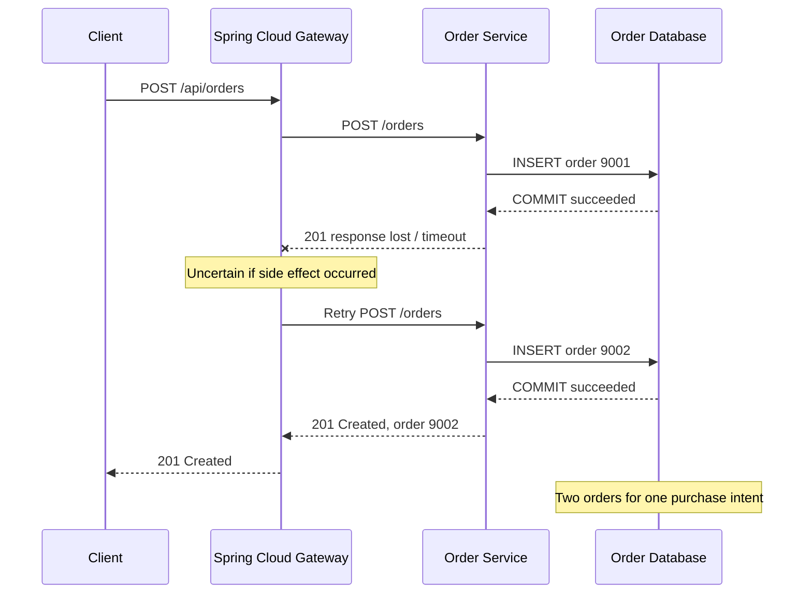
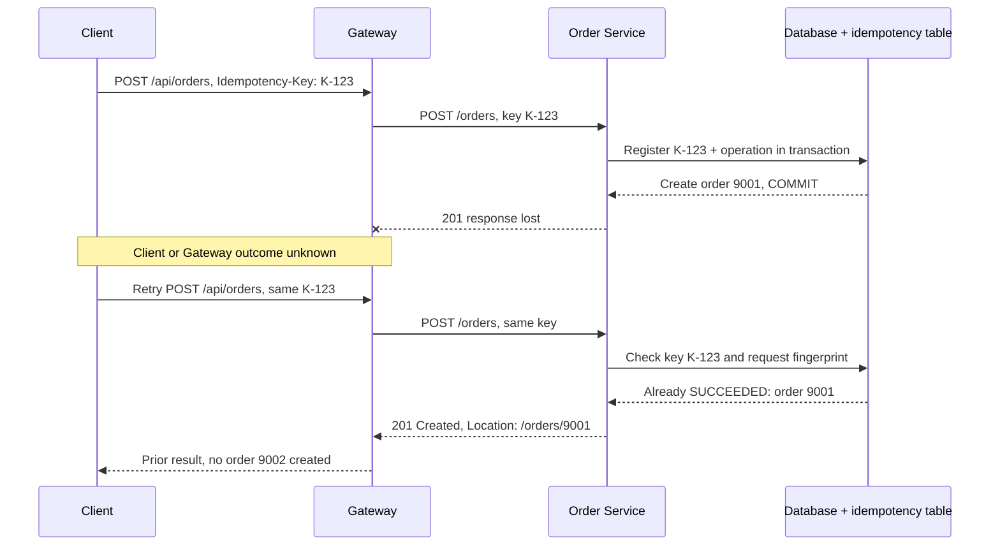
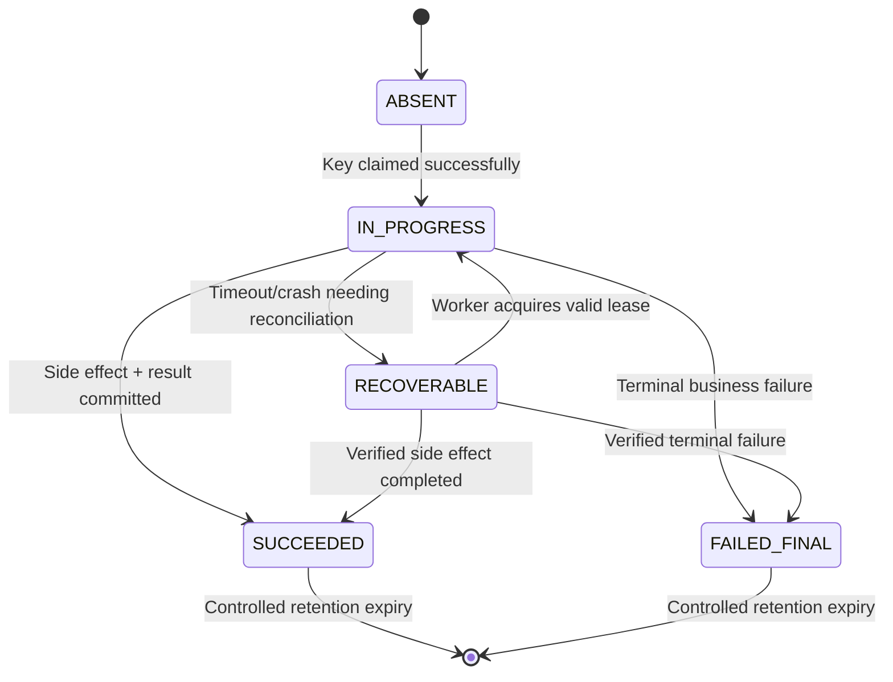
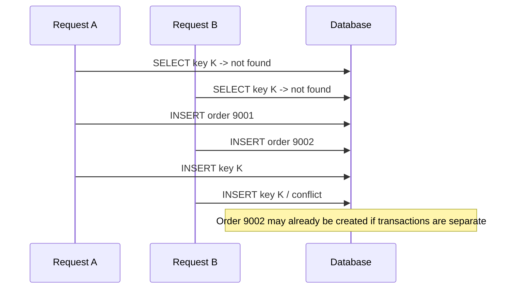
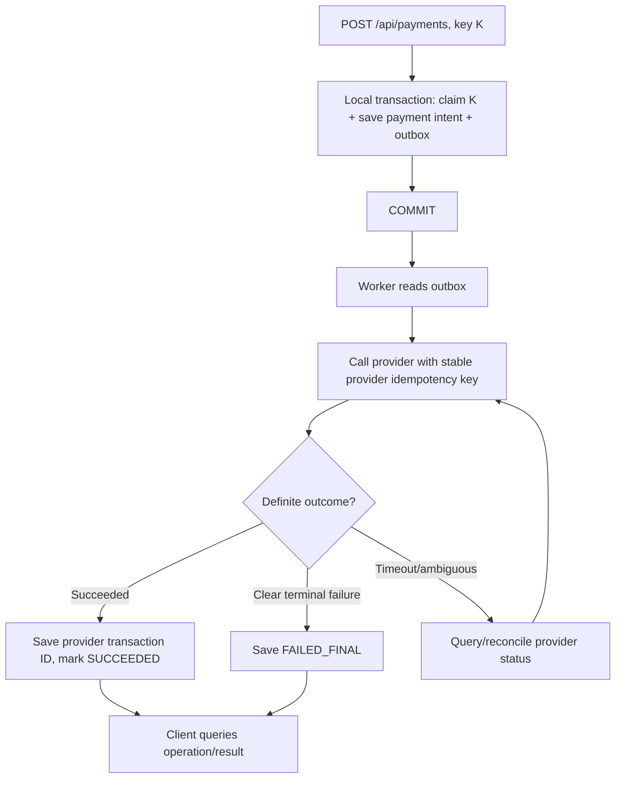
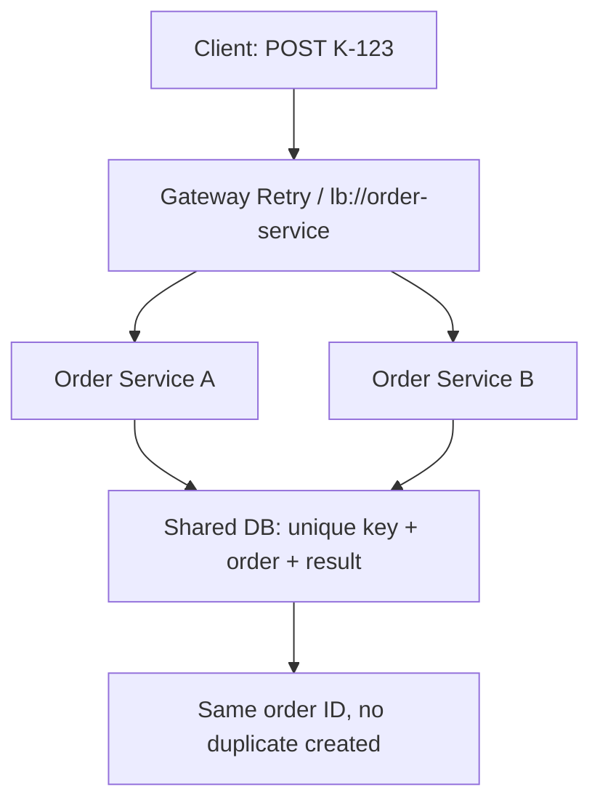

# Idempotency Keys for Operations at Risk of Duplicate Execution in Spring Cloud Gateway

In a microservices architecture, retries are an important tool for overcoming brief network glitches. However, **resending** a request does not automatically make an operation **safe to execute again**. For example, a client sends `POST /api/orders`, the Order Service persists the order successfully, and the response gets lost on the way back. The Gateway or client sees a timeout and resends the POST; if the backend cannot recognize that both requests represent the **same business intent**, the user may end up with **two orders**, **two payment charges**, or **two confirmation emails**.

An **idempotency key** is a stable identifier for **one intentional business execution**. The client sends the same key whenever it must retry the same operation, and the backend uses that key to **avoid executing side effects twice** when a request is delivered multiple times. This capability does not magically come from the Spring Cloud Gateway `Retry` filter: the Gateway can re-send an HTTP request, while guaranteeing "one order created" belongs to the service owning the business logic and a concurrency-safe state store.

This lesson belongs to the **Request Retries** chapter of the `SPRING_CLOUD_GATEWAY` module. It connects directly with route predicates, filter chains, path/header transformations, service discovery, authentication, rate limiting, circuit breakers, retries, TLS, and request observability to operate a microservices ingress safely.

**Expected outcomes:** You will know how to design an `Idempotency-Key` header contract, choose storage and unique keys, handle concurrent requests and lost responses, distinguish in-progress/succeeded/conflict states, coordinate Gateway Retry with the backend, and test the most dangerous failure mode: **the operation succeeded, yet the caller does not know the outcome**.

> **Scope:** Examples focus on **Spring Cloud Gateway Server WebFlux** and Java/Spring backends. Illustrative code is designed to explain transaction boundaries; it is not a production-ready payment application. Gateway APIs and configuration namespaces can vary across Spring Boot/Spring Cloud versions; verify against the deployed version.

## 1. The Core Problem: Request Succeeds, Response Fails

Suppose a user clicks **Place Order** once:

```http
POST /api/orders HTTP/1.1
Host: api.example.com
Authorization: Bearer <access-token>
Content-Type: application/json

{"cartId":"CART-42","shippingAddressId":"ADDR-7"}
```

A failure scenario:



The Gateway only knows the previous call **did not receive a result in time**. It cannot infer that the backend never processed the request. In particular, a timeout after sending the body and a timeout before establishing a connection carry **different levels of uncertainty**; never lump them all together as "safe to retry."

If the client also retries on its own, if a reverse proxy retries automatically, and if a message broker redelivers events, a single business intent can appear more than twice across multiple layers.

### 1.1. Retries Improve Availability, Yet Create Duplication Risk

A request can repeat because:

- A user clicks a button multiple times or the UI auto-resubmits.
- A browser, mobile app, or SDK retries after a connection reset.
- A Gateway `Retry` filter is configured to retry on errors or statuses.
- A service-to-service HTTP client retries.
- A queue/message broker redelivers a message lacking acknowledgment.
- A load balancer routes a request to a new instance after a connection error.
- A system recovers from a crash and reprocesses an unresolved task.

**An idempotency key does not eliminate retries**; it gives the system a way to recognize **repeated deliveries of the same intent** and return a consistent result.

## 2. HTTP Idempotency vs. Business Idempotency Keys

Under HTTP semantics, a method is **idempotent** when sending multiple identical requests has the same *intended effect* on server state as sending one. Some methods carry this property by protocol definition, which does not mean every implementation obeys it or that secondary side effects like logs/emails are identical.

| HTTP Method | Protocol Semantics | Risks to Watch |
| --- | --- | --- |
| `GET` | Safe and idempotent in intended effect. | Should not mutate data; a GET endpoint with side effects is poor design. |
| `HEAD` | Safe and idempotent. | Still subject to network/cache/authorization failures. |
| `PUT` | Idempotent when properly setting target resource state. | Server must implement it properly; watch secondary side effects and concurrency. |
| `DELETE` | Idempotent in intended effect. | First call may return 204, next 404; status codes need not match. |
| `POST` | Not guaranteed idempotent by method. | Order creation, charging, and emails can duplicate on retry. |
| `PATCH` | Not idempotent by default. | `increment balance by 10` twice adds 20; `set status=paid` can be idempotent if designed properly. |

**Key point:** "Idempotent" does not mean every HTTP response across calls must match byte-for-byte. It refers to the **intended effect** on the system. With business idempotency keys, many APIs also choose to **replay the recorded result** so the client receives the same status/resource on repeat requests.

### 2.1. Retrying POST Does Not Become Safe Because of HTTP 5xx

A `502 Bad Gateway` or `504 Gateway Timeout` response does not prove "POST was not executed." If the service committed and then failed while sending the response, retrying can create duplicate transactions.

For resource-creating POSTs, **never enable retries solely based on 5xx status**. You must have an idempotency contract and test the "commit succeeded, response disappeared" case.

### 2.2. Idempotency Key vs. Request ID and Trace ID

| Identifier | Created For What Purpose? | Should It Replace an Idempotency Key? |
| --- | --- | --- |
| **Idempotency key** | Bound to one **business intent** that may be resent. | It is the key driving deduplication. |
| **Request ID** | Identifies a specific HTTP request/attempt. | No. Each attempt can get a new request ID. |
| **Trace ID** | Correlates spans of an observability trace. | No. Traces may change between client resends. |
| **Order ID** | Identifies the created business resource. | Can be saved as the result after processing; not always known before the initial POST. |
| **Message ID** | Identifies a queue message. | Useful for inbox dedup, yet distinct from the API key without an explicit mapping. |

An HTTP retry can carry a **new trace ID** while preserving the **old idempotency key**. Conversely, two genuinely separate purchases by the same user require **two distinct keys**, even with identical bodies.

## 3. The API's `Idempotency-Key` Contract

A common design has the client send a header:

```http
POST /api/orders HTTP/1.1
Host: api.example.com
Authorization: Bearer <access-token>
Content-Type: application/json
Idempotency-Key: 86a1cd08-0f18-48bb-afcc-2ea3b2f0d7a8

{"cartId":"CART-42","shippingAddressId":"ADDR-7"}
```

If the client receives no clear outcome and decides to retry, it must send the **same key** and **same business payload**:

```http
POST /api/orders HTTP/1.1
Idempotency-Key: 86a1cd08-0f18-48bb-afcc-2ea3b2f0d7a8
Content-Type: application/json

{"cartId":"CART-42","shippingAddressId":"ADDR-7"}
```

**Standardization note:** `Idempotency-Key` is a header name adopted by many APIs and discussed in related IETF drafts. Exact syntax/semantics, retention durations, and error codes vary by API/provider; never claim the Gateway automatically enforces a universal contract just because it sees this header. If an organization uses a different header name, document it consistently.

### 3.1. Who Should Generate the Key?

Usually the **client initiating the business operation** or a BFF acting on its behalf. The key should:

- Be newly generated per **business intent**.
- Have high entropy and not be easily guessable; random UUID v4 is a common choice.
- Stay stable across all retries of the same operation.
- Never contain emails, phone numbers, access tokens, or sensitive content.
- Have length/format bounded and validated by the server.

If a client sends a POST, times out, and **generates a new key on retry**, the backend treats it as a new intent and can create an extra order.

### 3.2. One Key Must Not Be Reused for a Different Intent

Example:

- First purchase: `KEY-A`, buy 2 books.
- Retry of first purchase: **still `KEY-A`**, same payload.
- User intentionally places a second order: **`KEY-B`**, even if buying the same 2 books.

Never use a user ID, session ID, current date, or constant string like `order-create` as an idempotency key for all transactions. They fail to distinguish two separate intents.

### 3.3. What Should the Server Publish in the API Contract?

An idempotent API should clearly document:

1. Which endpoints/methods **require** a key.
2. Key format, length limits, and generation expectations.
3. Uniqueness *scope*: per user, tenant, operation, endpoint, or entire account.
4. What the server returns when the same key and same payload are resent after success.
5. What error code the server returns when the same key is sent with a different payload.
6. Whether the server returns 202, 409, 425, or waits per policy when the initial request is **in progress**.
7. Key TTL/retention and behavior after expiration.
8. Which 4xx/5xx error cases have their outcomes persisted.
9. How the client queries status when uncertain whether an operation succeeded.
10. Auth/authorization policy on every retry.

Clients should never have to guess these rules from a blog post or ad-hoc error body.

## 4. A Safe Flow From Client Through Gateway to Backend

Suppose the order-creation API guarantees: same key and same payload create at most one order during the retention window, and repeat requests after success return the reference to the created order.



**The safety boundary sits in the Order Service and database**, not merely in the Gateway preserving the header. The Gateway may retry sensibly, yet the backend must handle **concurrent requests with the same key**, post-crash retries, and requests hitting different backend instances.

### 4.1. Invariants to Maintain

For every `(scope, operation, idempotencyKey)` tuple:

- **One valid intent** never creates two resources/payments due to retries.
- **Two different keys** can represent two genuine intents even with identical payloads.
- **One key with a different payload** never silently reuses the old payload's result.
- **Concurrent requests with the same key** never both pass a "key not found" check and both execute.
- **Committed results** can be retrieved after a lost response.
- **Access control** is enforced on every request; the key is not an authentication credential.

## 5. Choosing Deduplication Scope and Request Fingerprint

Storing every key globally unique across the entire system is sometimes too broad. Two independent tenants could randomly collide; worse, if a key leaks or is guessed, one tenant must never read another tenant's response.

A conceptual storage key structure:

```text
dedupKey =
    tenantId + operationName + idempotencyKey

operationName = "create-order:v1"
```

If a system has no tenants, use an **authenticated** account/client identifier. Choose scope per product contract: some APIs share keys account-wide, others scope per endpoint.

### 5.1. Fingerprints Detect Misused Keys

Suppose the first call is:

```json
{"sku":"BOOK-42","quantity":2}
```

A retry reuses the key with:

```json
{"sku":"BOOK-42","quantity":200}
```

If the server simply checks the key and replays the old result, the client may mistakenly think it bought 200 items. The backend should store and compare a **request fingerprint**:

```text
fingerprint =
    SHA-256(canonicalBusinessOperation)
```

Fields to include in the fingerprint can cover:

- Normalized HTTP method and **operation**, not just the post-rewrite raw path.
- Body fields that determine side effects: item, quantity, currency, amount, recipient, etc.
- Business-relevant headers affecting the outcome, if any.
- API contract/version when semantics change.
- Tenant/account/actor bindings if not already part of the key scope.

**Do not naively hash raw JSON text assuming two logically equivalent bodies yield the same fingerprint**: field ordering, whitespace, escaping, or number formatting can change bytes without changing business meaning. Canonicalize data after validation; if the contract mandates "exact same bytes," document that explicitly.

### 5.2. Never Put Raw Secrets in Fingerprints or Logs

If payloads contain passwords, tokens, or payment secrets, at minimum avoid storing raw payloads, and assess guessing risks for low-entropy fields under plain hashes. For sensitive data, use a server-keyed HMAC or store a secure reference to the normalized request per retention rules; manage keys and access control properly.

**Fingerprints do not replace authentication:** a caller holding the key and body must still carry valid credentials and permissions to query/replay the outcome.

### 5.3. Same Key, Different Payload → Conflict

A common contract is:

```http
HTTP/1.1 409 Conflict
Content-Type: application/problem+json
Cache-Control: no-store

{
  "type": "https://api.example.com/problems/idempotency-conflict",
  "title": "Idempotency key already used",
  "status": 409,
  "detail": "This key has already been used for another operation."
}
```

This example is a **backend-designed response**, not auto-generated by Spring Cloud Gateway. Never return old transaction details or secret fingerprints in errors if the caller lacks authorization.

## 6. What States Need to Be Stored?

An idempotency record can track:

| Field | Example | Purpose |
| --- | --- | --- |
| `tenant_id` | `shop-7` | Permission/quota scope. |
| `operation` | `create-order:v1` | Distinguishes business APIs. |
| `idempotency_key` | `K-123` | Identifies the same intent. |
| `request_hash` | SHA-256 of normalized request | Detects key reuse with a different payload. |
| `state` | `IN_PROGRESS`, `SUCCEEDED`, `FAILED_FINAL` | Prevents duplicate execution and tracks outcome. |
| `resource_id` | `order-9001` | Reference to created resource. |
| `http_status` | `201` | Restores status on replay. |
| `response_ref` | Securely stored body/metadata reference | Replays result when needed. |
| `created_at` / `updated_at` | Server timestamps | Auditing and cleanup. |
| `expires_at` | Expiration timestamp | Defines key retention/TTL. |
| `owner_version` / `lease_token` | Fencing token when using leases | Prevents two workers from both completing one operation. |

Conceptual state transitions:



This is an **illustrative state machine**, not a built-in Spring API. State transition rules must fit your concrete transactions, leases, and side effects; simpler database-only operations do not need every state.

### 6.1. In-Progress: Wait, 202, or 409?

When a second request arrives with the same key while the first is still running, common strategies include:

| Strategy | Response | Considerations |
| --- | --- | --- |
| **Wait for completion** within a time limit | If first finishes, return recorded result. | Never hold connections forever; bound timeout/budget. |
| **202 Accepted** + operation status URL | Tells client it's processing and how to check. | Requires clear status endpoint/representation. |
| **409 Conflict** / dedicated in-progress error code | Tells client not to resend same key right now. | Distinguish from `409` on payload mismatch; e.g., via problem code. |
| **425 Too Early** in specialized contracts | Use only when explicitly designed/supported by clients. | Do not treat as a mandatory status for idempotency keys. |

No single in-progress status fits every system. **The API specification must define it clearly**, preventing the frontend from receiving 409, swapping in a new key, and creating a duplicate transaction.

### 6.2. Which Errors Should Be Persisted?

Do not assume **all** errors must be replayed forever:

- **Validation 400/422 before side effects:** can reject immediately; whether to keep the key depends on contract. If kept, editing payload with the same key requires explicit rules.
- **Terminal business failures:** can record `FAILED_FINAL` once certain no dangling side effects remain.
- **Timeouts/500s with unknown external state:** **never** assume "nothing happened" and blindly re-execute.
- **401/403:** validate security on every request; never replay another principal's response on key match.
- **Transient failures before side effects start:** may allow retries per policy.

Some payment providers persist even 500 errors for a key; others allow retries after specific errors. Follow the provider's exact semantics rather than applying one assumption everywhere.

## 7. Preventing Race Conditions: SELECT Then INSERT Is Not Enough

Wrong pattern:

```text
if NOT EXISTS idempotency_key:
    createOrder()
    INSERT idempotency_key
```

Two concurrent requests with the same key:



Even with a unique index on the idempotency table, **executing the side effect before claiming ownership of the key** still creates duplicate side effects. Never treat an unlocked/non-transactional "check-then-act" sequence as safe under concurrency.

### 7.1. Unique Constraints Must Reside in an Atomic Store

Example PostgreSQL table:

```sql
CREATE TABLE api_idempotency (
    tenant_id        text        NOT NULL,
    operation        text        NOT NULL,
    idempotency_key  text        NOT NULL,
    request_hash     text        NOT NULL,
    state            text        NOT NULL,
    resource_id      text,
    http_status      integer,
    response_ref     text,
    created_at       timestamptz NOT NULL DEFAULT now(),
    updated_at       timestamptz NOT NULL DEFAULT now(),
    expires_at       timestamptz NOT NULL,
    PRIMARY KEY (tenant_id, operation, idempotency_key)
);

CREATE INDEX api_idempotency_expiry_idx
    ON api_idempotency (expires_at);
```

The unique/primary key ensures two transactions cannot create **two key records** in the same scope. Yet that alone doesn't guarantee a single side effect: you also need **claim-before-execute** and a safe **transaction/claim protocol**.

### 7.2. Single-Transaction Pattern for Database-Only Logic

If orders and idempotency records live in the **same database**, one transaction can commit atomically:

```text
BEGIN TRANSACTION

1. Attempt to claim (tenant, operation, key) via
   INSERT ... ON CONFLICT DO NOTHING.

2. If this transaction inserted the row:
   - Run remaining business validations.
   - INSERT the order.
   - UPDATE the key record = SUCCEEDED,
     saving order_id and replayable result.
   - COMMIT both the order and idempotency state.

3. If the key already existed:
   - Read the record at a consistent snapshot.
   - Compare request_hash; if different, return conflict.
   - If SUCCEEDED, return stored result.
   - If IN_PROGRESS, handle per contract.

ROLLBACK if the creation branch transaction fails.
```

In PostgreSQL, `INSERT ... ON CONFLICT DO NOTHING` with a unique constraint can cause a second transaction to **wait** for the key-owning transaction to finish before determining conflict. Set appropriate timeouts and re-read state after the competing transaction commits. Never treat `ON CONFLICT DO NOTHING` alone as the complete solution; **keep order creation and result recording inside the same transaction** to prevent "order created but key unrecorded."

Example claim statement:

```sql
INSERT INTO api_idempotency (
    tenant_id, operation, idempotency_key, request_hash,
    state, expires_at
)
VALUES (
    :tenantId, 'create-order:v1', :idempotencyKey, :requestHash,
    'IN_PROGRESS', now() + interval '24 hours'
)
ON CONFLICT (tenant_id, operation, idempotency_key)
DO NOTHING;
```

**Check the inserted row count** to determine whether this transaction owns execution. If zero rows were inserted, query the existing key and inspect its fingerprint/state. The 24-hour retention is only an example, not a mandatory default.

### 7.3. Why Does a Transaction Protect Against "Committed Yet Response Lost"?

When Order Service commits both the **order** and the **idempotency result** in one transaction:

- A lost response does not lose the outcome data.
- Retries find the key already marked `SUCCEEDED`.
- The service returns the **existing order's** ID/status without re-running the order INSERT.
- If the transaction rolled back before commit, the order does not exist and the key is not marked succeeded; the next call can retry safely per contract.

**Critical condition:** Never trigger **out-of-transaction** side effects (charges, emails, external calls) inside the order-creation branch without dedicated compensation/guarantees.

## 8. Spring WebFlux: Example Idempotency Handling Structure

In a Spring WebFlux backend, a handler can require `Idempotency-Key` and delegate to a dedicated service:

```java
import org.springframework.http.HttpStatus;
import org.springframework.http.ResponseEntity;
import org.springframework.web.bind.annotation.PostMapping;
import org.springframework.web.bind.annotation.RequestBody;
import org.springframework.web.bind.annotation.RequestHeader;
import org.springframework.web.bind.annotation.RestController;
import reactor.core.publisher.Mono;

@RestController
public class OrderController {

    private final IdempotentOrderService service;

    public OrderController(IdempotentOrderService service) {
        this.service = service;
    }

    @PostMapping("/orders")
    public Mono<ResponseEntity<OrderReceipt>> create(
            @RequestHeader("Idempotency-Key") String key,
            @RequestBody Mono<CreateOrderCommand> body) {

        return body
            .flatMap(command -> service.createOnce(key, command))
            .map(result -> ResponseEntity
                .status(result.httpStatus())
                .header("Location", "/orders/" + result.orderId())
                .body(result.receipt()));
    }
}
```

Here `IdempotentOrderService`, `CreateOrderCommand`, `OrderReceipt`, and the `result` type are **application-defined components**, not built-in Spring Cloud Gateway APIs. The snippet only illustrates wiring a controller to a service. Production applications must:

- Derive **tenant/user scope** from verified `Authentication`, never from client-supplied headers.
- Validate the key (length, characters, entropy policy) and request body.
- Compare fingerprints inside the same transaction/claim protocol.
- Map 409, 202, and stored results explicitly.
- Never perform blocking database I/O on the Reactor event loop; use R2DBC/reactive drivers or dispatch to an appropriate execution model.

### 8.1. The Service Must Wrap the Transaction Tightly

Service-level pseudocode:

```text
createOnce(key, command):
    scope = trustedAuthentication.tenantId
    operation = "create-order:v1"
    hash = canonicalFingerprint(command)

    return transaction:
        inserted = tryInsertIdempotency(scope, operation, key, hash)
        if inserted:
            order = createOrderRow(command, trustedAuthentication)
            saveResult(scope, operation, key,
                       state=SUCCEEDED,
                       orderId=order.id,
                       httpStatus=201)
            return receipt(order)

        existing = readExisting(scope, operation, key)
        if existing.hash != hash:
            return 409 IDEMPOTENCY_CONFLICT
        if existing.state == SUCCEEDED:
            return existing.savedReceipt
        if existing.state == IN_PROGRESS:
            return policyForInProgress(existing)
        return recoveryPolicy(existing)
```

This pseudocode must be implemented with the data store's **real transaction semantics**; never slap `@Transactional` on a method calling multiple systems and assume they share one transaction. With R2DBC, use `TransactionalOperator` and ensure every database operation joins the same reactive transaction context. Never call `block()` during request handling in WebFlux.

### 8.2. Replaying Responses May Require Re-Encoding

When returning an old result:

- Keep the contractual status (e.g., `201 Created`) and `Location` pointing to **the same order ID**.
- Return only data the current caller is authorized to read.
- Never replay a response tied to stale security state if permissions changed.
- For large bodies, store **resource ID + status/reference**, and reconstruct the response safely instead of caching megabytes.
- Consider `ETag`, versioning, and content negotiation if responses evolve over time.

Returning **byte-for-byte identical** responses is not strictly required if the contract only promises the same effect and same resource. However, if the API promises "replay original response," the server must persist enough data to fulfill that promise.

## 9. Off-Database Side Effects: The Harder Payment Problem

For payments, a transaction inside Order Service's database **does not automatically cover** HTTP calls to Payment Service or an external payment provider.

Scenario:

1. Order Service marks key `IN_PROGRESS` in its database.
2. Sends a charge request to the payment provider.
3. The provider **captures the charge**, yet the response back is lost.
4. The worker/Order Service crashes before saving the outcome.
5. A retry sees an old `IN_PROGRESS` record and tries to run the payment again.

If step 5 issues a **new payment instruction**, the user can be charged twice.

### 9.1. Outbox and Provider Idempotency

A safer architecture:



Principles:

- Write **payment intent** and **outbox event** in the same local transaction.
- Workers may retry message delivery, so provider calls need a **stable idempotency key** tied to that *same payment intent*.
- After a timeout, never assume "not charged"; **query/reconcile** via provider transaction/reference or a supported lookup endpoint.
- Providers may enforce their own **key TTLs and rules**; internal retention must account for that window.
- If a provider lacks idempotency or reliable transaction lookup, build reconciliation/refund procedures and restrict auto-retries.

This is an architectural pattern, not a global "exactly once" guarantee: events, networks, databases, and providers span independent systems, requiring **at-least-once delivery + idempotent effects + reconciliation**.

### 9.2. Should Every Layer Use the Exact Same Key?

Not by default. A client key may need mapping to a **payment intent ID** or a verified provider-scoped key. For example:

```text
Client intent key: K-CLIENT-17
Internal payment intent: PAYINT-9001
Provider idempotency key: HMAC(providerKey, PAYINT-9001)
```

This is **one design choice**, not a universal mandate across providers. Ensure retries of the same payment intent always reuse the **same provider key**, while distinct payment intents use distinct keys. Never leak secrets in headers/logs or use sensitive PII directly as keys.

### 9.3. Leases, Fencing, and Mid-Flight Worker Crashes

For long operations, a lease can grant one worker processing ownership for a bounded window. Yet **lease expiration does not prove the side effect did not occur**.

If worker A stalls, its lease expires, and worker B takes over, A might still finish after B. Use **fencing tokens/versions** and conditional updates to stop stale workers from writing wrong results; for external providers, idempotency/reconciliation is still mandatory because database fencing cannot recall an already-dispatched HTTP call.

## 10. What Is the Gateway's Responsibility for `Idempotency-Key`?

Spring Cloud Gateway can:

- Match the `POST /api/orders` route via predicates.
- Preserve and forward the `Idempotency-Key` header unless stripped by a filter.
- Authenticate JWTs in Spring Security before forwarding requests.
- Apply `RequestRateLimiter` to throttle request rates.
- Apply the `Retry` filter within configured bounds.
- Enforce timeouts/circuit breakers and emit request telemetry.

However, **the Gateway cannot tell whether Order Service's transaction committed** just by looking at an HTTP status. It must never be treated as the sole source of business idempotency.

### 10.1. Forward-Only Route Without Auto-Retrying POST

Illustrative WebFlux configuration:

```yaml
spring:
  cloud:
    gateway:
      server:
        webflux:
          routes:
            - id: order-api
              uri: lb://order-service
              predicates:
                - Path=/api/orders/**
              filters:
                - StripPrefix=1
```

In older Spring Cloud Gateway Server WebFlux branches, the namespace may be `spring.cloud.gateway.routes`. On this route, the Gateway forwards `Idempotency-Key` to Order Service without **creating deduplication logic itself**. If the client omits the header, the backend decides whether to reject or handle it per contract.

### 10.2. Never Generate a New Key Per Attempt Inside a GatewayFilter

A dangerous anti-pattern:

```java
// Wrong idea for retrying the same business operation:
String key = UUID.randomUUID().toString();
// Re-running the filter or resending the request can generate a new key!
```

Even if the Gateway keeps a stable key within **one** HTTP exchange, it cannot tell whether two separate client HTTP requests after a timeout belong to the same intent. Hence the client/BFF normally has the context to generate and preserve the key across attempts.

If the Gateway acts as a **true BFF** owning the business intent, it can manage keys as part of a durable workflow. That is **stateful business design**, not slapping `AddRequestHeader` or a random UUID onto every request.

### 10.3. Never Use the Route ID as an Idempotency Key

If every POST to `order-api` receives the key `order-api`, every customer gets collapsed into a single operation. Route IDs are useful for **operation/scope classification**, not as a replacement for each business intent's unique identifier.

## 11. Gateway Retry Filter: Why Must It Be Configured Intentionally?

The `Retry` GatewayFilter Factory can retry requests based on **HTTP status, status series, method, exceptions, and backoff** as supported by configuration and version.

An **illustrative-only** example showing how GET retries are configured more safely than POST:

```yaml
spring:
  cloud:
    gateway:
      server:
        webflux:
          routes:
            - id: catalog-read
              uri: lb://catalog-service
              predicates:
                - Path=/api/catalog/**
                - Method=GET
              filters:
                - StripPrefix=1
                - name: Retry
                  args:
                    retries: 2
                    methods: GET
                    statuses:
                      - BAD_GATEWAY
                      - SERVICE_UNAVAILABLE
                      - GATEWAY_TIMEOUT
                    backoff:
                      firstBackoff: 100ms
                      maxBackoff: 500ms
                      factor: 2
                      basedOnPreviousValue: false
```

This is a **read route** illustrating Retry arguments; it does not mean every GET is automatically safe if an endpoint violates semantics. Whether a retry fires also depends on error/status type, request routing, and filter order in your version.

### 11.1. What If You Must Retry POST?

Consider it only after Order Service has:

1. Required or accepted keys per contract.
2. Atomic deduplication when concurrent requests share a key.
3. Stored results/references for post-commit replay.
4. Handling for mismatched payloads and in-progress requests.
5. Crash recovery and handling for off-database side effects.
6. Tests covering lost responses after commit, timeouts, and retries across service instances.

An illustrative fragment of a **guarded policy** for a dedicated route:

```yaml
- id: order-create
  uri: lb://order-service
  predicates:
    - Path=/api/orders
    - Method=POST
  filters:
    - StripPrefix=1
    - name: Retry
      args:
        retries: 1
        methods: POST
        statuses:
          - BAD_GATEWAY
          - SERVICE_UNAVAILABLE
        backoff:
          firstBackoff: 200ms
          maxBackoff: 200ms
          factor: 1
          basedOnPreviousValue: false
```

**Warning:** The snippet above **does not validate or enforce `Idempotency-Key` itself**. Deploy only if the backend already holds the necessary guarantees and the client/API contract matches. Never enable POST retries merely because `methods: POST` appears in documentation.

### 11.2. Status-Based vs. Exception-Based Retries Differ

- **Status-based retry:** upstream returns a configured response status while the request is still in a retryable phase.
- **Exception-based retry:** a pipeline error matches a configured/triggered exception class; this can happen before or after the request reached the backend.
- **Not every error retries:** if the response has committed, the body cannot be replayed, or the exception falls outside policy, the Gateway cannot simply resend.
- **No final result after deadline:** return a contractual error and let the client query status; do not force excessive retries.

A `500 Internal Server Error` can occur **after a transaction already committed**, depending on the failure path; even status-based retries do not prove the prior operation never happened.

### 11.3. POST Body Replay and Memory Pressure

For methods with bodies, some Gateway Retry paths may need to **cache the request body** for replay. Large JSON payloads or multipart uploads can create memory/`DataBuffer` pressure, especially when multiple requests retry simultaneously. You should:

- Cap body size and total retry budget.
- Verify requests can replay safely after the first subscription.
- Never log sensitive request bodies.
- Avoid manual `block()` or `subscribe()` inside a `GatewayFilter`.
- Test cancellation, Netty backpressure, response commit, and timeouts.

A valid idempotency header **does not solve** the technical error of "body already consumed." Both problems must be solved independently.

## 12. Two-Layer Retries and Call Multiplication Risk

Suppose an SDK retries 3 times and the Gateway retries 2 times per attempt. If those counts mean *total tries* per layer, upstream attempts can reach the product of both layers; if they mean *additional retries*, include the initial call as well.

Example using clear math:

```text
Client: 1 initial + up to 2 retries = 3 attempts
Gateway: 1 initial + up to 2 retries per attempt = 3 attempts

Potential upstream attempts = 3 × 3 = 9
(excluding internal service-to-service retries)
```

The issue is not just HTTP call count: a side-effecting operation can execute multiple times if the backend lacks idempotency. A system may need a **shared retry budget**, total elapsed-time caps, and a single layer owning primary retries.

### 12.1. Backoff, Jitter, and Retry Storms

If thousands of clients all retry after exactly 1 second, the upstream gets slammed by a fresh wave right while recovering. Use:

- Exponential backoff or a bounded retry schedule.
- **Jitter** to spread out retry timestamps.
- Reasonable total retry caps and deadlines.
- Honoring `Retry-After` when legitimately provided by the server.
- Circuit breakers and load shedding to stop retrying when the backend is clearly down.

Idempotency keys prevent **duplicate side effects**, but they do not make retry storms free in terms of CPU, I/O, or database locks.

### 12.2. HTTP 429 Should Not Be Retried Immediately

When Gateway `RequestRateLimiter` returns `429 Too Many Requests`, the client should slow down and wait per policy. Repeatedly resending a POST with the same key still consumes network capacity and can exhaust quotas/Redis. Idempotency **does not replace rate limiting**.

## 13. Multi-Instance Backends: Idempotency State Must Be Shared

A Gateway may route the initial request to Order Service instance A and a retry to instance B:



If each instance only holds a local `ConcurrentHashMap` or Caffeine cache, instance B has no idea instance A already created the order. **Idempotency keys require shared state across the proper scope**, or a partitioning scheme with equivalent guarantees.

### 13.1. Should You Use Redis Instead of a Database?

Redis can serve as a key/state store for suitable workloads, provided you understand its consistency properties:

- `SET NX` or an atomic script lets one request claim a key, yet **does not atomically commit an order in another database**.
- If Redis records `IN_PROGRESS` and Order Service crashes, you need a recovery/TTL policy.
- If the database created the order yet Redis loses the key record, retries can create duplicates.
- Redis failover, eviction, or TTL expiry can drop idempotency state.
- High-durability outcomes, especially payments, usually require **unique constraints and transactions in the system of record** or a durable workflow engine.

Using Redis to optimize lookups/locks can help, yet **never rely solely on a short-lived distributed lock to guarantee exactly-once payments**.

### 13.2. Locks Do Not Replace Unique Constraints

Distributed locks can expire or be lost during process pauses. Two workers can both believe they hold ownership at overlapping moments. Unique constraints/conditional writes and fencing tokens remain essential.

## 14. Idempotency with Message Brokers: Outbox and Inbox

Suppose Order Service creates an order and emits an `OrderCreated` event to Inventory Service. The broker may redeliver the event if the consumer crashes before acknowledgment. If Inventory Service deducts stock on every delivery, inventory can be deducted twice.

Consumer-side **inbox deduplication** can use:

```sql
CREATE TABLE processed_messages (
    consumer_name text NOT NULL,
    message_id    text NOT NULL,
    processed_at  timestamptz NOT NULL DEFAULT now(),
    PRIMARY KEY (consumer_name, message_id)
);
```

Pattern:

```text
Within the same Inventory Service transaction:
  1. Attempt INSERT (consumer_name, message_id).
  2. If already exists -> skip duplicate side effect.
  3. If INSERT succeeds -> update inventory.
  4. COMMIT both the dedup marker and inventory change.
```

If the `processed_messages` marker commits **before** updating inventory in a separate transaction, the consumer might mark it processed without updating inventory; conversely, updating first and marking later risks deducting stock twice. You need **atomicity** just like API idempotency.

### 14.1. Idempotency Keys Across HTTP and Events Need Not Match

The HTTP request key can represent one order creation; the `OrderCreated` event has its own message ID. Keep correlation between them for investigation, while each consumer deduplicates by its **appropriate event/side-effect identifier** rather than blindly copying one key across every downstream operation.

### 14.2. Exactly-Once Is a Business-Effect Goal

Most infrastructure only delivers at-least-once. You can achieve **non-duplicated business effects** via unique constraints, transactions, inbox/outbox, and provider idempotency, yet never label this a global guarantee that "every HTTP byte is transmitted exactly once."

Distinguish:

- **Exactly-once delivery** at the transport protocol level (hard to guarantee across independent systems).
- **Exactly-once effect** within a designed operation boundary (achievable via dedup/transactions under explicit assumptions).
- **Idempotent response**: multiple requests for the same intent receive a consistent outcome.

## 15. Retries with Circuit Breakers and Service Discovery

Spring Cloud Gateway can combine `Retry`, `CircuitBreaker`, and `lb://service-id` on the same route, yet filter ordering and error types affect behavior. Never assume the circuit breaker always opens/closes or retries always fire on every no-instance error.

Scenarios:

| Failure | Did Backend Execute Side Effects? | Action to Consider |
| --- | --- | --- |
| No instance found before sending HTTP request | Not sent to any instance on that branch. | Check discovery/readiness; short retry only if recovery is plausible. |
| Connection refused before sending body | Usually not processed by that instance. | May retry depending on method, body, and policy; observe carefully. |
| Timeout after sending body | **Uncertain.** | Requires idempotency/reconciliation before resending. |
| Backend returns 503 | May or may not have partially processed. | Do not rely on status alone to assume retry is safe. |
| Backend commits then loses response | **Already occurred.** | Reuse same key, return stored result, or query status. |
| Circuit breaker is open | Request may never have reached backend. | Fallback must be honest; never return `201 Created` if no order was created. |
| Rate limiter returns 429 | Request may have been blocked at Gateway pre-routing. | Client backs off; never change key to bypass quota. |

If a `CircuitBreaker` fallback returns "success" for an unexecuted action, the client may wrongly believe payment succeeded. For financial operations, fallbacks should generally return an **uncertain/pending** status or appropriate error with lookup instructions rather than faking success.

## 16. API Statuses and Response Replay

A reference contract for `POST /api/orders`:

| Scenario | Illustrative Status | Behavior |
| --- | --- | --- |
| First request, new key, order created | `201 Created` | Return `orderId` and `Location`; persist outcome. |
| Retry same key, same fingerprint, first succeeded | `201 Created` or replayed response per contract | **Create no new order**; same `orderId`. |
| Retry same key while first is still running | `202 Accepted` or `409 Conflict` per API | Provide status and wait/lookup guidance. |
| Same key, different fingerprint | `409 Conflict` | Reject reusing the key for another payload. |
| Missing key on required endpoint | `400 Bad Request` or explicit policy code | Execute no side effect; client must supply a valid key. |
| Malformed/overlong key | `400 Bad Request` | Validate before writing state. |
| Unauthorized | `401/403` | Enforce security every time; never replay unauthorized data. |
| Rate limit exceeded | `429 Too Many Requests` | Gateway/client follows rate limiting policy. |
| External outcome ambiguous | `202` or `5xx` with error/status-lookup code per contract | Never declare success or failure before reconciliation. |

These codes are **design choices**, not automatic Spring Cloud Gateway defaults.

### 16.1. Avoid Returning Another Order Due to a Bad Cache Key

If the scope is only `key`, two tenants could collide on the same replay record. If operations are not separated, a key used for `create-order` might collide with `charge-payment`. The store must key by verified scope and matching operation.

### 16.2. Handling Keys After TTL Expiration

Suppose retention is 24 hours, yet a mobile client goes offline for 48 hours and then retries. If the server purged the key record, it might treat the request as new and create another order.

Choose explicitly:

- Retention long enough for the **maximum retry window** and business needs.
- API support for **querying operation/resource** by stable ID instead of endless retries.
- For payments, retention must cover provider key TTLs, settlement workflows, and duplicate-risk windows.
- Consider keeping a **tombstone/unique business reference** longer than the full response cache to prevent recreating dangerous side effects.
- Document the TTL; never promise permanent protection if the store purges keys.

Specifically, a "24-hour cache" is not automatically sufficient for every industry or user journey.

## 17. Securing `Idempotency-Key` and Response Replay

An idempotency key can act as a **sensitive business-flow reference**, even though it is not an access token. Protect against key poisoning, leakage, and cross-permission replay.

### 17.1. Do Not Treat the Key as a Credential

Someone holding `Idempotency-Key: K-123` **must not automatically view** someone else's order result. Every request must pass proper authentication/authorization, and keys must bind to trusted tenant/account/operation scopes.

### 17.2. Key Guessing and Cross-Tenant Replay

If client-generated keys are predictable, attackers can probe existing keys. Require sufficient entropy, cap key length, apply rate limiting, and **never return sensitive responses** across scopes. If logging keys, consider hashing/masking under controlled access.

### 17.3. Never Put the Key in URL Query Parameters

Headers are preferable to query parameters because URLs land in browser history, proxy access logs, analytics, and referrers. Avoid putting raw keys in public URLs without compelling reason.

### 17.4. Protecting Payload Fingerprints

Never store raw JSON containing passwords, tokens, documents, or payment details merely to compare fingerprints. Use a minimal canonical representation, appropriate hash/HMAC, encryption at rest where warranted, bounded retention, and deletion policies.

### 17.5. Permissions Changing Over Time

A user might have permissions revoked after the initial POST completes. A retry using the same key must not bypass authorization simply because "a cached result exists." Check current identity/permissions per policy before returning data; return a resource reference or appropriate error rather than leaking a stale body.

## 18. CORS, TLS, and API Gateway Headers

For a frontend SPA at `https://app.example.com` sending `POST` to `https://api.example.com` with a Bearer JWT and `Idempotency-Key`, the browser normally issues a **preflight OPTIONS** request because those headers are not CORS-safelisted.

Example preflight:

```http
OPTIONS /api/orders HTTP/1.1
Origin: https://app.example.com
Access-Control-Request-Method: POST
Access-Control-Request-Headers: authorization, content-type, idempotency-key
```

Policy-compliant CORS response may include:

```http
Access-Control-Allow-Origin: https://app.example.com
Access-Control-Allow-Methods: POST
Access-Control-Allow-Headers: Authorization, Content-Type, Idempotency-Key
Vary: Origin
```

If `Idempotency-Key` is not allowed in CORS configuration, the browser can block the request **before sending the real POST**. Still, CORS **is not authentication**, and requests from curl or backends are unaffected by browser CORS rules.

If responses return `Location` or `Operation-Id` that JavaScript needs to read, configure `Access-Control-Expose-Headers` accordingly. Test preflights and 201/202/409/429/503 responses in a real browser, not just with curl.

### 18.1. TLS and Sensitive Information

- Use HTTPS from client to Gateway; secure Gateway-to-backend links per your trust model.
- Never log full `Authorization` headers, cookies, or payment payloads.
- Never let clients spoof internal identity headers to switch idempotency scopes.
- Never treat a valid token as permission to read arbitrary order IDs.
- Even with mTLS/service identity, the backend must still enforce scope/resource authorization.

## 19. How Does a Client Keep the Key Stable Across Retries?

JavaScript example for a web app **explicitly creating an order intent**:

```javascript
// Create key ONCE when the user initiates an order intent.
// Keep key and payload in app state/workflow if resume is needed.
const intent = {
  idempotencyKey: crypto.randomUUID(),
  body: {
    cartId: "CART-42",
    shippingAddressId: "ADDR-7"
  }
};

async function submitOrder(intent, accessToken) {
  return fetch("https://api.example.com/api/orders", {
    method: "POST",
    headers: {
      "Authorization": "Bearer " + accessToken,
      "Content-Type": "application/json",
      "Idempotency-Key": intent.idempotencyKey
    },
    body: JSON.stringify(intent.body)
  });
}

// Initial send:
const first = await submitOrder(intent, accessToken);

// If outcome is uncertain due to a network error:
// DO NOT generate a new crypto.randomUUID() inside the retry function.
// Check the API's timeout/backoff/lookup rules before calling:
const again = await submitOrder(intent, accessToken);
```

This snippet **only illustrates preserving the key**, not a complete production client: it omits `fetch` exception handling, retry predicates, status/body checks, token refresh, duplicate-click prevention, and safe state persistence. **Do not blindly call `again` after every response**: if a clear 201 was received, the operation is complete; on a 409 payload mismatch, fix the bug; on 429, back off.

### 19.1. What About Page Reloads or App Restarts?

The client may need to persist the intent's key and payload in an appropriate durable state layer, or store an operation ID for lookup. Never casually dump Bearer tokens or payment card data into `localStorage` just to support retries. In a BFF architecture, the server can manage workflow/idempotency keys instead of the frontend per security design.

### 19.2. Preventing Double-Clicks Is Not Enough

Disabling the "Place Order" button on click improves UX and lowers duplicate submissions, yet **does not protect against** network retries, refreshes, two tabs, mobile reconnects, or Gateway Retries. Idempotency keys and backend atomicity are still mandatory.

## 20. Observing Retries Without Equating Attempts with Operations

For duplicate-execution incidents, you must measure both **HTTP attempts** and **business operations actually committed**.

Metrics to consider:

| Metric/Telemetry | Meaning |
| --- | --- |
| Requests per Gateway route ID, HTTP method, status | Shows ingress traffic volume. |
| Retry attempts per route/status/error class | Measures Gateway-layer re-sends. |
| Idempotency first-seen / replay-hit / conflict / in-progress | Measures backend deduplication behavior. |
| Unique orders/payments committed | Measures actual business effects. |
| Idempotency key lookup/transaction latency | Detects hot keys, contention, and DB stress. |
| Count of stale `IN_PROGRESS` / reconciliation backlog | Flags stuck operations. |
| Provider duplicate/declined/unknown outcomes | Aids payment reconciliation. |
| Redis/DB/storage errors, TTL evictions | Reveals whether idempotency state is lost/corrupted. |

**Avoid high-cardinality metric labels using raw idempotency keys, order IDs, or user IDs.** When investigating a specific operation, use structured logs with protected correlation/references, proper retention, and access controls.

### 20.1. Do Not Measure Only 2xx Rates

Seeing many 201 responses on an API does not mean "many distinct orders" if 201 responses are replays. Conversely, a client receiving 504 can correspond to a successfully committed order.

Compare:

```text
HTTP attempts        = 8
Distinct intent keys = 3
Created orders       = 3
Replayed responses   = 5
```

These numbers illustrate healthy deduplication. The goal is **operations ≈ valid intents**, not orders = HTTP requests.

### 20.2. Retry Traces May Not Share the Same Trace ID

If a client resends a request after a timeout with a fresh trace context, the trace ID may differ. To link attempts by intent, log protected operation references/keys or use a correlation table without exposing secrets. Never attach raw idempotency keys as tags on every span/metric.

## 21. Mandatory Test Matrix

A sound idempotency design must be proven by **side effects in the database/provider**, not just two matching HTTP responses.

| Test Case | Condition | Invariant to Verify |
| --- | --- | --- |
| New key | Initial POST, valid payload | Creates exactly one resource/transaction; persists outcome. |
| Retry after success | Same key, same payload | Creates no new resource; returns contractual response. |
| Response lost after commit | Drop connection after backend commits | Retry still references original resource. |
| Two concurrent requests | Same key, same payload, sent simultaneously | Only one side effect; second waits/in-progress/replays. |
| Same key, different payload | Modified quantity/amount | 409 or contractual error; never silently reuses old result. |
| Different keys, same payload | User intentionally creates two identical orders | Can create two independent operations if allowed by business rules. |
| Request from another tenant | Same key string | Cannot view/replay the other tenant's data. |
| Revoked token | Replay with unauthorized credentials | Never bypasses authorization. |
| DB rollback before commit | Order-creation transaction fails | Never records fake success; retry remains safe. |
| Crash after commit | App crashes after DB COMMIT, before HTTP response | Outcome remains retrievable. |
| Payment provider timeout | Provider may have charged | Reconciliation or provider key prevents double charge. |
| Worker lease expired | Old and new workers race | Fencing/conditional update prevents duplicate side effects. |
| TTL expired | Client retries past retention | Documented behavior; no unexpected dangerous duplicates. |
| Multi-instance | Retry lands on two different backend instances | Shared unique state; never creates two orders. |
| Gateway Retry | POST configured to retry in test | Preserves key/body; attempt count stays bounded. |
| Redis/DB outage | Idempotency store unavailable | Refuses to execute side effects when policy requires dedup. |
| CORS preflight | `Idempotency-Key` header from browser | Valid OPTIONS and readable error responses. |
| HTTP 429 | RateLimiter rejects | Client does not rotate keys to evade quota or hammer retries. |
| Message redelivery | Consumer receives same event ID twice | Inbox dedup ensures side effect runs once. |
| Request body with reordered JSON fields | Same logical intent | Fingerprint honors API canonicalization policy. |

### 21.1. Testing Concurrency with Multiple Workers

To expose races, do not just send two sequential requests. In your test environment, dispatch multiple concurrent requests sharing one key across multiple Order Service replicas. Then **count order/payment rows**, verify unique constraints, and inspect transaction logs. Seeing one 409 response while the database holds two orders means the application is still broken.

### 21.2. Place Fault Injection at the Right Points

Points to simulate:

1. Before claiming the idempotency key.
2. After claiming, before executing the side effect.
3. After creating the order, before transaction commit.
4. **After commit, before sending the response** (the most important one).
5. After provider charge, before saving the provider transaction ID.
6. During worker lease expiration with multiple active workers.

Each point requires its own recovery policy. Testing only "backend returns 500 before doing anything" does not prove POST retries are safe.

### 21.3. Separate Gateway and Backend Testing

- **Gateway tests:** predicates/routes, header forwarding, Retry config, upstream attempt counts, body replay, CORS/error handling.
- **Backend idempotency tests:** unique constraints, transactions, fingerprints, states, replay, and security.
- **End-to-end fault tests:** Gateway retries across replicas, provider timeouts, crashes, and reconciliation.
- **Load tests:** same-key bursts, distinct-key bursts, cache-hit ratios, lock contention, DB/Redis latency.

Never conclude "having `Idempotency-Key` in the request" is sufficient without verifying final side-effect counts.

## 22. Common Mistakes and Fixes

| Mistake | Consequence | Fix |
| --- | --- | --- |
| Gateway mints a new key for every HTTP attempt. | Retries become new intents, creating duplicates. | Client/BFF preserves one key across attempts. |
| Using trace ID as idempotency key. | New traces or multi-op shared traces break scope. | Separate business intent IDs from tracing. |
| Returning old success for same key with different payload. | Client misreads quantity/amount. | Store fingerprint and return controlled conflict. |
| `SELECT` sees no key, then creates order. | Two concurrent requests both create. | Unique constraint + atomic claim/transaction. |
| Writing idempotency record **after** side effect. | Crash leaves effect persisted with no dedup state. | Put claim and effect/result in one transaction, or durable workflow. |
| Storing keys in each backend pod's in-memory map. | Retries hitting another instance create duplicates. | Shared/persistent store with proper atomicity. |
| Treating a Redis lock as an exactly-once payment guarantee. | Lease expiry, failover, independent DB commit. | Unique business reference, provider idempotency, reconciliation. |
| Assuming timeout means backend did nothing. | Double charges/duplicate orders. | Treat outcome as unknown; query or retry same key per contract. |
| Retrying every POST on 500. | Multiplies side effects. | Secure backend idempotency first; pick narrow failure policies. |
| Client changes key every time user clicks "Retry." | Each retry creates a new operation. | Preserve the intent's key and payload. |
| Reusing the same key for two real orders. | Second order rejected as duplicate/conflict. | Mint a new key for a **new intent**. |
| TTL too short. | Retries after expiration create duplicate transactions. | Retention >= retry/reconciliation window or tombstone/ref lookup. |
| Storing raw tokens/sensitive bodies in idempotency table. | Data leaks and storage bloat. | Minimal scope/fingerprint, encryption/retention. |
| Replaying response without checking permissions. | Cross-tenant data exposure. | Authenticate/authorize every attempt; trusted key scope. |
| Reusing same idempotency key across operations without operation scope. | Unrelated conflicts. | Scope by operation/version. |
| Returning fake 201 for an uncertain payment fallback. | Confuses users and breaks reconciliation. | Return pending/unknown status and lookup endpoint. |
| Enabling Gateway Retry with large bodies without measuring memory. | Buffer/cache spikes. | Cap body size, retry budget, and test replay. |
| Frontend only reports CORS errors on 409/429. | Masks real API errors. | Apply proper CORS policy across both success and error responses. |
| Equating HTTP request counts with created order counts. | Wrong billing, ops metrics, and audits. | Measure distinct intents and committed effects. |

## 23. Practice Exercises with Answers

### Exercise 1 — Timeout After Order Creation

Client sends `POST /api/orders` with key `K1`. Order Service commits order `9001`, yet the Gateway times out. Client resends the same body and `K1`.

**Answer:** Backend must recognize `K1` is already `SUCCEEDED`, return reference `9001` per contract, and **not** create order `9002`.

### Exercise 2 — One Key for Two Intents

A user successfully buys two books, then intentionally places a second purchase with the exact same body and key `K1`.

**Answer:** This is a **new intent** and requires key **K2**. Identical bodies do not mean the same business intent; reusing K1 can cause the server to replay the earlier order's result.

### Exercise 3 — Why Is Check-Then-Insert Wrong?

Two workers both read from the database "no K1 found," then both create payments. Afterward, one worker hits a unique-key conflict inserting K1.

**Answer:** The conflict on the idempotency record arrives **after** the side effect already happened. Claim the key and bind the side effect inside an atomic transaction/protocol before executing.

### Exercise 4 — Same Key, Different Amount

First call with `K1` uses amount 100,000 VND; second call with `K1` uses amount 1,000,000 VND. Should the server return the old payment result as success?

**Answer:** No. Detect the mismatched fingerprint, reject with conflict or contractual error status, and never process a new charge under that key.

### Exercise 5 — Backend A and B

A Gateway retry is load-balanced to instance B, while the first attempt went to instance A. If A and B each use a local in-memory key map, is idempotency guaranteed?

**Answer:** No. You need a shared database/state with unique constraints and proper atomicity, or an equivalently guaranteed partitioning mechanism.

### Exercise 6 — Payment Provider Timeout

The provider debited the account, yet the HTTP response was lost. A worker sees the timeout, generates a new provider idempotency key, and charges again.

**Answer:** Wrong. Keep a stable provider key for the same payment intent and **reconcile** transaction status before resending per provider semantics; prevent double charges.

### Exercise 7 — 409 Error While Request Is Still Processing

Client receives 409 with code `OPERATION_IN_PROGRESS`, generates a new key, and immediately resends.

**Answer:** Wrong. That can create a second operation. Keep the same key, poll status with backoff, or follow the API contract's guidance.

### Exercise 8 — Record Lost After TTL

Server purges all keys after 10 minutes, while a mobile app may stay offline for a day before retrying a payment command.

**Answer:** Risk of double charge. Retention/operation references must match the retry window and provider reconciliation; never promise idempotency longer than storage lasts.

### Exercise 9 — Retries and Attempt Count

Client allows up to 3 attempts, and Gateway allows up to 3 upstream attempts per client attempt. In the worst case, how many upstream attempts can occur?

**Answer:** Up to **9**, excluding internal service retries. Enforce retry budgets and idempotency to avoid multiplying side effects.

### Exercise 10 — Revoked Token

A user created an order with key K1 and later lost access to that order. Afterward, the user resends K1 to fetch the stored response body.

**Answer:** A key does not replace authorization. The backend must check current permissions and never replay unauthorized data; return 403/404 per contract.

### Exercise 11 — CORS with `Idempotency-Key`

An SPA sends `Idempotency-Key` on POST, yet preflight `OPTIONS` returns `Access-Control-Allow-Headers: Authorization, Content-Type` without `Idempotency-Key`.

**Answer:** The browser may block the POST request. Configure CORS to allow the required header while still enforcing authentication/authorization on the actual request.

### Exercise 12 — Exactly-Once Delivery vs. Exactly-Once Effect

A message broker redelivers `OrderCreated` twice. The consumer has an inbox table with unique `(consumer, message_id)` and updates inventory in the same transaction.

**Answer:** The broker can still deliver multiple times, yet the consumer guarantees a **single business effect** within the designed transaction/consumer boundary. Never claim the entire network has exactly-once delivery.

### Exercise 13 — Retrying POST With a Large Body

A Gateway route enables `Retry` on POST multipart uploads. The `Idempotency-Key` header is valid; can you conclude it is safe for performance too?

**Answer:** No. Idempotency handles business duplicates, while body replay, memory buffering, streaming, and resource budgets are separate concerns. Bound payload sizes and test Netty/`DataBuffer`/cancellation.

## 24. Checklist Before Enabling Retries for Write Operations

- [ ] Side-effecting endpoints are identified and POST/PATCH are **not** assumed idempotent.
- [ ] Client/BFF creates **one key per intent**, preserves it across retries, and never reuses it for another intent.
- [ ] API contract publishes key format, scope, fingerprint, in-progress, conflict, retention, and replay behavior.
- [ ] Idempotency keys are not confused with request IDs, trace IDs, or route IDs.
- [ ] `KeyResolver`/authentication/rate limiting remain independent of idempotency while sharing trusted identity boundaries where needed.
- [ ] Backend validates key and body, scoped by authenticated tenant/account/operation.
- [ ] **Unique constraints/atomic claims** are enforced; no unlocked check-then-act.
- [ ] For DB-only operations, side effects and idempotency results **commit in the same transaction**.
- [ ] For payments/emails/messages, outbox/inbox or provider idempotency and reconciliation are in place.
- [ ] Same key, same fingerprint after success **creates no new side effects**.
- [ ] Same key, different fingerprint produces an explicit conflict error.
- [ ] Concurrent requests sharing a key are handled safely with no cross-replica races.
- [ ] `IN_PROGRESS`/timeouts/crashes have recovery paths; leases use fencing where needed.
- [ ] Key retention/TTL covers the business retry and duplicate-risk window.
- [ ] Replayed responses never leak cross-tenant or bypass updated authorization.
- [ ] Gateway preserves headers cleanly across `StripPrefix`, `RewritePath`, load balancing, and Retry.
- [ ] GatewayFilter never generates a new key per retry attempt.
- [ ] Gateway `Retry` enables POST only after backend idempotency is guaranteed; retry statuses/exceptions/budgets are intentional.
- [ ] Bodies are replayable; memory, request size, timeouts, and cancellation are bounded.
- [ ] Client/backoff/jitter, `Retry-After`, 429, and circuit breakers do not trigger retry storms.
- [ ] Browser CORS allows `Idempotency-Key`; 201/202/409/429/503 responses are tested.
- [ ] Traces/logs separate HTTP attempts, business intents, replay hits, and committed effects.
- [ ] Fault injection **post-commit pre-response**, concurrency tests, multi-instance tests, and provider timeout tests exist.
- [ ] Short-lived idempotency state is not used as the sole source for long-term billing/audits.

## 25. Summary

An **idempotency key** turns repeated deliveries of the **same business intent** into a single controlled effect, whether a client, Gateway, or service-to-service client retries the request. This is critical for `POST` order creation, payments, reservations, and workflows with side effects. **Same key and same fingerprint** should resolve to the same operation; **different keys** represent new intents; **same key with a different payload** must be flagged as a conflict.

**Spring Cloud Gateway `Retry` does not automatically provide business idempotency.** The Gateway matches routes, forwards headers/bodies, enforces timeouts, retries, and trips circuit breakers. The **backend** must persist durable state with unique constraints/transactions or safe claim protocols, store results, and recover from crashes. In distributed systems, outbox/inbox, provider idempotency, fencing, and reconciliation achieve **non-duplicated business effects** without promising that HTTP bytes travel only once.

A sound design must handle the hardest scenario: **the backend committed, yet the response was lost**. By combining stable keys, fingerprints, authorization, proper TTLs, safe body replay, retry budgets, CORS, TLS, and observability, **Spring Cloud Gateway** can improve microservices resilience without turning one retry into two charges or two orders.
