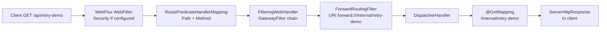
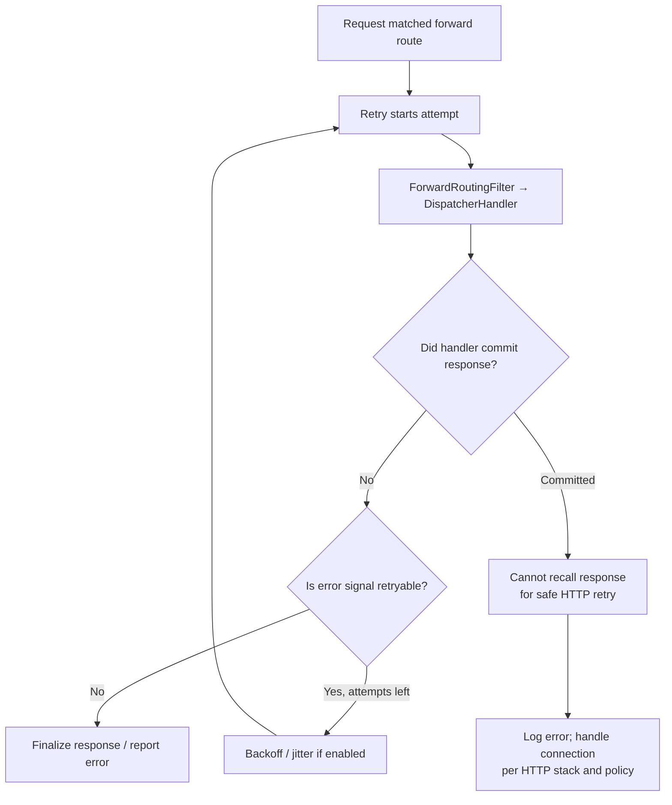

# Retrying With Internal Forward and Uncommitted Response Conditions

An API Gateway can encounter transient errors when calling downstream services: timeouts, closed connections, or `503 Service Unavailable` responses. To improve resilience, **Spring Cloud Gateway** provides the **`Retry` GatewayFilter Factory**. For routes using `http://`, `https://`, or `lb://`, retrying usually involves another backend call. However, the Gateway also supports the **`forward:`** destination, dispatching requests to a handler **inside the same WebFlux application running the Gateway**. When combining `Retry` with `forward:`, a special constraint arises: **the HTTP response must remain uncommitted if you still want to retry**.

Suppose an internal controller handles a request, detects an error, and returns `ResponseEntity.status(503).body(...)`. Once the framework has written status/headers/body to the response, it **cannot rewind** already-sent bytes to retry the handler and swap in a successful response. For `forward:`, the safer approach for **retryable errors** is to **emit an error signal** (`throw` or `Mono.error(ex)`) **before writing the response**, giving `Retry` a chance to catch the error, evaluate conditions, and re-execute the appropriate processing segment.

This lesson belongs to the **Request Retries** chapter of the `SPRING_CLOUD_GATEWAY` module. The topic connects with route predicates, filter chains, path/header transformations, service discovery, authentication, rate limiting, circuit breakers, retries, TLS, and request observability. The goal is implementing retries without sending duplicate responses, accidentally repeating side effects, or mistaking a committed error for a recoverable failure.

> **Scope:** Examples use **Spring Cloud Gateway Server WebFlux** and **Spring Security Reactive** where security is discussed. Newer Gateway versions use the `spring.cloud.gateway.server.webflux.routes` namespace, while many 4.x versions use `spring.cloud.gateway.routes`. The official `Retry` docs explicitly warn: when the destination uses the `forward:` prefix, error handlers must not do anything that causes the response to be sent to the client and committed; for annotated controllers, do not return a `ResponseEntity` with an error status—throw an exception or emit `Mono.error(ex)` so the retry filter handles it.

## 1. What Is Internal Forward and How Does It Differ From Proxying to a Backend?

Spring Cloud Gateway Server WebFlux supports multiple routing mechanisms. Distinguish these two paths:

| Aspect | HTTP/HTTPS or `lb://` Route | `forward:` Route |
| --- | --- | --- |
| Destination | Remote HTTP backend, optionally behind a load balancer | WebFlux handler inside the **Gateway process itself** |
| Routing component | `NettyRoutingFilter` for HTTP(S), plus load balancing if needed | `ForwardRoutingFilter` cooperating with `DispatcherHandler` |
| New outbound HTTP connection | May require TCP/TLS and connection pool | **No extra HTTP network hop** just to forward |
| Handler lookup | URI host/port, instance discovery | Internal WebFlux controller/functional endpoint mapping |
| What does Retry do? | May repeat downstream calls per policy | May repeat handler/filters downstream of Retry on eligible failures |
| Special risk | Timeouts, lost responses, ambiguous side-effect outcomes | Controller/handler may **directly commit the response** before Retry decides |

Example configuration routing a public URL to a handler in the same application:

```yaml
spring:
  cloud:
    gateway:
      server:
        webflux:
          routes:
            - id: local-retry-demo
              uri: forward:///internal/retry-demo
              predicates:
                - Path=/api/retry-demo
                - Method=GET
```

The client calls `GET /api/retry-demo`. The Gateway matches route `local-retry-demo`; `ForwardRoutingFilter` sees the `forward` URI scheme and dispatches handling through `DispatcherHandler` targeting `/internal/retry-demo`. No service discovery registration or backend TCP lookup is needed for this forward step.

**Three common misconceptions:**

1. `forward:///internal/retry-demo` is an **in-server internal forward**, **not an HTTP `302` redirect**. The client is not instructed to issue a second request to another URL.
2. Gateway routing filter's `forward:` is not the same as returning a view name `"forward:..."` from a WebFlux controller. Standard Spring WebFlux does not support MVC Servlet-style view forwarding; Gateway has its own `ForwardRoutingFilter` mechanism.
3. `forward:` is not automatically a fallback. **CircuitBreaker's `fallbackUri`** can use a `forward:` target, yet "returning a fallback after the circuit breaker trips" **differs from** "Retry re-executing the same handler multiple times."

### 1.1. How Is a Forward Route Matched?



Forward is a **processing branch inside the Gateway application**. The internal controller still runs on the Gateway's own CPU, memory, and event loop; using it for heavy work can overload the ingress itself. Retrying repeatedly increases load on the **Gateway process**, not just a backend microservice.

## 2. Response State: "Status Selected" Differs From "Committed"

In WebFlux, responses are managed via `ServerHttpResponse` and the reactive APIs of `ReactiveHttpOutputMessage`.

An **uncommitted response** means metadata/body have not yet been written to the HTTP layer in an irreversible way. The framework may still be assembling status, headers, and body.

A **committed response** means writing to the HTTP layer has begun to the point where it cannot be retracted to send a fresh response with a different status, headers, or body. After commit, a retry cannot guarantee returning a single valid HTTP response for the original request.

| State / Event | Implication for Retry |
| --- | --- |
| Handler just invoked, nothing written yet | Can retry if processing emits an eligible failure |
| Handler emits `Mono.error(ex)` **before response is written** | Retry can catch the error signal and resubscribe/reinvoke appropriately |
| Response has a provisional status set yet **is not committed** | Does not automatically block retry, though you must verify filter state reset safety |
| Handler returns `ResponseEntity.status(503).body(...)` | Risk that the renderer writes the 503 response and **commits**, preventing safe retry |
| Handler calls `response.writeWith(...)` and flushes bytes | May commit; cannot "recall" bytes to resend a whole new body |
| Handler calls `response.setComplete()` | Completes response; never assume it can be revived for retry |
| SSE/streaming already emitted several events then fails | Response already started transmitting; full-request HTTP retry will not restore client state |

### 2.1. Why Is `ResponseEntity.status(503)` Not a Safe Retry Signal?

For a remote HTTP backend, the Gateway can observe a 503 status before writing the final response to the client, and apply status-based retries. With an **internal forward handler**, however, the annotated controller and WebFlux's HTTP message writer build and **send the response** on the exact same exchange that Retry manages.

Example to avoid if the goal is **retrying internal failures**:

```java
@GetMapping("/internal/retry-demo")
public Mono<ResponseEntity<String>> unsafeForForwardRetry() {
    return Mono.just(
        ResponseEntity.status(503).body("temporary failure")
    );
}
```

This code can cause the error status/body to be written out to the client before the retry filter has a chance to trigger another execution. Thus, **do not treat `statuses: SERVICE_UNAVAILABLE` as an "undo" for a committed forward response**.

Instead, the controller should **emit a reactive error** before any response is written:

```java
@GetMapping("/internal/retry-demo")
public Mono<String> retryableFailure() {
    return Mono.error(
        new IllegalStateException("transient local processing error")
    );
}
```

Here the method **has not written a success body or error response to the HTTP layer**; it returns a publisher terminating with an `onError` signal. Retry can intercept the failure **if** the exception type, HTTP method, and retry count match configuration.

**Note:** `Mono.error(...)` does not automatically guarantee a retry if a `@ControllerAdvice`, `onErrorResume`, or another error handler catches the error and turns it into an error response **before Retry sees the signal**. Test the actual execution path and error-handler ordering.

### 2.2. When Does a Response Actually Commit?

In Spring WebFlux, operations that can trigger commit include:

- Starting to write body bytes via `writeWith(...)` or `writeAndFlushWith(...)`.
- Completing the response via `setComplete()`.
- Letting a response renderer serialize `ResponseEntity`/JSON/status/headers.
- Starting to emit a streaming response, SSE, file download, or flushing HTTP headers.

The `exchange.getResponse().isCommitted()` API reports state **at the instant checked**; it is useful for diagnostics, yet **is not a rollback mechanism**. `beforeCommit(...)` lets you register hooks right before commit, not perform an "uncommit" after bytes have been sent.

Therefore, sound design is not "let the controller commit, and if `isCommitted() == true` try to reset." Sound design is **avoiding commit until you know whether the outcome is retryable**.

## 3. Why Must Retries Happen Before the Commit Boundary?

HTTP responses flow toward the client in one direction. Once the server sends the status line/headers or part of the body, changing the status from `503` to `200` on the same response is impossible.



**Key point:** Retry eligibility (status/exception) and the ability to **emit a fresh response to the client** are two separate conditions. Even if an exception matches `exceptions`, retrying an already-committed request **breaks protocol correctness** and can produce "response already committed" errors.

If a controller already flushed `200 OK` and half a JSON payload before emitting `onError`, attempting to retry everything cannot turn the partial output into a clean new JSON response. For streaming, use an **application-level recovery protocol** (resume tokens, sequence IDs, offsets, reconnects) rather than "post-commit HTTP retry."

### 3.1. Necessary Conditions for Safe Retry

A new attempt should execute only when:

1. The error or status **is selected by the Retry policy**.
2. Attempt count has not hit the limit.
3. HTTP method and business logic permit re-execution without dangerous side effects.
4. **The response is still uncommitted**; zero bytes have been sent to the client.
5. The request body and reusable objects (if any) remain in a valid state.
6. Remaining **timeout/deadline budget** allows it.
7. The system is not in a retry storm, open circuit breaker, or overload requiring early termination.

**Uncommitted does not mean free of business side effects.** A handler might write to a database and then emit an error before writing a response. Retrying can **write twice** without idempotency/transaction semantics.

## 4. Configuring the Retry GatewayFilter Factory for Forward

Per Spring Cloud Gateway Server WebFlux documentation, the `Retry` factory supports:

| Parameter | Role | Example |
| --- | --- | --- |
| **`retries`** | Number of **retry attempts** after the first call. | `2` → up to **3 attempts** |
| **`statuses`** | List of specific HTTP codes eligible for retry. | `BAD_GATEWAY`, `SERVICE_UNAVAILABLE` |
| **`series`** | Status series eligible for retry. | `SERVER_ERROR` corresponding to 5xx |
| **`methods`** | HTTP methods eligible for retry. | `GET` |
| **`exceptions`** | Exception types eligible for retry. | `java.lang.IllegalStateException` for lab tests |
| **`backoff`** | Delay between retries, optionally exponential. | `firstBackoff: 50ms`, `factor: 2` |
| **`jitter`** | Random variation on backoff, if supported by version. | `randomFactor: 0.5` |
| **`timeout`** | Retry duration cap per supported version semantics. | `200ms` in newer doc examples |

Newer Server WebFlux docs list typical defaults as:

- `retries`: **3** retries (up to 4 total attempts).
- `series`: **5xx**.
- `methods`: **GET**.
- `exceptions`: **`IOException`** and **`TimeoutException`**.
- `backoff`: disabled; `jitter`: disabled; `timeout`: unlimited under newer retry parameters.

**Defaults can vary by release.** For forward routes, **explicitly declaring** the retryable exception is clearer than relying on defaults. `IllegalStateException` in this demo **is not implicitly included in the default `IOException`/`TimeoutException` list**.

### 4.1. Server WebFlux Route With Exception-Based Retry

```yaml
spring:
  cloud:
    gateway:
      server:
        webflux:
          routes:
            - id: forward-retry-demo
              uri: forward:///internal/retry-demo
              predicates:
                - Path=/api/retry-demo
                - Method=GET
              filters:
                - name: Retry
                  args:
                    retries: 2
                    methods:
                      - GET
                    exceptions:
                      - java.lang.IllegalStateException
                    backoff:
                      firstBackoff: 50ms
                      maxBackoff: 200ms
                      factor: 2
                      basedOnPreviousValue: false
```

Explanation:

1. Gateway matches the route only when a client sends `GET /api/retry-demo`.
2. `forward:///internal/retry-demo` targets the WebFlux handler inside the Gateway.
3. `Retry` allows **2 retries** after the initial attempt. If the handler emits `IllegalStateException` on attempts 1 and 2, then succeeds **before commit** on attempt 3, the client receives the successful attempt 3 response.
4. `backoff` avoids firing all attempts instantaneously. Actual intervals depend on retry sequence, scheduler clock, backoff mode, and framework version.
5. With a bodyless `GET`, the example isolates **commit and exception** behavior from body-caching memory risks.

**Why not configure only `statuses: SERVICE_UNAVAILABLE`?** Internal forward scenarios must signal failure **before the response is written**. When a controller returns an error response, the status may no longer be in a safe state for Retry to intercept. Setting `exceptions` explicitly gives cleaner control over the demo scenario.

### 4.2. Common Namespace in Spring Cloud Gateway 4.x

On older 4.x releases, the equivalent configuration can be:

```yaml
spring:
  cloud:
    gateway:
      routes:
        - id: forward-retry-demo
          uri: forward:///internal/retry-demo
          predicates:
            - Path=/api/retry-demo
            - Method=GET
          filters:
            - name: Retry
              args:
                retries: 2
                methods: GET
                exceptions:
                  - java.lang.IllegalStateException
                backoff:
                  firstBackoff: 50ms
                  maxBackoff: 200ms
                  factor: 2
                  basedOnPreviousValue: false
```

Pick **one namespace** matching your project's BOM and starter. If the route does not load, startup complains about a missing filter, or `exceptions`/`methods` fail to bind, verify the docs for your exact Server WebFlux version and variant. Do not copy a **Gateway Server MVC** retry filter assuming identical APIs and semantics.

### 4.3. Prefer Selecting Recoverable Errors

Retrying all `RuntimeException`s is a **broad and dangerous** policy. Failures like invariant violations, data mapping errors, programming bugs, or missing permissions generally **do not vanish** a few milliseconds later.

In production, use exception types **representing genuine transient failures**, such as recoverable library exceptions or dedicated application exception classes. `IllegalStateException` is chosen here solely as a simple demo to verify exception interception.

**Never retry `401`/`403`/`404` by default**: authentication, authorization, and missing routes are rarely solved by unconditional repetition. For `429`, respect backoff/quotas and `Retry-After` if required by contract; never add `429` to a generic retry list just "hoping the next attempt is allowed."

## 5. Correct Controller Example: Error Before Commit, Third Attempt Succeeds

The controller below is **strictly for hands-on lab environments**. It uses `AtomicInteger` to record attempt counts and `Mono.defer(...)` so result-generation logic runs on **each subscription**, including when Retry resubscribes to the reactive publisher.

```java
package com.example.gateway.demo;

import java.util.Map;
import java.util.concurrent.atomic.AtomicInteger;

import org.springframework.web.bind.annotation.GetMapping;
import org.springframework.web.bind.annotation.RestController;
import reactor.core.publisher.Mono;

@RestController
public class InternalRetryDemoController {

    private final AtomicInteger attempts = new AtomicInteger();

    @GetMapping("/internal/retry-demo")
    public Mono<Map<String, Object>> retryDemo() {
        return Mono.defer(() -> {
            int attempt = attempts.incrementAndGet();

            // First two attempts: emit error, DO NOT write response.
            if (attempt <= 2) {
                return Mono.error(new IllegalStateException(
                    "Temporary failure at attempt " + attempt
                ));
            }

            // Next attempt: return successful response.
            return Mono.just(Map.of(
                "result", "ok",
                "attempt", attempt
            ));
        });
    }

    public int attemptCount() {
        return attempts.get();
    }
}
```

Assuming the route has `retries: 2` and `exceptions: [java.lang.IllegalStateException]`, a fresh public call in a test starting with counter at 0 behaves as:

```text
Client GET /api/retry-demo
  Attempt 1 -> Mono.error(IllegalStateException) -> uncommitted
  Backoff
  Attempt 2 -> Mono.error(IllegalStateException) -> uncommitted
  Backoff
  Attempt 3 -> Mono.just({result: "ok", attempt: 3})

Client:
  HTTP 200
  {"result":"ok","attempt":3}
```

**This is a test controller**, not a production endpoint. A process-wide counter shared across all callers produces request-order-dependent behavior; real tests should reset/isolate state per test case. Under concurrent requests, do not expect attempts #1/#2/#3 to belong to one request if sharing a single counter. Key test failure injection by a **controlled test request ID**, or use a stub with per-scenario sequences/counters.

### 5.1. Why Use `Mono.defer`?

A reactive publisher can be a **cold publisher**, yet statements executed **before creating the publisher** do not automatically re-run just because a new subscription arrives.

Poor example when attempting to count **each retry attempt**:

```java
@GetMapping("/internal/retry-demo")
public Mono<String> fragileCounter() {
    int attempt = attempts.incrementAndGet();
    if (attempt <= 2) {
        return Mono.error(new IllegalStateException("temporary"));
    }
    return Mono.just("ok");
}
```

If Retry **resubscribes to the same publisher** without re-invoking the controller method as expected, `attempts.incrementAndGet()` may not run again. `Mono.defer(...)` moves test side-effect logic to subscription time, making re-execution clearly observable. Still, production business code must be **idempotent**; `defer` is not a duplicate-write safeguard.

### 5.2. Controller Emits Specific Exceptions Instead of Early 503s

Keep failures as reactive signals:

```java
return service.performRead()
    .onErrorMap(
        TemporaryBackendException.class,
        ex -> new RetryableLocalException("temporary", ex)
    );
```

Here `RetryableLocalException` must be defined and listed in Retry's `exceptions` to serve as a trigger. The snippet above is a **skeleton** for error classification, not a complete class.

Avoid:

```java
return service.performRead()
    .onErrorResume(ex -> Mono.just(
        ResponseEntity.status(503).body("temporary")
    ));
```

The second snippet **swallows the error signal** and constructs a 503 response; once the renderer commits the response, Retry cannot safely apply to the forward route.

## 6. Anti-Pattern Example: Committing an Error Before Retry

### 6.1. Returning a `ResponseEntity` With an Error Status

```java
@GetMapping("/internal/retry-status")
public Mono<ResponseEntity<Map<String, String>>> wrongForForwardRetry() {
    return Mono.just(
        ResponseEntity.status(503).body(
            Map.of("error", "temporarily unavailable")
        )
    );
}
```

With route `uri: forward:///internal/retry-status` and a `Retry` filter configured with `statuses: SERVICE_UNAVAILABLE`, learners might expect the Gateway to retry. **Do not rely on this assumption:** official docs warn that an annotated controller returning an error-status `ResponseEntity` can cause the response to be sent and committed. This is **not the recommended forward-retry pattern**.

### 6.2. Writing Part of a Body Then Emitting an Error

```java
@GetMapping(
    value = "/internal/partial",
    produces = "text/event-stream"
)
public Flux<String> streamingThenFail() {
    return Flux.concat(
        Flux.just("event: start\n\n"),
        Flux.error(new IllegalStateException("after first event"))
    );
}
```

This scenario is **unsuitable for full-response HTTP Retry**: if the first event was flushed to the client, the response is committed and **cannot be replaced by a brand-new response from the start**. For SSE/WebSocket/streaming, implement reconnect/resume with sequence IDs and an explicit contract rather than using Retry to rewind streams.

### 6.3. Writing Headers, Cookies, or Redirects Too Early

In some handlers, modifying response metadata can lead to subsequent commit:

```java
// Skeleton illustrating the risk, not a valid retry example.
exchange.getResponse().getHeaders().add("X-Attempt", "1");
return exchange.getResponse().setComplete();
```

Once a handler calls `setComplete()`, **no pending response remains to manipulate**. Retry cannot transform a completed response into another outcome.

Likewise, never emit login/logout cookies, partial files, or `302` redirects before deciding whether to retry. For client-facing side effects, finish all retryable checks **before** writing the response.

## 7. How Do Status-Based and Exception-Based Retries Differ in Forward?

### 7.1. Status-Based Retry

When a remote HTTP backend returns `503`, the Gateway can receive the status as a routing outcome, match `statuses`/`series`, and **still have not written the final client response**; depending on the pipeline, retry can run validly.

```yaml
# Example for a remote HTTP backend, not the preferred pattern for internal forward.
routes:
  - id: orders-upstream
    uri: http://localhost:9090
    predicates:
      - Path=/api/orders/**
    filters:
      - name: Retry
        args:
          retries: 2
          statuses:
            - SERVICE_UNAVAILABLE
          methods:
            - GET
```

With `forward:///internal/...`, the controller operates on the Gateway's **own `ServerHttpResponse`**. If the controller builds and writes a 503 status/body, the window for status-based retry may already be gone. That is why Spring docs recommend **throwing an exception or `Mono.error(ex)` instead of returning an error `ResponseEntity`**.

### 7.2. Exception-Based Retry

An exception signal not yet converted into a response is generally better suited for forward:

```yaml
filters:
  - name: Retry
    args:
      retries: 2
      methods:
        - GET
      exceptions:
        - java.lang.IllegalStateException
```

Still, an exception can arrive **too late**, after a filter or controller already wrote the response. Listing the right `exceptions` **cannot rescue** an already-committed response.

### 7.3. Decision Table

| Scenario | Signal Visible to Retry | Is Retry Safe? |
| --- | --- | --- |
| Forward handler emits `Mono.error` immediately, nothing written | Exception | Possibly, if matching policy and attempts remain |
| Forward handler throws exception before writing response | Exception | Possibly, if error propagates to Retry |
| Forward handler returns `ResponseEntity.status(503).body(...)` | Status handled by renderer | **Do not rely on retry**; commit risk |
| Forward handler returns `Mono.error` yet `@ExceptionHandler` turns it into JSON 503 | Error may already be converted to response | Must verify; exception signal may be gone |
| Forward handler sends partial SSE then `onError` | Exception after response began | Cannot safely retry full HTTP response |
| Remote HTTP backend returns 503 before Gateway writes client response | Status | Can retry per `statuses`/`series` |
| Client disconnected | Cancellation/connection error | Should not keep retrying a response with no recipient |

**Practical rule:** An internal handler may fail, yet **must report failure prior to commit** so Retry can act. Once a final response is produced, accept/record the error per protocol instead of trying to fake a "retry" inside an already-sent response.

## 8. How Many Retries, How Much Backoff, and Load Amplification Risk?

A configuration:

```yaml
filters:
  - name: Retry
    args:
      retries: 2
      exceptions:
        - java.lang.IllegalStateException
      methods:
        - GET
      backoff:
        firstBackoff: 50ms
        maxBackoff: 200ms
        factor: 2
        basedOnPreviousValue: false
```

means **1 initial attempt + up to 2 retries**. If 100 requests fail simultaneously on the first try, handler executions **can reach 300**, excluding retries at other layers.

\[
\text{Max attempts} = 1+\text{retries}
\]

\[
\text{Theoretical total attempts}
=\text{Admitted requests}\times(1+\text{retries})
\]

This formula is an **upper bound** when every request traverses the same retry policy without early success, cancellation, or timeout; it does not mean every request exhausts all retries.

### 8.1. Backoff and Jitter

Exponential backoff separates retries in time. With `firstBackoff=50ms` and `factor=2`, modeled waits can grow 50 ms → 100 ms → 200 ms (capped by `maxBackoff`), though exact sequence and previous-value math depend on parameters and version.

**Jitter** adds randomized variance to keep thousands of requests from retrying at the exact same timestamp. Newer Gateway releases expose `jitter.randomFactor` and `timeout`; configure them only when supported by your version rather than assuming identical support across all 4.x lines.

For forward retries:

- Slow backoff holds Gateway resources per request longer.
- An internal handler failing en masse executes repeatedly inside the same process.
- Client overall deadlines must leave enough room, or retries must stop when time runs out.
- If Retry is masking a non-transient programming bug, backoff only slows the system down further.

### 8.2. Never Retry Forever

An unbounded retry loop can cause:

- Unexpected spikes in subscriptions/handler invocations.
- CPU/memory pressure inside the Gateway process.
- Elevated p95/p99 latency and client timeouts.
- Duplicate side effects when handlers write to Redis/databases or publish messages.
- Sustained load on the exact failing dependency, hindering recovery.

Bounding `retries`, timeouts/deadlines, idempotency, and circuit breakers **complement** each other; you do not pick just one of the four.

## 9. Filter Order: Which Filters Re-Execute?

Spring Cloud Gateway documentation states clearly: **the Retry filter retries all filters placed after it in the filter chain**.

This affects filters that:

- Add or modify headers and request attributes.
- Emit access logs, tracing spans, and metrics.
- Read or cache request bodies.
- Enforce rate limits.
- Call backends, write data, or trigger side effects.
- Trip circuit breakers or invoke fallbacks.

Example illustrating intent:

```yaml
filters:
  - name: RequestRateLimiter
    args:
      key-resolver: "#{@principalKeyResolver}"
      redis-rate-limiter.replenishRate: 5
      redis-rate-limiter.burstCapacity: 10
  - name: Retry
    args:
      retries: 2
      methods:
        - GET
      exceptions:
        - java.lang.IllegalStateException
```

If the rate limiter executes **before Retry in actual runtime order**, it can charge once per client request while filters/handlers after Retry re-run. If a limiter or custom filter sits **after Retry**, it can run multiple times and charge quota per attempt.

**Never read YAML line order alone** when `GlobalFilter`s, explicit filter orders, or custom factories exist. Gateway merges and sorts filters by `Ordered`; verify actual runtime order. Explicitly decide whether metrics count **inbound requests** or **attempts**.

### 9.1. Side Effects in Custom Filters

A custom filter might contain:

```java
// Cautionary skeleton snippet.
auditCounter.incrementAndGet();
return chain.filter(exchange);
```

If placed inside the filter chain segment retried by Retry, `auditCounter` can increment multiple times for one inbound request. For business auditing or billing, this is a bug if the author implicitly assumed each filter run represents a distinct client request.

**Good design:** separate **request-level instrumentation** from **attempt-level instrumentation** and clearly log `retry_scheduled`, `attempt_started`, `attempt_failed`, `attempt_succeeded` events. Never log raw JWTs, cookies, or sensitive data.

### 9.2. Exchange Attributes Persist Across Attempts

In WebFlux, `ServerWebExchange` holds the request, response, and attributes. When a segment retries on the same exchange, attributes or state modified by custom filters can influence the next attempt.

Do not assume each retry is a brand-new HTTP request with a pristine exchange. Test:

- Does an `AddRequestHeader` filter duplicate headers across retries?
- Does custom filter data stored in `exchange.getAttributes()` accumulate?
- Does a pre-Gateway security context need/undergo re-evaluation?
- Are `Set-Cookie` or `Content-Length` response headers left over from a failed attempt?
- Do tracing counters cleanly separate inbound requests from retry attempts?

## 10. Retrying POST/PUT and Body-Bearing Requests: Safety Boundaries

Gateway WebFlux documentation warns that enabling Retry for **any HTTP method with a request body** can **cache the body in memory** as a `DataBuffer` for replay. With large bodies and high concurrency, this poses a major risk to the Gateway.

### 10.1. Why Must Bodies Be Cached?

HTTP request bodies in WebFlux are reactive streams. An already-consumed stream **cannot naturally replay** on a second attempt. Retry needs a replay/caching mechanism to re-transmit the same body if policy permits.

Risks:

- Additional memory consumption proportional to body size and concurrency.
- Codec/buffer limit errors or OOM when many large payloads retry at once.
- Uploads/streams unsuitable for full in-memory buffering.
- Bodies carrying sensitive data that should not linger in memory or dumps.
- Attempt 1 already persisted side effects before failing, and attempt 2 repeats the write.

### 10.2. POST Is Not Safe Simply Because the Response Was Uncommitted

Example:

```text
POST /api/payments
  Attempt 1: debits account successfully, then errors before writing response
  Retry:
  Attempt 2: debits account a second time
```

An uncommitted HTTP response **does not mean the prior transaction rolled back**. For side-effecting operations, enforce **idempotency keys**, deduplication, and solid transaction/business semantics where execution occurs.

For internal forward endpoints, restrict initial retries to **GET/read-only/idempotent handlers**. Expand to write methods only after verifying body replay, authorization, idempotency, and memory impact. `PUT`/`DELETE` carry standard idempotent semantics, yet concrete implementations still need side-effect verification.

### 10.3. When Should You Not Use Retry?

Avoid auto-retrying the entire request when:

- The response already committed or began streaming.
- Errors stem from invalid input, missing permissions, bad tokens, or coding bugs.
- The handler already executed side effects that **cannot be repeated safely**.
- Request bodies are very large or non-replayable.
- The client disconnected or the deadline expired.
- A dependency is overloaded and retries amplify load.
- A fallback already emitted a response and the contract defines that as final.

## 11. Internal Forward vs. CircuitBreaker Fallback: Do Not Conflate Them

Spring Cloud Gateway can also use a **CircuitBreaker** filter with `fallbackUri: forward:/fallback`. That forwards to a **fallback handler** after the circuit breaker triggers fallback—unlike Retry re-running the primary handler multiple times.

| Mechanism | When Triggered | Action |
| --- | --- | --- |
| **Retry** | An attempt fails matching policy | Re-executes the downstream chain within allowed count/time |
| **CircuitBreaker** | Error rate/conditions trip circuit per policy | Sheds calls; may return error/fallback |
| **Forward route** | Gateway matches a `forward:` route | Dispatches handling to an internal WebFlux handler |
| **Fallback forward** | CircuitBreaker chooses fallback path | Dispatches to handler to produce a substitute response |

Conceptual example:

```yaml
# Example illustrating a mechanism distinct from Retry:
filters:
  - name: CircuitBreaker
    args:
      name: ordersCircuit
      fallbackUri: forward:/fallback/orders
```

With a fallback, the controller is supposed to **return a fallback response** with a designed status/body. That **does not mean** a controller acting as a **Retry forward** target can freely commit an error response and expect Retry to roll it back. Distinguish the goal of **terminating via fallback** from **retrying another attempt**.

### 11.1. Prevent Forward Loops

A severe misconfiguration is forwarding to a path that matches the exact same Gateway route again:

```text
Path=/api/**
uri=forward:///api/internal

Forward /api/internal
  -> matches Path=/api/** again
  -> forwards recursively ...
```

Depending on dispatch mechanics and routing conditions, this can create infinite loops, stack/resource exhaustion, or cryptic failures. **Choose internal paths outside public route patterns**, e.g. `/internal/retry-demo`; test actual routing, block direct access, and prevent catch-all routes from forwarding endlessly.

## 12. Security: Internal Handlers Are Not Automatically Private

A controller mapped to `/internal/retry-demo` is still a **WebFlux handler** inside the same application. If a client directly calls `GET /internal/retry-demo`, WebFlux **can** route to that handler unless blocked by security or routing rules.

**Never treat an `/internal/` prefix as a firewall.** When using forward for sensitive logic:

- Spring Security must protect **public URLs** with proper authentication/authorization.
- **Direct calls** to internal handler paths must also be blocked or restricted via tested security/ingress policies.
- Never trust client-supplied `X-Internal-Call: true` headers as proof of forwarding.
- Never expose debug/counter-reset endpoints or sensitive Actuator endpoints to the Internet.
- If the handler accesses databases, brokers, or remote APIs, enforce least privilege and tenant/resource authorization.

### 12.1. Placement of `Spring Security WebFilter`

In standard WebFlux setups, **`Spring Security WebFilter`** processes inbound requests before Gateway route filters. Internal forward routes use `DispatcherHandler` to dispatch handlers and do not necessarily create a **new inbound HTTP request** from the client or an isolated second security chain run.

Therefore, verify all four:

1. `GET /api/retry-demo` **without a token** → blocked per public API policy.
2. `GET /api/retry-demo` **with valid permissions** → forwarded and retried as expected.
3. `GET /internal/retry-demo` **called directly by a client** → never inadvertently left public.
4. Catch-all routes or other handler mappings create no bypass path to the same functionality.

Never configure one rule for `/api/retry-demo` and assume `/internal/retry-demo` is unreachable directly. Write explicit rules for the direct path and test end-to-end.

### 12.2. Resource Limits and DoS Risks

Because forward Retry repeats **work in the same process**, an attacker could abuse a fast-failing endpoint to force the Gateway to loop execution. Systems need:

- Bounded retry counts and timeouts.
- Edge rate limiting on inbound requests.
- Protection against handlers throwing `RetryableException` endlessly.
- Avoiding full stack-trace logging on every attempt under high traffic.
- Circuit breakers/bulkheads where handlers call other dependencies.
- Body size, CPU, memory, and request concurrency caps.

**An available Gateway is a shared resource** across many services; never let one route's retry logic monopolize the event loop or saturate thread pools and take down other APIs.

## 13. Integration Testing: Measuring Retries and Response Commit State

Never assert HTTP 200 alone. To prove Retry **actually** worked, measure handler execution counts, error types, and commit timing.

### 13.1. Scenario A — Two Pre-Commit Errors Then Success

Using the route in Section 4.1, the controller in Section 5, and a fresh test context with counter at 0:

```java
// Snippet inside a @SpringBootTest integration test (illustrative).
// Requires configuring WebTestClient against a running Gateway.

webTestClient.get()
    .uri("/api/retry-demo")
    .exchange()
    .expectStatus().isOk()
    .expectBody()
    .jsonPath("$.result").isEqualTo("ok")
    .jsonPath("$.attempt").isEqualTo(3);

assertThat(internalRetryDemoController.attemptCount())
    .isEqualTo(3);
```

Conditions:

- `@SpringBootTest` loads full Gateway routes/filters and the controller.
- No other filter/security/route blocks the request before the demo route.
- Each test case uses an isolated counter or resets properly.
- No concurrent requests share the counter and mix attempt numbers.

A test that mounts only the controller without the Gateway filter chain misses the point entirely. If the counter increments once while returning 200, either the controller never failed or the test bypassed Retry.

### 13.2. Scenario B — Exhausting All Retries

Modify the test handler to **always emit an error** before commit:

```java
return Mono.defer(() ->
    Mono.error(new IllegalStateException("always failing")));
```

With `retries: 2`, expect **3** attempts before the final error enters exception handling and produces the client response. **The final status code** depends on `WebExceptionHandler`, error mapping, and security/HTTP stack; commonly it is `500`, yet tests should follow your actual contract.

If an always-failing handler retries endlessly or increments the counter past expectations, check nested retries, filter ordering, other routes, circuit breakers, or client-side retries.

### 13.3. Scenario C — Controller Returns Error `ResponseEntity`

Change the handler to:

```java
return Mono.just(
    ResponseEntity.status(503).body("temporary")
);
```

**Educational expectation:** this is the exact anti-pattern Spring docs **warn against** with Retry + `forward:`. Tests should inspect:

- Did the response commit before the filter could process a retry?
- Was the handler re-invoked as the author hoped?
- Were errors logged trying to mutate an already-committed response?
- Were inconsistent statuses/bodies emitted or truncated?

**Do not write tests assuming this case reliably returns 503 three times** or reliably retries cleanly. The purpose is identifying the **anti-pattern**, not locking in consistent behavior for a broken pattern across versions.

### 13.4. Scenario D — Error Handler Swallows the Error Signal

Add a `@RestControllerAdvice` or `onErrorResume` converting the exception into JSON `500`/`503` before Retry sees it. Observe whether Retry still observes the exception and whether the response already committed.

Key lesson: error handlers built for regular UI/API responses can alter **when an exception turns into an HTTP response**. For forward retries, maintain a **clean boundary** between retryable failures and errors converted into final responses.

### 13.5. Scenario E — Writing Partial Stream Then Failing

Have a streaming handler emit a first chunk, then `onError`. Check:

- Did the client receive partial bytes before connection error/close?
- Did the Gateway observe `isCommitted()==true` when the error fired?
- Were there attempts to write a second response?
- Did the retry policy trigger, and if so, did it risk breaking protocol?

This test is for **catching unsafe behavior** and excluding streams from Retry—never treat appending more data after a failure as "successful retry."

### 13.6. Comprehensive Test Matrix

| ID | Scenario | What to Verify |
| --- | --- | --- |
| F1 | `GET` forward, `Mono.error` twice then success | 3 attempts, one successful response |
| F2 | `GET` forward, always emits eligible exception | Stops after `1 + retries`, final response per error policy |
| F3 | Exception not in `exceptions` | Does not retry on that exception |
| F4 | `POST` not in `methods` | Does not retry merely due to exception |
| F5 | Controller returns `ResponseEntity.status(503)` | Identifies commit risk; does not assume retry works |
| F6 | Controller emits `Mono.error` yet `@ExceptionHandler` converts to 503 | Checks whether exception was swallowed before Retry |
| F7 | Handler flushes body chunk then fails | Must not emit a "successful" HTTP response by restarting |
| F8 | `ServerHttpResponse.isCommitted()` after writing data | Cannot roll back |
| F9 | Forward target path matches catch-all route | Catches forward loop/route shadowing risk |
| F10 | Direct call to `/internal/retry-demo` | Security/ingress blocks unintended access |
| F11 | Client lacks JWT/scope on public path | 401/403; handler never invoked |
| F12 | Retry + `RequestRateLimiter` in different orders | Distinguishes per-inbound vs. per-attempt quota |
| F13 | Retry + custom logging/headers filter | No duplicated headers or unintended duplicate event logs |
| F14 | Large request body with POST Retry enabled | Measures memory pressure/cached `DataBuffer`; enforces limits |
| F15 | Handler writes database then fails | Prevents duplicate side effects via idempotency |
| F16 | Multiple Gateway replicas running forward | Attempts stay request-local, not reliant on shared demo counters |
| F17 | Jitter/backoff, burst of 100 requests | No retry storm; p99 within SLA |
| F18 | Client disconnect/timeout | Stops work where possible; no wasted retries |

## 14. Observing Commit State and Attempt Counts

A test or production dashboard should distinguish **client requests** from **retry attempts**:

| Metric / Log Field | Why Needed? |
| --- | --- |
| `routeId` and public path | Shows which route matched |
| Sanitized `forward target` | Shows which internal handler ran |
| Inbound request count | How many requests clients sent |
| Attempt count per route/error | How much extra execution retries caused |
| Retry reason: status vs. exception | Diagnoses exact Retry trigger |
| Final HTTP status and response size | What the client actually received |
| Response committed flag on exception | Detects errors occurring after response transmission began |
| p95/p99 latency and backoff time | Evaluates SLA impact |
| CPU/memory/event-loop pressure | Prevents retries from overloading the Gateway itself |
| Backend/database side-effect count | Catches unexpected duplicate writes |

### 14.1. Example: Inspecting Response Commit State While Debugging

In a custom filter or `WebExceptionHandler` with exchange access, you can inspect:

```java
boolean committed = exchange.getResponse().isCommitted();
```

This is **an observation at the instant read**, not complete coverage of all timing or protocol cases. If logged before the renderer commits, `false` does not guarantee the response stays uncommitted by the next retry. Tests must assert **final responses, logs, and attempt counts**.

**Never call `setStatusCode(...)` after commit** thinking you fixed the status. Once `ServerHttpResponse` transitions to committed, it cannot revert to an unsent HTTP response.

### 14.2. Instrumentation with Micrometer/Tracing

You can pair Gateway metrics with custom retry counters, provided you:

- Avoid labels with raw JWTs, session IDs, or PII.
- Clearly distinguish **request-level** from **attempt-level** counters to avoid double counting.
- Use stable route IDs and normalized exception categories to prevent high cardinality.
- Track final `503`/`5xx` separately from exceptions handled internally by Retry.
- Alert when retries/initial attempts spike or when `isCommitted=true` accompanies errors.

Spring Cloud Gateway/Actuator docs cover request and route metrics; granular retry metrics depend on version and custom instrumentation. Never assume enabling Actuator automatically provides every counter in the table above.

## 15. Troubleshooting Common Failures

### 15.1. "Configured `retries=2` Yet Handler Only Runs Once"

Check in order:

1. Did the request match the **right route ID** carrying the Retry filter?
2. Is the HTTP method included in `methods`?
3. What **exception type** did the handler emit? Does it match `exceptions`?
4. Did `@ExceptionHandler` or `onErrorResume` convert the exception into a response?
5. Did the response commit before Retry could act?
6. Did controller code run outside `Mono.defer`, miscounting attempts in the test?
7. Is the namespace wrong or did another higher-priority route match first?

### 15.2. "Attempt 2 Reports Response Already Committed"

This is a major red flag on forward routes. Attempt 1's handler or filter likely wrote status/headers/body, preventing attempt 2 from producing an independent response. Check:

- `ResponseEntity.status(503)` / `ResponseEntity.body(...)`.
- `response.writeWith(...)`, `setComplete()`, SSE.
- `@ExceptionHandler` / `WebExceptionHandler` / custom `GlobalFilter`.
- `Content-Length`, `Set-Cookie`, redirect headers.

**Root fix:** Convert retryable errors into exceptions **before commit** rather than trying to reset/clear a response after bytes have been flushed.

### 15.3. "Retrying Repeatedly Yet Still Failing"

If the root cause is a coding bug, bad validation, or an unrecoverable dependency, retries just burn resources. Narrow exception matching, lower retry counts, set deadlines, use circuit breakers, and investigate the root cause.

### 15.4. "One Request Writes Data Multiple Times"

Not every duplicate comes from response commit issues: data may have already been written before the handler emitted an error. Enforce idempotency keys, transaction boundaries, and rollback/dedup policies. Allow retries only when attempts are semantically safe.

### 15.5. "`/internal/retry-demo` Is Reachable Without Going Through the Gateway"

Internal WebFlux handlers can accept direct HTTP requests. Configure Spring Security/ingress protections, test direct paths, and never treat `/internal/` as authentication. If a helper **need not be an HTTP handler**, call an internal component/service method directly instead of exposing a mapped controller endpoint.

### 15.6. "429s Spike During Retries"

If `RequestRateLimiter` sits inside the retried segment of the filter chain, it may deduct quota on every attempt. Or multiple clients may retry simultaneously during downstream errors. Verify filter order, per-attempt counts, and decide whether quotas apply per inbound request or per attempt.

### 15.7. "Forward Retry Gets Intercepted by a Catch-All Route"

Inspect route `Path` predicates and `order`. A broad `/api/**` route might outrank your demo route without Retry attached. Internal `/internal/**` paths must also stay isolated from other forward routes. Never guess from client URLs without inspecting runtime routes.

## 16. Safe Implementation Workflow

1. **Confirm whether `forward:` is truly needed.** For internal helper logic, a service method works; use `forward:` only when WebFlux `HandlerMapping`/`DispatcherHandler` is required.
2. **Choose idempotent endpoints.** Favor GET/read-only for Retry; write operations require idempotency/transaction semantics.
3. **Restrict error types.** Retry only transient errors with explicit exception classes; never default to `RuntimeException` in production.
4. **Design pre-commit failure signaling.** Error handlers emit exceptions/`Mono.error` rather than error `ResponseEntity`s expecting post-commit Retry recovery.
5. **Avoid pre-retry side effects.** Never write cookies/status/body/redirects early; never run unprotected duplicate writes.
6. **Set attempts, backoff, and deadlines.** Prevent retry storms; enable jitter when supported and needed.
7. **Verify filter order.** Know which filters re-run and whether quotas/metrics count attempts or inbound requests.
8. **Protect internal handlers.** Secure public paths, restrict direct access to internal targets, enforce TLS, and align infrastructure policies.
9. **Run integration tests.** Test pre-commit failures, post-commit failures, non-matching exceptions, always-fail, body streaming, concurrency, and cancellation.
10. **Monitor and roll back.** Track attempt counts, commit errors, final 5xx rates, p99, CPU/memory, and dial down/disable Retry under overload.

## 17. Self-Check Scenarios

### Scenario A — Controller Returns 503 With Body

A route uses `forward:///internal/check` with `Retry` configured for `statuses: SERVICE_UNAVAILABLE`. The controller returns `ResponseEntity.status(503).body("fail")`.

**Question:** Should you rely on Retry re-running after that error response?

**Explanation:** **No.** Spring docs warn that forward controllers should not return error-status `ResponseEntity`s because doing so can commit the response before Retry intervenes. Convert recoverable errors into exceptions/`Mono.error` prior to writing a response.

### Scenario B — Two Exceptions Then Success

A `Mono.defer` handler emits `IllegalStateException` on the first two subscriptions, then returns success JSON on the third. Retry sets `retries: 2` and lists `IllegalStateException` in `exceptions`.

**Explanation:** Given matching route/method and an uncommitted response, up to three attempts can run, and the client can receive the successful third-attempt response.

### Scenario C — Partial Stream Already Sent

A handler emits one SSE event and then fails. **Question:** Can you retry the entire HTTP response to replace the SSE stream with fresh JSON?

**Explanation:** Unsafe. Once bytes are flushed, you cannot uncommit the response. Protocol/application-level reconnect/resume is required.

### Scenario D — Exception Outside `exceptions`

Default Retry in your version covers only `IOException`/`TimeoutException`, yet the handler emits `IllegalStateException`.

**Explanation:** The failure is not retry-eligible; declare the matching exception explicitly or emit an appropriate supported transient error. Never blanket-match all exceptions just to pass a test.

### Scenario E — Order Creation POST

A handler persists an order and then emits an exception before responding; Retry re-invokes it and creates a second order.

**Explanation:** An uncommitted response **does not guarantee idempotency**. You need deduplication/idempotency keys or to avoid retrying write operations.

### Scenario F — RateLimiter Downstream of Retry

One inbound request triggers three retry attempts; the limiter sits inside the retried chain segment.

**Explanation:** It can deduct quota multiple times for one inbound request. Confirm chain ordering and intended quota semantics.

### Scenario G — Direct Access to Target

Public API `/api/retry-demo` is JWT-protected, yet calling `/internal/retry-demo` directly still returns JSON.

**Explanation:** The internal handler path is still a WebFlux endpoint requiring direct-access protection; `forward:` does not automatically make it private.

### Scenario H — Response Already Committed, `isCommitted=true`

A custom filter detects `exchange.getResponse().isCommitted() == true` after a handler failure.

**Explanation:** You cannot call `setStatusCode(200)` or retry to erase already-sent bytes. Redesign to emit errors prior to commit or handle post-commit errors per HTTP semantics.

## 18. Key Takeaways

1. **`forward:` dispatches to a WebFlux handler inside the Gateway itself**, neither redirecting the client nor calling a remote backend via Netty HTTP client.
2. **Retry eligibility and response commit are independent conditions.** Safe retries require emitting eligible errors **before the response commits**.
3. **With `forward:`, prefer `throw` or `Mono.error(ex)` for retryable failures** instead of returning an error `ResponseEntity` expecting Retry to undo it.
4. **`retries=2` means up to two extra tries**, for a maximum of three attempts absent other errors/cancellations.
5. **Configure `exceptions`, `methods`, and backoff explicitly**; never blindly retry all exceptions, methods, or statuses.
6. **Retry re-runs filters placed after it**; align quotas, logs, and side effects to either inbound requests or retry attempts.
7. **An uncommitted response does not imply zero side effects.** POST/PUT need idempotency, and request body caching can create memory pressure.
8. **Forward handlers are not private by default**; secure public URLs and guard direct access to internal target paths.
9. **Test both happy and failure paths:** `Mono.error` then success, all-fail, error `ResponseEntity`, partial streams, mismatched exceptions, and filter ordering.

**Practical conclusion:** In Spring Cloud Gateway, `Retry` on a `forward:` route is only effective when the application **keeps the response uncommitted** until deciding whether to retry. Design handlers to emit reactive error signals before writing statuses/bodies, retry only transient failures, cap attempts, and guard all side effects. Once a response has been flushed to the client, no Retry setting can make it "unsent"—at that point, handle errors per protocol or build an application-level recovery mechanism.

### References

- [Spring Cloud Gateway Server WebFlux — Retry GatewayFilter Factory](https://docs.spring.io/spring-cloud-gateway/reference/spring-cloud-gateway-server-webflux/gatewayfilter-factories/retry-factory.html): Retry parameters, defaults, warning on `forward:` and error `ResponseEntity`, filter ordering, and body caching.
- [Spring Cloud Gateway 4.2 — Retry GatewayFilter Factory](https://docs.spring.io/spring-cloud-gateway/reference/4.2/spring-cloud-gateway/gatewayfilter-factories/retry-factory.html): configuration syntax with the `spring.cloud.gateway.routes` namespace.
- [Spring Cloud Gateway Server WebFlux — Global Filters](https://docs.spring.io/spring-cloud-gateway/reference/spring-cloud-gateway-server-webflux/global-filters.html): `ForwardRoutingFilter`, `DispatcherHandler`, and differences from `NettyRoutingFilter`.
- [Spring Framework — ReactiveHttpOutputMessage API](https://docs.spring.io/spring-framework/docs/6.1.21/javadoc-api/org/springframework/http/ReactiveHttpOutputMessage.html): `isCommitted()`, `beforeCommit()`, `writeWith()`, and `setComplete()`.
- [Spring Framework — WebFlux DispatcherHandler](https://docs.spring.io/spring-framework/reference/web/webflux/dispatcher-handler.html): reactive dispatch mechanics, distinguishing view forwarding from internal routing.
