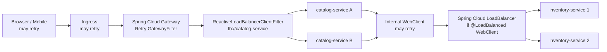
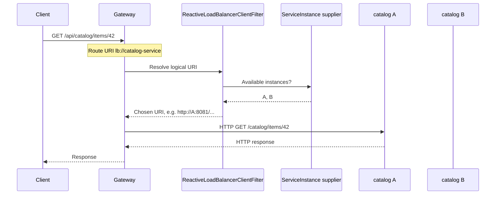
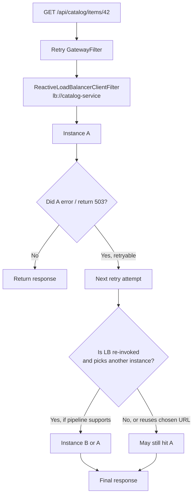
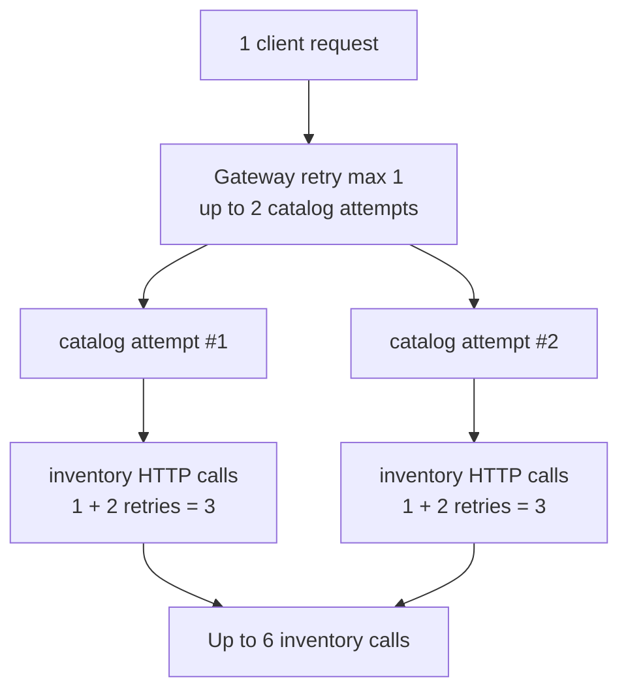
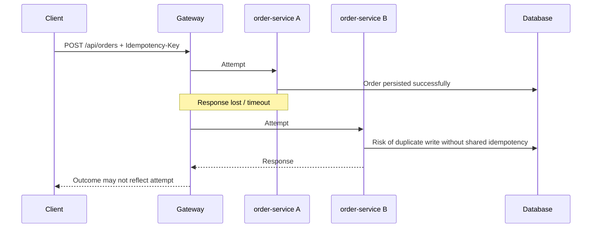

# Interaction With Load Balancers and Service Retry Mechanisms

In a microservices system, a request arriving at an API Gateway may be dispatched to one of several instances of the same service. If the chosen instance fails, you might assume **retrying will automatically fail over to a healthier instance**. In reality, multiple distinct retry layers exist: **the `Retry` GatewayFilter**, **Spring Cloud LoadBalancer retries for HTTP clients**, **retries executed by the microservice itself**, and even **client or ingress retries**. They differ in scope, triggers, and instance selection behavior.

For example, a client calls `GET /api/catalog/items/42` on **Spring Cloud Gateway Server WebFlux**; the route targets `lb://catalog-service`. The Gateway may use `Retry` to re-send the HTTP request. `catalog-service` itself also calls `inventory-service` through a `WebClient` with its own retry policy. If these layers each retry multiple times, one client request can trigger a burst of internal calls and worsen an overload incident.

This lesson belongs to the **Request Retries** chapter of the `SPRING_CLOUD_GATEWAY` module. When building an API Gateway with route predicates, filter chains, path/header transforms, and service discovery, coordinating retries with load balancing, authentication, rate limiting, circuit breakers, timeouts, TLS, and observability is essential to keeping the microservices ingress reliable.

**Learning objectives:**

1. Distinguish `Retry GatewayFilter`, **Spring Cloud LoadBalancer** retries, and **internal service/client** retries.
2. Understand `lb://serviceId` resolution, `ServiceInstance` selection, and the limits of assuming "retries always switch instances."
3. Design retries around `statuses`, `methods`, `exceptions`, `backoff`, and overall budgets.
4. Recognize **retry amplification** across multiple retry layers and know how to trim overlapping layers.
5. Handle body-bearing requests, idempotency, `503` errors from missing instances, and cases where the backend finishes executing despite a Gateway timeout.
6. Write configurations and tests verifying **outbound attempt counts, selected instances, route IDs, and latency**.

> **Version Scope:** This lesson uses **Spring Cloud Gateway Server WebFlux** and **Spring Cloud LoadBalancer**. Gateway WebFlux 5.x uses the `spring.cloud.gateway.server.webflux.routes` route namespace; Gateway WebFlux 4.3.x commonly uses `spring.cloud.gateway.routes`. Load-balanced `WebClient` behavior under Spring Cloud Commons **does not automatically match** the Gateway's Reactor Netty proxy mechanics. Exact behavior of filter ordering, request body caching, per-instance retries, and HTTP client layers depends on version and configuration; verify with integration tests, especially before promising instance switching on every retry.

## 1. Four Places Where Retries Can Happen

The diagram below depicts a product-read and inventory-check flow:



There is no single "master retry engine" controlling every layer in this diagram.

| Layer | Who Executes It? | When Is It Triggered? | Does It Control Instance Selection? |
| --- | --- | --- | --- |
| External client | Browser, mobile SDK, HTTP client | Timeout/status where client chooses to retry | May hit a different Gateway pod via ingress |
| Ingress / reverse proxy | NGINX, Envoy, mesh, cloud LB | Per edge retry policy | May pick another Gateway pod; does not directly pick Java service instances |
| **Gateway Retry** | `RetryGatewayFilterFactory` in a route | When downstream filter chain returns matching status/exception | **Does not guarantee** switching `ServiceInstance` |
| **Spring Cloud LoadBalancer retry** | Load-balanced `WebClient`/`RestTemplate` via Commons integration | When HTTP client is configured with matching LB retry | Supports **same/next `ServiceInstance`** settings within supported integrations |
| **Service-level retry** | `retryWhen`, Resilience4j Retry, SDK, database client | Per service code and policy | Depends on the service's own HTTP client and discovery |

**Core point:** Having an `lb://catalog-service` route **does not mean** `spring.cloud.loadbalancer.retry.*` properties replace or fully govern Gateway's `Retry`. These are two separate layers serving different purposes.

## 2. What Does `lb://` Do Without Retries?

When a route has `uri: lb://catalog-service`, Gateway WebFlux uses `ReactiveLoadBalancerClientFilter` and Spring Cloud `ReactorLoadBalancer` to pick an instance for service ID `catalog-service`. It rewrites the logical URI to a concrete host/port before HTTP routing.



In Gateway WebFlux, `ReactiveLoadBalancerClientFilter` reads `ServerWebExchangeUtils.GATEWAY_REQUEST_URL_ATTR`. When the URI scheme is `lb`, it picks an instance and updates that attribute to the corresponding `http://` or `https://` URI. `NettyRoutingFilter` then sends the HTTP request to the chosen URI.

### Distinguishing Route Matching from Instance Selection

| Step | Question | Component Involved |
| --- | --- | --- |
| Route selection | Which route matches `/api/catalog/**`? | `RoutePredicateHandlerMapping` |
| Path transform | Does backend receive `/catalog/items/42` or original path? | `StripPrefix` / `RewritePath` |
| Service resolution | Which instances exist for `catalog-service`? | Discovery / `ServiceInstanceListSupplier` |
| Load balancing | Pick A or B for this dispatch? | `ReactorLoadBalancer` |
| Outbound transport | Open TCP/TLS connection and await HTTP response | Reactor Netty HTTP client |
| Retry decision | Should another attempt run? | Retry policy at the active layer |

If **no instance exists**, the Gateway typically returns `503 Service Unavailable` by default during load balancing; a config option allows returning `404`. If **an instance exists yet the port refuses connections**, that is a transport error. If the backend returns **HTTP 503**, we actually reached a responding upstream; these three scenarios are not identical.

### TLS Is Not Just a Single Hop

A client accessing `https://api.example.com` does not guarantee the Gateway uses HTTPS to the backend. The outbound `lb://` scheme can be affected by `ServiceInstance.isSecure` and route/filter settings. TLS handshake/certificate errors can fail requests even when an instance is found; **retries cannot fix a bad truststore or certificate hostname mismatch**.

## 3. `Retry` GatewayFilter: Route-Level Retry Policy

Gateway WebFlux includes the **`Retry` GatewayFilter Factory**. Key parameters:

| Parameter | Meaning | Notes |
| --- | --- | --- |
| `retries` | **Number of additional retries** | `1` means up to **2 attempts**, not 1 |
| `statuses` | Specific HTTP statuses eligible for retry | `BAD_GATEWAY`, `SERVICE_UNAVAILABLE`, etc. |
| `series` | An entire status group | `SERVER_ERROR` / `5XX` per supported enum |
| `methods` | HTTP methods eligible for retry | Common default is `GET` |
| `exceptions` | Exception classes triggering retry | e.g., transport/timeouts depending on version |
| `backoff` | Progressive delay between attempts | `firstBackoff`, `maxBackoff`, `factor` |
| `jitter` | Adds randomness to backoff | Reduces synchronized retry waves |
| `timeout` | Limit tied to Retry execution per implementation | Not a substitute for HTTP client timeouts or system-wide deadlines |

Defaults described in Gateway 5.x docs when `Retry` is enabled include **3 retries**, **5xx** series, **GET** method, `IOException`/`TimeoutException`, backoff and jitter off, and unlimited retry timeout. For a predictable policy, **declare critical conditions explicitly** instead of relying blindly on defaults.

### One Attempt vs. One Retry Differ

```text
Client request #1
   ├── outbound attempt #1  ← always runs if request is proxied
   └── outbound attempt #2  ← runs if retries=1 and retry criteria match

Maximum attempts in one retry cycle:
   1 + retries
```

With `retries: 2`, a route can dispatch up to **3 attempts** under ideal conditions, unless client cancellation, an OPEN breaker, response commit, or a non-retryable failure stops it early.

### Retry Re-Runs Filters Placed After It

Official docs state clearly: `Retry` **retries all filters placed after it** in the chain. Consequently:

- A downstream custom `GatewayFilter` with side effects (auditing, billing, external API calls) **can run multiple times**.
- A filter before `Retry` typically participates only in the outer pass, depending on logic and reactive signals.
- Ordering between `Retry` and `CircuitBreaker` decides whether the breaker counts **each attempt** or **the final outcome of the logical request**.
- `GlobalFilter` and `GatewayFilter` instances are merged and sorted by `Ordered`; do not inspect YAML line order alone while ignoring custom/global filter orders.

Never place a custom filter that increments transaction counters or creates invoices after Retry. Side-effecting actions need explicit idempotency boundaries.

## 4. Does Gateway Retry Automatically Switch to Another `ServiceInstance`?

**Do not make that promise.** Gateway's `RetryGatewayFilterFactory` and `ReactiveLoadBalancerClientFilter` instance selection are separate parts of the filter chain.



Reasons for caution:

1. Upon selecting an instance, the Gateway **writes the resolved URI** onto `ServerWebExchange`. A retry may resubscribe the filter chain without necessarily resetting every exchange attribute back to `lb://` identically across all versions.
2. Gateway `Retry` is not documented as a guaranteed "retry next service instance" API.
3. The LoadBalancer's instance list can be **cached/stale**: instance A might be down while `DiscoveryClient` still lists it.
4. Even when re-selecting, round-robin, weighted, zone, or sticky-session algorithms can pick **the exact same instance A** again.
5. When only one instance remains, there is obviously no "new instance" to fail over to.

A historical issue was recorded in Gateway WebFlux where **`RetryGatewayFilterFactory` retried the same instance when using `lb://` and hitting `UnknownHostException`**. This is evidence that you must **test on your exact version**, not a claim that every version has that bug.

> **Implementation rule:** If the business requirement truly demands **"when instance A fails, the next attempt must try instance B,"** design `ServiceInstance`-aware retries in the appropriate HTTP client layer, test the instance list supplier, and verify it does not unexpectedly return to A. Do not simply write `Retry=2` on an `lb://` URI and consider failover solved.

## 5. Spring Cloud LoadBalancer Retries: Same Instance and Next Instance

Spring Cloud Commons provides a retry mechanism for integrated **load-balanced HTTP clients**, notably reactive `@LoadBalanced WebClient` or `RestTemplate`. Documentation lists these properties:

| Property Under `spring.cloud.loadbalancer.retry` | Role |
| --- | --- |
| `enabled` | Enables/disables LoadBalancer retry for supported integrations |
| `max-retries-on-same-service-instance` | Additional retries against the same `ServiceInstance` |
| `max-retries-on-next-service-instance` | Retries that pick a new `ServiceInstance` |
| `retryable-status-codes` | HTTP status codes eligible for retry at this layer |
| `retryable-exceptions` | Exceptions eligible for retry |
| `retry-on-all-exceptions` | Allows retrying all exceptions if intentional |
| `retry-on-all-operations` | Expands retries beyond default allowed HTTP methods |
| `avoid-previous-instance` | When supported by supplier, prefers avoiding the previously chosen instance |
| `backoff.enabled` | Enables/disables reactive retry backoff |
| `backoff.min-backoff` / `max-backoff` / `jitter` | Wait bounds and jitter for reactive retries |

Example configuration **for a load-balanced HTTP client with integrated retry**, not a direct setting for `RetryGatewayFilterFactory`:

```yaml
spring:
  cloud:
    loadbalancer:
      retry:
        enabled: true
        max-retries-on-same-service-instance: 0
        max-retries-on-next-service-instance: 1
        retryable-status-codes:
          - 503
        retry-on-all-operations: false
        avoid-previous-instance: true
        backoff:
          enabled: true
          min-backoff: 100ms
          max-backoff: 300ms
          jitter: 0.3
```

Policy intent: zero extra attempts on the same instance, allow one attempt selecting the next instance, treat `503` as retryable, and restrict to operations permitted by default by the integration. **This does not guarantee a Gateway `lb://` route applies this policy.**

### `RetryAwareServiceInstanceListSupplier`

Spring Cloud LoadBalancer includes `RetryAwareServiceInstanceListSupplier`, which can deprioritize the instance picked on the prior attempt **when alternatives exist in the list**. The `avoid-previous-instance` property controls this behavior.

Preconditions apply:

- The HTTP client must use an **LB retry mechanism that supplies a retry context**.
- The supplier must be active per supported integration/version.
- The service instance list must contain at least one alternative matching zone/health/weight rules.
- Picking a different instance does not guarantee success; instance B could also fail.

Merely setting `avoid-previous-instance: true` when requests never pass through an LB retry context provides zero basis to claim Gateway Retry switches instances.

### Checking Per-Service Customization

Spring Cloud Commons also allows many LoadBalancer properties per client under `spring.cloud.loadbalancer.clients.<clientId>.*`, though certain global switches like `retry.enabled` behave globally. When different services need distinct retry limits, check property merging and exceptions in your exact version.

**Do not design by "enabling LoadBalancer retry globally on the Gateway"** assuming it will not affect other `WebClient` beans in the same process.

## 6. Gateway Retry, LB Retry, and Service Retry Do Not Share Counters

Comparing the three policies:

| Question | Gateway `Retry` | LoadBalancer Retry | In-Service Retry |
| --- | --- | --- | --- |
| Where does it run? | Gateway route filter chain | Integrated load-balanced HTTP client | Service code/SDK |
| What does it inspect? | Route ID, status, method, exception | Client/service ID, selected instance, retry context | Downstream endpoint, exception, and contract |
| Knows which instance failed? | Not a primary contract | Can know previous `ServiceInstance` via retry context | Depends on client and tracing |
| Picks next instance? | Not guaranteed | Supports same/next parameters if client supports it | Possible via load-balanced `WebClient` or custom client |
| Wait time | Gateway HTTP client + retry backoff/timeout | Client timeout + LB retry backoff | Service client + retry backoff |
| Risk | Re-runs downstream filters, caches request body | Network/instance cycling, inflates request counts | Amplifies calls to downstream dependencies |
| Observability | Gateway route/status/attempt | LB client/instance/attempt | Service spans, downstream HTTP call counts |

**One request can traverse all three retry types**, yet no single actor automatically sees attempts made by the others. The Gateway might log **one final success** while `inventory-service` got hammered by many calls.

## 7. Service-Level Retries and Request Multiplication

Suppose:

- Client sends **1 logical request**.
- Gateway configures `retries=1`, sending up to **2 attempts** to `catalog-service`.
- Each time `catalog-service` handles a request, it calls `inventory-service` with `retryWhen` allowing **2 extra retries**—up to **3 attempts**.
- If inventory attempts keep failing retryably, calls hitting inventory can reach roughly **2 × 3 = 6** for a single initial request.



Estimation formula for the **ceiling on a fully re-executable chain**:

```text
A_gateway = 1 + gatewayRetries
A_service = 1 + serviceRetries

maxInventoryCalls ≈ A_gateway * A_service
```

If the service's internal HTTP client **also** enables LB retries (e.g., one extra retry on same/next instance), calls can multiply further **if** every layer runs for each outer attempt:

```text
maxInventoryCalls ≈ A_gateway * A_service * A_lb
```

This formula is an **idealized upper bound for budget design**, not a guarantee that all calls execute. Attempts can be cut short by breakers, timeouts, auth, missing instances, committed responses, or cancellation; some retry libraries also retry only exceptions rather than statuses by default.

### What If Client or Ingress Also Retries?

If a mobile client sends **2 total tries** and each traverses the whole chain above, the backend sees even more calls. Establish a **system-wide retry budget** rather than treating every service's retry count as harmless in isolation.

**Recommendation:** Pick the layer with the richest context to own retries for each failure type. Never enable retries for the exact same failure across gateway, ingress, service, and SDK without explicit justification.

## 8. Distinguishing Which Errors Should Be Retried

Not every error is fixed by another attempt.

| Event | Retry at Gateway? | Switch to Another Instance? |
| --- | --- | --- |
| Transient TCP connect timeout | Possibly, for GET/HEAD with small budget | Helpful if A is truly broken, requires proper re-selection |
| Connection refused | Conditionally | Helpful if registry has other instances |
| Backend returns transient `502`/`503` | Possibly with backoff and safe methods | Possibly; first identify which service emitted 503 |
| Backend returns `504` from downstream proxy | Conditionally | Helpful if another proxy/instance is healthy |
| No instance for `lb://serviceId` | Immediate retry rarely helps unless registry updates | No "next instance" exists when list is empty |
| DNS fails to resolve instance host | Retrying same host rarely helps | Only helpful if actually picking another working host |
| Untrusted TLS certificate | **No** retry can fix configuration | No if all instances share the broken cert/trust |
| `400 Bad Request` | No | No |
| `401 Unauthorized` / `403 Forbidden` | No | No |
| `404 Not Found` | Usually no | Usually no |
| `429 Too Many Requests` | Client should honor `Retry-After`, not retry immediately | Switching instances to evade quota violates policy |
| `500` from deterministic bug | Usually retrying does not help | Switching instances still fails if code is identical |
| Timeout on `POST /payments` | Not by default; high risk of duplicate side effects | Switching instances does not solve idempotency |

**Distinguish the source of 503:**

1. Gateway `ReactiveLoadBalancerClientFilter` found no instances.
2. Gateway picked A, and A returned 503 due to overload/maintenance.
3. Intermediate ingress/proxy returned 503.
4. Circuit breaker/fallback returned 503.
5. Backend called a failing downstream dependency and mapped it to 503.

Never look solely at the final status and assume "instance A failed so retry B."

## 9. HTTP Methods, Idempotency, and Request Bodies

### GET/HEAD

`GET` and `HEAD` are designed as **safe** under HTTP semantics (excluding systems violating the contract). Retries carry less side-effect risk. Still, a GET can be expensive and generate burst load; set clear retry limits and budgets.

### PUT/DELETE

`PUT` and `DELETE` are defined as **idempotent** in HTTP semantics when implemented properly: repeating the same request yields the same desired state. Even so, broken implementations can still duplicate audit events, emails, or queue messages. Do not enable broad PUT/DELETE retries without verifying the contract.

### POST/PATCH

`POST` and `PATCH` are not idempotent by default. Example:



Even when retrying to **instance B**, instance A's transaction may **already have committed**. Thus "retrying on the next instance" is even riskier if idempotency state is kept locally on A.

If you must retry write requests:

- Client sends a stable **`Idempotency-Key`** across all attempts.
- Backend records keys and outcomes **atomically** in a store shared across instances.
- Keys are scoped by principal/tenant, endpoint, and request fingerprint to catch mismatched payloads.
- When uncertain whether an earlier attempt finished, expose a status check endpoint or return an appropriate "unknown/pending" status.
- Never return a fallback claiming "definitely failed" merely because the Gateway timed out waiting for a response.

### Body Retries and Memory Risk

Gateway WebFlux documentation notes: when using `Retry` on HTTP methods carrying a body, the request body is **cached**, involving `ServerWebExchangeUtils.CACHED_REQUEST_BODY_ATTR` and `DataBuffer`. Therefore:

- Large bodies increase Gateway memory consumption.
- Filters downstream of Retry may read/write the body multiple times in ways that must be verified.
- File/multipart uploads and large streams are **unsuitable** for blind retries.
- Cap request size, concurrency, and memory, and check `DataBuffer` release.
- Across retries, keep `Content-Type`, framing, and body bytes valid; never retain a stale `Content-Length` if the body was modified.

**Retrying a request body does not automatically make a POST idempotent.**

## 10. Designing a Gateway Retry Policy Without Excessive Amplification

For a public Gateway, a safe starting policy for a data-reading route can be:

- Apply to `GET` only.
- Retry only selected transient errors (e.g., 502/503/504 or controlled exceptions).
- One retry or very few retries.
- Short backoff with jitter; avoid immediate lockstep retries.
- Configure HTTP connect/response timeouts, `TimeLimiter`, or a sensible overall deadline.
- Include circuit breakers and rate limiting to avoid hammering a weakened backend.
- Measure **attempt counts** and actual upstream instances hit.
- Avoid repeating identical retries inside internal services unnecessarily.

### Gateway WebFlux 5.x Example

Suppose Gateway runs at `localhost:8080` and `catalog-service` has at least one registered instance. Clients call `GET /api/catalog/items/42`; backend receives `GET /catalog/items/42`.

```yaml
spring:
  cloud:
    gateway:
      server:
        webflux:
          httpclient:
            connect-timeout: 1000  # ms
            response-timeout: 5s    # Duration

          routes:
            - id: catalog-read
              uri: lb://catalog-service
              predicates:
                - Path=/api/catalog/**
                - Method=GET
              metadata:
                connect-timeout: 400     # ms
                response-timeout: 1200   # ms
              filters:
                - StripPrefix=1
                - name: Retry
                  args:
                    retries: 1
                    methods:
                      - GET
                    statuses:
                      - BAD_GATEWAY
                      - SERVICE_UNAVAILABLE
                      - GATEWAY_TIMEOUT
                    series: []
                    backoff:
                      firstBackoff: 100ms
                      maxBackoff: 300ms
                      factor: 2
                      basedOnPreviousValue: false
                    jitter:
                      randomFactor: 0.3

            - id: order-write-no-retry
              uri: lb://order-service
              predicates:
                - Path=/api/orders/**
                - Method=POST
              filters:
                - StripPrefix=1
```

**Meaning:**

1. `catalog-read` allows one extra retry, meaning up to **2 Gateway attempts** on eligible failures.
2. `series: []` signals intent not to expand retries across the entire 5xx group; verify empty-list binding on your exact version. `exceptions` is evaluated separately and may still trigger retries on I/O/timeout errors.
3. `response-timeout: 1200` in route metadata is **1200 milliseconds**, not 1200 seconds.
4. `uri: lb://catalog-service` picks an instance via LoadBalancer integration; it **does not guarantee** the second attempt picks a different instance.
5. `order-write-no-retry` illustrates separating GET and POST: **no Retry filter** on the write route, avoiding accidental retries of order creation.
6. `StripPrefix=1` drops the `api` segment; backends receive `/catalog/items/42` or `/orders/**`.

**Dependencies:** Gateway Server WebFlux starter, Spring Cloud LoadBalancer, and a service instance source (`DiscoveryClient` or `SimpleDiscoveryClient`). Environment-appropriate Eureka/Consul/Kubernetes discovery starters may be needed. You do not need a Resilience4j starter merely to use `Retry GatewayFilter Factory`; circuit breaking is a separate feature.

### Why Can Exceptions Still Retry Even When `series` Is Empty?

`statuses`/`series` govern retries by **HTTP response status**; `exceptions` is an independent condition. To narrow transport retries, configure `exceptions` explicitly and test against your exact factory/version. Do not assume `series: []` alone restricts Retry to only the three statuses above in all cases.

### WebFlux 4.3.x

Switch route/HTTP client prefixes to the corresponding namespace:

```yaml
spring:
  cloud:
    gateway:
      httpclient:
        connect-timeout: 1000
        response-timeout: 5s
      routes:
        - id: catalog-read
          uri: lb://catalog-service
          predicates:
            - Path=/api/catalog/**
            - Method=GET
          metadata:
            connect-timeout: 400
            response-timeout: 1200
          filters:
            - StripPrefix=1
            - name: Retry
              args:
                retries: 1
                methods: GET
                statuses: BAD_GATEWAY,SERVICE_UNAVAILABLE,GATEWAY_TIMEOUT
```

This is a **condensed sample** for 4.3.x; do not assume all 5.x and 4.3.x defaults match identically. In particular, versions can differ in retry/backoff/jitter support and filter ordering; measure in practice.

## 11. Actively Managing LoadBalancer Retries in Applications

Spring Cloud LoadBalancer offers retries for certain HTTP client integrations, yet if an app uses both Gateway Retry and an `@LoadBalanced WebClient` calling internal dependencies, establish a transparent policy.

Example **disabling LB retry globally** in an application where retry ownership sits at another layer:

```yaml
spring:
  cloud:
    loadbalancer:
      retry:
        enabled: false
```

**Boundary:** This property controls **LoadBalancer retry**, not a kill switch for `Retry GatewayFilter Factory` on a route. Conversely, setting `enabled: true` does not mean Gateway Retry uses `max-retries-on-next-service-instance`.

If LB retry is genuinely needed for an `@LoadBalanced WebClient` inside a backend, enable it explicitly with low counts per docs. Never duplicate the exact same policy across every layer:

```yaml
spring:
  cloud:
    loadbalancer:
      retry:
        enabled: true
        max-retries-on-same-service-instance: 0
        max-retries-on-next-service-instance: 1
        retry-on-all-operations: false
```

This example is **for an application using a matching load-balanced HTTP client retry**, not a snippet to paste into the Gateway expecting it to "force attempt #2 onto another instance."

### Setting Per-Client Policies

Spring Cloud LoadBalancer supports most properties under `spring.cloud.loadbalancer.clients.<clientId>.*`. Global toggles have exceptions; for example, `retry.enabled` has global vs. per-client constraints that vary by version.

When serving multiple downstream services with distinct characteristics, verify docs and actual property binding rather than letting one default retry apply uniformly to payment, inventory, and search. For sensitive APIs, designate a clear **retry owner**: Gateway, BFF, or specific service.

## 12. Service-Level Retries via WebClient: A Safer Example

Inside `catalog-service`, you might call `inventory-service` to check stock levels. If the business contract allows and the request is GET, the service can retry when downstream returns HTTP `503`.

Illustrative service-level snippet:

```java
import java.time.Duration;

import org.springframework.web.reactive.function.client.WebClient;
import org.springframework.web.reactive.function.client.WebClientResponseException;

import reactor.core.publisher.Mono;
import reactor.util.retry.Retry;

public class InventoryClient {

    private final WebClient client;

    public InventoryClient(WebClient.Builder builder) {
        this.client = builder
            .baseUrl("http://inventory-service")
            .build();
    }

    public Mono<String> fetchInventory(String sku) {
        return client.get()
            .uri("/inventory/{sku}", sku)
            .retrieve()
            .bodyToMono(String.class)
            .retryWhen(
                Retry.backoff(1, Duration.ofMillis(100))
                    .maxBackoff(Duration.ofMillis(300))
                    .jitter(0.3)
                    .filter(ex ->
                        ex instanceof WebClientResponseException err
                        && err.getStatusCode().value() == 503));
    }
}
```

**Important note:** For the logical URL `http://inventory-service` to resolve through Spring Cloud LoadBalancer, the injected `WebClient.Builder` must be a **load-balanced builder** configured by Spring Cloud, such as a `@LoadBalanced WebClient.Builder` bean. With a plain builder, `inventory-service` must resolve via DNS/network with no LoadBalancer guarantees. The snippet above is a partial client class requiring proper bean wiring and dependencies.

With `Retry.backoff(1, ...)`, the service allows **1 retry after the initial attempt**. In this illustration it retries only `WebClientResponseException` with HTTP 503; other connection errors require their own policy rather than catching every exception unconditionally.

**If LB retry is also enabled**, the service can generate extra calls beyond this single `retryWhen`. This illustrates why you must inspect both **Reactor operator retries** and **Spring Cloud LoadBalancer retries** inside the same HTTP client.

### Never Use `block()` to Retry

In WebFlux, avoid:

```java
// Anti-pattern in reactive request path
for (int i = 0; i < 3; i++) {
    String body = client.get()
        .uri("/inventory/42")
        .retrieve()
        .bodyToMono(String.class)
        .block(); // Blocks thread, stalling the reactive pipeline
}
```

This is an **anti-pattern** for illustration, not code to run. Let `Mono`/`Flux` and reactive operators manage retries and cancellation; never call `subscribe()` manually inside a service request handler to mask errors.

## 13. Setting Cross-Layer Retry Budgets and Timeouts

A single request can have multiple timers:

- Client/mobile timeout.
- Ingress/reverse proxy timeout.
- Gateway TCP connect timeout and HTTP response timeout.
- Gateway retry backoff.
- Resilience4j `TimeLimiter` (if using `CircuitBreaker`).
- Connection pool acquisition, DNS, TLS handshake.
- `catalog-service` timeout and retries when calling `inventory-service`.

Example:

| Mechanism | Illustrative Value |
| --- | --- |
| Client deadline | 4s |
| Ingress timeout | 3.5s |
| Gateway breaker `TimeLimiter` on logical call | 3s |
| Gateway HTTP response timeout per attempt | 1.2s |
| Gateway extra retries | 1 |
| Gateway backoff | ~100ms |
| Catalog → Inventory HTTP timeout | 400ms per attempt |
| Inventory service extra retries | 1, 100ms backoff |

Conceptual breakdown:

```text
Gateway may perform:
  attempt #1: wait up to 1.2s for response
  backoff: ~0.1s
  attempt #2: wait up to 1.2s for response

Time for those steps alone ≈ 2.5s

Excluding:
  TCP/TLS setup, connection pool acquire,
  load balancer lookup, auth/filter processing,
  gateway response write, ingress and client network.

Inside each Gateway attempt:
  catalog-service may still be running 2 inventory attempts.
```

**However:** If catalog executes internal retries within 1.2 seconds, the Gateway can time out before catalog responds; catalog **may still be executing**. If the Gateway dispatches a second attempt, two catalog requests can run concurrently, pushing actual inventory calls higher than a simple sequential sum suggests.

### Budgeting Rules

1. Establish the **end-to-end deadline** the client genuinely tolerates.
2. Partition time across Gateway and downstream hops rather than letting every hop claim the full budget.
3. Retry only when enough time remains for a new attempt to succeed usefully.
4. Combine backoff + jitter to avoid synchronizing clients.
5. Cap **total attempts** and **attempts per request**, monitoring both.
6. For write requests, idempotency is a prerequisite before retries—not an afterthought after duplicate transactions happen.
7. When `CircuitBreaker` is OPEN, never configure Retry to keep hammering the breaker.
8. Honor cancellation/client disconnects reactively, without assuming backends automatically roll back side effects.

**Never multiply timeouts mechanically**: connections can be reused, attempts can fail fast, or `TimeLimiter` can abort the entire chain early. Measure real traces.

## 14. Combining CircuitBreaker and Retry to Prevent Error Amplification

`CircuitBreaker` tracks failure rates/slow calls and sheds new requests during sustained backend failures. When combined with `Retry`, wrapping order matters.

### CircuitBreaker Outside Retry

```yaml
filters:
  - name: CircuitBreaker
    args:
      name: catalogBreaker
      statusCodes:
        - SERVICE_UNAVAILABLE
      fallbackUri: forward:/fallback/catalog
  - name: Retry
    args:
      retries: 1
      statuses:
        - SERVICE_UNAVAILABLE
      methods:
        - GET
```

The breaker usually sees the **final outcome of the logical request after retries**, if filter ordering aligns as designed. One failed attempt followed by a successful retry can record one logical call success on the breaker. The breaker's `TimeLimiter` can wrap the whole retry sequence.

### Retry Outside CircuitBreaker

```yaml
filters:
  - name: Retry
    args:
      retries: 1
      statuses:
        - SERVICE_UNAVAILABLE
      methods:
        - GET
  - name: CircuitBreaker
    args:
      name: catalogBreaker
      statusCodes:
        - SERVICE_UNAVAILABLE
```

When the breaker sits inside Retry, each attempt can be recorded by the breaker. If a fallback returns a successful response, an outer Retry may not retry because no matching failure remains.

**No single ordering fits every API.** Choose the failure-accounting scope you want and test it. Especially avoid letting Retry repeat **fallbacks**, hammer an OPEN breaker, or hide widespread upstream 503s.

### 429, 401, and 403 Are Not Backend Health Signals

`RequestRateLimiter` often emits `429` directly at the Gateway. Spring Security may return `401/403` prior to routing. Never retry these responses to bypass quotas, authentication, or authorization, and never count them as failures tripping a backend health breaker.

## 15. Observing Which Instances a Request Hits

**You cannot prove failover from a final HTTP `200`.** You must know which outbound attempts occurred and which backend instance handled each.

Signals to collect:

| Signal | Source | Distinguishes |
| --- | --- | --- |
| Gateway Request ID / Trace ID | Tracing filter / Micrometer | One external logical request |
| Route ID | Gateway | Did `catalog-read` actually match? |
| Attempt index | Gateway instrumentation or test stub | How many outbound attempts? |
| Service ID | LoadBalancer / route metadata | `catalog-service` vs. another service? |
| Selected instance ID, host/port | Standardized LB metrics/logs/tracing | Did attempt #1 and #2 switch instances? |
| Per-attempt HTTP status | Netty HTTP client / backend test | Which backend returned `503`? |
| Network/timeout exception | Gateway/client logs | Connect error, timeout, TLS, or DNS |
| `catalog → inventory` attempts | Service tracing | Is amplification happening inside services? |
| Breaker state and retries | Resilience4j/Micrometer | OPEN/HALF_OPEN and rejected attempts |
| Redis rate limiter state / 429 | Gateway/Redis metrics | Quota rejection vs. upstream failure? |

**Never expose raw Authorization/tokens, cookies, arbitrary user IDs, or sensitive internal instance addresses in public responses.** In staging, headers like `X-Test-Instance` can help, while production typically logs safe markers to traces/logs only.

### Observing Routes and Filter Ordering

Gateway Actuator can display route definitions, filters, and global filter ordering. Secure the endpoint on an administrative network with read-only permissions when used for observation.

```bash
# Only for administrative environments where Actuator is enabled and secured
curl -s http://localhost:8080/actuator/gateway/routes
curl -s http://localhost:8080/actuator/gateway/globalfilters
```

Use the output and logs to verify runtime `Retry`, `ReactiveLoadBalancerClientFilter`, `NettyRoutingFilter`, and custom filters. Never hardcode order numbers from outdated docs when running a different version.

## 16. Hands-On Lab: Two Catalog Instances, One Failing Instance

### 16.1. Goal

Run two `catalog-service` instances:

- **Instance A** at `localhost:8081`: intentionally returns HTTP `503`.
- **Instance B** at `localhost:8082`: returns HTTP `200`.
- Gateway at `localhost:8080`: `lb://catalog-service` route with `Retry` as in Section 10.

The goal is **observing in practice**: which attempt hit A/B, whether retry fired, and whether it **switched instances**. That matters far more than seeing a final 200 or 503 at the client.

### 16.2. Using `SimpleDiscoveryClient` for Local Testing

In a test Gateway, you do not need Eureka/Consul if `SimpleDiscoveryClient` and LoadBalancer are present. Declare two instances via properties:

```properties
spring.cloud.discovery.client.simple.instances.catalog-service[0].uri=http://localhost:8081
spring.cloud.discovery.client.simple.instances.catalog-service[1].uri=http://localhost:8082
```

These lines use `application.properties` syntax, not YAML. They provide a static service instance source. Verify `SimpleDiscoveryClient` is active in your test app (other discovery providers on the classpath may alter resolution).

Minimal dependencies for a compatible release train:

```xml
<dependency>
  <groupId>org.springframework.cloud</groupId>
  <artifactId>spring-cloud-starter-gateway-server-webflux</artifactId>
</dependency>
<dependency>
  <groupId>org.springframework.cloud</groupId>
  <artifactId>spring-cloud-starter-loadbalancer</artifactId>
</dependency>
```

### 16.3. Instance-Identifying Backend Stub

Example WebFlux controller inside a demo backend; run one instance with `DEMO_INSTANCE=A`, `DEMO_FAIL=true` on port 8081, and the other with `DEMO_INSTANCE=B`, `DEMO_FAIL=false` on port 8082:

```java
import java.util.Map;
import java.util.concurrent.atomic.AtomicInteger;

import org.springframework.http.HttpStatus;
import org.springframework.http.ResponseEntity;
import org.springframework.web.bind.annotation.GetMapping;
import org.springframework.web.bind.annotation.PathVariable;
import org.springframework.web.bind.annotation.RequestMapping;
import org.springframework.web.bind.annotation.RestController;

import reactor.core.publisher.Mono;

@RestController
@RequestMapping("/catalog")
class CatalogStubController {

    private final AtomicInteger attempts = new AtomicInteger();

    @GetMapping("/items/{id}")
    Mono<ResponseEntity<Map<String, Object>>> item(
            @PathVariable String id) {

        String instance =
            System.getenv().getOrDefault("DEMO_INSTANCE", "A");

        boolean fail = "true".equalsIgnoreCase(
            System.getenv().getOrDefault("DEMO_FAIL", "false"));

        int sequence = attempts.incrementAndGet();

        Map<String, Object> body = Map.of(
            "instance", instance,
            "attemptOnInstance", sequence,
            "itemId", id);

        if (fail) {
            return Mono.just(ResponseEntity
                .status(HttpStatus.SERVICE_UNAVAILABLE)
                .header("X-Test-Instance", instance)
                .body(body));
        }

        return Mono.just(ResponseEntity
            .ok()
            .header("X-Test-Instance", instance)
            .body(body));
    }
}
```

This test controller deliberately returns instance/attempt metadata. **Never deploy it publicly.** When retries repeatedly hit instance A, A's counter increments multiple times; when switching instances, the response body/trace/log from B reveals it.

### 16.4. Calling the Gateway and Observing

```bash
curl -i http://localhost:8080/api/catalog/items/42
```

Possible scenarios:

| Initially Chosen Instance | When Retry Runs | Observable Outcome |
| --- | --- | --- |
| B is healthy | No retry needed | 200 from B |
| A fails; Retry still calls A | Retried without failover | Final 503 or fallback response |
| A fails; Retry picks B | Retried, switched instance | Potentially 200 from B |
| Empty instance list | LB finds no target | Often 503 from Gateway; check if Retry spawns extra attempts |
| Registry still lists A though A is down | Connect/host error | May fail multiple times; does not prove LB evicted A |

**Warning:** Never assume Gateway round-robin deterministically yields A then B on every single request. If the initial attempt lands on B, there is no retry to observe; run multiple requests or control health/instance selection in staging via managed fault injection.

### 16.5. Comparing With Load-Balanced `WebClient` Retry

Build a **separate** test client using `@LoadBalanced WebClient` and Spring Cloud LoadBalancer retry as in Section 5. In tests, log the `ServiceInstance` chosen per attempt. Compare with the Gateway `lb://catalog-service` route:

- Do both use the same `ServiceInstanceListSupplier`/discovery?
- Is there a retry context avoiding the previous instance?
- Do both behave the same when A returns 503?
- Do both behave the same when A throws `ConnectException` or `UnknownHostException`?
- Does `spring.cloud.loadbalancer.retry.*` actually affect Gateway proxy attempts?

This cleanly separates **what Commons guarantees for load-balanced HTTP clients** from **Gateway retry/filter-chain behavior**.

### 16.6. Testing Service-Level Retry Amplification

Have `catalog-service` call an inventory stub returning 503 on the first 1–2 calls. Enable `retryWhen` in `catalog-service`, then enable `Retry` at the Gateway. Measure:

```text
logicalClientRequests
gatewayCatalogAttempts
catalogInventoryAttempts
inventoryActualCalls

ratio1 = gatewayCatalogAttempts / logicalClientRequests
ratio2 = inventoryActualCalls / logicalClientRequests
```

If `ratio2` climbs steeply compared to `ratio1`, extra service-level retrying/batching is occurring. Account for every retry layer, not just Gateway `retries`.

## 17. Failures Not Solved by Retrying Instances

### Stale Discovery and Recently Terminated Instances

During rolling deployments, Eureka/Consul/Kubernetes discovery updates can lag. Instance A may already be shutting down while still cached in `ServiceInstanceListSupplier`. Re-selecting from the same stale list can return A again. Check cache TTLs, health checks, deregistration, readiness probes, and graceful shutdown.

Never raise retry counts to compensate for stale registries: that inflates Gateway load and client latency. Prioritize **readiness, preStop/graceful shutdown, health filtering, and cache refresh**.

### LoadBalancer Has No Instances

If the instance list is empty, retrying 50 ms later likely hits the exact same empty list. Raising retries does not create new backends. Check service ID, namespace/zone, discovery source, health, and network; return an appropriate 503 and let clients retry later if contractual.

### Sticky Sessions and Routing Constraints

When clients require session affinity, subsequent attempts may stick to the same instance. With zone/weighted/metadata filtering, eligible alternatives may be fewer than total registered instances. "Two pods exist" does not mean this request has two valid targets.

### Failover Does Not Replace Security

Switching from A to B must never:

- Bypass JWT validation or resource authorization.
- Trust client-supplied identity headers.
- Downgrade HTTPS/mTLS or disable hostname verification.
- Call client-supplied hostnames via headers/queries without validation (SSRF/open proxy).
- Cross tenant/region data residency boundaries.

Service instances must come strictly from trusted discovery sources under matching security and data residency controls.

## 18. Combining Gateway Retry With Rate Limiting and Circuit Breakers

A system combining `RequestRateLimiter`, `Retry`, and `CircuitBreaker` requires intentional filter ordering.

| Mechanism | Relationship With Retry |
| --- | --- |
| `RequestRateLimiter` | If placed **after** Retry and resubscribed, can charge quota per attempt; if before, usually limits logical requests |
| `CircuitBreaker` | Can measure logical requests or individual attempts depending on order |
| `Retry` | Re-executes downstream filters, potentially increasing outbound calls |
| `NettyRoutingFilter` | Sends HTTP request to the current/resolved URI |
| `ReactiveLoadBalancerClientFilter` | May select an instance during `lb://` processing when pipeline runs |
| Custom auth/audit filter | Must not trigger unintended duplicate side effects |

**Never use Retry to evade `429`.** If a client exceeded its Gateway quota, retrying immediately just loads Gateway/Redis. For `Retry-After` from downstream services, use client-side backoff or a properly budgeted policy rather than applying it blindly to all statuses.

An easy-to-operate `GET` pipeline is typically:

1. Spring Security authenticates and checks route permissions.
2. Rate limiter applies to **logical requests** using a trusted key.
3. Circuit breaker wraps a bounded Retry chain.
4. Gateway Retry retries only intentional transient errors.
5. HTTP client enforces connect/response timeouts and LoadBalancer picks instances from discovery.
6. Backends avoid redundant retries for the exact same failure unless needed.

This is a **design pattern**, not a guarantee from YAML line order; inspect effective order of `GlobalFilter`s/`GatewayFilter`s and measure attempts.

## 19. Troubleshooting Common Errors and Misconceptions

| Symptom | Likely Cause | How to Investigate |
| --- | --- | --- |
| `lb://` has two instances yet retries keep hitting A | Gateway Retry doesn't alter selected URI or LB picks A again | Log instance markers per attempt; check version/order |
| Changed `spring.cloud.loadbalancer.retry.*` yet Gateway Retry didn't change | LB retry settings govern another client integration, not Gateway factory | Separate Gateway Retry from `@LoadBalanced WebClient` |
| Immediate 503 with zero outbound calls | No instances found for service ID | Check discovery, health, `ServiceInstance` supplier |
| 503 after calling backend | Backend or proxy returned 503 | Inspect backend logs/traces; do not blame registry |
| `Connection refused` | Host/port not listening | Check readiness/ports rather than bumping timeouts |
| `UnknownHostException` after rolling update | Stale registry/DNS; selected instance vanished | Check deregistration, caches, and DNS |
| TLS handshake error | Bad cert/SNI/truststore | Fix TLS rather than retrying endlessly |
| Inventory call count higher than expected | Gateway + service + LB retries stacked | Measure via trace ID/attempts per hop |
| One POST creates 2 orders | Non-idempotent write retried | Add idempotency key + shared backend deduplication |
| Gateway returns 200 while instance A failed | Retry or fallback hid prior failure | Check upstream attempt metrics and fallback labels |
| Gateway returns more 429s after enabling Retry | Downstream RateLimiter re-ran or client retry storm | Check filter order and quota scope |
| Circuit breaker OPENS too fast | Counting attempts instead of logical calls, excessive retries | Adjust ordering/names/thresholds and inspect events |
| Response times out before retries finish | `TimeLimiter`/ingress/client deadline shorter than total budget | Sketch hop-by-hop timeline |
| Retry does not run on committed responses | Cannot replace already-sent HTTP response | Fix error signaling prior to commit |
| POST payloads spike memory | Gateway caches body for replay | Cap body size; avoid retrying large uploads |
| HTTP 401 gets retried | Status/exception policy too broad | Exclude auth failures from retry; fix tokens/security |
| Metrics miss individual attempts | Measuring only logical requests at ingress/Gateway | Add backend/test instrumentation and tracing |
| Route ID change post-deploy alters policy | Route config and filters differ across replicas | Inspect effective routes/versions |

### Step-by-Step Root-Cause Procedure

1. Verify the Gateway matched the **exact route ID**, method, and path.
2. Verify `RequestRateLimiter`/Spring Security did not block beforehand.
3. Confirm `Retry` factory is actually attached to the route and status/exception matched.
4. Count Gateway attempts using backend markers and tracing.
5. Record the chosen instance per attempt; never assume retry = failover.
6. Check registry/health/caches and the root cause of 503/`ConnectException`/`UnknownHostException`.
7. Measure service-level `WebClient`/SDK retries as well as client/ingress retries.
8. Compare total retry budget, timeouts, circuit breaker, and idempotency results.

## 20. Reinforcement Questions

**1. Does `uri: lb://catalog-service` automatically enable Gateway Retry?**

> No. `lb://` tells LoadBalancer to pick an instance; Retry requires its own explicit policy if the Gateway should retry.

**2. Does Gateway `retries: 2` mean two total outbound attempts?**

> No. It means **two additional retries**, allowing up to three attempts when conditions match and nothing aborts early.

**3. Is Gateway Retry guaranteed to pick a different instance on the second attempt?**

> No. It may pick the same instance again or skip re-selection depending on pipeline/version. Always test and observe selected instances.

**4. Is `max-retries-on-next-service-instance` a Gateway Retry or LoadBalancer retry property?**

> It is a **Spring Cloud LoadBalancer retry** property. Never treat it as a switch guaranteeing Gateway `RetryGatewayFilterFactory` picks the next instance.

**5. If Gateway has `retries=1` and catalog service has `retries=2` when calling inventory, how many calls can inventory receive?**

> If both layers execute fully, up to `(1+1) × (1+2) = 6` inventory attempts per external request. With additional LB or client retries, the count can be higher.

**6. May the Gateway retry a POST/payment onto instance B if A times out?**

> Not by default. A may already have committed the transaction; B needs shared idempotency and state checks before re-executing.

**7. Why does Retry rarely help when the registry has zero instances?**

> There is no valid backend to pick. Immediate retries likely hit the same empty list; fix discovery/readiness/health or wait for controlled recovery.

**8. Can a CircuitBreaker outside Retry "miss" a failed attempt followed by a successful retry?**

> Yes. It may record the final success of one logical call, which is why separate attempt metrics are needed to see intermediate failures.

**9. Why shouldn't you retry `429` hoping to find an instance with remaining quota?**

> Rate limits are usually per client/tenant policy, not instance health failures. Retrying to evade quotas breaks fairness and adds load.

**10. Should you combine `WebClient.retryWhen(Retry.backoff(...))` and LoadBalancer retries simultaneously?**

> Only after computing the total budget and understanding each layer's mechanics. Otherwise, stacked retries multiply requests and latency.

## 21. Pre-Deployment Checklist

- [ ] Distinguish **Gateway Retry**, **Spring Cloud LoadBalancer retry**, **service retry**, and **client/ingress retry**.
- [ ] Use `lb://serviceId` with Spring Cloud LoadBalancer and reliable instance sources; never assume automatic failover.
- [ ] Confirm `spring.cloud.loadbalancer.retry.*` properties actually apply to the intended **HTTP client integration**.
- [ ] For Gateway WebFlux, pick the right 4.3.x or 5.x namespace and inspect effective route config.
- [ ] Keep `retries` low, understanding `retries=1` means up to **2 attempts**.
- [ ] Choose `statuses`, `series`, `methods`, and `exceptions` intentionally; never retry auth/validation/quota errors.
- [ ] Configure backoff/jitter and retry budgets; avoid synchronized retry storms across clients/pods.
- [ ] Measure **outbound attempts** and **selected instances**; never look solely at final statuses.
- [ ] Test whether Gateway Retry actually re-selects `ServiceInstance` on your exact version.
- [ ] Check stale registries, health/readiness probes, DNS, zone/weight filtering, and sticky sessions.
- [ ] Calculate amplification across Gateway, LoadBalancer, services, ingress, and clients; cap the sum.
- [ ] Align connect/response timeouts and end-to-end deadlines to a single unified latency budget.
- [ ] For POST/PATCH/PUT/DELETE, verify idempotency contracts before retrying; payments/orders need shared deduplication.
- [ ] Avoid retrying large uploads/streams; cap request body size and memory.
- [ ] Prevent custom filters downstream of Retry from producing unintended duplicate side effects.
- [ ] Place `CircuitBreaker`/`RequestRateLimiter` at the intended logical-request or per-attempt scope.
- [ ] Never retry to bypass HTTP 429, 401, 403, or TLS certificate errors.
- [ ] Protect access tokens, identity headers, TLS/mTLS, and network policies between Gateway and service instances.
- [ ] Monitor route ID, instance ID, per-attempt status/exception, p95/p99 latency, retries, breakers, and Redis errors.
- [ ] Test across multiple Gateway replicas, rolling deployments, downed instances, stale registries, and upstream timeouts.
- [ ] Never expose debug Actuator endpoints or backend instance markers in production.

## Conclusion

**The interaction between load balancing and retries** in Spring Cloud Gateway goes far beyond setting `uri: lb://serviceId` and adding `Retry`. `ReactiveLoadBalancerClientFilter` selects instances for HTTP routing; `RetryGatewayFilterFactory` decides when to re-run the filter chain; Spring Cloud LoadBalancer manages same/next-instance policies for **integrated load-balanced HTTP clients**. Service-level and external client retries add yet more layers.

The most important takeaway is that **Gateway retries do not guarantee switching to another instance**, and **stacked retries across layers can multiply request counts**. Safe design requires explicit retry ownership, narrow error/method selection, bounded attempts/backoff/deadlines, idempotency for writes, and measuring actual selected instances under controlled failures.

Combining deliberate retries with service discovery, proper filter ordering, authentication, rate limiting, circuit breakers, TLS, and observability lets the API Gateway shield backends during incidents rather than turning transient glitches into cascading overload.

## References

- [Spring Cloud Gateway Server WebFlux — Retry GatewayFilter Factory](https://docs.spring.io/spring-cloud-gateway/reference/spring-cloud-gateway-server-webflux/gatewayfilter-factories/retry-factory.html)
- [Spring Cloud Gateway Server WebFlux — ReactiveLoadBalancerClientFilter and Global Filter Ordering](https://docs.spring.io/spring-cloud-gateway/reference/spring-cloud-gateway-server-webflux/global-filters.html)
- [Spring Cloud Gateway Server WebFlux — HTTP Timeouts](https://docs.spring.io/spring-cloud-gateway/reference/spring-cloud-gateway-server-webflux/http-timeouts-configuration.html)
- [Spring Cloud Commons — Retrying Failed Requests](https://docs.spring.io/spring-cloud-commons/reference/spring-cloud-commons/common-abstractions.html)
- [Spring Cloud Commons — LoadBalancer Configuration](https://docs.spring.io/spring-cloud-commons/reference/spring-cloud-commons/loadbalancer.html)
- [Spring Cloud Commons — Configuration Properties](https://docs.spring.io/spring-cloud-commons/reference/configprops.html)
- [Spring Cloud Gateway Issue #2809 — RetryGatewayFilterFactory with lb:// retrying same instance in an older version; historical warning only](https://github.com/spring-cloud/spring-cloud-gateway/issues/2809)
- [RFC 9110 — HTTP Semantics / Idempotent Methods](https://www.rfc-editor.org/rfc/rfc9110.html)
