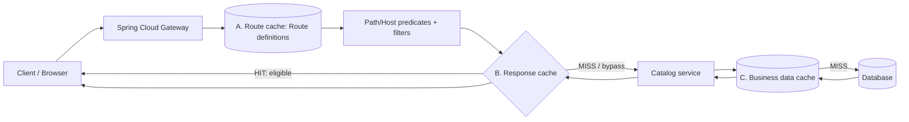
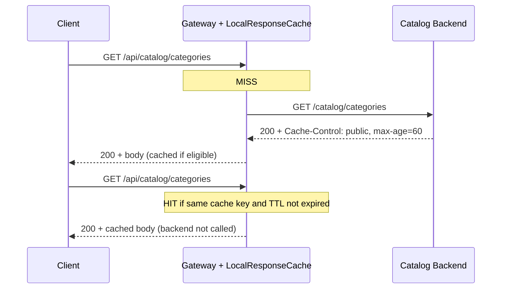
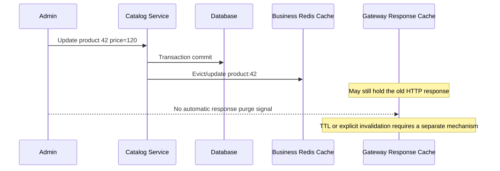

# Distinguishing Route Cache, Response Cache, and Business Data Cache in Spring Cloud Gateway

## 1. Three Things All Called "Cache," Solving Three Different Problems

In a microservices architecture, **Spring Cloud Gateway** is the HTTP entry point to the system: selecting routes via **route predicates**, running the **filter chain**, transforming paths/headers, routing through service discovery/load balancing, and applying authentication, rate limiting, circuit breakers, retries, TLS, and request observability. When someone says "enable caching at the Gateway," you must identify precisely **what is being stored**.

Consider an online store example with a Gateway, `catalog-api`, `orders-api`, and `pricing-service`:

- **Route cache:** The Gateway keeps built routes such as `catalog-route: Path=/api/catalog/** → lb://catalog-api`. This cache supports **selecting the route**, not storing the product list.
- **HTTP response cache:** The Gateway can store the status, headers, and body of `GET /api/catalog/categories` so subsequent calls do not need to reach Catalog. In Gateway WebFlux, there is the `LocalResponseCache` filter backed by Caffeine.
- **Business data cache:** `catalog-api` itself stores the `Product(id=42)` object or query results from the database in Redis/Caffeine to reduce repeated queries. The Gateway does not inherently know that "a product's price has changed."

The three cache types differ in **content, location, keys, expiration, invalidation mechanisms, and security responsibilities**. Enabling one type **does not automatically activate** the other two.

**Lesson objectives:** properly distinguish the three cache layers, configure route/response caching in Gateway Server WebFlux, describe business caching in the backend, protect personal data, understand multi-replica Gateway scenarios, test cache hit/miss behavior, and know when to refresh/purge/evict.

> **Version note:** the primary examples use **Spring Cloud Gateway Server WebFlux 4.3+/5.x** with the `spring.cloud.gateway.server.webflux.*` prefix. Gateway WebFlux 4.2 and earlier typically used `spring.cloud.gateway.*`. Web MVC has separate configuration and filter APIs. In particular, older Gateway releases have **security advisories related to LocalResponseCache published in November 2026**; see Section 11.

## 2. Location Diagram of the Three Cache Layers



The diagram illustrates the logical flow. **Route cache** is used by the Gateway to build/select routes and is not necessarily a "database lookup step" on every HTTP request. **Response cache** can short-circuit the path to the backend on a HIT. **Business cache** only comes into play if the request actually reaches the service (or another service using the same data).

| Criterion | Route cache | Response cache | Business data cache |
|---|---|---|---|
What content is stored? | Route objects/definitions, predicates, filters, URI/order | HTTP status, headers, body | Entities, DTOs, computed values, queries |
Where does it live? | Gateway route locator, typically in the JVM | Gateway `LocalResponseCache`, per-JVM Caffeine; or external CDN/proxy | In the backend, local Caffeine or a dedicated Redis/cache store |
Conceptual key | Set of routes from config/discovery sources | HTTP request identity and headers affecting representation | Business key such as `productId` + tenant + version |
Unit of a "HIT" | Retrieved loaded routes for route matching | Able to return an HTTP response without calling the backend | Backend avoids DB access/expensive operations |
When does it change? | Route edits/refresh/restart/source config changes | TTL, eviction, purge, process restart | TTL, data updates/deletes, domain events |
Who manages correctness logic? | Gateway operations team | Gateway/API contract and Security teams | Owner of the business service/data |
Propagates automatically across replicas? | Not by default | `LocalResponseCache`: **no** | Depends on store: Redis shares, local Caffeine does not |
Typical risks | Stale routes, misrouting to the wrong service | Serving stale data or leaking data across users/routes | Stale data, invalidation race, inconsistency with DB |

## 3. Route Cache: Optimizing the Routing Table, Not Caching HTTP Bodies

Spring Cloud Gateway Server WebFlux uses `RouteDefinitionLocator`/`RouteLocator` to fetch and build routes; in a standard configuration, `CachingRouteLocator` stores a snapshot of the built `Route` objects. A route may consist of:

```text
Route ID: public-catalog
Predicate: Path=/api/catalog/**
URI: lb://catalog-api
GatewayFilter: StripPrefix=1
Order: 0
```

Each time a client calls `GET /api/catalog/products/42`, the Gateway checks the current routing table to select `public-catalog`, and only then evaluates filters and routes downstream to the backend. **The route cache does not return JSON by itself**; it has no knowledge of what body `GET /products/42` previously returned.

### 3.1. Explicit Route Example

```yaml
# application.yml — Gateway Server WebFlux 4.3+/5.x
spring:
  cloud:
    gateway:
      server:
        webflux:
          routes:
            - id: public-catalog
              uri: lb://catalog-api
              predicates:
                - Path=/api/catalog/**
                - Method=GET
              filters:
                - StripPrefix=1
```

In this example, loading and caching the route allows the Gateway to use the `public-catalog` definition to pick the backend. However, if the backend response is:

```http
HTTP/1.1 200 OK
Content-Type: application/json
Cache-Control: no-store

{"id":"42","price":100}
```

then **the route cache cannot turn this response into a cache HIT at the HTTP layer**. A hundred requests can use the exact same route definition and still trigger a hundred backend calls.

### 3.2. Refreshing the Route Cache

According to the Gateway Actuator API, the administrative endpoint:

```http
POST /actuator/gateway/refresh
```

is used to **refresh the route cache**. It is not `PURGE /api/catalog/products/42`, and it **does not clear `LocalResponseCache` or the Redis business cache**. Triggering a refresh is only meaningful if the route source actually has new data; modifying YAML on disk does not imply that every running process has reloaded the new file or updated its property bindings.

In Spring Cloud Gateway 5.x, the `/actuator/gateway` endpoint **does not allow management operations over HTTP by default**. To let operators inspect routes in read-only mode:

```yaml
management:
  endpoint:
    gateway:
      access: read-only
  endpoints:
    web:
      exposure:
        include: health,info,gateway
```

`read-only` **does not allow calling refresh**. If `POST /actuator/gateway/refresh` is genuinely needed, you must enable the appropriate access level (such as `access: unrestricted` in a controlled operational environment) and enforce strict **Spring Security, management network isolation, auditing, and role-based permissions**. Never expose route-modifying endpoints to the public Internet for convenience.

Inspection commands when authorized:

```bash
# Only from a valid management network/with proper permissions.
curl -i http://localhost:8080/actuator/gateway/routes

# Only in an administrative environment WITH refresh access configured:
curl -i -X POST http://localhost:8080/actuator/gateway/refresh
```

Refresh is documented as an asynchronous operation; an HTTP 200 does not guarantee that every Gateway replica has immediately synchronized the new routes. Some versions support refreshing a subset of routes using a metadata filter, but you must verify the documentation for your version and check the route list afterward.

### 3.3. Discovery/LoadBalancer Does Not Change the Nature of Route Cache

When using DiscoveryClient, the Gateway can generate `/{serviceId}/**` routes or resolve `lb://catalog-api` to an instance. This is **route/discovery state**, not business data. You should not treat the route cache as a "product results" mechanism, nor assume `/actuator/gateway/refresh` automatically refreshes every service instance, DNS record, or Redis key.

A sensitive change such as revoking publication access to a service requires controlling **the route source, all Gateway replicas, the network layer, and the backend**. Refreshing a single pod is not an instantaneous cluster-wide access revocation measure.

## 4. Response Cache: Storing HTTP Results at the Gateway

Unlike the route cache, a **response cache** can allow a second request to **avoid calling the backend**. Gateway Server WebFlux provides `LocalResponseCache`, a **per-JVM local** cache backed by **Caffeine**.

Example of two calls to the same public endpoint:



### 4.1. Caching Conditions According to Gateway Documentation

`LocalResponseCache` only considers requests/responses that satisfy specific conditions:

1. The request is a **GET without a request body**.
2. The response has status **200 OK**, **206 Partial Content**, or **301 Moved Permanently**.
3. The request does not contain the `Cache-Control: no-store` directive.
4. The response does not contain the `Cache-Control: no-store` or `private` directive.
5. The cache must **be enabled and properly scoped**.

This is the scope of **this specific filter**, not an exhaustive list of all HTTP statuses cacheable under the RFC. For instance, a `POST` API creating an order or a `GET` returning a `204` response **is outside the documented set of cacheable methods/statuses for this filter**.

The Gateway documentation also notes that when an entry is already cached and a new request carries `Cache-Control: no-cache`, the client may receive a **304 Not Modified response with no body**. You must verify this against your specific version and request conditions; do not assume `no-cache` means `no-store` or that every `no-cache` automatically produces a cache MISS.

### 4.2. Enable Cache **Per Public Route Only**, Not Globally

In Gateway Server WebFlux **5.1**, the property names verifiable from `configprops` are:

```yaml
spring:
  cloud:
    gateway:
      server:
        webflux:
          # Avoid using a shared global cache across all routes.
          global-filter:
            local-response-cache:
              enabled: false
          # Allow using this filter on selected routes.
          filter:
            local-response-cache:
              enabled: true
          routes:
            - id: public-catalog-cached
              uri: http://localhost:8081
              predicates:
                - Path=/api/catalog/categories
                - Method=GET
              filters:
                - StripPrefix=1
                - LocalResponseCache=30s,10MB

            - id: private-orders
              uri: http://localhost:8082
              predicates:
                - Path=/api/orders/**
              filters:
                - StripPrefix=1
                # Do not add LocalResponseCache.
```

`LocalResponseCache=30s,10MB` configures a TTL of **30 seconds** and a cache size limit of **10 MB** for the route—not an HTTP response connection timeout or the lifetime of an object in the database.

**Why avoid global configuration?** A global response cache has a large risk surface because cache keys and route predicates can interact unexpectedly. Even on patched versions, prefer enabling caching **only on reviewed public routes**; do not apply this filter to Orders, profile, billing, or identity-dependent endpoints.

Older 4.x/legacy documentation sometimes lists `spring.cloud.gateway.filter.local-response-cache.enabled` and `spring.cloud.gateway.global-filter.local-response-cache.enabled`. When using **4.3+/5.x**, check the **actual `configprops` of your release train** to avoid setting the wrong prefix and mistakenly thinking the cache is disabled or enabled.

### 4.3. Dependencies for `LocalResponseCache`

The official documentation requires Caffeine and the Spring Boot cache starter:

```xml
<!-- In pom.xml, versions are managed by the BOM/Dependency Management -->
<dependency>
    <groupId>org.springframework.cloud</groupId>
    <artifactId>spring-cloud-starter-gateway-server-webflux</artifactId>
</dependency>
<dependency>
    <groupId>org.springframework.boot</groupId>
    <artifactId>spring-boot-starter-cache</artifactId>
</dependency>
<dependency>
    <groupId>com.github.ben-manes.caffeine</groupId>
    <artifactId>caffeine</artifactId>
</dependency>
```

With Gradle:

```groovy
dependencies {
    implementation 'org.springframework.cloud:spring-cloud-starter-gateway-server-webflux'
    implementation 'org.springframework.boot:spring-boot-starter-cache'
    implementation 'com.github.ben-manes.caffeine:caffeine'
}
```

You do not need `spring-boot-starter-data-redis-reactive` **just to use LocalResponseCache**: this filter uses **local Caffeine**, and does not automatically turn into a distributed Redis cache. If your project defines multiple custom `CacheManager` beans, the Gateway documentation requires proper bean selection via `@Primary` or `@Qualifier`.

### 4.4. Equivalent Java DSL

```java
package com.example.gateway.routes;

import java.time.Duration;
import org.springframework.cloud.gateway.route.RouteLocator;
import org.springframework.cloud.gateway.route.builder.RouteLocatorBuilder;
import org.springframework.context.annotation.Bean;
import org.springframework.context.annotation.Configuration;

@Configuration(proxyBeanMethods = false)
public class CatalogCacheRoute {
    @Bean
    RouteLocator catalogRoute(RouteLocatorBuilder builder) {
        return builder.routes()
            .route("public-catalog-cached", r -> r
                .path("/api/catalog/categories")
                .filters(f -> f
                    .stripPrefix(1)
                    .localResponseCache(Duration.ofSeconds(30), "10MB"))
                .uri("http://localhost:8081"))
            .build();
    }
}
```

This Java example replaces the YAML route with the same ID; do not register both simultaneously. Note that how `RouteLocatorBuilder` is constructed differs from Gateway Server **Web MVC**. To test this, the backend on port `8081` must serve `GET /catalog/categories`, and the response must satisfy the caching conditions.

## 5. HTTP Cache Semantics: Which Headers Affect Whether a Response Can Be Stored?

**Response caching is not just "keep JSON for 30 seconds."** It also involves the HTTP contract, response headers, request headers, how distinct representations are differentiated, and when data ceases to be fresh.

### 5.1. `Cache-Control`: Key Directives

| Header/Directive | HTTP Semantics | Practical Impact |
|---|---|---|
`Cache-Control: public, max-age=60` | Allows storage in shared caches when other HTTP conditions are met; fresh for roughly 60 seconds | Suitable for **public**, reviewed data |
`Cache-Control: private` | Forbids **shared caches** from storing the response | Suitable for user-specific data |
`Cache-Control: no-store` | Must not store the request/response per directive | Preferred for sensitive information |
`Cache-Control: no-cache` | May be stored, but must be revalidated before reuse under standard HTTP semantics | **Not synonymous** with `no-store` |
`Cache-Control: max-age=0` | Response requires revalidation before reuse under standard semantics | Does not make a response secret by default |
`Cache-Control: s-maxage=60` | Freshness directive for shared caches | Must verify actual support in each cache layer |
`ETag` / `If-None-Match` | Representation version identifier and conditional request | Enables revalidation and 304 responses when valid |
`Vary: Accept-Language` | Representation depends on the `Accept-Language` request header | Cache must separate Vietnamese/English variants |
`Set-Cookie` / `Authorization` | Sensitive session/user data or credentials | Do not enable shared response caching by default |
`Age` | Age of the cached representation under HTTP cache semantics | Useful when investigating multi-layer CDN/proxy/cache stacks |

Example of a **public, non-personalized** category response:

```http
HTTP/1.1 200 OK
Content-Type: application/json
Cache-Control: public, max-age=60
Vary: Accept-Language
ETag: "categories-vi-v12"

{"locale":"vi","categories":["Sách","Điện tử"]}
```

If the same URL also supports `Accept-Language: en`, the cache **must not return the Vietnamese response to an English client** solely because the URL matches. Do not assume every cache layer supports all `Vary`/headers identically; you must test the actual cache key behavior. For routes that may return user- or tenant-specific data, **do not use LocalResponseCache** rather than trying to cram headers into the key and hoping nothing leaks.

### 5.2. How Do `LocalResponseCache` `max-age` and TTL Relate?

The `LocalResponseCache` documentation states that the filter may **adjust the `Cache-Control: max-age`** of a cached response based on the configured TTL **if the original response includes `max-age`**. On subsequent HITs, the value is adjusted according to the remaining lifetime.

Example:

```text
Backend:       Cache-Control: public, max-age=120
Gateway route: LocalResponseCache=30s,10MB

At store time: max-age reflects the TTL applied by the Gateway.
After ~10s:    max-age on a HIT response may decrease accordingly.
After ~30s:    the cache entry expires; the next call needs the backend.
```

Do not assume **the Gateway automatically adds `Cache-Control: public`** if the backend does not permit it. Likewise, do not assume browser/CDN `max-age`, local cache TTL, and business Redis cache TTL must be identical; they serve separate layers.

### 5.3. Status 206, Range, and Representations

`LocalResponseCache` also lists **HTTP 206 Partial Content**, but caching partial responses requires proper handling of `Range`, `Content-Range`, validators, encoding, and cache keys. For large files or video, consider a CDN/object storage with verified HTTP range support instead of letting LocalResponseCache hold file chunks without thorough testing.

`404` or `500` responses **are not in the cacheable status list of LocalResponseCache** in current Gateway documentation. However, in a **business cache**, a team might choose **negative caching** (e.g., "product ID does not exist" for a short duration) after analyzing risks and invalidation; do not conflate these two semantics.

## 6. Business Data Cache: The Data Owner Decides Consistency

The business cache typically lives inside the **backend**, not the Gateway. The backend understands product IDs, tenants, price update timestamps, access permissions, orders, and transactions, so it can decide:

- Which values can be cached by a **domain key**, such as `productId=42`.
- How much data staleness (TTL/delay) is acceptable.
- When to **evict or update** the cache after a write operation.
- Where user/tenant permissions must be part of the key or **never shared in a cache**.
- Which cases must bypass the data cache to preserve business correctness.

### 6.1. Spring Cache Example in the Catalog Backend

The following example lives in the **Catalog service**, not in the Gateway. It uses the Spring Cache abstraction for a **synchronous method**:

```java
package com.example.catalog;

import java.math.BigDecimal;
import org.springframework.cache.annotation.CacheEvict;
import org.springframework.cache.annotation.Cacheable;
import org.springframework.stereotype.Service;

@Service
public class ProductService {
    private final ProductRepository repository;

    public ProductService(ProductRepository repository) {
        this.repository = repository;
    }

    @Cacheable(cacheNames = "catalog-products", key = "#productId")
    public ProductDto findById(String productId) {
        // Called on a cache MISS.
        return repository.loadProduct(productId);
    }

    @CacheEvict(cacheNames = "catalog-products", key = "#productId")
    public void updatePrice(String productId, BigDecimal price) {
        repository.updatePrice(productId, price);
    }
}
```

`ProductRepository`, `ProductDto`, and `loadProduct/updatePrice` are **hypothetical business components** that must be implemented in the Catalog application. The example illustrates the logic: if `findById("42")` is a cache HIT, the backend can return the DTO without calling the repository. When `updatePrice("42", ...)` completes successfully, `@CacheEvict` targets entry `"42"`.

**Consistency warning:** if the update runs inside a transaction, the ordering between DB commit and cache eviction must be carefully designed. `@CacheEvict` does not automatically guarantee invalidation occurs **only after transaction commit** under every Spring advice ordering. For critical business flows, consider after-commit synchronization, transaction-aware caches, domain events/outbox, or data versioning. Do not treat a short TTL as a substitute for transactional correctness.

Spring Cache uses proxies/AOP in standard configurations: calling `this.findById(...)` from within the same bean can **bypass the annotation proxy**. Production readiness checks must verify that cache interception actually works, rather than just seeing `@Cacheable` in the source code.

### 6.2. Enabling Spring Cache and Redis in the Backend

When multiple Catalog replicas need a shared cache, you can use a Redis CacheManager in the **Catalog service**, not the Gateway's `LocalResponseCache`:

```java
package com.example.catalog;

import org.springframework.cache.annotation.EnableCaching;
import org.springframework.context.annotation.Configuration;

@Configuration(proxyBeanMethods = false)
@EnableCaching
public class CatalogCacheConfig {
}
```

```yaml
# application.yml of the Catalog service, NOT the Gateway file.
spring:
  cache:
    type: redis
    cache-names:
      - catalog-products
    redis:
      time-to-live: 60s
      cache-null-values: false
  data:
    redis:
      host: redis.internal.example
      port: 6379
```

The backend requires the appropriate Spring cache and Redis dependencies, a real Redis host/ACL/TLS setup, and a `CacheManager` auto-configured by Spring Boot or defined explicitly. `spring.cache.redis.time-to-live` controls **only the business cache TTL**—it **does not control LocalResponseCache or the route cache**.

Do not assume every `@Cacheable` on a method returning `Mono`/`Flux` shares the exact same semantics as the synchronous example: Spring Framework supports reactive return types depending on version, with specific lifecycle/aggregation and cache provider constraints. If the backend is pure WebFlux, design compatible reactive caching and never `block()` Redis on the Netty event loop.

### 6.3. Example of a Price Change Across All Three Layers

Suppose at 10:00 product 42 has a price of **100**, and:

- The Gateway route `public-catalog` is cached in the route locator.
- The Gateway caches the `GET /api/catalog/products/42` response with a 30-second TTL.
- The Catalog service has a Redis business cache `product:42` with a 60-second TTL.

At 10:05, an admin updates the price to **120** in the database.



Even after Catalog updates Redis, the Gateway **may still return the old HTTP body** from `LocalResponseCache` until the TTL expires or it is invalidated by a mechanism the system actually implements. **Refreshing the route cache does not solve this.**

Therefore, highly volatile data such as real-time prices or inventory may **not belong in a Gateway response cache**, or may require a very short TTL and a verified purge mechanism. Quotas, billing, and authorization generally require stronger consistency than a static category list.

## 7. Choosing Which Cache to Use: Business-Aligned Scenarios

| Scenario | Appropriate Cache Layer | Why? |
|---|---|---|
Gateway matches `Path=/api/catalog/**` thousands of times | **Route cache** | Avoids repeatedly reading/assembling route definitions |
`GET /api/public/categories` is identical for all users | Controlled **response cache** | Reduces backend calls and network traffic when returning the same HTTP representation |
`GET /api/orders/me` carries a Bearer token/cookie | **Do not use shared LocalResponseCache** | Content may vary per user |
Catalog reads a product from DB repeatedly across clients | **Business cache** in Catalog | Reduces DB load; the service controls domain keys/eviction |
Price/stock must be accurate immediately after an update | Business cache with tight invalidation; usually **no long HTTP response cache** | Reduces staleness across layers |
`POST /api/orders` creates an order | Do not use LocalResponseCache | Filter only caches GET without body; mutations must execute |
RedisRateLimiter needs to hold token buckets | **Quota state store**, not a business response cache | Redis is used for rate limiting; this does not mean bodies are cached |
CircuitBreaker fallback uses a public snapshot | Fallback data cache with its own contract | Do not treat a fallback response as a normal backend success |
SSE/live feed | **Streaming**, avoid full-response caching | Streams may be unbounded, and freshness applies per event |
Browser/CDN caches static assets | HTTP cache at CDN/browser | Separate layer from Gateway `LocalResponseCache` |

### 7.1. Never Use a Cache as an Authorization Mechanism

Never think "the Orders path is behind the Gateway, so a shared cache is safe." The Gateway may skip calling the backend on a **cache HIT**; if response cache serving does not enforce the right trust boundary and route key, private data can leak without the backend ever getting a chance to check permissions.

For any API where identity, tenant, role, subscription tier, or consent alters content:

- Prefer **not caching shared HTTP responses** at the Gateway.
- Keep authentication/authorization checks in the backend even when the Gateway runs Security.
- Use `Cache-Control: private, no-store` per the API contract when appropriate.
- Do not rely on `Vary: Authorization` as the sole protection for confidential data; evaluate the cache implementation and the CVEs in Section 11.
- Enforce network controls so clients cannot bypass the Gateway and hit the backend directly with forged headers.

## 8. Lifecycle and Invalidation: Three Completely Different "Clear Cache" Actions

**Cache invalidation** is the act of ensuring an old entry/snapshot is no longer served. Across the three cache layers, the triggers and administrative tools are **not the same**:

| Real Change | Cache to Handle | Appropriate Mechanism | **Not** Solved By |
|---|---|---|---|
Point `catalog-api` route to a new URI | **Route cache** | Update route source, refresh/republish routes per runbook | Deleting Redis `product:42` |
Revoke an internal public route | **Route cache + network policy** | Disable route, refresh all replicas, verify route list and backend ACLs | Waiting for response TTL |
Change the public categories list | **Response cache** | Short TTL, controlled invalidation/purge, versioned URL | Calling `/actuator/gateway/refresh` alone |
Update product price in DB | **Business cache** | Evict/update domain key after transaction commit | Restarting the Gateway alone |
Price updated, but Gateway still holds old HTTP response | **Response cache** **and** business cache (if any) | Coordinate TTL/versioning/invalidation at each layer | Evicting business Redis alone |
Change a user's RedisRateLimiter quota | **Quota state** | Rate-limit policy/dedicated Redis keys | Clearing `LocalResponseCache` |
Redeploy a Gateway pod | Route/response cache **local to that pod** is rebuilt | Check the state of remaining pods | Assuming the entire cluster's cache was cleared |

### 8.1. TTL, Versioning, and Event Strategies

- **TTL:** simple; maximum staleness depends on when the entry was stored and the cache type. Suitable for public data that tolerates delayed updates.
- **Versioned path/query:** `/api/catalog/v3/categories` or content hashes for static assets. A new URL isolates the new representation without waiting for old entries to expire.
- **Event-driven invalidation:** when `catalog-api` commits data, it emits a `ProductChanged` event; the service updates its business cache, and a separate mechanism may purge the response cache/CDN. You must handle lost or replayed events.
- **Write-through/update cache:** update the cache alongside the write flow when feasible; races and rollbacks still need handling.
- **Cache-aside:** read the cache first, query the source on a MISS; invalidate the cache after writing data. This is a common pattern for business data.

**Important:** `LocalResponseCache` is not designed as a cache with a built-in API to purge domain keys. Do not invent a `DELETE /cache/products/42` endpoint in documentation and claim the Gateway supports it out of the box. If active invalidation by object ID is required, you must build/deploy a controlled mechanism or pick a more suitable cache layer.

### 8.2. Do Not Collapse All TTLs Into a Single Number

Suppose:

```text
Business Redis TTL:         60s
Gateway LocalResponseCache: 30s
CDN edge TTL:               120s
Browser max-age:            60s
```

Even if Catalog updates Redis immediately after a write, a user may still receive an older copy from the **CDN/browser** while it remains fresh. Staleness can accumulate or depend on when each cache layer was populated; **never use the minimum value as your freshness SLA**. You must identify the **source of truth**, invalidation path, headers, and end-to-end TTL across the entire chain.

## 9. Multi-Replica Scope, Memory, and Rollout Behavior

Suppose production runs **3 Gateway pods**, each configured with `LocalResponseCache=30s,10MB` for a public route.

```text
Gateway Pod A: local Caffeine cache (up to ~10 MB as configured)
Gateway Pod B: local Caffeine cache (up to ~10 MB as configured)
Gateway Pod C: local Caffeine cache (up to ~10 MB as configured)

Catalog Pod 1/2/3 --> shared Redis business cache --> Database
```

Gateway pods **do not automatically share response entries**. For example, Pod A may receive the first GET and serve a cache HIT on the second, while Pod B has never seen that URL and will still MISS and call the backend.

| Scenario | Route cache | Local response cache | Backend business Redis |
|---|---|---|---|
One pod restarts | Reloads/rebuilds routes | **Loses local entries** | Redis entries may remain |
Three pods handle the same URL | Each pod keeps its own route snapshot | Each pod has independent hit/miss state | Backends can share Redis keys |
Route config changes on one pod | Can create drift across pods | Old TTLs may still live on other pods | Does not affect product data directly |
Memory grows with Gateway pods | Route metadata per pod | **Total local cache memory scales with replicas** | Memory lives in Redis |
Gateway app rollback | Route/config version changes | New/old caches follow each pod's lifecycle | Redis key schema might still hold the old version |

**Rough calculation:** three pods with a 10 MB local response cache per route can hold roughly **30 MB of response entries** for that route across the cluster, **excluding** Caffeine overhead, byte buffers, JVM heap, and other routes. Never describe `10MB` as a "10 MB cluster-wide cap."

During a rolling deployment, Gateway A might run a new version/route while B still runs the old one; if a global HTTP cache fails to separate routes or certain predicates, that discrepancy can be dangerous. Use versioned routes, controlled config rollouts, runtime route list checks, isolated cache scopes, and security verification throughout deployment.

## 10. Response Cache Security: Never Accidentally Cache User Data

### 10.1. Data Types That Should Not Enter a Shared Gateway Cache

**Do not enable `LocalResponseCache`** on the following APIs unless you have a dedicated, reviewed, and verified security design:

- `GET /api/orders/me`, `/api/profile`, `/api/billing/invoices`, or responses containing personal/payment information.
- Responses depending on `Authorization`, session cookies, tenant, role, region, permissions, or per-user feature flags.
- Responses containing `Set-Cookie`, access tokens, refresh tokens, signed download URLs, or sensitive data.
- APIs where permission revocation must take effect immediately, prohibiting serving a previously authorized copy to a caller whose access was revoked.

A response carrying `Cache-Control: public` that actually contains personal information **is still a misconfiguration**. HTTP headers do not inspect business payloads. The backend/API owner must decide cacheability after analyzing trust boundaries.

### 10.2. Do Not Treat `Vary: Authorization` as an Authorization Control

`Vary` helps caches differentiate representations based on specific request headers. It **does not replace**:

1. Verifying JWT issuer/audience/expiry/scopes.
2. Checking whether the user/tenant is authorized for the resource in the backend.
3. Controlling cache route selection and cache key behavior in the implementation.
4. Ensuring `private`/`no-store` responses are never stored.

If the Gateway serves a cache HIT **before the backend checks current permissions**, or if the cache key lacks sufficient route/authorization context, data can leak. When in doubt, **removing response caching from private endpoints** is safer than trying to tune `Vary` to make it fit.

## 11. Real-World Security Advisories: CVE-2026-59426 and CVE-2026-59427

On **November 19, 2026**, Spring published **two High-severity advisories** involving `LocalResponseCache` across several Spring Cloud Gateway release lines. These are not hypothetical risks and must be reviewed during dependency checks before enabling HTTP caching.

### 11.1. CVE-2026-59426 — Global Cache May Leak Responses Across Routes

**Root cause:** in affected versions, the global `LocalResponseCache` could share a single cache across routes that did not declare their own cache. When two routes share the **same request URI** but are distinguished by `Host`, `Header`, `Cookie`, `RemoteAddr`, or another predicate **excluded from the cache key**, a response from a restricted route could be returned to a caller matching only the public route.

Architecture pattern to strictly avoid:

```text
GET /reports/summary
  + Header X-Partner-Tier=premium -> Route PREMIUM -> private report
  + No header                     -> Route PUBLIC  -> public report

Global cache does not distinguish route ID in the key in affected versions
-> May mistakenly return a response from one route to a request matched to the other route.
```

**Mitigation:** upgrade to a patched version; disable global `LocalResponseCache`; cache only reviewed individual public routes. The advisories note that **per-route LocalResponseCache** uses separate caches and is not affected by **this specific cross-route global bug**, though upgrading is still required for other cache risks.

### 11.2. CVE-2026-59427 — Incorrect Parsing of Combined `private/no-store` Directives

**Root cause:** in affected versions, the filter could compare the **entire `Cache-Control` header value** against the single string `private` or `no-store`, instead of splitting comma-separated directives. When upstream sends:

```http
Cache-Control: private, no-store
```

or a multi-directive header typical of default Spring Security responses, the cache could **store the response despite upstream forbidding storage**. Subsequent requests could receive private data from the cache instead of the backend, depending on cache key/`Vary` factors.

**Mitigation:** upgrade Gateway to a version marked as patched by Spring. **Merely changing `Cache-Control` is insufficient** to consider an unpatched system safe, especially if the endpoint contains private data; best practice is to keep caching disabled on that route and apply the patch.

### 11.3. Affected Scope per Advisories Published on November 19, 2026

| Gateway Branch | Listed Affected Range | Fixed Version Stated in Advisory |
|---|---|---|
5.0.x | **5.0.0–5.0.4** | **5.0.5** (OSS); 5.0.4.1 (Enterprise Support Only) |
4.3.x | **4.3.0–4.3.6** | **4.3.7** (Enterprise Support Only) |
4.0–4.2 | **4.0.0–4.2.10** | **4.2.11** (Enterprise Support Only) |

This reflects the published list at the time of writing and **does not imply every branch/version is broadly available across all distribution channels**. Always verify your actual BOM, release notes, security support status, and patch availability within your organization. Gateway 5.1.0 is outside the **affected ranges listed in the advisories**, yet you should still monitor new security updates and avoid enabling response caching on sensitive data by default.

**Official sources:**

- [Spring Security Advisory — CVE-2026-59426: Global LocalResponseCache Leaks Responses Across Routes](https://spring.io/security/cve-2026-59426/)
- [Spring Security Advisory — CVE-2026-59427: LocalResponseCache Stores private and no-store Responses](https://spring.io/security/cve-2026-59427/)

**Action priority if running an affected version:** audit routes using `LocalResponseCache`, disable global HTTP caching, remove caching from private APIs, upgrade to a supported patched version, and run negative tests for route overlap and `Cache-Control` headers. Do not wait until actual data leakage is observed.

## 12. End-to-End Hands-On: Proving Response Cache HIT/MISS

### 12.1. Environment Setup

You need:

1. A **Gateway Server WebFlux** instance running on `http://localhost:8080`, using the `public-catalog-cached` route from Section 4.2, Caffeine/cache starter, and per-route filter properties enabled.
2. A **Catalog backend** running on `http://localhost:8081`, serving a public `GET /catalog/categories` response.
3. You may use Spring Boot Actuator on the Gateway to inspect the route ID, though **exposing route-modifying endpoints is unnecessary** to test cache HITs.

Do not configure a global `LocalResponseCache` in this lab. Do not add authentication or user profile fields to the test response. If the Gateway application uses Spring Security, add a **dedicated permit rule for public categories**; never disable Security across the entire Gateway just to test caching.

### 12.2. Backend Controller with a Request Counter

In the **Catalog backend application**, add a demonstration controller:

```java
package com.example.catalog.demo;

import java.time.Duration;
import java.util.HashMap;
import java.util.List;
import java.util.Map;
import java.util.concurrent.atomic.AtomicInteger;

import org.springframework.http.CacheControl;
import org.springframework.http.ResponseEntity;
import org.springframework.web.bind.annotation.GetMapping;
import org.springframework.web.bind.annotation.RestController;

@RestController
public class PublicCategoriesController {
    private final AtomicInteger backendCalls = new AtomicInteger();

    @GetMapping("/catalog/categories")
    ResponseEntity<Map<String, Object>> categories() {
        Map<String, Object> body = new HashMap<>();
        body.put("categories", List.of("Books", "Electronics"));
        body.put("backendInvocation", backendCalls.incrementAndGet());

        return ResponseEntity.ok()
            .cacheControl(CacheControl.maxAge(Duration.ofSeconds(120))
                .cachePublic())
            .body(body);
    }
}
```

This controller uses an `AtomicInteger` to **count how many HTTP requests the backend actually receives** in that process. It is not a business cache and is unsuitable for measuring distributed request counts across multiple backend replicas. `backendInvocation` is **demo-only** data and should not be added to public production APIs.

Because the Gateway route uses `StripPrefix=1`, clients call `/api/catalog/categories` while the backend receives `/catalog/categories`.

### 12.3. Calling Directly vs. Calling Through the Gateway

```bash
# Direct call: reaches the backend every time, counter increments.
curl -i http://localhost:8081/catalog/categories
curl -i http://localhost:8081/catalog/categories

# Through the Gateway, same URL and same Gateway instance:
curl -i http://localhost:8080/api/catalog/categories
curl -i http://localhost:8080/api/catalog/categories
```

| Action | Expected Result When Configured Correctly | What It Proves |
|---|---|---|
Call backend directly twice | `backendInvocation` increments on both calls | The demo backend does not cache responses itself |
Call Gateway the first time | MISS, backend counter increments | Response is fetched from downstream |
Call Gateway again within 30 seconds | May HIT; body/counter stays unchanged | Gateway serves from response cache |
Wait over 30 seconds and call again | Cache entry TTL expires, backend counter increments | Gateway response cache TTL is active |
Change route TTL and refresh route | **Does not automatically purge** old data cache under route refresh semantics | Route cache and response cache are distinct |

When troubleshooting, do not conclude a cache HIT merely from seeing a 200 response. Stronger evidence is that **`backendInvocation` does not increment** or the backend access log shows no matching request. A cache HIT also changes tracing observations: the downstream span will be absent because the request never reached the backend.

### 12.4. Testing Non-Storable `Cache-Control` Headers

In a **separate** test profile, update the backend endpoint to return:

```java
return ResponseEntity.ok()
    .header("Cache-Control", "private, no-store")
    .body(body);
```

This **replaces the return statement** in the controller; do not keep both this and the earlier `cacheControl(...)` simultaneously. Test on a Gateway version **patched against CVE-2026-59427**, against a clean cache without stale entries (a dedicated path or a fresh Gateway test process), and call through the Gateway multiple times.

Expected result: `backendInvocation` increments every time because `private, no-store` responses **must not be cached**. If the Gateway is in an unpatched range or another filter/cache interferes, **do not run this test against real user data**.

### 12.5. `no-cache`, `no-store`, and Conditional Responses

```bash
# Request instructing not to store data per the no-store directive:
curl -i \
  -H 'Cache-Control: no-store' \
  http://localhost:8080/api/catalog/categories

# Request requiring revalidation per no-cache;
# exact 304 behavior depends on filter/version.
curl -i \
  -H 'Cache-Control: no-cache' \
  http://localhost:8080/api/catalog/categories
```

Under HTTP semantics, `no-cache` means **must revalidate before reuse**, not a synonym for `no-store`. Spring Cloud Gateway documentation notes that LocalResponseCache returns `304` without a body in a scenario where an entry is already cached; in practice, you should observe status codes, `ETag`/`Cache-Control` headers, and backend request counts to understand your cache implementation. **Never treat a 304 response alone as absolute proof** of whether the backend was called.

### 12.6. Testing the Difference Between Route Cache and Response Cache

When Gateway Actuator is in `read-only` mode with authorized access:

```bash
curl -i http://localhost:8080/actuator/gateway/routes
```

The Actuator response lists active route definitions, such as `public-catalog-cached`, the `Path` predicate, URI, and filters. It **does not contain business data counters like `backendInvocation`**. The route cache management endpoint `/actuator/gateway/refresh` **is not** an endpoint for purging Caffeine's response cache.

In production, never test `POST /actuator/gateway/refresh` without authorization and a change window. If you want to demonstrate route refreshing, spin up an isolated sandbox environment, intentionally modify the route source, refresh via the secured management API, and inspect the updated route list and routing behavior.

### 12.7. Multi-Replica Testing

Run Gateway A on port `8080` and Gateway B on port `8083` with the same routes, where **each instance maintains its own Caffeine cache**:

```bash
curl -i http://localhost:8080/api/catalog/categories
curl -i http://localhost:8080/api/catalog/categories
curl -i http://localhost:8083/api/catalog/categories
```

Gateway B may call the backend on its first request even while Gateway A is serving HITs. This is **expected behavior for a local cache**, not a Redis synchronization bug. If you need a shared HTTP response cache across edge nodes, evaluate a dedicated CDN/reverse proxy/cache service and enforce keys, security, and invalidation per contract; `LocalResponseCache` does not turn itself into a distributed cache.

## 13. Observing Effectiveness and Cost of Each Cache

| Cache | Metrics to Observe | How to Verify |
|---|---|---|
Route cache | Route IDs, route sources, refresh timestamps, drift across Gateway pods | `/actuator/gateway/routes` from management endpoint, logs, and config revision |
Response cache | HIT/MISS, TTL, entry count, retained bytes, eviction, backend request reduction | Appropriate instrumentation, backend request count, before/after latency |
Business cache | HIT/MISS per cache name, DB query count, eviction, stale reads, Redis memory/latency | Spring Cache/Redis metrics, repository counters, transaction/event traces |
CDN/browser cache | `Age`/`Cache-Control`/`ETag`, CDN HIT/MISS, regional stale content | CDN dashboard, HTTP headers, multi-region probes |

Not every `LocalResponseCache` version exposes built-in cache hit/miss metrics under the same metric names. **Do not fabricate metric names**; if you need dashboards, check Actuator/Micrometer bindings on your exact Gateway version, add controlled instrumentation, or measure from the backend and reverse proxy.

### 13.1. TTL Is Not the Only Goal

Key operational questions:

1. Does the cache significantly reduce **backend calls** and DB load?
2. How many requests return **stale data** relative to the business SLA?
3. Is the cache retaining **private responses** or content containing cookies?
4. Do Gateway replicas hold different routes/configs during rollouts?
5. When an invalidation event is lost, how does the system recover via TTL/versioning/reconciliation?
6. Does caching mask `401/403` errors or bypass fresh permission checks?
7. When the backend returns `500` or the CircuitBreaker is OPEN, do clients receive cached content allowed by the API contract?

A Gateway cache HIT reduces backend latency, but **does not automatically guarantee database consistency or authorization freshness**.

## 14. Common Issues and Troubleshooting

| Symptom | Possible Cause | Resolution |
|---|---|---|
Called `/actuator/gateway/refresh`, but JSON remains unchanged | You refreshed the route cache, not the HTTP response cache | Check TTL/purge at the proper layer or disable response cache |
Gateway still calls the backend on every GET | Missing Caffeine/starter, filter not enabled, or response fails status/header rules | Check dependencies, `LocalResponseCache`, and `Cache-Control` |
Error when configuring `LocalResponseCache` | Wrong config prefix, missing bean/CacheManager, or wrong WebFlux/MVC stack | Verify starter and `configprops` for your version |
Cache HIT on pod A, MISS on pod B | Local per-JVM cache | Expected behavior; inspect load balancing if needed |
`private,no-store` responses are still cached | May be running a Gateway version affected by CVE-2026-59427 | Stop caching sensitive routes, apply patch, run negative tests |
Response from a restricted route appears on a public route | Global cache key/route mismatch in versions affected by CVE-2026-59426 | Disable global cache, use per-route caching, and upgrade Gateway |
Product price stays stale after DB update | Business cache and/or response cache is still stale | Evict the right domain key **and** review response TTL/invalidation |
`@Cacheable` does not take effect | Missing `@EnableCaching`/CacheManager, self-invocation, or wrong key | Check cache proxy interception and backend metrics |
Tenant A's cached product appears for Tenant B | Business key omits tenant/security context or broken authorization | Design tenant-qualified keys and backend checks |
Browser still sees old data after Gateway already MISSes | CDN/browser still caching based on `max-age` | Inspect the full chain of HTTP cache layers |
`Vary` header does not behave as expected | Cache key fails to distinguish representations or inconsistent client headers | Test with `Accept-Language`/encoding and check implementation |
Uploads/POSTs are not cached | `LocalResponseCache` only supports GET without a body | Design limitation; never work around by response-caching mutations |
Gateway memory rises after enabling caching | Cache size/TTL too high or too many routes/replicas | Measure heap, entry size, eviction, and concurrency |
A deleted route still appears on some pods | Route snapshot/refresh out of sync | Audit route source and refresh/rollout all replicas |
HTTP status 304 causes confusion | HTTP conditions and cache revalidation were not correlated | Inspect response headers, validators, and backend request count |

## 15. Scenario Exercises and Answers

**Exercise 1 — Classification.** The Gateway stores `Path=/api/catalog/** → lb://catalog-api` in a cache. Does this allow it to return product JSON without calling the backend?

**Answer:** No. That is the **route cache**, which only maintains route state and chooses the routing path. Avoiding an HTTP call to the backend requires a response cache HIT or another cache layer in front of the backend.

**Exercise 2 — Response cache.** Two identical `GET /api/catalog/categories` requests arrive, with a public 200 response cached at a 30-second TTL and all conditions met. Can the second call skip the backend?

**Answer:** Yes, if it hits the same Gateway instance/cache key, the entry has not expired, and no bypass condition applies; `LocalResponseCache` can serve the stored response.

**Exercise 3 — Business cache.** `catalog-api` uses `@Cacheable(cacheNames="catalog-products", key="#productId")`. Does this make the Gateway automatically cache HTTP 200 responses?

**Answer:** No. The backend may skip the DB query, but the Gateway can still call the backend over HTTP every time.

**Exercise 4 — Refresh.** An admin calls `POST /actuator/gateway/refresh` to point a route to a new service. Does this clear `product:42` in the backend Redis cache?

**Answer:** No. That operates on the **route cache**, not the Redis domain cache or the Gateway's `LocalResponseCache`.

**Exercise 5 — Security.** Route `/api/orders/me` returns private data and requires a JWT. Should you enable global `LocalResponseCache` and rely on `Vary: Authorization` to keep it safe?

**Answer:** No. Authorization must still be verified; cache keys and global routes have had leakage vulnerabilities. For user-specific APIs, prefer **not caching HTTP responses at the Gateway**, using `private/no-store`, and running a patched Gateway version.

**Exercise 6 — Versioning.** A Gateway 5.0.4 instance uses `LocalResponseCache`. Should you assume Spring already handles `Cache-Control: private, no-store` properly?

**Answer:** No. Version 5.0.4 is within the range affected by CVE-2026-59427 (and CVE-2026-59426 when using global cache). You must upgrade to a version Spring published as patched or disable caching on sensitive routes as advised.

**Exercise 7 — Multiple pods.** Three Gateway pods each allow up to 10 MB of response caching for a route. Does this mean the cluster holds at most 10 MB total?

**Answer:** No. Caffeine caching is **local to each JVM**; total usage can reach roughly 30 MB of entries for that route, excluding overhead and other routes.

**Exercise 8 — Price update.** An admin changed `price=100` to `price=120`, and the backend evicted Redis. Why might a client still see 100?

**Answer:** Because the Gateway response cache, CDN, or browser may still hold the older HTTP representation. Business cache eviction does not automatically invalidate outer cache layers.

**Exercise 9 — HTTP status.** Does `LocalResponseCache` cache `GET` responses returning `500` by default?

**Answer:** No, per the documentation: the filter's status list is 200, 206, and 301. `500` errors should be handled with resilience and observability mechanisms, not cached indiscriminately.

**Exercise 10 — Layer selection.** A service performs expensive per-tenant price calculations. Should the result be stored in the Gateway global cache or a business cache?

**Answer:** Prefer a **business cache** with a validated key that includes the tenant and all price-affecting parameters, backed by strict TTL/invalidation. Never share HTTP responses for Tenant A and Tenant B in a Gateway global cache.

**Exercise 11 — TTL.** Business Redis TTL is 60s, Gateway response TTL is 30s, and CDN TTL is 120s. Is the client guaranteed to receive the new price at most 30 seconds after an update?

**Answer:** No. The CDN or browser can hold the representation longer. Actual freshness depends on every layer and its invalidation workflow, not solely on the Gateway TTL.

**Exercise 12 — Administration.** Does `management.endpoint.gateway.access: read-only` allow `POST /actuator/gateway/refresh`?

**Answer:** No. Read-only is for observation; refreshing requires granting appropriate management access and strictly securing the endpoint—never exposing it publicly.

## 16. Deployment Checklist and Official References

Before enabling caching on a route, confirm **who owns the data**, whether the route is strictly public, whether responses depend on user/tenant/headers, the cache header contract, which caches exist across Gateway/CDN/backend, the invalidation strategy, and how negative cases are tested.

Short checklist:

1. **Route cache:** know your route source and refresh workflow, secure Actuator, and never mistake route refresh for response purging.
2. **Response cache:** enable only for suitable public GETs, restrict to per-route, set small TTL/size limits, and verify HTTP status and `Cache-Control` rules.
3. **Business cache:** choose keys aligned with business entities and tenants, align TTL/eviction with transactions, and monitor DB query reduction and stale reads.
4. **Security:** audit dependencies for CVEs, never cache user data, and test combined `private/no-store`, route overlap, and false cache HITs.
5. **Multi-replica:** verify per-JVM local cache behavior, rolling deployments, route drift, and the fact that invalidation does not propagate across pods automatically.
6. **Observability:** verify backend request counts, cache hit/miss instrumentation if available, memory usage, latency, staleness, and access controls.
7. **Operational ownership:** maintain runbooks for route refresh, disabling/rolling back response cache, CDN purging (if used), and authorized business cache eviction.

### References

- [Spring Cloud Gateway 5.1 – LocalResponseCache GatewayFilter](https://docs.spring.io/spring-cloud-gateway/reference/spring-cloud-gateway-server-webflux/gatewayfilter-factories/local-cache-response-filter.html): bodyless GETs, statuses 200/206/301, cache directives, Caffeine, and route TTL/size.
- [Spring Cloud Gateway 5.1 – Global Filters](https://docs.spring.io/spring-cloud-gateway/reference/spring-cloud-gateway-server-webflux/global-filters.html): global/per-route LocalResponseCache and filter chain mechanics.
- [Spring Cloud Gateway 5.1 – Configuration Properties](https://docs.spring.io/spring-cloud-gateway/reference/5.1/configprops.html): `server.webflux.filter.local-response-cache.*` and `global-filter.local-response-cache.*`.
- [Spring Cloud Gateway 5.1 – Actuator API](https://docs.spring.io/spring-cloud-gateway/reference/spring-cloud-gateway-server-webflux/actuator-api.html): listing routes, read-only/unrestricted access, and refreshing the route cache.
- [Spring Framework – Cache Abstraction](https://docs.spring.io/spring-framework/reference/integration/cache.html): `@Cacheable`, `@CacheEvict`, key generation, and interceptors.
- [Spring Boot – Caching](https://docs.spring.io/spring-boot/reference/io/caching.html): Caffeine, Redis, and cache auto-configuration for backends.
- [RFC 9111 – HTTP Caching](https://www.rfc-editor.org/rfc/rfc9111): freshness, `Cache-Control`, validators, shared/private caches, and `Vary`.
- [Spring Advisory CVE-2026-59426](https://spring.io/security/cve-2026-59426/) and [CVE-2026-59427](https://spring.io/security/cve-2026-59427/): response leakage through global cache and mishandling of private directives in affected versions.

**Key takeaway:** **the route cache stores routing paths**, **the response cache stores HTTP status/headers/body**, and **the business data cache stores objects understood and managed by the backend**. Refreshing routes does not clear responses; evicting business Redis does not automatically purge HTTP responses; and a local cache does not automatically share state across Gateway replicas. For Spring Cloud Gateway in production, cache only truly eligible public responses, always check versions and security advisories, design invalidation at the right layer, and prioritize authorization over any performance gain.
