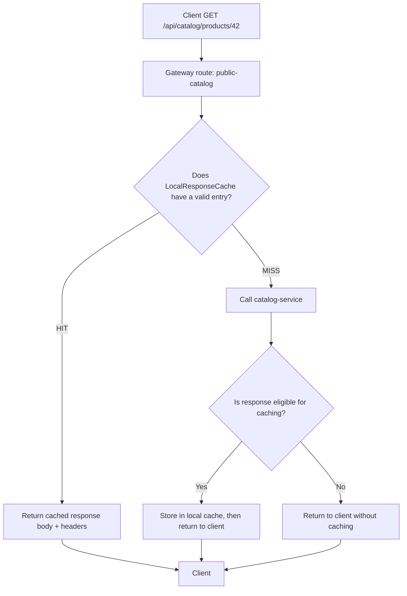
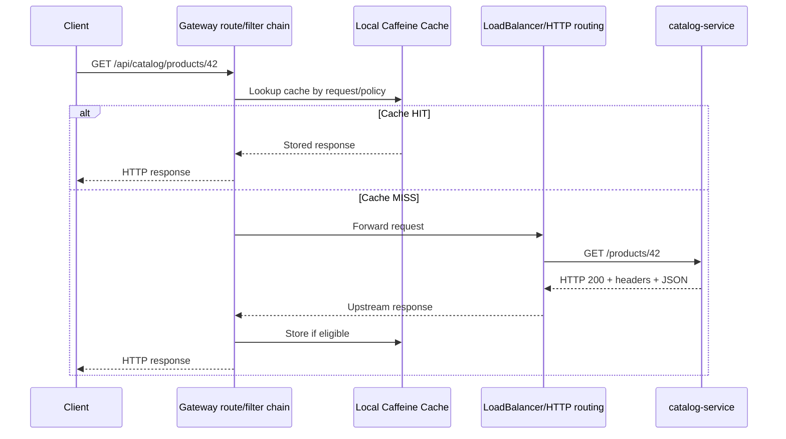
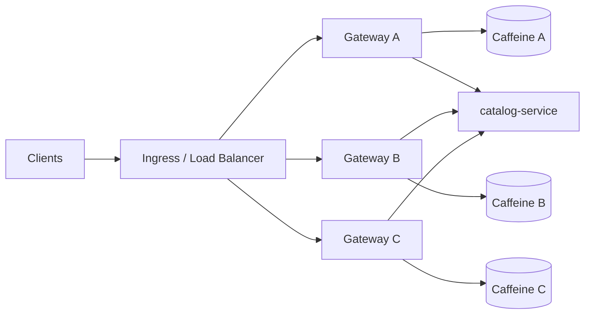
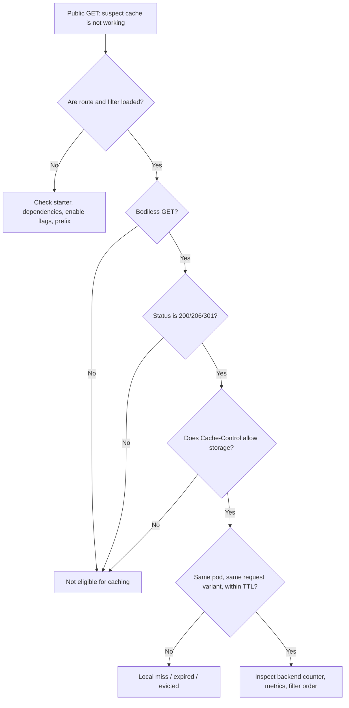

# LocalResponseCache and Required Dependencies

A **Spring Cloud Gateway** serving thousands of product catalog read requests may have to forward the same content repeatedly to `catalog-service`. If the data is allowed to be cached and does not change too frequently, the Gateway can reuse the response for a short period, reducing backend calls and client latency.

In Spring Cloud Gateway Server WebFlux, **`LocalResponseCache`** provides the ability to cache **HTTP response bodies and headers** inside the Gateway process itself using **Caffeine**. The word *Local* is critical: the cache lives within the scope of a single **Gateway instance/pod**, not Redis, a database, or shared memory across multiple replicas. The same URL hitting two Gateway pods can have two separate cache entries with different expiration times.

This lesson belongs to the **Response Caching** chapter of the **SPRING_CLOUD_GATEWAY** module. We will identify the required dependencies, intentionally enable per-route caching, understand caching eligibility and `Cache-Control`, measure hits/misses, protect private data, and observe interactions with route predicates, filter chains, path/header rewrites, service discovery, authentication, rate limiting, circuit breakers, retries, TLS, and multiple Gateway replicas.

> **Scope:** This lesson focuses on **Spring Cloud Gateway Server WebFlux**. Server Web MVC has a different request/response processing model and filter configuration; do not copy route DSL or starter names verbatim from WebFlux to MVC. The examples below use the property namespace of newer Gateway WebFlux release lines; for Gateway 4.x or older versions, verify Configuration Properties for the **exact release train**.

## 1. The Problem: Why Cache at the Gateway?

Suppose there is an API:

```http
GET /api/catalog/products/42 HTTP/1.1
Host: api.shop.example
Accept: application/json
```

Without caching, each request passes through this sequence:

```text
Client
  → Gateway: route predicate / gateway filters
  → LoadBalancer: selects catalog-service instance
  → catalog-service: queries data
  → Gateway: receives response
  → Client: returns JSON
```

If caching the response **complies with the HTTP contract**, after the first request the Gateway can return the stored content for subsequent requests without calling the backend.



This is a **conceptual flow**, not a detailed callback-by-callback breakdown for every version. A matching route, Caffeine, and an eligible HTTP response together enable caching; **not every GET is cached**.

### Benefits and Trade-offs

| Potential Benefit | Trade-off |
| --- | --- |
| Reduces backend requests for repeated responses. | Consumes memory on each Gateway replica. |
| Can lower latency on cache hits. | May serve stale data during the TTL window. |
| Reduces immediate backend dependency for cache hits. | Risks security incidents if personal responses are cached. |
| Well-suited for short-lived caching of public resources. | Cache is fragmented across replicas and lost on restart. |
| Can reduce DB load caused by popular GETs. | Requires monitoring hit ratio, memory, eviction, and cache key correctness. |

### Three Different Types of "Cache"

| Mechanism | Stored Data | Scope |
| --- | --- | --- |
| **`LocalResponseCache`** | Eligible HTTP response bodies and headers. | Within **one Gateway process/pod**. |
| **`CacheRequestBody`** | Request body read/decoded for downstream filters to reuse. | Within the lifecycle of **a single request** on the exchange. |
| **Application-designed Redis / distributed cache** | Data objects/responses/quotas depending on architecture and app-defined keys. | Can be shared across multiple applications/pods. |

`RedisRateLimiter` uses Redis to coordinate **token bucket quotas**, and does not automatically make Redis the storage backend for `LocalResponseCache`.

## 2. Where Does LocalResponseCache Sit in Gateway WebFlux?

After `RoutePredicateHandlerMapping` selects a route, `FilteringWebHandler` executes the combined chain of `GlobalFilter`s and route `GatewayFilter`s ordered by `Ordered`. Response caching interacts with HTTP routing/response writing so it can return stored content or record a new response.



**Do not assume** a cache hit necessarily skips every `GlobalFilter`, Spring Security, or all logging steps. Some components may run **before** the cache lookup, while downstream components may not execute when a response is returned early. Observe the actual execution order when integrating authentication, rate limiting, and tracing.

### Cache Hit vs. HTTP 304

- **Cache hit:** The Gateway retrieves the response from the cache and can return a cached HTTP 200 body if request/semantics allow.
- **HTTP 304 Not Modified:** A response **with no body**, telling the client it may continue using its stored copy under the HTTP caching contract. This is not a regular JSON response.
- **Backend returning HTTP 304:** Requires understanding conditional requests and validators like `ETag`/`Last-Modified`; do not assume LocalResponseCache replaces all revalidation mechanisms.

The `Cache-Control: no-cache` discussion in Section 4 explains a specific `304` behavior documented by Gateway.

## 3. Which Conditions Make a Response Cacheable?

According to the Gateway Server WebFlux `LocalResponseCache` documentation for supported release lines, the filter considers storing a response only if **all** of the following conditions hold simultaneously:

1. The request is a **GET without a request body** (*bodiless GET*).
2. The response status is **HTTP 200 OK, 206 Partial Content, or 301 Moved Permanently**.
3. The request does **not** carry `Cache-Control: no-store`.
4. The response does **not** carry `Cache-Control: no-store` and does **not** carry `Cache-Control: private`.
5. The filter is enabled, dependencies are present, the cache has capacity/availability, and the request/response meet runtime execution requirements.

### Baseline Matrix

| Request | Response | Cached Under These Conditions? | Reason |
| --- | --- | --- | --- |
| Bodiless GET | `200`, `Cache-Control: public, max-age=60` | **Possibly** | Resource is permitted to be stored. |
| Bodiless GET | `206`, caching not forbidden | **Possibly**, verify actual `Range` handling | Partial content carries risk if cache key lacks byte range. |
| Bodiless GET | `301`, caching not forbidden | **Possibly** | Permanent redirect is in the supported status set. |
| Bodiless GET | `404` | No under this status rule | Not in 200/206/301. |
| Bodiless GET | `500` | No under this status rule | Backend errors are not cached by this mechanism. |
| POST JSON | `200` | No | Request is not a bodiless GET. |
| GET with request body | `200` | No | Violates bodiless GET condition. |
| GET with `Cache-Control: no-store` header | `200` | No | Client requested no storage. |
| Bodiless GET | `200`, response `Cache-Control: private` | No | Response is restricted to a private context. |
| Bodiless GET | `200`, response `Cache-Control: no-store` | No | Upstream forbids storage. |

**Do not look only at the status code** to judge safety. An HTTP 200 response for `GET /api/me` containing user A's account info, session, or orders must still be blocked from caching via **route policy and response headers**; `LocalResponseCache` does not turn into a resource-authorization engine.

### Cache-Control Directives Are Evaluated Independently

For example, a response:

```http
Cache-Control: max-age=60, private
```

is still **not cached** by the filter due to `private`, even though `max-age` is present.

Similarly:

```http
Cache-Control: no-cache, no-store, max-age=0
```

contains `no-store`, so it is not cached. Directives do not have to appear alone, and current documentation describes matching individual directives case-insensitively.

## 4. TTL, Cache-Control, and Headers to Understand Clearly

### 4.1. TTL (Time to Live)

The **TTL** of LocalResponseCache is the configured time limit for which an entry remains valid. For instance:

```text
TTL = 30 seconds

T=0s   First GET    → MISS → backend → store response
T=8s   Similar GET  → may HIT
T=25s  Similar GET  → may HIT
T=31s  Similar GET  → may MISS because entry expired
```

This is an illustrative timeline; an entry can be evicted **before its TTL** due to size limits, memory pressure, or configuration. TTL expiration **does not push notifications** to clients or other Gateway pods.

### 4.2. Response Cache-Control: max-age

Gateway WebFlux documentation describes the ability to **recalculate `max-age`**:

- If the original response **already includes `Cache-Control: max-age=...`**, the value is rewritten based on the configured TTL.
- Subsequent cache reads can receive a `max-age` reduced by the **number of seconds remaining until the entry expires**.
- If the original response **lacks `max-age`**, do not assume the filter will automatically inject every cache header your application wants.

Example original response:

```http
HTTP/1.1 200 OK
Cache-Control: public, max-age=3600
Content-Type: application/json

{"id":42,"name":"Keyboard"}
```

If the route cache TTL is `30s`, when stored/served, `max-age` can be recalculated relative to the TTL instead of keeping `3600`. When testing, inspect the actual values on the first request, a cache hit, and after TTL expiration.

**Gateway TTL does not equal browser/CDN cache lifetime.** Browsers and proxies use the response headers they receive to make their own decisions. When multiple cache layers coexist, clearly define who refreshes, who serves stale data, and how invalidation works when information changes.

### 4.3. No-store Differs from No-cache

| Directive | Operational Meaning | Note for LocalResponseCache |
| --- | --- | --- |
| `no-store` | Do not store a copy per HTTP policy. | A **non-caching** condition documented by Gateway. |
| `private` (response) | Suitable only for private caches, not shared caches. | A **non-caching** condition for LocalResponseCache. |
| `no-cache` | May be stored in a cache, but requires revalidation before reuse per HTTP semantics. | **Not synonymous with `no-store`**; verify version behavior. |
| `max-age=N` | Defines freshness for HTTP caches. | May be rewritten to match LocalResponseCache TTL. |
| `public` | Permits shared caching under HTTP semantics when other rules pass. | Use only when the response truly contains no user-specific content. |

In several Gateway WebFlux lines, `LocalResponseCache` documentation notes that if a response is **already in the cache** and a new request carries `Cache-Control: no-cache`, the filter can return **`304 Not Modified` with an empty body**. This is notable because it differs from a normal 200 JSON payload. **Do not design clients assuming every version/validator/ETag behaves identically**; test directly against your deployed version. Some lines add a **`request.no-cache-strategy`** property; check Config Props before using it.

### 4.4. Vary, ETag, and Last-Modified

If a response varies by:

- `Accept-Language`;
- `Accept-Encoding`;
- `Origin`/CORS;
- `Authorization`/cookies;
- query string, hostname, or tenant context;

then **the cache key and HTTP `Vary` semantics** must distinguish variants properly. Do not assume a given Gateway release automatically includes all of these headers in its cache key. **Test variant isolation explicitly**, or avoid caching responses that depend on identity or context.

`ETag` and `Last-Modified` are useful validators for conditional GETs, but they do not guarantee that LocalResponseCache automatically generates or validates them. The backend must define their semantics, and Gateway/CDN/browsers must be tested so wrong variants are never served.

## 5. Required Dependencies: Gateway, Spring Cache, and Caffeine

In Gateway Server WebFlux versions that include LocalResponseCache, the official documentation requires two additional dependencies **beyond the Gateway starter**:

1. **`org.springframework.boot:spring-boot-starter-cache`** — Spring Cache integration and auto-configuration.
2. **`com.github.ben-manes.caffeine:caffeine`** — the Caffeine in-memory caching library used as the local response store.

### Maven Example

For a project already using a compatible Spring Boot parent/Dependency Management and Spring Cloud BOM:

```xml
<dependencies>
    <dependency>
        <groupId>org.springframework.cloud</groupId>
        <artifactId>spring-cloud-starter-gateway-server-webflux</artifactId>
    </dependency>
    <dependency>
        <groupId>org.springframework.boot</groupId>
        <artifactId>spring-boot-starter-cache</artifactId>
    </dependency>
    <dependency>
        <groupId>com.github.ben-manes.caffeine</groupId>
        <artifactId>caffeine</artifactId>
    </dependency>
    <!-- Depending on observability needs -->
    <dependency>
        <groupId>org.springframework.boot</groupId>
        <artifactId>spring-boot-starter-actuator</artifactId>
    </dependency>
</dependencies>
```

This is a **dependency snippet**, not a complete `pom.xml`. Do not assign arbitrary Gateway/Caffeine versions manually when using a BOM; choose a supported Spring Boot/Spring Cloud release train and inspect the resolved dependency tree.

### Gradle Example

```groovy
dependencies {
    implementation "org.springframework.cloud:spring-cloud-starter-gateway-server-webflux"
    implementation "org.springframework.boot:spring-boot-starter-cache"
    implementation "com.github.ben-manes.caffeine:caffeine"
    implementation "org.springframework.boot:spring-boot-starter-actuator"
}
```

For older Gateway lines, the starter may be `spring-cloud-starter-gateway` instead of `spring-cloud-starter-gateway-server-webflux`. Use the starter matching your WebFlux version; **do not add the MVC starter just to "supplement" caching features**.

### Why Both Dependencies Are Needed

| Missing Component | Consequence / Check Point |
| --- | --- |
| Missing Gateway Server WebFlux | No WebFlux route/filter runtime as demonstrated. |
| Missing `spring-boot-starter-cache` | LocalResponseCache may not initialize/activate as documented. |
| Missing Caffeine | No local cache provider suitable for this feature. |
| Dependencies present, filter not enabled | Requests may still go straight to the backend without expected route caching. |
| Multiple custom `CacheManager` beans | Bean ambiguity or unexpected CacheManager selection; requires `@Primary`/`@Qualifier` per docs. |

If the application **already has a custom `CacheManager`**, do not add another `CacheManager` bean with arbitrary naming/priority to "fix" LocalResponseCache. The Gateway docs note that bean selection must be handled—such as marking the proper bean `@Primary` or using `@Qualifier` during injection; verify which bean the filter actually uses and how it impacts other application caches.

### Caffeine Does Not Turn the Cache Into a Distributed Cache

Adding Caffeine provides **efficient local memory** only. When Gateway runs three pods, each process keeps its own cache and lifecycle. There is no invalidation broadcast, shared key space, or cross-pod consistency just from adding this dependency.

## 6. Two Ways to Enable: Global and Route-Specific

Spring Cloud Gateway Server WebFlux has two related configuration levels:

| Type | Purpose | Risk If Misconfigured |
| --- | --- | --- |
| **Global local-response-cache filter** | Enables caching across many/all eligible routes. | Easy to accidentally hit personal/sensitive GETs if backend headers and policies are lax. |
| **Per-route `LocalResponseCache` GatewayFilter** | Intentionally enables caching on a single route, with custom TTL/size. | Requires matching route ID, enable property, and dependencies. |

In newer Gateway lines, **Configuration Properties** list branches such as:

```text
spring.cloud.gateway.server.webflux.global-filter.local-response-cache.enabled
spring.cloud.gateway.server.webflux.filter.local-response-cache.enabled
spring.cloud.gateway.server.webflux.filter.local-response-cache.time-to-live
spring.cloud.gateway.server.webflux.filter.local-response-cache.size
```

In some older version docs, they appear under:

```text
spring.cloud.gateway.global-filter.local-response-cache.enabled
spring.cloud.gateway.filter.local-response-cache.enabled
spring.cloud.gateway.filter.local-response-cache.time-to-live
spring.cloud.gateway.filter.local-response-cache.size
```

**Version check is essential:** some newer GatewayFilter reference pages still mention legacy enable property names in prose, whereas the Configuration Properties table for newer Gateway WebFlux uses the `server.webflux` prefix. **Prioritize the actual configuration table, metadata binding, and startup tests for your exact artifact**; do not declare both branches in parallel just to guess.

### Safe Configuration for the Lab

The following example **disables global caching** and enables the filter only on the public catalog route:

```yaml
spring:
  cloud:
    gateway:
      server:
        webflux:
          global-filter:
            local-response-cache:
              enabled: false
          filter:
            local-response-cache:
              enabled: true
          routes:
            - id: public-catalog
              uri: http://localhost:8081
              predicates:
                - Path=/api/catalog/**
                - Method=GET
              filters:
                - StripPrefix=2
                - LocalResponseCache=30s,16MB
```

**Meaning:**

- `global-filter.local-response-cache.enabled: false` prevents accidentally caching other routes.
- `filter.local-response-cache.enabled: true` allows using `LocalResponseCache` per route in supported release lines.
- `LocalResponseCache=30s,16MB` is shortcut syntax: the first argument is a 30-second TTL, and the second is a 16 MB cache limit for the route per filter mechanics.
- The `Method=GET` predicate stops this test route from handling POSTs; the filter's internal condition also requires a bodiless GET.
- `StripPrefix=2` ensures the backend receives `/products/42` from the public URL `/api/catalog/products/42`.
- The backend must return an eligible response, especially without `no-store`/`private`.

**Note:** A route specifying `LocalResponseCache` is not a complete security policy on its own. Confirm the endpoint is public, responses do not vary per user, size bounds exist, and an invalidation strategy is defined.

### Should You Enable Global Caching to "Make Every Route Faster"?

Do not enable it solely hoping for a performance boost. A `GET /api/me` could return 200 without `private/no-store` due to an incomplete backend configuration. When global caching is on, the response **risks being stored unexpectedly**, especially if the cache key does not distinguish all identity factors.

A sound design starts with an **allowlist of public routes** and proper HTTP cache headers, then measures effectiveness. Only consider global caching when the entire public API contract and safety review guarantee no personal or confidential data can be shared.

## 7. Java RouteLocatorBuilder and LocalResponseCache

In Gateway Server WebFlux lines providing the corresponding Java DSL, you can configure:

```java
import java.time.Duration;
import org.springframework.cloud.gateway.route.RouteLocator;
import org.springframework.cloud.gateway.route.builder.RouteLocatorBuilder;
import org.springframework.context.annotation.Bean;
import org.springframework.context.annotation.Configuration;

@Configuration
public class CatalogCacheRoutes {

    @Bean
    RouteLocator catalogRoutes(RouteLocatorBuilder builder) {
        return builder.routes()
            .route("public-catalog", route -> route
                .path("/api/catalog/**")
                .filters(filters -> filters
                    .stripPrefix(2)
                    .localResponseCache(Duration.ofSeconds(30), "16MB"))
                .uri("http://localhost:8081"))
            .build();
    }
}
```

In the Java example, `Duration.ofSeconds(30)` and `"16MB"` express the same settings as YAML. The `localResponseCache` method name and builder API **must be verified against the dependencies/IDE of your active version**; this is the WebFlux DSL, not MVC.

Do not declare the **same route ID `public-catalog` in both YAML and Java DSL** unintentionally; conflicting route definitions can cause unpredictable behavior. Choose a single source of truth for route management or clearly define loading/precedence rules.

## 8. Choosing TTL and Size Limits

### TTL Based on Data Characteristics

| Example API | Should It Be Cached Locally? | Starting TTL to Test | Reason |
| --- | --- | --- | --- |
| Slowly changing public product catalog | Possibly | 15–60 seconds | Cuts backend traffic while tolerating brief staleness. |
| Versioned public UI configuration | Possibly | Depends on publish/version flow | Versioned cache keys are usually easier to manage. |
| Rapidly changing exchange rates / prices | Use extreme caution | Per strict freshness SLA | Stale data can cause wrong decisions. |
| `/api/me`, shopping cart, per-user orders | **Avoid** | Not applicable | Contains principal-specific data. |
| Payment data, tokens, PII | **Never use shared response cache** | Not applicable | Severe security risk. |
| Large downloads or video/range | Needs dedicated POC | Based on content profile | Size, `206`, `Range`, and buffer pressure. |

The TTLs in this table are **hypothetical starting points for discussion**, not framework defaults or real SLOs. Freshness must be decided by the data owner and API operators.

### Size and Memory Pressure

Suppose each Gateway replica has an experimental cache limit of `16MB` on the catalog route. With three replicas, in principle there can be **three independent sets of entries**, each capped separately. Never infer "the whole cluster uses only 16 MB."

Beyond the size of cached bodies, there is overhead from Caffeine entries/metadata, JVM heap/direct buffers, request/response processing, Netty connection pools, TLS, route metadata, and other caches.

**Actual memory must be measured via metrics/profiling**, not simply calculated as `cached response bytes = total cache RAM`. Different versions may vary in eviction policy, size estimation, and byte accounting; verify enforced bounds by testing with both small and large bodies.

### Cache Size Limits Do Not Replace Backend Body Limits

`16MB` in `LocalResponseCache` is not the maximum HTTP response size allowed from the backend, nor does it **automatically block large upload requests**. Request sizes, response buffering, codecs, and ingress/server limits are separate mechanisms.

## 9. Cache Key: When Are Two Requests Truly Equivalent?

Caching is only correct when two requests represent **the exact same resource and HTTP representation**. A single URL's response can change based on path, query, hostname, language, `Accept` headers, or user identity.

For example:

```http
GET /api/catalog/products/42?currency=VND
Accept-Language: vi
```

and:

```http
GET /api/catalog/products/42?currency=USD
Accept-Language: en
```

must not necessarily share a cache entry. Likewise, `GET /api/orders/123` with User A's token and User B's token **must never share a response** simply because the path matches.

### Dimensions to Evaluate During Design

| Dimension | Scenario | Handling |
| --- | --- | --- |
| **Path** | `/products/42` differs from `/products/43`. | Verify route + actual key separates paths. |
| **Query** | `currency=VND` differs from `currency=USD`. | Test query variants; never assume the key includes all query params automatically. |
| **Host/tenant** | `shop-a.example` and `shop-b.example` share a path. | Isolate routes/hosts or disable caching if isolation isn't guaranteed. |
| **`Accept-Language`** | Vietnamese vs. English content. | Use `Vary` properly; test actual cache keys. |
| **`Accept-Encoding`** | Compressed vs. uncompressed responses. | Test that content encoding/body/headers are never swapped between variants. |
| **`Origin`/CORS** | CORS headers depend on allowed origin. | Place CORS policy at the right layer, verify `Vary: Origin` and cached responses. |
| **`Authorization`/Cookie** | Per-user API responses. | **Never cache shared responses**; use `private, no-store` and exclude the route. |
| **Backend release/version** | Data/contract changes on deploy. | Use versioned URLs or appropriate TTL/invalidation. |

`LocalResponseCache` documentation describes caching conditions and TTL/size settings, yet **you should not infer** a blanket guarantee covering every cache key dimension across all versions. Before enabling caching on multilingual, multi-tenant, or complex-CORS APIs, test with **two distinct requests producing different responses** to verify no cross-contamination occurs.

### Do Not Rewrite URLs and Forget Cache Semantics

`StripPrefix`, `RewritePath`, `SetPath`, and `RewriteRequestParameter` can alter the URL before upstream dispatch. The cache key may be constructed in a different phase than the final downstream path. **Do not assume** rewriting a path at the Gateway always changes the cache key identically to the backend path.

For APIs with many query/path variants, write a test matrix covering the **client-sent URL**, query params, headers, filter ordering, and backend responses. If a variant is not reliably distinguished, disable caching on that route or move to a cache solution with an explicit key policy.

## 10. Security: Never Cache Personal Responses at a Shared Edge

LocalResponseCache can retain data from many different requests within the same Gateway process. Even though the cache is not shared across Gateway replicas, it is still a **shared response cache across multiple clients hitting the same pod**.

### Leakage Scenario to Avoid

Suppose a backend exposes:

```http
GET /api/me HTTP/1.1
Authorization: Bearer <user-A-token>
```

and returns:

```http
HTTP/1.1 200 OK
Content-Type: application/json

{"userId":"A","email":"user-a@example.invalid"}
```

If global caching is enabled, the backend omits `Cache-Control: private`/`no-store`, and the cache key lacks safe per-user isolation, the response risks **being reused for User B**. That is a security incident, not a minor performance bug.

**Priority defenses:**

1. Never enable LocalResponseCache on routes returning **per-user/session/account/tenant responses**, unless explicitly reviewed and hardened.
2. Have the backend return `Cache-Control: private, no-store` for sensitive data; do not rely solely on the Gateway spotting a cookie/JWT and skipping caching.
3. Never add `public` or `max-age` to personal responses just to raise hit ratios.
4. Avoid global caching; use an **explicit route allowlist**.
5. Test with Users A and B, different tokens, different query strings, and error status codes.

### Cache-Control Headers at the Backend

**Public data tolerating brief staleness:**

```http
HTTP/1.1 200 OK
Content-Type: application/json
Cache-Control: public, max-age=60

{"id":42,"name":"Keyboard"}
```

**Personal or sensitive data:**

```http
HTTP/1.1 200 OK
Content-Type: application/json
Cache-Control: private, no-store

{"userId":"A","email":"user-a@example.invalid"}
```

These examples show policies defined by **the backend or an authoritative tier**. If the Gateway rewrites/strips `Cache-Control` or a response modifier turns `private` into `public` before cache eligibility runs, this safeguard breaks. Therefore, inspect the **final response headers** and filter ordering.

### Set-Cookie, Authorization, and Tokens

Do not treat "any response with `Set-Cookie` is guaranteed to be excluded from cache" as an implicit guarantee. `LocalResponseCache`'s documented conditions emphasize method, status, and `Cache-Control`; **proactively avoid caching** session/token responses, login redirects, password resets, payments, and personal identifiers.

Avoid letting `Authorization`, cookies, access tokens, refresh tokens, session IDs, or PII appear in cache keys, logs, or metric tags. Even a "safe" cache key does not make caching token-bearing responses good design.

### Spring Security Still Needs Backend Authorization

If Gateway uses OAuth2 Login/Resource Server, Security typically checks requests in the `WebFilter` chain; a cache hit **is no reason** to bypass authentication/authorization. Still, a Security filter checking only "is the user logged in" does not verify whether the user may read **another user's resource**.

The backend must enforce resource-level authorization, and private responses must bypass shared caches. **Never serve one user's cached content to another simply because both hold valid bearer tokens.**

## 11. GlobalFilter, GatewayFilter, and Response Transformation Ordering

A system might combine:

- `RequestRateLimiter` to throttle requests.
- `TokenRelay` to pass access tokens downstream.
- `StripPrefix`/`RewritePath` to transform paths.
- `ModifyResponseBody` to transform JSON responses.
- `SetResponseHeader`/`AddResponseHeader` to set HTTP headers.
- `LocalResponseCache` to reuse responses.

### What Happens When Caching Is Combined With ModifyResponseBody?

Suppose the backend returns:

```json
{"price":100}
```

A custom filter transforms it into:

```json
{"price":100,"currency":"VND"}
```

To cache properly, you must know **which version is stored**: the raw backend response or the rewritten response, and whether the transformation runs again on a cache hit. The outcome depends on **filter ordering and the specific implementation**.

Do not assume that because YAML lists `ModifyResponseBody` above `LocalResponseCache`, every phase runs strictly top-to-bottom. In Gateway WebFlux, filters have **pre/post phases**; higher-priority filters run earlier in the pre-phase and later in the post-phase.

**Test to perform:** send two consecutive GETs and compare the response body, content type, content length, ETag, Vary, and custom response headers; verify the second request is neither double-rewritten nor altered. If transformed responses must be cached, verify execution order and filter compatibility.

### Rate Limiting on a Cache Hit

An important product question: **does a cache hit consume customer quota?**

- If quota measures **incoming HTTP requests**, cache hits should still be counted.
- If quota measures **backend workload**, cache hits might not consume the same budget, though edge abuse limits are still needed.
- Depending on filter ordering, a limiter filter might not execute on certain cache hits.

Measure `incoming requests`, `limiter decisions`, `cache hits`, and `backend requests` directly; never infer from YAML alone that every request consumes one token.

### CircuitBreaker, Retry, and Response Cache

On a cache hit, the backend may not be called; thus downstream `CircuitBreaker`, `Retry`, or HTTP client timeouts are not triggered. However, **caching does not replace resilience mechanisms**:

- When entries expire or miss, the backend can still fail.
- If upstream returns HTTP 5xx, those statuses are outside `LocalResponseCache`'s eligible list above.
- `Retry` on a GET miss can amplify backend attempts; bound latency and load.
- Do not assume LocalResponseCache supports CDN-style `stale-if-error` or `stale-while-revalidate` unless your version/mechanism actually provides and verifies it.

### Route Predicates Decide Where Caching Applies

If the `public-catalog` route only matches `Method=GET`, POST or OPTIONS requests do not match the route and will not use its LocalResponseCache. CORS preflight requests should be handled via proper Gateway/Spring Security policies; a cache filter is not a CORS engine.

## 12. Local Caching With Multiple Gateway Replicas

A real deployment typically runs multiple pods behind an ingress:



**Each pod owns its own cache.** If the first request hits Pod A, Pod A may store the response. The next request hitting Pod B may still be a **cache miss** because B lacks the entry. When Pod C restarts, C's cache is empty; other pods do not sync entries to it.

### Consequences to Expect

| Symptom | Cause | Implication |
| --- | --- | --- |
| Backend RPS spikes after deployment | Gateway pods have cold caches simultaneously. | Provision capacity for warm-up; prevent cache stampedes. |
| Same URL alternates between old and new data | Cache entries were populated at different times across pods. | Accept TTL-bounded staleness or use another invalidation strategy. |
| Pod A gets many hits while Pod B gets many misses | Traffic distribution, sticky sessions, or staggered rollouts. | Measure per-pod and cluster-wide, not just one instance. |
| Clearing cache on Pod A leaves data on B | No default invalidation broadcast. | Avoid local caches when instantaneous synchronized clearing is required. |
| Scaling up replicas briefly lowers hit ratio | The same traffic splits across more cold caches. | Evaluate before scaling or test warm-up behavior. |

### Do Not Assume Redis Provides "One Shared Cache" Here

In earlier examples, Redis was used to share `RedisRateLimiter` quotas across replicas. **That does not make `LocalResponseCache` use Redis.** If the system requires a cluster-wide shared response cache, design a separate tool: a reverse proxy/CDN cache, API management cache, or dedicated distributed cache with controlled keys, TTLs, and invalidation.

Each option brings different network cost, latency, and consistency trade-offs. Local Caffeine fits when per-pod caching, short TTLs, and public responses are acceptable; it is unsuitable as a "single source of truth" for rapidly changing data.

## 13. Invalidation: When Data Changes Before TTL

Suppose product 42 changes price from 100 to 90 right after Gateway caches the response. With a 30-second TTL, the Gateway may keep returning the old price for the remaining window. In an e-commerce app requiring exact checkout pricing, **never rely on cached catalog API data to determine the final transaction price**.

### Strategies Matched to Data Types

| Strategy | Approach | Trade-off |
| --- | --- | --- |
| **Short TTL** | Let entries expire after seconds/minutes. | Accepts a bounded staleness window. |
| **Versioned URLs** | E.g., `/api/catalog/v2026-11/products/42`. | Clients must know the version; requires version lifecycle management. |
| **Skip caching freshness-sensitive endpoints** | Let the backend serve current data. | Higher load on the backend. |
| **Purge via dedicated cache layer** | Use a CDN/shared cache with controlled invalidation APIs. | Depends on external cache infrastructure; requires securing purge permissions. |
| **Custom event-driven invalidation** | Propagate change events to all pods. | Complex; LocalResponseCache does not provide this broadcast out of the box. |

**Do not assume** `/actuator/gateway/refresh` clears response entries across all pods. When enabled, that endpoint refreshes the **route cache**; the route-definition cache and LocalResponseCache bodies/headers have independent lifecycles. If you need to clear response caches, verify what APIs/cache managers support and build a dedicated mechanism.

### When Long TTLs Create Risk

- Rapidly changing prices, stock levels, or promotions.
- Recently revoked user/tenant access permissions.
- Backend data fixes for legal or security issues.
- JSON schema/contract changes after a rollout.
- Revoked certificates/tokens/cookies where old responses could still be served.

Cases touching identity or security should **avoid local shared response caching** rather than relying solely on asynchronous invalidation.

## 14. Coordinating LocalResponseCache With Browser Cache, CDN, and Backend

A single request may traverse several layers:

```text
Browser cache
    ↓
CDN / edge cache (if present)
    ↓
Gateway LocalResponseCache per pod
    ↓
Backend HTTP cache / application data cache
    ↓
Database
```

Each layer has its own scope and policy. A `Cache-Control: public, max-age=60` response header may be used by browsers/CDNs; LocalResponseCache also has its **own TTL** and may rewrite `max-age`. If any layer holds a response longer than expected, the client still sees stale data even after the Gateway entry expires.

### Caching Contract Approved by the Data Owner

| Contract Aspect | Example Questions |
| --- | --- |
| **Eligibility** | Which resources are genuinely public and safe for shared GET caching? |
| **Key** | Which paths, queries, languages, content encodings, and hosts form variants? |
| **Freshness** | How stale can the content be at most? |
| **Invalidation** | When critical data changes, how is staleness cleared? |
| **Personalization** | Does the response depend on JWT, cookies, tenant, or user? |
| **HTTP headers** | How are `Cache-Control`, `ETag`, `Vary`, and `Set-Cookie` defined? |
| **Failure** | When the backend fails, may cached responses be served, and under what conditions? |
| **Observability** | At which layer are hit ratios, evictions, and response ages measured? |

### CORS and Caching

The Gateway may return different `Access-Control-Allow-Origin` headers per `Origin` when using an allowlist. Response caching must never leak **Origin A's CORS header** to Origin B. If responses vary by `Origin`, `Vary: Origin` is an important HTTP signal for caches.

However, **having `Vary: Origin` does not automatically prove the current LocalResponseCache includes Origin in its key**. Test with at least two allowed origins and one rejected origin, especially when the CORS filter and LocalResponseCache run in different phases. Prefer placing CORS policies at the right layer and disabling caching on complex responses whose safety cannot be proven.

## 15. Lab A: Verifying Hits/Misses on a Single Gateway Process

### 15.1. Preparation

| Component | Assumed Address | Role |
| --- | --- | --- |
| Gateway WebFlux | `http://localhost:8080` | `public-catalog` route with `LocalResponseCache=30s,16MB`. |
| Mock backend | `http://localhost:8081` | Receives GETs, increments counter, returns public JSON. |
| Caffeine | In-memory in Gateway | Stores eligible responses. |
| `curl` | Test machine | Checks response headers/status and timing. |

The mock backend should implement:

```text
GET /products/42
    -> increment endpoint counter when backend ACTUALLY receives a request
    -> return Content-Type: application/json
    -> return Cache-Control: public, max-age=120
    -> return JSON containing counter + productId
```

Example output generated by the mock:

```http
HTTP/1.1 200 OK
Cache-Control: public, max-age=120
Content-Type: application/json

{"productId":42,"backendCounter":1}
```

**Not a default framework response.** The counter in the body demonstrates whether the backend was called again; in production, never embed sensitive debug data just to prove cache hits.

### 15.2. Enable Dependencies and Route

1. Add `spring-boot-starter-cache` and `caffeine` to the classpath alongside the Gateway WebFlux starter.
2. Configure the per-route filter as in Section 6; **disable global caching**, enable the local-response-cache route filter.
3. Ensure the mock backend listens on `8081` and serves `/products/42` after `StripPrefix=2`.
4. Start Gateway and check startup/route config logs; confirm there are no `CacheManager` bean conflicts.

### 15.3. First GET

```bash
curl -i \
  -H "Accept: application/json" \
  "http://localhost:8080/api/catalog/products/42"
```

Expected behavior with an initially empty cache:

- Gateway selects route `public-catalog`.
- Backend receives GET `/products/42`.
- Response is HTTP `200`, with a cache-permitting `Cache-Control`.
- Mock returns `backendCounter: 1`.
- Cache stores the response per policy and limits.

### 15.4. Second GET Within TTL

```bash
curl -i \
  -H "Accept: application/json" \
  "http://localhost:8080/api/catalog/products/42"
```

On a proper cache hit:

- The response body still has `backendCounter: 1`.
- The backend counter **does not increment** for this call.
- `Cache-Control: max-age` may decrease compared to the first call, tracking remaining TTL.
- Gateway may exhibit lower latency, though you must sample repeatedly and rule out keep-alive/JIT/backend caching before concluding.

**Important:** seeing an identical body **is not enough** to prove a cache hit; a backend can return identical payloads. Check backend invocation counts or reliable instrumentation.

### 15.5. After TTL

Wait past the lab's TTL duration and call again:

```bash
curl -i \
  "http://localhost:8080/api/catalog/products/42"
```

If the entry expired and no other cache layer exists, the backend counter increments. If it does not, check:

- Whether a CDN/proxy/browser cache is sitting in front.
- Whether the configured TTL is actually 30 seconds.
- Whether the test hits the intended Gateway port/route.
- Whether the backend caches on its own or returns a static/reset counter.
- Whether multiple Gateway replicas/proxies skew observations.

To test Gateway cache state, call **directly with `curl -i`** rather than observing via a browser, since browsers maintain their own caches.

## 16. Lab B: Testing Non-Cacheable Conditions and HTTP Headers

Keep Gateway and the mock backend in the lab environment; adjust the backend to return varying statuses/headers on a **dedicated mock endpoint** without changing real API policies.

### 16.1. Client Sends no-store

```bash
curl -i \
  -H "Cache-Control: no-store" \
  "http://localhost:8080/api/catalog/products/42"
```

Under the stated conditions, a request carrying `no-store` **must not be used to store a response in the cache**. However, to accurately evaluate how a `no-store` request behaves when an entry is already cached, measure backend counter, body, headers, and your exact version's behavior. Do not extrapolate across all paths from a single request.

### 16.2. Private or no-store Responses

Configure the backend to return:

```http
Cache-Control: private, no-store
```

Send multiple GETs to the same URL and verify the backend receives every request per caching rules. Also test:

```http
Cache-Control: max-age=60, private
```

because the `private` directive appearing after `max-age` must still prevent caching. Isolate the endpoint from **previously cached entries** using a new URL/bucket or restarting the lab Gateway to avoid misleading results.

### 16.3. 404 or 500 Responses

Have the backend return `404` or `500` instead of `200` for the same GET conditions. These statuses fall outside `LocalResponseCache`'s `200/206/301` set; verify subsequent requests continue reaching the backend.

**Do not confuse** an HTTP 404 from the backend with a 404 caused by Gateway failing to match a route. Check the route ID and backend logs.

### 16.4. HEAD and POST Are Not Bodiless GETs

```bash
curl -i -X HEAD \
  "http://localhost:8080/api/catalog/products/42"

curl -i -X POST \
  "http://localhost:8080/api/catalog/products/42"
```

Because the sample route specifies `Method=GET`, these requests may fail to match the route; that is **different** from "the request matched the route, but the filter skipped caching." To test the filter itself, create a lab route allowing that method and verify it creates no cache entry.

**Do not use `curl -I` to test caching of a bodiless GET**, because `-I` sends HEAD rather than GET.

### 16.5. Request Cache-Control: no-cache

After populating a valid entry with an earlier GET:

```bash
curl -i \
  -H "Cache-Control: no-cache" \
  "http://localhost:8080/api/catalog/products/42"
```

According to LocalResponseCache documentation in several Gateway WebFlux lines, this request can return **`304 Not Modified` with an empty body** when the response is already cached. Verify against your running version and inspect `ETag`/validators if clients use conditional requests; do not generalize from this POC that all WebFlux releases treat `no-cache` identically.

### 16.6. 206 and 301 Responses

These two statuses are listed as **cacheable** in LocalResponseCache docs, with specific caveats:

- **`206 Partial Content`:** must ensure `Range`, `Content-Range`, and byte ranges are differentiated and served accurately. Serving the wrong byte slice to a different range request causes corruption. Run dedicated tests or avoid caching download/range routes until safety is proven.
- **`301 Moved Permanently`:** redirects can be cached. Never cache redirects containing tokens, session data, or user-dependent `Location` values; verify `Location`, hostnames, and browser redirect caching.

Run these checks against a **dedicated mock/fixture**, since a normal JSON catalog API does not return 206/301 on its own.

## 17. Lab C: Two Gateway Replicas With Unsynchronized Caches

### Environment

| Process | Port | Resources |
| --- | --- | --- |
| Gateway replica A | 8080 | Caffeine `LocalResponseCache` A. |
| Gateway replica B | 8083 | Caffeine `LocalResponseCache` B. |
| Mock catalog backend | 8081 | Shared request counter for both A and B. |

Both Gateway replicas share the **same route ID, TTL, size, and backend**, but run as **two independent JVMs/processes**.

### Steps

1. Start both A and B so both caches begin empty.
2. Send GET through A **twice within TTL**; confirm the backend receives roughly one request if cached.
3. Send the same URL through B; expect a **first-request miss on B** because B has no entry yet.
4. Call again through B within TTL; verify B's cache hit.
5. Change the mock backend response (e.g., `name=Keyboard v2`) **without changing the URL**.
6. Query via A and B before their entries expire; you may observe **different stale responses** because they were cached at different timestamps.
7. Restart B; B's cache becomes empty while A retains its cached entry until expiration.
8. Record counters, elapsed time, response age/max-age, and backend call counts.

### Direct Per-Pod Commands

```bash
curl -i "http://localhost:8080/api/catalog/products/42"
curl -i "http://localhost:8080/api/catalog/products/42"
curl -i "http://localhost:8083/api/catalog/products/42"
curl -i "http://localhost:8083/api/catalog/products/42"
```

The goal is not to prove caches "sync," but to prove **they are local**. If business requirements demand clearing caches simultaneously across all pods when prices change, do not rely on LocalResponseCache as your sole consistency mechanism.

### Acceptance Matrix

| ID | Scenario | What to Observe |
| --- | --- | --- |
| L01 | Public GET 200 on empty cache | Backend is called; cache may store response. |
| L02 | Repeated GET within TTL on same pod | Backend may receive no additional call. |
| L03 | GET after TTL | Backend is called again once entry expires. |
| L04 | Request `Cache-Control: no-store` | Response is not stored per rule. |
| L05 | Response `private`/`no-store` | Data is not cached. |
| L06 | Response `404`/`500` | Not cached per documented status rule. |
| L07 | `POST`/`HEAD` | Not cached by the bodiless GET filter. |
| L08 | `no-cache` when entry exists | Verify `304`/revalidation behavior for your version. |
| L09 | `206` with two distinct `Range` headers | Byte ranges/`Content-Range` are never mixed up. |
| L10 | `301` redirect | Verify redirect caching and `Location` policy. |
| L11 | Two pods A/B | Independent caches, warm-up, and TTL timing. |
| L12 | Restart pod B | B's cache is cold; A does not lose entries. |
| L13 | Users A/B call a private URL | Never receive each other's data via cache. |
| L14 | Two `Accept-Language` values | Content/language is never swapped if route is cached. |
| L15 | Two `Origin` values with CORS | Incorrect CORS headers are never returned; `Vary` is honored. |
| L16 | `ModifyResponseBody` + cache | Body/headers are neither double-rewritten nor mismatched. |
| L17 | Gateway `RequestRateLimiter` | Cache hits/misses consume quota per defined policy. |
| L18 | Backend disconnected on hit/miss | Distinguish cache hit, miss, timeout, and circuit breaker. |
| L19 | Large bodies under high concurrency | Memory/pools/GC remain within limits. |
| L20 | Config changes during rolling deploy | Sensitive routes do not accidentally enable global cache. |

## 18. Performance, Memory, and Cache Stampede

**A high cache hit ratio alone does not prove correctness or safety.** First prove eligibility, data correctness, and personalization isolation. Only then optimize hit ratio and memory.

### Metrics to Measure

| Category | Meaning |
| --- | --- |
| **Cache hit/miss/eviction** | Is the cache reducing backend calls? |
| **Backend request count/RPS** | Most direct proof that upstream traffic decreased. |
| **Gateway p50/p95/p99 latency** | Does response time improve, and does tail latency spike on misses? |
| **Heap/direct memory, GC** | Are cached bodies or response buffering consuming excessive RAM? |
| **Entry size/TTL** | Are large entries crowding the cache, or is staleness too long? |
| **Error rate/Redis/auth/discovery** | Do not conflate unrelated dependency errors with cache errors. |
| **Per pod** | Which replicas hit/miss more, and do they share identical config? |

If your library/framework/Actuator exposes Caffeine cache metrics, verify the **exact cache name and whether statistics are enabled**. Do not assume every `LocalResponseCache` release automatically emits a meter named `cache.hit` or an `X-Cache: HIT` header.

### Cache Stampede on a Cold Key

If 500 clients simultaneously request a product not yet in cache, many misses can hit the backend concurrently before the first entry is stored. Similarly, when three Gateway pods restart together, all caches start cold.

Mitigations:

- Pick TTL/size values balancing hit ratio against acceptable staleness.
- Limit bursts/concurrency for public traffic at the ingress/Gateway.
- Verify coalescing/single-flight capabilities if needed; **do not assume the filter coalesces concurrent misses by default**.
- Consider a CDN/shared cache for ultra-hot resources, with safe keys and invalidation.
- Load-test cold caches and warm caches separately.
- Ensure the backend can still absorb a baseline share of cache miss/refresh traffic.

### Multi-Pod Memory Estimation

If a route has a `16MB` cache budget per pod across five Gateway pods, the nominal total budget can reach roughly **5 × 16MB = 80MB** for that route's entries across five processes, **excluding overhead**. This is only an illustrative capacity estimate; actual eviction behavior and byte consumption must be measured in your deployment.

Never bump size from `16MB` to `2GB` just to boost hit ratios without checking JVM heap, direct memory, total cached routes, Gateway pod count, traffic patterns, and autoscaling.

## 19. Common Troubleshooting

| Symptom | Possible Cause | What to Check |
| --- | --- | --- |
| Route has `LocalResponseCache` but fails to start | Missing dependencies, filter disabled, or wrong prefix. | WebFlux starter, cache starter, Caffeine, config props, startup logs. |
| `CacheManager` bean error at startup | Multiple custom managers or ambiguous bean selection. | `@Primary`/`@Qualifier`, Spring Boot auto-configuration, bean wiring. |
| Repeated GETs still hit backend | Ineligible request/response, different route, short TTL, tiny size, or cache off. | Route ID, status, method, `Cache-Control`, eviction, backend counter. |
| Cache hit returns wrong body | Cache key ignores query/header/tenant, or broken rewrite filter. | Test variants and filter order; disable cache until fixed. |
| User A sees User B's data | Private response cached with leakage risk. | **Disable route caching immediately**, audit policy/cache key, treat as security incident. |
| `Cache-Control: private` still seems cached | Stale prior entry, another cache layer, or rewritten header. | Test fresh URL, hit Gateway directly, inspect headers at each layer. |
| Backend sees few requests but client sees stale data | TTL, multiple pods, or CDN/browser caching. | Compare cache age/TTL across every cache layer. |
| Empty-body `304` returned when sending `no-cache` | LocalResponseCache/conditional GET behavior in running version. | Check reference docs, request headers/validators, and strategy. |
| Browser reports CORS error on cache hit | Cached response holds wrong ACAO/Vary for the origin. | Test two origins, CORS owner, and cache key semantics. |
| Response has wrong Content-Length/Content-Encoding | Body rewrite or compression filter conflicts with cache ordering. | Compare hit vs. miss raw headers/bodies and filter ordering. |
| Only Pod B gets no cache hits | Local cache still cold, config drift, or pod recently restarted. | Pod logs, route ID, TTL, size, and backend counter. |
| Product update still displays old value | Entry TTL not expired or outer cache layer holds old copy. | Adjust freshness, use versioned URLs, or disable cache. |
| Backend returns `503` on cache miss | Discovery/LoadBalancer/network issue; not necessarily a cache bug. | `lb://`, instance health, TLS, timeouts, circuit breaker. |
| Gateway memory climbs after enabling cache | Cached entries, large bodies, Caffeine overhead, or GC pressure. | Heap/direct memory, eviction, cache size, concurrency. |
| Caching does not speed up the API | Low hit ratio, fast backend, or upstream proxy/cache dominates. | Measure p95/p99, upstream RPS, cold vs. warm cache. |

### Short Debug Flowchart



## 20. Production Deployment Checklist

- [ ] Identify the **exact public routes** allowed to be cached; never enable global caching solely for performance.
- [ ] Choose compatible JDK, Spring Boot, Spring Cloud release train, Gateway **Server WebFlux**, and dependency management versions.
- [ ] Add `spring-boot-starter-cache` and `com.github.ben-manes.caffeine:caffeine`; resolve any custom `CacheManager` bean conflicts.
- [ ] Verify the `spring.cloud.gateway.server.webflux.*` namespace or legacy namespace for your exact running version.
- [ ] Enable `LocalResponseCache` per route and confirm global caching is not accidentally applied to private routes.
- [ ] Understand the bodiless GET rule, 200/206/301 statuses, and `Cache-Control` `no-store`/`private`.
- [ ] Choose TTLs based on data freshness contracts, not "how fast or slow the backend feels."
- [ ] Size cache limits based on **per-Gateway-replica** memory budgets and total cached routes.
- [ ] Ensure backends return `Cache-Control: private, no-store` for personal/token/session data; run User A/B tests against cache bleed.
- [ ] Verify cache keys/`Vary` for queries, Accept-Language, Accept-Encoding, Origin, and required variants.
- [ ] Never cache responses with `Set-Cookie`, OAuth logins, `/api/me`, order details/private data, or sensitive redirects/tokens.
- [ ] Test `ModifyResponseBody`, `SetResponseHeader`, compression, ETag/Last-Modified, and filter ordering if combined.
- [ ] Verify rate limiters/CORS/Spring Security still enforce rules properly on cache hits and error responses.
- [ ] Understand that caching does not replace Retry, CircuitBreaker, timeouts, LoadBalancer/discovery, or TLS.
- [ ] Test cold/warm caches, TTL expiry, eviction, backend downtime, and concurrent load.
- [ ] When running multiple replicas, plan for independent local caches and warm-up/cold starts.
- [ ] Establish an invalidation strategy when data changes; never treat route refresh as a response cache purge.
- [ ] If CDN/browser caches exist, define `Cache-Control`/`Vary`, layer ordering, and cumulative staleness.
- [ ] Collect metrics/logs/traces per route/pod, backend requests, hit/miss if supported, memory/GC, and p95/p99.
- [ ] Never log access tokens, cookies, user data, or raw cache keys containing PII.
- [ ] Maintain a rollback/toggle to quickly disable route caching if stale data or leakage risks arise.

## 21. Self-Check Questions

1. Why does `LocalResponseCache` use Caffeine yet still not create a shared cache across multiple Gateway pods?
2. What two dependencies besides the Gateway WebFlux starter must be added to use LocalResponseCache?
3. State the request method/body, response status, and `Cache-Control` conditions required for a response to be stored.
4. Why is `Cache-Control: max-age=60, private` not cached despite having `max-age`?
5. How do `CacheRequestBody` and `LocalResponseCache` differ in data stored, lifecycle, and purpose?
6. When repeating a request on the same pod, why is an identical response body insufficient to prove a cache hit?
7. What limits does `LocalResponseCache=30s,16MB` configure, and is 16MB a cluster-wide limit?
8. With three Gateway replicas, why can the same URL hit cache on A yet miss on B?
9. Why should `GET /api/me` not be cached even when Spring Security authenticates every request?
10. When a response varies by `Accept-Language` or `Origin`, what must be tested regarding cache keys and `Vary`?
11. Why does refreshing routes not imply purging `LocalResponseCache`?
12. What risk do `206` responses and `Range` requests pose if the cache fails to separate byte ranges?
13. Why can `Cache-Control: no-cache` not be equated with `no-store`, and why must `304` behavior be tested?
14. When `RequestRateLimiter` sits before vs. after the cache layer, how can token consumption on cache hits differ?
15. When combining `ModifyResponseBody` with LocalResponseCache, how do you verify hit and miss responses match?
16. Which metrics prove caching is truly effective without exposing sensitive data?

## 22. References and Version Cross-Check

The following official sources help verify dependencies, configuration examples, and `LocalResponseCache` limits. Open the release line matching your application's dependencies:

- [Spring Cloud Gateway Server WebFlux — LocalResponseCache GatewayFilter Factory](https://docs.spring.io/spring-cloud-gateway/reference/spring-cloud-gateway-server-webflux/gatewayfilter-factories/local-cache-response-filter.html)
- [Spring Cloud Gateway Server WebFlux — Global Filters / Local Response Cache Filter](https://docs.spring.io/spring-cloud-gateway/reference/spring-cloud-gateway-server-webflux/global-filters.html)
- [Spring Cloud Gateway — Configuration Properties](https://docs.spring.io/spring-cloud-gateway/reference/configprops.html)
- [Spring Cloud Gateway Server WebFlux — GatewayFilter Factories](https://docs.spring.io/spring-cloud-gateway/reference/spring-cloud-gateway-server-webflux/gatewayfilter-factories.html)
- [Spring Cloud Gateway Server Web MVC — Reference](https://docs.spring.io/spring-cloud-gateway/reference/spring-cloud-gateway-server-webmvc/index.html)
- [Spring Boot — Caching](https://docs.spring.io/spring-boot/reference/io/caching.html)
- [Caffeine — Caching library](https://github.com/ben-manes/caffeine)
- [HTTP Caching — RFC 9111](https://www.rfc-editor.org/rfc/rfc9111)
- [HTTP Semantics — RFC 9110](https://www.rfc-editor.org/rfc/rfc9110)

**Key takeaway:** **`LocalResponseCache` is Spring Cloud Gateway Server WebFlux's local HTTP response cache**, backed by `spring-boot-starter-cache` and **Caffeine**. It caches only eligible requests/responses—specifically **bodiless GETs, statuses 200/206/301, and permissive `Cache-Control` headers**. Enable caching intentionally for public routes, configure TTL/size limits, protect personal data, and test cache keys. When running multiple Gateway replicas, **each pod maintains its own cache**: there is no automatic cluster-wide synchronization or invalidation. Performance optimization is only meaningful when data correctness, security, and observability are preserved.
