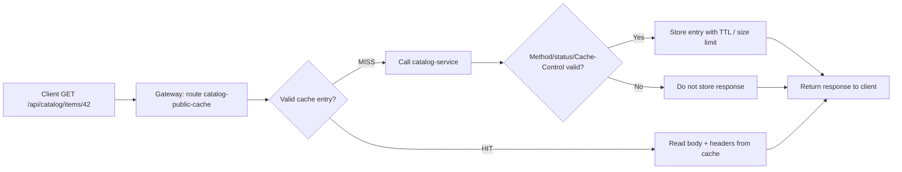
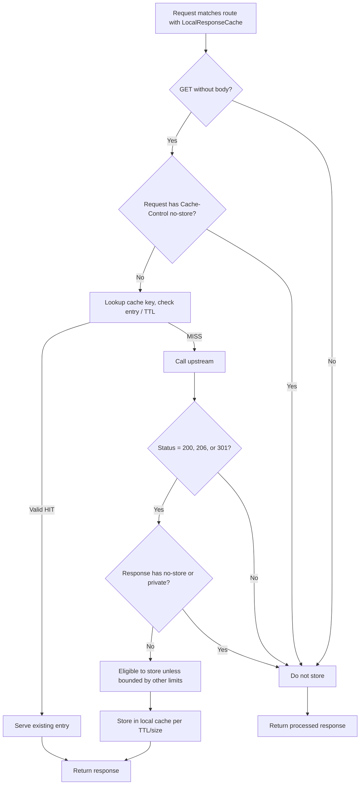

# Cache Conditions by HTTP Method, Status, and Cache-Control

## 1. The Problem: Not Every Response Passing Through the Gateway Should Be Cached

In a microservices architecture, **Spring Cloud Gateway** is the entry point for APIs. The Gateway selects routes via predicates, processes requests/responses through a filter chain, discovers service instances, and integrates authentication, rate limiting, circuit breakers, retries, TLS, and request observability. **Response caching** can reduce backend calls, latency, and processing costs for content that is **safe to reuse**.

For example, `catalog-service` serves a public, infrequently changing product catalog. The Gateway can keep the response of a GET request in cache briefly so subsequent requests for the same data do not have to hit the backend. However, if an API returns a user's transaction history, or a response carries `Cache-Control: private`, caching it improperly can cause **data leakage**.

The direct topic of this lesson in the **Response Caching** chapter is: **cache conditions by HTTP method, status, and Cache-Control**. For **Spring Cloud Gateway's `LocalResponseCache`**, these three sets of conditions form a checkpoint. Only when the conditions are satisfied and the filter is genuinely enabled/attached to the route can a response enter the cache.

After this lesson, you will be able to:

1. Explain why **bodiless GET** differs from POST/PUT/DELETE/HEAD under `LocalResponseCache` rules.
2. Recall the exact HTTP statuses **200, 206, 301** eligible for storage by the filter, and know why 404, 500, 503, 302, or 204 are excluded.
3. Distinguish `Cache-Control` **on the request** vs. **on the response**, specifically `no-store`, `private`, `no-cache`, and `max-age`.
4. Configure **per-route** caching in Gateway Server WebFlux, set TTL/size limits, and test using a request-counting backend.
5. Recognize the differences between **Gateway caching**, **browser/CDN caching**, and `ETag`/`304` mechanics.
6. Protect cache keys, tokens/sessions, routes sharing the same URI, and multi-instance Gateway environments.

> **Version and scope:** Primary examples use **Spring Cloud Gateway Server WebFlux 5.0.5** (the 5.0.x line patched for the global cache vulnerability) and a compatible Spring Boot/Spring Cloud BOM. The configuration namespace is `spring.cloud.gateway.server.webflux`. Gateway Server Web MVC has a filter of the same name but a different runtime/Java DSL. **This learning setup favors per-route caching with global caching disabled** because cache boundaries are a security concern. Examples use plain internal HTTP for the lab only; production requires TLS and proper route protection.

## 2. What Does LocalResponseCache Actually Do?

Spring Cloud Gateway provides the **`LocalResponseCache`** filter backed by a **local cache inside the Gateway process** (powered by Caffeine when the required dependencies are present). The filter can store **response headers and bodies** of eligible requests and return them without opening another upstream request.



This diagram illustrates **cache eligibility and the basic lifecycle**. In practice, there are also key lookup steps, expiry, eviction, header conditions, filter ordering, and the special branch for `Cache-Control: no-cache` requests.

### 2.1. Three Different Places Caches Live

| Cache | Where Does It Live? | Who Controls It? | Impact |
|---|---|---|---|
| **Browser HTTP cache** | User's device | Browser, HTTP caching headers | May avoid sending a request to Gateway |
| **CDN / reverse proxy cache** | Edge/ingress in front of Gateway | CDN/proxy policy | May avoid sending a request to Gateway |
| **Gateway LocalResponseCache** | RAM/process of a Gateway instance | Spring Cloud Gateway + Caffeine | On a HIT, may skip calling backend |
| **Backend application cache** | Inside the service or dedicated Redis | Backend | Gateway may still send requests to the service |

**Important:** a `Cache-Control: max-age=120` returned by the backend does not automatically mean Gateway will cache that response. The filter still checks method, status, storage directives, size, TTL, route, and cache state. Also, if a browser/CDN HITs before Gateway, measuring Gateway caching with a backend call counter requires isolating those outer cache layers.

### 2.2. A Local Cache Is Not a Distributed Cache

If you deploy **3 Gateway pods**, each pod has its own Caffeine cache. Pod A experiencing a MISS and caching a response does not populate Pod B with that entry. Restarting a pod wipes its in-memory cache; eviction can also occur when capacity fills or TTL expires. Do not assume `LocalResponseCache` shares data via Redis, service discovery, or a LoadBalancer.

## 3. First Condition: HTTP Method Must Be a Bodiless GET

Spring Cloud Gateway 5.0.x documentation specifies that **`LocalResponseCache` caches only GET requests without a body** (*bodiless GET*). This is an enforced filter rule, not merely a REST guideline.

| Request | Eligible by Method/Body? | Remarks |
|---|---|---|
| `GET /items/42`, no body | **Yes** | Status and headers still apply |
| `GET /items/42?lang=vi`, no body | **Yes** | Query may denote another representation; test cache keys |
| `GET /items/42` with a request body | **No** | Fails the **bodiless GET** condition |
| `HEAD /items/42` | **No** per filter list | Even though HTTP HEAD relates to GET, this filter explicitly specifies GET |
| `POST /items` | **No** | Not cached by this filter, even for read-only POSTs |
| `PUT /items/42`, `PATCH`, `DELETE` | **No** | State-mutating requests require different invalidation strategies |
| `OPTIONS /items/42` | **No** | CORS preflights are not stored by LocalResponseCache under the GET rule |

**Route predicates and cache filters are two separate layers.** For instance, `Method=GET` restricts the route to GETs, but **does not enable caching on its own**. Conversely, if a route also matches POST, `LocalResponseCache` will still only consider **bodiless GETs** eligible for storage. Ideally, create dedicated cached routes for public read endpoints so the scope stays easy to audit.

### 3.1. Why Avoid Bodies on GET?

Designing GET requests with bodies can cause proxies/caches to omit the body from the cache key or disagree on semantics. Even if a backend accepts it, `LocalResponseCache` **does not cache GETs with bodies** under the filter's contract. Do not work around this by stuffing sensitive payload data into query strings: URLs routinely end up in logs, browser histories, and metrics.

### 3.2. Does Caching a GET Automatically Clear on POST?

**There is no promise of automatic invalidation of GET entries when a POST/PUT/DELETE modifies a product.** LocalResponseCache is a TTL/eviction response cache; the application must design appropriate invalidation or TTLs. A mutation request can succeed on the backend while readers continue receiving the old cached response from Gateway until expiry or eviction.

For inventory counts, real-time pricing, or payment decisions, consider **not caching**, using very short TTLs, or implementing a verifiable invalidation strategy at the proper layer.

## 4. Second Condition: Only HTTP Statuses 200, 206, and 301

The `LocalResponseCache` documentation specifies **three statuses** eligible for response storage:

| HTTP Status | Cacheable by Filter? | Example | Risks to Check |
|---|---|---|---|
| **200 OK** | **Yes** | Public catalog JSON, small images | Must contain no personal data; appropriate response headers |
| **206 Partial Content** | **Yes** | Serving a byte slice of a file via Range request | Cache key and `Range`/`Content-Range` slicing are highly sensitive |
| **301 Moved Permanently** | **Yes** | Redirecting a legacy path to a new URL | Old redirects can linger in cache |
| 204 No Content | **No** per list | Operation returning no body | Do not assume it acts like 200 |
| 302 Found / 307 / 308 | **No** per list | Temporary or other redirects | Do not infer "all 3xx are cached" |
| 304 Not Modified | **No** (not stored as an upstream cache entry) | Result of conditional request evaluation | Distinguish from the 304 the filter **returns on `no-cache`** (Section 6) |
| 400 / 401 / 403 / 404 / 429 | **No** | Bad request, unauthorized, missing resource, rate-limited | Do not rely on this filter for negative-caching 404s |
| 500 / 502 / 503 / 504 | **No** | Backend failure, timeout, unavailable | Error responses are not cached by this filter |

**Note:** an **eligible status** is a **necessary**, not **sufficient**, condition. For example, a 200 response with `Cache-Control: private` is still excluded. A POST request returning 200 is also ineligible due to the method rule.

### 4.1. Why Be Cautious With 206?

`206 Partial Content` typically accompanies:

```http
HTTP/1.1 206 Partial Content
Accept-Ranges: bytes
Content-Range: bytes 0-999/100000
Cache-Control: public, max-age=60
```

Two requests to the same URL with different `Range` headers **must never receive the wrong byte slice**. Although the filter treats 206 as storable, **do not rush to enable caching on video/download/range APIs** without verifying key/`Range`/`If-Range`/`ETag` handling, byte integrity, and client behavior. Support for 206 does not mean large streaming workloads belong in an in-process cache.

### 4.2. 301 Redirects and Location

A 301 response carrying `Location` can be stored if all other conditions pass. When changing paths or hosts, caching 301s can keep sending clients to the old redirect until expiry. Test absolute/relative `Location`, `Host`, `Forwarded`, and access controls; **never cache redirects whose `Location` is constructed from unvalidated Host input**.

## 5. Third Condition: Request and Response Cache-Control

Both directions in HTTP can carry `Cache-Control`. **Request directives** express the caller's preference, whereas **response directives** define the reuse policy of the returned content. To understand the filter, inspect **both direction and directive**, not merely header presence.

### 5.1. Request Cache-Control: no-store

If a request contains `Cache-Control: no-store`, Spring Cloud Gateway documentation states **the response for that request is not stored**. This is useful when a caller needs to avoid creating a new cache entry.

```http
GET /api/catalog/items/42 HTTP/1.1
Host: gateway.example.test
Cache-Control: no-store
```

**Do not confuse `no-store` with `no-cache`:** `no-store` forbids **storage**, whereas `no-cache` in HTTP caching forbids **reuse without revalidation**. The filter's handling of `no-cache` has specific nuances (Section 6.3).

### 5.2. Response Cache-Control: no-store

If the backend returns:

```http
HTTP/1.1 200 OK
Content-Type: application/json
Cache-Control: no-store

{"id":"42","status":"sensitive"}
```

then `LocalResponseCache` **must not store the response**, even for a bodiless GET with status 200. This is the right policy for access tokens, personalized payloads, sensitive data, or responses unsuitable for shared caches.

### 5.3. Response Cache-Control: private

```http
HTTP/1.1 200 OK
Cache-Control: private, max-age=60
```

`private` forbids **shared caches from storing the content** under HTTP semantics. Gateway is shared across many users; `LocalResponseCache` **excludes responses carrying `private`**. Having `max-age=60` alongside it does not make the response eligible: **`no-store`/`private` overrides storage**.

### 5.4. Response Cache-Control: public, max-age

```http
HTTP/1.1 200 OK
Cache-Control: public, max-age=120
Content-Type: application/json

{"id":"42","name":"Sample product"}
```

This is a **caching candidate** when the request is a bodiless GET, status is valid, and route caching is enabled. `public` indicates suitability for shared caches, while `max-age` bounds HTTP **freshness** duration.

In `LocalResponseCache`, the filter's TTL also governs **cache entry lifetime**. If upstream returned `Cache-Control` with `max-age`, the filter **rewrites** the response's `max-age` based on the cache's `timeToLive` and decrements remaining seconds on subsequent served hits. Thus, understand **both numbers**: the freshness advertised by upstream and the Gateway cache TTL.

### 5.5. Summary of Key Directives

| Header and Direction | `LocalResponseCache` 5.0.x Caching Rule | Notes |
|---|---|---|
| **Request**: `Cache-Control: no-store` | **Do not store** | Explicitly stated in filter docs |
| **Response**: `Cache-Control: no-store` | **Do not store** | Even on status 200 |
| **Response**: `Cache-Control: private` | **Do not store** | Even with `max-age` present |
| **Response**: `Cache-Control: private, max-age=120` | **Do not store** | Directives must be parsed **individually even when combined** |
| **Response**: `Cache-Control: no-cache, no-store, max-age=0` | **Do not store** | `no-store` still applies even when not listed first |
| **Request**: `Cache-Control: no-cache` when entry exists | Has a **bodyless 304** branch per filter docs | See Section 6.3 and test your exact version |
| **Response**: `Cache-Control: public, max-age=120` | **May store** | Still subject to method, status, TTL, key, policy |
| **Response**: `Cache-Control: max-age=120` | Not excluded by the three blocking rules above | Must verify whether data is genuinely safe to share |
| **Response**: no `Cache-Control` | Not excluded solely for lacking the header | Cache TTL/filter behavior must still be verified |
| **Response**: `Cache-Control: no-cache` (without no-store/private) | Not synonymous with `no-store` | HTTP mandates revalidation; **do not guess** per-version filter behavior |

**A critical bug:** checking with a naive string match like "Cache-Control starts with `no-store`" misses `Cache-Control: max-age=60, private` or `Cache-Control: no-cache, no-store`. Spring 5.0.5 documentation specifies that blocking directives are matched **individually, case-insensitively, at any position in the header**.

### 5.6. Vary, Authorization, and Cookies Must Not Be Ignored

Even when `Cache-Control` does not block storage, a response depending on:

- `Authorization` and principal permissions;
- `Cookie`, session/tenant;
- `Accept-Language`, `Accept-Encoding`, `Origin`;
- `Host` or a route predicate using headers/queries/client IP;

still risks unsafe sharing if cache keys or `Vary` fail to capture every variant. **`Cache-Control: public` does not replace authorization** nor prove all users are allowed to receive the same payload. Safe default: **never use LocalResponseCache for personalized APIs**; backends should emit `Cache-Control: private, no-store` (or an equivalent appropriate policy) whenever data must not be shared.

## 6. How the Three Conditions Combine and Special Responses

### 6.1. Response Storage Decision Flowchart



This flowchart focuses on **storage eligibility**; there is also the **request `no-cache` with an existing entry** branch that can return a bodyless 304 per docs, plus factors like cache keys, size limits, memory, and eviction. **Do not use this diagram to assert that a `no-store` request bypasses all pre-existing cache entries across every version**; verify bypass behavior empirically.

### 6.2. Quick Matrix

| Request | Upstream Response | Verdict per Filter Rules |
|---|---|---|
| Bodiless GET, no `no-store` | 200, `public, max-age=120` | **Eligible to store** |
| Bodiless GET | 206, `public, max-age=120` | **Eligible to store**, must test Range |
| Bodiless GET | 301, `public, max-age=120` | **Eligible to store** redirect |
| Bodiless GET | 404, `public, max-age=120` | **Not stored** due to status |
| Bodiless GET | 503, `public, max-age=120` | **Not stored** due to status |
| POST | 200, `public, max-age=120` | **Not stored** due to method |
| HEAD | 200, `public, max-age=120` | **Not stored** under bodiless GET rule |
| GET with body | 200, `public, max-age=120` | **Not stored** due to request body |
| Bodiless GET, request `no-store` | 200, `public, max-age=120` | **Not stored** due to request directive |
| Bodiless GET | 200, response `private` | **Not stored** due to response directive |
| Bodiless GET | 200, response `no-store` | **Not stored** due to response directive |
| Bodiless GET | 200, response `max-age=60, private` | **Not stored**; do not be fooled by max-age |

### 6.3. Request no-cache With an Existing Entry: A Common Point of Confusion

Spring Cloud Gateway `LocalResponseCache` 5.0.5 documentation describes a **special branch**: when an entry is already in the cache and a new request sends `Cache-Control: no-cache`, the filter can return **`304 Not Modified` without a body**.

```http
GET /api/catalog/items/42 HTTP/1.1
Cache-Control: no-cache

HTTP/1.1 304 Not Modified
```

Do not confuse this with **304 being a storable status**: 304 is **not in the 200/206/301 list** for storing new upstream responses. Nor does `no-cache` equal `no-store`.

In general HTTP caching, 304 pairs with **conditional requests** (e.g., `If-None-Match`/`If-Modified-Since`) and revalidation. Because the filter docs describe a specific behavior, **test your exact version, validators, and client semantics before relying on 304**. Properties controlling `no-cache` strategy can differ across release lines (5.0.5 lists `spring.cloud.gateway.server.webflux.filter.local-response-cache.request.no-cache-strategy`). Do not guess values or assume 304 triggers a fresh backend fetch.

## 7. TTL, max-age, and Cache Size

### 7.1. Example Remaining-Lifetime Calculation

Suppose upstream returns:

```http
Cache-Control: public, max-age=120
```

Gateway configures `LocalResponseCache=30s,10MB`. According to filter documentation, because the response **already includes `max-age`**, Gateway may rewrite `max-age` to the **30-second TTL** and count down remaining seconds on subsequent hits.

| Time | State | Example `max-age` Seen by Client |
|---|---|---|
| Second 0 | MISS, entry just stored | Around `30` seconds |
| Second 10 | HIT, entry still valid | Around `20` seconds |
| Second 28 | HIT, entry near expiry | Around `2` seconds |
| After second 30 | Entry expired → may call upstream again | TTL resets with new entry |

These numbers are **illustrative**: second rounding, write timing, and eviction policy can slightly shift actual output. If upstream **omits `max-age`**, do not claim the filter guarantees adding a `max-age` directive; docs state it **rewrites when the original response already had max-age**.

### 7.2. TTL Does Not Mean Unlimited Bytes

`LocalResponseCache` also has a **size budget** (e.g., `10MB`) to cap total cache storage/eviction per configuration. Caffeine can evict entries before TTL if the budget fills. Aside from serialized/compressed payload bytes, the JVM uses memory for metadata, objects, and buffers; **`10MB` is not a guarantee that Gateway RAM grows by only 10 MB**.

For workloads with many URL/query variants, cache key cardinality can explode rapidly. Never cache large file downloads, SSE, WebSockets, continuous streams, multi-Range downloads, or PII-bearing bodies simply because the method is GET.

### 7.3. Cache-Control, ETag, and Age Are Not the Same Thing

| Element | Meaning | Note |
|---|---|---|
| `max-age` | Freshness lifetime for HTTP caches | Rewritten by filter if upstream provided it |
| Gateway `time-to-live` | Entry lifetime inside Caffeine | Configured on Gateway cache |
| `ETag` / `Last-Modified` | Validator for conditional requests | If another filter modifies the body, the validator may no longer match |
| `Age` | Time a response has spent in a cache/proxy per HTTP | **Do not deduce** total entry age solely from presence/absence of this header |
| `Vary` | Request headers affecting representation | Critical for `Accept-Language`, compression, origin, tenant |

When combining `ModifyResponseBody`, `RewriteResponseHeader`, compression, or a CDN, verify **filter order** and the headers attached to the final representation. An ETag computed by the backend on pre-rewrite JSON may be invalid for JSON transformed by Gateway.

## 8. Enabling LocalResponseCache on a WebFlux Route

### 8.1. Dependencies and Version

For this lab, prepare a **Gateway Server WebFlux** app on Spring Cloud Gateway **5.0.5** (or an equivalent patched release) with a compatible Spring Boot/Spring Cloud BOM. In `pom.xml`, with versions managed by the BOM:

```xml
<dependencies>
    <dependency>
        <groupId>org.springframework.cloud</groupId>
        <artifactId>spring-cloud-starter-gateway-server-webflux</artifactId>
    </dependency>
    <dependency>
        <groupId>com.github.ben-manes.caffeine</groupId>
        <artifactId>caffeine</artifactId>
    </dependency>
    <dependency>
        <groupId>org.springframework.boot</groupId>
        <artifactId>spring-boot-starter-cache</artifactId>
    </dependency>
</dependencies>
```

Gateway documentation requires **Caffeine** and the **Spring Boot Cache starter** for LocalResponseCache. If your project defines a custom `CacheManager`, configure bean selection (such as `@Primary`/`@Qualifier`) so caching works properly. Do not assume dependencies are satisfied just because YAML parses cleanly.

### 8.2. Disable Global Cache, Enable Route-Level Cache

In `src/main/resources/application.yml` of **gateway-demo**:

```yaml
server:
  port: 8080

spring:
  application:
    name: gateway-demo
  cloud:
    gateway:
      server:
        webflux:
          # Do not cache all routes; only cache approved public routes.
          global-filter:
            local-response-cache:
              enabled: false
          filter:
            local-response-cache:
              enabled: true
          routes:
            - id: catalog-public-cache
              uri: http://localhost:8081
              predicates:
                - Path=/api/catalog/**
                - Method=GET
              filters:
                - StripPrefix=2
                - LocalResponseCache=30s,10MB
```

**Read each layer accurately:**

- `server.port: 8080`: Gateway's inbound HTTP server. This **does not** control cache lifetime.
- `global-filter.local-response-cache.enabled: false`: **disables global caching**; prevents other routes from accidentally sharing a response cache.
- `filter.local-response-cache.enabled: true`: enables the **GatewayFilter factory** so routes can attach `LocalResponseCache`.
- `LocalResponseCache=30s,10MB`: **30-second** TTL and **10 MB** max size for this route's cache in shortcut syntax.
- `Path=/api/catalog/**` + `Method=GET`: matches this public route only for GETs. The cache still enforces **no request body** internally.
- `StripPrefix=2`: `GET /api/catalog/items/42` reaches `GET /items/42` on the backend; this is a path rewrite, not a caching condition.

**Important note:** in the 5.0.5 configuration properties table, `spring.cloud.gateway.server.webflux.global-filter.local-response-cache.enabled` and `spring.cloud.gateway.server.webflux.filter.local-response-cache.enabled` are **two separate flags**. Legacy docs may use `spring.cloud.gateway.global-filter.*`; do not mix 4.x and 5.0.x namespaces arbitrarily.

### 8.3. Equivalent Java RouteLocatorBuilder

If you prefer configuring **routes in Java instead of YAML**, replace the `routes` block with a bean:

```java
package com.example.gateway;

import java.time.Duration;
import org.springframework.cloud.gateway.route.RouteLocator;
import org.springframework.cloud.gateway.route.builder.RouteLocatorBuilder;
import org.springframework.context.annotation.Bean;
import org.springframework.context.annotation.Configuration;
import org.springframework.http.HttpMethod;

@Configuration
public class CatalogCacheRoutes {

    @Bean
    RouteLocator cacheRoutes(RouteLocatorBuilder builder) {
        return builder.routes()
            .route("catalog-public-cache", r -> r
                .path("/api/catalog/**")
                .and()
                .method(HttpMethod.GET)
                .filters(f -> f
                    .stripPrefix(2)
                    .localResponseCache(Duration.ofSeconds(30), "10MB"))
                .uri("http://localhost:8081"))
            .build();
    }
}
```

This Java bean **replaces the `catalog-public-cache` YAML route**; do not register the same ID in both places. The two flags `global-filter...enabled=false` and `filter...enabled=true` from Section 8.2 still apply. When using Java DSL, keep one authoritative route source to avoid duplicate predicates with conflicting cache policies.

### 8.4. What If You Want Global Caching?

The global filter can enable caching across many routes, but **it is unsuitable as a default for any Gateway mixing public and personalized endpoints**. Specifically, Gateway 5.0.0–5.0.4 contained **CVE-2026-59426**, where a global cache served multiple routes sharing a request URI but separated by other predicates (Section 11).

Accordingly, this lesson **does not provide a `global-filter...enabled: true` config to copy into production**. Only consider it after patching, analyzing routes/cache keys, and writing explicit data-isolation tests.

## 9. Sample Spring Boot Backend: Counting Real Requests

### 9.1. Two Applications in the Lab

| Application | Port | Key Dependencies | Role |
|---|---:|---|---|
| `catalog-demo` | 8081 | Spring Boot Web MVC | Serves JSON, statuses, and Cache-Control per scenario |
| `gateway-demo` | 8080 | Gateway Server WebFlux + Caffeine + Cache starter | Applies per-route `LocalResponseCache` |

On Spring Boot 4.x, the Servlet starter is `spring-boot-starter-webmvc`; on Boot 3.x it is typically `spring-boot-starter-web`. **Do not add the Servlet starter to Gateway WebFlux itself** unless intentionally changing stacks.

### 9.2. Backend Controller With Test Response Headers

Create `CatalogApplication.java` in the backend project:

```java
package com.example.catalog;

import java.util.Map;
import java.util.concurrent.atomic.AtomicLong;
import org.springframework.boot.SpringApplication;
import org.springframework.boot.autoconfigure.SpringBootApplication;
import org.springframework.http.HttpHeaders;
import org.springframework.http.HttpStatus;
import org.springframework.http.ResponseEntity;
import org.springframework.web.bind.annotation.GetMapping;
import org.springframework.web.bind.annotation.PathVariable;
import org.springframework.web.bind.annotation.RequestParam;
import org.springframework.web.bind.annotation.RestController;

@SpringBootApplication
@RestController
public class CatalogApplication {

    private final AtomicLong calls = new AtomicLong();

    public static void main(String[] args) {
        SpringApplication.run(CatalogApplication.class, args);
    }

    @GetMapping("/items/{id}")
    public ResponseEntity<Map<String, Object>> item(
            @PathVariable String id,
            @RequestParam(name = "mode", defaultValue = "normal") String mode) {

        long n = calls.incrementAndGet();

        // Each mode uses a different URL query to test each condition separately.
        HttpStatus status = switch (mode) {
            case "missing" -> HttpStatus.NOT_FOUND;
            case "error" -> HttpStatus.SERVICE_UNAVAILABLE;
            default -> HttpStatus.OK;
        };

        String cacheControl = switch (mode) {
            case "private" -> "private, max-age=120";
            case "no-store" -> "no-store";
            case "combined" -> "public, max-age=120, no-store";
            default -> "public, max-age=120";
        };

        return ResponseEntity.status(status)
            .header(HttpHeaders.CACHE_CONTROL, cacheControl)
            .header("X-Backend-Call", Long.toString(n))
            .body(Map.of(
                "id", id,
                "mode", mode,
                "backendCall", n,
                "message", "catalog demo"));
    }
}
```

`application.yml` of **catalog-demo**:

```yaml
server:
  port: 8081
spring:
  application:
    name: catalog-demo
```

**Counter explanation:** `backendCall` and `X-Backend-Call` increment every time a request hits the controller. Calling the backend twice directly increments both. When calling the same URL twice through the Gateway, if the second call is a **cache HIT**, the stored response retains the **same `backendCall` value**. This in-memory counter is for lab use only, not a distributed global metric.

The `normal` mode returns 200 + `public, max-age=120`, `private` returns 200 + `private, max-age=120`, `no-store` returns 200 + `no-store`; `missing` returns 404 and `error` returns 503. Even though both error responses carry `Cache-Control: public, max-age=120`, their **status** still disqualifies them from filter storage.

### 9.3. Preparation Before Running

Start the `8081` backend first, then `8080` Gateway. To avoid misinterpretation, test direct calls first:

```bash
curl -i 'http://localhost:8081/items/42'
curl -i 'http://localhost:8081/items/42?mode=private'
curl -i 'http://localhost:8081/items/42?mode=missing'
```

If Gateway runs inside a container/pod, `localhost:8081` in the route refers to **the Gateway container/pod's own loopback**, not the host machine's backend. Use the proper DNS/Service name (such as a Kubernetes Service name), or `lb://catalog-service` when LoadBalancer/DiscoveryClient is configured.

> **The commands in this guide are instructions for self-testing, not captured execution logs.** JSON key ordering, exact headers, Caffeine eviction, and timing may vary by runtime version.

## 10. Testing With curl: Proving HIT, MISS, and Non-Cached Cases

### 10.1. Public GET 200 — First MISS, Second HIT

Start both apps per Sections 8–9 and call the **exact same URL** twice within 30 seconds:

```bash
# First request via Gateway; expect MISS when cache is empty.
curl --noproxy '*' -i \
  'http://localhost:8080/api/catalog/items/42'

# Second request to the EXACT SAME URL within 30 seconds.
curl --noproxy '*' -i \
  'http://localhost:8080/api/catalog/items/42'
```

For an uncached, unevicted entry, illustrative output:

```http
# First call:
HTTP/1.1 200 OK
Cache-Control: public, max-age=30
X-Backend-Call: 1
Content-Type: application/json

{"id":"42","mode":"normal","backendCall":1,"message":"catalog demo"}

# Second call within TTL:
HTTP/1.1 200 OK
Cache-Control: public, max-age=26
X-Backend-Call: 1
Content-Type: application/json

{"id":"42","mode":"normal","backendCall":1,"message":"catalog demo"}
```

**The key detail is not the number 26**, but that `backendCall` **remains unchanged** because no new backend invocation occurred. After 30 seconds or eviction, a new request will MISS and `backendCall` will rise again. If you see 1 then 2 right away, check route/cache enable flags, query/headers, TTL, another pod, or whether the response contained `private/no-store`.

### 10.2. GET 200 With Cache-Control: private

```bash
curl --noproxy '*' -i \
  'http://localhost:8080/api/catalog/items/42?mode=private'
curl --noproxy '*' -i \
  'http://localhost:8080/api/catalog/items/42?mode=private'
```

Each time the backend processes the call, `backendCall` increments and the response carries `Cache-Control: private, max-age=120`. Even though status and body shape match a normal 200, **`private` stops `LocalResponseCache` from storing it**. If a CDN/browser cache sits in front, separate those layers before drawing conclusions.

### 10.3. GET 200 With Cache-Control: no-store

```bash
curl --noproxy '*' -i \
  'http://localhost:8080/api/catalog/items/42?mode=no-store'
curl --noproxy '*' -i \
  'http://localhost:8080/api/catalog/items/42?mode=no-store'

# Combined mode tests no-store when it is not the first directive.
curl --noproxy '*' -i \
  'http://localhost:8080/api/catalog/items/42?mode=combined'
curl --noproxy '*' -i \
  'http://localhost:8080/api/catalog/items/42?mode=combined'
```

`mode=combined` returns `public, max-age=120, no-store`; **`no-store` must still block storage**. This guards against flawed custom logic that only inspects the first directive. Never test with real personal data for lab verification.

### 10.4. Request no-store — Never Creates a New Entry

Use a URL not called earlier, such as ID `100`, and send `Cache-Control: no-store` on the request:

```bash
curl --noproxy '*' -i \
  -H 'Cache-Control: no-store' \
  'http://localhost:8080/api/catalog/items/100'

curl --noproxy '*' -i \
  -H 'Cache-Control: no-store' \
  'http://localhost:8080/api/catalog/items/100'
```

Even though the backend returns `200 public, max-age=120`, **request `no-store` prevents storing the response in the cache** under the filter's rules. Pick an uncached URL for this test so you do not mix a pre-existing cache HIT branch with testing **new entry creation**.

### 10.5. Status 404/503 — Not Stored Even When Cache-Control Allows It

```bash
# Two 404s to the same URI: not cached by LocalResponseCache.
curl --noproxy '*' -i \
  'http://localhost:8080/api/catalog/items/42?mode=missing'
curl --noproxy '*' -i \
  'http://localhost:8080/api/catalog/items/42?mode=missing'

# Two 503s to the same URI: not cached by LocalResponseCache.
curl --noproxy '*' -i \
  'http://localhost:8080/api/catalog/items/42?mode=error'
curl --noproxy '*' -i \
  'http://localhost:8080/api/catalog/items/42?mode=error'
```

In each pair, `X-Backend-Call` increments because the filter creates no 404/503 cache entry. If Gateway runs a **CircuitBreaker fallback**, Retry, RateLimiter, or custom filter, statuses may change before reaching the client; check backend access logs and the filter chain to see which exact response was evaluated for storage.

### 10.6. Request no-cache When a 200 Entry Already Exists

First send a normal GET to warm the cache:

```bash
curl --noproxy '*' -i \
  'http://localhost:8080/api/catalog/items/777'

# Immediately afterward, test the no-cache directive on the request.
curl --noproxy '*' -i \
  -H 'Cache-Control: no-cache' \
  'http://localhost:8080/api/catalog/items/777'
```

Per official `LocalResponseCache` docs, when an **entry already exists**, a `no-cache` request can receive a **bodyless 304** instead of a fresh JSON payload. Record status, any `ETag`/validators, cache entry age, and actual backend calls. If your system requires strict standard HTTP conditional requests or real-time freshness, test your exact version and consider skipping this filter for that workload.

### 10.7. HEAD/POST Are Never Filter HITs

```bash
# The lab route specifies Method=GET, so HEAD/POST may not match the route.
curl --noproxy '*' -I \
  'http://localhost:8080/api/catalog/items/42'

curl --noproxy '*' -i -X POST \
  'http://localhost:8080/api/catalog/items/42'
```

Here, if Gateway returns **404/405** or another error, that reflects **route matching** first, not proof that `LocalResponseCache` ran and rejected storage. To test the filter's own GET/HEAD/POST rule, set up a **temporary route matching those methods** with a matching backend handler; even then, the filter still **caches only bodiless GETs**.

## 11. Cache Key Security Boundaries and CVE-2026-59426

### 11.1. Why Did Global Caching Cause Cross-Route Leakage?

On **November 19, 2026**, Spring published **CVE-2026-59426 — Spring Cloud Gateway Global LocalResponseCache Leaks Responses Across Routes**. It affects certain Gateway versions with **global caching** enabled and **multiple routes matching the same request URI** separated by predicates not captured in the cache key.

Per the advisory, in affected versions the global cache key was built from **request URI, Authorization, cookies, and request headers listed in `Vary`**, while **omitting the route ID**. Example risk:

```text
GET /api/report
Header: X-Segment: internal
    → route internal-report → internal upstream, returns response A

GET /api/report
Header: X-Segment: public
    → route public-report → public upstream, should return response B

If the shared cache fails to separate routes/segments properly,
a public caller risks receiving A from cache without hitting backend B.
```

Relevant predicates include `RemoteAddr`, `Host`, `Header`, `Cookie`, `Query`, and custom predicates. This scenario **requires no backend bug**: the wrong response is served directly by Gateway.

### 11.2. Affected Versions and Mitigation

According to Spring's announcement:

| Branch | Affected Versions | Published Patch |
|---|---|---|
| 5.0.x | **5.0.0–5.0.4** | **5.0.5** (OSS) |
| 4.3.x | **4.3.0–4.3.6** | **4.3.7** (Enterprise Support) |
| 4.0–4.2.x | **4.0.0–4.2.10** | **4.2.11** (Enterprise Support) |

For the 5.0.x line used here, **upgrade to 5.0.5 or a higher patched release**, **disable global LocalResponseCache**, and attach `LocalResponseCache` only to **approved routes** where appropriate. The advisory states **per-route caches maintain separate caches** and are unaffected by this **cross-route global cache** bug. That is why this guide uses:

```yaml
spring:
  cloud:
    gateway:
      server:
        webflux:
          global-filter:
            local-response-cache:
              enabled: false
          filter:
            local-response-cache:
              enabled: true
```

**Caveat:** upgrading and isolating routes **does not automatically make every response inside a single route safe**. A personalized endpoint can still be mis-cached if auth, tenant, `Vary`, `Cache-Control`, or filter ordering is flawed. **Never use caching as a substitute for authentication/authorization.**

### 11.3. Never Rely on Vary as Your Sole "Shield"

`Vary: Accept-Language` states that representation depends on the `Accept-Language` header; a Vary-aware cache can separate variants by that header. However, if a response depends on tenant or entitlements inside a token, no simple, safe header may capture all access rights.

**Separate routes**, narrow what is cached, skip private responses, and keep authorization checks in the right place. For user tokens/cookies, prefer `Cache-Control: private, no-store` and test with **at least two accounts/roles/tenants** to ensure zero response sharing.

## 12. When Does Caching Return Wrong Results Despite Passing the Three Basic Rules?

The three method/status/Cache-Control rules are an **initial filter**. They **do not guarantee** every response is safe to share with every client.

### 12.1. Same Path, Different Language or Encoding

Suppose:

```text
GET /api/catalog/items/42
Accept-Language: vi
→ {"name":"Tai nghe"}

GET /api/catalog/items/42
Accept-Language: en
→ {"name":"Headphones"}
```

If the backend uses `Accept-Language` to pick a language, the response should declare `Vary: Accept-Language` and the cache must be tested to confirm variant isolation. Likewise, for `Accept-Encoding`, the cache must never serve gzip bytes to a client that does not accept gzip.

**Never look only at the URI and assume two requests are equivalent.** `Vary` headers must align with content, and proxies/HTTP clients may normalize them. In production, test differing headers side by side and compare body, `Content-Encoding`, `Content-Length`, and status.

### 12.2. Same Path, Different Permissions/Users

```text
GET /api/orders
Cookie: SESSION=alice
→ Alice's orders

GET /api/orders
Cookie: SESSION=bob
→ Bob's orders
```

By method and status, both are `GET 200`, yet **they must never share a cached response**. Any bug in cache keys, filter order, route selection, or cookie/session handling is severe. Always:

- Return `Cache-Control: private, no-store` on private responses.
- Never attach `LocalResponseCache` to routes carrying user/tenant data without test-proven isolation.
- Verify Spring Security/TokenRelay and authorization still run properly on cache HITs; a cache returning a response **before a security check** breaks security assumptions.
- Never log raw access tokens or cookies in logs or metrics to "debug cache keys."

### 12.3. Caching After Route Rewrites and Query Parameters

Gateway can alter paths via `StripPrefix`/`RewritePath` or add query parameters. The cache key must align with the **actual data representation**; when the same public URL routes to different upstreams based on `Host`, `Header`, `RemoteAddr`, `Cookie`, or custom predicates, be especially cautious with **global caching** and the Section 11 advisory.

A parameter like `?currency=USD` vs. `?currency=VND` can completely change the payload. Never collapse differing query URLs into one cache entry unless the backend guarantees identical responses.

### 12.4. Caching and Response Body Filters

If `ModifyResponseBody` strips internal fields or transforms a DTO, ordering between `LocalResponseCache` and the body filter is vital: the cache may store the **pre-transform or post-transform representation** depending on the filter chain and lifecycle. This impacts:

- Body structure, `Content-Type`, and `Content-Length` received by the client.
- An `ETag` computed by the backend from the original body.
- Headers added after cache read/write.
- Tenant/user authorization if response filters rely on `SecurityContext`.

For APIs with non-trivial body transformations, test both **MISS and HIT** and compare bodies and headers programmatically. Never assume that because MISS works, HIT will too.

### 12.5. Fallbacks, Retries, Rate Limits, and Circuit Breakers

In a Gateway with multiple filters:

- **CircuitBreaker fallback 503:** status 503 is outside LocalResponseCache's cacheable list; however, if a fallback **deliberately returns 200**, a cache positioned accordingly may treat it as a normal 200 response. Set `Cache-Control: no-store` explicitly on fallbacks you do not want stored.
- **Retry:** a MISS request may generate multiple upstream attempts, while a HIT calls the backend zero times. Never assume upstream HTTP calls equal incoming Gateway requests.
- **RateLimiter:** quota policies must be evaluated before serving cache HITs if quotas limit **all incoming requests**. A cache HIT is not a pass to skip auth or quotas.
- **TokenRelay:** never cache responses governed by a specific bearer token merely because the HTTP status is 200. Audience, scopes, and user entitlements do not vanish behind a proxy.

### 12.6. CORS and Cache-Control

With multiple frontend origins, CORS responses may emit a specific `Access-Control-Allow-Origin` along with `Vary: Origin`. Caches/CDNs/Gateway must preserve distinct variants so one origin's CORS headers are never returned to another origin. **CORS governs browser read access**, not tenant cache isolation or client authentication.

## 13. Per-Route Caching vs. Gateway Server Web MVC

**Server WebFlux** in this lesson uses Reactor Netty, `RouteLocatorBuilder`, and the `spring.cloud.gateway.server.webflux` namespace. **Gateway Server Web MVC** builds on Servlet/WebMvc.fn; Spring docs describe a LocalResponseCache filter for it, with a **different Java API/runtime**.

| Aspect | Gateway Server WebFlux | Gateway Server Web MVC |
|---|---|---|
| Runtime | WebFlux, Reactor Netty | Servlet/WebMvc.fn |
| Java Routes | `RouteLocatorBuilder` | `GatewayRouterFunctions.route(...)` |
| YAML Route Config | `spring.cloud.gateway.server.webflux.routes` | `spring.cloud.gateway.server.webmvc.routes` |
| Cache Filter | `LocalResponseCache` GatewayFilter factory | Corresponding MVC filter/HandlerFilterFunction |
| Documented Baseline Rules | Bodiless GET; status 200/206/301; skip on request no-store/response no-store/private | Also described in MVC docs |
| Operational Notes | Reactive in-process Caffeine cache | Servlet in-process cache; different stack config/filters |

YAML snippet **specifically for an MVC app**:

```yaml
spring:
  cloud:
    gateway:
      server:
        webmvc:
          routes:
            - id: mvc-catalog-cache
              uri: http://localhost:8081
              predicates:
                - Path=/api/catalog/**
              filters:
                - StripPrefix=2
                - LocalResponseCache=30s,10MB
```

**Do not copy** `spring.cloud.gateway.server.webflux.filter...` flags into MVC assuming identical binding. Check the **configuration properties/implementation of your exact Gateway MVC version**, configure Caffeine/Cache dependencies properly, and test with the same method/status/header matrix. This snippet illustrates filter and route syntax only, **not a complete production file**.

## 14. Operations: Local Cache, Memory, Scale-Out, and Invalidation

### 14.1. A Cache MISS Does Not Mean Upstream Failed

A cache MISS is normal whenever:

- A new URL appears for the first time.
- The entry's TTL expires.
- The cache evicts entries due to size limits.
- A Gateway pod restarts or traffic lands on a different pod.
- Request/body/headers fail caching rules.
- Upstream returns a non-storable status or `Cache-Control`.
- `Vary`/query changes yield a different key.

**Do not attribute cache MISSes to circuit breaker or service discovery failures.** A backend can return 200 every time even when Gateway caches nothing.

### 14.2. Memory Risks and Cache Key Explosion

With millions of distinct URLs, even 10 MB per route cache incurs overhead. Caffeine caps are measured according to the implementation's data weight accounting; the JVM also allocates heap/direct buffers, object overhead, HTTP client connection pools, and in-flight reactive exchanges. With multiple routes/pods, multiply budgets per actual config and measure memory.

Recommendations:

1. Cache only **small, public, low-cardinality payloads**; avoid large downloads or streaming responses.
2. Use short TTLs matching required freshness; avoid caching 301s too long when routes may change.
3. Limit the number of cached routes and per-route memory budgets.
4. Monitor heap/direct memory, GC, CPU, hit ratio, and latency.
5. Load-test concurrent MISSes on the same URL to spot cache stampedes; do not assume the cache coalesces concurrent requests automatically.

### 14.3. Invalidation When Data Changes

In the lab, updating a product does not automatically clear GET caches. Design options depend on your SLA:

| Strategy | Pros | Limitations |
|---|---|---|
| Short TTL | Simple, no event invalidation needed | Can serve stale data within TTL |
| Skip caching strongly consistent data | More accurate | Higher backend load |
| Versioned URLs / ETag with proper validators | Simplifies freshness for certain content | Needs standard HTTP caching and client testing |
| Centralized invalidation at CDN/Redis/service | Better version control when engineered well | Not a built-in feature of LocalResponseCache |
| Deploy-time warm-up | Reduces initial cold MISSes | Risk of warming wrong/too many variants |

If the system requires **immediate eviction** across all Gateway pods when a product changes, `LocalResponseCache` should not be treated as a distributed cache/invalidation bus. Consider moving caching to a tier with a dedicated invalidation API or shortening TTLs to meet business needs.

### 14.4. Multiple Instances and Cache Statistics

When Gateway runs N instances behind a LoadBalancer, each instance has **its own cache lifecycle**. Two requests to the same URL may land on Pod A and Pod B, causing two MISSes; a HIT on Pod A does not imply a HIT on Pod B. To measure properly:

- Include **pod/instance ID** in logs and metrics.
- Track backend request counts/rates per route.
- Use cache/Actuator telemetry where supported by your version and configuration.
- Do not divide client requests by upstream requests alone to compute hit ratio when Retries, auth rejections, circuit breakers, or CDNs are present.

## 15. Troubleshooting When Caching Misbehaves

### 15.1. Symptom and Cause Table

| Symptom | Possible Cause | Specific Checks |
|---|---|---|
| Startup fails to find `LocalResponseCache` | Route-level factory not enabled, missing Caffeine/Cache starter, incompatible BOM | Check `filter.local-response-cache.enabled`, dependencies, startup logs |
| GET 200 always increments `backendCall` | `private`/`no-store` response, cache disabled, differing query/headers, expired entry, or another pod | Check status, both `Cache-Control` headers, `X-Backend-Call`, route ID, TTL |
| GET 200 stays HIT for too long | TTL exceeds requirement, or stale response in outer cache layers | Check `time-to-live`, browser/CDN, and individual Gateway instances |
| GET 404 or 503 is not cached | **Expected behavior** per status list | Do not expect LocalResponseCache to cache 404/503 |
| POST 200 is not cached | **Expected behavior**: filter supports bodiless GET only | Design another cache if POST response caching is truly required |
| GET with body is not cached | **Expected behavior** per filter rules | Do not design cache keys around GET request bodies |
| HEAD returns 404 via Gateway | `Method=GET` route rejects HEAD | Separate route predicate mismatches from filter caching rules |
| Request `no-store`, yet response still shows `max-age` | Request header forbids **storing**; response headers may still reflect upstream policy | Verify whether an entry was actually stored, not just headers |
| `public, max-age=120, private` still HITs | Different config/version/filter or browser/CDN cache | Call the exact Gateway pod directly; inspect blocking headers at every hop |
| Request `no-cache` returns bodyless 304 | Documented LocalResponseCache branch for cached entries | Check validators, client semantics, version, and `no-cache-strategy` |
| Response `max-age` is lower than upstream's | Gateway rewrote remaining TTL seconds | Compare route TTL with elapsed seconds |
| `X-Backend-Call` unchanged, yet body differs | Another filter modified body, multi-layer cache, or unstable backend | Compare raw body/headers per hop with request ID logs |
| User A's content appears for User B | **Severe security incident**; broken cache key/route/user isolation | Disable caching on sensitive routes, block exposure, investigate, patch |
| Route A's response appears on Route B | Global cache key collision where distinguishing predicate isn't in key; see CVE | Disable global cache, apply patch, use per-route cache, test shared URIs |
| Backend data updated, client sees stale data | Entry TTL not expired or CDN/browser cache still fresh | Check TTL, `Age`, `Cache-Control`, and invalidation flow |
| Data fresh on Pod A, stale on Pod B | Independent per-pod local caches or unsynced rollout/config | Compare instance ID, artifact version, and config |
| Cache consumes too much RAM | High URL/query cardinality, oversized cap, concurrent MISSes | Lower TTL/size, restrict routes, monitor memory/GC |
| Poor behavior for SSE/large downloads | LocalResponseCache is not a general streaming cache | Disable caching on those routes and use purpose-built streaming/CDN |

### 15.2. Repeatable Investigation Workflow

1. **Verify version and pod:** Patched Spring Cloud Gateway 5.0.5; confirm active `application.yml`/profiles on the pod receiving traffic.
2. **Verify route:** ID, URI, Path/Method predicates, `LocalResponseCache` attached, and global cache disabled.
3. **Verify dependencies:** Caffeine, Cache starter, proper `CacheManager`, and accurate enable flags.
4. **Verify request:** GET method, no body, URL/query/headers, and request `Cache-Control`.
5. **Verify upstream response:** Status **200/206/301**? Any `private`/`no-store`? Any `Vary`/`ETag`?
6. **Test HIT/MISS cleanly:** call the exact URL within TTL, check `X-Backend-Call`; call again after TTL.
7. **Isolate cache layers:** hit the exact Gateway pod directly over an appropriate network, bypassing CDNs/browsers.
8. **Test differing variants:** multiple accounts, headers, origins, Hosts, locales, queries, and URI-overlapping routes.
9. **Monitor operations:** memory, eviction, backend call counts, latency, failures, auth, and response body integrity.
10. **Finish with regressions:** confirm non-cacheable methods/statuses/Cache-Control rules still reject caching after dependency or filter-order changes.

### 15.3. Actuator and Metrics: What Proof Is Sufficient?

With Spring Boot Actuator, Gateway Server WebFlux can expose route/filter metadata when read access is enabled:

```yaml
management:
  endpoint:
    gateway:
      access: read-only
  endpoints:
    web:
      exposure:
        include: health,metrics,gateway
```

```bash
curl -sS 'http://localhost:8080/actuator/gateway/routes'
curl -sS 'http://localhost:8080/actuator/gateway/routes/catalog-public-cache'
curl -sS 'http://localhost:8080/actuator/metrics'
```

`/routes/{id}` confirms that a route and its filters are configured; **it does not prove** a specific response was stored or served from cache. Nor does a Gateway request count metric replace **cache hit/miss/eviction metrics** if supported by instrumentation. Combine Actuator with backend counters, client responses, and trace IDs. Protect management endpoints with Spring Security/network policies; never expose internal routes, tokens/cookies, or cache entries containing sensitive data.

## 16. Safe Cache Design Checklist

- [ ] Cache only **bodiless GETs** on appropriate routes.
- [ ] Expect only **200, 206, 301**; never silently cache 404/503.
- [ ] Ensure request `no-store` and response `no-store`/`private` never create new cache entries.
- [ ] Distinguish `no-cache` from `no-store`; test 304 behavior separately.
- [ ] Set proper `Cache-Control` on public responses; never treat `public` as authorization.
- [ ] Tune TTL and size per SLA, data volatility, QPS, and memory budget.
- [ ] Keep global `LocalResponseCache` **disabled**; enable **per-route** caching explicitly.
- [ ] Use a **Spring Cloud Gateway version patched for CVE-2026-59426** (at least 5.0.5 on 5.0.x).
- [ ] Test shared URIs across multiple routes with differing predicates (Header/Host/RemoteAddr/Query/Cookie).
- [ ] Test two users/tenants and multiple roles; never cache PII responses.
- [ ] Test `Vary`/locale/encoding/ETag/Content-Length when body or other filters alter payloads.
- [ ] Maintain strategies for stale data, invalidation, or bypassing cache on sensitive business flows.
- [ ] Account for per-pod local caches; do not assume Redis sharing or cross-pod invalidation by default.
- [ ] Ensure metrics/logs never record cookies, bearer tokens, or private data; monitor hits/misses/evictions and memory.

## 17. Practice Exercises

**Exercise 1 — Method.** Gateway receives a bodiless GET, HEAD, POST, and a GET with a body on the same endpoint. Which of the four are **eligible by method/body** for LocalResponseCache?

**Exercise 2 — Status.** The backend returns 200, 206, 301, 302, 404, and 503 with `Cache-Control: public, max-age=60`. Which statuses **may be stored** by the filter?

**Exercise 3 — Two-way Cache-Control.** Compare (a) request with `Cache-Control: no-store`, (b) response with `Cache-Control: no-store`, (c) response with `Cache-Control: private, max-age=120`, and (d) response with `Cache-Control: public, max-age=120`. Which scenarios do not store?

**Exercise 4 — Directive order.** A response returns `Cache-Control: max-age=60, private`. Someone writes a custom filter checking only if the header **starts with `private`**. Why is that check broken?

**Exercise 5 — Request counting.** Cache TTL is 30 seconds and the backend returns JSON with `backendCall=8` on the first MISS. Five seconds later, the client calls the same URL and receives `backendCall=8`. Why is this stronger evidence than merely observing HTTP 200?

**Exercise 6 — max-age.** Upstream returns `Cache-Control: public, max-age=120`. Gateway caches with a 30-second TTL. Since the original response includes `max-age`, roughly what value may Gateway rewrite it to initially and after 10 seconds?

**Exercise 7 — no-cache.** Why must a `Cache-Control: no-cache` request when an entry already exists be tested separately? Distinguish the filter's 304 behavior from caching a 304 response status.

**Exercise 8 — Private data.** A GET route returns order history with different bodies for Alice and Bob, yet the response sets `Cache-Control: public, max-age=300`. Should you enable LocalResponseCache on this route? Which protection layers must change?

**Exercise 9 — CVE.** Two routes share URI `/api/report` but pick different upstreams via `Header=X-Segment`. On Gateway 5.0.3 with global caching enabled, what Spring-published risk exists, and how is it mitigated?

**Exercise 10 — HEAD and route predicates.** A route has `Method=GET`. `curl -I` returns 404. Can you conclude `LocalResponseCache` rejected caching HEAD? Why or why not?

**Exercise 11 — Multi-pod.** Two identical GETs arrive sequentially at Gateway Pod A and Pod B. Although Pod A cached the response, Pod B's request still hits the backend. Is this necessarily a bug?

**Exercise 12 — Query/locale.** Same URI path, but requests differ by `?currency=USD`/`?currency=VND` or `Accept-Language`. Design a test matrix proving the cache does not serve the wrong representation.

**Exercise 13 — Status 206.** When downloading a file with `Range: bytes=0-999` and `Range: bytes=1000-1999`, why must keys, `Content-Range`, and `ETag` be verified before caching 206?

**Exercise 14 — Fallback.** CircuitBreaker returns a 200 fallback after a backend timeout. Why might a misplaced cache store the fallback notice as normal data? Which `Cache-Control` should be used?

**Exercise 15 — Architecture.** A price table changes every second and must remain consistent across all pods. Decide whether to use a 5-minute TTL local cache and propose a better mechanism.

### Answer Key Hints

1. Only **bodiless GET** is eligible by method/body; status and `Cache-Control` still apply.
2. **200, 206, and 301**. Other statuses are outside LocalResponseCache's cacheable list.
3. (a), (b), and (c) **do not store**; (d) may store if other conditions are met.
4. Because `private` can follow `max-age`; parsers must inspect individual directives case-insensitively regardless of order.
5. HTTP 200 also appears on a MISS; `backendCall` staying constant indicates the backend did not process that extra call. You must still rule out CDN/browser caches if present.
6. Around **30 seconds** when stored and **20 seconds** after 10 seconds (subject to timing/rounding).
7. Docs describe returning a **bodyless 304** for a cached entry on a `no-cache` request; 304 is **not** an upstream status eligible for creating a new cache entry.
8. **No**, do not cache with a public filter. Require `Cache-Control: private, no-store`, per-account authorization, and cross-user tests; never assume cookies make public caching safe.
9. **CVE-2026-59426**: a shared global cache omitting route ID can return the internal route's response to a public-route caller. Upgrade to Gateway 5.0.5+, disable global caching, cache per-route only, and test.
10. No. The HEAD request was likely **rejected by the `Method` predicate before the filter ran**; that is a route-matching result.
11. No; LocalResponseCache is **local to each process/pod**, so Pod B rightly MISSes.
12. Send each variant twice within TTL, compare JSON/headers at backend and Gateway, then alternate variants; verify `Vary` and key isolation.
13. Different `Range` headers return different byte slices; an improper key/validator can corrupt downloads by mixing offsets or file versions.
14. A 200 fallback has an eligible status if other criteria match; return a business-accurate status and `Cache-Control: no-store` if it must not be cached.
15. Unsuitable for a long per-pod in-memory TTL. Use an authoritative data source, a cache with synchronized invalidation, or skip caching on time-sensitive endpoints.

## Official References

- [Spring Cloud Gateway Server WebFlux 5.0.5 — LocalResponseCache GatewayFilter Factory](https://docs.spring.io/spring-cloud-gateway/reference/5.0/spring-cloud-gateway-server-webflux/gatewayfilter-factories/local-cache-response-filter.html) — bodiless GET, statuses 200/206/301, Cache-Control, 304, and TTL/size config.
- [Spring Cloud Gateway Server WebFlux 5.0.5 — Global Filters](https://docs.spring.io/spring-cloud-gateway/reference/5.0/spring-cloud-gateway-server-webflux/global-filters.html) — global local cache, TTL, auto max-age, Caffeine/Cache dependencies.
- [Spring Cloud Gateway 5.0.5 — Configuration Properties](https://docs.spring.io/spring-cloud-gateway/reference/5.0/configprops.html) — `server.webflux.filter.local-response-cache.*` and `global-filter.*` namespaces.
- [Spring Security Advisory — CVE-2026-59426, Nov 19, 2026](https://spring.io/security/cve-2026-59426/) — cross-route cache cause, affected versions, patches, and mitigations.
- [Spring Cloud Gateway Server Web MVC — LocalResponseCache Filter](https://docs.spring.io/spring-cloud-gateway/reference/spring-cloud-gateway-server-webmvc/filters/local-cache-response-filter.html) — filter conditions on the Servlet stack.
- [RFC 9111 — HTTP Caching](https://www.rfc-editor.org/rfc/rfc9111) — freshness, Cache-Control, Vary, shared/private caches, validators.
- [RFC 9110 — HTTP Semantics](https://www.rfc-editor.org/rfc/rfc9110) — GET/HEAD methods, statuses 200/206/301/304, conditional requests.
