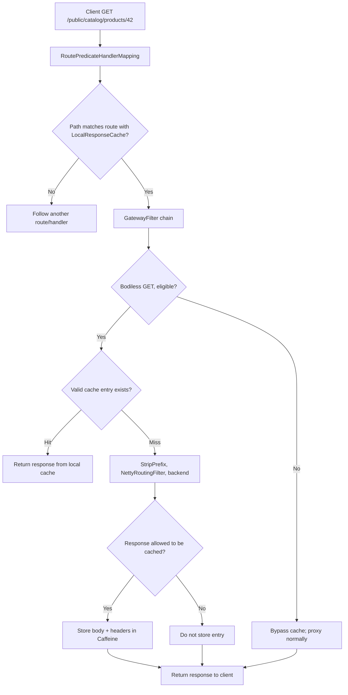

# Configuring Per-Route Capacity and Time-to-Live

## 1. Why Set Separate Cache Limits for Each Route?

In **SPRING_CLOUD_GATEWAY**, clients send requests to a single entry point, and the Gateway selects routes using predicates, runs a filter chain to transform paths/headers, authenticates, rate-limits, applies circuit breakers/retries, and forwards traffic to a microservice over HTTP(S) or `lb://`. For public content read frequently but changing infrequently, returning a **response stored in memory** lowers latency and reduces backend request load.

Spring Cloud Gateway **Server WebFlux** provides `LocalResponseCache` backed by **Caffeine**. This filter can store **response bodies along with response headers** for eligible GET requests. Instead of applying one shared cache across all paths, you can configure time-to-live and capacity limits **per route**:

```text
Gateway :8080
  |
  +-- /public/catalog/**       -> catalog-public
  |      LocalResponseCache=10s,512KB
  |      -> Backend Catalog
  |
  +-- /public/announcements/** -> announcements-public
         LocalResponseCache=1m,2MB
         -> Backend Announcements
```

For instance, product catalog/pricing needs to be relatively fresh, so it only keeps `10s`; public announcements change rarely and can stay for `1m`. If two datasets have different traffic and payload sizes, you also set separate **capacities** so a large route cannot evict a small route's entries.

**Learning objectives:**

1. Distinguish **per-route** vs. **global** caching, especially when multiple routes share a URI/path but differ by predicates.
2. Understand the meaning and units of `LocalResponseCache=10s,512KB`, `time-to-live`, and `size`.
3. Determine which requests/responses are cached by HTTP method, status, and `Cache-Control`.
4. Set up Gateway Server WebFlux 4.3.x with Caffeine and Spring Cache dependencies.
5. Practice with two routes having different TTLs/sizes, testing cache hits, expiry, `no-store` responses, and backend request counters.
6. Analyze the impact of `max-age`, cache eviction, memory/replicas, user data, and content updates.
7. Recognize a published security vulnerability involving **global LocalResponseCache** in affected Gateway versions.

> **Reference versions:** Spring Boot 3.5.x + Spring Cloud 2025.0.x / **Spring Cloud Gateway Server WebFlux 4.3.x**. Uses the `spring-cloud-starter-gateway-server-webflux` starter and the newer `spring.cloud.gateway.server.webflux` prefix. Examples select **route-level caching** and explicitly **disable global caching**. The `*.0` versions in the Maven snippet simply illustrate a compatible release train; choose a supported patch release and address security advisories before deploying to production.

## 2. Where Does Caching Sit in the Gateway Filter Chain?



`LocalResponseCache` is a `GatewayFilterFactory`: only requests that **match a route configured with the filter** can use that route's cache. On a hit, Gateway may **skip sending a new request** upstream. On a miss, Gateway proceeds with normal routing, including path/header transformation filters and potentially LoadBalancer, TLS, and Netty HttpClient.

This differs fundamentally from **browser/CDN** `Cache-Control`: `LocalResponseCache` holds responses **inside the Gateway process**. It does not write to Redis/DB and does not share entries across Gateway replicas automatically.

### 2.1. Which Requests and Responses Are Eligible?

Per official Gateway WebFlux 4.3 documentation, the filter caches responses when these conditions are met:

| Condition | Cached When | Not Cached When |
| --- | --- | --- |
| HTTP method | **Bodiless GET** request. | POST, PUT, PATCH, DELETE; GET with body. |
| HTTP response status | **200 OK**, **206 Partial Content**, **301 Moved Permanently**. | Other statuses like 201, 302, 401, 403, 404, 429, 500, 503. |
| Request `Cache-Control` | Does not contain `no-store` directive. | Contains `Cache-Control: no-store`. |
| Response `Cache-Control` | Does not contain `no-store` or `private`. | Contains `no-store` or `private`. |
| Entry expired | No: must call upstream again. | Expired entries must not be served as valid hits. |
| Cache has capacity | Can store and evict other entries per Caffeine policy. | No guarantee all responses stay retained if cache is full. |

`Cache-Control: no-cache` is **not synonymous** with `no-store`. Furthermore, 4.3 filter documentation describes that when an **entry already exists** and the client sends `Cache-Control: no-cache`, the client may receive **304 Not Modified without a body**; exact behavior depends on `request.no-cache-strategy` in your patch version. Therefore, **never rely on `no-cache` as a guaranteed local-cache bypass across all versions**. When a response must never be stored, emit `no-store` from upstream and verify it.

> **Data safety:** the rules above are **technical conditions**, not authorization decisions. A personalized response can carry status 200 and accidentally pass eligibility if `private`/`no-store` is omitted. This lab caches **strictly public content identical for every caller**.

### 2.2. Backend `Cache-Control` Is Not Capacity Configuration

Suppose the backend returns:

```http
HTTP/1.1 200 OK
Cache-Control: public, max-age=120
Content-Type: text/plain; charset=UTF-8
```

The `max-age=120` header is HTTP caching metadata advertised by the backend. If the Gateway route sets `LocalResponseCache=10s,512KB`, Gateway uses a **10-second TTL** for its entry and, when `max-age` is already present, can **rewrite** `max-age` to match the configured TTL; on subsequent cache hits it counts down remaining seconds. Do not assume the backend's `max-age=120` always stays unchanged after passing through Gateway.

The `512KB` size is **not** `max-age`, nor does it limit a single request to 512KB of bandwidth. It is the **cache memory budget** governing retention and eviction of that route's entries.

## 3. Route-Level Cache vs. Global Cache

Spring Cloud Gateway has two related but non-equivalent modes.

| Property | **Route-level** `LocalResponseCache` | **Global** local response cache |
| --- | --- | --- |
| Scope | Routes that **attach** `LocalResponseCache`. | Can apply broadly to routes via global filter. |
| Custom TTL/size | `LocalResponseCache=10s,512KB` or DSL. | Uses global/default properties; can combine with per-route config. |
| Cache storage | Per-instance local Caffeine, scoped per route filter. | Local Caffeine, with global sharing mechanics depending on version. |
| Public/private control | Easy to audit route by route. | Easy to enable accidentally on sensitive or overlapping-predicate routes. |
| Example recommendation | **Enable selectively on allowlisted public routes.** | **Disable** to prevent accidental caching and cross-route leaks. |

In WebFlux 4.3, the key properties are:

```yaml
spring:
  cloud:
    gateway:
      server:
        webflux:
          global-filter:
            local-response-cache:
              enabled: false   # Do not auto-cache globally
          filter:
            local-response-cache:
              enabled: true    # Allow per-route LocalResponseCache
```

**Two separate switches**: disabling the global filter does not disable the route-level factory. Conversely, if a route declares `LocalResponseCache=...` without `filter.local-response-cache.enabled` set properly, route caching may not work as expected.

### 3.1. Security Advisory CVE-2026-59426 (Nov 19, 2026)

Spring published advisory **[CVE-2026-59426](https://spring.io/security/cve-2026-59426/)**, rated **HIGH**, warning that **global LocalResponseCache can serve responses across two different routes** when they match the same request URI but are separated by predicates excluded from the cache key (such as `Host`, `Header`, `Cookie`, `RemoteAddr`, `Query`, or custom predicates). The global filter's cache key in affected versions **did not include the selected route**. As a result, an unauthorized client could receive a restricted route's response without touching upstream.

Per the November 19, 2026 advisory:

- Affected: Gateway **4.3.0–4.3.6**, **5.0.0–5.0.4**, and **4.0.0–4.2.10** under the described deployment conditions.
- Stated fixes: **5.0.5 (OSS)**, **4.3.7 (Enterprise Support Only)**, and other supported lines.
- Mitigation: **disable global LocalResponseCache** and configure **route-level LocalResponseCache** only on routes that genuinely need caching. Per the advisory, the route-level filter uses separate caches and is unaffected by that global cross-route leak.

Mitigation config for WebFlux 4.3:

```yaml
spring:
  cloud:
    gateway:
      server:
        webflux:
          global-filter:
            local-response-cache:
              enabled: false
```

**Do not mistake mitigating this CVE for permission to cache sensitive data.** Even when route-level caches isolate routes from one another, personalized/financial/session responses still require `Cache-Control: no-store` or no caching at all, and proper authorization. Verify exact patch levels per advisory at deployment time.

### 3.2. Why Can the Same URL Belong to Two Routes?

```text
GET /catalog/42
  Route A: Header X-Channel=internal -> internal upstream
  Route B: Header X-Channel=public   -> public upstream
```

If a global cache keys only on URI and certain headers **without route identity**, a response from Route A can mistakenly be served to a request matched to Route B. Route IDs `catalog-internal` and `catalog-public` did not automatically enter the global filter's cache key in buggy versions.

**The safe approach in this lesson** uses two distinct public paths **and** separate route-level caches with global caching disabled. In production, if you use Host/header/tenant predicates, test route boundaries explicitly and never rely on route names for isolation without verifying the implementation.

## 4. What Do Time-to-Live and Size Mean?

### 4.1. TTL — `time-to-live`

`LocalResponseCache` takes as its first parameter the **maximum lifetime of an entry**, in units such as:

- `10s`: 10 seconds.
- `30s`: 30 seconds.
- `5m`: 5 minutes.
- `1h`: 1 hour.

Example:

```yaml
filters:
  - LocalResponseCache=10s,512KB
```

The first request misses the cache, so Gateway calls upstream and stores the result if eligible. Subsequent requests arriving **before the TTL expires** with the same cache identity can receive the stored response **without calling upstream**. Once the TTL passes, the next request must fetch fresh content and may store it again.

TTL **is not a background cron job refreshing the cache every 10 seconds**. It is an entry expiration bound; if no new request arrives, Gateway has no reason to proactively fetch data simply because TTL elapsed (unless you build a custom prefetching mechanism).

### 4.2. Size — Cache Capacity of a Route

The second parameter sets the maximum **cache** size expressed in `KB`, `MB`, or `GB`:

```yaml
filters:
  - LocalResponseCache=1m,2MB
```

`2MB` caps the total size of entries retained for that route according to Caffeine's and Gateway's weight/eviction accounting. It is **not** a rule limiting HTTP response payload sizes sent to clients; blocking oversized responses requires separate size/routing controls.

When cached data exceeds the limit, entries can be **evicted** per Caffeine policy. Consequently, a cached response that gets evicted can cause the next request to miss **before the TTL expires**.

**Do not infer that cache size is a hard cap on total JVM heap/RSS.** Caches incur overhead for keys, headers, metadata, objects, and concurrent state. With N routes of `2MB` each and M Gateway replicas, the total configured budget across the fleet can reach roughly `N × 2MB × M` (plus overhead), rather than a single quota shared across pods.

### 4.3. Balancing TTL, Capacity, Freshness, and Memory

| Response Type | Starting TTL to Test | Starting Capacity | Key Risk |
| --- | --- | --- | --- |
| Frequently updated public product catalog | 5–15 seconds | 256KB–2MB/route | Prices/stock change; never use cache as final transaction source of truth. |
| Infrequently updated public announcements | 1–5 minutes | 1–8MB/route | Content needs urgent edit/takedown while TTL remains active. |
| Versioned public configuration | Several minutes or more per policy | Sized by version count and body size | URL versioning and invalidation. |
| Order data, user profiles, tokens/sessions | **Never enable public route local response cache** | Not applicable | Cross-user/tenant leakage and permission changes. |
| Streaming / continuously dynamic responses | Usually unsuitable for this cache | Not applicable | Memory, latency, stale data. |

These figures are **planning heuristics**, not runtime defaults or firm SLAs. Measure backend update frequency, body sizes, URL variant count, hit ratios, heap usage, and business requirements before tuning.

### 4.4. Cache Key Count Matters More Than Route Count

Two routes with identical size budgets can behave completely differently:

```text
Route A:
  100 repeated public paths -> high hit ratio

Route B:
  /public/report?requestId=<a new UUID every time>
  -> too many keys, almost zero repetition -> cache churn
```

Enabling caching on URLs with random queries or per-request IDs explodes **cache key cardinality**, wasting memory without cutting backend traffic. Only cache resources with stable keys, repeated reads, and tolerance for TTL staleness.

## 5. Configuring Route-Level Caching in WebFlux 4.3

### 5.1. Properties to Remember

| Property | Function | Lab Setting |
| --- | --- | --- |
| `spring.cloud.gateway.server.webflux.filter.local-response-cache.enabled` | Enables the route `LocalResponseCache` filter. | `true`. |
| `spring.cloud.gateway.server.webflux.global-filter.local-response-cache.enabled` | Toggles local caching applied globally across routes. | `false` to prevent unintended caching outside allowlist. |
| `spring.cloud.gateway.server.webflux.filter.local-response-cache.time-to-live` | Default TTL for the filter when not overridden per route. | Omitted, since routes declare it explicitly. |
| `spring.cloud.gateway.server.webflux.filter.local-response-cache.size` | Default size limit when not overridden per route. | Omitted, since routes declare it explicitly. |
| `LocalResponseCache=<duration>,<size>` | **Per-route** override: TTL first, capacity second. | `10s,512KB`, `1m,2MB`. |

Gateway WebFlux 4.3's official properties table shows a default TTL of `5m` for the filter group. Some 4.3 global filter doc pages still mention **legacy prefixes** `spring.cloud.gateway.filter.local-response-cache.*` and `spring.cloud.gateway.global-filter.local-response-cache.*`. When using Spring Cloud **2025.0.x**, prefer the `server.webflux` namespace listed in the **Configuration Properties of your exact artifact** and verify startup/behavior. Never blindly copy snippets from older release trains.

### 5.2. YAML for Two Public Routes

```yaml
server:
  port: 8080

spring:
  application:
    name: response-cache-gateway

  cloud:
    gateway:
      server:
        webflux:
          # Keep global cache off: enforce a per-route allowlist.
          global-filter:
            local-response-cache:
              enabled: false

          # Allow the LocalResponseCache factory on declared routes.
          filter:
            local-response-cache:
              enabled: true

          routes:
            - id: catalog-public
              uri: http://127.0.0.1:9001
              predicates:
                - Path=/public/catalog/**
              filters:
                - LocalResponseCache=10s,512KB
                - StripPrefix=2

            - id: announcements-public
              uri: http://127.0.0.1:9001
              predicates:
                - Path=/public/announcements/**
              filters:
                - LocalResponseCache=1m,2MB
                - StripPrefix=2
```

Observations:

1. Route `catalog-public` retains eligible responses for up to roughly **10 seconds**, with a **512KB** capacity for that route's cache.
2. Route `announcements-public` retains responses for up to roughly **1 minute**, with a **2MB** capacity.
3. `StripPrefix=2` strips the first two path segments: `/public/catalog/products/42` becomes `/products/42`; `/public/announcements/release` becomes `/release`.
4. Both routes use **two distinct paths** for easy testing and to avoid unnecessary predicate overlap.
5. `http://127.0.0.1:9001` is strictly for local lab use. In real microservices you would use HTTPS or `lb://serviceId`; caching remains **local to Gateway**, not shared across backend instances.

**Why place `LocalResponseCache` before `StripPrefix`?** Filters are ordered, and a cache hit can short-circuit downstream proxy steps. In real deployments, verify the effective order of `GatewayFilter`s/`GlobalFilter`s, path rewrites, and any auth/rate-limit checks that must run before caching. For the public content in this lab, this ordering is chosen for clear observation without relying on identity data.

### 5.3. Java DSL Alternative to YAML

The same setup can be written using Java `RouteLocator`:

```java
package com.example.gateway;

import java.time.Duration;

import org.springframework.cloud.gateway.route.RouteLocator;
import org.springframework.cloud.gateway.route.builder.RouteLocatorBuilder;
import org.springframework.context.annotation.Bean;
import org.springframework.context.annotation.Configuration;

@Configuration
public class CachedRoutes {

    @Bean
    RouteLocator routeLocator(RouteLocatorBuilder builder) {
        return builder.routes()
                .route("catalog-public", r -> r
                        .path("/public/catalog/**")
                        .filters(f -> f
                                .localResponseCache(
                                        Duration.ofSeconds(10), "512KB")
                                .stripPrefix(2))
                        .uri("http://127.0.0.1:9001"))
                .route("announcements-public", r -> r
                        .path("/public/announcements/**")
                        .filters(f -> f
                                .localResponseCache(
                                        Duration.ofMinutes(1), "2MB")
                                .stripPrefix(2))
                        .uri("http://127.0.0.1:9001"))
                .build();
    }
}
```

**This replaces** the YAML routes; do not register duplicate route IDs/predicates simultaneously in the same application. When using the DSL, you still need the cache dependencies and the property enabling route-level `LocalResponseCache`.

Carefully audit any path requiring login: if the answer depends on tokens, cookies, or tenants, **never turn it into a public-cached response** simply because the controller returned 200.

## 6. Hands-On: Gateway With Two TTLs and Two Memory Limits

This lab runs **one Gateway Server WebFlux** on `127.0.0.1:8080` and **one HTTP Echo backend** on `127.0.0.1:9001`. The backend prints a request sequence number and returns it in the response header and body. When Gateway serves a **cache hit**, the backend sequence number stops incrementing—so you do not have to guess from latency alone.

Local architecture:

```text
Client curl
    |
    v
Gateway :8080
    |
    +-- /public/catalog/products/42
    |       LocalResponseCache: 10s,512KB
    |       StripPrefix=2 -> /products/42
    |
    +-- /public/announcements/release
            LocalResponseCache: 1m,2MB
            StripPrefix=2 -> /release
                    |
                    v
             EchoBackend :9001
             Counter + Cache-Control
```

### 6.1. Prepare Dependencies

Requires **JDK 17+**, Maven, and `curl`. Create a standalone Maven project with the following `pom.xml`:

```xml
<?xml version="1.0" encoding="UTF-8"?>
<project xmlns="http://maven.apache.org/POM/4.0.0"
         xmlns:xsi="http://www.w3.org/2001/XMLSchema-instance"
         xsi:schemaLocation="http://maven.apache.org/POM/4.0.0
                             https://maven.apache.org/xsd/maven-4.0.0.xsd">
    <modelVersion>4.0.0</modelVersion>

    <parent>
        <groupId>org.springframework.boot</groupId>
        <artifactId>spring-boot-starter-parent</artifactId>
        <version>3.5.0</version>
        <relativePath/>
    </parent>

    <groupId>com.example</groupId>
    <artifactId>gateway-cache-lab</artifactId>
    <version>0.0.1-SNAPSHOT</version>

    <properties>
        <java.version>17</java.version>
    </properties>

    <dependencyManagement>
        <dependencies>
            <dependency>
                <groupId>org.springframework.cloud</groupId>
                <artifactId>spring-cloud-dependencies</artifactId>
                <version>2025.0.0</version>
                <type>pom</type>
                <scope>import</scope>
            </dependency>
        </dependencies>
    </dependencyManagement>

    <dependencies>
        <dependency>
            <groupId>org.springframework.cloud</groupId>
            <artifactId>spring-cloud-starter-gateway-server-webflux</artifactId>
        </dependency>

        <dependency>
            <groupId>org.springframework.boot</groupId>
            <artifactId>spring-boot-starter-cache</artifactId>
        </dependency>

        <dependency>
            <groupId>com.github.ben-manes.caffeine</groupId>
            <artifactId>caffeine</artifactId>
        </dependency>

        <dependency>
            <groupId>org.springframework.boot</groupId>
            <artifactId>spring-boot-starter-actuator</artifactId>
        </dependency>
    </dependencies>

    <build>
        <plugins>
            <plugin>
                <groupId>org.springframework.boot</groupId>
                <artifactId>spring-boot-maven-plugin</artifactId>
            </plugin>
        </plugins>
    </build>
</project>
```

Key notes:

- `spring-cloud-starter-gateway-server-webflux` runs reactive Gateway on Netty.
- `spring-boot-starter-cache` and `com.github.ben-manes.caffeine:caffeine` are the **two dependencies** required by `LocalResponseCache` documentation.
- `spring-boot-starter-actuator` aids lab inspection; it does not guarantee every cache metric appears in every version.
- Spring Boot parent and Spring Cloud BOM manage dependency versions; do not manually pin arbitrary Gateway/Caffeine versions.
- Do not add `spring-boot-starter-web` (Servlet) to Gateway WebFlux. For production projects, use a supported release train/patch version; the `*.0` numbers here illustrate compatibility.

If the application has **custom `CacheManager` beans**, Gateway docs note you must configure `@Primary` or `@Qualifier` appropriately. Never add an unnamed second `CacheManager` and assume LocalResponseCache will pick the one you intended.

### 6.2. Gateway Java Entry Point

Create `src/main/java/com/example/gateway/GatewayApplication.java`:

```java
package com.example.gateway;

import org.springframework.boot.SpringApplication;
import org.springframework.boot.autoconfigure.SpringBootApplication;

@SpringBootApplication
public class GatewayApplication {
    public static void main(String[] args) {
        SpringApplication.run(GatewayApplication.class, args);
    }
}
```

Create `src/main/resources/application.yml` using the **complete YAML from Section 5.2**. In this lab, **do not** also register the Java DSL from Section 5.3: pick **one** route definition mechanism.

**Crucial:** keep `global-filter.local-response-cache.enabled: false` and `filter.local-response-cache.enabled: true`. This explicitly controls which routes are permitted to cache.

### 6.3. Echo Backend: Public Responses and Counter

Create `EchoBackend.java` **outside the Gateway project**. This is a JDK test server, not a production service:

```java
import com.sun.net.httpserver.HttpServer;
import java.net.InetSocketAddress;
import java.nio.charset.StandardCharsets;
import java.util.concurrent.atomic.AtomicInteger;

public class EchoBackend {

    public static void main(String[] args) throws Exception {
        AtomicInteger counter = new AtomicInteger();

        HttpServer server = HttpServer.create(
                new InetSocketAddress("127.0.0.1", 9001), 0);

        server.createContext("/", exchange -> {
            int originNumber = counter.incrementAndGet();
            String method = exchange.getRequestMethod();
            String path = exchange.getRequestURI().getRawPath();
            String query = exchange.getRequestURI().getRawQuery();

            boolean noStore = path.equals("/uncacheable");
            boolean privatePolicy = path.equals("/private-policy");
            int status = path.equals("/missing") ? 404 : 200;

            String body = "origin-request=" + originNumber + "\n"
                    + "method=" + method + "\n"
                    + "path=" + path + "\n"
                    + "query=" + query + "\n";

            // Generate a large entry to test cache capacity on a dedicated lab route.
            if (path.startsWith("/large/")) {
                body += "payload=" + "x".repeat(2048) + "\n";
            }

            var headers = exchange.getResponseHeaders();
            headers.set("Content-Type", "text/plain; charset=UTF-8");
            headers.set("X-Origin-Request-No",
                    Integer.toString(originNumber));

            if (noStore) {
                headers.set("Cache-Control", "no-store");
            } else if (privatePolicy) {
                headers.set("Cache-Control", "private, max-age=120");
            } else {
                headers.set("Cache-Control", "public, max-age=120");
            }

            byte[] bytes = body.getBytes(StandardCharsets.UTF_8);
            System.out.println("UPSTREAM #" + originNumber + " "
                    + method + " " + path + " status=" + status);

            exchange.sendResponseHeaders(status, bytes.length);

            try (var response = exchange.getResponseBody()) {
                response.write(bytes);
            }
        });

        server.start();
        System.out.println("EchoBackend started at 127.0.0.1:9001");
    }
}
```

In the lab, the backend responds with `Cache-Control: public, max-age=120` for normal paths so Gateway can store responses and rewrite `max-age`. `/uncacheable` and `/private-policy` return non-cacheable directives for negative tests. `/large/<id>` simply inflates the payload; it contains no sensitive data.

**Never deploy these special endpoints to production.** They only simulate HTTP cache policies and show which requests actually reach the backend.

Open **terminal A**:

```bash
java EchoBackend.java
```

Open **terminal B** in the project directory containing `pom.xml` and `application.yml`:

```bash
mvn spring-boot:run
```

If using Maven Wrapper: `./mvnw spring-boot:run` on Linux/macOS or `mvnw.cmd spring-boot:run` on Windows. On Windows PowerShell, adjust multiline continuations from the Bash examples, though basic `curl` commands work via `curl.exe`.

### 6.4. Verifying Cache Hits on the Catalog Route

Open **terminal C** and send two identical requests within 10 seconds:

```bash
curl -i "http://127.0.0.1:8080/public/catalog/products/42"
curl -i "http://127.0.0.1:8080/public/catalog/products/42"
```

If caching is active and the second request arrives before TTL expiration, you will typically receive:

```http
HTTP/1.1 200 OK
Cache-Control: public, max-age=10
X-Origin-Request-No: 1
Content-Type: text/plain; charset=UTF-8

origin-request=1
method=GET
path=/products/42
query=null
```

In the second response, `X-Origin-Request-No` and `origin-request` **remain 1** (assuming these were the first two calls to the backend). The `max-age` header typically drops according to remaining lifetime, often below `10`. Because both body and headers are cached, the backend generation timestamp does not change on a hit.

Check **terminal A**: across two identical-key requests within TTL, only **one** new `UPSTREAM` line appears. This is much stronger proof than fast response times, since localhost misses are also fast.

### 6.5. Verifying TTL Expiration

Wait about 11 seconds **after the entry was initially created**, then send:

```bash
sleep 11
curl -i "http://127.0.0.1:8080/public/catalog/products/42"
```

Once the Catalog entry's TTL expires, Gateway must fetch a fresh response from the backend. `X-Origin-Request-No` increments and terminal A logs a new `UPSTREAM` line.

**Do not infer that requests hit the backend precisely once every 10 seconds.** TTL counts from entry insertion time, with no scheduled background refresh. Concurrent misses, early eviction, request `Cache-Control`, and key changes all affect actual upstream call counts.

### 6.6. Comparing TTL on the Announcements Route

Send requests to the second route:

```bash
curl -i "http://127.0.0.1:8080/public/announcements/release"
curl -i "http://127.0.0.1:8080/public/announcements/release"
```

Here `LocalResponseCache=1m,2MB` allows entries to stay cached longer than Catalog. After ~11 seconds, Catalog may miss, while Announcements can still hit if under one minute:

```bash
sleep 11
curl -i "http://127.0.0.1:8080/public/announcements/release"
```

`X-Origin-Request-No` stays unchanged on a cache hit, and `Cache-Control: max-age` reflects remaining seconds. Once past TTL or evicted for capacity, a miss is expected.

### 6.7. Responses With `no-store` or `private`

In EchoBackend, these two paths disallow caching:

```bash
curl -i "http://127.0.0.1:8080/public/catalog/uncacheable"
curl -i "http://127.0.0.1:8080/public/catalog/uncacheable"

curl -i "http://127.0.0.1:8080/public/catalog/private-policy"
curl -i "http://127.0.0.1:8080/public/catalog/private-policy"
```

Repeated requests should **hit the backend**, shown by incrementing `X-Origin-Request-No`. `/uncacheable` returns `Cache-Control: no-store`; `/private-policy` returns `Cache-Control: private, max-age=120`. In both cases, LocalResponseCache must not store the response.

Even though the test payloads contain no user data, this demonstrates how the backend communicates caching policies. For tokens/sessions, orders, balances, and personal information, **prefer `Cache-Control: no-store`** and **do not attach local caching to those routes** rather than relying solely on downstream headers.

### 6.8. POST Requests and 404 Responses Stay Out of Local Cache

Because the Gateway route uses `Path`, it can match POSTs unless a `Method` predicate is added. `LocalResponseCache` caches only **bodiless GETs**; it does not act as a cache for POST/PUT/PATCH.

Test on the side-effect-free mock backend:

```bash
curl -i -X POST \
  "http://127.0.0.1:8080/public/catalog/products/42"

curl -i -X POST \
  "http://127.0.0.1:8080/public/catalog/products/42"
```

The demo backend returns 200, yet `X-Origin-Request-No` increments on every POST. **In real APIs**, never assume a 200 POST can be cached: mutations must be authorized and executed. Add `Method=GET` predicates if a route is strictly read-only.

Verify 404 responses are not cached:

```bash
curl -i "http://127.0.0.1:8080/public/catalog/missing"
curl -i "http://127.0.0.1:8080/public/catalog/missing"
```

`EchoBackend` returns `404` for `/missing`. This is **not** among the default cacheable statuses in LocalResponseCache 4.3, so the backend counter must increment.

### 6.9. Requests With `Cache-Control: no-store`

Send a GET to **an uncached URL** asking not to store:

```bash
curl -i -H "Cache-Control: no-store" \
  "http://127.0.0.1:8080/public/catalog/products/no-store-test"
```

A request with `no-store` is ineligible to populate the cache. Repeating the same URL without that header forces Gateway to call upstream since no valid entry was stored:

```bash
curl -i \
  "http://127.0.0.1:8080/public/catalog/products/no-store-test"
```

In this test, use a fresh path to avoid confusion with previously stored entries. Do not substitute `Cache-Control: no-cache` as equivalent to `no-store`: per 4.3 docs, a `no-cache` request when an entry exists may receive **304 without a body**, with exact behavior depending on version/strategy.

### 6.10. Testing Size Limits: Eviction Is Not Expiry

To see how size affects hit ratio, **temporarily edit only your lab config**:

```yaml
filters:
  - LocalResponseCache=30s,4KB
  - StripPrefix=2
```

Apply to the Catalog route, restart Gateway, and request multiple distinct `/large/` URLs:

```bash
curl -s -o /dev/null \
  "http://127.0.0.1:8080/public/catalog/large/1"
curl -s -o /dev/null \
  "http://127.0.0.1:8080/public/catalog/large/2"
curl -s -o /dev/null \
  "http://127.0.0.1:8080/public/catalog/large/3"
curl -i "http://127.0.0.1:8080/public/catalog/large/1"
```

Each `/large/<id>` response carries roughly **2KB of body** plus headers/cache metadata. With a `4KB` budget, entries compete for space in Caffeine; once an entry is evicted, re-querying `/large/1` calls the backend even though the 30-second TTL has not elapsed.

**Do not hardcode assertions on exact entry counts or eviction order.** Caffeine policies, overhead, and Gateway's weight calculation vary by version. This test illustrates **capacity misses** vs. **TTL expiry**—do not extrapolate exact JVM RSS usage from demo request counts.

After testing, **restore the original setting** `LocalResponseCache=10s,512KB`.

## 7. How to Choose TTL and Capacity in Production

Never start with `30m,500MB` across every route simply because it appeared in an example. Measure:

- **Required freshness:** how soon after content changes must users see the update?
- **Response size distribution:** p50, p95, p99 of body + headers.
- **Potential cache key count:** how many variants do paths/queries/headers create?
- **Repeat traffic:** how often are identical keys requested within the TTL?
- **Memory budget:** JVM heap/Pod memory limits, route count, replica count, overhead.
- **Invalidation:** during urgent edits/takedowns, can you tolerate staleness until TTL expires?
- **Authorization:** is data identical for all clients, or token/cookie/tenant-dependent?

### 7.1. Start From Freshness SLOs

If a catalog updates every minute and the business tolerates 10 seconds of lag, a `10s` TTL may be a good starting point. If price/stock changes must take effect **immediately during checkout**, never use Gateway HTTP caching as the final price or decision authority. Checkout backend logic must verify live price and inventory.

An approximate formula:

\[
\text{Hit ratio} =
\frac{\text{requests served from cache}}{\text{total cache-eligible requests}}
\]

Too short a TTL yields low hit ratios; too long yields stale data. Tuning balances backend load reduction against freshness obligations. **A high hit ratio is meaningless on its own** if responses are wrong or overly stale.

### 7.2. Capacity Estimation

Suppose a route has about `500` frequently accessed URLs, each roughly `2KB` for body + headers:

\[
500 \times 2\ \text{KB} \approx 1000\ \text{KB}
\]

You might start testing a budget comfortably above the rough estimate, such as `2MB`, then observe eviction and hit ratios. This **is not a guaranteed formula**: Caffeine adds overhead, encoding differs, and key variants/counts fluctuate.

With `4` Gateway replicas and `2MB` per route, the configured system-wide budget reaches roughly **8MB** for that route's entries, yet **each pod can hold different entries**. Never assume an entry just cached on Pod A will hit on Pod B; a rolling restart wipes the new pod's cache.

### 7.3. TTL Is Not Event-Driven Invalidation

If the backend updates an announcement, Gateway's local cache can keep returning the old version until TTL expires. If content must be taken down urgently for legal or security reasons, **never hope a few remaining minutes of TTL are acceptable**. You may need to:

- Skip caching content that requires immediate revocation.
- Use versioned URLs with controlled path transitions.
- Shorten TTLs or adopt a cache platform supporting managed invalidation/ban/purge.
- Actively verify multi-pod Gateway states after deployments and route updates.
- Set `Cache-Control: no-store` on non-cacheable responses, including fallbacks.

LocalResponseCache is neither a CDN with a distributed purge API nor an inter-replica event synchronization bus. If you need stronger invalidation than TTL, choose another cache technology or design explicit invalidation.

## 8. Security Boundaries Commonly Overlooked

### 8.1. Never Cache Personalized APIs

Examples that **should not** attach public-style `LocalResponseCache`:

```text
GET /api/me
GET /api/orders/O-200
GET /api/billing/statement
GET /api/admin/dashboard
GET /api/session
```

Even if every request carries a valid token, **responses can vary by principal/tenant and permission check timing**. A cache hit can bypass downstream steps, so never assume backend authorization always re-runs when Gateway serves from cache.

- Gateway must still enforce **authentication/authorization** in the WebFlux layer before route filters.
- Backends must emit `Cache-Control: no-store` for sensitive data; do not rely solely on Gateway config.
- On public cached routes, verify responses truly **contain zero personal data** and never vary by cookie/`Authorization`.
- Never rely on client-supplied `X-User-Id` headers or `tenant` query params for "data isolation" without a trusted identity source.
- Never treat `Vary` or cache key fields as your sole defense in place of authorization.

### 8.2. Route Caching and Global Cache Risks

Per **CVE-2026-59426**, on affected versions, routing by `Host`, `Header`, `RemoteAddr`, or other predicates omitted from the cache key could cause a **global cache** to return the wrong route's response. Therefore:

1. **Disable global local response caching** on affected versions.
2. Use **route-level caching** selectively for explicitly justified public routes.
3. Verify patched Gateway versions or mitigations per Spring's advisory.
4. Test two requests with **the same URI matching two distinct routes** and confirm zero cross-leakage.
5. Never re-enable global caching purely for performance without a full security review.

The advisory describes specific exploitation conditions rather than every deployment leaking automatically: it requires global caching enabled alongside matching routes/predicates. Nevertheless, per-route allowlisting remains far easier to audit.

### 8.3. `206 Partial Content` and `301` Responses

Gateway 4.3 can cache **206** and **301** responses when other conditions hold. This demands extra testing:

- **206 Partial Content:** verify `Range`, `Content-Range`, request variants, and byte-slice accuracy. Never assume a local cache handles large file ranges identically to a CDN.
- **301 Moved Permanently:** redirects can linger in browsers/proxies. Check `Location`, public hostnames, queries, and URL lifecycle; never cache redirects carrying tokens or internal links.
- **200 OK:** verify `Cache-Control`, `Vary`, login sessions, and true public nature of content.

Do not enable caching for binary streaming or complex partial content based solely on status support; run realistic integration tests first.

### 8.4. Cache Poisoning and Header Trust

Attackers can alter queries, `Host`, `Accept-Language`, or other headers to influence responses. If a poisoned response gets cached for others, that becomes **cache poisoning / cross-user leakage**.

- Restrict `Host` sources and trusted forwarded headers; never trust client-supplied `X-Forwarded-Host`.
- Check `Vary` on representations depending on `Accept-Language`/encoding or valid headers; test variants and verify separation.
- Keep tokens/API secrets out of URL query strings; queries appear in logs and cache keys.
- Bound query parameter cardinality and route matchers; skip caching requests with random/high-cardinality IDs.
- Never let clients forge tenant-scoping cache keys via headers when the backend resolves tenants differently.
- Track headers added/modified by `AddRequestHeader`, `RewritePath`, `SetRequestHostHeader`, and `DedupeResponseHeader`: filter ordering changes what the cache sees.

### 8.5. Caching Alongside Circuit Breakers, Retries, and Rate Limiting

On a cache hit, the request **does not necessarily reach the backend**, so:

- Cache hits can make backend request counts much lower than Gateway request counts; measure **both sides**.
- If rate limiting must apply to **every client request**, verify filter ordering so cache hits never bypass quotas. Spring Security WebFilters usually run before Gateway route filters, whereas `RequestRateLimiter` sits in the route filter chain and its effective order must be tested.
- Circuit breakers measure downstream outcomes; never infer backend health or latency from cache hits alone.
- Retries can amplify backend calls on misses; caches do not automatically prevent cache stampedes when concurrent requests hit the same cold key.
- Fallbacks are often 503 and thus excluded from caching; however, a **fallback returning 200 with stale/sensitive data** must be reviewed carefully.
- TLS/mTLS between Gateway and backend protects outbound hops; a cache hit does not replace per-request authentication/authorization.

## 9. Cache Observability and Troubleshooting

### 9.1. What to Measure?

| Metric | Purpose | Note |
| --- | --- | --- |
| Cache hit/miss ratio | Shows whether caching reduces load. | Combine with backend counters, not latency alone. |
| Eviction count | Reveals whether capacity is too small. | Distinguish size evictions from expiry per available metrics/APIs. |
| Estimated cache size/weight | Tracks memory budget. | Not equivalent to JVM RSS. |
| Origin request rate | Tracks actual traffic reaching backend. | Measure at both backend and Gateway routes. |
| Request latency p50/p95/p99 | Evaluates performance. | Separate hits, misses, errors, and fallbacks where possible. |
| Heap/RSS/GC pauses | Spots memory impact. | Evaluate across all routes and replicas. |
| HTTP status, `Cache-Control` | Verifies eligibility/freshness. | Never log tokens, cookies, or personal data. |

With Spring Boot Actuator/Micrometer and Caffeine metrics enabled/configured, you can inspect cache metrics like hits/misses/evictions; exact metric names and tags **depend on bean exposure/registration and version**. Never assume a specific `cache.gets` metric exists merely because Actuator was added.

In the lab, use `X-Origin-Request-No` and `UPSTREAM` logs to verify hits/misses. In production, avoid exposing `X-Origin-Request-No` or internal backend hostnames/instances on public APIs.

### 9.2. Diagnostic Table

| Symptom | Common Cause | How to Check |
| --- | --- | --- |
| No cache hits despite repeated GETs | Route-level factory disabled; wrong prefix; missing Caffeine/Cache starter; ineligible response. | Check dependencies, WebFlux config, HTTP status/method, and `Cache-Control`. |
| `Cache-Control: private` yields no cache hits | Response excluded by rule. | Expected behavior. |
| POST requests still hit backend | Cache applies only to bodiless GETs. | Use `Method=GET` routes for read-only resources. |
| 404/500 responses are not stored | Outside cacheable statuses. | Check origin status; never mask errors with caching. |
| Second request after 11s misses | `10s` route TTL elapsed. | Measure from entry insertion time; verify TTL config. |
| Miss before TTL expires | Small cache capacity, entry evicted, or different URL/query/header variant. | Monitor evictions and key cardinality. |
| Response `max-age` differs from upstream | Gateway rewrote it per `time-to-live`. | Compare direct backend response vs. Gateway response. |
| Gateway pods return different versions | Local caches are unshared; each pod caches/expires independently. | Check replicas and rolling deployment state. |
| Wrong-route response after enabling global cache | Potentially CVE-2026-59426 on affected versions. | Disable global cache, use route-level, patch, test same-URI/different-predicate routes. |
| CORS/Host/language variants mixed up | Inconsistent `Vary`/cache key/header transforms. | Test `Accept-Language`/Host/Authorization/cookies and filter order. |
| Old content still visible after edits | TTL active, no distributed invalidation. | Pick appropriate TTL, purge mechanism, or versioned URLs. |
| Heap rises while hit ratio stays low | Too many cache entries or large/non-repeating bodies. | Lower size/TTL, limit keys, watch memory and GC. |
| 401/403 yet client gets old data | Auth/cache filter order bug or personalized response cached. | Disable route cache, check WebFilter/authorization and advisories. |

### 9.3. Isolation Workflow

1. **Does the route match?** If not, check `Path`, `Host`, `Method`, and route ID.
2. **Is `LocalResponseCache` attached and enabled?** Verify `server.webflux` prefix, Caffeine/Cache starters, and global cache disabled.
3. **Is the request eligible?** Bodiless GET; no `Cache-Control: no-store`.
4. **Is the response eligible?** 200/206/301 and no `no-store`/`private`.
5. **Is the cache key actually identical?** Compare URL/query/relevant headers; test with two identical requests on a single Gateway replica.
6. **Is TTL still valid?** Compare insertion time against Gateway-rewritten `max-age`.
7. **Is eviction occurring?** Reduce key count or raise capacity in a controlled test while watching the backend counter.
8. **Are there security concerns?** Check personalized APIs, global cache, route overlap, tokens/tenants, and CVE advisories.
9. **Have multiple replicas been checked?** Local memory is unshared; evaluate hits and staleness per pod.

## 10. Required Pre-Deployment Test Matrix

| Case | Condition | What to Verify |
| --- | --- | --- |
| Catalog hit | Repeated GET to same URL within 10s | Backend sees only the first request; response headers/body preserved. |
| Catalog expiry | Wait past 10s | Next request calls backend again. |
| Announcements TTL | Repeated GET within 1m | Hits longer than the Catalog route. |
| Capacity | Lower size, send multiple `/large/<id>` URLs | Eviction happens before TTL; hit ratio shifts. |
| GET with distinct queries | Two URLs with different query strings | Variant responses never mixed; verify actual key. |
| `no-store` response | Backend emits `Cache-Control: no-store` | Response is not stored. |
| `private` response | Backend emits `Cache-Control: private` | Response is not stored. |
| `no-store` request | Uncached URL, client requests `no-store` | No entry created for that request. |
| `no-cache` request | Existing entry, send `no-cache` | Verify version/strategy behavior; do not assume forced refresh. |
| POST | Call same URL via POST | POST response is not cached. |
| HTTP 404/500 | Backend returns errors | Statuses are not cached under default rules. |
| Two routes with distinct TTLs | Catalog and Announcements | Capacity and TTL remain isolated per route policy. |
| Multi-replica | Two Gateway instances | Independent cache state, zero implicit entry sharing. |
| Global cache disabled | Check startup/runtime | Only routes with the filter are cached. |
| Route overlap/cross-route | Same URI with differing route predicates | Never serves another route's response, especially on CVE-affected lines. |
| Authenticated resource | User A/B or Tenant A/B | Never caches personalized data outside policy. |
| Rate limit + cache | Consecutive cache-hit requests | Quotas still enforce properly on client requests. |
| Upstream unavailable | Backend down after cache entry expires | Do not assume automatic stale-while-revalidate/fallback from cache. |
| Deployment/restart | Restart one Gateway pod | That pod's local cache resets; subsequent calls warm it up. |

**Never assert only HTTP 200.** Simultaneously inspect backend counters, `Cache-Control` headers, post-TTL state, small-capacity behavior, and route isolation. For protected resources, verify **401/403** rejections even when an earlier cache entry exists.

## 11. Self-Check Questions

**1. Does `LocalResponseCache=10s,512KB` mean each request is allowed to download at most 512KB?**

No. `10s` is the entry TTL, and `512KB` is the route cache's memory/size budget per implementation, not an HTTP payload size limit.

**2. If the Catalog route sets a 10s TTL, does Gateway proactively re-fetch data every 10 seconds?**

No. The entry expires; the next request misses the cache and calls the backend. TTL alone triggers no periodic background prefetch.

**3. Why might a response miss the cache before TTL expires?**

Because the entry may have been **evicted due to capacity**, the request used a different cache key/variant, or the request/response failed eligibility.

**4. Do Spring Cache + Caffeine dependencies automatically enable LocalResponseCache on all routes?**

No. You must enable it in configuration and attach the filter per route (or deliberately enable global cache, though this lesson disables global caching).

**5. Are `Cache-Control: private` or `no-store` responses stored by LocalResponseCache 4.3?**

No, per official eligibility rules.

**6. Why does Gateway return `Cache-Control: max-age=10` even when the backend sent `max-age=120`?**

Because the filter can rewrite `max-age` to match Gateway's cache TTL and count down remaining seconds on cache hits.

**7. Does sharing the same route ID across two Gateway pods mean they share the same cache contents?**

No. Caffeine caches are per-process local in-memory caches; they do not share entries or expiration times.

**8. Why should global response caching not be used on Gateway 4.3.0–4.3.6 when multiple routes share a URI with different predicates?**

Per **CVE-2026-59426**, the global cache in affected versions could omit the route from the key, returning a restricted route's response to another route.

**9. Why is enabling caching on `/api/me` or `/api/orders/{id}` dangerous?**

Responses depend on principal/tenant/permissions; a cache hit may skip calling the backend to verify authorization, causing leaks or stale data. Skip caching on those routes and return `Cache-Control: no-store`.

**10. With rate limiting enabled, are cache hits automatically exempt from quotas?**

Never assume so. Design and test filter ordering so rate limits apply to every client request per policy, whether or not it hits the backend.

## Conclusion

`LocalResponseCache` in **Spring Cloud Gateway Server WebFlux** lets you configure **per-route TTLs and capacities**, such as `LocalResponseCache=10s,512KB` for fast-changing public data and `LocalResponseCache=1m,2MB` for slower public announcements. TTL governs entry freshness; size governs memory pressure and eviction. Choose both based on payload sizes, key counts, repeat read frequency, and **per-Gateway-instance** memory limits.

Caching helps only when **requests/responses are eligible** and security stays intact. Documentation for 4.3 restricts methods/statuses/cache directives; sensitive responses require `no-store`, authentication/authorization must remain accurate, and caching never replaces retries/circuit breakers, TLS, rate limiting, or discovery. Given **CVE-2026-59426 published on November 19, 2026**, disable **global LocalResponseCache** on affected versions, attach the **route-level filter** only to reviewed public routes, and apply the patched release per Spring's advisory.

### Official References

- [Spring Cloud Gateway Server WebFlux 4.3 — LocalResponseCache GatewayFilter Factory](https://docs.spring.io/spring-cloud-gateway/reference/4.3/spring-cloud-gateway-server-webflux/gatewayfilter-factories/local-cache-response-filter.html)
- [Spring Cloud Gateway Server WebFlux 4.3 — Global Filters / Local Response Cache](https://docs.spring.io/spring-cloud-gateway/reference/4.3/spring-cloud-gateway-server-webflux/global-filters.html)
- [Spring Cloud Gateway 4.3 — Configuration Properties (local-response-cache)](https://docs.spring.io/spring-cloud-gateway/reference/4.3/configprops.html)
- [Spring Security Advisory — CVE-2026-59426: Global LocalResponseCache Cross-Route Leak (Nov 19, 2026)](https://spring.io/security/cve-2026-59426/)
- [Spring Cloud Gateway Server WebFlux 4.3 — How It Works / Filter Chain](https://docs.spring.io/spring-cloud-gateway/reference/4.3/spring-cloud-gateway-server-webflux/how-it-works.html)
- [Caffeine Cache — official project](https://github.com/ben-manes/caffeine)
- [Spring Cloud — Release Train and Spring Boot Compatibility](https://spring.io/projects/spring-cloud/)
