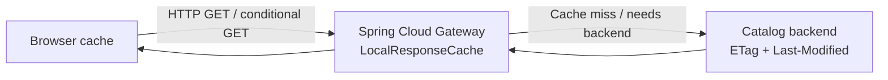
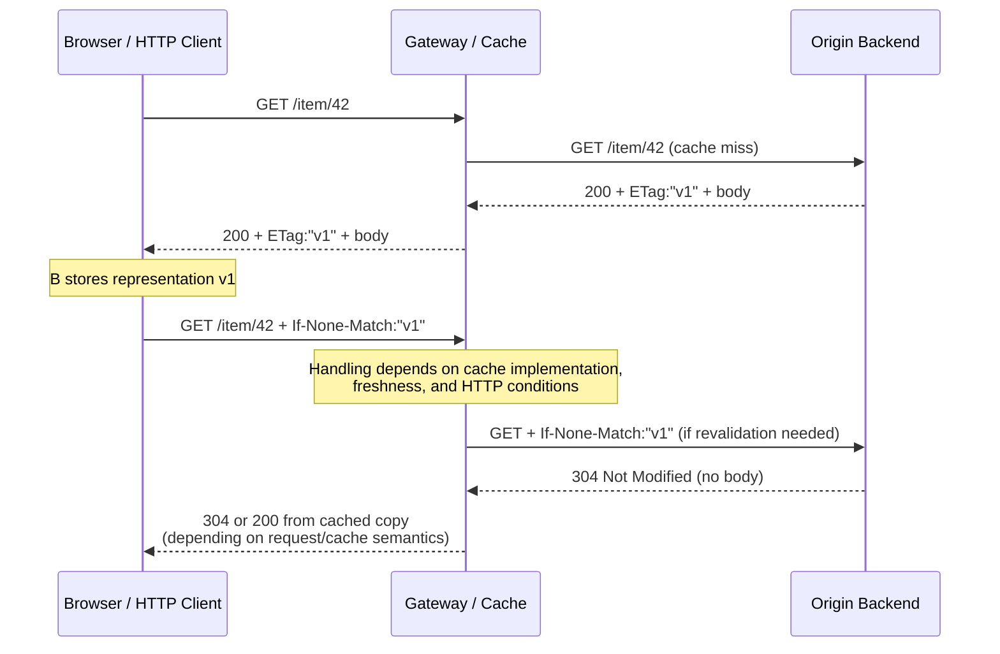

# Interaction With `max-age` and Conditional Requests

**Chapter:** Response Caching  
**Module:** `SPRING_CLOUD_GATEWAY` — Spring Cloud Gateway

An API Gateway for microservices can reduce backend load by storing responses to eligible HTTP `GET` requests. Yet asking "is it cached yet?" is not enough to verify correct behavior. When a client receives `Cache-Control: max-age=60`, the browser can reuse its copy for a period; once expired, the client can send `If-None-Match` or `If-Modified-Since` to check whether the resource changed. Inside Spring Cloud Gateway, `LocalResponseCache` has its **own TTL** and can **rewrite `max-age`** on the response. Consequently, the browser cache, Gateway cache, and origin backend data can follow **three different lifecycles**.

This lesson explains the exact interaction among **cache freshness**, `max-age`, `Age`, ETag, Last-Modified, `304 Not Modified`, and **conditional requests**, then practices with **Spring Cloud Gateway Server WebFlux** and a Spring Boot backend. In particular, we distinguish **standard HTTP rules** from **the specific behavior of `LocalResponseCache`**, without assuming the Gateway filter is a full RFC 9111-compliant HTTP cache for every scenario. The final sections connect caching to route predicates, filter chains, header transformations, service discovery, OAuth2/Authorization, TLS, rate limiting, circuit breakers, retries, and request observability.

> **Scope and security:** Examples target **Gateway Server WebFlux** using the `spring.cloud.gateway.server.webflux.*` route namespace of newer Spring Cloud Gateway lines. Response caching **can leak data across route or user boundaries** if cache keys are misdesigned. This lab caches **public catalog data only**, uses **per-route caching**, and leaves global caching disabled. Spring published **CVE-2026-59426 on November 19, 2026** regarding `global LocalResponseCache` in certain versions; review the security section before enabling caching in real environments.

## 1. Learning Objectives

After this lesson, you will be able to:

1. Explain the differences between **Gateway cache TTL**, **HTTP response `Cache-Control: max-age`**, **`Age`**, and **browser/CDN copy lifetimes**.
2. Describe `ETag`, `Last-Modified`, `If-None-Match`, `If-Modified-Since`, and the conditions producing `304 Not Modified`.
3. Distinguish `no-store`, `no-cache`, `private`, `public`, `must-revalidate`, `max-age=0`, and `s-maxage`.
4. Understand `LocalResponseCache` rules: bodiless GET requests, cacheable statuses, `Cache-Control` checks, and `max-age` rewriting when declared by the backend.
5. Write **per-route** cache configs with bounded TTL and size, toggling the right properties for your release train.
6. Build a backend with ETag, Last-Modified, and an origin hit counter to test initial calls, cache hits, conditional GETs, and cache expiry.
7. Identify risks of cross-authorization leaks, broken `Vary`, stale data, cache stampedes, multi-replica Gateways, and operational failures.
8. Design repeatable tests to observe hits/misses/304s without logging tokens or personal data.

## 2. Three Places a Response Can Be Stored During a Request

A browser calling `GET /api/catalog/items/SKU-42` may encounter:



There may also be a CDN, reverse proxy, ingress, or backend service cache; each adds **another caching layer**. You cannot conclude "the backend saw no request, so LocalResponseCache hit" if a browser or CDN is also caching.

| Layer | Where Is Data Stored? | Basis for Decisions |
|---|---|---|
| **Browser HTTP cache** | On the user's device, per browser policy | `Cache-Control`, `Age`, validators, request mode, and browser policy |
| **CDN / shared proxy cache** | Outside Gateway or at ingress | HTTP cache policy, cache key, `Vary`, authorization, its own TTL |
| **Gateway `LocalResponseCache`** | Local cache memory inside each Gateway process, Caffeine | Filter rules, route, URI/key, TTL, status, and headers |
| **Backend data cache** | Redis, DB cache, service in-memory | Application TTL/invalidation, distinct from HTTP response caching |

**Local** means **each Gateway replica has its own cache**. With two replicas, Instance A may hold an entry while Instance B does not, unless an external shared cache layer sits in front. Adding `lb://catalog-service` changes backend selection only; it does not turn LocalResponseCache into Redis or a distributed cache.

### 2.1. What Does a Cache Hit Mean?

First call:

```text
Browser -> Gateway MISS -> Backend 200 + body + ETag + Cache-Control
                    Gateway stores response if eligible
         <- 200 response
```

Subsequent call within TTL:

```text
Browser -> Gateway HIT (if request/entry match)
         <- response from cache; backend does not process this request
```

Once an entry expires or cannot be reused, Gateway may need to call the backend; the backend may return `200` with a new representation or `304` on a conditional request. **Never equate** "cache miss" with "backend returned 200," nor "HTTP 304" with "Gateway cache hit": these three concepts come from different layers.

## 3. What Is `Cache-Control: max-age`?

`Cache-Control: max-age=N` on a **response** declares the response's freshness lifetime in seconds under HTTP caching. For example:

```http
HTTP/1.1 200 OK
Cache-Control: public, max-age=60
ETag: "catalog-v4"
Last-Modified: Sun, 01 Nov 2026 00:00:00 GMT
Content-Type: application/json

{"sku":"SKU-42","price":350000}
```

An eligible cache can reuse the response within the permitted freshness window. Ignoring `Age`/`Date` or clock adjustments for a moment, think of this simply as **up to ~60 seconds** from when it was considered fresh. However, per RFC 9111, **freshness is not measured by an isolated client stopwatch**: caches must account for elapsed time from origin, `Date`, `Age`, and related headers.

### 3.1. Calculating Freshness Also Involves `Age`

A response coming through a shared cache may look like:

```http
HTTP/1.1 200 OK
Cache-Control: public, max-age=60
Age: 35
ETag: "catalog-v4"
```

Plain interpretation: the response is already ~35 seconds old; with a 60-second freshness lifetime, roughly 25 seconds of freshness remain, before standard network transit/clock skew adjustments. **Never treat `max-age=60` as granting 60 fresh seconds anew each time a cache serves the response.**

An intuitive approximation:

```text
freshnessLifetime = 60 seconds
currentAge        = 35 seconds
remainingFresh    = max(0, 60 - 35) = 25 seconds
```

This is an **approximate learning model**; RFC 9111 specifies exact `current_age` calculation using `Date`, `Age`, and request/response timestamps. Do not rely on `Age` alone as a sole authoritative counter.

### 3.2. `max-age` Does Not Guarantee the Resource Is Immutable

The backend could update a product's price right after sending a `max-age=60` response. Until the advertised freshness lifetime expires, caches may continue serving the old copy. Choosing `max-age` is a **trade-off between freshness, load, and latency**, not proof that underlying data never changes.

For inventory, sensitive pricing, permissions, or transaction state, base TTL on acceptable staleness. When staleness is unacceptable, choose revalidation/`no-store` policies or proactive invalidation rather than picking arbitrary long durations.

### 3.3. Response `max-age` Differs From Request `max-age`

Both sides can send the same directive name with different intent:

```http
GET /api/catalog/items/SKU-42 HTTP/1.1
Cache-Control: max-age=0
```

On a **request**, `max-age=0` expresses a preference not to accept a cached response older than 0 seconds; it is a **client preference**, not equivalent to the server returning `Cache-Control: no-store`. Depending on the implementation, a cache may revalidate with origin or apply a configured strategy. Do not assume `max-age=0` always deletes cache entries or forces the backend to generate a brand-new body.

## 4. `Cache-Control` Directives to Distinguish

| Directive | On Request / Response | Key Meaning to Remember |
|---|---|---|
| `max-age=60` | Response | Maximum freshness lifetime of the representation under HTTP freshness rules |
| `max-age=0` | Request or response | Request wants a fresh response; response becomes stale virtually as soon as `current_age > 0` |
| `no-cache` | Response | **May be stored**, but must be revalidated with origin before serving another request |
| `no-cache` | Request | Client asks caches not to reuse a stored response without revalidating first, per HTTP semantics |
| `no-store` | Request/response | Forbids storing the response/request per respective semantics; for the Gateway filter, excludes from cache |
| `private` | Response | Forbids **shared caches** from storing; private browser caches may store per policy |
| `public` | Response | Allows shared caches to store if other conditions pass; does not guarantee safety if private data is present |
| `must-revalidate` | Response | Once stale, never reuse without validating; if validation fails, standard requires erroring rather than serving stale |
| `s-maxage=30` | Response | Freshness override specifically for **shared caches**, with semantics distinct from `max-age` |
| `stale-while-revalidate` | Response extension | May temporarily serve stale within a bound while revalidating asynchronously, **only if supported by the cache** |
| `immutable` | Response extension | Hints to clients that the representation will not change while fresh, common for versioned assets |

**Never equate `no-cache` with `no-store`.** Under HTTP, a `no-cache` response can still be stored, while **reuse** depends on revalidation. For sensitive data, `private, no-store` is typically needed, backed by **authentication/authorization** at Gateway and backend rather than headers alone.

### 4.1. Headers With Multiple Directives

```http
Cache-Control: public, max-age=120, must-revalidate
```

Directives are comma-separated and case-insensitive; filters/caches must parse **individual directives**, not match full strings at fixed positions. If a response has:

```http
Cache-Control: max-age=120, private
```

then `private` still forbids shared caches from storing the response despite `max-age`. If a response includes `no-store`, never strip it just to force caching a private response.

### 4.2. Should You Add `public` to Every GET Response?

**No.** A GET request can return order details, user profiles, or search results scoped by permissions, tenants, roles, or cookies. `GET` describes only the HTTP method, not whether data is safe to share across users. Review the response contract and cache key before adding `Cache-Control: public`.

## 5. Conditional Requests: Checking "Has It Changed?"

When a client already holds a copy, it can ask the server/cache to **validate a condition** instead of always re-sending the entire body. Two common validator pairs:

- **ETag / If-None-Match:** compares representation version tokens (entity tags).
- **Last-Modified / If-Modified-Since:** compares last modification timestamps.



In this diagram, Gateway **does not always have to** forward conditional requests to origin. If holding a fresh copy, a conforming HTTP cache can satisfy conditions when it has sufficient metadata; with `LocalResponseCache`, test your actual implementation. Likewise, if origin returns 304 to a cache, the cache can update metadata and serve **200 with the stored body** to a client that sent an unconditional request.

### 5.1. ETag and `If-None-Match`

Origin returns:

```http
HTTP/1.1 200 OK
ETag: "catalog-v7"
Cache-Control: public, max-age=60
Content-Type: application/json

{"sku":"SKU-42","price":350000}
```

A client holding that body sends:

```http
GET /api/catalog/items/SKU-42 HTTP/1.1
If-None-Match: "catalog-v7"
```

If the selected representation still carries a matching ETag, the server may return:

```http
HTTP/1.1 304 Not Modified
ETag: "catalog-v7"
Cache-Control: public, max-age=60
```

`304` **carries no response body** by specification. The client reuses its stored representation and updates headers/metadata per caching rules. If the ETag does not match (for example, origin changed), the server returns `200` with the new body and new ETag.

**ETags must stay consistent whenever representations are equivalent under validator semantics.** If price, product name, or fields change while the ETag stays unchanged, clients risk keeping wrong stale data. Conversely, generating a random ETag on every request prevents revalidation from ever saving bandwidth.

### 5.2. Strong ETag vs. Weak ETag

```http
ETag: "v7"
ETag: W/"v7"
```

- A Strong ETag omits the `W/` prefix, indicating strict byte-for-byte representation equivalence and supporting byte ranges.
- A Weak ETag carries the `W/` prefix, allowing minor representation differences while remaining semantically equivalent.
- `If-None-Match` on GET uses **weak comparison** per RFC 9110, so weak and strong tags can match when their opaque tags match; this differs from preconditions requiring strong comparison such as `If-Match`.
- Never pick a weak ETag for file download/range endpoints needing exact byte integrity and `If-Range`.

Applications commonly derive ETags from a **data version** or representation hash, accounting for encoding, JSON formatting, locale, and access permissions. Never embed raw user identities or tokens directly into ETags or cache keys where metadata could leak.

### 5.3. Last-Modified and `If-Modified-Since`

If origin lacks an ETag, it can send:

```http
HTTP/1.1 200 OK
Last-Modified: Sun, 01 Nov 2026 00:00:00 GMT
Cache-Control: public, max-age=60
```

The client sends:

```http
GET /api/catalog/items/SKU-42 HTTP/1.1
If-Modified-Since: Sun, 01 Nov 2026 00:00:00 GMT
```

If the resource has not changed since that timestamp and preconditions match, the server can return `304`. When modified, the server returns `200` with the new representation.

**Limitation of Last-Modified:** HTTP-dates have one-second resolution; if data mutates multiple times within a single second or clocks/metadata are unreliable, timestamp validators are less accurate than version/hash ETags. High-churn APIs therefore generally need a stable ETag or row version.

### 5.4. What If a Request Carries Both Headers?

For GET/HEAD, when `If-None-Match` is present, it **takes precedence over `If-Modified-Since`** per RFC 9110; never write custom logic saying "return 304 if either says not modified" when the ETag mismatches. Use Spring Framework's HTTP conditional support or evaluate preconditions in proper precedence order.

```http
GET /items/SKU-42 HTTP/1.1
If-None-Match: "old-version"
If-Modified-Since: Sun, 01 Nov 2026 00:00:00 GMT
```

If the current ETag differs from `"old-version"`, the backend should honor `If-None-Match` precedence even if the timestamp in `If-Modified-Since` happens to match.

### 5.5. `304` and `412` Are Different Outcomes

| Request | Validator | Possible Response | Meaning |
|---|---|---|---|
| GET | `If-None-Match` matches | `304 Not Modified` | Reuse client's existing copy |
| GET | `If-Modified-Since` holds | `304 Not Modified` | No need to send a new body |
| GET | Validator mismatches | `200 OK` + body | Resource updated or not-modified cannot be confirmed |
| PUT/PATCH/DELETE | `If-Match` mismatches | `412 Precondition Failed` | Blocks updating against an unexpected version |
| PUT/POST with `If-None-Match` | Depends on semantics/conditions | May return `412` | Never apply the GET→304 formula blindly to all methods |

`If-Match`/`If-Unmodified-Since` are commonly used to prevent **lost updates** during writes. That is optimistic concurrency control, distinct from GET HTTP response caching. `LocalResponseCache` does not turn a payment or order API into an optimistically locked API.

### 5.6. Caution With HEAD, 206, and Range

HTTP HEAD asks for representation metadata without a body. `If-Range`/`Range` deal with **byte ranges** and `206 Partial Content`; strong ETags, `Content-Range`, `Vary`, and partial representations must be handled accurately.

Gateway's `LocalResponseCache` docs list **bodiless GET** as the eligible request and **200/206/301** as cacheable responses. That **does not mean** every `Range`/`If-Range` or HEAD edge case is automatically handled like a full RFC cache. For media/video/range downloads, write dedicated integration tests or use a specialized CDN/cache with verified HTTP range support.

## 6. Interaction Between Conditional GET and Freshness

Case A — response is **fresh** in an HTTP cache:

```text
Browser has a fresh copy of v1
  -> Can serve response from browser cache
  -> Sends no HTTP request to Gateway
```

Case B — response is **stale**, with a validator:

```text
Browser has stale copy v1 + ETag "v1"
  -> GET If-None-Match:"v1"
  -> Gateway / origin evaluates per actual semantics
  -> 304 if unchanged, or 200 + new body if changed
```

Case C — **stale**, **no validator**:

```text
Browser has old body, but no ETag/Last-Modified
  -> Likely sends a regular GET
  -> Response usually includes full body on HTTP 200
```

Key point: **`max-age` governs how long a copy can be reused without revalidating**, whereas **ETag/Last-Modified govern whether a copy can be verified as still current**. The two complement rather than replace each other.

### 6.1. `304` Does Not Make Old Bodies Disappear Automatically

A client holding an old representation that receives `304` reuses its stored body while updating headers/metadata per HTTP cache rules. Therefore:

- Receiving `304` saves response body bandwidth.
- Backend/Proxy still processes the validation request, consuming I/O and CPU.
- A browser displays the body properly because it kept the prior copy; a manual `curl` sending `If-None-Match` **without a local cache** only sees `304` and no JSON.
- If an intermediary returns `304` to an **unconditional** request, ordinary HTTP clients may lack any stored copy to show; test such behavior carefully and check whether it fits expected HTTP semantics.

### 6.2. `Age`, `Date`, and ETag Serve Different Purposes

| Header | Question Answered |
|---|---|
| `Cache-Control: max-age=60` | How long can the response be considered fresh at most? |
| `Age: 15` | How old does the serving cache report the response to be? |
| `Date` | When was the message generated per HTTP semantics? |
| `ETag: "v1"` | What is the representation's version/validator? |
| `Last-Modified` | When was the representation/resource last modified? |
| `If-None-Match` | Which ETag(s) is the client validating? |
| `If-Modified-Since` | After what timestamp is the client checking for changes? |
| `Vary` | Which request headers influence representation/cache entry selection? |

Never invent an `X-Version` field inside JSON expecting browsers/CDNs to treat it like an ETag: HTTP clients require **standard validator headers** or an explicit custom protocol.

## 7. `LocalResponseCache` in Spring Cloud Gateway Server WebFlux

In **Spring Cloud Gateway Server WebFlux**, `LocalResponseCache` is a `GatewayFilter` storing response bodies and headers in a local cache (Caffeine). Per official docs, the filter enforces these key rules:

| Element | Documented Condition |
|---|---|
| HTTP method | **Bodiless GET** request |
| HTTP statuses considered for storage | **200 OK**, **206 Partial Content**, **301 Moved Permanently** |
| Request `Cache-Control: no-store` | Do not cache response |
| Response `Cache-Control: no-store` | Do not cache response |
| Response `Cache-Control: private` | Do not cache response |
| Response includes `Cache-Control: max-age` | Filter can **rewrite `max-age`** based on cache TTL |
| Response lacks `max-age` | Does not automatically inject a `max-age` just because TTL is configured |
| Request `Cache-Control: no-cache` with existing entry | Gateway docs describe **bodyless 304** behavior in some lines; check version/strategy, **do not confuse with general RFC rules** |

**Important note:** the table above describes **Gateway's filter**, not a complete RFC 9111 HTTP caching specification. `LocalResponseCache` should not be assumed to handle every `Vary`, `Authorization`, `Range`, `If-None-Match`, stale revalidation, and CDN invalidation edge case without integration tests.

### 7.1. How Does Gateway Rewrite `max-age`?

Gateway documentation explains:

1. If the **original response already has** `Cache-Control: max-age=...`, the filter rewrites it to **the configured `timeToLive` in seconds**.
2. For subsequent requests served from that cached entry, Gateway recalculates `max-age` from the **remaining seconds before expiry**.
3. If the original response **omits `max-age`**, the filter does not guarantee adding a new `max-age`.

Suppose:

```text
Backend:
  Cache-Control: public, max-age=120
  ETag: "v1"

Gateway LocalResponseCache:
  timeToLive = 30s

First Gateway response:
  Cache-Control: public, max-age=30   (illustrative)

Gateway response after 10s, entry still fresh:
  Cache-Control: public, max-age≈20  (illustrative)

Gateway response after TTL:
  entry must be refreshed / backend called per filter behavior
```

The numbers `30` and `20` are **illustrative of documented behavior**, not a promise that `curl` always sees exact integers: real execution time, entry creation timing, and rounding vary. Verify actual headers on your running Gateway version.

### 7.2. Gateway TTL vs. Origin `max-age`

| Scenario | Consequence to Check |
|---|---|
| Backend `max-age=120`, Gateway TTL 30s | Gateway can lower outbound `max-age` to 30s |
| Backend `max-age=5`, Gateway TTL 30s | Gateway could raise `max-age` to 30s — **risks violating backend's freshness intent**, needs clear policy |
| Backend `max-age=120` but Gateway forbidden due to `private` | Never override policy just to apply a 30s TTL |
| Backend sends `ETag` only, **no** `max-age` | Internal cache TTL does not automatically become explicit browser freshness |
| Backend sends `no-store` | Never cached, regardless of enabled filter/TTL |

**Never treat Gateway TTL automatically as "the maximum duration the backend permits caching."** Because the filter can rewrite `max-age` to match TTL, operations and backend teams must align policies: pick a TTL no longer than the data owner's freshness budget unless an explicit caching contract is agreed and tested.

### 7.3. Request `no-cache`: Differences Between Gateway Docs and HTTP Specs

Under RFC 9111, `Cache-Control: no-cache` on a **request** instructs caches not to satisfy the request from a stored response **without successful origin validation**.

Meanwhile, Spring Cloud Gateway `LocalResponseCache` docs note that when a cached response already exists and a request carries `Cache-Control: no-cache`, the filter can return **`304 Not Modified` without a body**. Newer releases also document the property:

```properties
spring.cloud.gateway.server.webflux.filter.local-response-cache.request.no-cache-strategy=skip-update-cache-entry
```

**Never deduce backwards** that `no-cache` is a synonym for `If-None-Match`. Standard `304` responses for conditional retrieval rely on proper preconditions/validators; `Cache-Control: no-cache` **by itself is not a validator**. If a filter returns `304` to a request without `If-None-Match`/`If-Modified-Since`, treat it as **implementation behavior to test for HTTP client compatibility and version specifics**, not as an RFC rule.

In the lab, we will test **two separate requests**:

```bash
# Controls freshness policy without a validator:
curl -i -H "Cache-Control: no-cache" "http://localhost:8080/api/catalog/items/SKU-42"

# Conditional request based on a specific ETag:
curl -i -H 'If-None-Match: "catalog-v1-SKU-42"' \
  "http://localhost:8080/api/catalog/items/SKU-42"
```

The two responses can differ depending on hit/miss state, strategy, and version. **Do not** use the first command to prove backend revalidation occurred, nor the second to assume Gateway always forwards ETags.

### 7.4. Properties Across Release Trains

`LocalResponseCache` appears across multiple doc pages. For **Gateway Server WebFlux 5.x** per Configuration Properties:

```properties
spring.cloud.gateway.server.webflux.filter.local-response-cache.enabled=true
spring.cloud.gateway.server.webflux.filter.local-response-cache.time-to-live=5m
spring.cloud.gateway.server.webflux.global-filter.local-response-cache.enabled=false
```

Some prose filter pages still show **shorter/legacy** names:

```properties
spring.cloud.gateway.filter.local-response-cache.enabled=true
spring.cloud.gateway.global-filter.local-response-cache.enabled=false
```

Versions **4.2.x and earlier** widely used `spring.cloud.gateway.*`; modern lines use `spring.cloud.gateway.server.webflux.*`. **Never mix both prefixes in the same example assuming equivalence.** Verify the `configprops` table or actual configuration metadata of your release train.

### 7.5. Per-Route vs. Global Cache

Two ways to enable caching:

| Mode | Scope | Recommendation |
|---|---|---|
| Per-route `LocalResponseCache` | Only the configured route, with its own TTL and size | **Preferred** once an API is reviewed as cacheable |
| Global local response cache | Many routes via one global cache mechanism | Be extremely cautious with cache keys, route predicates, and security; do not enable system-wide by default |

Specifically, **CVE-2026-59426** involves a shared global cache omitting route ID from the cache key in affected versions. This lab **disables global caching** and enables only the route-level filter. Version ranges and mitigations are detailed in Section 14.

### 7.6. Caffeine and Spring Cache Dependencies

Gateway documentation requires adding:

```xml
<dependency>
    <groupId>com.github.ben-manes.caffeine</groupId>
    <artifactId>caffeine</artifactId>
</dependency>
<dependency>
    <groupId>org.springframework.boot</groupId>
    <artifactId>spring-boot-starter-cache</artifactId>
</dependency>
```

Caffeine manages local storage, sizing, and eviction per configuration. `spring-boot-starter-cache` provides Spring Cache integration and components needed by the filter. If the project defines a custom `CacheManager`, docs advise marking one `@Primary` or applying `@Qualifier` to avoid bean ambiguity.

**Do not confuse this with `CacheRequestBody`**: that filter caches the **request body** so downstream filters can re-read it, not the HTTP response for future GETs.

## 8. Hands-On: Build an Origin Backend With ETag and Last-Modified

We will build **two standalone applications**:

| Application | Port | Stack | Role |
|---|---:|---|---|
| Catalog Backend | `8081` | Spring Boot MVC | Returns responses with `Cache-Control`, ETag, Last-Modified, and an origin invocation counter |
| API Gateway | `8080` | Spring Cloud Gateway Server WebFlux | Per-route `LocalResponseCache`, 30-second TTL |

The backend also exposes a **lab-only `POST` endpoint** to bump the catalog version. This lets us prove the cache continues serving the older copy **until TTL expires**, even after origin changes.

### 8.1. Create the Catalog Backend Project

From Spring Initializr, generate a Java Maven project with the **Spring Web** dependency (using Java 17+ for Spring Boot 3.x), package `com.example.catalog`. For Spring Boot 4.x or newer, select the matching starter offered by Initializr without hardcoding versions.

Create `src/main/resources/application.yml`:

```yaml
server:
  port: 8081
spring:
  application:
    name: catalog-origin-lab
```

Create `CatalogApplication.java`:

```java
package com.example.catalog;

import org.springframework.boot.SpringApplication;
import org.springframework.boot.autoconfigure.SpringBootApplication;

@SpringBootApplication
public class CatalogApplication {
    public static void main(String[] args) {
        SpringApplication.run(CatalogApplication.class, args);
    }
}
```

Create `CatalogController.java`:

```java
package com.example.catalog;

import java.time.Duration;
import java.time.Instant;
import java.util.LinkedHashMap;
import java.util.Map;
import java.util.concurrent.atomic.AtomicInteger;
import java.util.concurrent.atomic.AtomicReference;
import org.springframework.http.CacheControl;
import org.springframework.http.HttpStatus;
import org.springframework.http.ResponseEntity;
import org.springframework.web.bind.annotation.GetMapping;
import org.springframework.web.bind.annotation.PathVariable;
import org.springframework.web.bind.annotation.PostMapping;
import org.springframework.web.bind.annotation.RestController;
import org.springframework.web.context.request.ServletWebRequest;

@RestController
public class CatalogController {

    private final AtomicInteger catalogVersion = new AtomicInteger(1);
    private final AtomicInteger originRequests = new AtomicInteger();
    private final AtomicReference<Instant> modifiedAt =
        new AtomicReference<>(Instant.parse("2026-11-01T00:00:00Z"));

    @GetMapping("/items/{sku}")
    public ResponseEntity<Map<String, Object>> getItem(
            @PathVariable String sku,
            ServletWebRequest webRequest) {

        int originNumber = originRequests.incrementAndGet();
        int version = catalogVersion.get();
        long lastModified = modifiedAt.get().toEpochMilli();
        String eTag = "\"catalog-v" + version + "-" + sku + "\"";
        CacheControl policy = CacheControl
            .maxAge(Duration.ofSeconds(90))
            .cachePublic();

        // Spring supports evaluating If-None-Match / If-Modified-Since.
        if (webRequest.checkNotModified(eTag, lastModified)) {
            return ResponseEntity.status(HttpStatus.NOT_MODIFIED)
                .eTag(eTag)
                .lastModified(lastModified)
                .cacheControl(policy)
                .header("X-Origin-Requests", String.valueOf(originNumber))
                .build();
        }

        Map<String, Object> body = new LinkedHashMap<>();
        body.put("sku", sku);
        body.put("version", version);
        body.put("price", 350000);

        return ResponseEntity.ok()
            .eTag(eTag)
            .lastModified(lastModified)
            .cacheControl(policy)
            .header("X-Origin-Requests", String.valueOf(originNumber))
            .body(body);
    }

    @GetMapping("/private/{sku}")
    public ResponseEntity<Map<String, Object>> noStore(
            @PathVariable String sku) {
        int originNumber = originRequests.incrementAndGet();
        return ResponseEntity.ok()
            .cacheControl(CacheControl.noStore())
            .header("X-Origin-Requests", String.valueOf(originNumber))
            .body(Map.of(
                "sku", sku,
                "demo", "no-store",
                "originInvocation", originNumber));
    }

    @PostMapping("/_lab/catalog/change")
    public ResponseEntity<Map<String, Integer>> changeVersion() {
        int newVersion = catalogVersion.incrementAndGet();
        modifiedAt.set(Instant.now());
        return ResponseEntity.ok()
            .cacheControl(CacheControl.noStore())
            .body(Map.of("catalogVersion", newVersion));
    }
}
```

**Technical explanation:**

- `catalogVersion` drives the ETag and the `version` field in the body. While the version stays unchanged, the body for a given SKU stays unchanged, keeping the ETag stable.
- `modifiedAt` records the latest version bump in the lab. Calling the POST endpoint stores the new timestamp for `Last-Modified`.
- `X-Origin-Requests` is an **observation header** distinguishing real backend hits from cache hits. Never use this header as a validator or for authorization.
- `ServletWebRequest.checkNotModified(etag,lastModified)` uses Spring Framework's built-in conditional GET check and sets status `304` when applicable.
- The GET response returns `Cache-Control: public, max-age=90`; the Gateway lab uses a **30-second** TTL so you can observe `max-age` rewriting on the client.
- `/private/{sku}` returns dummy data with `no-store` to verify Gateway does not cache it—it is not a real personal-data endpoint.
- `POST /_lab/catalog/change` **must never be exposed to the Internet**. It only triggers origin mutations in the lab and omits auth in this minimal example.

If you add Spring Security to your project, configure proper permissions on the test endpoints; **never disable production security** just to run a lab.

### 8.2. Start the Backend and Test Direct GETs

In the Catalog Backend directory:

```bash
./mvnw spring-boot:run
```

Windows PowerShell:

```powershell
.\mvnw.cmd spring-boot:run
```

In another terminal:

```bash
curl -i "http://localhost:8081/items/SKU-42"
```

Expected:

```http
HTTP/1.1 200 OK
Cache-Control: public, max-age=90
ETag: "catalog-v1-SKU-42"
Last-Modified: Sun, 01 Nov 2026 00:00:00 GMT
X-Origin-Requests: 1
Content-Type: application/json
```

Body shape:

```json
{"sku":"SKU-42","version":1,"price":350000}
```

`X-Origin-Requests: 1` holds only if this was the very first request after backend startup; if you hit another endpoint first, the count will be higher. The header's purpose is to **increment whenever the backend actually handles another request**, not to assert a fixed absolute number.

### 8.3. Send Conditional GETs Directly to the Backend

```bash
curl -i "http://localhost:8081/items/SKU-42" \
  -H 'If-None-Match: "catalog-v1-SKU-42"'
```

While version is still 1, the backend can return:

```http
HTTP/1.1 304 Not Modified
ETag: "catalog-v1-SKU-42"
Cache-Control: public, max-age=90
```

**No JSON body in 304.** `X-Origin-Requests` may still increment because the controller/backend processed the conditional request; this illustrates that `304` saves body bytes but **does not mean zero traffic reached origin**.

Try also:

```bash
curl -i "http://localhost:8081/items/SKU-42" \
  -H "If-Modified-Since: Sun, 01 Nov 2026 00:00:00 GMT"

curl -i "http://localhost:8081/items/SKU-42" \
  -H 'If-None-Match: "different-version"'
```

With version 1 and unchanged timestamp in the lab, the `If-Modified-Since` call can return 304, while the mismatched ETag returns 200 with a body. This lets you verify **backend conditional semantics before introducing Gateway**.

### 8.4. Bump the Version at Origin

```bash
curl -i -X POST "http://localhost:8081/_lab/catalog/change"

curl -i "http://localhost:8081/items/SKU-42"
```

Expect `catalogVersion` to advance to 2, ETag to `"catalog-v2-SKU-42"`, and body to contain `"version":2`. Requests presenting ETag `v1` must now be treated as outdated.

**Note:** because the lab uses an in-memory `AtomicInteger`, restarting the backend resets all versions and request counters. This is not production versioning; real data needs durable version/updatedAt fields from a DB or trusted metadata store.

## 9. Hands-On: Enable Per-Route `LocalResponseCache` in Gateway

Create a separate **Spring Cloud Gateway Server WebFlux** app using a compatible Spring Boot/Spring Cloud BOM. With modern starters, Maven dependencies are:

```xml
<dependencies>
    <dependency>
        <groupId>org.springframework.cloud</groupId>
        <artifactId>spring-cloud-starter-gateway-server-webflux</artifactId>
    </dependency>
    <dependency>
        <groupId>org.springframework.boot</groupId>
        <artifactId>spring-boot-starter-cache</artifactId>
    </dependency>
    <dependency>
        <groupId>com.github.ben-manes.caffeine</groupId>
        <artifactId>caffeine</artifactId>
    </dependency>
</dependencies>
```

Do not add `spring-boot-starter-web`/Spring MVC to the Gateway WebFlux project just to host a demo controller; the MVC backend on `8081` is a separate project. If your application already uses Redis caching, **do not** assume Gateway `LocalResponseCache` switches from Caffeine to Redis automatically.

### 9.1. Gateway `application.yml`

```yaml
server:
  port: 8080

spring:
  application:
    name: catalog-response-cache-gateway
  cloud:
    gateway:
      server:
        webflux:
          filter:
            local-response-cache:
              enabled: true
          global-filter:
            local-response-cache:
              enabled: false
          routes:
            - id: public-catalog-cache
              uri: http://localhost:8081
              predicates:
                - Path=/api/catalog/items/**
                - Method=GET
              filters:
                - StripPrefix=2
                - LocalResponseCache=30s,5MB

            - id: no-store-demo
              uri: http://localhost:8081
              predicates:
                - Path=/api/catalog/private/**
                - Method=GET
              filters:
                - StripPrefix=2
                - LocalResponseCache=30s,5MB
```

**Explanation:**

1. `filter.local-response-cache.enabled: true` enables creating **route-level** `LocalResponseCache` filters (per the modern Gateway Server WebFlux properties table).
2. `global-filter.local-response-cache.enabled: false` disables global caching; this is an **intentional choice** to prevent cross-route entry sharing and shrink the risk surface.
3. Route `public-catalog-cache` matches only GET `/api/catalog/items/**`, strips the two segments `api` and `catalog`, and forwards `/items/SKU-42` to the backend.
4. `LocalResponseCache=30s,5MB` sets a 30-second TTL and 5 MB per-route cache capacity; ineligible responses are not stored.
5. Route `no-store-demo` also attaches the filter, yet backend `/private/SKU-42` returns `Cache-Control: no-store`, so it is not cached despite status 200.
6. `Method=GET` scopes the API route cleanly; `LocalResponseCache` itself also caches only **bodiless GETs** per docs.

**Version check:** the `spring.cloud.gateway.server.webflux.*` namespace is listed in Gateway 5.x Configuration Properties. Older Gateway WebFlux projects may need `spring.cloud.gateway.routes`, `spring.cloud.gateway.filter.local-response-cache.enabled`, and `spring.cloud.gateway.global-filter.local-response-cache.enabled`. Never swap prefixes without checking your release train.

### 9.2. Equivalent Java DSL (When Avoiding YAML)

A Java route in Gateway WebFlux:

```java
package com.example.gateway;

import java.time.Duration;
import org.springframework.cloud.gateway.route.RouteLocator;
import org.springframework.cloud.gateway.route.builder.RouteLocatorBuilder;
import org.springframework.context.annotation.Bean;
import org.springframework.context.annotation.Configuration;

@Configuration
public class CatalogCacheRoutes {

    @Bean
    RouteLocator catalogCacheRoute(RouteLocatorBuilder builder) {
        return builder.routes()
            .route("public-catalog-cache", r -> r
                .path("/api/catalog/items/**")
                .filters(f -> f
                    .stripPrefix(2)
                    .localResponseCache(Duration.ofSeconds(30), "5MB"))
                .uri("http://localhost:8081"))
            .build();
    }
}
```

This Java DSL snippet omits the `Method=GET` predicate, though the filter itself stores only bodiless GETs; if you want the entire route restricted by HTTP method, add a method predicate per your Gateway version's `RouteLocatorBuilder` API. **Do not enable both** YAML and Java routes with the same ID/path simultaneously in the lab unless explicitly managing precedence, as duplicate routes make cache tests confusing.

### 9.3. Start the Gateway

Start the backend first, then in the Gateway project:

```bash
./mvnw spring-boot:run
```

From a separate terminal, verify Gateway reaches the backend:

```bash
curl -i "http://localhost:8080/api/catalog/items/SKU-42"
```

If you see `502`/`503` or connection refused, check backend `8081`, URI, networking, and route config before debugging caching. If `404`, check `Path`, `Method`, and `StripPrefix=2`. Routing/downstream failures do not mean caching is broken.

### 9.4. Why Global Caching Is Kept Off

In a multi-route system, a global cache could take a response from Route A and serve it to a request matching the same URL under Route B selected by a header, host, or permission. **CVE-2026-59426** specifically documented this **cross-route** cache leak in certain Gateway versions. Therefore, the lab disables global caching and enables **isolated caching per reviewed route**.

The security principle goes beyond that CVE: **per-route caching does not automatically protect user-private data if a single route serves multiple principals/tenants and cache keys/policies fail to separate them**. Never apply route-level caching to personal responses merely because a global-cache CVE was patched.

## 10. Testing Cache Hits and `max-age` Through Gateway

Before each test sequence, the easiest way to get a clean baseline is to **restart both the lab backend and Gateway** to reset counters and caches. Restarting is not a production invalidation strategy; it simply creates a clean test state.

### 10.1. First Call: Cache Miss

```bash
curl -i "http://localhost:8080/api/catalog/items/SKU-42"
```

The backend returns `Cache-Control: public, max-age=90`; with a `30s` Gateway route TTL, a Gateway response may look like:

```http
HTTP/1.1 200 OK
Cache-Control: public, max-age=30
ETag: "catalog-v1-SKU-42"
X-Origin-Requests: 1
```

Body:

```json
{"sku":"SKU-42","version":1,"price":350000}
```

If you observe `max-age` at 29 instead of 30, that is simply rounding or elapsed milliseconds since entry creation. Check server logs/responses and your exact version before concluding anything is wrong.

### 10.2. Second Call: Cache Hit Before TTL Expires

Send the **exact same** URL, method, headers, and query immediately:

```bash
curl -i "http://localhost:8080/api/catalog/items/SKU-42"
```

On a cache hit:

- The body still contains `"version":1`.
- `X-Origin-Requests` retains its old value because response headers came from cache.
- `Cache-Control: max-age` **decreases** according to remaining seconds before expiry.
- The backend processes **no** new GET request for this call.

Using headers is an indirect check. For certainty, check origin logs/metrics: seeing zero new backend requests is much stronger proof than guessing from low latency.

### 10.3. Compare Directly Against Origin

```bash
# Via Gateway (may cache hit).
curl -i "http://localhost:8080/api/catalog/items/SKU-42"

# Direct call to origin (bypasses LocalResponseCache).
curl -i "http://localhost:8081/items/SKU-42"
```

The direct call increments `X-Origin-Requests`; the Gateway call can continue showing the cached count. **Never treat direct backend access as safe in production** when backends must be protected against Gateway bypass; here it is strictly local HTTP on localhost.

### 10.4. Mutate Origin Data While the Gateway Entry Is Still Fresh

While cache TTL remains:

```bash
# Mutate backend data WITHOUT going through the cached route.
curl -i -X POST "http://localhost:8081/_lab/catalog/change"

# Origin already serves the new version:
curl -i "http://localhost:8081/items/SKU-42"

# Gateway may still serve the old version during TTL:
curl -i "http://localhost:8080/api/catalog/items/SKU-42"
```

Example:

| Stage | Observed `version` | Why |
|---|---:|---|
| Origin after POST | 2 | Origin data updated |
| Gateway within TTL | 1 | Old entry is still fresh per route config |
| Gateway after TTL | 2 | Once entry expires, requests reach origin for a new response |

This is caching's core trade-off: **lower load at the cost of a staleness window**. If your API contract forbids seeing old prices/stock for 30 seconds, adjust TTL/policy or use proper validation/invalidation.

### 10.5. After TTL Expiration

Once ~30 seconds have elapsed since the entry was cached (do not wait from an arbitrary timestamp if you restarted):

```bash
curl -i "http://localhost:8080/api/catalog/items/SKU-42"
```

Once the entry expires and no other cache layer blocks it, Gateway refreshes by contacting the backend; `X-Origin-Requests` increments and the new ETag reflects version 2. If you still see version 1, check timestamps, browser/CDN caches, other Gateway replicas, matched route, and revalidation strategy.

**Depending on version, an expired entry may be evicted, a miss may issue a plain GET, or the cache may perform a validation step.** `LocalResponseCache` docs do not guarantee one fixed HTTP sequence for every validator type; rely on observed outputs and tests.

### 10.6. Compare With `no-store`

```bash
curl -i "http://localhost:8080/api/catalog/private/SKU-42"
curl -i "http://localhost:8080/api/catalog/private/SKU-42"
```

Backend `/private/SKU-42` emits `Cache-Control: no-store`; even with the filter on route `no-store-demo`, both requests still reach the backend and `originInvocation` in JSON increments. **Never** use real `private` responses containing user data for public tests: in this lab, the path name merely tests header policy.

## 11. Testing Conditional Requests Through Gateway

After understanding the **direct-to-backend** tests in Section 8, send the same headers to the **Gateway** URL. Observe not just HTTP status, but also **whether the backend received a request**, which `ETag` appears, and how `max-age` behaves.

### 11.1. `If-None-Match` While the Entry Is Fresh

Suppose the response with ETag `"catalog-v1-SKU-42"` is already cached:

```bash
curl -i "http://localhost:8080/api/catalog/items/SKU-42" \
  -H 'If-None-Match: "catalog-v1-SKU-42"'
```

Under HTTP conditional semantics, if the cache or origin receives the request, picks a representation with a matching ETag, and evaluates the precondition, `304` is a valid response for a GET **with `If-None-Match`**. However, **do not assume** `LocalResponseCache` always performs ETag comparison like a CDN or full RFC-compliant shared cache: depending on implementation, a cache hit may serve an unexpected representation, whereas forwarding to origin lets the Spring MVC backend return 304.

Record:

| Attribute | What to Observe |
|---|---|
| HTTP status | 200 or 304; do not assume a fixed outcome |
| Response ETag | Is `"catalog-v1-SKU-42"` preserved? |
| `Cache-Control: max-age` | Remaining TTL or value from origin/filter |
| `X-Origin-Requests` | Did it change from the prior response? |
| Origin/backend logs | Did a new GET actually reach the backend? |

Test again after TTL expires; results can change once Gateway needs a fresh representation.

### 11.2. Stale Validator After Origin Changes

To test the stale scenario:

1. Populate `v1` through Gateway.
2. Call `POST http://localhost:8081/_lab/catalog/change` so backend advances to `v2`.
3. Wait for Gateway's cache TTL to expire, or restart Gateway **in the lab only**.
4. Send:

```bash
curl -i "http://localhost:8080/api/catalog/items/SKU-42" \
  -H 'If-None-Match: "catalog-v1-SKU-42"'
```

For conditional GET against origin, since current ETag is `v2`, origin must not claim `v1` is still current; an ordinary GET or outdated validator receives `200` with body `v2`. If Gateway serves cached `v1` before TTL expires, clients seeing `v1` reflects **the lab TTL freshness window**, not origin accepting the outdated validator.

If a test returns a bodyless 304 despite a mismatched validator, isolate **which cache implementation path** handled it before assuming API sync works: test directly against backend `8081` as your control.

### 11.3. `If-Modified-Since` and ETag Precedence

```bash
curl -i "http://localhost:8080/api/catalog/items/SKU-42" \
  -H "If-Modified-Since: Sun, 01 Nov 2026 00:00:00 GMT"

curl -i "http://localhost:8080/api/catalog/items/SKU-42" \
  -H 'If-None-Match: "old-version"' \
  -H "If-Modified-Since: Sun, 01 Nov 2026 00:00:00 GMT"
```

The first request tests timestamp validation. The second sends **both preconditions**, where `If-None-Match` must take precedence when evaluated by origin. Do not rely solely on Gateway status while the response is fresh: Gateway may never contact origin, so the result does not prove the backend enforced precedence rules.

### 11.4. Request `Cache-Control: no-cache`

```bash
curl -i "http://localhost:8080/api/catalog/items/SKU-42" \
  -H "Cache-Control: no-cache"
```

Compare with:

```bash
curl -i "http://localhost:8080/api/catalog/items/SKU-42" \
  -H "Cache-Control: no-cache" \
  -H 'If-None-Match: "catalog-v1-SKU-42"'
```

`LocalResponseCache` docs describe a branch returning 304 when an entry exists and the client sends `no-cache`. Therefore:

- **Do not** treat a `304` from a `no-cache`-only request as proof that `no-cache` is a standard conditional validator.
- When `If-None-Match` is present, verify validator matching and entry state for your exact version before trusting the response.
- Look up `filter.local-response-cache.request.no-cache-strategy` in your release train's Configuration Properties; never invent undocumented enum values.
- If an endpoint requires mandatory origin revalidation on every call, audit the `LocalResponseCache` implementation carefully and consider disabling Gateway caching or choosing a cache supporting the full protocol.

### 11.5. `no-store` on the Request

```bash
curl -i "http://localhost:8080/api/catalog/items/SKU-42" \
  -H "Cache-Control: no-store"
```

Per filter docs, a `no-store` request must not create a new cached response. Yet **do not deduce** that it purges pre-existing cached entries or invalidates external CDN/browser caches. Test the request path and watch origin logs per security needs.

### 11.6. `curl` Differs From Browser Caches

Plain `curl -i` does not persist an HTTP cache between invocations like a browser does. It lets you inspect **Gateway/Origin** fairly directly. A browser can hold a `max-age` response and **skip sending a second request to Gateway**, making tests look like Gateway hits when Gateway was never contacted.

To separate them:

1. Use `curl` with explicit, controlled headers.
2. In browser DevTools, open Network and check "from memory cache" / "from disk cache" (labels vary by browser).
3. Verify whether an actual HTTP request reached Gateway.
4. Compare origin counters and Gateway metrics; if a CDN/ingress sits in front, inspect that tier too.
5. When testing conditional GETs, **do not swap tokens/cookies or append random query strings just to bust caches** if your goal is studying the cache key itself.

## 12. `Vary` and Cache Keys: Which Resources Count as the Same Copy?

A response can vary by:

- URL path and query, e.g., `/items/SKU-42?currency=VND`;
- `Accept-Language` when the backend localizes output;
- `Accept-Encoding` when compressed vs. uncompressed representations differ;
- `Authorization` or cookies if an API serves per-user data;
- `Host`, tenant, API version, header route predicates, or other application headers.

`Vary` tells caches **which request headers affect representation selection**. For example, a translated API:

```http
HTTP/1.1 200 OK
Vary: Accept-Language
Cache-Control: public, max-age=60
ETag: "item-42-vi-v1"
```

An `Accept-Language: vi` request must never receive an English body from an entry meant only for `Accept-Language: en` when representations differ. If the backend emits identical ETags for two distinct bodies or omits required `Vary` headers, bugs occur **even though `max-age` and validator syntax look fine**.

### 12.1. Vary Does Not Replace Authorization

If an API returns user-specific data, **adding `Vary: Authorization` does not automatically make all cache layers safe**. You must understand the exact cache key in your Gateway version, network trust, bypass paths, backend authorization, and response properties. For sensitive information, prefer `Cache-Control: private, no-store` plus auth/tenant isolation and **do not enable Gateway response caching** without a formal threat model/review.

### 12.2. Vary, Content-Encoding, and ETag

When responses are compressed for `Accept-Encoding: gzip`, byte representations differ from uncompressed responses. Strong ETags across representations must differ, or weak validators must be used per semantics; `Vary: Accept-Encoding` helps caches keep them separate.

Never insert `ModifyResponseBody`, JSON rewrites, or gzip compression **after ETag generation** without checking whether the validator still matches the new bytes. If a filter changes the body while leaving old `Content-Length`, ETag, or `Content-Encoding` intact, clients receive inconsistent payloads or conditional statuses.

### 12.3. Route Predicates and Cache Keys

Two routes can share `/api/data` while picking different upstreams via `Header`, `Cookie`, `Host`, `RemoteAddr`, or `Query`. If the cache key fails to separate route IDs or routing criteria, **an entry from Route A can be served for Route B**.

That is the exact risk pattern in **CVE-2026-59426** for global `LocalResponseCache` in affected versions. Therefore, do not ask only "is the URL in the cache key?"; ask whether it **isolates routes, principals/tenants, and representations**. If safety cannot be proven, do not cache that route.

### 12.4. Query Parameters, Host, and Path Rewrites

Example:

```text
Public request:  /api/catalog/items/SKU-42?currency=VND
Gateway route:   /api/catalog/items/**
StripPrefix=2:   /items/SKU-42?currency=VND
Backend:         /items/SKU-42?currency=VND
```

If the backend varies pricing by `currency`, the cache must separate variants or **not cache at all**. Likewise, rewriting a downstream URL via `RewritePath`/`StripPrefix` does not guarantee Gateway's cache key reflects your business representation key; inspect filter order and implementation.

### 12.5. CORS and Response Caching

A frontend on Origin A receives `Access-Control-Allow-Origin: https://a.example.test`. If that response is cached and reused for Origin B without `Vary: Origin` or key isolation, browsers reject the response or policies leak. Clarify which tier owns CORS (Gateway/ingress/backend) and verify `Vary: Origin` whenever policies respond dynamically per origin.

`OPTIONS` preflights generally do not use the GET route cache; `LocalResponseCache` docs restrict caching to **bodiless GETs**, so never enable uncontrolled global caching hoping to "speed up CORS preflights."

## 13. Common Design Mistakes With `max-age` and Validators

### 13.1. Raising `max-age` Beyond Allowed Staleness

The backend emits `Cache-Control: public, max-age=5` because prices/stock move quickly, yet Gateway configures a 10-minute TTL. When the filter rewrites `max-age` to match TTL, clients are told to keep copies far longer than the backend intended. That is not a "free optimization": it breaks the API's freshness contract.

**Recommendation:** set Gateway TTL within business-approved staleness bounds; if the backend enforces strict freshness, never override it with a larger generic cache config. Where shared caching is required, backend and Gateway contracts must agree on explicit thresholds.

### 13.2. Keeping ETag Constant When Body Changes

Suppose the backend raises a price from 350,000 to 400,000 yet still emits:

```http
ETag: "catalog-v1"
```

A client holding `v1` and sending `If-None-Match: "catalog-v1"` can receive `304` despite the price change. The bug lies in **a validator that fails to reflect representation changes**, not in 304 itself.

**Recommendation:** derive ETags from a reliable version or hash synchronized with payload mutations and language/currency/encoding variants.

### 13.3. Lacking Validators While Hoping to Save Bandwidth After TTL

If the backend only sends:

```http
Cache-Control: public, max-age=30
```

then once stale, a cache must fetch the full body again because no meaningful ETag/Last-Modified exists. `LocalResponseCache` cannot guess that a payload is unchanged merely because the URL matches. Emitting `ETag`/`Last-Modified` from the backend is a core part of HTTP cache design.

### 13.4. Confusing `no-cache` With "Always Generate New Data"

A request carrying `Cache-Control: no-cache` does not force origin to **mint** a new data version. If revalidation confirms the representation is unchanged, `304` is a valid conditional retrieval result. The goal is **never reusing without validating**, not mutating data on demand.

### 13.5. Setting `Cache-Control: private` While Expecting Gateway to Cache

Per `LocalResponseCache` docs, responses with `private` are **not stored**. `private` permits private browser caches under the RFC, whereas Gateway acts as a shared intermediary; never override that policy just to reduce backend load.

### 13.6. Treating `max-age=0` as `no-store`

`max-age=0` leaves effectively zero freshness lifetime; `no-store` forbids **storage**. For credentials, personal info, invoices, or session-bound results, apply the policy required by your security contract—never substitute `max-age=0` for `no-store` when storage is forbidden.

### 13.7. Keeping Origin ETags After Modifying Bodies in Flight

Gateway may run `ModifyResponseBody`, `RewriteResponseHeader`, or response compression. If the body changes while the backend's ETag stays untouched, clients receive mismatched conditional validators. Identify which layer builds the final representation and update/invalidate ETags accordingly, or omit stale validators.

### 13.8. Judging Cache Hits by Latency Alone

A fast 200 response can come from a healthy backend, pooled connections, or a browser cache; conversely, a cache hit can stall during CPU/GC spikes. Measure **origin calls, Gateway cache metrics if available, response headers, and route IDs** rather than relying solely on `curl` timing.

## 14. Security Advisory: Global LocalResponseCache and CVE-2026-59426

On **November 19, 2026**, Spring published advisory **"Spring Cloud Gateway Global LocalResponseCache Leaks Responses Across Routes"**, tracked as **CVE-2026-59426** with **HIGH** severity.

Per the advisory:

- Global `LocalResponseCache` in affected versions used **a single shared cache across routes** that did not declare route-level filters.
- The cache key included request URI, `Authorization`, cookies, and `Vary` request headers, **but omitted the route that handled the request**.
- When multiple routes matched the same URI but were separated by `RemoteAddr`, `Host`, `Header`, `Cookie`, `Query`, or custom predicates, a cached response from a restricted route could be served to a caller matching only another route.
- Under those specific bug conditions, an unauthenticated user could read responses not intended for them.
- Routes defining their own per-route `LocalResponseCache` use route-scoped caches and **are outside the advisory's cross-route global cache flaw**.

### 14.1. Affected Ranges and Patches per Advisory

| Affected Versions | Fixed Version Published by Spring | Notes |
|---|---|---|
| `5.0.0–5.0.4` | `5.0.5` | OSS |
| `5.0.0–5.0.4` | `5.0.4.1` | Enterprise Support Only |
| `4.3.0–4.3.6` | `4.3.7` | Enterprise Support Only |
| `4.0.0–4.2.10` | `4.2.11` | Enterprise Support Only |

This reflects the advisory published **November 19, 2026**, as of writing in **November 2026**. In ongoing operations, always consult the latest advisories and release notes instead of treating this table as permanently current.

**Official source:** [Spring Security Advisory — CVE-2026-59426](https://spring.io/security/cve-2026-59426/).

### 14.2. Mitigations Guided by Spring

1. **Upgrade** to the corresponding patched version if running an affected release.
2. If unable to upgrade immediately, **disable global LocalResponseCache** and configure `LocalResponseCache` individually on **only routes that genuinely require caching**:

```yaml
# With the modern Gateway Server WebFlux namespace.
spring:
  cloud:
    gateway:
      server:
        webflux:
          global-filter:
            local-response-cache:
              enabled: false
          filter:
            local-response-cache:
              enabled: true
```

3. On Gateway `4.2.x`, the advisory specifies the legacy property to disable global caching:

```properties
spring.cloud.gateway.global-filter.local-response-cache.enabled=false
```

4. Audit security policies, overlapping routes, and response headers so caching never violates data contracts.

**Do not conclude that patching this CVE eliminates all caching risks.** If a single `/profile` route serves multiple users at the same URI with principal-specific payloads, a bad policy can still leak data even though route-level caching avoids that cross-route bug. Never cache private data without proven cache key, `Vary`, authorization, and invalidation guarantees.

### 14.3. Testing Route Boundaries and Access Control

In an **isolated** integration test, create two routes sharing a path:

```text
Route A:
  Path=/api/data, Header=X-Lab-Context, public
  -> public backend

Route B:
  Path=/api/data, Header=X-Lab-Context, restricted
  -> restricted backend requiring proper authorization
```

The goal is not exploiting a real environment, but **proving the cache never serves the wrong representation when predicates differ**. Never leave a restricted endpoint unauthenticated to stage an attack, never use real customer tokens/data, and never turn on a vulnerable global cache just to "verify in production."

Tests should:

1. Send a request via the restricted route using **valid test credentials** and dummy data to populate/verify behavior.
2. Send a request to the same URI via the public route using a different test context/header.
3. Assert the response contains only public data and zero restricted markers.
4. Observe route IDs, origin calls, and per-route cache state.
5. Repeat across multiple Gateway replicas rather than treating a single-process test as cluster-wide proof.

### 14.4. Never Base Cache Key Assumptions on Unverified Claims

Certain headers influence authorization:

```text
Authorization: Bearer ...
Cookie: SESSION=...
X-Tenant-Id: ...
X-Internal-Role: ...
X-API-Version: ...
Accept-Language: ...
```

Cache keys and response contracts must distinguish **factors affecting representation**. However, client-supplied `X-Internal-Role` or `X-Tenant-Id` headers **are not proof of authorization**. Gateway/backend must validate principals/tokens, tenant isolation, and trusted networks before deciding what can be shared.

With OAuth2/OIDC Gateways, **TokenRelay** can pass an access token downstream once a route is selected; user/scope-dependent responses should not use public-style Gateway caching. Saying "the cache key includes `Authorization` so it is safe" is insufficient: tokens may be injected by another filter, keys may be computed before/after transforms, or scopes/permissions may change. Run integration tests and security reviews.

### 14.5. What Should and Should Not Be Cached at the Gateway?

| Example Endpoint | Initial Decision | Reason |
|---|---|---|
| Public catalog with slowly changing data | Can cache per-route with short TTL | Content is identical for all permitted callers |
| Fingerprinted/versioned static assets | Can cache longer | URL changes whenever content changes |
| Real-time prices/stock | Cache only if staleness window is approved | High risk of rapid mutation |
| User `GET /me` or `GET /orders` | **Do not cache at shared Gateway by default** | Response tied to identity/permissions |
| Admin dashboard, restricted internal APIs | **Do not cache without dedicated security review** | High risk of route/cookie/role leakage |
| OAuth2 callbacks, token/session endpoints | Never use general response caching | Contains sensitive codes, tokens, or session state |
| API returning `Cache-Control: no-store` | Do not cache | Origin explicitly forbade storage |

This is an **initial decision matrix**, not automatic proof that an endpoint is "safe." Always factor in regulatory compliance, PII rules, and permission changes over time.

## 15. Combining Response Caching With Other Gateway Features

Response caching is one stage in the pipeline. On a **cache hit**, a request may **skip reaching the backend**, meaning downstream components do not run. Review filter ordering and confirm security, rate limiting, circuit breakers, retries, and routing operate at the right layer.

### 15.1. Route Predicates and Path Transformations

A route such as:

```yaml
predicates:
  - Path=/api/catalog/items/**
  - Method=GET
filters:
  - StripPrefix=2
  - LocalResponseCache=30s,5MB
```

differs from another route adding `Header`/`Cookie`/`Host` predicates even when the URL looks identical. **Route selection** determines which filter chain executes; filter order determines URL/headers visible at each stage. When routes overlap, verify cache isolation with real integration tests.

### 15.2. Rate Limiting and Cache Hits

`RequestRateLimiter` may apply per user/key before or after a cache filter depending on configuration and order. If a cache hit short-circuits downstream filters, users might consume zero quota unexpectedly—or conversely consume quota for responses that never touched the backend. Clarify whether **quotas protect the Gateway/API or the backend**, and place limiters at the right tier.

Never use raw `X-Forwarded-For`, untrusted client headers, or URL paths containing user IDs as quota keys without trusted proxy chains. Both cache isolation and rate limiting depend on trustworthy identity and routing policies.

### 15.3. CircuitBreaker and Caching

When the backend is failing:

- A **fresh** cache entry can still be served without calling the backend.
- An **expired** cache entry requires a fresh attempt; if the backend fails, `CircuitBreaker`/`fallbackUri` engages according to execution order.
- `LocalResponseCache` does not automatically provide full **stale-if-error** semantics just because the backend goes down.
- Circuit breaker fallbacks must never be accidentally cached for long periods like normal public data; for degraded messages, emit appropriate HTTP statuses and `Cache-Control`.

Do not let cache hits completely hide an ongoing outage in monitoring. Track cache hit rates, backend error rates, and breaker states separately whenever possible.

### 15.4. Retries and Conditional Requests

Retrying a `GET` on backend errors can be reasonable when bounded and idempotent, but:

- One client request can multiply downstream calls;
- Cache misses + concurrent traffic can trigger **cache stampedes / thundering herds**;
- `If-None-Match` does not make retries safe for every method; mutating `POST` calls need explicit idempotency;
- Repeated revalidation while the backend is sluggish can worsen load instead of helping.

Cap concurrent cache misses, timeouts, and retry budgets per SLO; never enable unbounded retries to "boost cache hits."

### 15.5. OAuth2/TokenRelay and Authorization

For a `/api/profile/me` route using WebSession/OIDC Login + `TokenRelay`:

```text
Browser cookie -> Gateway authenticates -> TokenRelay -> Backend user-specific response
```

Responses like this **should not use public-style per-route `LocalResponseCache`** without an explicit caching contract and verified identity/tenant policies. Interactions across `SecurityWebFilterChain`, `GatewayFilter`s, and cache keys can expose headers/tokens at unexpected stages; never assume the cache distinguishes every principal just because a token is relayed downstream.

### 15.6. TLS and Service Discovery

`uri: https://catalog.internal` encrypts the Gateway → backend hop when TLS is configured properly. `lb://catalog-service` picks instances via discovery/LoadBalancer. **Neither mechanism fixes a bad cache key or invalidates old entries.**

A route shifted from Backend A to Backend B after a deployment can still serve cached responses from the old version until TTL expires, if policy permits. In production, pair rollouts with versioned URLs, cache invalidation, or short TTLs.

### 15.7. CORS, Accept-Encoding, and Response Transformations

If Gateway alters `Access-Control-Allow-Origin`, `Vary`, or compresses/rewrites JSON responses:

- Verify `Vary` still matches all influential request headers;
- Verify ETags match the final representation sent to clients;
- Never retain stale `Content-Length` values after body modification;
- Keep tokens/cookies out of cache metadata and logs;
- Confirm `304` responses from cache or backend carry valid metadata.

**HTTP compression** also creates different byte representations of the same resource, requiring care for `If-Range` and strong ETags.

### 15.8. Memory Limits and Request Bodies

`LocalResponseCache` caches **response bodies** of eligible GETs; `CacheRequestBody` buffers **request bodies** within the filter chain. They address different needs, and enabling both carries real cost. Large responses consume memory per entry; diverse clients/keys increase cardinality. Set sensible bounds like `5MB`, cap payload sizes at services, and watch heap/direct memory, evictions, and GC.

## 16. Observing Cache Hits, Staleness, and Revalidation in Production

A sound observability design should answer five questions:

1. Did the request reach Gateway, or was it served by a browser/CDN?
2. Which route was selected, and was the user/tenant authorized for it?
3. Did `LocalResponseCache` hit, miss, evict, or bypass due to `no-store`/`private`?
4. Was the backend called to fetch a new body or validate an ETag?
5. Which status (`200`/`304`), remaining `max-age`, and payload version did the client receive?

### 16.1. Signals to Track

| Signal | Used to Distinguish | Caveats |
|---|---|---|
| Route ID | Which route owns the cache/response | Never replace with raw URLs containing user IDs |
| `X-Origin-Requests` (lab) | Whether the backend was invoked | Never expose debug counters on public production APIs |
| Response `Cache-Control`/`Age` | Client-visible freshness | Never infer complete HTTP cache state from a single header |
| `ETag`/`Last-Modified` | Current validator | Avoid logging full validators if they leak sensitive info |
| HTTP status 200/304/4xx/5xx | Full body vs. validation/error | 304 does not automatically mean cache hit |
| Backend request count | Actual load reduction | Even 304 validation costs a backend request |
| Cache estimated size/eviction | Memory/cardinality pressure | Stay within Gateway memory budgets |
| Gateway p50/p95/p99 latency | Caching gains and side effects | Break down by route/miss/hit if supported |
| CircuitBreaker/Retry metrics | Backend failures and attempts | Cache hits can mask backend errors |
| Security audit and deny logs | Zero cross-user cache leaks | Never write raw tokens/cookies to logs |

### 16.2. Distinguishing a 200 From Cache vs. a 304 From Origin

An unconditional `GET` can receive `200` with an older body from Gateway while fresh. A request carrying `If-None-Match` can receive `304` from origin after the cache revalidates. **Status alone** never tells you whether the backend was called.

To measure hit rates, use metrics or events supported by your implementation/instrumentation; **never assume `X-Cache: HIT` is always present**, as `LocalResponseCache` does not guarantee adding such a fixed header.

### 16.3. Metrics and Access Controls

Spring Boot Actuator/Micrometer can expose Gateway routes, HTTP statuses, and timings; Caffeine/Spring Cache metrics depend on enabling binders/instrumentation and the specific `CacheManager`. Never promise a specific hit/miss metric name across every version.

Never expose `/actuator/**` to the public Internet. Metrics can leak route IDs, backend URIs, or topology. Enforce authentication, network policies, bounded metric labels, and appropriate retention.

### 16.4. Never Log Raw Conditional Headers Verbatim

`Authorization` and `Cookie` hold credentials; `If-None-Match` and certain queries/headers can also contain user identifiers or sensitive data if backend ETags are poorly designed. Log method, route ID, status class, validator **presence**, cache outcome, and non-sensitive correlation IDs rather than dumping raw request/response headers.

### 16.5. Multiple Gateway Replicas

Suppose two Gateway instances serve the same route:

```text
Gateway A: caches SKU-42 v1, 10s remaining
Gateway B: does not yet have entry SKU-42

Request via A -> may return v1
Request via B -> calls backend, may receive v2
```

This is a consequence of **local** caching, not necessarily a load-balancing bug. If business rules forbid version skew across replicas, move caching to a tier with synchronized invalidation/version control, or use short TTLs with an explicit staleness contract.

## 17. Common Pitfalls Table

| Symptom | Possible Cause | How to Check |
|---|---|---|
| Requests always reach backend, zero hits | Filter off / missing Caffeine or cache starter / wrong route or property | Check dependencies, route ID, filter config, origin counter |
| `LocalResponseCache` ignored in YAML | Wrong release-train prefix or filter disabled | Verify `server.webflux.filter.local-response-cache.enabled` |
| `max-age` ignores TTL | Backend response lacked `max-age` or request bypassed cache | Inspect origin and Gateway headers plus filter rules |
| `max-age` higher than expected | Gateway TTL exceeds origin policy | Check TTL and rewritten response header |
| POST requests not cached | Filter caches bodiless GETs only | By design; never force-cache arbitrary POSTs |
| Status 404/401/403 not cached | Filter docs restrict caching to 200/206/301 | Distinguish status codes from expected filter rules |
| Backend sends `no-store`, yet caching still occurs externally | Browser/CDN/external proxy or misconfiguration | Inspect each cache layer and actual headers |
| `private` responses not cached at Gateway | Shared caches must not store private responses | Safe, documented behavior |
| `no-cache` request returns unexpected 304 | `LocalResponseCache`-specific branch/strategy | Do not confuse with `If-None-Match`; check version and backend hits |
| Matching `If-None-Match` still returns 200 | Gateway served cached entry, ETag not evaluated as expected, or variant differed | Test conditional directly against backend and Gateway after TTL |
| Stale `If-None-Match` still returns 304 | Broken backend validator or cache behavior | Verify current ETag, backend version, and conditional precedence |
| Stale data persists after origin update | Gateway/browser/CDN TTL not expired | Check each tier, TTL, cache key, and invalidation |
| Only some replicas serve fresh data | Per-Gateway local caches | Compare per-replica counters and deployment routing |
| Wrong language/currency returned | Missing `Vary`/query variant in cache key | Check `Accept-Language`, query params, and representations |
| Wrong tenant or role response | Cache key/route auth policy fails to isolate | Disable risky route caching, review security and advisories |
| CORS fails on cache hits | Wrong ACAO/`Vary: Origin` or duplicate headers | Check `Origin` and Gateway/backend/ingress CORS policies |
| Identical ETag for different bodies | Broken version/hash validator | Fix ETag logic at origin and body transforms |
| Empty body on `304` in `curl` | Standard HTTP conditional retrieval semantics | Client must hold a prior cached copy to reuse |
| Range/206 returns wrong slice | Unverified partial representation/caching | Test `Range`, `Content-Range`, and `If-Range` separately |
| CPU/heap spikes after enabling cache | Oversized entries, high key count, GC/eviction, stampede | Cap size, TTL, and concurrency; watch metrics |
| Backend throws 503 yet clients get 200 | Fresh cache hit before touching backend | Monitor backend errors/health directly; never treat hits as backend health |
| Gateway cannot resolve `lb://...` | Service discovery has no instances | Check service ID, LoadBalancer, TLS, and network |

### 17.1. Layered Debugging Workflow

1. **Call backend `8081` directly**: confirm ETag, Last-Modified, `Cache-Control`, and `If-None-Match` work.
2. **Check Gateway `8080`**: route `Path`/`Method`, `StripPrefix`, and starter/cache properties for your version.
3. **Disable global caching**; use per-route `LocalResponseCache` strictly on public lab URLs.
4. **Send two GETs** via `curl`; compare `X-Origin-Requests` and `max-age`.
5. **Bump origin version**; compare direct vs. Gateway responses before and after TTL expiry.
6. **Test conditional headers** separately: `If-None-Match`, `If-Modified-Since`, request `no-cache`, and `no-store`.
7. **Test cache keys** across query params/`Vary` headers, origin/tenant/role/route predicates using dummy data only.
8. **Check multiple proxies/replicas** when production diverges from lab results.
9. **Audit security** before caching any route involving identities, cookies, or bearer tokens.

Never "fix" a `304` bug by inflating TTL or deleting all ETags: pinpoint whether the cause lies in the origin validator, freshness rules, filter implementation, or browser cache.

## 18. Self-Guided Practice Exercises

Run these strictly on your **lab** apps on `8080`/`8081` with dummy data; never enable caching on production personal/order routes to experiment.

### Exercise 1 — Determine Response Freshness

Suppose a client receives:

```http
Cache-Control: public, max-age=120
Age: 45
ETag: "v3"
```

Estimate remaining freshness using the simplified model, then explain why RFC 9111 also factors in `Date`, transit time, and `current_age`.

### Exercise 2 — Gateway TTL vs. Origin `max-age`

Configure backend `max-age=90` and Gateway `LocalResponseCache=30s,5MB` as in the lab. Call the same URL twice within 30 seconds and record:

- Outbound `Cache-Control` from Gateway;
- ETag;
- `X-Origin-Requests`;
- Response body version.

Why can Gateway emit a shrinking `max-age` even while the backend advertises `max-age=90`?

### Exercise 3 — Conditional GET Directly to Origin

Send `If-None-Match: "catalog-v1-SKU-42"` to the backend at version 1; record status and body length. Next, bump the version to 2 and repeat the exact same condition. Explain 304 vs. 200.

### Exercise 4 — Conditional GET Through Gateway

Send those same two requests through Gateway **while the cache is fresh** and **after TTL**. Compare with direct backend calls. List three reasons results can differ (cache hit/TTL, filter strategy, version/backend validator).

### Exercise 5 — `If-Modified-Since`

Use `Last-Modified` from a backend response to send `If-Modified-Since`. Why can timestamp validators lose accuracy when data mutates multiple times within one second? When a request carries both ETag and timestamp, which takes precedence?

### Exercise 6 — `no-store` vs. `no-cache`

Send two GET `/api/catalog/private/SKU-42` requests through Gateway and prove the backend is called every time due to `no-store`. Next, send `Cache-Control: no-cache` to a cached public route; if 304 is returned, why **can you not** claim `no-cache` itself is an ETag validator?

### Exercise 7 — CORS and `Vary`

Suppose the backend returns `Access-Control-Allow-Origin` dynamically per request `Origin`. Design a `Vary: Origin` policy and distinguish browser caching from Gateway caching. Explain why Origin A's `Access-Control-Allow-Origin` must never be served to Origin B.

### Exercise 8 — Per-User Data

Given a `GET /api/orders` route using OIDC session/TokenRelay with user-specific responses, decide whether to enable `LocalResponseCache`. If not, explain risks around cache keys, tokens, authorization, and invalidation. If proposing an alternative cache, explain how isolation and access checks are verified.

### Exercise 9 — Cross-Route Security

Build a **mock test** with two routes sharing a URI but differing by predicates, verifying each route returns only responses meant for its callers. Review **CVE-2026-59426** and explain why per-route caching, disabling global caching, and applying patches matter.

### Exercise 10 — Testing Multiple Gateway Replicas

Suppose Gateway A cached `v1`, Gateway B has nothing cached, and origin updates to `v2`. Predict what requests via A and B can receive during TTL. Propose one solution when business rules disallow version skew across replicas.

### Self-Assessment Rubric

| Criterion | Passing Standard |
|---|---|
| Distinguish both TTLs | Understands `LocalResponseCache` `timeToLive` differs from HTTP `max-age` |
| Read `Age` | Does not reset 60 fresh seconds each time a cache serves a response |
| Understand validators | Explains ETag, Last-Modified, If-None-Match, If-Modified-Since |
| Distinguish 200/304 | 304 carries no body; clients need a stored copy |
| Understand directives | Does not confuse `no-cache`, `no-store`, `private`, and `max-age=0` |
| Gateway config | Uses per-route caching, bounded TTL/size, global cache disabled |
| Backend testing | `X-Origin-Requests` proves whether backend was called |
| Update testing | Observes staleness within TTL and new version after expiry |
| Safe cache keys | Understands `Vary`, route ID, principal, and tenant |
| Know advisories | States CVE-2026-59426 risk and mitigations accurately |
| Operations | Tracks hits/misses/304/latency without logging secrets |

## 19. Quick Review Questions

**1. Does `Cache-Control: public, max-age=60` guarantee the body will not change for 60 seconds?**  
No. It allows treating the response as fresh for that policy window; origin can mutate data before the cache's freshness lifetime ends.

**2. Gateway LocalResponseCache TTL is 30 seconds while backend `max-age=90`; what value can clients see?**  
When the origin response includes `max-age` and the filter is properly configured, Gateway can rewrite it to roughly 30 seconds initially and decrement it by remaining entry lifetime.

**3. If the backend omits `max-age` while Gateway sets a TTL, does the filter inject `max-age` automatically?**  
Per `LocalResponseCache` docs, rewriting applies only when origin already supplied `max-age`. Never assume local cache TTL doubles as browser HTTP freshness metadata.

**4. Does `no-cache` mean the response must not be stored?**  
No. Under HTTP, caches may store it but must revalidate before reuse. `no-store` is the directive forbidding storage.

**5. When does a GET with `If-None-Match` receive `304`?**  
When the precondition is evaluated per HTTP semantics and the validator matches the unchanged selected representation; `304` has no body.

**6. When both `If-None-Match` and `If-Modified-Since` are sent, which takes precedence?**  
`If-None-Match` takes precedence on GET/HEAD under RFC 9110.

**7. If a client sends only `Cache-Control: no-cache` and gets `304` from Gateway, is `no-cache` itself a conditional validator?**  
No. That reflects `LocalResponseCache`/strategy-specific behavior in certain versions; `no-cache` carries no validator like ETag or Last-Modified.

**8. Is HTTP 304 proof that the backend was called?**  
No. An intermediary might handle the condition itself, or origin might return 304. Inspect logs/metrics across every tier.

**9. Why are `private` responses not stored by Gateway LocalResponseCache?**  
Gateway acts as an intermediary/shared cache; filter docs reject `private` responses. A user's private browser cache follows different rules.

**10. What does `Vary: Accept-Language` solve?**  
It informs caches that responses depend on `Accept-Language`, preventing serving a Vietnamese copy to an English request or vice versa.

**11. Does `LocalResponseCache` cache POST JSON by default?**  
No. Documentation restricts eligible requests to bodiless GETs.

**12. Why can enabling global `LocalResponseCache` be dangerous?**  
Cache keys omitting routes/authorization can leak responses across permission boundaries. CVE-2026-59426 is a concrete example of cross-route leakage with global caching in affected versions.

**13. Is upgrading to a CVE-patched version enough to cache `GET /me` publicly?**  
No. User-specific data requires dedicated privacy, authorization, and cache-key policies; never treat per-route caching or a patch as permission to cache private endpoints.

**14. With two Gateway replicas, does a 30-second TTL ensure both replicas serve the same version?**  
No. `LocalResponseCache` stores entries inside each process; each replica can miss, hit, and refresh at different times.

**15. If a GET through Gateway responds faster than usual, does that prove a cache hit?**  
Not yet. Correlate origin request counts, headers, and metrics while ruling out browser/CDN caches.

## 20. Design and Deployment Checklist

- [ ] Verify the route is **genuinely safe to cache** (public data, stable representation, acceptable staleness).
- [ ] Pick your Gateway release train and exact property namespace per Configuration Properties.
- [ ] Enable `LocalResponseCache` only on reviewed routes; **disable global caching** unless backed by rigorous design and verification.
- [ ] Check and upgrade versions affected by **CVE-2026-59426** per advisory.
- [ ] Install required dependencies: `spring-boot-starter-cache`, Caffeine, and Gateway Server WebFlux.
- [ ] Bound cache TTL, size, and memory budgets; plan for cache stampedes and multiple replicas.
- [ ] Align backend `max-age` with Gateway TTL; never accidentally extend freshness beyond what data permits.
- [ ] Emit ETags/Last-Modified matching the final representation; update validators whenever data or formats change.
- [ ] Test `If-None-Match`, `If-Modified-Since`, 304/200, request `no-cache`, and response `no-store`/`private` separately.
- [ ] Configure `Vary` properly for language, encoding, origin, and permitted HTTP variants.
- [ ] Never cache session/cookie/bearer-token/user-specific responses without proven isolation and auth checks.
- [ ] Maintain integration tests isolating routes by Host/Header/Cookie/Query/RemoteAddr and caller identity.
- [ ] Understand exact filter ordering with `StripPrefix`/`RewritePath`/`ModifyResponseBody`/`TokenRelay`/`RequestRateLimiter`.
- [ ] Monitor origin requests, cache hits/misses/evictions, HTTP statuses, freshness, and backend error rates.
- [ ] Never log raw `Authorization`, `Cookie`, tokens, sensitive queries, or personal payloads in logs/metrics.
- [ ] Test across browsers, `curl`, multiple Gateway replicas, and ingress/CDNs if present—not just one local request.
- [ ] Define a clear invalidation/deployment/rollout plan whenever data changes before TTL.

## 21. Summary

In HTTP caching, **`Cache-Control: max-age`** advertises freshness, while **`ETag`/`Last-Modified` paired with `If-None-Match`/`If-Modified-Since`** let clients validate stored copies. `304 Not Modified` omits the body, letting clients/caches reuse existing representations when validators confirm no change; it does **not** prove by itself that origin was called or that a new cached response was written.

In **Spring Cloud Gateway Server WebFlux**, `LocalResponseCache` enforces its **own TTL** and can **rewrite `max-age`** when the origin response already carries that directive, counting down remaining seconds while fresh. The filter caches only eligible requests/responses and exhibits specific `no-cache` behaviors that must be verified per version; never mistake it for a full RFC 9111 HTTP cache.

To use response caching safely in a microservices gateway, **cache per route**, bound size and TTL, keep cache keys and `Vary` aligned with representations, understand staleness trade-offs, protect tokens/sessions/tenants, and never let caching bypass authorization. Given **CVE-2026-59426** published in November 2026, audit versions and avoid shared global `LocalResponseCache` on affected releases. Ultimately, pair properly layered caching with route predicates, filter chains, service discovery, rate limiting, circuit breakers, retries, TLS, and observability to gain speed without sacrificing privacy or data correctness.

## Official References

1. [Spring Cloud Gateway Server WebFlux — LocalResponseCache GatewayFilter Factory](https://docs.spring.io/spring-cloud-gateway/reference/spring-cloud-gateway-server-webflux/gatewayfilter-factories/local-cache-response-filter.html) — caching conditions, TTL/size, max-age rewriting.
2. [Spring Cloud Gateway Server WebFlux — Global Filters](https://docs.spring.io/spring-cloud-gateway/reference/spring-cloud-gateway-server-webflux/global-filters.html) — global/per-route caching and filter ordering.
3. [Spring Cloud Gateway — Configuration Properties](https://docs.spring.io/spring-cloud-gateway/reference/configprops.html) — verifying `spring.cloud.gateway.server.webflux.*` prefixes and `no-cache-strategy`.
4. [Spring Security Advisory — CVE-2026-59426](https://spring.io/security/cve-2026-59426/) — cross-route leakage in global LocalResponseCache, affected versions, and mitigations.
5. [RFC 9111 — HTTP Caching](https://www.rfc-editor.org/rfc/rfc9111.html) — `max-age`, `Age`, `no-cache`, `no-store`, `Vary`, and cache validation.
6. [RFC 9110 — HTTP Semantics](https://www.rfc-editor.org/rfc/rfc9110.html) — ETag, Last-Modified, preconditions, 304/412, GET/HEAD.
7. [Spring Framework WebFlux — HTTP Caching](https://docs.spring.io/spring-framework/reference/web/webflux/caching.html) — `CacheControl`, `ResponseEntity.eTag`, conditional request support.
8. [Spring Framework MVC — HTTP Caching](https://docs.spring.io/spring-framework/reference/web/webmvc/mvc-caching.html) — Servlet/MVC conditional request handling.
9. [Spring Cloud Gateway Server WebFlux — Route Predicate Factories](https://docs.spring.io/spring-cloud-gateway/reference/spring-cloud-gateway-server-webflux/request-predicates-factories.html) — `Path`/`Method`.
10. [Spring Cloud Gateway Server WebFlux — GatewayFilter Factories](https://docs.spring.io/spring-cloud-gateway/reference/spring-cloud-gateway-server-webflux/gatewayfilter-factories.html) — filter chain, path/header/body transformations.

> **Version and scope note:** Examples use Spring Cloud Gateway Server WebFlux with the modern configuration namespace; older versions and Gateway Server Web MVC may differ in starters, prefixes, and runtime semantics. Specific `LocalResponseCache` behavior with `Cache-Control: no-cache` must be verified on your exact release train rather than assumed as a general HTTP standard. This document completes STEP 4 learning-material requirements; it does not replace STEP 6 academic QA, real-system integration testing, or production security reviews.
