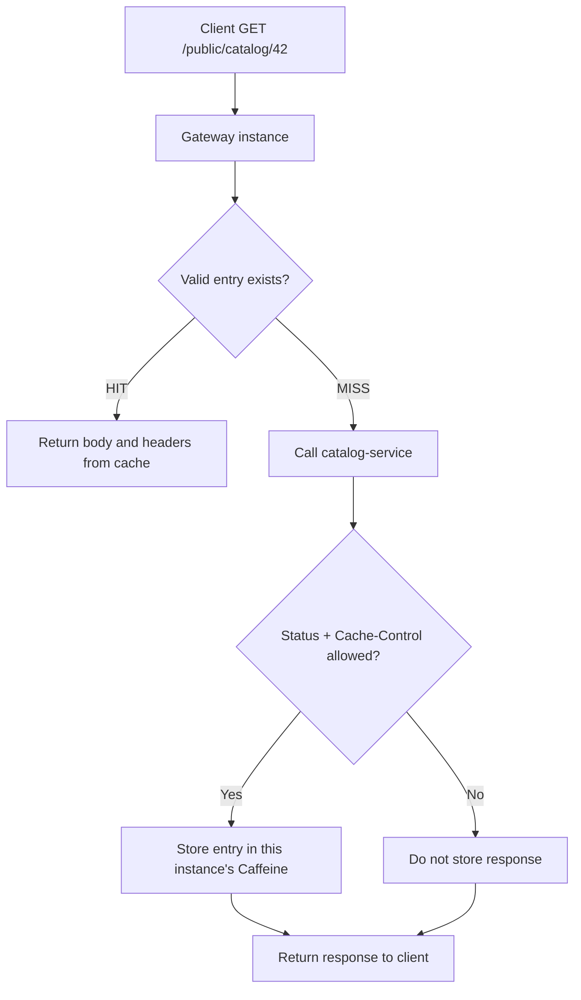
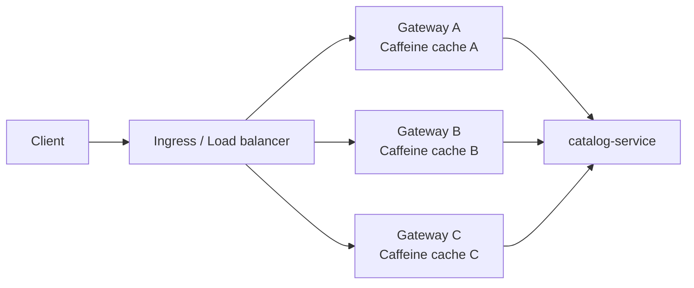

# Limitations of Local Caching When Gateway Has Multiple Replicas

In a microservices architecture, **Spring Cloud Gateway** is the entry point handling route predicates, filter chains, path/header transformations, authentication, rate limiting, circuit breakers, retries, and request observability. When a read API is called repeatedly, **response caching** can reduce backend load and improve latency. Yet the simplest approach—storing responses **directly inside Gateway memory**—carries a major limitation: **each Gateway replica maintains its own separate cache**.

Suppose three Gateway replicas `gateway-a`, `gateway-b`, and `gateway-c` all serve `GET /public/catalog/42`. Replica A has cached an older product version, B just fetched a newer version, and C has never seen the request. The load balancer can distribute three consecutive requests across all three replicas, causing the client to observe inconsistent results even though all replicas run the **exact same configuration file**.

This lesson in the **Response Caching** chapter focuses on how **`LocalResponseCache`** operates and its limitations in **Spring Cloud Gateway Server WebFlux**, the impact of scaling to multiple instances, data safety practices, memory sizing, testing, and deciding when to move to a CDN, shared cache, or backend cache.

> **Version scope:** Examples use Spring Cloud Gateway **Server WebFlux 5.0.x**, compatible Spring Cloud 2025.1.x, and Spring Boot 4.x. Route YAML uses `spring.cloud.gateway.server.webflux.routes`, not the legacy `spring.cloud.gateway.routes` prefix. **Server Web MVC** uses a different API/filter stack; never apply this WebFlux configuration to MVC without checking the documentation for your active branch.

## 1. Learning Objectives

After this lesson, you will be able to:

1. Distinguish **per-replica local caching**, **shared caching**, CDN caching, and browser caching.
2. Explain Caffeine-backed `LocalResponseCache`, eligible requests/responses, and `Cache-Control` conditions.
3. Explain why replicas exhibit different **hits/misses**, data versions, TTLs, and cache key sets.
4. Calculate **total cache memory across replicas** and assess warm-up, evictions, rolling restarts, and HPA effects.
5. Configure per-route caching, bound `timeToLive`/`size`, and control global cache toggles in Gateway 5.0.
6. Run a lab with two Gateway processes and one shared backend to prove independent cache results.
7. Avoid caching personal data, role/tenant-scoped responses, `Set-Cookie` payloads, and sensitive transactional data.
8. Choose among local cache, Redis/shared cache, CDN, and backend cache based on SLOs, freshness, and cost.

## 2. What Does Response Caching Actually Store?

For a request `GET /public/catalog/42`:

- **Cache MISS:** Gateway lacks a valid entry, calls upstream, receives the response, and may store body/headers per policy.
- **Cache HIT:** Gateway serves the stored response **without calling the backend again**.
- **Expiration:** The entry exceeds TTL; the next request can call the backend to fetch fresh content.
- **Eviction:** The cache hits its size limit, so the implementation can evict entries before TTL expires.
- **Invalidation:** Actively deleting entries because data changed—a much harder problem when instances hold independent memory.



### 2.1. `LocalResponseCache` and Caffeine

In Gateway Server WebFlux, `LocalResponseCache` stores **response bodies and certain headers** in a local **Caffeine**-backed cache. To use it, official documentation requires the `caffeine` dependency alongside `spring-boot-starter-cache`; to scope caching to specific routes, use the `LocalResponseCache` GatewayFilter.

This **does not mean** Gateway automatically becomes a distributed cache. Caffeine uses the **running JVM's memory**. There is no automatic entry sync between Gateway replicas A and B, no cross-pod entry replication, and no cross-replica invalidation protocol provided by `LocalResponseCache` alone.

### 2.2. Response Caching Conditions per Gateway Documentation

Gateway Server WebFlux's `LocalResponseCache` documentation outlines key conditions:

| Condition | Meaning |
|---|---|
| Request is a **bodiless GET** | Do not cache POST/PUT/PATCH, and do not expect request bodies to be cached |
| Response status is **200**, **206**, or **301** | These statuses are candidates under current filter behavior; not all 2xx/3xx/4xx are cached |
| Request **lacks** `Cache-Control: no-store` | Client can forbid storage per filter rules |
| Response **lacks** `Cache-Control: no-store` or `private` | Responses unsuitable for shared caches must not be stored |
| TTL and capacity remain valid | Entries may expire or be evicted before serving |

These are **conditions to be considered for storage**, not a guarantee that every eligible response will hit. Requests remain subject to route matching, filter ordering, cache keys, capacity, version behavior, and memory pressure.

**Note on `206 Partial Content`:** This is a range response; verify `Range`, `Content-Range`, `ETag`, and cache key handling before enabling caching on file downloads. A partial slice must never be served improperly as a full representation. For large media/files, prefer a CDN or streaming rather than caching bodies on Gateway.

**Note on `301 Moved Permanently`:** Redirects can be cached. If redirects vary by host, language, session, or tenant, never share a single cache blindly across all clients.

### 2.3. `Cache-Control` Governs Storage Eligibility

```http
GET /public/catalog/42 HTTP/1.1
Host: api.example.test
```

A public response suitable for cache consideration:

```http
HTTP/1.1 200 OK
Content-Type: application/json
Cache-Control: public, max-age=60
ETag: "catalog-v42"

{"id":"42","name":"Keyboard","price":120}
```

An account-data response that **must never** be stored in a shared response cache:

```http
HTTP/1.1 200 OK
Content-Type: application/json
Cache-Control: private, no-store

{"userId":"u-123","balance":10000}
```

HTTP directives such as `private` and `no-store` are not presentation hints: they state **caching policy**. Still, never rely solely on headers from a potentially misconfigured backend to protect PII. Your primary defense is **never enabling `LocalResponseCache` on routes carrying personal/authorized data** unless partitioned cache keys are rigorously verified.

### 2.4. `max-age` and Gateway TTL Are Not One Concept

Suppose a response carries `Cache-Control: max-age=120` while Gateway configures `LocalResponseCache=30s,10MB`. Per documentation, when the original response includes `max-age`, the filter can **rewrite `max-age` to the cache's TTL** and decrement remaining seconds when serving cache hits.

Therefore, never assume clients always see the exact `max-age=120` sent by the backend. When debugging, check headers **through Gateway**, hit timing, and actual configured TTL.

Furthermore, Gateway cache TTL governs only **how long an entry stays in Gateway**. Browsers, CDNs, and intermediate proxies keep their own caches per headers/validators. A Gateway entry expiring **does not force** browsers or CDNs to re-fetch immediately unless headers require it.

## 3. What Changes When Gateway Runs Multiple Replicas?

Single-instance model:

```text
Client → Gateway A [cache A] → catalog-service
```

Scaled to three instances:



Although all instances load the same route config, **their memories are unshared**. When a request lands on Instance B:

- It **does not query** A's cache.
- It **does not benefit from** entries A has warmed up.
- It may call the backend again for the exact same resource.
- It may hold a different version or expire at a different timestamp.
- When Pod B restarts, entries residing only in B vanish.

### 3.1. Timeline Table: Same URL, Different Results

Suppose `GET /public/catalog/42` has a 60-second TTL on each instance. Each backend call returns the current version:

| Time | Replica Picked by LB | Backend Version | Replica Cache Before Request | Client Result |
|---|---|---|---|---|
| `t=00` | A | v1 | A MISS | v1; A stores v1 |
| `t=01` | A | v1 | A HIT | v1; backend not called |
| `t=02` | B | v1 | B MISS | v1; B stores v1 |
| `t=05` | — | **Updated to v2** | A and B still hold v1 | No request |
| `t=06` | C | v2 | C MISS | v2; C stores v2 |
| `t=07` | A | v2 | A HIT (v1) | **v1** |
| `t=08` | C | v2 | C HIT (v2) | **v2** |
| `t=09` | B | v2 | B HIT (v1) | **v1** |

**Takeaway:** A single client can observe `v1 → v2 → v1` as the load balancer routes across instances. Backend updates do not automatically purge entries from each JVM. This may be fine for public catalogs tolerating brief lag, yet highly dangerous for prices, stock, access permissions, or financial data needing strong consistency.

### 3.2. Local Caching Increases Cold MISSes When Scaling

With `N` Gateway replicas and a "hot" URL not yet cached, the same resource can cause at least **`N` initial MISSes** as every replica receives a request—compared to one miss in an ideal shared cache. Under concurrent bursts, even within one replica you must verify loader synchronization to avoid duplicate reloads.

Intuitive cold-start formula:

\[
\text{Approximate misses} \approx N \times K
\]

where `K` is the number of cache keys requested at least once per instance. This is **not** an upper bound: TTL expiration, eviction, content updates, and concurrent requests generate additional misses.

When the Horizontal Pod Autoscaler scales from 2 to 8 replicas, the six new replicas **start with cold caches**. A major scale-out event while the backend is already overloaded can send more cache misses downstream than expected.

### 3.3. Do Sticky Sessions Solve This?

Load balancers can use cookies or IP hashing to pin a client to one replica. This improves **cache locality** for certain workloads, yet it does not convert a local cache into a shared cache:

- Different clients still hit different replicas.
- When a pod restarts or the LB rebalances, sessions move to cold caches.
- IP-based routing breaks under NAT/corporate proxies; load skew and hotspots become unpredictable.
- Data updates still fail to invalidate across instances.
- Cookie affinity introduces separate security, privacy, and operational trade-offs.

**Never rely on sticky sessions as a primary consistency mechanism.** They are only a hit-distribution optimization when eventual consistency is already acceptable.

## 4. Memory Multiplies by Replica Count

Suppose configuration caps each replica's cache at `128 MB`. Running `6` instances:

\[
M_{\text{total theoretical cache}} \le 6 \times 128\,\text{MB} = 768\,\text{MB}
\]

This represents the combined **configured budget** if every instance shares identical limits and accounting. It does not mean the system has **one 768 MB shared cache**, nor that each Java process uses strictly 128 MB.

| Replicas | Local Budget per Instance | Nominal Total Cache Budget |
|---:|---:|---:|
| 1 | 128 MB | 128 MB |
| 2 | 128 MB | 256 MB |
| 4 | 128 MB | 512 MB |
| 6 | 128 MB | 768 MB |
| 10 | 128 MB | 1,280 MB |

**Do not confuse cache budget with real memory usage:** add overhead for keys/entries, objects/headers, buffers, Netty direct memory, JVM heap/code, GC, and other filters. In `LocalResponseCache`, `size` bounds cached data under the cache's eviction rules—it is **not** a total JVM or pod RAM cap.

### 4.1. Per-Route Size vs. Total Cache

If one instance enables three cached routes at `20MB` each, the instance's total cache budget can differ from a single `20MB` limit depending on global/per-route settings and cache manager layout. Verify **where `size` applies** in your exact version. Never read one route's limit and assume it bounds Gateway's total memory.

### 4.2. Cache Capacity Does Not Mean Negligible Cost

A 300 KiB response body is stored along with headers and metadata. If many distinct URLs hold similar content:

- The cache allocates memory for every stored key/entry.
- Storing large responses adds heap/GC pressure and latency.
- Hitting size limits triggers frequent evictions and repeated misses.
- Across replicas, identical bodies may be stored **`N` times redundantly**.
- Query parameters inflating key cardinality yield minimal cache benefit while burning RAM and CPU.

Never enable local response caching for **large file downloads, videos, SSE, or streaming responses** just to trim backend bandwidth. Those workloads fit CDNs, object storage, or dedicated streaming with proper quotas.

## 5. Scoping Caching Properly in Gateway Server WebFlux 5.0

### 5.1. Required Dependencies

With Maven, the Gateway project uses these core dependencies:

```xml
<dependencies>
    <dependency>
        <groupId>org.springframework.cloud</groupId>
        <artifactId>spring-cloud-starter-gateway-server-webflux</artifactId>
    </dependency>

    <dependency>
        <groupId>org.springframework.boot</groupId>
        <artifactId>spring-boot-starter-cache</artifactId>
    </dependency>

    <dependency>
        <groupId>com.github.ben-manes.caffeine</groupId>
        <artifactId>caffeine</artifactId>
    </dependency>
</dependencies>
```

These are only the **cache-related dependencies**; a complete `pom.xml` also needs a Spring Boot parent/plugin and a Spring Cloud BOM matching the Boot version. Never override Caffeine/Gateway versions arbitrarily when dependency management already supplies tested versions.

If the project defines custom `CacheManager` beans, Spring Cloud Gateway docs remind you to configure `@Primary` or `@Qualifier` so Spring injects the right bean. A `CacheManager` used for business data does not automatically act as Gateway's distributed cache.

### 5.2. Two Easily Confused Switches in Gateway 5.0

In **Configuration Properties 5.0**, there are two distinct properties:

| WebFlux 5.0 Property | Listed Default | Role |
|---|---|---|
| `spring.cloud.gateway.server.webflux.global-filter.local-response-cache.enabled` | `true` | Enables **global** local response caching |
| `spring.cloud.gateway.server.webflux.filter.local-response-cache.enabled` | `false` | Enables the `LocalResponseCache` factory for **per-route** use |

Therefore, when piloting **only one public route**, **explicitly disable global caching** and **explicitly enable the per-route filter**. Do not merely add `- LocalResponseCache=...` assuming other routes are untouched; inspect effective configuration and release-specific docs.

**Design principle:** cache scope must be an **allowlist of safe public routes**, never enabled everywhere hoping every backend emits `Cache-Control: private` reliably.

### 5.3. An Explicit Route-Only YAML Configuration

`src/main/resources/application.yml`:

```yaml
server:
  port: ${SERVER_PORT:8080}

spring:
  application:
    name: catalog-cache-gateway

  cloud:
    gateway:
      server:
        webflux:
          global-filter:
            local-response-cache:
              enabled: false  # Do not cache all routes

          filter:
            local-response-cache:
              enabled: true   # Allow per-route factory

          routes:
            - id: public-catalog
              uri: http://localhost:9000
              predicates:
                - Path=/public/**
                - Method=GET
              filters:
                - StripPrefix=1
                - LocalResponseCache=15s,10MB
```

Breakdown:

| Component | Meaning |
|---|---|
| `server.port` | Reads `SERVER_PORT` env var, defaults to `8080` |
| `global-filter.local-response-cache.enabled: false` | Keeps caching disabled across unconfigured routes |
| `filter.local-response-cache.enabled: true` | Permits `LocalResponseCache` inside route `filters` |
| `Path=/public/**` + `Method=GET` | Matches only GET requests in the lab's public namespace |
| `uri: http://localhost:9000` | One shared backend served to all Gateway replicas |
| `StripPrefix=1` | `/public/catalog/42` becomes `/catalog/42` at the backend |
| `LocalResponseCache=15s,10MB` | Entry TTL is `15s`, route cache size limit is `10MB` |

Shortcut argument order for `LocalResponseCache` is **TTL first, size second**. This filter **caches responses**, unlike `CacheRequestBody` which caches request bodies inside the filter chain.

> **Scope warning:** this configuration is for **public content**; never add a `/private/**` route sharing this filter to cache user data. If your app uses `spring.cloud.gateway.server.webflux.default-filters` or global cache settings from profiles/config servers, verify they do not inadvertently enable caching on sensitive routes.

### 5.4. Default Configuration and Tuning

Per Gateway 5.0's configuration table, the default `time-to-live` for local response caching is listed as **5 minutes**. Configurable properties include:

```yaml
spring:
  cloud:
    gateway:
      server:
        webflux:
          filter:
            local-response-cache:
              enabled: true
              time-to-live: 30s
              size: 20MB
```

These set **filter-wide defaults**, not a replacement for choosing safe cached routes. When a route uses shortcut `LocalResponseCache=15s,10MB`, it overrides TTL and size for that route.

Always configure **explicit TTLs and sizes** for production routes. If size is omitted, inspect the default/effective cache builder; never assume memory is strictly bounded just because a TTL is set.

### 5.5. Is `Cache-Control: no-cache` a "Bypass Local Cache" Command?

**Do not assume so.** `LocalResponseCache` documentation describes a specific behavior: when an entry is already cached and a client sends `Cache-Control: no-cache`, the filter can return **`304 Not Modified` without a body**. Therefore:

```bash
curl -i -H "Cache-Control: no-cache" \
  http://localhost:8080/public/catalog/42
```

is not a test guaranteeing "always call the backend and fetch fresh data." If you need invalidation or cache bypass, design a **dedicated policy** and verify against your runtime; never treat `no-cache` as a cluster-wide cache-clear button.

`Cache-Control: no-store` is a different directive: docs specify a `no-store` request must not store a response in the local cache. Interactions with pre-existing entries—especially alongside multiple filters/validators—must be tested rather than guessed from directive names alone.

### 5.6. This Feature Does Not Automatically Integrate Redis

`LocalResponseCache=15s,10MB` **contains no** Redis URL, emits no Redis pub/sub invalidation, and does not share Caffeine maps over HTTP. Switching `uri: lb://catalog-service` changes backend routing only, not local cache storage.

If you need **centralized caching**, add an appropriate architecture: a CDN/edge cache, an external reverse-proxy cache, a Redis-backed backend cache, or a dedicated distributed response cache built and tested separately. Never claim "just adding `spring.data.redis.host` makes LocalResponseCache share state"—that is false.

## 6. Lab: Two Gateway Replicas, One Backend, Independent Caches

This lab intentionally runs **two Gateway processes** on the same machine pointing to **one shared backend** on port `9000`. The goal is observing divergent responses from two separate caches firsthand.

### 6.1. A Backend That Mutates Data Without Restarting

Create `CatalogCacheLab.java` in your practice directory:

```java
import com.sun.net.httpserver.HttpServer;
import java.net.InetSocketAddress;
import java.nio.charset.StandardCharsets;
import java.util.concurrent.atomic.AtomicInteger;
import java.util.concurrent.atomic.AtomicLong;

public class CatalogCacheLab {
    public static void main(String[] args) throws Exception {
        HttpServer server = HttpServer.create(
                new InetSocketAddress("127.0.0.1", 9000), 0);

        AtomicLong backendCalls = new AtomicLong();
        AtomicInteger revision = new AtomicInteger(1);

        server.createContext("/", exchange -> {
            String path = exchange.getRequestURI().getRawPath();
            String method = exchange.getRequestMethod();

            // Local lab only; production has no such endpoint.
            if ("/__lab/bump".equals(path) && "POST".equals(method)) {
                int next = revision.incrementAndGet();
                byte[] body = ("revision=" + next + "\n")
                        .getBytes(StandardCharsets.UTF_8);
                exchange.getResponseHeaders().set(
                        "Cache-Control", "no-store");
                exchange.sendResponseHeaders(200, body.length);
                try (var out = exchange.getResponseBody()) {
                    out.write(body);
                }
                return;
            }

            if (!"GET".equals(method)) {
                exchange.sendResponseHeaders(405, -1);
                exchange.close();
                return;
            }

            long call = backendCalls.incrementAndGet();
            int currentRevision = revision.get();

            String json = "{\"path\":\"" + path
                    + "\",\"revision\":" + currentRevision
                    + ",\"backendCalls\":" + call + "}";

            byte[] body = json.getBytes(StandardCharsets.UTF_8);
            exchange.getResponseHeaders().set(
                    "Content-Type", "application/json");
            exchange.getResponseHeaders().set(
                    "Cache-Control", "public, max-age=120");
            exchange.getResponseHeaders().set(
                    "X-Backend-Calls", Long.toString(call));
            exchange.getResponseHeaders().set(
                    "X-Backend-Revision", Integer.toString(currentRevision));
            exchange.sendResponseHeaders(200, body.length);

            try (var out = exchange.getResponseBody()) {
                out.write(body);
            }

            System.out.println("backendCall=" + call
                    + " revision=" + currentRevision
                    + " path=" + path);
        });

        server.start();
        System.out.println("Catalog lab on http://localhost:9000");
    }
}
```

Run the backend with JDK 17+:

```bash
java --add-modules jdk.httpserver CatalogCacheLab.java
```

This backend is strictly for the lab: `/__lab/bump` bumps the revision via POST with **zero authentication**. It binds to `127.0.0.1` for local development and **must never be deployed publicly**. In the demo, Gateway defines only GET `/public/**` and does not proxy `/__lab/bump`.

### 6.2. Gateway Application and Two Processes

Minimal entry-point class:

```java
import org.springframework.boot.SpringApplication;
import org.springframework.boot.autoconfigure.SpringBootApplication;

@SpringBootApplication
public class CatalogGatewayApplication {
    public static void main(String[] args) {
        SpringApplication.run(CatalogGatewayApplication.class, args);
    }
}
```

Use the exact `application.yml` from Section 5.3. In the Gateway project directory, launch two separate processes:

**Linux/macOS (two terminals):**

```bash
# Terminal A
SERVER_PORT=8081 ./mvnw spring-boot:run

# Terminal B
SERVER_PORT=8082 ./mvnw spring-boot:run
```

**Windows PowerShell 5.1 (two separate terminals):**

```powershell
# Terminal A
$env:SERVER_PORT = '8081'
.\mvnw.cmd spring-boot:run

# Terminal B (in another PowerShell window)
$env:SERVER_PORT = '8082'
.\mvnw.cmd spring-boot:run
```

Both processes run identical code/config yet own **independent JVMs and Caffeine caches**. Here we target ports 8081/8082 directly to pick a replica intentionally. In real deployments, an ingress/load balancer picks the replica and may add service discovery, TLS, and additional filters.

### 6.3. Warm Cache A

Call twice consecutively (within `15s`):

```bash
curl -i http://localhost:8081/public/catalog/42
curl -i http://localhost:8081/public/catalog/42
```

When caching works, the first call hits the backend and returns a body with `backendCalls=1`. The second call through **the same A** typically returns `backendCalls=1` again because Gateway A serves from cache. `Cache-Control: max-age` may be rewritten to remaining TTL instead of keeping the backend's 120 seconds.

In the backend terminal, `/catalog/42` logs typically advance only once when two requests hit A back-to-back. That is **stronger evidence** than low latency, since local network misses are also fast.

### 6.4. First Call to Cache B

```bash
curl -i http://localhost:8082/public/catalog/42
curl -i http://localhost:8082/public/catalog/42
```

Because Gateway B is a separate process, it lacks the entry A created. The first call to B typically bumps `backendCalls` to `2`; the second call to B keeps `backendCalls=2` via B's cache hit. At this point, A holds `backendCalls=1` while B holds `backendCalls=2`.

Do not treat 1 and 2 as universal rules across every run: prior tests, TTLs, timing, and background calls can change the exact integers. What matters is that **a hit on A never produces a hit on B**.

### 6.5. Bump the Backend Revision and Observe Inconsistent Data

While A's TTL is still active, call the **backend directly**:

```bash
curl -i -X POST http://localhost:9000/__lab/bump
```

The backend bumps `revision` from `1` to `2`. Query A while its entry is still alive:

```bash
curl -i http://localhost:8081/public/catalog/42
```

A can still return `revision=1`. If B cached revision 1, B can still return revision 1 too. Wait for each entry's TTL or start a fresh Gateway instance on `8083`, then hit the route on the new instance:

```bash
SERVER_PORT=8083 ./mvnw spring-boot:run
curl -i http://localhost:8083/public/catalog/42
```

Fresh process `C` has no entry, so it fetches `revision=2` from the backend. Alternating requests between A and C while A's TTL remains active yields `revision=1` and `revision=2` interchangeably.

**Timing note:** the demo TTL is only 15 seconds; booting process C can take long enough for A's TTL to expire. To reliably observe both versions, raise the lab TTL to `60s`, boot C **before** bumping the revision (without calling C yet), or time your calls deliberately. Never take failing to spot staleness in one run as proof that caches are synchronized.

### 6.6. Wait for TTL and Recheck

After each entry expires, the next GET on that replica can call the backend, fetch the new revision, and cache it. Yet the moment "all replicas are up to date" varies because **each replica populated its entry at a different time**.

TTLs bound the age of **each entry** per cache policy, yet **do not** synchronize data refresh timestamps across replicas. Whenever business rules require replicas to switch to new versions simultaneously, TTL alone is not a consistency protocol.

## 7. Limitations in Multi-Replica Environments

### 7.1. No Automatic Cross-Replica Invalidation

Suppose `catalog-service` updates a product and emits a `ProductUpdated(42)` event. When caches A, B, and C are Caffeine instances in three separate JVMs, business events **do not automatically** locate and evict that entry across all three JVMs merely because they run Spring Cloud Gateway.

Active invalidation requires a mechanism you explicitly design:

- Broadcast events to every instance via a message broker/pub-sub where each instance knows which keys to evict.
- Call an authenticated admin endpoint on **every replica** to purge entries (if you build and support it); do not assume `LocalResponseCache` ships a distributed purge API.
- Change the namespace/cache version in the URL or key when publishing new static data.
- Set a short enough TTL if the business tolerates bounded staleness without instant invalidation.
- Switch to a cache with shared state/invalidation protocols when stricter consistency is required.

**Warning:** sending "one request to the Gateway service" through a load balancer **does not guarantee** a purge command reaches every instance. The LB picks **one** replica, just like for a GET. Clearing all replicas requires service discovery/instance enumeration, retries, handling booting/restarting pods, and race mitigation.

### 7.2. TTL Does Not Guarantee Data Accuracy at Read Time

A smaller TTL only bounds how long an entry **may** be served from cache after storage. TTL never checks whether backend data just changed.

A product updated at `12:00:10` can still be returned by A from a cache entry created at `12:00:00` until nearly `12:01:00` under a 60s TTL. Meanwhile, if B caches the new version at `12:00:12`, A and B temporarily disagree.

If the business requires:

- Displayed prices to be exact at checkout;
- Inventory counts never to exceed real stock;
- Revoked permissions to take effect immediately;
- Transaction statuses never to misreport success;

then **never hinge correctness on short-lived `LocalResponseCache`**. Read the source of truth or a consistent data tier at critical decision points; caching may serve reference listings/snapshots, but always re-verify before side-effecting operations.

### 7.3. Scale-Out Creates Cold Caches

When replicas scale from 2 to 10, the eight new JVMs do not automatically "import" entries from the two older JVMs. With balanced traffic, URLs that enjoyed high hit ratios on A/B generate **new MISSes** on the new pods.

Effects:

1. Backend QPS spikes immediately after scale-out.
2. p95/p99 latency can temporarily climb while caches warm up.
3. Outbound connection pools must handle higher concurrency.
4. If the backend is already strained, extra misses make recovery harder.
5. Requests for hot shared keys can hit multiple replicas simultaneously—a **cluster-wide cache stampede**.

A scale-out plan must account for rate limiting, circuit breakers, connection pools, backend concurrency, and possibly preloading **a tiny set of ultra-hot public keys** if the contract permits. Preloading all keys or warming with heavy traffic risks triggering another overload storm.

### 7.4. Rolling Deployments, HPA, and Request Routing

**Rolling updates:** new instances have cold caches while old instances retain entries; during mixed-version rollouts, clients can observe inconsistent responses even without backend changes.

**Autoscaling down:** entries in terminated pods vanish with those pods rather than migrating to survivors.

**Rolling restarts:** once all pods restart, the entire cluster starts cold; never depend on local caches to preserve critical state.

**Health checks:** a green `/actuator/health` reports only that configured health indicators pass; it **never proves** caches are warm, data is fresh, or hit ratios meet targets. Track dedicated cache-effectiveness metrics.

### 7.5. Hotspots, Eviction, and Key Cardinality

Suppose a route caps cache at `10MB`, yet receives 200,000 URL/query variants:

```text
/public/catalog/42?lang=vi
/public/catalog/42?lang=en
/public/catalog/42?lang=fr
/public/catalog/42?sort=name
/public/catalog/42?sort=price
...
```

If variants generate distinct cache keys, new entries continuously evict older ones. Result: **cache thrashing**, high miss rates, higher CPU overhead, and persistent RAM usage.

Never guess whether cache keys include or exclude specific queries, headers, or `Vary` without verifying **your exact version's implementation**. Verify via tests that differing responses are **never crossed across callers**, and that variant counts do not overwhelm cache capacity.

With `RewritePath`, `StripPrefix`, and query/header modifiers, filter ordering also affects the URL the cache sees. Test variants against your full application config rather than guessing cache keys from a short YAML snippet.

### 7.6. Concurrent Requests and "Cache Stampedes"

Two concurrent requests arriving at A for the same expired key can both observe missing data. Depending on the implementation's single-flight/coalescing behavior, multiple upstream calls may fire.

With 8 replicas, even if each replica synchronizes loads inside its own JVM, **there is no cluster-wide single-flight** with local Caffeine alone. Mitigations can include:

- A shared cache or per-key single-flight in a shared tier.
- Randomized TTL/jitter where supported by the implementation/system.
- Bounded background refresh paired with circuit breakers.
- Rate limiting/bulkheads in front of the backend, returning clear errors under overload.
- Preferring backend caching for data read across many Gateway replicas.

Never write a `synchronized` `GlobalFilter` inside JVM A and claim you solved cluster-wide stampedes—A's mutex never locks B or C.

## 8. Security: Risk of Mixing Data Across Users and Tenants

Gateway response caching can become a **cross-user data leak** if it stores sensitive responses using cache keys that omit identity, authorization context, or request variants.

### 8.1. Examples of Data to Exclude From Caching

```http
GET /api/me HTTP/1.1
Authorization: Bearer <token-alice>
```

Upstream returns:

```http
HTTP/1.1 200 OK
Content-Type: application/json

{"user":"alice","email":"alice@example.test"}
```

If this route is cached by URL without distinguishing principals, Bob's request can receive Alice's data. **Never rely on Spring Security authenticating both users** to assume cache keys separate them. Authentication around the filter chain does not automatically partition response caches per principal.

Layered defenses:

1. **Never enable `LocalResponseCache` on `/api/me`, `/api/orders/**`, `/api/payments/**`, or sensitive routes** without a thoroughly vetted partitioned cache design.
2. Have the backend return `Cache-Control: private, no-store` on personal data, tokens, credentials, and non-storable payloads.
3. Block direct backend bypass paths and enforce resource-level authorization in the backend.
4. Never trust client-supplied `Authorization`, `Cookie`, or `X-User-Id` headers as reliable cache partitions without verification.
5. If user data truly needs caching, consider **service-tier caching** keyed on verified identity with clear quotas/TTLs/invalidation instead of edge HTTP caching at Gateway.
6. Test with at least two users, two tenants, two differently scoped JWTs, and multiple replicas before enabling in production.

### 8.2. `Cache-Control: private` and `no-store`

Per `LocalResponseCache` docs, responses containing `private` or `no-store` are not cached by this feature. Safe example:

```http
HTTP/1.1 200 OK
Cache-Control: private, no-store
Content-Type: application/json

{"accountId":"a-42","balance":100}
```

Yet **never depend on a single header alone**. One backend commit accidentally dropping `private` can silently change behavior. Route allowlists and authorization tests remain mandatory.

### 8.3. `Set-Cookie`, `Vary`, CORS, and Response Variants

Factors that commonly break cache keys:

| Factor | Risk If Omitted |
|---|---|
| `Authorization` | Serving User A's data/roles to User B |
| `Cookie` / `Set-Cookie` | Replaying someone else's session/cookie or caching stateful responses |
| `Vary: Accept-Language` | Serving the wrong language to a client |
| `Vary: Accept-Encoding` | Serving compressed payloads incompatible with the request |
| `Vary: Origin` and CORS headers | Serving wrong `Access-Control-Allow-Origin` or causing cache poisoning |
| Queries `tenant=...`, `lang=...`, `currency=...` | Mixing business, currency, or locale data |
| `Range` / `Content-Range` on `206` | Serving a partial byte slice as a full response |
| `301` redirects by host/path | Redirecting to the wrong tenant/host or serving stale redirects |

`Vary` signals caches to separate variants, **yet never assume** every cache implementation/framework version handles every variant like a full CDN. On routes with complex `Vary` behavior, write integration tests checking keys and headers, or skip local caching altogether.

### 8.4. Never Cache Auth Responses or Errors Carrying Sensitive Data

Keep out of local response caches:

- Token/login/logout endpoints, responses with `Set-Cookie` or refresh tokens.
- `/me`, account profiles, order histories, balances, payment statuses.
- APIs authorized by tenant, role, or resource ownership.
- Paths returning sensitive JWT/JWK/private identity material unsuitable for public caching.
- Responses reflecting recently revoked permissions.
- Real-time APIs used for transaction approvals, inventory reservations, or fraud checks.

`RequestRateLimiter`, Spring Security, and TLS protect **access and traffic volume**, yet cannot fix a response cache serving the wrong body across users. Data boundaries must be enforced separately.

## 9. Local Cache vs. Shared Cache?

No single strategy fits every case. The table compares scope and consistency:

| Solution | Where Cache Lives | Under Gateway Scaling | Strengths | Risks / Trade-offs |
|---|---|---|---|---|
| **LocalResponseCache (Caffeine)** | Each Gateway JVM's RAM | **Per replica** | Extremely fast hits, zero network hop to cache | Version skew, RAM scales with replicas, no shared invalidation |
| CDN / edge cache | Multiple edge POPs | Independent of Gateway replica count | Offloads Internet traffic before Gateway; great for public assets | Per-POP TTL/purge, URL/header variants, cost, public data only |
| Shared reverse-proxy HTTP cache | Shared proxy/cache tier | Multiple Gateways share one cache tier | Centralized HTTP caching, often supports purging | Extra tier, HA, TTL/consistency, and ops overhead |
| Redis or distributed data cache **in backend** | Shared key-value store across services | Any Gateway hitting backend benefits from backend cache | Easy partitioning by identity/domain and invalidation | Backend still receives Gateway calls; extra network/cache service |
| Cache inside each backend replica | Each backend instance's RAM | Decoupled from Gateway count, though backends still diverge | Cache sits close to business logic | Still needs distributed invalidation across backend replicas |
| No cache | Read source of truth | Zero gateway-cache inconsistency | Accurate, simplifies security | Higher backend latency/load; requires capacity planning |

**Never equate a backend Redis cache with `LocalResponseCache`:** adding a Redis dependency to Gateway does not turn Caffeine into a distributed HTTP response cache. Sharing HTTP responses requires a dedicated solution aware of cache keys, HTTP headers/validation, TTLs, serialization, invalidation, and authorization.

### 9.1. When Is Local Response Caching Suitable?

Works well when an API:

- Serves only **bodiless public GETs**.
- Changes infrequently or tolerates seconds/minutes of staleness.
- Has small responses and bounded URL/variant cardinality.
- Emits proper cache headers and sits on an allowlisted route.
- Does not require instant cross-replica entry deletion.
- Has memory headroom sized for **maximum replica count**, not just current replicas.
- Has metrics proving it genuinely lowers backend load.

Examples: country lists, public metadata, static API docs, or catalog previews excluding final checkout prices.

### 9.2. When Should You Use a Shared Cache or CDN?

If the primary goal is **reducing total backend calls regardless of which Gateway replica handles a request**, a shared-tier or backend cache fits better.

For instance, a hot public catalog across 20 Gateway replicas each warming 5,000 keys incurs tens of thousands of cold loads and 20× duplicated RAM. A CDN or shared cache removes redundant per-pod warming—in exchange for designing shared-tier consistency, purging, availability, and stampede protection.

When instant price/inventory synchronization is needed, **a shared cache still does not guarantee linearizability** without explicit consistency mechanisms. Shared caches reduce state duplication; they do not replace your source of truth or transaction checks.

## 10. Designing TTL, Size, and Load Budgets at Scale

Parameter tuning should never start from "make the cache huge," but from **freshness requirements**, backend load, and memory limits.

### 10.1. Deriving TTL From Acceptable Staleness

Suppose a catalog permits displayed info to lag up to ~30 seconds behind the backend. Setting `timeToLive=30s` is a testable starting point. It does not guarantee instant consistency nor manage downstream browser/CDN caches.

| Data Category | Characteristics | Cache Policy to Consider |
|---|---|---|
| Country codes, slowly changing public metadata | Staleness easily tolerated | Multi-minute TTL or longer CDN caching with release invalidation |
| Public catalog pages | Data updates minute-by-minute | Short TTL; monitor stale window and upstream traffic |
| Reference listing prices | Slight lag allowed per product specs | Conservative TTL; **always re-verify price at checkout** |
| Real-time inventory / seat availability | Must be exact at purchase time | Never rely on local response cache for holds or checkout |
| Profiles, orders, payment status | Per-user/tenant and sensitive | Do not local-cache by URL at Gateway |
| JWT/authorization decisions | Must reflect revocations | Never cache auth decisions via public HTTP filters |

These durations are **design guidelines**, not official defaults. Product owners must define acceptable staleness; operations teams verify latency, memory, and upstream load.

### 10.2. Sizing Based on Maximum Replica Count

Suppose each Gateway pod has a 512 MiB memory limit; the app needs headroom for heap, connection pools, buffers, native/direct memory, and other filters. **Never** allocate all 512 MiB to response caching.

If each pod budgets up to 40 MiB for local response caching and HPA scales up to 12 pods:

\[
\text{Cluster cache budget} \approx 40\,\text{MiB} \times 12 = 480\,\text{MiB}
\]

This is a budget multiplication, **not an exact RSS forecast**, and does not describe a 480 MiB shared cache. Monitor RSS, JVM heap/non-heap, direct memory, GC, and real workloads because cached response sizes do not always equal total memory consumed by entries.

A capacity planning sheet should capture at least:

| Metric / Variable | What to Measure |
|---|---|
| Min / Max Gateway replicas | `N_min` / `N_max` per HPA |
| Response body p50/p95/p99 | Actual payload size distribution |
| Keys per route within TTL | Cardinality and hot-key skew |
| Per-route TTL and size | Memory budget and staleness |
| Warm hit/miss ratio | Actual benefit vs. uncached baseline |
| Miss surge on restart/scale | Burst load hitting backend |
| Eviction count / memory pressure | Whether cache is thrashing |
| Backend capacity & SLO | Whether backend survives cold-start traffic |

### 10.3. Rough Formulas for Estimating Hits and Misses

For one route:

\[
\text{Hit ratio} = \frac{\text{cache hits}}{\text{cache hits} + \text{cache misses}}
\]

and

\[
\text{Backend requests from route} \approx
\text{cache misses} + \text{bypass/non-cacheable requests}
\]

This is a simplified model; implementations may count misses differently under concurrent loads, non-cacheable statuses, backend errors, or pre-filter rejections.

Example with 10,000 public GETs per minute:

- 7,000 cache hits, 2,000 misses, and 1,000 policy-uncacheable requests → backend receives roughly 3,000 requests.
- If a scale-out adds 2,000 extra misses in that minute → backend receives roughly 5,000 requests despite identical client volume.

**Do not measure only HTTP 200s:** cache misses return 200 too, and cache hits do not prove data is fresh. Track hit ratios, backend QPS, stale incidents, and latency separately.

### 10.4. When Caches Store Errors or Redirects

Per documented Gateway `LocalResponseCache` rules, candidate statuses are **200, 206, and 301**. `404` is excluded by default; do not assume raising TTL makes Gateway negative-cache 404 lookups.

`301` redirects can persist across headers/TTLs and browser/CDN caches with their own policies. When changing redirect targets, stale redirects can linger across replicas and clients. Maintain redirect versioning strategies and test across multiple hops.

`206` demands extreme care with `Range`, validators, and large files. Without a compelling reason to local-cache partial content, route file/downloads separately to a CDN or object storage.

## 11. Cache Lifecycle Alongside Other Gateway Layers

### 11.1. Route Predicates and Filter Chains

`LocalResponseCache` operates within the context of a matched route. This means:

- Requests failing `Path`/`Method` predicates never enter that route's cache filter.
- A cache hit can bypass normal upstream routing in the pipeline.
- Other filters still execute in order; path/query/header rewrites can affect route selection and caching behavior.
- If global response caching is enabled, caching may apply **beyond** the individual route you are inspecting.

**`routes[*].order` controls route selection priority**, not `GatewayFilter` execution order. Never tweak `order` trying to "sync caches" across replicas.

### 11.2. Spring Security Does Not Automatically Make Caching Safe

With JWT/OAuth2 Resource Server or mTLS, Spring Security can reject unauthorized callers before Gateway routes run. However, for **two authenticated users**, never assume `LocalResponseCache` separates them unless routes and cache keys are explicitly designed for it.

For authorized content, skip Gateway HTTP response caching or use a business-service cache keyed on verified identity and ownership policies. Never let clients supply `X-Internal-Tenant-Id` and use it as a cache partition.

### 11.3. Caching Does Not Replace Circuit Breakers, Retries, or Rate Limiting

- **CircuitBreaker:** trips on failing upstreams; cache hits reduce upstream calls but do not verify data validity.
- **Retry:** one cache miss can trigger multiple upstream attempts when retries are enabled—especially risky during scale-out.
- **RequestRateLimiter:** throttles requests per key/route; a cache hit does not exempt callers from quotas (depending on filter position/order).
- **TLS/mTLS:** secures transport and hop identity; does not encrypt or replicate local cache entries across replicas.
- **Observability:** measure both cache outcomes and upstream outcomes. When caching works, the backend sees fewer calls while Gateway still serves full traffic volume.

Never use caching to mask 401/403 errors, replace per-user authorization, or serve stale data as a fallback for critical transactions.

## 12. Multi-Replica Observability: What Should You Measure?

### 12.1. Actuator for Inspecting Routes and Filters

With `spring-boot-starter-actuator` present, Gateway 5.0.x can expose a read-only management endpoint:

```yaml
management:
  endpoint:
    gateway:
      access: read-only
  endpoints:
    web:
      exposure:
        include: health,info,gateway,metrics
```

After startup, query each instance individually:

```bash
curl -i http://localhost:8081/actuator/gateway/routes
curl -i http://localhost:8082/actuator/gateway/routes
curl -i http://localhost:8081/actuator/gateway/routes/public-catalog
```

The routes endpoint shows which routes declare `LocalResponseCache`. It **does not show** which entries currently live in Caffeine, per-key remaining TTLs, or whether two replicas hold identical data.

**Never expose Actuator to the public Internet**: route IDs, upstream URIs, and filter configs reveal architecture details. Enforce security/network policies and strict access control.

### 12.2. Recommended Metrics

| Metric / Signal | Useful Breakdown | What to Detect |
|---|---|---|
| Cache hit/miss ratio | Replica, route | Whether new replicas have cold caches |
| Cache eviction rate | Replica, route | Undersized cache or excessive key cardinality |
| Cache size/weight | Replica, route | Cache memory consumption |
| Backend QPS | Backend, route | Whether caching actually cuts load |
| Response p50/p95/p99 | Route, replica | Whether hits lower latency and avoid tail spikes |
| JVM heap/RSS/direct memory/GC | Pod, app version | Whether caching causes memory pressure |
| Response version/staleness | Resource/test dataset | Replicas serving different stale versions |
| HPA replicas, rollout restarts | Deployment | Hit ratio drops correlated with scaling/restarts |
| HTTP 5xx, timeouts, circuit OPEN | Route/upstream | Whether cold misses overload the backend |
| CORS/tenant/security anomalies | Route, security domain | Any leakage across response variants |

**Never assume** all metrics above are auto-exported under identical names by one starter. Caffeine, Micrometer, Spring Boot Actuator, and Gateway's internal cache must be properly wired/instrumented to expose them. When direct hit/miss metrics are absent, the lab's `X-Backend-Calls` safely infers hits/misses in tests, yet internal counters should not be exposed in production.

### 12.3. Structured Logging

Sample log event:

```json
{
  "requestId": "5ba02424-4dc3-4c5d-80cb-555e25a65f4d",
  "routeId": "public-catalog",
  "replica": "gateway-b",
  "cacheOutcome": "MISS",
  "upstreamCalled": true,
  "status": 200,
  "durationMs": 31
}
```

This is a **suggested schema**, not an automatic log output of the filter. Add instrumentation at the appropriate layer to emit accurate `cacheOutcome` values. Never log raw `Authorization` headers, cookies, tokens, user data, or full response bodies for cache debugging; keep metric tags low-cardinality (avoid `requestId` or user IDs).

### 12.4. Distinguishing Effective Caching From "Serving Stale Data"

A Gateway with a 99% hit ratio is not healthy if entries violate business freshness requirements. SLOs should combine:

- **Availability:** Are responses served within contract?
- **Latency:** Are p95/p99 through Gateway improved?
- **Freshness:** What share of responses fall within the allowed stale window?
- **Correctness:** Are there zero cross-tenant leaks, wrong prices/permissions, or bad redirects?
- **Cost:** How do backend QPS, CPU, memory, and egress change as replicas scale?

Maximizing hit ratios **must never** override data safety or business correctness.

## 13. Test Matrix for Multi-Replica Gateway Caching

For caches, running `curl` twice against **one instance** is insufficient. A proper test suite validates per-JVM state, HTTP correctness, and security boundaries.

| Test Case | Action | Expected Observation |
|---|---|---|
| A1 | GET same URL twice quickly on A | Backend called once; A hits on second call |
| A2 | Same URL, first call to B | B misses even though A just hit |
| A3 | Alternate calls to A and B | Body/`X-Backend-Calls` differ due to separate caches |
| A4 | Bump backend revision while A holds entry | A may serve old revision within TTL |
| A5 | New cold pod/instance C | C fetches new revision, differing from A |
| A6 | Wait for each replica's TTL to expire | Replicas refresh at different times |
| A7 | Restart only replica A | A loses entries; B retains its entries |
| A8 | Scale from 2 to 8 replicas | Additional cold misses; backend QPS may rise |
| A9 | GET with `Cache-Control: no-store` | Verify no new entry stored per filter rules |
| A10 | Cache hit + request `Cache-Control: no-cache` | Check documented `304` behavior; do not treat as purge |
| A11 | Response `Cache-Control: private, no-store` | Never stored in local response cache |
| A12 | Upstream returns HTTP 404 | Not cached by default under 200/206/301 status rule |
| A13 | Route fails `Path` or `Method` match | Route's `LocalResponseCache` does not run |
| A14 | Two users/tenants request personalized payloads | Public local cache never leaks data across users |
| A15 | `Vary: Accept-Language`/`Origin` | Content/header variants stay isolated; verify implementation |
| A16 | Route `LocalResponseCache` enabled while global filter stays on | Check whether non-allowlisted routes get cached unintentionally |
| A17 | `206` response to `Range` request | Partial slices never get mixed up or served as full responses |
| A18 | Small size limit, many keys | Monitor evictions, misses, and memory growth |

**In automated assertions**, verify **status, body, response headers, and actual backend call counts**, not request speed alone. For TTL and concurrency checks, use tolerance windows and range assertions rather than brittle millisecond timings in CI.

### 13.1. Avoiding Global Caching With Explicit Public/Private Routes

A production config can clearly separate public and private routes:

```yaml
spring:
  cloud:
    gateway:
      server:
        webflux:
          global-filter:
            local-response-cache:
              enabled: false
          filter:
            local-response-cache:
              enabled: true
          routes:
            - id: catalog-public
              uri: http://catalog-service:9000
              predicates:
                - Path=/public/catalog/**
                - Method=GET
              filters:
                - LocalResponseCache=20s,10MB
                - StripPrefix=1

            - id: orders-private
              uri: http://order-service:9001
              predicates:
                - Path=/api/orders/**
              filters:
                - StripPrefix=1
                # INTENTIONALLY omits LocalResponseCache
```

This illustrates **scope separation**; DNS hostnames assume a deployment topology running those services. It will not run verbatim without matching backends, and the private route still requires Spring Security + backend authorization. For HTTP caching, `orders-private` omits the cache filter and global caching is off.

For `catalog-public`, evaluate `Set-Cookie`, `Vary`, `Cache-Control`, and data sensitivity. Having the word "public" in a route ID **does not automatically make the payload public**.

### 13.2. Testing in Kubernetes

When deploying Gateway via a multi-pod Kubernetes Deployment:

1. Tag **internal logs/metrics** with `pod`/`instance` to distinguish replicas without necessarily exposing pod names in client headers.
2. Measure backend QPS before and after scale-out or rolling updates.
3. Verify actual local cache behavior on newly launched (cold) vs. existing (warm) pods.
4. Update a backend resource and send requests across multiple pods.
5. Drain/restart one pod; confirm remaining pods operate normally despite unsynchronized cache state.
6. Ensure pod memory limits accommodate full caches; monitor OOMKills and GC.
7. Watch `429` rates, circuit breaker OPENs, and timeouts during cold-miss spikes, as those filters react to sudden load.
8. Observe behavior when HPA scales down and back up.

**Never alter production service discovery randomly just to route a request to one pod.** Use a test environment or controlled port-forward/debug endpoint without bypassing auth/TLS boundaries.

## 14. Common Configuration and Operational Issues

| Symptom | Possible Cause | Resolution |
|---|---|---|
| A hits cache, B always misses same URL | Each instance holds its own Caffeine cache | Inherent to local caching; use a shared cache if sharing is required |
| Client sees alternating old/new values | Each replica has independent TTLs and refresh times | Accept bounded staleness or change cache architecture |
| Backend load spikes after HPA scale-out | New pods start with cold caches | Plan capacity, limited warm-up, shared cache, backend protection |
| Cache vanishes after restart | Entries live only in pod RAM | Never store critical state in local caches |
| JVM RAM grows with cached routes | Multiple per-route caches/entries + overhead | Cap per-route size, measure total RAM, consolidate/move layer |
| OOMKilled despite `LocalResponseCache=10MB` | 10MB caps route cache data only, not heap/Netty/filters | Measure RSS/heap/direct memory; shrink payloads/caches, raise headroom |
| Responses never get cached | Missing Caffeine/cache starter, route flag off, status outside 200/206/301, `no-store`/`private` | Check dependencies, effective properties, cache headers, route matching |
| Route without filter still caches | Global cache or `default-filters` enabled | Explicitly disable global cache, audit config profiles |
| Expected `no-cache` to force fresh fetch, got 304 | Documented `no-cache` behavior when entry is already cached | Never use as purge; build dedicated invalidation |
| `max-age` via Gateway differs from backend | Filter rewrote it to local cache TTL | Compare upstream headers, TTL config, and insertion timing |
| `GET` with different queries returns wrong payload | Key/variant handling or rewrite bug | Test queries, `Vary`, and cache keys on your exact version |
| User A's data appears for User B | Cached wrong route/private data or broken key partitioning | Disable caching on sensitive routes; audit auth and `private/no-store` |
| Stale `Set-Cookie` header appears | Response with session header was cached | Never cache session responses; audit policy and cache keys |
| `301` redirect points to old host | Redirect cached in Gateway/browser/CDN | Use versioning/purging and check all cache layers |
| `206` content returns wrong range | Range headers/variants mishandled | Isolate file routes, use CDN, or disable local cache for partial content |
| High eviction, low hit ratio | Tiny size, high key cardinality, large bodies | Trim variants, adjust TTL/size to data, or disable cache |
| Redis configured, yet replicas cache independently | `LocalResponseCache` uses local Caffeine | Shared caching requires a separate architecture and implementation |
| Actuator omits entry counts | `/routes` is not a Caffeine key-inspection API | Add controlled metrics/diagnostics |
| Request hits cache yet backend is called on another route | Request matched a different route or filter/tenant variant | Check route order/method/predicates and filter chain |
| `401`/`403` served from cache | Misconfiguration or another cache layer intervening | Never cache auth responses; check ingress/CDN/browser and policies |
| Raising TTL worsens stale data | TTL only delays refresh, never syncs invalidation | Derive TTL from freshness SLOs; cache closer to source |
| Multiple Gateways return same body without cutting backend QPS | Continuous MISSes, bypasses, evictions, or unique keys | Measure per-replica/route hits/misses; inspect origin headers |

### 14.1. Seven-Step Diagnostic Workflow

1. **Verify route:** Which `Path`/`Method` matched; is `LocalResponseCache` attached?
2. **Verify scope:** Are `global-filter.local-response-cache.enabled`, `default-filters`, or profile overrides interfering?
3. **Check dependencies:** Are Caffeine and Spring Boot cache starter versions compatible?
4. **Check HTTP semantics:** Status 200/206/301, request `no-store`, response `private/no-store`, `max-age`, and `Vary`.
5. **Measure backend calls per replica:** Test A/A then B/B, distinguishing hits from misses instead of relying on latency.
6. **Check memory/TTL:** Per-route size, evictions, refresh timing, pod restarts, and max replica count.
7. **Evaluate security/consistency:** Auth/cookies/tenants, stale price/stock, invalidation; change architecture if local caching falls short.

## 15. Self-Check Questions

**Question 1.** Gateways A and B run the exact same YAML. Why can a URL hit on A yet miss on B?

**Answer:** `LocalResponseCache` uses Caffeine in **each JVM's local memory**. Two processes never share entries or TTL timers.

**Question 2.** Does scaling from two to eight pods automatically distribute old cache entries to the new pods?

**Answer:** No. The six new pods start with cold caches. The backend may see extra misses for keys already cached on older pods.

**Question 3.** With 128 MB configured per pod across six pods, is there one 768 MB shared cache?

**Answer:** No. That is only the **nominal combined budget** across six isolated caches, excluding overhead. One pod cannot read another pod's entries.

**Question 4.** What does `LocalResponseCache=30s,20MB` mean?

**Answer:** Maximum entry TTL of ~30 seconds and a 20 MB cache budget scoped to that filter/route per implementation. It does not cap total JVM/pod RAM.

**Question 5.** Which dependencies does Gateway WebFlux 5.0 need for `LocalResponseCache`?

**Answer:** Per docs, `com.github.ben-manes.caffeine:caffeine` and `spring-boot-starter-cache` alongside the compatible Gateway starter.

**Question 6.** Should a response returning `Cache-Control: private, no-store` be stored by `LocalResponseCache`?

**Answer:** No. These directives disqualify the response under documented cache rules, and sensitive routes should avoid attaching the filter altogether.

**Question 7.** Does `Cache-Control: no-cache` always force Gateway to fetch a new response from the backend?

**Answer:** Never assume so. `LocalResponseCache` docs note that with an existing cached entry, a `no-cache` request can produce a bodyless `304`, not a cluster-wide purge.

**Question 8.** When a product is updated in the backend, does the new version immediately appear on A, B, and C?

**Answer:** No. Live entries on each pod can remain outdated until explicit invalidation or TTL expiration.

**Question 9.** Do sticky sessions solve consistency when backend data changes?

**Answer:** No. They can improve locality, yet never update entries on other pods and still break on rebalances or restarts.

**Question 10.** Does adding a Redis dependency to Gateway automatically turn `LocalResponseCache` into a distributed cache?

**Answer:** No. `LocalResponseCache` is local Caffeine; sharing entries requires a dedicated shared-cache solution/architecture.

**Question 11.** Why must `Vary: Accept-Language` or `Vary: Origin` be tested when caching is enabled?

**Answer:** Bodies/headers can vary by request header. If the cache fails to separate variants properly, clients receive the wrong language, wrong CORS headers, or even inappropriate data.

**Question 12.** Which routes should avoid `LocalResponseCache` even under high traffic?

**Answer:** Routes returning per-user/tenant data, payment info, sessions, tokens, permissions, or state requiring instant accuracy; mis-caching risks data leaks or wrong business outcomes.

**Question 13.** Why is a high cache hit ratio not automatically good?

**Answer:** Hits may serve stale data or violate isolation boundaries; always evaluate freshness, correctness, memory, latency, and backend load too.

**Question 14.** If each pod locks a key inside its own JVM to stop stampedes, are duplicate requests prevented cluster-wide?

**Answer:** No. Local mutexes do not coordinate across JVMs; multiple pods can still miss concurrently and call the backend.

### Practice Exercises

1. Run two Gateway processes (`8081`/`8082`) and backend (`9000`); run A/A/B/B initially and record `X-Backend-Calls`.
2. Change TTL from 15s to 60s; bump the backend revision after A warms, then compare A against an unwarmed process C.
3. Restart A while keeping B alive; observe A missing again while B still hits.
4. Use a test backend returning `Cache-Control: private, no-store` and confirm repeated requests never hit the demo route's cache.
5. Send `Cache-Control: no-cache` when an entry exists and record actual status/headers; explain why it cannot be treated as invalidation.
6. Increase query variant counts in tests, observe evictions/hit ratios if instrumented, and check per-pod memory growth.
7. Sketch a deployment with 6 Gateway replicas + CDN + `catalog-service` + Redis backend cache. Identify which cache layers support centralized purging, which do not, and the security boundary between public and private data.
8. Propose caching strategies for public catalog (`GET`), order history, payment status, and file downloads; explain when to skip caching, use local caching, or use CDN/shared caching.

## 16. Pre-Production Checklist for Local Response Caching

- [ ] Confirm you are running **Gateway Server WebFlux** with compatible Spring Cloud/Spring Boot versions.
- [ ] Add `caffeine` and `spring-boot-starter-cache`, verifying no unexpected `CacheManager` bean overrides occur.
- [ ] Explicitly disable global caching when intending per-route caching; maintain a public GET allowlist.
- [ ] Never cache personal, account, payment, order, token, session, or authorization-decision routes.
- [ ] Configure accurate `Cache-Control` on the backend; emit `private`/`no-store` on sensitive responses.
- [ ] Test `Vary`, query params, `Accept-Language`, `Origin`, `Range`, `ETag`, and `301` redirects where applicable.
- [ ] Choose TTLs from **freshness SLOs**, not just to maximize hit ratios.
- [ ] Choose cache sizes based on **per-pod** memory/headroom, accounting for maximum replica count.
- [ ] Test across multiple replicas, backend updates during active TTLs, cold starts after restarts, and rolling deployments.
- [ ] Answer the **invalidation** question upfront: is TTL-only lag acceptable, or are purging/shared state required?
- [ ] Never assume sticky sessions or a single purge request through an LB updates every replica.
- [ ] Load-test scale-outs, cache stampedes, and backend timeouts/circuit breakers under cold caches.
- [ ] Monitor hits/misses/evictions **per replica**, alongside backend QPS and memory usage.
- [ ] Test filter interactions with security, rate limiters, response rewrites, and body streaming.
- [ ] Never expose management/debug endpoints that list entries, backend URIs, tokens, or sensitive cache keys.
- [ ] Keep a rollback/feature flag or safe toggle to disable route caching quickly if staleness or leakage occurs.

## 17. Official References

1. [Spring Cloud Gateway Server WebFlux — LocalResponseCache GatewayFilter Factory](https://docs.spring.io/spring-cloud-gateway/reference/5.0/spring-cloud-gateway-server-webflux/gatewayfilter-factories/local-cache-response-filter.html) — GET rules, statuses 200/206/301, `Cache-Control`, TTL/size, and route examples.
2. [Spring Cloud Gateway Server WebFlux — Global Filters](https://docs.spring.io/spring-cloud-gateway/reference/spring-cloud-gateway-server-webflux/global-filters.html) — enabling/disabling global Local Response Cache and caching conditions.
3. [Spring Cloud Gateway 5.0 — Configuration Properties](https://docs.spring.io/spring-cloud-gateway/reference/5.0/configprops.html) — `spring.cloud.gateway.server.webflux.*`, `global-filter`, and `filter.local-response-cache` prefixes.
4. [Spring Cloud Gateway 5.0 — How It Works](https://docs.spring.io/spring-cloud-gateway/reference/5.0/spring-cloud-gateway-server-webflux/how-it-works.html) — route matching, `GatewayFilter`, and `GlobalFilter`.
5. [Spring Cloud Gateway Server WebFlux — Actuator API](https://docs.spring.io/spring-cloud-gateway/reference/5.0/spring-cloud-gateway-server-webflux/actuator-api.html) — inspecting routes/filters via Actuator.
6. [Spring Framework — Cache Abstraction](https://docs.spring.io/spring-framework/reference/integration/cache.html) — cache concepts, keys, and differences from business caching (not direct `LocalResponseCache` config docs).
7. [Spring Boot — Caching](https://docs.spring.io/spring-boot/4.0/reference/io/caching.html) — cache auto-configuration and providers such as Caffeine.
8. [Caffeine Cache](https://github.com/ben-manes/caffeine) — in-process Java caching library and eviction, expiration, and stats concepts.
9. [RFC 9111 — HTTP Caching](https://www.rfc-editor.org/rfc/rfc9111) — HTTP caching semantics, `Cache-Control`, freshness, validators, and `Vary`.
10. [RFC 9110 — HTTP Semantics](https://www.rfc-editor.org/rfc/rfc9110) — HTTP methods, statuses 200/206/301/304, and conditional requests.

**Key takeaway:** `LocalResponseCache` delivers speed by keeping responses right inside Gateway, yet **each replica's cache is an isolated copy with its own TTL, memory, and refresh timing**. Scaling out replicas does not create a shared cache: it multiplies memory budgets, increases cold misses during rollouts, and can show clients alternating old and new data. Apply local caching only to public routes with acceptable staleness, set explicit size/TTL limits, test across multiple instances, and **never trade security or business correctness for hit ratios**. Whenever cross-replica invalidation or shared state is required, design an appropriate cache tier or consistency protocol instead of expecting Caffeine to synchronize itself.
