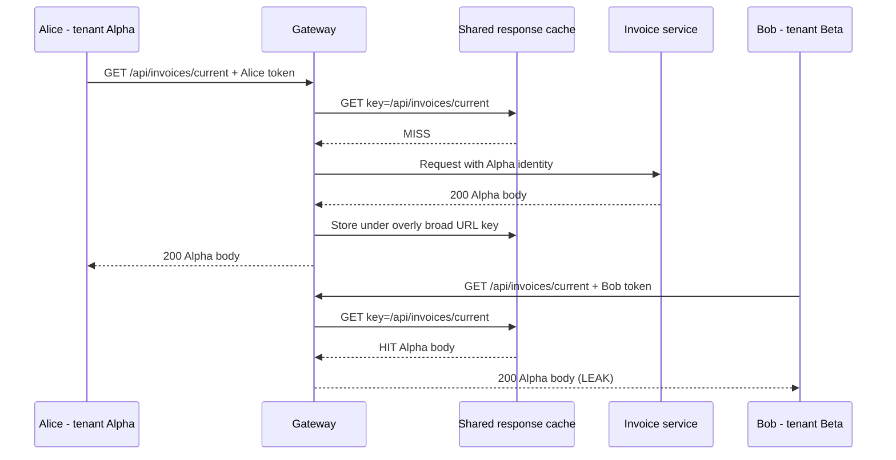
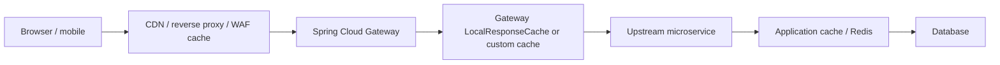
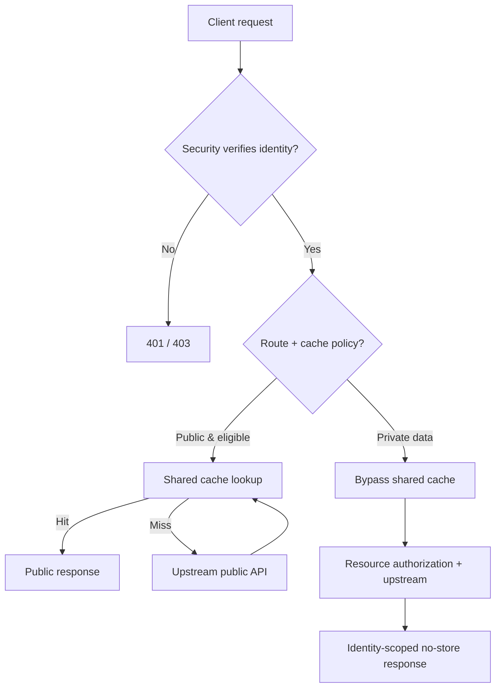
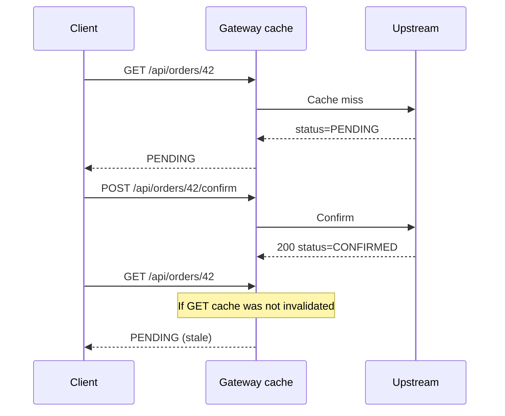
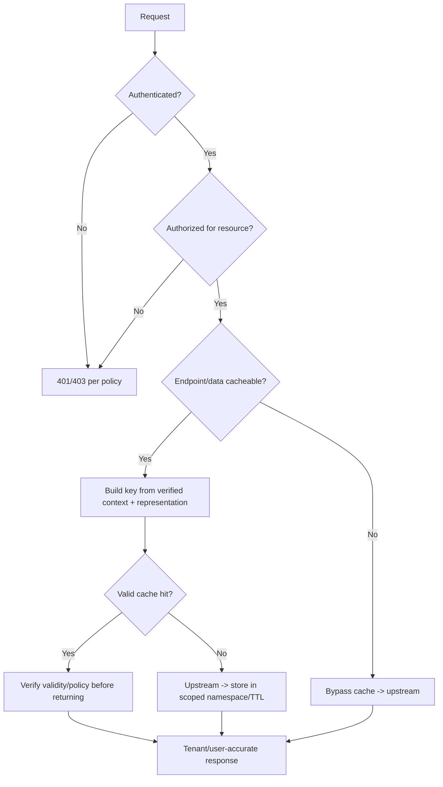

# Preventing Cross-User or Cross-Tenant Data Caching

**Response caching** helps Spring Cloud Gateway cut microservice calls and shorten response times for repeated requests. However, a cache is a **security boundary**, not just a performance tool: if the Gateway stores User A's response and serves it to User B, the system can leak personal profiles, orders, payment details, or another enterprise customer's data.

In multi-tenant systems, the same path `GET /api/orders` can return completely different order lists depending on **principal**, **tenant**, **role**, **permission scope**, and **data state**. A cache key built solely from the URL may work for a public product catalog, yet it is extremely dangerous for `/api/me` or `/api/tenants/current/invoices`. Mis-caching bugs rarely show up as HTTP `500`: clients still receive `200 OK` with schema-valid JSON, **belonging to someone else**.

This lesson in the **Response Caching** chapter focuses on preventing **per-user or per-customer/tenant** data leaks when operating **Spring Cloud Gateway Server WebFlux**. It integrates route predicates, filter chains, authentication/authorization, `LocalResponseCache`, HTTP caching headers, service discovery, circuit breakers, retries, TLS, and observability to design a secure Gateway.

> **Scope:** Examples use Spring Cloud Gateway **Server WebFlux**, reactive Spring Security, and HTTP caches. Certain `LocalResponseCache` properties/syntax vary across versions. This document distinguishes standard HTTP caching mechanics from custom application caching: **never assume an arbitrary Gateway filter automatically honors every rule of `Cache-Control`, `Vary`, access permissions, or tenant isolation**. Until caching is proven safe, **do not cache personalized responses** by default.

## 1. What Is a Cross-Data Caching Incident?

Suppose two employees belong to two enterprise customers (tenants):

- Alice belongs to `tenant-alpha` and is allowed to view Alpha's invoices.
- Bob belongs to `tenant-beta` and is only allowed to view Beta's invoices.
- Both call `GET https://api.example.test/api/invoices/current` through Gateway with different JWTs.

```text
Alice: GET /api/invoices/current
       Authorization: Bearer token-alice
       -> upstream returns {"tenant":"alpha","total":125000}

Gateway cache:
       key = "GET /api/invoices/current"
       value = {"tenant":"alpha","total":125000}

Bob:   GET /api/invoices/current
       Authorization: Bearer token-bob
       -> cache HIT, returns Alice's JSON

Bob sees Alpha's data even though Bob lacks permission.
```

Such a cache implementation is broken because **response variants depend on identity/tenant while the cache key fails to reflect that dependency**. If the cache serves a response before proper authorization runs, the risk is even worse.



**Crucial point:** Bob's JWT may pass Spring Security validation cleanly, yet the cache still leaks if **data partitioning** and **authorization ordering** are wrong. Valid authentication does not automatically make cached results properly authorized.

### Who Can Data Leak Between?

| Leak Scope | Example | Consequence |
| --- | --- | --- |
| **Between users** | User B receives User A's `/api/me` | Leaks identity, email, activity history |
| **Between tenants** | Company B receives Company A's private pricing or invoices | Leaks customer data and contracts |
| **Between roles** | Regular staff receives an admin representation | Exposes sensitive fields or admin capabilities |
| **Across sessions/tokens** | Old token was revoked, yet cached response keeps serving | Bypasses revocation or updated permissions |
| **Between languages/formats** | Different `Accept-Language` or `Accept` shares one cache entry | Serves wrong representation; can corrupt client state |
| **Between origins** | CORS response for Origin X is served to Y | CORS errors; under flawed design, leaks data |
| **Between environments/hosts** | Same path on two virtual hosts pointing to different tenants | Cross-contaminates data because host is missing from key |

Mis-caching in these scenarios is typically an **authorization vulnerability in the data-delivery tier**, not merely a performance tuning flaw.

## 2. Distinguish Every Cache Layer That May Exist

A response traveling from a microservice to a browser can be stored in multiple places:



| Layer | Who Typically Shares It? | Security Risks to Control |
| --- | --- | --- |
| Browser private cache | Typically one browser profile, yet has its own lifecycle/sharing behavior | Sensitive data saved on disk, logout cleanup, shared devices |
| CDN / edge / shared reverse proxy | Many users, regions, and origins | Cross-user/tenant leaks can happen **before reaching Gateway** |
| `LocalResponseCache` at Gateway | Many requests hitting **one Gateway instance** | Whether cache keys and eligibility match the response |
| Custom Gateway `GlobalFilter`/`GatewayFilter` | Depends on code and cache store | Easy to overlook `SecurityContext`, `Vary`, invalidation |
| Cache inside microservice | Depends on domain cache key | Wrong user/tenant JSON returned even when Gateway caches nothing |
| Database / query cache | Depends on connection/schema/tenant filters | Data-partitioning bugs in the repository layer |

**Gateway caching and application caching are distinct.** If Gateway caches nothing while the backend already returns wrong JSON from Redis, turning off `LocalResponseCache` does not fix the root cause. Conversely, a microservice returning accurate data can still be leaked by Gateway or a CDN after caching.

### An `lb://` Route Does Not Solve Cache Scope

`lb://invoice-service` helps Spring Cloud LoadBalancer pick a backend instance. It **does not ensure cache keys include principal/tenant**, nor turn private responses into public ones. Having many well-behaved backend instances never stops a shared Gateway cache from replaying someone else's response.

## 3. The Safest Rule: Never Put Personalized Responses in Shared Caches

Classify APIs before enabling caching:

| Endpoint Type | Examples | Starting Policy |
| --- | --- | --- |
| **Public, identical for everyone** | `GET /api/public/countries`, non-personalized public catalog | Can consider shared caching with proper TTL and `Vary` |
| **Public, varies by language** | `GET /api/public/articles/42` | Cache only if `Accept-Language`/representations are cleanly isolated |
| **Per-user** | `GET /api/me`, `GET /api/my/orders` | **Do not cache at shared Gateway/CDN** |
| **Per-tenant** | `GET /api/tenant/invoices`, custom contract pricing | **No shared caching** by default; consider partitioning only if truly necessary |
| **Role/permission-scoped** | `GET /api/admin/reports` | No shared cache without a provable key and authz model |
| **Sensitive data** | Tokens, PII, accounts, payment transactions | `Cache-Control: no-store` and bypass shared caches |
| **Writes/mutations** | `POST /payments`, `PATCH /users/42` | Never use GET response caching for writes; design invalidation |
| **Streaming/SSE or private file exports** | `GET /reports/export` | Avoid automatic caching; use dedicated policy for large/sensitive streams |

**Risk-based recommendation:** for `/api/me`, `/api/orders`, `/api/invoices`, `/api/payments`, and per-user/tenant sensitive data, **disable shared response caching** instead of trying to tack a few headers onto the cache key. Certain internal datasets may support tenant-partitioned caching when authorization, keys, and invalidation are all proven, but that is an advanced design with a wider failure surface.

## 4. HTTP Caching Headers: Understand Precisely Before Configuring

HTTP headers do not all mean the same thing:

| Response Header | Core Meaning | Impact on Private Data |
| --- | --- | --- |
| `Cache-Control: no-store` | Compliant caches must not store the response for reuse | Appropriate for sensitive data; still audit custom caches |
| `Cache-Control: private` | Response is for private caches only; shared caches must not store | Does not stop browser caching |
| `Cache-Control: no-cache` | **May be stored**, but must revalidate before reuse | **Not synonymous with `no-store`** |
| `Cache-Control: public` | Permits shared caches to store if eligible | Dangerous if response is personalized |
| `Cache-Control: max-age=60` | Freshness lifetime per HTTP rules | Does not define user/tenant variants |
| `Cache-Control: s-maxage=60` | Shared-cache freshness override, taking precedence over `max-age` in shared caches | Use only when strictly safe for shared caches |
| `ETag` | Validator for a specific representation | Does not replace identity/authorization |
| `Vary` | Lists request headers that alter the representation | Must be enforced by caches; does not create authz |
| `Set-Cookie` | May carry session state or private tokens | **Does not guarantee every cache skips storage** |

### `no-store` vs. `private`

For sensitive responses:

```http
HTTP/1.1 200 OK
Cache-Control: no-store
Content-Type: application/json

{"userId":"u-42","email":"private@example.test"}
```

`no-store` is the stronger directive preventing compliant caches from storing content for later reuse. For less sensitive per-user data, `private, max-age=...` may permit browser caching, though shared devices, logout cleanup, and permission changes must still be evaluated.

**`private` does not mean "encrypt the data."** It only specifies **which cache type may store it** in HTTP mechanics. Never use `private` in place of TLS, authentication, or authorization.

### `no-cache` Does Not Mean "Do Not Store"

```http
Cache-Control: no-cache
ETag: "representation-v1"
```

Caches may still store the representation, provided they revalidate before serving. This suits public data that always checks for updates. For highly sensitive personal/tenant data, **never use `no-cache` instead of `no-store`** just because the names sound similar.

### `public` Does Not Mean "Accessible Once Logged In"

An API requiring a JWT yet returning private data is never "public" simply because every logged-in user is allowed to call that endpoint. In HTTP caching, `public` encourages shared caches to store responses; it is a **representation-sharing** directive, not an authorization policy label.

## 5. `Authorization` and `Cookie` Headers: Common Traps

Under HTTP caching rules for compliant shared caches, responses to requests carrying `Authorization` face strict reuse limits unless explicit directives allow it (such as `public` or specific shared-cache directives). However:

- A **custom cache** in Gateway might not implement the full HTTP standard.
- A route relying on **session cookies** without an `Authorization` header still produces per-user responses.
- An external proxy in front of Gateway may be configured to ignore or mishandle `Cache-Control`.
- An upstream accidentally emitting `public` can cause a shared cache to store private data.

**Never rely solely on the presence of a Bearer token to protect data.** The safest policy is ensuring private routes **never attach shared caches**, return `Cache-Control: no-store`, and get tested across all tiers.

### Mistake: Putting Raw `Authorization` Into the Cache Key

An intuitive quick fix looks like:

```text
cacheKey = method + path + query + raw Authorization header
```

This creates serious problems:

1. Raw access tokens are credentials; storing them in keys can leak secrets into heap dumps, telemetry, dashboards, or logs.
2. Token rotation creates duplicate cache entries for the same user, complicating invalidation.
3. A single user with multiple scopes/tenant contexts still needs per-request authorization.
4. If a token has the wrong audience or expires, a cache hit must never bypass verification.
5. The key can still omit host, locale, representation headers, or other conditions.

**Never use raw tokens as cache identifiers.** If a design genuinely requires per-user caching, derive identifiers from a **verified `SecurityContext`**, with canonicalized principal/tenant/permission context, isolation, and short TTLs. Even then, **not caching** is usually safer for sensitive data.

## 6. Cache Keys Must Capture Every Response Variant

A safe cache key for cacheable data is more than a `URL path`. Depending on the API, keys may require:

```text
key = (
  route/policy version,
  effective scheme + host,
  normalized method + path + relevant query,
  negotiated representation (Accept, language, encoding, ...),
  verified tenant scope (if data is tenant-scoped),
  verified principal/authorization cohort (if user-scoped caching is allowed),
  data/permission version or invalidation namespace
)
```

This is a **design model**, not `LocalResponseCache`'s built-in key structure. When using a built-in Gateway filter, verify its actual key construction and header support for your version; **never assume it automatically reads `SecurityContext` or tenant IDs**.

| Key Component | When Needed | If Missing |
| --- | --- | --- |
| Scheme/host/route | Virtual hosts or multiple upstreams sharing paths | Mixes public domains, environments, or routes |
| Path and meaningful queries | `?category=x` differs from `?category=y` | Returns the wrong resource |
| HTTP method | Semantics differ across methods | Serves wrong representation |
| `Accept`/`Accept-Language`/encoding | Content negotiation changes output | Serves wrong language/format |
| Verified tenant ID | Per-company/customer data | Cross-tenant leak |
| Verified principal ID | Per-user data | Cross-user leak |
| Scope/role/policy version | Response varies by permissions | Leaks higher-privileged data |
| Data version/invalidation tag | Mutations invalidate responses | Serves overly stale data |
| Origin (if CORS/output truly varies) | Dynamic `Access-Control-Allow-Origin` headers | Caches wrong CORS policy |

**Even a complete key is insufficient if authorization is skipped on a cache hit.** Gateway/backend must verify the user still has access before returning a response, or the cache design must ensure **cache hits occur only after permission checks**. A cache key valid yesterday becomes wrong today once a user loses access, a tenant changes ownership, or a subscription expires.

### Never Trust Client-Supplied `X-Tenant-Id`

Dangerous example:

```http
GET /api/invoices/current HTTP/1.1
Authorization: Bearer <token-user-beta>
X-Tenant-Id: tenant-alpha
```

If the cache key uses client-sent `X-Tenant-Id` directly, Bob can supply another tenant's name to retrieve unauthorized data. That is **cache key poisoning** and a trust-boundary breach.

Trusted tenant identity must come from verified identity claims/permissions or a backend-verified tenant context. If users may switch tenants, check **membership/permissions for the target tenant**, never merely read a tenant ID string. Never treat client query params or headers as proof of tenant authorization.

## 7. How Per-User Caching Differs From Per-Tenant Caching

Two users inside the same tenant may **not share the same permissions**.

Suppose:

- Anna: `tenant-alpha`, role `FINANCE_ADMIN`.
- Minh: `tenant-alpha`, role `VIEWER`.
- Endpoint `GET /api/tenant/report` includes a `bankAccount` field for Finance Admins.

If the cache key includes only `tenant-alpha`, Minh can receive the representation generated for Anna. **Tenant isolation does not automatically provide user or role isolation.**

| API | Tenant-Only Cache Key? | Safe Approach |
| --- | --- | --- |
| Public country list | No tenant needed | Public key by URL/representation |
| Shared tenant UI config with zero personal data | Possibly, if contract guarantees identical output for all tenant members | Consider tenant-aware cache with authz + invalidation |
| Tenant report with role-specific fields | **Insufficient** | No shared cache, or partition by verified permissions |
| `/api/me` | **Wrong** | No shared cache |
| Tenant invoices with per-invoice access rules | **Insufficient** | Enforce resource authorization; prefer bypassing cache |
| User/plan-specific feature flags | **Insufficient** | Key by identity/cohort/policy + invalidation, or bypass |

**A response is strictly "tenant-scoped" only when the contract proves every authorized principal in that tenant receives the exact same representation.** If an API filters by user, team, field-level masking, subscription, or dynamic policies, partition further or exclude it from caching.

## 8. `Vary` Matters, Yet Never Replaces Authorization

`Vary` declares which request headers affect representation selection:

```http
HTTP/1.1 200 OK
Cache-Control: public, max-age=60
Vary: Accept-Language
Content-Type: application/json
```

A compliant shared cache can reuse a response for a new request only when matching conditions, including `Vary`, are met.

For CORS responses reflecting origins, you may see:

```http
Vary: Origin
Access-Control-Allow-Origin: https://app.example.test
```

If a CDN ignores `Origin` or strips `Vary`, it can serve CORS headers meant for a different frontend origin. That is a cache-variant bug causing CORS failures—or, combined with permissive credentials policies, creating security flaws.

### Why `Vary: Authorization` Is Not a "Standard Fix" for Private Data

Some propose:

```http
Cache-Control: public, max-age=300
Vary: Authorization
```

This is **not** recommended practice for personalized APIs, because:

- It still places private data inside a **shared cache**, expanding the leak surface and storing credential-linked entries.
- Custom cache implementations may **fail to enforce `Vary` properly**.
- `Authorization` changes across token refreshes, creating hard-to-revoke entries.
- It fails to handle permission revocation or cookie-based browser sessions.
- If the backend emits `public` improperly, external caches may reuse entries unexpectedly.

For `/api/me`, tenant invoices, and account data: **bypass shared caches and emit `Cache-Control: no-store`**. If personalized caching is a hard requirement, build a dedicated key/authorization/invalidation mechanism and conduct a security review.

## 9. Spring Cloud Gateway's `LocalResponseCache`: Scope It Properly

Spring Cloud Gateway Server WebFlux provides the **`LocalResponseCache` GatewayFilter Factory** in supported versions. It uses a **local in-process Gateway cache** to optimize eligible responses per framework configuration.

Lab example for a **genuinely public product catalog**:

```yaml
spring:
  cloud:
    gateway:
      routes:
        - id: public-catalog
          uri: lb://catalog-service
          predicates:
            - Path=/api/public/catalog/**
            - Method=GET
          filters:
            - StripPrefix=1
            - LocalResponseCache=30s,20MB

        - id: my-profile
          uri: lb://identity-service
          predicates:
            - Path=/api/me/**
          filters:
            - StripPrefix=1
            - SetResponseHeader=Cache-Control,no-store
```

In this example:

1. `public-catalog` is a read route **proven identical for all callers**.
2. `LocalResponseCache=30s,20MB` illustrates shortcut syntax in supported versions for TTL and cache size limit. Verify exact factory names, dependencies, eligibility rules, and version-specific property prefixes (`spring.cloud.gateway.server.webflux.*` in newer releases).
3. `my-profile` **omits `LocalResponseCache`** and enforces `Cache-Control: no-store` on responses per policy.
4. `SetResponseHeader` replaces the header at the route filter instead of appending conflicting `Cache-Control` values; upstream must also be configured properly.
5. Spring Security still checks permissions for `/api/me/**` and all protected routes.

**This is not a complete production configuration.** Depending on Gateway version, `LocalResponseCache` may require cache dependencies and explicit feature flags; eligibility generally depends on method, body, status, and HTTP caching headers. Always verify against your **exact version**.

### Avoid Uncontrolled Global Caching

Some Gateway versions support a global cache filter or global properties enabling local response caching across many routes. If global settings or `default-filters` fail to separate public from private APIs, a `/api/me` route can accidentally fall under the same policy.

**Never assume `LocalResponseCache` automatically understands tenants or principals.** Before caching user-dependent responses, verify exact key eligibility, `Vary` handling, filter ordering, and CORS/Security interactions in your running version. When unproven, never enable it for private data.

### Local Caches Across Multiple Gateway Replicas

`LocalResponseCache` is **local** memory: Gateway replicas A and B can hold different entries with different expiration times. Stale responses lingering on only one replica can cause intermittent "sometimes right, sometimes wrong" bugs, especially behind an ingress load balancer.

Do not assume updating data in `catalog-service` **immediately** clears cached local responses across all Gateway replicas. Use appropriate TTLs, invalidation/refresh policies, or versioned URLs; never conflate response caches with service discovery caches.

## 10. Authn/Authz Must Form a Boundary Before Cache Reads

In Gateway WebFlux, Spring Security typically runs in the **`WebFilter` chain** before Gateway route mapping/filter chains. This rejects missing/invalid tokens before route filters execute, yet **is insufficient** if cached data is mis-partitioned.



This diagram expresses **desired policy**, not a promise that every `CacheFilter` automatically behaves this way. For custom filters, developers must implement authorization and caching checkpoints correctly.

### Authentication Differs From Authorization

- **Authentication:** "Does this request belong to Alice?"
- **Authorization:** "Is Alice permitted to view invoice X in tenant Alpha?"
- **Cache eligibility:** "Is this response safe to reuse for another request?"

These three questions are distinct. A cache hit may have been populated when a user had access, yet that user's access was later revoked. With authentication alone and a stale cache key, the response can still leak.

**Critical rule:** for resource-authorized data, never let a cache hit **short-circuit authorization**. Check permissions on every access, or use a dedicated cache design with verified permission context and invalidation.

### Proxies/CDNs in Front of Gateway Are Especially Risky

A CDN can serve a cache hit **without the request ever reaching Spring Security**. Gateway protections cannot stop a misconfigured shared edge cache from storing a private response.

For authenticated APIs, configure the CDN/ingress to **bypass caching** via reliable routes/policies while emitting `no-store` on sensitive responses. Always test through the outermost public endpoint, not only Gateway's internal port.

## 11. Never Cache `Set-Cookie` or Private Responses Just Because the URL Matches

A response can carry:

```http
HTTP/1.1 200 OK
Set-Cookie: SESSION=...
Content-Type: application/json

{"welcome":"Alice"}
```

If a shared cache stores response headers too, replaying `Set-Cookie` or private payloads is catastrophic. Compliant HTTP caches have rules for handling such responses, yet **seeing `Set-Cookie` alone does not prove every implementation bypasses caching automatically**.

Defensive rules:

1. Exclude login, callback, logout, refresh/session, and `/api/me` routes from shared response caches.
2. Emit `Cache-Control: no-store` on sensitive responses.
3. Never store `Set-Cookie` inside shared cache entries.
4. Assert **response headers**, not just JSON bodies, in tests.
5. In custom cache code, guard against header injection, redirects, `Vary` mismatches, and buffer commit bugs.

For auth errors (`401`/`403`), rate-limit errors (`429`), and circuit-breaker/fallback responses (`503`), verify whether they pass through caching. **Never accidentally cache error payloads containing PII or tokens**, and never serve cached `200` responses to bypass expired authentication.

## 12. Status Codes, ETags, and Conditional Requests Do Not Provide Tenant Isolation

HTTP caches can use validators:

```http
GET /api/public/catalog/items/42 HTTP/1.1
If-None-Match: "item-42-v3"
```

Upstream can return `304 Not Modified` when the representation is unchanged. The cache then serves its **previously stored valid representation**.

For private data, this is an easy place to trip:

- `304` normally carries no body; the actual payload comes from cache.
- If the initial cache key mixed users, `304` can cause the cache to serve **another user's body**.
- If `ETag` ignores resource/representation scope or the cache ignores `Vary`, revalidation cannot fix the leak.
- Users whose access was revoked must still fail authorization rather than seeing records simply because an ETag remains valid.

**ETag validates a representation, not access permissions.** Never treat `If-None-Match` as an auth token, and never let `304` skip policy checks.

### HTTP Status Codes Also Have Distinct Caching Rules

Certain statuses are cacheable under HTTP rules in specific conditions; others require explicit directives. Never write filter rules saying "only 200 is safe" or "all 2xx are cacheable": **safety depends on data, permissions, headers, and status semantics**.

For example, `200 OK` containing `{"email":"alice@..."}` is still private; `301 Moved Permanently` can encode host/routing policy; `404` can vary by permissions (avoiding resource existence leaks). Whitelist public endpoints and verify your framework's actual eligibility rules.

## 13. Permission Lifecycles and Invalidation

Even when a cache key includes user and tenant, access permissions can still change.

Timeline example:

```text
10:00 Alice has permission to read /api/tenant-alpha/report/42.
10:01 Gateway caches the report/42 response for Alice.
10:03 Admin revokes Alice's access.
10:04 Alice sends the request again.
10:04 Cache returns report/42 under the old key if permissions aren't rechecked.
```

This is **stale authorization**, not a key collision between two users. Even a properly partitioned cache key violates security policy when **permissions change**.

Strategies:

| Mechanism | Benefit | Limitation |
| --- | --- | --- |
| Bypass cache for data needing instant authz | Simple, clear ownership | Extra upstream calls |
| Very short TTL | Shrinks stale window | Does not guarantee instant revocation |
| Invalidate by user/tenant/resource | Proactively drops entries on permission/data changes | Complex across multiple Gateway replicas/edge |
| Permission version/epoch in key | Separates entries before/after permission change | Needs a reliable, timely version source |
| Re-authorize before serving cache hit | Enforces current permissions | Cuts into performance gains; races still need care |
| Cache only public data, skip private bodies | Shrinks leak surface | Requires refactoring endpoints mixing public/private fields |

**TTL is not an authorization control.** Setting a 5-second TTL only bounds expected staleness at certain layers; it never replaces authentication/authorization.

## 14. Mutations: Keeping Caches Consistent When Data Changes

A public catalog cached for 30 seconds can tolerate brief staleness. However, for **credit limits, contract inventory, customer-specific pricing, or payment status**, stale responses cause bad business decisions.



Even without cross-user leaks, stale responses can break API contracts. When a design genuinely requires caching mutable data:

1. Map which mutations affect which cache keys.
2. Design invalidation across multi-replica deployments (Gateway, CDN, microservice).
3. Bound TTL/`stale-while-revalidate` where allowed; never use them for data requiring immediate consistency.
4. Never blindly retry non-idempotent writes, as retries plus stale caches obscure real state.
5. Keep versions/ETags accurate to representations and policies; **never use ETag to skip authorization**.

For sensitive account/customer data, **bypassing response caches** dramatically reduces both consistency and security complexity.

## 15. CORS, Language, and Content Negotiation Also Affect Cache Correctness

### CORS

Frontends `https://app-a.example.test` and `https://app-b.example.test` may both call public APIs through Gateway. If CORS responses reflect `Origin`, enforce `Vary: Origin` and prevent CDNs from caching wrong headers. For credentialed requests, `Access-Control-Allow-Origin: *` is invalid per CORS rules.

CORS **is not authorization**. Browsers blocking cross-origin reads is a client-side protection, whereas mobile clients or `curl` ignore it. A cache leak can never be "fixed" by CORS headers alone.

### Language and Format

`Accept-Language: vi` may receive Vietnamese content while `Accept-Language: en` receives English. `Accept: application/json` differs in representation from `Accept: application/problem+json`. If caching keys only on URL, clients receive wrong formats or languages.

Apply `Vary` appropriately per header, but avoid blindly listing an overly broad `Vary` set that fragments the cache unnecessarily. Only cache endpoints with clear representation contracts.

### Query / Host

An API query `?currency=VND` differs from `?currency=USD`. Hostnames may distinguish environments or customers. Caches must preserve meaningful query and host semantics; **never strip query parameters** assuming "they don't matter." Canonicalize queries strictly per contract and test for collisions.

## 16. An Auditable Routing Strategy in Gateway

To minimize risk, separate APIs into **cacheable public routes** and **non-cached private routes**. Conceptual layout:

```text
/api/public/catalog/**    -> route public-catalog -> LocalResponseCache with short TTL
/api/me/**                -> route my-profile    -> no cache + no-store
/api/orders/**            -> route orders        -> no shared cache
/api/tenant/reports/**    -> route tenant-report -> no shared cache
/api/admin/**             -> route admin         -> no shared cache
```

Define explicit route predicates and audit route overlaps/order. A catch-all `Path=/api/**` route can accidentally capture requests meant for a private route, especially when combined with `default-filters` or global filters.

### Never Put `LocalResponseCache` in `default-filters` for All APIs

Policy **anti-pattern**:

```yaml
# NOT recommended if /api/** includes private data.
spring:
  cloud:
    gateway:
      default-filters:
        - LocalResponseCache=5m,100MB
```

A `default-filter` can apply to far more routes than intended. If the cache implementation stores eligible responses from private data, the exposure spans the entire Gateway.

**Instead:** attach caching explicitly to audited public routes, write tests verifying private routes bypass caching, and mirror those rules at the CDN/Ingress tier.

### What If Upstream Emits the Wrong `Cache-Control`?

If a backend accidentally returns:

```http
HTTP/1.1 200 OK
Cache-Control: public, max-age=3600

{"accountId":"a-42","balance":123456}
```

Gateway must never treat `public` as proof an endpoint is safe to share. **Cache eligibility must be constrained first by route allowlists and data classification**, and only then by caching headers and library rules.

On private routes, upstream should emit `no-store` at the source; Gateway can enforce the header as defense-in-depth, yet **rewriting a response header does not guarantee an earlier cache filter didn't already store the payload**. To truly prevent storage, disable/bypass caching at the storage point and verify filter ordering.

## 17. Custom Cache Filters: Mandatory Prerequisites Before Implementation

If system requirements genuinely force caching a tenant-scoped response, never write:

```java
// WRONG PSEUDOCODE: path-only key while data is tenant-scoped.
String key = exchange.getRequest().getURI().getPath();
return cache.getOrLoad(key, () -> callUpstream(exchange));
```

That snippet is an **anti-pattern**, not real Spring Cloud Gateway Java API code. It omits principal, tenant, authorization, representation, TTL, and invalidation.

An **acceptable** design must satisfy at least:

- **Eligibility:** only endpoints with an explicit caching policy enter the cache.
- **Identity:** derive principal/tenant from verified auth context, never arbitrary client headers.
- **Authorization:** before **every cache hit**, verify current permission for the target resource/representation.
- **Key:** reflect tenant + user/role/scope if output depends on them, plus scheme/host/path/query/`Vary`/data version.
- **Value:** never store `Set-Cookie`, tokens, private headers, or out-of-scope user fields.
- **TTL and invalidation:** handle permission changes, logout, tenant membership changes, mutations, and config/route updates.
- **Concurrency:** prevent two different users from racing on key reads/writes; share zero mutable identity state.
- **Body lifecycle:** if handling `DataBuffer`s, manage retain/release, size bounds, and cleanup on errors/cancellations.
- **Observability:** tag metrics with anonymized/low-cardinality tenant cohorts, never secrets.
- **Tests:** prove zero cross-user/tenant leakage across cache hits, retries, failovers, revoked permissions, and multiple Gateway replicas.



**Warning:** this diagram is a **design specification**. Never treat a simple `GlobalFilter` as sufficient for resource authorization when only upstream knows fine-grained permissions. When authz depends on backend data, the safest option is often **skipping Gateway response caching**.

## 18. Practical Testing: Two Users, Two Tenants, One URL

### Prepare Fixtures

Obtain two test JWTs from your security test infrastructure or trusted test Authorization Server:

- `token-alpha`: `sub=alice`, `tenant=alpha`, authorized for Alpha resources.
- `token-beta`: `sub=bob`, `tenant=beta`, unauthorized for Alpha data.

A mock upstream inspects test identity/tokens and returns matching bodies:

```json
{"tenant":"alpha","user":"alice","orders":["A-001"]}
```

```json
{"tenant":"beta","user":"bob","orders":["B-001"]}
```

Because the endpoint serves private data, Gateway policy must **bypass shared response caching** even though the request URL is identical.

### Reproducing With `curl`

```bash
# TOKEN_ALPHA and TOKEN_BETA are TEST tokens loaded securely.
# Never print them to logs or share shell history.
curl -sS -D - -o /dev/null \
  -H "Authorization: Bearer $TOKEN_ALPHA" \
  http://localhost:8080/api/orders

curl -sS -D - -o /dev/null \
  -H "Authorization: Bearer $TOKEN_BETA" \
  http://localhost:8080/api/orders
```

`-o /dev/null` prints response headers only; to verify JSON bodies in your **test environment**, write to isolated output files or use an assertion tool without logging real customer data. Requests with fake/expired tokens must return `401` per security policy and **never receive a cached 200**.

**Checking that both requests return `200` is insufficient.** Verify Alice always receives Alpha, Bob always receives Beta, the backend is called as required, and nothing is improperly reused from cache.

### Test Sequence to Catch Cross-Data Caching Bugs

```text
1. Alice calls URL X -> receives Alpha body.
2. Bob calls the same URL X -> must receive Beta body.
3. Alice calls URL X again -> still Alpha.
4. Anonymous user calls X -> 401 (or matching policy), receives neither Alpha nor Beta.
5. Alice switches to another permitted tenant -> representation reflects new tenant.
6. Revoke Alice's permission -> no longer receives previously cached response.
7. Change Bob's role -> must not receive representation from old/higher role.
8. Repeat across Accept-Language, queries, Origin, and another Gateway replica.
9. Induce upstream 503 -> must not serve old private response as public fallback.
```

A URL-only cache key usually fails at step 2, whereas a **stale authorization** bug may surface only at step 6 or 7. Always test permission changes too, not just multiple users.

## 19. Integration Testing With `WebTestClient`

With reactive Spring Security and Gateway WebFlux, use `WebTestClient` in integration tests. The snippet below illustrates **asserting responses are never mixed**; your test fixture must configure mock JWTs, upstreams, and specific routes:

```java
@Test
void privateOrdersAreNotSharedAcrossPrincipals() {
    webTestClient.get()
        .uri("/api/orders")
        .headers(headers -> headers.setBearerAuth(tokenAlice))
        .exchange()
        .expectStatus().isOk()
        .expectHeader().valueEquals(HttpHeaders.CACHE_CONTROL, "no-store")
        .expectBody()
        .jsonPath("$.tenant").isEqualTo("alpha")
        .jsonPath("$.user").isEqualTo("alice");

    webTestClient.get()
        .uri("/api/orders")
        .headers(headers -> headers.setBearerAuth(tokenBob))
        .exchange()
        .expectStatus().isOk()
        .expectHeader().valueEquals(HttpHeaders.CACHE_CONTROL, "no-store")
        .expectBody()
        .jsonPath("$.tenant").isEqualTo("beta")
        .jsonPath("$.user").isEqualTo("bob");
}
```

**Note:** this is a test fragment, not a standalone runnable class. `tokenAlice` and `tokenBob` must be **valid tokens in your test SecurityContext/AS fixture**, `WebTestClient` must target Gateway, the mock upstream must respond by identity, and error mappings must match. If your real upstream does not receive tokens directly, mirror the relay/exchange model in tests.

### Test Proving Cache Hits Never Bypass Security

```java
@Test
void anonymousCannotReceivePreviouslyCachedPrivateResponse() {
    // Call with Alice's token first to ensure the data path is exercised.
    webTestClient.get()
        .uri("/api/me")
        .headers(h -> h.setBearerAuth(tokenAlice))
        .exchange()
        .expectStatus().isOk();

    // Anonymous request must never receive Alice's cached 200 hit.
    webTestClient.get()
        .uri("/api/me")
        .exchange()
        .expectStatus().isUnauthorized();
}
```

This test **does not prove complete security** if fixtures bypass routing or skip body assertions; combine it with multi-user, tenant-context, permission-change, role-specific field, and backend call-count tests.

### Verifying True Cache Hits on Public Routes

To prove public caching works:

1. Mock upstream `GET /public/catalog/items/42` returns the exact same representation for every principal or anonymous caller, with valid caching headers.
2. Send the first request through Gateway; assert upstream call count = 1.
3. Resend the exact URL/representation within TTL; assert upstream call count remains = 1 when supported by your `LocalResponseCache` version/config and eligibility rules.
4. Send a request with a different `Accept-Language`; if representation changes, assert the wrong variant is never returned.
5. After TTL/invalidation takes effect, assert updated data is served per contract.

**Testing public hits and private bypasses are two separate requirements**: disabling all caches makes data safe yet sacrifices public catalog optimization; conversely, testing only public hits proves nothing about privacy.

## 20. Cache Security Test Matrix

| Test | Input / Scenario | What Must Be Proven |
| --- | --- | --- |
| T1 | Two users both GET `/api/me` | Neither user ever sees the other's data |
| T2 | Two tenants both GET the exact same URL | Zero cross-tenant response reuse |
| T3 | Two roles within the same tenant | Higher-role fields never leak |
| T4 | Anonymous call after authenticated call | Never receives cached authenticated response |
| T5 | Expired/revoked token | Cache hits never bypass current authn/authz |
| T6 | User loses resource permission | Never keeps reading resource from old cache |
| T7 | Valid tenant switch | Keys/policies switch to the new tenant context |
| T8 | Client modifies `X-Tenant-Id` | Unverified header never fetches another tenant's cache |
| T9 | Queries `?customer=A` vs. `B` | Two resource variants are never merged |
| T10 | Two virtual hosts with same path | Hostnames and route scopes never cross |
| T11 | Different `Accept-Language` | Right locale served if shared cache is used |
| T12 | Different CORS `Origin` | `Vary`/cache policy never repeats wrong Allow-Origin |
| T13 | Response includes `Set-Cookie` | Never caches/forwards another user's cookie |
| T14 | Private response `Cache-Control: no-store` | Never stored by Gateway/edge per policy |
| T15 | Upstream accidentally emits `public` on private API | Gateway/edge still bypasses by route |
| T16 | `ETag` and `If-None-Match` | `304` never resurrects another user's body |
| T17 | Mutations POST/PATCH/DELETE | Never returns stale data violating contract |
| T18 | CircuitBreaker fallback / Retry | Never hides auth/upstream errors behind cached private 200s |
| T19 | Two Gateway replicas | Neither leaks, even with diverging cache states |
| T20 | CDN/ingress in front of Gateway | Final public responses carry accurate `Cache-Control`/`Vary` and private routes bypass |
| T21 | Client cancellation / stream error | Never stores partial bodies or leaks pooled buffers |
| T22 | High concurrent load | Zero key races across principal/tenant contexts |

For security, observing "no leak" on a single request is never enough. Run **interleaved sequences A→B→A→anonymous**, concurrency tests, token expirations, permission mutations, and rolling deployments across multiple replicas.

## 21. Observing Caches Without Leaking Data

Useful metrics:

| Category | Question Answered |
| --- | --- |
| Cache hits/misses by route | Is caching active on permitted routes? |
| Bypass reason | Did a private route bypass by policy or fail eligibility? |
| TTL/entry count/eviction | Is the cache holding data too long or burning memory? |
| Upstream call count | Do public cache hits genuinely cut backend traffic? |
| HTTP status | Are success/error responses being cached unintentionally? |
| Authn/authz decisions | Are requests authorized before receiving responses? |
| Gateway replica ID | Which replica holds stale entries or drifted config? |
| CDN cache status | Was the response served at the edge before Gateway? |
| Mutation/invalidation events | Do data/permission changes evict related entries? |
| Incident correlation ID | Ties frontend, Gateway, backend, and cache events together |

**Never place raw access tokens, cookies, emails, invoice IDs, sensitive queries, or full PII-bearing cache keys into metric labels.** To detect tenant mix-ups, use synthetic test data, bounded/anonymized internal IDs, and access-controlled logs. A debug header like `X-Cache-Hit` can help in tests, yet does not verify user/tenant correctness.

### Distinguishing a Cache Hit From an Upstream Response

An `Age` header or CDN debug header may hint that content was cached, though header semantics depend on cache configuration. Never assume every Gateway local cache injects a fixed header name automatically. Verify via **upstream call counts**, traces/spans, and metrics from your active cache implementation.

When encountering "only one Gateway replica returns wrong data," inspect **local cache instances, route config, rollout versions, and feature flags**. When all replicas serve the same wrong resource, inspect CDNs or upstream business caches before tweaking Gateway TTLs.

## 22. Runbook When Suspecting a Cross-User/Tenant Cache Leak

This is a **data security incident**; containment takes priority over performance tuning.

1. **Scope** affected endpoints, timeframe, potentially exposed tenants/users, involved cache tiers, and indicators of wrong responses.
2. **Stop the bleeding:** disable/bypass caching on suspected routes and at the edge if needed; keep security checks active. Never just drop TTL from 10 minutes to 1 minute and call it fixed.
3. **Preserve evidence:** capture access-controlled logs/traces with secrets redacted; never paste customer data into public channels.
4. **Pinpoint the leaking tier:** call upstream directly with test identities, then Gateway directly, then via CDN/Ingress. Compare bodies, headers, and call counts.
5. **Audit cache eligibility:** did a private endpoint slip into `LocalResponseCache`, a `default-filter`, a global filter, or a CDN rule?
6. **Audit cache keys:** missing user/tenant/role/host/query/`Vary`, trusting unverified tenant headers, or keying on raw tokens?
7. **Audit authorization:** did cache hits bypass authz, were permissions revoked, or is permission version/TTL stale?
8. **Audit headers:** `Cache-Control`, `Vary`, `Set-Cookie`, `ETag`, and error/fallback responses.
9. **Invalidate/purge across every tier:** clear affected entries in each cache layer using controlled procedures. Restarting one Gateway replica does not clear CDNs or sibling replicas.
10. **Deploy fix and verify:** run the full multi-user/tenant, revoked-access, role-change, public-cache, and concurrency test matrix.
11. **Assess impact:** determine which requests/users/tenants may have received wrong data; follow organizational incident/security/privacy procedures.
12. **Monitor for recurrence:** cache hit ratios, response mismatch assertions in tests/canaries, error rates, config drift, and audit trails.

### Quick Diagnostic Table

| Symptom | What to Investigate First |
| --- | --- |
| User B gets A's body at the same URL | Cache key lacks identity, or shared cache serves private responses |
| User sees another tenant's data | Untrusted tenant context, missing authz, or key lacks tenant |
| Breaks only after login/logout | Session cookies, cached private responses, stale token/session state |
| Breaks only after role change | Authorization version and permission-based invalidation |
| Fails via CDN, works directly on Gateway | Edge cache key, cache policy, `Vary`, route bypass rules |
| Fails on only one replica | Local `LocalResponseCache`, config drift, stale entries |
| Old state persists after POST | Invalidation/TTL and consistency |
| Browser reports CORS failure on cache hit | `Vary: Origin` and cached Allow-Origin mismatch |
| Upstream always right, Gateway intermittently wrong | Gateway cache/filter order or proxy response caching |
| `401` turns into cached `200` | Caching runs before Security or authz bypassed |
| `304` causes wrong body display | Broken validator/representation key or wrong cached variant |
| Backend `503` yet Gateway serves old private 200 | Fallback/cache policy masking current errors and permissions |

## 23. Practice Exercise: Designing Safe Caching for a Multi-Tenant SaaS

A SaaS platform exposes three APIs:

- `GET /api/public/countries`: country list, identical for all customers, updated monthly.
- `GET /api/tenant/pricing`: enterprise-specific price sheet; within the same company, different roles see different fields.
- `GET /api/me`: user's name, email, subscription, and private settings.

Gateway runs three replicas behind an Ingress/CDN and proxies to microservices via `lb://`. Spring Security verifies JWTs, while tenants can be chosen from URL/headers after verifying tenant membership.

### Proposed Design

**Endpoint `/api/public/countries`:** Suitable for controlled per-route shared caching with an appropriate TTL and representation-accurate `Cache-Control`/`Vary`. Tests prove every user gets identical data and backend call counts drop on cache hits.

**Endpoint `/api/tenant/pricing`:** **Do not enable simple tenant-ID shared caching**, because representations also depend on roles and may contain sensitive contract pricing. Bypass Gateway/CDN response caching and emit `no-store`, or consider tenant/role-aware caching only after full authorization and invalidation reviews.

**Endpoint `/api/me`:** Never cache responses at Gateway/CDN. Emit `Cache-Control: no-store`, verify JWT/session on every request, and ensure cached responses never bypass logout or permission changes.

**Ingress/CDN tier:** Cache only allowlisted public routes. Never treat upstream `public` or `max-age` headers as permission to cache private data automatically; enforce bypass rules for authenticated/personalized APIs and test from the public domain.

### Self-Check Questions

1. Why does sharing the URL `GET /api/me` not mean responses are identical for everyone?
2. Is a verified JWT enough to return a cache hit without checking resource permissions?
3. How do `Cache-Control: private` and `Cache-Control: no-store` differ?
4. Why does `no-cache` not mean "do not store"?
5. Why is adding `Vary: Authorization` alone not a safe default for personalized APIs?
6. If two users belong to the same tenant with different roles, is a tenant-ID-only cache key enough?
7. When a user loses permissions, why can an otherwise well-partitioned cache key still cause stale authorization?
8. Why should client-supplied `X-Tenant-Id` never be trusted as the sole source for cache keys?
9. How does per-instance `LocalResponseCache` differ from a shared CDN cache?
10. What happens if a CDN serves a cache hit before the request reaches Gateway Spring Security?
11. Why must responses containing `Set-Cookie` be treated as a severe caching risk?
12. Can `ETag`/`304` replace authorization?
13. When a POST mutates data, how must related GET response caches be handled?
14. When does `Vary: Origin` become critical in CORS responses?
15. What bug does an A→B→anonymous test catch that repeating calls for a single user misses?
16. When one Gateway replica serves wrong data while another serves right data, which cache layers should you check?
17. If upstream mistakenly returns `Cache-Control: public` on account info, what should Gateway do?
18. Why is response `Cache-Control` alone insufficient if a custom cache stored the payload before header rewriting?
19. Which metrics show public caching genuinely cuts upstream calls while private routes bypass caching?
20. When suspecting a customer data leak, what containment actions must happen before re-tuning TTLs?

**Key takeaway:** **A proper cache key is more than a URL; cache eligibility and authorization matter even more.** For responses depending on user, tenant, role, or login session, the safest approach in Spring Cloud Gateway is **skipping shared response caching** and emitting `Cache-Control: no-store`. Cache only genuinely public data, or build partitioned caching keyed on verified security context with full invalidation and security tests. Audit every tier from CDN/Ingress through Gateway to microservices; a fast cache hit returning someone else's data is worse than any performance loss.
