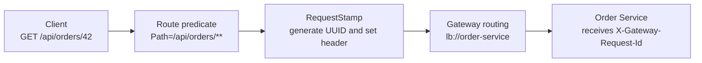

# Creating a GatewayFilterFactory with AbstractGatewayFilterFactory

## Lesson Objectives

In the **Custom Filters** chapter, this lesson guides you through creating a **custom GatewayFilterFactory** by extending `AbstractGatewayFilterFactory` in **Spring Cloud Gateway Server WebFlux**. When built-in factories such as `AddRequestHeader`, `SetRequestHeader`, `RewritePath`, `RequestRateLimiter`, or `CircuitBreaker` do not satisfy a specific technical rule, you can package that rule into a filter with a name, parameters, and route-level scope.

After this lesson, you will be able to:

- Distinguish between `GatewayFilter`, `GatewayFilterFactory`, `GlobalFilter`, and `AbstractGatewayFilterFactory`.
- Create a Java class with the `GatewayFilterFactory` suffix, a `super(Config.class)` constructor, and the `apply(Config)` method.
- Declare `Config` with JavaBean getters/setters; map parameters from YAML in **named arguments** and **shortcut** forms via `shortcutFieldOrder()`.
- Safely modify requests using `ServerHttpRequest.mutate()` and `ServerWebExchange.mutate()`, continuing the chain with `chain.filter(exchange)`.
- Understand the **pre/post** lifecycle, reactive publishers, filter ordering, response commit, and how to handle errors / return early responses.
- Know how to protect internal headers, avoid trusting client-spoofed headers, and avoid blocking the Reactor Netty event-loop.
- Write unit tests with `MockServerWebExchange`/`StepVerifier` and integration tests with real routes.
- Decide when a custom filter is needed and when to use a factory provided out of the box by Spring Cloud Gateway.

> **Scope:** Examples use Spring Cloud Gateway **Server WebFlux**, Spring Boot, Java 17+, and Project Reactor. Do not treat servlet `HttpSecurity`, the Servlet API `Filter`, or Server MVC as equivalent APIs. Starter names and YAML prefixes may vary across Spring Cloud Gateway release trains; verify the running dependency version. This lesson focuses on **building a filter factory**, not the STEP 6 proficiency checkpoint.

## 1. What Problem Does GatewayFilterFactory Solve?

Suppose an API Gateway serves:

```text
GET /api/orders/42
    ↓
Spring Cloud Gateway
    ↓
Order Service
```

The operations team wants the Gateway to generate **a new Gateway-controlled request ID** and attach it to the request sent upstream to make log correlation easier across microservices. Requirements:

1. The request ID must not be trusted directly from external clients.
2. Each inbound request matching the configured route receives a new UUID.
3. The header name is configured at the **route**, not hard-coded into every service.
4. Do not modify the body, do not block the request, and do not depend on blocking I/O.
5. The same factory can be used across multiple routes with different configurations.

A custom filter named `RequestStamp` is suitable for illustration:



However, **not every header-attachment need requires custom code**. If you only need to attach a static value or copy a simple variable, evaluate the built-in filters:

```yaml
filters:
  - AddRequestHeader=X-Training-Example,gateway
  - SetRequestHeader=X-Api-Version,v1
```

A custom `GatewayFilterFactory` is worth considering when there is **conditional logic, value generation, data validation, state isolation, or coordination with another component** that cannot be expressed clearly with built-in factories. Do not rewrite `Retry`, `CircuitBreaker`, security, or rate limiters just to have another class.

### 1.1. Factory vs. Filter Instance

A factory is like a **blueprint**. When reading a route, Gateway uses the factory and `Config` to create **an executable GatewayFilter**:

```text
RequestStampGatewayFilterFactory (Spring bean)
                │
                ├── apply(Config route A)
                │       └── GatewayFilter A
                │
                └── apply(Config route B)
                        └── GatewayFilter B
```

Each request goes through the filter corresponding to the matched route. **Factory beans are usually singletons**; never store per-request changing variables (request body, tenant ID, token, in-flight UUID) as mutable fields on the factory bean.

## 2. Four Concepts to Distinguish

| Component | Purpose | Scope |
| --- | --- | --- |
| **`GatewayFilter`** | Interface for a request/response processing step in the gateway chain | An executable filter, typically attached to a route |
| **`GatewayFilterFactory<Config>`** | Creates a `GatewayFilter` from configuration | Mechanism for declaring a filter by name in a route |
| **`AbstractGatewayFilterFactory<Config>`** | Base class that helps build a factory and bind configuration | The class you extend to define a custom factory |
| **`GlobalFilter`** | Filter applied to requests processed through the gateway filtering chain without per-route declaration | Gateway-wide within the scope of routing through the Gateway |

A route can use both **GlobalFilters** and **GatewayFilters**. In Spring Cloud Gateway Server WebFlux, `FilteringWebHandler` combines them into a chain sorted by order. Filter order determines the processing order before calling the backend and the order of post-response operations.

**Spring Security WebFlux uses `WebFilter`/`SecurityWebFilterChain` in a separate processing layer.** Do not confuse Gateway's `GlobalFilter` with a security web filter that protects every request arriving at the server. For example, actuators or handlers that do not match a route may not pass through the Gateway filtering chain.

### 2.1. What Is the Signature of `GatewayFilter`?

At a minimal level, a filter works with:

```java
Mono<Void> filter(
    ServerWebExchange exchange,
    GatewayFilterChain chain
);
```

- `ServerWebExchange` holds the request, response, and attributes associated with the HTTP exchange.
- `GatewayFilterChain` lets processing continue to subsequent filters/routing.
- `Mono<Void>` represents a **reactive pipeline** that completes or fails; it is not an immediately returned synchronous result.

Example of a no-op filter:

```java
GatewayFilter passThrough = (exchange, chain) ->
    chain.filter(exchange);
```

**Do not call `subscribe()` or `block()`** to force a filter to run. Spring WebFlux is responsible for subscribing to the publisher when handling an HTTP request. Creating a separate subscription can break backpressure, cancellation, error propagation, or consume the body twice.

### 2.2. When to Use GlobalFilter?

If you need a common policy such as writing per-route access logs or checking consistent metadata across all routes, `GlobalFilter` may fit. If the logic differs per route such as:

```text
orders-api  → RequestStamp: X-Gateway-Request-Id
admin-api   → RequestStamp: X-Correlation-Id
```

then a `GatewayFilterFactory` with **per-route `Config`** is easier to operate. Do not create a `GlobalFilter` and manually look up route names with a series of `if` branches when it can be expressed directly with route-specific config.

## 3. Standard Structure of a Custom Factory

A factory typically has these components:

```text
@Component
public class RequestStampGatewayFilterFactory
        extends AbstractGatewayFilterFactory<Config> {

    public RequestStampGatewayFilterFactory() {
        super(Config.class);
    }

    @Override
    public GatewayFilter apply(Config config) {
        return (exchange, chain) -> ...;
    }

    @Override
    public List<String> shortcutFieldOrder() {
        return List.of("headerName");
    }

    public static class Config {
        // fields + getters + setters
    }
}
```

Key points:

1. **Class name** ends with `GatewayFilterFactory`. By Spring Cloud Gateway convention, `RequestStampGatewayFilterFactory` appears under the configuration name **`RequestStamp`**.
2. **`@Component`** lets Spring create the factory bean if the class is within component-scanning scope. You can declare a `@Bean` instead where appropriate.
3. **`super(Config.class)`** provides the configuration type so the factory infrastructure knows how to bind data.
4. **`apply(Config config)`** creates a filter that applies the bound policy; this is the business logic part of the factory.
5. **`Config`** is the class holding parameters, with setters/getters following the JavaBean convention.
6. **`shortcutFieldOrder()`** maps compact shortcut arguments in the exact order of field names in `Config`.

The class name should be clear and avoid colliding with a built-in filter name. Do not rely on arbitrary shortened names or aliases unsupported by the framework; the `GatewayFilterFactory` suffix is a convention you should keep.

## 4. Complete Example: `RequestStampGatewayFilterFactory`

We build a filter that generates its own UUID and **overwrites** the configured header value. Overwriting avoids trusting an unverified request ID from the client.

### 4.1. Java Source

```java
package com.example.gateway.filters;

import java.util.List;
import java.util.Set;
import java.util.UUID;

import org.springframework.cloud.gateway.filter.GatewayFilter;
import org.springframework.cloud.gateway.filter.factory.AbstractGatewayFilterFactory;
import org.springframework.http.server.reactive.ServerHttpRequest;
import org.springframework.stereotype.Component;

@Component
public class RequestStampGatewayFilterFactory
        extends AbstractGatewayFilterFactory<
            RequestStampGatewayFilterFactory.Config> {

    // Only allow headers that have been reviewed in config.
    private static final Set<String> ALLOWED_HEADER_NAMES = Set.of(
        "X-Gateway-Request-Id",
        "X-Correlation-Id"
    );

    public RequestStampGatewayFilterFactory() {
        super(Config.class);
    }

    @Override
    public GatewayFilter apply(Config config) {
        // Read/validate Config when the filter is created for the route.
        String headerName = config.getHeaderName();

        if (!ALLOWED_HEADER_NAMES.contains(headerName)) {
            throw new IllegalArgumentException(
                "Unsupported request ID header: " + headerName
            );
        }

        return (exchange, chain) -> {
            // UUID is per-request data; never keep it in a
            // mutable field on the factory bean.
            String requestId = UUID.randomUUID().toString();

            ServerHttpRequest stampedRequest = exchange.getRequest()
                .mutate()
                .headers(headers -> headers.set(headerName, requestId))
                .build();

            return chain.filter(
                exchange.mutate().request(stampedRequest).build()
            );
        };
    }

    @Override
    public List<String> shortcutFieldOrder() {
        return List.of("headerName");
    }

    public static class Config {
        private String headerName = "X-Gateway-Request-Id";

        public String getHeaderName() {
            return headerName;
        }

        public void setHeaderName(String headerName) {
            this.headerName = headerName;
        }
    }
}
```

**Assumption:** the project has a compatible Gateway Server WebFlux starter and package `com.example.gateway.filters` is scanned by Spring Boot. The package name is only an example. `Set.of(...)` requires modern Java, matching Java 17+ commonly used with Spring Boot 3.

### 4.2. Step-by-Step Analysis

**Step 1 — Spring discovers the factory.** At application startup, `@Component` creates a `RequestStampGatewayFilterFactory` bean. If the package is outside the scan path and there is no `@Bean`, Gateway cannot find the factory when binding routes.

**Step 2 — Gateway binds route config.** The route defines `name: RequestStamp` along with `args.headerName`. The infrastructure creates/binds a corresponding `Config`.

**Step 3 — The factory creates a GatewayFilter.** `apply(config)` reads `headerName`, checks the allowed names, and creates the lambda. The lambda captures the **immutable config value** chosen for the route, rather than holding mutable per-request state.

**Step 4 — An HTTP request matches the route.** The lambda generates a new UUID when a request actually flows through the filter.

**Step 5 — The request is mutated.** `ServerHttpRequest.mutate()` creates a builder for the modified request. `headers.set(...)` **replaces** any value with the same name instead of appending a second value.

**Step 6 — The new exchange is forwarded.** `exchange.mutate().request(stampedRequest).build()` creates an exchange decorator containing the new request; `chain.filter(...)` lets downstream filters and routing see the new header.

Key takeaway: `ServerHttpRequest` and the exchange in reactive HTTP should not be assumed to be arbitrarily mutable objects. Instead of directly mutating request fields, use the **mutate/decorate** API and pass the **appropriate exchange** to the chain.

### 4.3. Why Use `set` Instead of `add`?

A client can send:

```http
X-Gateway-Request-Id: client-controlled-value
```

If the filter calls `headers.add(...)`, downstream services may receive two values:

```http
X-Gateway-Request-Id: client-controlled-value
X-Gateway-Request-Id: <gateway-generated-uuid>
```

Different backends/frameworks may interpret multiple header values differently: take the first value, take the last value, concatenate them, or reject the request. If the request ID is used to correlate operational events, Gateway should **decide a single value**. Therefore, use `set` and verify that upstream receives the Gateway-generated ID.

In this example, the UUID is only used for **correlation/diagnostics**. It is **not** a W3C Trace Context trace ID, does not automatically enable Micrometer tracing, and is **not a credential**. If the system already has tracing (`traceparent`), prefer the tracing system's propagator rather than writing a custom filter to replace the trace protocol.

### 4.4. Why Restrict Allowed Header Names?

`headerName` in YAML comes from deployer configuration, not input sent by an Internet client. Still, if arbitrary header names are allowed, a misconfigured entry could accidentally overwrite:

```text
Authorization
Cookie
Host
Forwarded
X-Authenticated-User
```

These headers affect authentication, cookies, routing, or trust boundaries. For this lesson, `ALLOWED_HEADER_NAMES` is a **small allowlist** to demonstrate the fail-fast idea. When extending a real-world factory, you should also validate the header name against HTTP syntax, value validity, namespaces, and organizational policies.

If a filter's value contains a client-controlled string, you must defend against header injection, newline/control characters, and excessive length. Never concatenate raw data into a header without validation.

## 5. Using the Factory in YAML Routes

### 5.1. Named Arguments Syntax

```yaml
spring:
  cloud:
    gateway:
      routes:
        - id: orders-api
          uri: lb://order-service
          predicates:
            - Path=/api/orders/**
          filters:
            - name: RequestStamp
              args:
                headerName: X-Gateway-Request-Id
            - StripPrefix=1
```

The example has two Gateway filters:

- `RequestStamp` generates a UUID and sets `X-Gateway-Request-Id`.
- `StripPrefix=1` removes the `/api` segment before sending the URI to the backend, so `/api/orders/42` can become `/orders/42`.

For the route to work end-to-end, Spring Cloud LoadBalancer and an instance list source for `order-service` are required if the URI uses `lb://`. You can replace it with `http://localhost:9001` when simply practicing the filter with a mock backend.

**Version note:** some newer Gateway Server WebFlux releases use:

```text
spring.cloud.gateway.server.webflux.routes
```

instead of:

```text
spring.cloud.gateway.routes
```

Only change the **namespace to match your actual version**; do not assume extra properties exist on the factory. Verify the runtime loaded routes, because syntactically valid YAML under the wrong prefix can cause the filter not to be applied.

### 5.2. Shortcut Syntax

Because the class overrides:

```java
@Override
public List<String> shortcutFieldOrder() {
    return List.of("headerName");
}
```

the route can use:

```yaml
filters:
  - RequestStamp=X-Gateway-Request-Id
  - StripPrefix=1
```

`RequestStamp=X-Gateway-Request-Id` tells the factory to look up the first field in `shortcutFieldOrder()` and assign the value to `Config.headerName`.

With a config that has **multiple parameters**, the shortcut order must accurately reflect `shortcutFieldOrder()`:

```java
return List.of("headerName", "policyName");
```

and the corresponding shortcut form:

```yaml
- CustomName=X-Gateway-Request-Id,safe-policy
```

This only illustrates the **argument ordering** mechanism, not the actual configuration of `RequestStamp` in section 4 (this lesson's factory has only one field). When there are many parameters, or when regexes, commas, special characters, or complex structures are needed, **named arguments** are usually easier to read and less error-prone.

### 5.3. One Factory Works Across Multiple Routes

```yaml
spring:
  cloud:
    gateway:
      routes:
        - id: orders-api
          uri: http://localhost:9001
          predicates:
            - Path=/api/orders/**
          filters:
            - name: RequestStamp
              args:
                headerName: X-Gateway-Request-Id

        - id: admin-api
          uri: http://localhost:9002
          predicates:
            - Path=/api/admin/**
          filters:
            - name: RequestStamp
              args:
                headerName: X-Correlation-Id
```

Each route applies **its own configuration** when creating the filter. A singleton factory **must not** write `currentHeaderName` or `currentTenant` into a mutable field for later use, because multiple requests from both routes can run concurrently on different threads/reactive publishers.

**Route order note:** when two routes have overlapping predicates, which policy applies depends on the route **selected** by predicate/order, not just its visual position in YAML. If you want a filter to apply to all routes, consider `default-filters` or `GlobalFilter` and verify the intended scope.

## 6. Pre and Post Processing Flow

In Gateway Server WebFlux, filters are sorted by **order** and combined into a reactive chain. A filter can do work **before** `chain.filter(...)` and register work to run **after** the downstream part.

Conceptual example:

```java
GatewayFilter timingFilter = (exchange, chain) -> {
    long startNanos = System.nanoTime();

    // Pre phase: executed when the filter enters the chain.
    return chain.filter(exchange)
        .doFinally(signalType -> {
            // Post phase: complete, error, or cancel.
            long elapsedMillis =
                (System.nanoTime() - startNanos) / 1_000_000;

            // Record metric with route ID + normalized outcome.
            // Do not log body, Authorization, cookie, or full URI.
        });
};
```

`doFinally` is suitable for cleanup/metrics based on Reactor signals, including cancellation. In the example above, the start time is captured when the filter lambda executes; if you strictly need to measure **per subscription**, you can wrap the measurement with `Mono.defer(...)` to avoid unintended state reuse.

### 6.1. Filter Order and Wrapping Chain

Suppose:

```text
Filter A (lower order)
  └─ Filter B (higher order)
       └─ Routing
```

Typically you see:

```text
Pre A
  Pre B
    Routing
  Post B
Post A
```

This **does not mean every filter with a post-chain callback is allowed to modify response headers**. Once the response is committed, status/headers may no longer be modifiable. A filter with a lower order is invoked earlier in the pre phase and typically finishes later in the post phase.

### 6.2. Creating a Filter with Explicit Order

When you need to return a `GatewayFilter` with a specific order:

```java
import org.springframework.cloud.gateway.filter.GatewayFilter;
import org.springframework.cloud.gateway.filter.OrderedGatewayFilter;

GatewayFilter delegate = (exchange, chain) ->
    chain.filter(exchange);

GatewayFilter ordered =
    new OrderedGatewayFilter(delegate, -10);
```

`-10` is an example order value, **not a number to apply mechanically** to every custom factory. When using a custom order, verify how it interacts with internal Gateway filters such as route URL processing, load balancing, Netty routing/response writing, and other factories.

**Putting `@Order` on the factory class does not automatically mean the same thing** as setting the order on the `GatewayFilter` returned by the factory. If the goal is to order the filter instance, use `OrderedGatewayFilter` or the Route/DSL ordering mechanism supported by your Gateway version.

### 6.3. When to Use `beforeCommit`?

If you want to attach a Gateway-owned response header **before the response commits**, you can register an early callback:

```java
GatewayFilter responseMarker = (exchange, chain) -> {
    exchange.getResponse().beforeCommit(() -> {
        exchange.getResponse().getHeaders()
            .set("X-Gateway-Handled", "true");
        return reactor.core.publisher.Mono.empty();
    });

    return chain.filter(exchange);
};
```

The purpose of `beforeCommit` is to intervene while headers can still be adjusted according to the HTTP response lifecycle. Register the callback **before** the response begins committing, and verify the actual output in an integration test. Do not assume the callback always runs in every error/cancellation branch or for every response written by Gateway itself.

For simple operations, consider `AddResponseHeader`, `SetResponseHeader`, or built-in filters rather than creating your own response decorator.

## 7. Returning an Early Response in a Custom GatewayFilter

Some custom filters enforce route-level policies. If a request does not meet a condition, the filter can **stop the chain** and return a response without forwarding the request to the backend.

Illustrative example:

```java
GatewayFilter rejectIfMissingHeader = (exchange, chain) -> {
    String value = exchange.getRequest()
        .getHeaders()
        .getFirst("X-Client-Feature");

    if (value == null || value.isBlank()) {
        exchange.getResponse().setStatusCode(
            org.springframework.http.HttpStatus.BAD_REQUEST
        );
        return exchange.getResponse().setComplete();
    }

    return chain.filter(exchange);
};
```

Key points:

- The rejection branch **does not call `chain.filter(exchange)`**, so downstream filters/routing do not run for that request.
- `setStatusCode` must be called while the response status can still be modified, then return the publisher that completes the response.
- Do not manually `subscribe()` to `setComplete()`.
- Standardize error status, error body, CORS headers, and logging **without secrets**.
- `X-Client-Feature` only illustrates a technical field; a client-sent header is **not proof of authentication or access rights**.

**Do not turn the example above into an authentication filter.** JWT, OAuth2, CSRF, and authorization should live in the Spring Security/identity layer or a verifiable mechanism protecting every entry point; a route-level GatewayFilter can be bypassed by requests that do not match that route.

## 8. Configuration and Validation Must Fail Fast

When reading configuration from YAML, treat `Config` as **configuration input** that needs validation, not a guaranteed-valid set of values.

### 8.1. Checking Inside `apply(Config)`

Lesson example:

```java
String headerName = config.getHeaderName();
if (!ALLOWED_HEADER_NAMES.contains(headerName)) {
    throw new IllegalArgumentException(
        "Unsupported request ID header: " + headerName
    );
}
```

This catches disallowed header names when the filter is created, instead of failing only on the first request.

Cases to consider:

| Config input | Risk | How to handle |
| --- | --- | --- |
| Empty/null `headerName` | Invalid HTTP header | Reject config or use an intentional default |
| Header name containing whitespace/CRLF | HTTP header injection or encoding error | Validate against HTTP token grammar and allowlist |
| `headerName: Authorization` | Accidentally overwriting credentials | Disallow in this factory |
| Value containing newlines | Response/request splitting if not blocked by stack | Validate/normalize per contract, never concatenate raw input |
| Overly large policy list | Complex config, error-prone | Bounded/allowlist policy |
| Wrong config property name | Filter unexpectedly uses default | Verify binding and test real routes |

### 8.2. Bean Validation for Config

You can use Jakarta Bean Validation for config fields:

```java
import jakarta.validation.constraints.NotBlank;

public static class Config {
    @NotBlank
    private String headerName = "X-Gateway-Request-Id";

    public String getHeaderName() {
        return headerName;
    }

    public void setHeaderName(String headerName) {
        this.headerName = headerName;
    }
}
```

**Note:** simply placing `@NotBlank` on a field **does not prove Gateway automatically executes validation** for custom factories across all versions and binding styles. If you rely on validation, configure the validator/integration supported by the framework, keep business allowlist checks in `apply(Config)`, and write tests confirming invalid configs are rejected.

For configs containing URLs, regexes, byte limits, durations, or policy names, parse/validate **once when creating the filter**, rather than re-parsing on every request. Do not embed secrets directly in YAML, exception messages, or startup logs when config is invalid.

### 8.3. Shortcut vs. Named Args Carry Different Risks

For example:

```yaml
filters:
  - RequestStamp=X-Correlation-Id
```

is concise, but does not make the field name clear at the point of reading the configuration. When `Config` has multiple fields and optional defaults, this form:

```yaml
filters:
  - name: RequestStamp
    args:
      headerName: X-Correlation-Id
```

is usually easier to review. **Do not arbitrarily change the order of `shortcutFieldOrder`** between factory versions, because older shortcut configs could end up bound to a different field.

## 9. Reactive Programming: Things You Must Never Do

### 9.1. Do Not Use Blocking I/O on the Event-Loop

A filter like:

```java
return (exchange, chain) -> {
    Thread.sleep(1000);  // Inappropriate!
    return chain.filter(exchange);
};
```

is not a proper retry/backoff. It blocks the worker thread and can slow down many requests on the same Netty event-loop. Similarly, never call blocking JDBC, blocking filesystem I/O, synchronous HTTP clients, or `Mono.block()` in the reactive processing path.

If you truly need to call an external policy service, use a non-blocking client such as `WebClient` with explicit timeouts and compose the publisher into the chain:

```java
// Illustration: policyClient.check(exchange) returns Mono<Boolean>.
return policyClient.check(exchange)
    .flatMap(allowed -> {
        if (!allowed) {
            exchange.getResponse().setStatusCode(
                HttpStatus.FORBIDDEN
            );
            return exchange.getResponse().setComplete();
        }

        return chain.filter(exchange);
    });
```

This is a **contextual snippet**, not a complete application: you must declare `policyClient`, `HttpStatus`, timeout/error handling, fail-open/fail-closed policy, and proper authentication. A custom filter making a network call on every request can become a **new bottleneck** for the entire Gateway.

### 9.2. Do Not Create a Subscription Detached from the Chain

Wrong example:

```java
webClient.get()
    .uri("/policy")
    .retrieve()
    .bodyToMono(Boolean.class)
    .subscribe();

return chain.filter(exchange);
```

The snippet above does not wait for the policy result; the request may already reach the backend before the policy is checked. Errors/cancellations of the detached subscription are outside the HTTP request lifecycle.

You must use reactive operators like `flatMap`, `then`, and `onErrorResume` deliberately and return **a single publisher encompassing both the check and downstream execution**.

### 9.3. Do Not Store Request State in Singleton Fields

Wrong example:

```java
@Component
public class UnsafeGatewayFilterFactory
        extends AbstractGatewayFilterFactory<UnsafeGatewayFilterFactory.Config> {

    private String currentRequestId; // Wrong: shared across requests.

    // ...
}
```

Requests can run concurrently, interleave, or switch threads. `currentRequestId` on a singleton bean causes race conditions and leaks data between users. Per-request data should be placed in **local variables**, `ServerWebExchange` attributes, or `Reactor Context` as appropriate, and passed cleanly through the lifecycle.

If state is needed across multiple Gateway replicas, local variables are not enough either: you need suitable distributed coordination infrastructure and must ensure no blocking dependency is introduced into the request path.

## 10. Request Body and Response Body: Choosing the Right API

The `RequestStamp` example **only modifies headers**, so it does not consume the body. If you write a factory that reads and replaces HTTP content, you must account for its lifecycle:

```text
Client HTTP body
    ↓
Flux<DataBuffer> (may be chunked/streamed)
    ↓
Custom decoder/rewrite/decorator
    ↓
New body + valid headers/framing
    ↓
Upstream or client
```

In WebFlux, `ServerHttpRequest.getBody()` typically provides a **`Flux<DataBuffer>`**. It is not a `String` that can be read arbitrarily many times. Common mistakes:

- Calling `subscribe()` just to log the body, preventing downstream routing from consuming the stream.
- Buffering the entire body into memory without limits, causing GC pressure on large uploads.
- Failing to release/retain `DataBuffer` properly when using Netty pooled buffers, causing memory leaks or use-after-release errors.
- Changing the body while keeping the old representation's `Content-Length` or `Content-Encoding`.
- Modifying the response body after the response has committed.
- Retrying requests that have a body without ensuring the content is properly **replayed** and the operation is safe.

If the goal is JSON/text transformation, evaluate built-in factories such as **`ModifyRequestBody`** and **`ModifyResponseBody`**, which handle part of the decode/encode pipeline. If specialized streaming transformations are needed, design and test an appropriate decorator/DataBuffer flow rather than copying byte-reading snippets that ignore lifecycle management.

### 10.1. Do Not Use a Custom Factory Just to Log Raw Bodies

Request/response bodies can contain passwords, tokens, cookies, card numbers, profiles, or user data. By default, log **route ID, method, status, latency, normalized error type, and trace ID**; do not log raw bodies.

If auditing part of a JSON payload is genuinely required, prefer a scoped **allowlist of fields and values**, size limits, and a retention policy; do not build a global custom GatewayFilterFactory that stores every payload.

## 11. Comparing Custom Factories with Built-in Factories

| Need | Prefer | When to write a custom factory? |
| --- | --- | --- |
| Add a static header | `AddRequestHeader` | When conditional logic or special value generation is needed |
| Set a header value | `SetRequestHeader` | When complex rules or Gateway-verified data are involved |
| Remove sensitive headers | `RemoveRequestHeader` / security policy | When specialized contract checks/transformations are needed |
| Rewrite URL | `RewritePath`, `StripPrefix` | When a specialized routing algorithm is needed |
| Return/change response status | `SetStatus` or dedicated error handling | When a valid policy cannot be configured out of the box |
| Distributed rate limiting | `RequestRateLimiter` + `RedisRateLimiter` | When a different algorithm/budget key is carefully designed |
| Circuit breaker/fallback | `CircuitBreaker` + Spring Cloud CircuitBreaker | When custom integration with tests is required |
| Retry | `Retry` | When requirements exceed built-in factory capabilities and idempotency holds |
| Body transformation | `ModifyRequestBody` / `ModifyResponseBody` | When special streaming/binary semantics are needed |
| Correlation/trace | Micrometer tracing / W3C trace context | When a dedicated request marker with clear policy is needed |

**Do not use a custom filter to replace Spring Security.** Authentication/authorization, CSRF, and token relay must sit at the proper trust boundary, not turn arbitrary client headers into identity.

## 12. Unit Testing `RequestStampGatewayFilterFactory`

A good unit test should verify that **the filter is created from config**, **the request is mutated**, and **downstream receives the new exchange**.

### 12.1. Unit Test with `MockServerWebExchange` and `StepVerifier`

Illustrative JUnit 5 example:

```java
import static org.junit.jupiter.api.Assertions.*;

import java.util.UUID;
import java.util.concurrent.atomic.AtomicReference;

import org.junit.jupiter.api.Test;
import org.springframework.cloud.gateway.filter.GatewayFilter;
import org.springframework.cloud.gateway.filter.GatewayFilterChain;
import org.springframework.mock.http.server.reactive.MockServerHttpRequest;
import org.springframework.mock.web.server.MockServerWebExchange;
import org.springframework.web.server.ServerWebExchange;
import reactor.core.publisher.Mono;
import reactor.test.StepVerifier;

class RequestStampGatewayFilterFactoryTest {

    @Test
    void overwritesUntrustedHeaderBeforeForwarding() {
        RequestStampGatewayFilterFactory factory =
            new RequestStampGatewayFilterFactory();

        RequestStampGatewayFilterFactory.Config config =
            new RequestStampGatewayFilterFactory.Config();
        config.setHeaderName("X-Gateway-Request-Id");

        GatewayFilter filter = factory.apply(config);

        MockServerWebExchange exchange =
            MockServerWebExchange.from(
                MockServerHttpRequest.get("/api/orders/42")
                    .header("X-Gateway-Request-Id", "client-value")
            );

        AtomicReference<ServerWebExchange> downstream =
            new AtomicReference<>();

        GatewayFilterChain chain = forwarded -> {
            downstream.set(forwarded);
            return Mono.empty();
        };

        StepVerifier.create(filter.filter(exchange, chain))
            .verifyComplete();

        assertNotNull(downstream.get());
        String generated = downstream.get()
            .getRequest()
            .getHeaders()
            .getFirst("X-Gateway-Request-Id");

        assertNotNull(generated);
        assertNotEquals("client-value", generated);
        assertDoesNotThrow(() -> UUID.fromString(generated));
    }

    @Test
    void rejectsDangerousHeaderConfiguration() {
        RequestStampGatewayFilterFactory factory =
            new RequestStampGatewayFilterFactory();

        RequestStampGatewayFilterFactory.Config config =
            new RequestStampGatewayFilterFactory.Config();
        config.setHeaderName("Authorization");

        assertThrows(
            IllegalArgumentException.class,
            () -> factory.apply(config)
        );
    }
}
```

This test assumes the project has Spring Test, JUnit 5, Reactor Test dependencies, and the factory class from section 4 on the classpath. It verifies:

1. The `client-value` header was replaced with a Gateway-generated UUID.
2. The header is present on the **forwarded exchange** passed to the next filter.
3. Forbidden configuration values are rejected during `apply`.

**Do not** check headers only on the original `exchange`: after mutation, the updated data may live on the exchange decorator passed downstream. This is an important detail when testing WebFlux.

### 12.2. Testing That Each Request Gets Its Own ID

To prove no mutable per-request state is retained, run the filter twice with **two independent exchanges** and compare the UUIDs:

```text
Exchange A -> X-Gateway-Request-Id = UUID-A
Exchange B -> X-Gateway-Request-Id = UUID-B

UUID-A must differ from UUID-B in practical tests.
```

Theoretically UUID v4 has an infinitesimally small collision probability, so in normal-scale tests this can be treated as a practical expectation. More importantly: the code generates a UUID **on every filter invocation**, rather than storing a single UUID when the factory initializes.

### 12.3. Testing Short-Circuit Filters

If a factory has a rejection branch (as in section 7), you should:

- Verify the status is 400/403/429 depending on the contract.
- Have a counter/assertion confirming **the chain is not called** when rejected.
- When the request is valid, confirm the chain is called **exactly once**.
- Do not write response body/headers after commit.
- Verify preflight OPTIONS and CORS responses when the filter returns early.

## 13. Integration Testing: Does YAML Actually Pick Up the Factory?

Unit tests only show that `apply()` works. **They do not prove Spring Boot discovered the bean, bound YAML properly, matched the route, and delivered the real header upstream.**

An integration test should cover:

```text
Gateway (localhost:8080)
    └── Route: Path=/api/orders/**
         └── RequestStamp
              └── Test backend (localhost:9001)
                   └── Echo request headers
```

### 13.1. Illustrative Echo Backend

```java
import java.util.Map;
import org.springframework.web.bind.annotation.GetMapping;
import org.springframework.web.bind.annotation.RequestHeader;
import org.springframework.web.bind.annotation.RestController;
import reactor.core.publisher.Mono;

@RestController
class EchoController {

    @GetMapping("/orders/42")
    Mono<Map<String, String>> echo(
        @RequestHeader("X-Gateway-Request-Id") String requestId) {
        return Mono.just(Map.of("requestId", requestId));
    }
}
```

In a test environment, this backend **must run on a separate server/port** if Gateway routes to `localhost:9001`. Putting the controller inside the Gateway itself while a route also forwards to the same uncontrolled URI/port can create loops or unintended routing.

### 13.2. Testing with `curl`

Assuming Gateway is running on `http://localhost:8080`, the route has `StripPrefix=1`, and the echo upstream is on `9001`:

```bash
curl -i "http://localhost:8080/api/orders/42" \
  -H "X-Gateway-Request-Id: client-spoofed"
```

Illustrative response:

```json
{
  "requestId": "9f5d3bd9-8b79-412a-94db-bd19c218e874"
}
```

The ID must be a Gateway-generated UUID, **not** `client-spoofed`. The value in the example is only illustrative; each request produces a different UUID.

If the request returns 404, check the `Path` predicate, `StripPrefix`, backend URI, and controller path. If it returns 503, check service discovery/load balancing/upstream. If it returns 401/403, check Spring Security **before** concluding the custom factory did not run.

### 13.3. Using `WebTestClient`

In an integration test with Gateway and a mock backend started:

```java
webTestClient.get()
    .uri("/api/orders/42")
    .header("X-Gateway-Request-Id", "client-spoofed")
    .exchange()
    .expectStatus().isOk()
    .expectBody()
    .jsonPath("$.requestId").isNotEmpty();
```

This is an **assertion scaffold**. A complete test needs to boot the Spring Boot context, configure the route, test backend, and `WebTestClient`, and then verify that the JSON `requestId` in the response is a valid UUID and differs from the client header. A test such as `@SpringBootTest(webEnvironment = RANDOM_PORT)` combined with a backend stub can be used to verify the real network path.

Do not assume `.expectStatus().isOk()` alone proves the filter was bound; the backend could return 200 even if the factory never ran.

### 13.4. Testing Multiple Routes and Multiple Replicas

Also test:

| Case | What to verify |
| --- | --- |
| Orders route `RequestStamp=X-Gateway-Request-Id` | Orders backend receives that exact header |
| Admin route `RequestStamp=X-Correlation-Id` | Admin backend receives its configured header |
| Client spoofs header | Client value is replaced by a new UUID |
| Config `Authorization` | Factory rejects when creating the filter |
| Empty or invalid config | Does not silently accept a dangerous header |
| Route without `RequestStamp` | Does not automatically apply the filter to that route |
| Overlapping wildcard routes | Selected route and filter apply properly |
| Multiple concurrent requests | IDs are not mixed across requests |
| Multi-replica Gateway | Factory operates independently on each replica |
| Retry and CircuitBreaker | Determine whether ID stays consistent per inbound request or changes per attempt |
| Early error response | CORS/security/error handling are not broken |
| HTTP/2 or TLS ingress | Headers behave properly across hops/protocols and trusted proxy policy |

## 14. Interactions with the Filter Chain, Retry, CircuitBreaker, and RateLimiter

### 14.1. `RequestStamp` Before or After `Retry`?

Suppose:

```text
RequestStamp
  └── Retry
       └── Routing
```

When `RequestStamp` runs outside the downstream segment resubscribed by Retry, the request ID may be generated **once per inbound request** and reused across outbound attempts.

Conversely:

```text
Retry
  └── RequestStamp
       └── Routing
```

if Retry actually re-executes the `RequestStamp` segment, each attempt may receive a **new UUID**. In that case, a single client request results in multiple IDs at the backend.

**Point to remember:** actual order depends on `Ordered`, how `Retry` recreates the publisher, and the filter's position in the effective Gateway chain. Do not infer behavior solely from YAML line order; test with a backend recording `X-Gateway-Request-Id` across multiple attempts.

If the system already has a standard trace ID, use the trace context for the **entire request**, and a separate attempt ID when retries need to be distinguished. Do not reuse the request ID to prove a POST is processed only once: that requires a properly designed **Idempotency-Key** and backend-side deduplication.

### 14.2. CircuitBreaker

`CircuitBreaker` can stop downstream routing when the circuit is OPEN. If `RequestStamp` is placed outside the breaker, an ID may be generated **even when upstream is not called**, which does not mean the backend received the request.

A fallback `forward:/...` may execute along a different branch, so verify:

- Is the ID header preserved across the fallback branch?
- Could the fallback accidentally read a spoofed client header?
- Does the fallback response preserve contract status/body without leaking sensitive data?
- Do metrics distinguish requests that went to the backend from requests handled only by fallback?

Do not put critical authorization logic in a late custom factory if another fallback/forward branch is not equally protected.

### 14.3. RequestRateLimiter

`RequestRateLimiter` can reject requests before routing. If `RequestStamp` runs after the limiter, 429-rejected requests may not be stamped with an ID by this factory. If every inbound request must have a correlation ID, place the logic in a **more suitable outer layer** (ingress/tracing/WebFilter), rather than relying only on a GatewayFilterFactory on a few routes.

### 14.4. Load Balancing and Service Discovery

A custom factory only sets the request header; it **does not** resolve `lb://` or select instances. If the backend does not receive the header, check **which instance is actually called**, how the path is rewritten, and whether another filter removes/overwrites the header before routing.

When Gateway calls the backend over HTTP/2, TLS, or through intermediate proxies, hop-by-hop headers can change. Application correlation headers should not carry secret data and must never be treated on their own as proof of identity.

## 15. Common Errors and How to Diagnose Them

### 15.1. `Unable to find GatewayFilterFactory with name RequestStamp`

**Possible causes:**

- The class name does not end with `GatewayFilterFactory`.
- The class is not scanned/instantiated as a Spring bean.
- The name in YAML is wrong or the framework uses a different config namespace.
- Gateway Server WebFlux dependency version/classpath mismatch.

**How to fix:** check the class name, `@Component`/`@Bean`, package scan, YAML route prefix, and startup logs. Do not work around this by renaming your factory to a built-in filter name and causing conflicts.

### 15.2. `headerName` Is Null or Defaults Unexpectedly

**Possible causes:** wrong `args` key name, missing setter/getter, `Config` class is not bindable, `shortcutFieldOrder()` points to the wrong field, or properties were not loaded.

**How to fix:** prefer named args, write unit tests for config, integration-test the route, and keep fail-fast validation. Do not just look at YAML in the repository and assume the configuration is active.

### 15.3. Backend Receives `client-spoofed` Instead of a UUID

**Possible causes:** the filter was not applied, a later filter overwrote the header, a different route matched, or the backend read a same-named header produced by a proxy.

**How to fix:** check the actual matched route ID, filter ordering, request headers at a backend stub, and ingress wiring. Use `headers.set` instead of `add` for governance-meaningful headers.

### 15.4. Custom Filter Causes 404/503

**Possible causes:** route predicate/target URI, `StripPrefix`, LoadBalancer missing instances, or the filter accidentally failing to call the chain.

**How to fix:** isolate tests: simple route without custom filter → add `RequestStamp` → add other filters; observe request counts at the backend stub. If logic uses `return exchange.getResponse().setComplete()`, the backend will **not be called**.

### 15.5. Request Body Disappears

**Possible causes:** custom filter reads `Flux<DataBuffer>` before routing, calls `subscribe()` independently, or fails to replay the body properly.

**How to fix:** remove unnecessary body access; if content transformation is needed, use body rewrite/decorator APIs with proper lifecycle handling and test both buffering and cancellation.

### 15.6. Response Headers Do Not Change

**Possible causes:** filter tries to set headers in the post phase after the response has committed, or response headers are overwritten by another filter/proxy.

**How to fix:** set headers before commit, use `beforeCommit` when appropriate, inspect `NettyWriteResponseFilter`, and run real HTTP integration tests.

### 15.7. Latency and CPU Spike After Adding the Factory

**Possible causes:** blocking I/O, parsing large regexes/JSON per request, logging bodies, calling a policy service without timeouts, or retries generating multiple attempts.

**How to fix:** keep the filter non-blocking, bound payloads, initialize immutable config once, monitor p95/p99 metrics, and check circuits/rates/concurrency and backpressure.

### 15.8. One Route Leaks Another Route's ID/Tenant

**Possible causes:** singleton factory holds mutable state, uses an unprotected static map, or passes security data via untrusted headers.

**How to fix:** separate per-route config from per-request state, derive tenant/identity only from a verified authentication context, and write concurrency tests across multiple routes/tenants.

## 16. Pre-Production Checklist

| Item | What to confirm |
| --- | --- |
| **Factory name** | Class has `GatewayFilterFactory` suffix; YAML uses the right short name? |
| **Bean discovery** | `@Component`/`@Bean`, package scan, and dependencies are correct? |
| **Config** | Config class supports binding, fields/getters/setters are valid; fail-fast validation? |
| **Shortcut** | `shortcutFieldOrder` is stable, order matches parameters, both shortcut and named args tested? |
| **Filter behavior** | `apply` returns a non-blocking GatewayFilter; calls chain on the right branches? |
| **Exchange mutation** | Request header/path is mutated and the new exchange is passed along? |
| **Thread-safety** | No per-request data stored in singleton state? |
| **Order** | Effective order is correct relative to rewrite, auth, rate, Retry, CircuitBreaker, routing? |
| **Response lifecycle** | No status/header modification after commit; body rewrite uses proper codec/framing? |
| **Security** | Client headers are not trusted as identity; credentials, cookies, tenant IDs are protected? |
| **CORS** | Preflight/actual requests and early rejects are handled properly? |
| **Memory** | No unbounded request/response body buffering, no `DataBuffer` leaks? |
| **Timeout** | External policy calls, if any, have timeout/budget and fail policy? |
| **Observability** | Route ID, latency, outcome, trace ID are measured without logging secrets? |
| **Tests** | Unit tests for factory, YAML integration, multi-route, concurrent, retry/fallback, error? |
| **Version** | Class/API/config namespace syntax matches the current Spring Cloud Gateway version? |

## 17. Practice Exercise with Answers

### Scenario

A Gateway has two routes:

```yaml
spring:
  cloud:
    gateway:
      routes:
        - id: orders-api
          uri: http://localhost:9001
          predicates:
            - Path=/api/orders/**
          filters:
            - RequestStamp=X-Gateway-Request-Id
            - StripPrefix=1

        - id: admin-api
          uri: http://localhost:9002
          predicates:
            - Path=/api/admin/**
          filters:
            - name: RequestStamp
              args:
                headerName: X-Correlation-Id
```

A client sends the request:

```http
GET /api/orders/42
X-Gateway-Request-Id: client-forged
```

**Questions:**

1. What must the Java class name be for YAML `RequestStamp` to be recognized by convention?
2. Why does the constructor need `super(Config.class)`?
3. What is `shortcutFieldOrder()` returning `List.of("headerName")` used for?
4. Why is `headers.set` better than `headers.add` in this example?
5. Is the UUID generated inside `apply(Config)` or inside the `(exchange, chain)` lambda?
6. Why must `exchange.mutate().request(stampedRequest).build()` be passed to the chain?
7. Can the orders backend receive `client-forged` as the final request ID if the filter runs properly and no other filter overwrites it?
8. The factory class is a singleton; can we add a `String currentRequestId` field to share across requests?
9. Can `RequestStamp` be used to authenticate users or block all requests before route matching?
10. If the Gateway also adds `Retry`, is the ID guaranteed to stay identical across all outbound attempts?
11. If you want to add a response header in the post phase, can you write it freely after the response commits?
12. In a unit test, should you read the header from the original exchange or from the exchange received by the chain?

**Explained Answers:**

1. **`RequestStampGatewayFilterFactory`**, registered as a Spring bean.
2. So the base factory knows which `Config` type to bind per route.
3. Maps the first shortcut value, e.g., `RequestStamp=X-Gateway-Request-Id`, to the `headerName` field.
4. `set` overwrites any header sent by the client, preventing downstream from seeing two conflicting values.
5. **Inside the per-request filter lambda.** `apply` should prepare config/logic, not generate a single UUID reused forever.
6. So downstream filters/routing see the mutated request.
7. **It should not.** When the filter runs properly, the final header is a Gateway-generated UUID; test to catch any filter that modifies it afterward.
8. **No.** Shared state causes race conditions and data leaks across requests.
9. **No.** It only sets a header on the routes where it is applied; security needs a policy with the right scope and trust boundary.
10. **You cannot claim that without knowing the effective order / Retry resubscription behavior.** You must test attempt counts and headers at the backend.
11. **No.** You must act before commit or use the appropriate response lifecycle API.
12. **The exchange passed into `GatewayFilterChain`**, because request mutation may produce a new exchange decorator.

## Summary

Creating a **`GatewayFilterFactory` with `AbstractGatewayFilterFactory`** is how you package custom per-route logic in **Spring Cloud Gateway Server WebFlux**. The key structure consists of **a class with the `GatewayFilterFactory` suffix, a `super(Config.class)` constructor, `apply(Config)` returning a GatewayFilter, `Config` with getters/setters, and `shortcutFieldOrder()`** for YAML shortcuts.

At runtime, **mutate the request/exchange and forward `chain.filter(...)`**, never store per-request state on the singleton factory, never block the Reactor event-loop, and never modify an already committed response. Prefer built-in factories when the problem only requires standard header manipulation, rewrites, retries, circuit breaking, or rate limiting; only write a new factory when custom logic brings clear value. Finally, verify both **Java unit tests** and **YAML integration tests** to be certain the filter is registered, binds configuration properly, applies to the right route/order, and works safely alongside security, TLS, CORS, Retry, LoadBalancer, and microservices observability.
