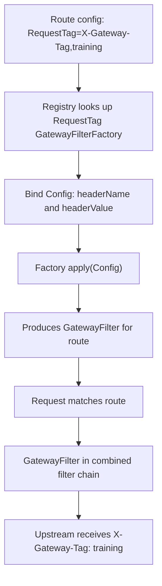
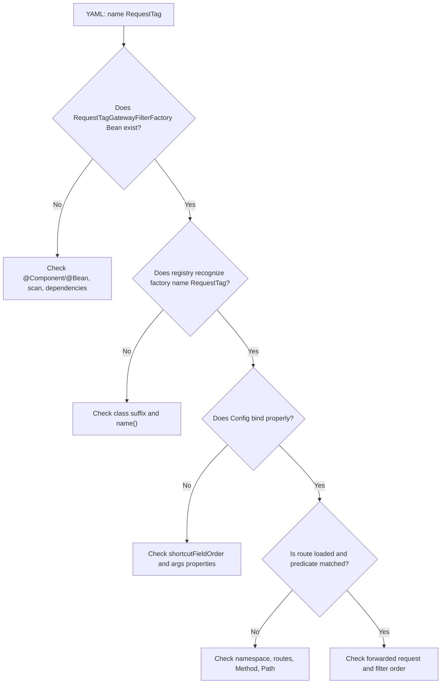

# Factory Naming Conventions and shortcutFieldOrder in Spring Cloud Gateway

In **Spring Cloud Gateway**, a route can use built-in filters such as `StripPrefix`, `AddRequestHeader`, or `SetResponseHeader`. When a microservices system needs a custom rule — such as attaching an internal trace header, normalizing data before calling a backend, or applying a per-route operation — you can write your own **GatewayFilter Factory**.

Implementing the logic in Java is only half the job. For YAML configuration like `- RequestTag=X-Gateway-Tag,training` to work, Spring Cloud Gateway must **find the factory by the right name**, instantiate it, and **bind configuration arguments in the right order**. The two decisive concepts here are the class naming convention ending with `GatewayFilterFactory` and the **`shortcutFieldOrder()`** method.

This lesson belongs to the **Custom Filters** chapter of the `SPRING_CLOUD_GATEWAY` module, where Gateway combines route predicates, filter chains, path/header transformations, and service discovery. It also highlights intersections with authentication, rate limiting, retry, circuit breaker, TLS, and observability so that a seemingly simple custom filter does not turn into a routing bug or security vulnerability.

**After this lesson, you will be able to:**

1. Explain why `RequestTagGatewayFilterFactory` is referenced by the name `RequestTag` in route configuration.
2. Implement `AbstractGatewayFilterFactory<Config>` with `apply(Config)` and appropriate getters/setters.
3. Declare both **shortcut syntax** and **expanded named-args syntax**.
4. Understand that `shortcutFieldOrder()` maps positional values to `Config` properties, which is completely distinct from filter execution order.
5. Verify that the factory is registered as a Spring Bean, the route is loaded, and the request is forwarded properly.
6. Distinguish custom `GatewayFilterFactory` from `GlobalFilter`, `WebFilter`, and built-in security mechanisms.

> **Version scope:** Examples target **Spring Cloud Gateway Server WebFlux** (reactive pipeline). Gateway Server MVC has its own API/DSL; do not copy WebFlux `ServerWebExchange` and `GatewayFilter` code directly into MVC. The route namespace may be `spring.cloud.gateway.routes` in some older generations, or `spring.cloud.gateway.server.webflux.routes` in newer ones. Always verify the starter and configuration metadata for your actual version.

## 1. Where Does a Short Filter Name in YAML Come From?

Here is a route with built-in filters:

```yaml
spring:
  cloud:
    gateway:
      server:
        webflux:
          routes:
            - id: catalog-api
              uri: lb://catalog-service
              predicates:
                - Path=/api/catalog/**
              filters:
                - StripPrefix=1
                - AddRequestHeader=X-Gateway-Source,edge
```

On the Java side, filters like `StripPrefix` and `AddRequestHeader` have corresponding **GatewayFilterFactory** classes, such as `StripPrefixGatewayFilterFactory` and `AddRequestHeaderGatewayFilterFactory`. Gateway takes the name in YAML, looks up a registered factory, binds the configuration, and invokes the factory to create the filter that participates in the chain.

To have a custom filter:

```yaml
filters:
  - RequestTag=X-Gateway-Tag,training
```

we need a Spring Bean of a factory type with a matching name, for example:

```java
@Component
public class RequestTagGatewayFilterFactory
        extends AbstractGatewayFilterFactory<RequestTagGatewayFilterFactory.Config> {
    // Config, shortcutFieldOrder, and apply are defined below.
}
```

**Key point:** `RequestTag` is the **factory name used by Gateway in route configuration**. It is not a Java method name, full class name, Bean ID, route name, or HTTP header.

### 1.1. Role of the Factory in the Pipeline

A `GatewayFilterFactory` **creates** a `GatewayFilter` from route configuration parameters:



A factory is typically a shared singleton bean in the application; **each route's Config** is bound from its corresponding route configuration. Do not assume `apply(Config)` is called once **per HTTP request**. In the normal flow, Gateway creates/materializes the route definition when loading or refreshing routes, and then the `filter(exchange, chain)` lambda executes for each matching HTTP request.

That is why you must never store per-request data in shared mutable fields on the factory. If you need per-request values, read them from `ServerWebExchange` inside `GatewayFilter`, rather than overwriting global state in `apply`.

## 2. The `...GatewayFilterFactory` Class Naming Convention

Standard Spring Cloud Gateway convention:

- The custom Java class extends/implements `GatewayFilterFactory`.
- The class name **should end with the `GatewayFilterFactory` suffix**.
- The name used in `filters` is typically **the class name with this suffix stripped**.
- The factory must be **registered in the Spring ApplicationContext**.
- The name in the route must match the factory name Gateway knows, not an arbitrary UI-style label.

Examples:

| Factory class name | Typical name in YAML | Notes |
| --- | --- | --- |
| `StripPrefixGatewayFilterFactory` | `StripPrefix` | Built-in factory. |
| `AddRequestHeaderGatewayFilterFactory` | `AddRequestHeader` | Built-in factory. |
| `SetResponseHeaderGatewayFilterFactory` | `SetResponseHeader` | Built-in factory. |
| `RequestTagGatewayFilterFactory` | `RequestTag` | Custom factory. |
| `TenantHintGatewayFilterFactory` | `TenantHint` | Custom factory, example. |
| `AuditLabelGatewayFilterFactory` | `AuditLabel` | Custom factory, example. |

### 2.1. Avoid Misleading Class Names

Classes like:

```java
public class RequestTagFilter { /* ... */ }

public class RequestTagFilterFactory { /* ... */ }
```

**do not automatically become** a `GatewayFilterFactory` recognized under the short name `RequestTag`. The class must implement the appropriate interface/base class, be registered as a Spring Bean, and follow the proper factory naming convention.

To avoid confusion and follow the established convention, prefer:

```java
public class RequestTagGatewayFilterFactory
        extends AbstractGatewayFilterFactory<RequestTagGatewayFilterFactory.Config> {
    // ...
}
```

Do not give a custom factory the same name as a built-in one like `RetryGatewayFilterFactory`, unless you truly understand and control the registration/collision mechanics of your running version. Name collisions can cause routes to bind to the wrong factory or behave unpredictably.

### 2.2. Bean Name and Factory Name Are Not Necessarily the Same

`@Component` or `@Bean` lets Spring manage the **factory instance**. Meanwhile, the filter name recognized by routes comes from the **factory name** via convention/API, not just from the Spring Bean ID.

Example illustrating the distinction:

```java
@Component("mySpringBeanName")
public class RequestTagGatewayFilterFactory
        extends AbstractGatewayFilterFactory<RequestTagGatewayFilterFactory.Config> {
    // ...
}
```

Assigning Bean ID `mySpringBeanName` **does not mean** routes automatically accept `- mySpringBeanName=...`. Before trying to change the public name used in YAML, check the factory naming API of your exact version; in most cases, the simplest approach is to **name the class with the standard suffix**.

### 2.3. Should You Write `GatewayFilterFactory` in YAML?

For the example factory:

```yaml
# Correct short form by convention:
filters:
  - RequestTag=X-Gateway-Tag,training
```

or:

```yaml
# Clear named-args form:
filters:
  - name: RequestTag
    args:
      headerName: X-Gateway-Tag
      headerValue: training
```

Do not default to the full Java class name like `RequestTagGatewayFilterFactory` in the `name` field. The public name to use is the name Gateway registers; the suffix rule keeps that name short and consistent.

## 3. What Does `AbstractGatewayFilterFactory<Config>` Do?

The standard way to build a custom filter in WebFlux is to extend:

```java
AbstractGatewayFilterFactory<T>
```

where `T` is the configuration type, typically named `Config`, holding the parameters for a route.

Three main parts:

| Part | Responsibility |
| --- | --- |
| Constructor `super(Config.class)` | Declares the configuration type so the binding mechanism can instantiate `Config`. |
| `shortcutFieldOrder()` | Lists **Config property names in order** to receive positional values from `Factory=a,b`. |
| `apply(Config config)` | Uses the bound configuration to create a `GatewayFilter`. |

Conceptual skeleton:

```java
@Component
public class MyRuleGatewayFilterFactory
        extends AbstractGatewayFilterFactory<MyRuleGatewayFilterFactory.Config> {

    public MyRuleGatewayFilterFactory() {
        super(Config.class);
    }

    @Override
    public List<String> shortcutFieldOrder() {
        return List.of("first", "second");
    }

    @Override
    public GatewayFilter apply(Config config) {
        return (exchange, chain) -> {
            // Process the request using the Reactive GatewayFilter API.
            return chain.filter(exchange);
        };
    }

    public static class Config {
        private String first;
        private String second;
        // Corresponding getters/setters for configuration.
    }
}
```

The template above is a skeleton for understanding structure, not standalone code with full imports/getters/setters. The next section provides a **more complete example**.

### 3.1. `Config` Is Not Per-Request Data

For example, if a route sets:

```yaml
- RequestTag=X-Gateway-Tag,catalog
```

then `Config` holds `headerName=X-Gateway-Tag` and `headerValue=catalog`, which are **static per route**. If you need to assign a new request ID for each request, do not generate a UUID inside `apply(Config)`, because that value may be generated once at route binding time and reused. Generate the value inside the `(exchange, chain) -> ...` lambda, or prefer existing tracing/correlation mechanisms.

### 3.2. Config Must Have a Proper Binding API

If the names in `shortcutFieldOrder` are `headerName` and `headerValue`, the `Config` type must expose matching properties, typically with JavaBean getters/setters:

```java
public static class Config {
    private String headerName;
    private String headerValue;

    public String getHeaderName() { return headerName; }
    public void setHeaderName(String headerName) {
        this.headerName = headerName;
    }

    public String getHeaderValue() { return headerValue; }
    public void setHeaderValue(String headerValue) {
        this.headerValue = headerValue;
    }
}
```

If Java uses `headerName` while YAML passes `name` without an explicit mapping mechanism in the binder, the value may not bind as expected. Avoid misconfiguration where the route still starts up but the filter receives a `null` parameter.

## 4. Complete Example: `RequestTagGatewayFilterFactory`

Let's build a simple factory: attach **a fixed request header** per route configuration so the backend knows the request passed through a specific entry point. This example uses the `X-Gateway-Tag` header with value `training`.

This is a **non-authenticating marker**. Never use this header for the backend to trust that a user is logged in or holds an admin role. Trusted identity must come from Spring Security / access tokens or verifiable assertions.

### 4.1. Java Code

```java
package com.example.gateway.filters;

import java.util.List;

import org.springframework.cloud.gateway.filter.GatewayFilter;
import org.springframework.cloud.gateway.filter.factory.AbstractGatewayFilterFactory;
import org.springframework.http.server.reactive.ServerHttpRequest;
import org.springframework.stereotype.Component;
import org.springframework.util.Assert;
import org.springframework.web.server.ServerWebExchange;

@Component
public class RequestTagGatewayFilterFactory
        extends AbstractGatewayFilterFactory<RequestTagGatewayFilterFactory.Config> {

    public RequestTagGatewayFilterFactory() {
        super(Config.class);
    }

    @Override
    public List<String> shortcutFieldOrder() {
        return List.of("headerName", "headerValue");
    }

    @Override
    public GatewayFilter apply(Config config) {
        Assert.hasText(config.getHeaderName(),
            "headerName must not be empty");
        Assert.hasText(config.getHeaderValue(),
            "headerValue must not be empty");

        // Illustrates an operator-configured marker only.
        // Production needs an appropriate header name allowlist/validation.
        Assert.isTrue(config.getHeaderName().startsWith("X-Gateway-"),
            "Only X-Gateway-* marker headers are allowed here");

        final String name = config.getHeaderName();
        final String value = config.getHeaderValue();

        return (exchange, chain) -> {
            ServerHttpRequest mutatedRequest =
                exchange.getRequest()
                    .mutate()
                    .headers(headers -> headers.set(name, value))
                    .build();

            ServerWebExchange mutatedExchange =
                exchange.mutate()
                    .request(mutatedRequest)
                    .build();

            return chain.filter(mutatedExchange);
        };
    }

    public static class Config {
        private String headerName;
        private String headerValue;

        public String getHeaderName() {
            return headerName;
        }

        public void setHeaderName(String headerName) {
            this.headerName = headerName;
        }

        public String getHeaderValue() {
            return headerValue;
        }

        public void setHeaderValue(String headerValue) {
            this.headerValue = headerValue;
        }
    }
}
```

In this example:

1. `@Component` registers the factory as a Spring Bean if the class is inside the component scan area.
2. `super(Config.class)` specifies the configuration type to bind.
3. `shortcutFieldOrder()` returns `["headerName", "headerValue"]`.
4. `apply(Config)` validates the configuration and captures copies of the name/value for the filter closure.
5. On each HTTP request, `ServerHttpRequest.mutate()` creates a new request with the header set.
6. `exchange.mutate().request(mutatedRequest).build()` passes the modified request into the chain.
7. `return chain.filter(mutatedExchange)` returns `Mono<Void>` per the reactive contract so subsequent filters and routing proceed.

### 4.2. Why Use `mutate()`?

Requests in Spring WebFlux should not be modified directly like a mutable `HttpServletRequest`. Wrong pattern:

```java
// Do not assume the original headers are mutable:
exchange.getRequest().getHeaders()
    .set("X-Gateway-Tag", "training");
```

Instead, use the request builder to create a new version and pass the new exchange to `chain.filter(...)`. If a filter only adds a response header before the response commits, use the response API at the right lifecycle point; do not attempt to modify headers after the HTTP response has committed.

### 4.3. Why Not Call `subscribe()` or `block()`?

A `GatewayFilter` in WebFlux must **return a publisher** so the framework manages subscription, error propagation, cancellation, and backpressure. Wrong pattern:

```java
// Wrong: subscribing manually and returning completion detached from the chain.
chain.filter(exchange).subscribe();
return Mono.empty();
```

Good pattern:

```java
return chain.filter(exchange);
```

If you need observational side effects, use appropriate Reactor operators such as `doFinally` or `doOnError`, and never perform blocking I/O on the Netty event loop. For Redis/database/network access, use reactive/non-blocking APIs or an appropriate processing architecture.

### 4.4. Limits of Marker Headers

This factory only demonstrates naming and binding. An `X-Gateway-Tag` header attached by Gateway config can aid tracing or debugging in a controlled environment, but:

- The backend **should not** treat it as proof of identity/authorization.
- If a client sends a header with the same name, `headers.set(...)` **overwrites** it with the route-configured value, though you must check other proxies/header filters.
- Do not create headers containing tokens, personal data, or unverified user-supplied data.
- For internal identity propagation, you need untrusted header stripping, a verified identity source, and a protected channel (network/mTLS or signed assertions).
- If multiple filters modify the same header, execution order determines the final value.

## 5. What Does `shortcutFieldOrder()` Actually Map?

This is the core of the lesson. For a factory with:

```java
@Override
public List<String> shortcutFieldOrder() {
    return List.of("headerName", "headerValue");
}
```

and the shortcut:

```yaml
filters:
  - RequestTag=X-Gateway-Tag,training
```

Gateway interprets it according to this model:

```text
Factory name:
    RequestTag

Positional arguments:
    arg[0] = "X-Gateway-Tag"
    arg[1] = "training"

shortcutFieldOrder():
    ["headerName", "headerValue"]

Config after binding:
    headerName  = "X-Gateway-Tag"
    headerValue = "training"
```

This is **not** the order in which filters run on a request. It is solely the **order of fields that receive positional arguments** for a single filter.

### 5.1. What Happens If the Order Is Swapped?

Suppose a developer accidentally writes:

```java
@Override
public List<String> shortcutFieldOrder() {
    return List.of("headerValue", "headerName");
}
```

while YAML remains:

```yaml
- RequestTag=X-Gateway-Tag,training
```

conceptual result:

| Property | Value received after swapping |
| --- | --- |
| `headerValue` | `X-Gateway-Tag` |
| `headerName` | `training` |

The complete example in section 4 rejects this configuration because the header name does not start with `X-Gateway-`, catching the mistake early. Without validation, Gateway might start and apply the wrong header/value, which is very hard to spot from an HTTP 200 status alone.

### 5.2. Argument Count Must Match the Contract

With two required fields, a valid shortcut by design is:

```yaml
- RequestTag=X-Gateway-Tag,training
```

Do not omit a value:

```yaml
# Missing headerValue; fails the example factory's requirement.
- RequestTag=X-Gateway-Tag
```

or add extra values without a designed binding:

```yaml
# The third value has no corresponding field in this example.
- RequestTag=X-Gateway-Tag,training,extra
```

The exact way Gateway handles missing/extra values may vary by parser/version; `apply(Config)` should **validate required configuration** and integration tests must verify startup/route loading. Do not treat "YAML parsed cleanly" as proof that the factory is configured properly.

### 5.3. Names in the List Must Be `Config` Property Names

In the example:

```java
public static class Config {
    private String headerName;
    private String headerValue;
    // getters/setters...
}
```

it must return:

```java
return List.of("headerName", "headerValue");
```

not arbitrary names like `List.of("first", "second")` if `Config` has no such properties. The binding mechanism cannot guess that "first means headerName".

### 5.4. Do Not Name the Method `shortcutFieldsOrder`

The method to override is **`shortcutFieldOrder()`** (no *s* after `Field`). Adding `@Override` lets the compiler catch a wrong signature. When copying examples from sources of a different version, always check the actual base class signature.

## 6. Two Configuration Syntaxes: Shortcut and Expanded Args

Spring Cloud Gateway allows route filters to be expressed in either **short form** or **named-arguments form** in supported versions.

### 6.1. Shortcut Form

```yaml
filters:
  - RequestTag=X-Gateway-Tag,training
```

Advantages:

- Short and readable when there are only one or two arguments.
- Similar to built-ins like `StripPrefix=1` and `AddRequestHeader=Name,Value`.

Limitations:

- Order matters, yet meaning becomes hard to read with many arguments.
- Commas can act as argument delimiters.
- Adding fields or changing `shortcutFieldOrder` can cause older configs to be interpreted differently.
- Passing complex strings, expressions, or lists is harder to read.

### 6.2. Expanded Named-Args Form

```yaml
filters:
  - name: RequestTag
    args:
      headerName: X-Gateway-Tag
      headerValue: training
```

Advantages:

- Clearly shows **which property receives which value**.
- Independent of YAML line ordering.
- Easy to review with many fields, optional settings, or values containing commas.
- Easier to maintain when formatting changes; however, renaming a **Config property** still requires migration.

Named args use the **factory's public name** in `name` and **property names** in `args`. A different Spring Bean name does not automatically substitute for either of these.

### 6.3. Commas Inside Values

If you need the marker:

```text
team,alpha
```

do not assume the following shortcut keeps the whole string as one argument:

```yaml
# Unsafe if the shortcut parser splits on commas.
- RequestTag=X-Gateway-Tag,team,alpha
```

Prefer:

```yaml
filters:
  - name: RequestTag
    args:
      headerName: X-Gateway-Tag
      headerValue: "team,alpha"
```

YAML quoting to produce a single scalar **does not imply** that Gateway's internal shortcut argument-splitting rules ignore commas. For strings with commas, equals signs, regexes, complex Unicode, or nested structures, named args are much clearer.

### 6.4. Whitespace and Data Types

Shortcut arguments are **textual representations**, which are then bound to property types. For `int`, `boolean`, and `Duration`, converters and validation must be compatible; do not assume every string converts automatically.

Example of another custom factory with two fields `enabled:boolean` and `limit:int`:

```yaml
filters:
  - name: ExamplePolicy
    args:
      enabled: true
      limit: 20
```

This is a **YAML structure illustration**, not a built-in `ExamplePolicy` factory. To actually use it, you must declare a Java factory with a matching Config. Using named args makes type checking clearer than writing `ExamplePolicy=true,20` without visible definitions.

## 7. `shortcutFieldOrder()` Does Not Control Filter Chain Order

Three "order" concepts are easily confused:

| Concept | What is it for? | Example |
| --- | --- | --- |
| **`shortcutFieldOrder()`** | Binds positional arguments **within one factory**. | `["headerName", "headerValue"]`. |
| **Filter order in route / `Ordered`** | Determines pre/post execution order among GatewayFilters. | Placing `StripPrefix` before or after a path-rewriting filter. |
| **`Route.order` / route predicate matching** | Prioritizes route selection when multiple routes can match. | Higher-priority route matching `/api/orders/**` before a catch-all route. |

Example:

```yaml
filters:
  - RequestTag=X-Gateway-Tag,training
  - StripPrefix=1
  - SetRequestHeader=X-Environment,staging
```

This list has **three separate filters**. `shortcutFieldOrder()` applies only internally to `RequestTag`; it does not make `headerName` run "before" `StripPrefix` or alter orders declared by other factories.

### 7.1. Pre-Phase and Post-Phase

In WebFlux, filters typically form a chain:

```text
Filter A pre
  Filter B pre
    Routing
  Filter B post
Filter A post
```

If a filter uses `chain.filter(exchange).then(...)` for post-routing logic, post-routing execution order can be the reverse of the pre-phase. This difference belongs to **filter ordering and Reactor composition**, unrelated to `shortcutFieldOrder`.

### 7.2. GlobalFilter vs. GatewayFilterFactory

- **`GatewayFilterFactory`** takes Config from a route and creates a `GatewayFilter` attached to a route or `default-filters`.
- **`GlobalFilter`** is a Gateway-level filter applied in the combined chain for route-matched requests; it does not use `shortcutFieldOrder`.
- **`WebFilter`** belongs to the Spring WebFlux pipeline; Spring Security can reject a request before Gateway route filters even run.
- **Servlet Filter** belongs to the servlet/MVC model, not the reactive API.

Therefore, if logic must run before authentication or for requests that **do not match any Gateway route**, a route-specific `GatewayFilterFactory` may **not be the right place**. Choose the execution layer based on requirements rather than trying to use a custom factory to replace built-in security/HTTP mapping.

## 8. Registering the Spring Bean So Gateway Can Find the Factory

Naming the class right while **forgetting to register the Bean** is a common mistake.

### 8.1. Using `@Component`

```java
package com.example.gateway.filters;

import org.springframework.stereotype.Component;

@Component
public class RequestTagGatewayFilterFactory
        extends AbstractGatewayFilterFactory<RequestTagGatewayFilterFactory.Config> {
    // ...
}
```

Spring Boot must component-scan the package containing the factory, usually a subpackage of the `@SpringBootApplication` class. If the factory sits outside the scan scope, it **is not registered automatically**.

### 8.2. Using `@Bean` as an Alternative

Another option is registering the factory inside a `@Configuration` class:

```java
import org.springframework.context.annotation.Bean;
import org.springframework.context.annotation.Configuration;

@Configuration
public class GatewayFactoriesConfig {

    @Bean
    RequestTagGatewayFilterFactory requestTagGatewayFilterFactory() {
        return new RequestTagGatewayFilterFactory();
    }
}
```

With this approach, avoid putting `@Component` **and** declaring a `@Bean` for the same factory without reason — that can create **two Beans** and confusing name-resolution behavior. If `apply` needs a service via DI, inject the service through the constructor instead of instantiating it manually inside a route.

### 8.3. Do Not Instantiate a New Factory Inside Each Request

Unsound pattern:

```java
return (exchange, chain) -> {
    RequestTagGatewayFilterFactory factory =
        new RequestTagGatewayFilterFactory();
    // Instantiating the factory and rebinding config on every request.
    return chain.filter(exchange);
};
```

Beyond the overhead, this bypasses the ApplicationContext lifecycle, DI, configuration binding, and observability. The factory should be a Spring Bean, while requests run through the filter created from bound Config.

### 8.4. Check for Duplicate Names

If two factories both expose the name `RequestTag`, the registry may hit conflicts or pick an unintended factory. Keep names distinct and descriptive, adding a domain prefix when needed, and avoid redefining built-ins.

For example, `TenantHeaderGatewayFilterFactory` with short name `TenantHeader` is much clearer than a custom factory named `RetryGatewayFilterFactory` which easily collides with built-in `Retry`.

## 9. Named Args When Shortcuts Are Not Used

Some factories have complex configurations or choose not to support positional syntax. With **expanded args**, readers identify properties by name without memorizing order.

Example:

```yaml
filters:
  - name: RequestTag
    args:
      headerValue: catalog
      headerName: X-Gateway-Tag
```

The two lines under `args` are swapped compared to the earlier example, yet they still bind to the same properties by **name**. `shortcutFieldOrder()` does not force YAML named args to follow the list order.

### 9.1. Is Overriding `shortcutFieldOrder` Mandatory?

- If you only use **expanded args** and do not need shortcuts, positional order is not part of your public contract.
- If you want `- RequestTag=a,b` to work, you must implement/declare the appropriate shortcut order.
- Do not rely on reflection guessing Java field order; declaration order is not a stable YAML contract.

### 9.2. What If Config Adds a New Field?

Suppose a new version adds `enabled:boolean`:

```java
public static class Config {
    private String headerName;
    private String headerValue;
    private boolean enabled = true;
    // Getters/setters...
}
```

You can keep the shortcut as:

```java
return List.of("headerName", "headerValue");
```

and treat `enabled` as an optional setting configured only in named args. That keeps older shortcut configurations preserving the same semantics, provided the implementation supports sensible defaults.

If you change the shortcut to:

```java
return List.of("enabled", "headerName", "headerValue");
```

then an existing `- RequestTag=X-Gateway-Tag,training` could bind to the wrong types/meanings. **Changing `shortcutFieldOrder` is a breaking change to the configuration contract**, requiring migration and backward-compatibility tests.

### 9.3. Where Should Validation Happen?

Validation should happen when creating/configuring the filter, before processing traffic:

```java
@Override
public GatewayFilter apply(Config config) {
    Assert.hasText(config.getHeaderName(), "headerName is required");
    Assert.hasText(config.getHeaderValue(), "headerValue is required");
    return (exchange, chain) -> chain.filter(exchange);
}
```

This is a validation-only fragment, not yet setting the header. The goal is to fail fast when the route is loaded/refreshed, rather than letting millions of requests arrive before discovering `null` or invalid values.

Depending on the version and route loading path, errors may surface at startup or when route definitions are evaluated/refreshed. Always verify effective configuration rather than assuming an open HTTP port means routes are valid.

## 10. Combining a Factory with `default-filters`

Sometimes the same marker/tracing rule is needed across **every route**. Server WebFlux may support `default-filters`:

```yaml
spring:
  cloud:
    gateway:
      server:
        webflux:
          default-filters:
            - name: RequestTag
              args:
                headerName: X-Gateway-Tag
                headerValue: edge
          routes:
            - id: catalog-api
              uri: lb://catalog-service
              predicates:
                - Path=/api/catalog/**
              filters:
                - StripPrefix=1

            - id: orders-api
              uri: lb://order-service
              predicates:
                - Path=/api/orders/**
              filters:
                - StripPrefix=1
```

In older versions, the property typically looks like `spring.cloud.gateway.default-filters`. Depending on the release generation, property names differ; choose the right namespace.

**Notes:**

- `default-filters` applies to **matching Gateway routes**; it does not turn a factory into a Spring Security `WebFilter` covering every URL.
- If a route also adds `RequestTag` for the same header, the outcome depends on filter order and header handling.
- Never use default markers as an authentication source for sensitive data.
- If built-in `AddRequestHeader` or `SetRequestHeader` already meets the need without new logic, **no custom factory is needed**; prefer standard filters to reduce code maintenance.

### 10.1. Can GlobalFilter Replace default-filters?

A `GlobalFilter` can apply shared logic across the Gateway chain, but it does not use route-specific factory/Config syntax. Choose:

- **`GatewayFilterFactory`** if you want per-route configurable settings from YAML.
- **`default-filters`** if you want to apply a configured factory across all routes.
- **`GlobalFilter`** if you want programmatic Gateway-wide logic without repeating per-route declarations, and you understand ordering/lifecycle.

Do not implement all three mechanisms for the same effect without controlling duplication.

## 11. Java DSL: Applying a Factory with Config Instead of YAML Shortcuts

In some projects, routes are built via Java `RouteLocatorBuilder`. You can still reuse the factory Bean:

```java
import org.springframework.cloud.gateway.route.RouteLocator;
import org.springframework.cloud.gateway.route.builder.RouteLocatorBuilder;
import org.springframework.context.annotation.Bean;
import org.springframework.context.annotation.Configuration;

@Configuration
public class CatalogRouteConfig {

    @Bean
    RouteLocator catalogRouteLocator(
            RouteLocatorBuilder builder,
            RequestTagGatewayFilterFactory tagFactory) {

        RequestTagGatewayFilterFactory.Config config =
            new RequestTagGatewayFilterFactory.Config();

        config.setHeaderName("X-Gateway-Tag");
        config.setHeaderValue("java-dsl");

        return builder.routes()
            .route("catalog-java", r -> r
                .path("/api/catalog/**")
                .filters(f -> f
                    .filter(tagFactory.apply(config))
                    .stripPrefix(1))
                .uri("lb://catalog-service"))
            .build();
    }
}
```

**Difference:** Java DSL constructs `Config` programmatically, so `shortcutFieldOrder()` is not needed to interpret positional arguments here. Still, the factory has the same type, and `apply(Config)` builds the `GatewayFilter` just as it does when YAML is bound.

Do not register the **same route ID** in both Java DSL and YAML unintentionally. Overlapping predicates/priorities can produce confusing behavior; choose one clear source of route definitions or manage route order explicitly.

### 11.1. Do Not `new` the Factory in Java DSL If It Has Dependencies

Suppose the factory injects an audit service via constructor. If you call `new` directly inside route configuration code, dependencies may be missing and Spring no longer manages its lifecycle. Inject the Bean such as `tagFactory` in the example above.

## 12. Distinguishing Factory Binding from HTTP Request Binding

Broadly, there are two very different kinds of "binding":

| Binding | When? | Where does data come from? | How much should it be trusted? |
| --- | --- | --- | --- |
| **Factory Config binding** | When loading/initializing routes. | YAML/Java DSL controlled by operators. | Conditionally trusted; still validate. |
| **Request data extraction** | On every HTTP request. | Headers, path, query, body, principal. | Must separate trusted/untrusted, authenticate, and sanitize. |

`shortcutFieldOrder()` only handles **factory config binding**. It has no capability to extract `Idempotency-Key`, principal, or tenant ID from an HTTP request.

For example, if you want to attach a `tenantId` claim upstream, you must inspect **Spring Security Authentication** and the trust boundary. Do not try to solve that by adding `tenantId` to `shortcutFieldOrder` and hoping Gateway pulls it from the request.

### 12.1. Why Must Config Data Be Validated?

If route configs come from dynamic sources such as a config server or database, a bug could introduce CR/LF characters, invalid header names, or dangerous internal URLs. Even when config sources are internal, validate classpath/binding/values and enforce access control on who can edit configs.

The marker example in section 4 restricts the header prefix for illustration; **production should use an explicit allowlist** or sufficiently narrow rule types. Do not use a factory as a mechanism to arbitrarily forge `Authorization`, `Host`, `Forwarded`, or verified identity headers.

## 13. Config Data Types to Watch Out For

A richer factory might have:

```java
public static class Config {
    private String headerName;
    private String headerValue;
    private boolean enabled = true;
    private int maxLength = 64;
    // getters/setters...
}
```

With named args:

```yaml
filters:
  - name: ExampleTag
    args:
      headerName: X-Gateway-Tag
      headerValue: catalog
      enabled: true
      maxLength: 64
```

`ExampleTag` here is a **hypothetical factory** with a complete Config and implementation, not a built-in filter.

### 13.1. Numeric and Boolean Types

If a field is `int` while YAML has `maxLength: not-a-number`, the binder may raise a configuration error. If using nullable `Boolean`/`Integer`, check for null; if using primitives with defaults, distinguish default values from operators explicitly passing `0`/`false`.

### 13.2. Duration

For filters with timeout parameters, use `Duration` and syntax supported by your version, such as `500ms` or `2s`. Never assume an integer `500` always means milliseconds; the binder/route contract must state units clearly. A custom filter timeout does not automatically replace Gateway's Netty connection/response timeouts.

### 13.3. Lists / Regexes / Values with Commas

For `List<String>`, regular expressions, or strings containing commas, **named args** configuration avoids wrong positional splitting. Some factories use a special `shortcutType()` to collect values into a list, but that is an advanced per-factory, per-version behavior. Do not change `shortcutFieldOrder()` expecting it to infer arbitrary list types.

### 13.4. Sensitive Values

Never pass secret API keys into `headerValue` of the example marker. Configuration may appear in the routes actuator endpoint, logs, or debug dumps depending on the environment. When credentials must be passed upstream, use proper secret management, token relay, or mTLS and restrict access to configuration inspection.

## 14. Common Error: Factory Not Found

A familiar error when loading routes:

```text
Unable to find GatewayFilterFactory with name RequestTag
```

The exact message depends on version/logger, but it usually means **the route requested a factory named RequestTag that the registry could not find**.

Causes to check:

1. Class name does not end with / match the `RequestTagGatewayFilterFactory` convention.
2. Factory does not properly extend/implement `GatewayFilterFactory`.
3. Missing `@Component`/`@Bean` or class sits outside component scan scope.
4. Wrong name in YAML, e.g., `RequestTags`, `RequestTagFilter`, or Bean ID instead of factory name.
5. Route config is under a namespace not read by the current version.
6. Application runs **Server MVC** while code imports Server WebFlux filter APIs.
7. Factory Bean threw an error in its constructor/dependencies and failed to register.
8. Two factories share the same name, causing collision/unexpected behavior.

### 14.1. Quick Diagnostic Flow



Do not see a single HTTP 404 and immediately blame the factory: the request might not match the route, the backend might return 404, or Spring Security might block it before the Gateway chain.

## 15. Common Error: Factory Found, Wrong Parameters

A route may load successfully yet produce the wrong header because:

- `shortcutFieldOrder()` swapped positions.
- Getters/setters do not match property names.
- YAML uses `args.name` while Java Config defines `headerName`.
- A comma in the shortcut caused the parser to split into extra values.
- An optional field has an unexpected default.
- A route loaded from another source overrides configuration or refreshes the route.
- Two filters set the same header and the later filter overwrites the value.
- Requests pass through another `GlobalFilter` before/after the custom filter.

### 15.1. A Systematic Checklist for Diagnosis

For the `RequestTag` factory:

```text
1. Does RequestTagGatewayFilterFactory exist?
2. Is its Spring Bean present in ApplicationContext?
3. Does the route name use "RequestTag"?
4. Does Config have headerName and headerValue with getters/setters?
5. Is shortcutFieldOrder() = ["headerName","headerValue"]?
6. Does the YAML shortcut have exactly two values?
7. Does apply(Config) validate and build the filter?
8. Does the request match the route?
9. What header value does the backend/mock upstream observe?
10. Does any other filter overwrite the header?
```

**Separate three layers of checks:** factory discovery, configuration binding, and runtime filter execution. These are three independent failure points.

## 16. Route Refresh Mechanism and Config Compatibility

In systems with dynamic routes, Gateway can refresh route definitions from a config server, registry, or trusted configuration source. This affects the factory:

- A new route can instantiate a new `Config` and a new `GatewayFilter`.
- A filter processing an in-flight request may still hold the Config active when that request began.
- Renaming the factory or changing `shortcutFieldOrder()` can break binding of **older route configs**.
- If the factory holds global mutable state, concurrent route reloads and requests can race.
- Config validation must run early enough to catch bad routes before critical traffic hits them.

Do not treat adding a `Config` field as a "Java-only" change when YAML routes act as the contract between platform and application teams.

### 16.1. Config Upgrade Strategy

For a factory already used across many routes:

1. Prefer **named args** for long or frequently evolving configs.
2. Never reorder published shortcut fields on your own.
3. Add new fields as optional with sensible defaults whenever possible.
4. Provide a migration guide when renaming properties is unavoidable.
5. Use validation to fail fast on invalid configs.
6. Test both existing YAML routes and new route configs.
7. Monitor route refresh errors, active route counts, and 404/5xx spikes after rollout.

### 16.2. Can One Route Have Multiple Config Versions?

A factory with a given name typically maps to one `Config` class at runtime. If you need to support fundamentally incompatible contracts, consider a new factory name (`RequestTagV2GatewayFilterFactory`) or an explicit validated version mechanism, rather than silently changing how `RequestTag=a,b` is interpreted and breaking old routes.

## 17. Unit Testing the `RequestTag` Factory

You can test `apply(Config)` logic **without booting the entire Gateway** using a mock WebFlux exchange and a stub `GatewayFilterChain`.

Illustrative example with Spring Test, Reactor Test, and JUnit:

```java
import java.util.concurrent.atomic.AtomicReference;

import org.junit.jupiter.api.Test;
import org.springframework.cloud.gateway.filter.GatewayFilter;
import org.springframework.cloud.gateway.filter.GatewayFilterChain;
import org.springframework.mock.http.server.reactive.MockServerHttpRequest;
import org.springframework.mock.web.server.MockServerWebExchange;
import reactor.core.publisher.Mono;
import reactor.test.StepVerifier;

import static org.junit.jupiter.api.Assertions.assertEquals;

class RequestTagGatewayFilterFactoryTest {

    @Test
    void addsConfiguredHeaderToDownstreamRequest() {
        RequestTagGatewayFilterFactory factory =
            new RequestTagGatewayFilterFactory();

        RequestTagGatewayFilterFactory.Config config =
            new RequestTagGatewayFilterFactory.Config();

        config.setHeaderName("X-Gateway-Tag");
        config.setHeaderValue("training");

        GatewayFilter filter = factory.apply(config);

        MockServerWebExchange exchange =
            MockServerWebExchange.from(
                MockServerHttpRequest.get("/api/catalog/42").build()
            );

        AtomicReference<String> observed = new AtomicReference<>();
        GatewayFilterChain chain = forwarded -> {
            observed.set(forwarded.getRequest()
                .getHeaders()
                .getFirst("X-Gateway-Tag"));
            return Mono.empty();
        };

        StepVerifier.create(filter.filter(exchange, chain))
            .verifyComplete();

        assertEquals("training", observed.get());
    }
}
```

This test proves **the runtime filter modifies the request**. It **does not prove** that `RequestTag` is discovered by the route registry or that YAML shortcuts bind properly, because the test constructs Config directly in Java.

### 17.1. Testing `shortcutFieldOrder` Directly

```java
@Test
void shortcutOrderMatchesConfigProperties() {
    RequestTagGatewayFilterFactory factory =
        new RequestTagGatewayFilterFactory();

    assertEquals(
        List.of("headerName", "headerValue"),
        factory.shortcutFieldOrder()
    );
}
```

This is a small contract-guard test during refactoring. Import `java.util.List`, `org.junit.jupiter.api.Test`, and `assertEquals` in the test class.

### 17.2. Testing Missing Parameters

```java
@Test
void missingHeaderValueIsRejected() {
    RequestTagGatewayFilterFactory factory =
        new RequestTagGatewayFilterFactory();

    RequestTagGatewayFilterFactory.Config config =
        new RequestTagGatewayFilterFactory.Config();

    config.setHeaderName("X-Gateway-Tag");

    assertThrows(IllegalArgumentException.class,
        () -> factory.apply(config));
}
```

Import JUnit `assertThrows`. The sample relies on `Assert.hasText` in the factory code; the exact exception message is not a public API contract.

### 17.3. Integration Tests Are Needed to Verify YAML

To prove **factory name discovery and shortcut syntax**, write at least one test loading a real Spring context/route, for example:

```yaml
spring:
  cloud:
    gateway:
      server:
        webflux:
          routes:
            - id: test-tag
              uri: http://localhost:9090
              predicates:
                - Path=/api/test/**
              filters:
                - RequestTag=X-Gateway-Tag,training
                - StripPrefix=1
```

A mock upstream at `http://localhost:9090` receives the request and checks:

- Method/path was rewritten to `/test/...`.
- Header `X-Gateway-Tag` equals `training`.
- The request matched the expected route ID.
- The YAML named-args form produces equivalent results.
- Invalid configuration is caught rather than silently skipping the filter.

**Note:** Tests should only hit local test servers, never send traffic to production or uncontrolled external hosts.

## 18. Testing with curl and a Mock Upstream

Suppose Gateway runs on `localhost:8080`, the mock backend is on `localhost:9090`, and route `test-tag` is loaded.

```bash
curl -i "http://localhost:8080/api/test/42" \
  -H "X-Gateway-Tag: forged-by-client"
```

With the `RequestTagGatewayFilterFactory` example, the filter resets the header to `training` before the request reaches upstream. **You cannot prove this from `curl -i` output alone**, because that output displays **Gateway's response**, not the request the backend received. You need:

- A mock HTTP server echoing headers in a **test environment**; or
- Assertions on the test backend; or
- Protected internal tracing/logs that do not log credentials.

If enabling the factory produces 404, distinguish between 404 from route mismatch, missing backend endpoint, or factory config issues. If you get 503, inspect `lb://` and service discovery; a misnamed factory would usually fail before handling requests.

### 18.1. Testing Two Routes Sharing One Factory with Different Args

```yaml
routes:
  - id: catalog-tag
    uri: lb://catalog-service
    predicates:
      - Path=/api/catalog/**
    filters:
      - RequestTag=X-Gateway-Tag,catalog
      - StripPrefix=1

  - id: orders-tag
    uri: lb://order-service
    predicates:
      - Path=/api/orders/**
    filters:
      - RequestTag=X-Gateway-Tag,orders
      - StripPrefix=1
```

This is a **fragment under the appropriate `routes` namespace**, not a complete `application.yml` file. The same factory Bean can create two filters with **two different Configs** per route. If both requests end up receiving `orders` as the final header, investigate whether the factory stores `Config` in a shared mutable instance field.

### 18.2. Testing Reload and Concurrency

If route definitions are dynamically refreshed, test changing one route's marker while sending concurrent requests to both routes. They must not accidentally share mutable Config values. Never modify a route's `Config` from an active request.

## 19. Impact of Custom Filters on Security and Other Systems

A factory can be very small yet sit right next to critical HTTP boundaries.

### 19.1. Spring Security May Run Before the Factory

With a JWT Resource Server, `SecurityWebFilterChain` can reject requests with 401/403 before route-specific factories run. Therefore:

- Do not use `RequestTag` to replace authN/authZ.
- Do not expect the filter to always attach headers on 401 responses produced by Security.
- If you need the principal, read verified authentication details and check for null/permissions.
- For CORS preflight, `OPTIONS` may be handled before route factories; do not expect custom route filters to always run.

### 19.2. Rate Limiting and Key Identity

`RequestRateLimiter` and `KeyResolver` have their own contracts. A custom filter adding `X-User-Id` **does not turn that header into a trusted principal**. Quotas should rely on authenticated user/tenant/API key or IP from a trusted proxy, not self-asserted client data.

### 19.3. Retry Can Make a Filter Run Multiple Times

A `Retry` GatewayFilter can re-execute the downstream chain under configured conditions. Depending on filter order, a custom filter may run again, or a side effect inside it may trigger repeatedly.

Therefore, custom filters should not:

- Create payment transactions or send emails without idempotency.
- Generate a fresh idempotency key per upstream attempt.
- Write non-idempotent data in `doOnSubscribe`/`doOnNext` without handling retries.
- Hold onto request body `Flux<DataBuffer>` without understanding ownership, ref-counting, and streaming.

The example factory only sets a static header, so repeating it produces no business side effects.

### 19.4. Circuit Breaker and Fallback

If downstream is short-circuited by a circuit breaker, a custom filter elsewhere in the chain may or may not run depending on order. Do not treat a marker header as proof that the backend was called successfully. Rely on tracing, status codes, and instrumentation at the right layer.

### 19.5. TLS and Header Content

Never disable upstream TLS verification or put secrets in custom headers to "pass" authorization. Use proper HTTPS/mTLS/trust stores and restrict which headers are allowed out to backends.

### 19.6. Observability

A custom factory can attach markers or correlation details for logs, but **does not automatically create a valid trace context** just by setting an arbitrary string. Prefer Micrometer Observation/OpenTelemetry and W3C Trace Context. If a filter logs route ID or latency, ensure:

- Never log tokens, cookies, or sensitive bodies.
- Never use raw user IDs or `Idempotency-Key` as high-cardinality metric labels.
- Never block the event loop to write logs or make network calls.
- Never confuse a Gateway-generated response status with a backend commit outcome.

## 20. Common Errors and How to Fix Them

| Symptom | Possible cause | How to fix |
| --- | --- | --- |
| Gateway reports `RequestTag` not found. | Wrong class suffix, Bean not scanned, or wrong YAML name. | Name `RequestTagGatewayFilterFactory`, register Bean, use `name: RequestTag`. |
| `- RequestTag=a,b` binds two fields backward. | `shortcutFieldOrder()` order swapped. | Return exact `List.of("headerName", "headerValue")`. |
| `args` has `name` while Java Config uses `headerName`. | Property name mismatch. | Match Config getter/setter names and test binding. |
| Filter works in Java DSL, fails in YAML. | Java DSL builds Config directly; YAML needs discovery and binding. | Test ApplicationContext and YAML routes end-to-end. |
| Code compiles, route does not load. | Wrong `spring.cloud.gateway...routes` namespace or duplicate route ID. | Check version and active route list. |
| Added `@Component("CustomName")` but YAML rejects `CustomName`. | Confused Bean ID with factory name. | Use factory name per convention/`name()`. |
| YAML value contains a comma; Config gets wrong args. | Shortcut parser splits positional args. | Switch to expanded named args. |
| Filter adds header, backend doesn't see it. | Route didn't match, another filter overwrote it, or mutation wasn't forwarded. | Check route ID, ordering, and `chain.filter(mutatedExchange)`. |
| Original request had client header and filter didn't overwrite it. | Logic used `add` instead of `set`, or a later filter changed it. | Check `headers.set` and filter order. |
| 401/403 lacks custom header. | Spring Security blocked before GatewayFilter. | Handle in WebFlux/Security layer if genuinely needed. |
| Preflight OPTIONS doesn't run filter. | CORS handled early, or Method predicate didn't match. | Inspect CORS handler mapping and Security. |
| Config mixed between two routes. | Factory holds global mutable Config in a field. | Capture per-route Config in closure; avoid shared mutable state. |
| Restart/route refresh alters behavior. | Config version or shortcut order changed. | Add migration, tests, and reload validation. |
| Filter hangs Gateway on DB calls. | Blocking I/O on Netty event loop. | Use reactive async APIs or move work to an appropriate layer. |
| Memory spikes with JSON/multipart. | Improper body read/caching ownership or multiple retries. | Understand `DataBuffer`, backpressure, and request size budgets. |
| Custom header trusted as token by backend. | Missing auth/trust boundary. | Use JWT/mTLS/signed assertions and strip untrusted headers. |
| Actuator route dump exposes secrets in Config. | Credentials placed in filter args. | Use secret management and restrict management endpoints. |
| Backend returns 503; team blames `shortcutFieldOrder`. | Issue may be in `lb://` discovery/upstream. | Separate route/config/filter success from upstream failures. |

## 21. Practice Exercises with Answers

### Exercise 1 — Naming the Factory

You create the class:

```java
public class AuditLabelGatewayFilterFactory
        extends AbstractGatewayFilterFactory<AuditLabelGatewayFilterFactory.Config> {
    // ...
}
```

What is the standard name used in YAML?

**Answer:** `AuditLabel`, because Gateway strips the `GatewayFilterFactory` suffix by convention. The class must be a valid Bean and Config/`apply` must be fully implemented.

### Exercise 2 — Determining Parameter Order

Config has `prefix` and `value`. Configuration is:

```yaml
- AuditLabel=trace-,123
```

What should `shortcutFieldOrder()` return?

**Answer:** `List.of("prefix", "value")` if the contract assigns the first value to `prefix` and the second to `value`. Config getters/setters must match those names.

### Exercise 3 — Why Named Args Do Not Care About Line Order

```yaml
- name: RequestTag
  args:
    headerValue: training
    headerName: X-Gateway-Tag
```

These two properties are swapped compared to `shortcutFieldOrder`. Is that wrong?

**Answer:** No, because expanded args bind by **property name**, not line position. Property names and values must still be valid.

### Exercise 4 — Correct Class, Yet Unrecognized

The Java factory has the right suffix, yet YAML reports `RequestTag` not found. The class is outside component scan.

**Answer:** Move the class into a scanned package or register it via `@Bean`. Naming the class properly alone does not add the Bean to ApplicationContext.

### Exercise 5 — Changing the Bean Name

You change `@Component` to `@Component("traceMarkerBean")` and expect YAML `- traceMarkerBean=a,b` to work.

**Answer:** You cannot assume that. Bean ID is not by default the factory short name. Use the name published by the factory—still `RequestTag` in this example.

### Exercise 6 — Commas in Values

You want the header `X-Gateway-Tag: team,alpha`. Is `- RequestTag=X-Gateway-Tag,team,alpha` safe?

**Answer:** No. Commas in shortcuts can split into multiple positional args. Switch to `name: RequestTag` with `args.headerValue: "team,alpha"`.

### Exercise 7 — Changing `shortcutFieldOrder` During an Upgrade

Version 1 uses `["headerName","headerValue"]`; version 2 switches to `["headerValue","headerName"]` while keeping old YAML unchanged.

**Answer:** This is a config-contract breaking change. Keep the old order or migrate all routes along with tests—never swap silently.

### Exercise 8 — Shortcut Order vs. Filter Order

In YAML, `RequestTag` appears before `StripPrefix`. Does `shortcutFieldOrder()` make RequestTag execute before StripPrefix?

**Answer:** No. `shortcutFieldOrder()` only maps arguments inside RequestTag. Pre/post execution order among GatewayFilters relies on the combined filter chain and `Ordered`/route filter order.

### Exercise 9 — Security Blocks Before Custom Filter

A request missing a JWT gets 401 and upstream never sees `X-Gateway-Tag`. Is the factory broken?

**Answer:** Not necessarily. Spring Security WebFilter may reject the request before GatewayFilter runs. Check the auth path and filter execution separately.

### Exercise 10 — Using Both `@Bean` and `@Component`

A factory is annotated with `@Component` while also configured via a `@Bean RequestTagGatewayFilterFactory` method.

**Answer:** This risks creating two bean instances / factory registrations with the same name. Choose one clear registration mechanism unless multiple beans are intentionally managed.

### Exercise 11 — Java DSL Works, YAML Fails

The factory works when you call `tagFactory.apply(config)` in Java DSL, but YAML fails to bind `RequestTag=a,b`.

**Answer:** Java DSL bypasses shortcut binding. Check the factory name in the registry, Bean scope, `shortcutFieldOrder()`, Config property binding, route namespace, and write a YAML integration test.

### Exercise 12 — Shared Config Across Requests

The factory stores the last request's `headerValue` into an instance field and returns it for other requests.

**Answer:** Wrong, because the factory Bean can be shared, causing race conditions and data leaks across routes/users. Keep Config per route and request state inside the exchange or immutable local variables.

### Exercise 13 — Marker Header Treated as "admin"

A backend trusts `X-Gateway-Tag: admin` to skip authorization. Should a custom factory emit this header?

**Answer:** No. A marker is not an identity credential. You need backend authentication/authorization or a protected, verifiable assertion across the trust boundary.

### Exercise 14 — Which Test Proves YAML Shortcuts Actually Work?

A unit test builds `Config`, calls `apply(Config)`, and sees the right header. Has `RequestTag=X-Gateway-Tag,training` been fully tested?

**Answer:** Not yet. Unit tests only verify filter logic. You need an integration test loading YAML routes, factory discovery, shortcut binding, and requests to a mock upstream.

## 22. Pre-Deployment Checklist for Custom Factories

- [ ] Correct **Spring Cloud Gateway Server WebFlux** chosen, not MVC filter APIs by mistake.
- [ ] Class name ends with `GatewayFilterFactory` and does not collide with built-ins.
- [ ] Route config uses the **factory short name**, e.g., `RequestTag`.
- [ ] Factory is registered via `@Component` or `@Bean` in the Spring context.
- [ ] Constructor calls `super(Config.class)` with the exact Config type.
- [ ] `Config` has getters/setters/properties matching names used in YAML.
- [ ] `shortcutFieldOrder()` specifies exact **field names and order** for shortcut syntax.
- [ ] For complex parameters, **expanded named args** are used instead of relying on commas.
- [ ] Published shortcut order is never swapped without migration and tests.
- [ ] `apply(Config)` validates required config and never stores global per-request state.
- [ ] `GatewayFilter` passes the mutated `ServerWebExchange` to `chain.filter(...)` properly.
- [ ] No `block()`, `subscribe()`, or blocking I/O inside reactive filters.
- [ ] Route namespace/ID/predicates are loaded for the exact version.
- [ ] Shortcut field order, GatewayFilter order, and `Route.order` are clearly distinguished.
- [ ] `default-filters`, per-route filters, and GlobalFilters do not cause unintended duplicate side effects.
- [ ] Custom markers/headers do not replace authentication, authorization, mTLS, or trusted identity.
- [ ] CORS preflight and Spring Security responses are handled at the right layer.
- [ ] Retry/circuit breaker/rate limiter interact with the custom filter in the right order without multiplying side effects.
- [ ] No JWTs, cookies, sensitive bodies, or API keys are logged inside the filter.
- [ ] Unit tests for `apply(Config)` and integration tests for factory discovery + YAML binding exist.
- [ ] Missing/extra args, swapped order, invalid Config, route refresh, and multi-route concurrency are tested.
- [ ] Test backend/mock upstream verifies actual forwarded headers/paths, not just `curl -i` responses.
- [ ] Versioning plan exists for factory names and shortcut syntax.
- [ ] Actuator/config dumps do not expose secrets in factory args.
- [ ] Custom factory is added only when built-in filters do not clearly meet the requirement.

## 23. Summary

A custom filter used in **Spring Cloud Gateway Server WebFlux** YAML must be **registered as a `GatewayFilterFactory`**, typically via a class ending in **`GatewayFilterFactory`** and a Spring Bean. Consequently, `RequestTagGatewayFilterFactory` is referenced in routes by its short name **`RequestTag`**.

**`shortcutFieldOrder()`** bridges positional configuration like **`RequestTag=X-Gateway-Tag,training`** and properties inside **`Config`**. It does not alter filter chain execution order. Expanded **`name: RequestTag`** with `args.headerName`/`args.headerValue` is clearer when configurations have multiple fields, complex types, or values containing commas.

When combining proper naming conventions, validation, clean binding, Reactor-safe request mutation, unit/integration tests, and sound security boundaries, `SPRING_CLOUD_GATEWAY` can extend per-route filters while keeping configurations readable, controllable, and safe for downstream microservices.
