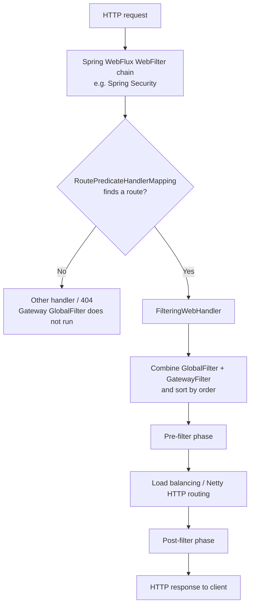
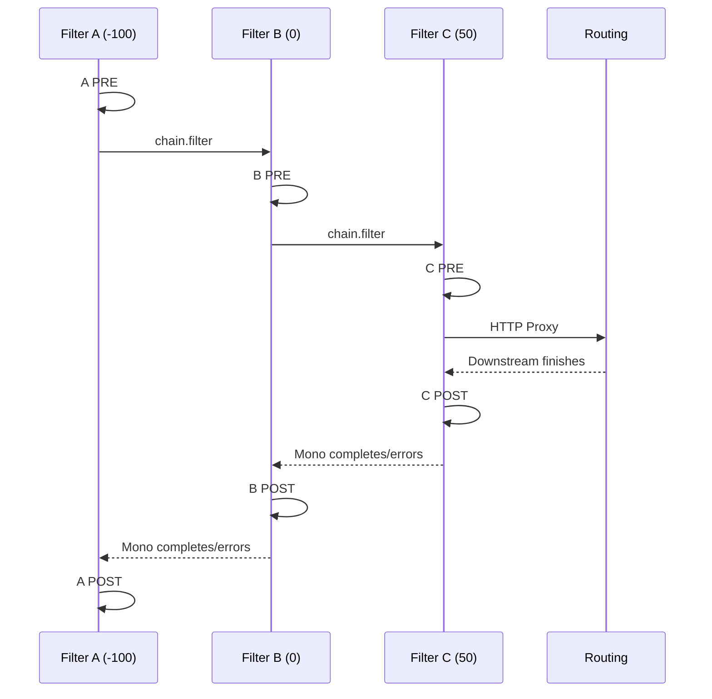
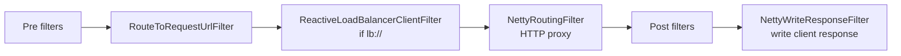
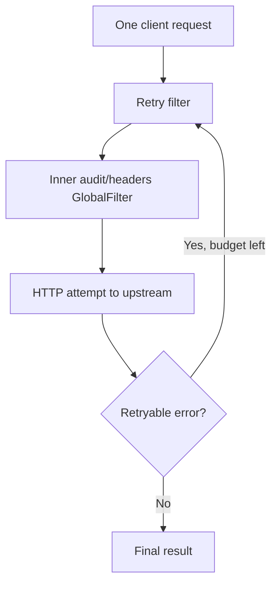

# Writing a GlobalFilter and Choosing Filter Order Deliberately

In **Spring Cloud Gateway Server WebFlux**, a request can pass through many steps before reaching a service: checking route predicates, adding a correlation ID, transforming paths/headers, resolving `lb://` URIs, selecting an instance, applying rate limits, circuit breakers, or retries, and then sending HTTP via Reactor Netty and writing the response back to the client. When a technical requirement must apply across **multiple routes** — such as normalizing tracking headers, collecting processing duration, or blocking requests during maintenance — we can write a **`GlobalFilter`**.

However, writing a filter that works is not enough. **Filter order determines what data a filter sees, how many times it is invoked on retry, and whether the response has already committed.** A filter that sets headers too late may have no effect; a filter using `Thread.sleep()` can stall the event loop; a filter placed after `Retry` can run multiple times and emit duplicate audit events. Therefore, you must design **pre/post phases, `Ordered`, and responsibility boundaries** from the start.

This lesson belongs to the **Custom Filters** chapter of the **SPRING_CLOUD_GATEWAY** module. It applies directly to building an API Gateway with route predicates, filter chains, path/header transformations, service discovery, authentication, traffic limiting, circuit breakers, retries, TLS, and request observability.

After this lesson, you will be able to:

1. Distinguish `GlobalFilter`, `GatewayFilter`, `WebFilter`, and `HttpHeadersFilter`; know when to use each.
2. Understand the **combined filter chain** and precedence rule: a lower order runs **earlier in pre** but **later in post**.
3. Write a `GlobalFilter` in Java using WebFlux reactive APIs, safely adding a correlation ID to both requests and responses.
4. Measure processing latency, handle errors/cancellation, perform intentional short-circuiting, and read route metadata.
5. Choose appropriate ordering relative to `Retry`, `CircuitBreaker`, `RequestRateLimiter`, `RouteToRequestUrlFilter`, `ReactiveLoadBalancerClientFilter`, and `NettyRoutingFilter`.
6. Test pre/post behavior, header mutation, response commit, retries, security, and inspect actual runtime ordering via Actuator.

> **Scope:** This lesson uses **Spring Cloud Gateway Server WebFlux** and **Reactor Netty**; do not treat `GlobalFilter` as a Servlet `Filter` or apply it verbatim to Gateway Server MVC. Official documentation notes that the `GlobalFilter` API may evolve in future milestones. Route examples use the **Gateway Server WebFlux 5.x** namespace `spring.cloud.gateway.server.webflux.routes`; **WebFlux 4.3.x** typically uses `spring.cloud.gateway.routes`. Do not hard-code internal Gateway orders from another version without verifying them at runtime.

## 1. Where Does GlobalFilter Sit in the Request Lifecycle?

Before selecting a route, Spring WebFlux processes requests through `WebFilter` instances and handler mappings. If `RoutePredicateHandlerMapping` finds a matching route, `FilteringWebHandler` builds the Gateway filter chain consisting of:

- Beans implementing **`GlobalFilter`**, applied across requests that have **matched a Gateway route**.
- **`GatewayFilter`** instances declared on the selected route.
- GatewayFilters added through `default-filters` configuration or other route filter mechanisms.

This chain is **sorted by `Ordered`**, not split into two separate groups of "run all globals, then run route filters".



**Do not confuse GlobalFilter with a filter for every HTTP request in Spring Boot.** Requests to actuator endpoints, an internal REST controller, CORS preflight handled elsewhere, or URLs matching no route **may never pass through `GlobalFilter`**. If you need a mandatory policy on **every WebFlux exchange**, look at `WebFilter`/Spring Security or an appropriate ingress layer.

A `GlobalFilter` is "global" within **the scope of the Gateway chain for matched routes**, not a guarantee that every URL passes through it.

### Example Selected Route

```yaml
spring:
  cloud:
    gateway:
      server:
        webflux:
          routes:
            - id: orders-api
              uri: lb://order-service
              predicates:
                - Path=/api/orders/**
              filters:
                - StripPrefix=1
                - AddRequestHeader=X-Edge, gateway
```

When a client calls `GET /api/orders/42`, eligible `GlobalFilter` beans are merged with this route's `StripPrefix` and `AddRequestHeader`. If a different route `catalog-api` is selected, **the same GlobalFilters** can run, merged with catalog's own GatewayFilters.

## 2. Distinguishing GlobalFilter, GatewayFilter, WebFilter, and HttpHeadersFilter

Placing the right responsibility in the right layer matters more than picking a "really small" order number.

| Type | Processing scope | Suitable tasks | Common confusion |
| --- | --- | --- | --- |
| **`GlobalFilter`** | Gateway chain when a route matches | Correlation IDs, shared operational logic, checks based on route metadata | Does not run for every WebFlux handler |
| **`GatewayFilter`** | A single route or routes with default filters | Path rewrite, add/remove headers, retry, per-API circuit breaker | Does not automatically apply gateway-wide |
| **`GatewayFilterFactory`** | Creates configurable `GatewayFilter` from YAML/Java DSL | Reusable filter with route-specific parameters | Different from writing a `GlobalFilter` directly |
| **`WebFilter`** | WebFlux chain before/outside Gateway handlers | Spring Security, CORS, and WebFlux application cross-cutting concerns | `WebFilter` `Ordered` is independent of Gateway order |
| **`HttpHeadersFilter`** | Modifies HTTP headers when Gateway prepares to proxy | Forwarded/X-Forwarded and hop-by-hop header policies | Not a general replacement for the Gateway filter chain |

### Selection Guidelines

- If all routes need a **correlation ID**: a `GlobalFilter` is a strong candidate.
- If only `/api/payments/**` needs a custom policy: prefer a route-configured **GatewayFilter**/factory, or a `GlobalFilter` **explicitly conditional** on metadata.
- If requests that do not match a route must also pass authorization: use **Spring Security WebFlux**, do not expect `GlobalFilter` to execute before security.
- If you only need `StripPrefix`, `AddRequestHeader`, `RemoveRequestHeader`, or `SecureHeaders`, **reuse built-in factories** instead of writing a complex GlobalFilter.
- If your goal is managing `Forwarded` or `X-Forwarded-*`, understand trusted proxy policies and built-in `HttpHeadersFilter` implementations before inserting headers manually.

**Anti-pattern:** Writing a `GlobalFilter` that manually Base64-decodes a JWT, sets `X-User-Id`, and treats that as authentication. JWTs must have their signature, issuer, audience, and expiration verified by **Spring Security Reactive Resource Server**; a GlobalFilter must never turn self-asserted client data into trusted identity.

## 3. GlobalFilter Signature and Reactive Principles

Two foundational APIs:

```java
import org.springframework.cloud.gateway.filter.GlobalFilter;
import org.springframework.cloud.gateway.filter.GatewayFilterChain;
import org.springframework.web.server.ServerWebExchange;
import reactor.core.publisher.Mono;

public interface GlobalFilter {
    Mono<Void> filter(
        ServerWebExchange exchange,
        GatewayFilterChain chain);
}
```

`GlobalFilter.filter(...)` returns a **`Mono<Void>`** — an asynchronous execution plan. Never interpret calling `chain.filter(exchange)` as "the HTTP proxy has definitely completed on that Java line".

Minimal example:

```java
import org.springframework.cloud.gateway.filter.GlobalFilter;
import org.springframework.cloud.gateway.filter.GatewayFilterChain;
import org.springframework.core.Ordered;
import org.springframework.stereotype.Component;
import org.springframework.web.server.ServerWebExchange;

import reactor.core.publisher.Mono;

@Component
public final class SimpleGlobalFilter
        implements GlobalFilter, Ordered {

    @Override
    public int getOrder() {
        return -50;
    }

    @Override
    public Mono<Void> filter(
            ServerWebExchange exchange,
            GatewayFilterChain chain) {

        // PRE: perform lightweight, non-blocking work.
        return chain.filter(exchange);
    }
}
```

`@Component` registers the class as a Spring bean. You can also declare a `@Bean GlobalFilter`; **never use both simultaneously** for the same logic, or the filter may register twice.

`Ordered` is the Spring Core contract Gateway uses to compare ordering. `-50` here is **only an example**, not a "Spring-recommended order for all filters". Always inspect interactions with other GlobalFilters/GatewayFilters and active built-in filters.

### Things You Must Never Do Inside `filter()`

```java
// ANTI-PATTERNS: do not copy into production GlobalFilters
Thread.sleep(500);
webClient.get().uri("/somewhere").retrieve()
    .bodyToMono(String.class).block();
mono.subscribe(); // Fire-and-forget; errors/cancellation are lost
```

- `Thread.sleep` and `block()` can stall the event loop.
- Manual `subscribe()` detaches work from the request lifecycle, disconnects errors from the response, and can let side effects run after client cancellation.
- Writing per-request state into **mutable fields on a singleton bean** causes data corruption across concurrent requests.
- Reading the entire request/response body in a GlobalFilter without a decorator/buffering policy can consume the stream, leaving the backend with an empty body or leaking `DataBuffer` instances.

## 4. Understanding Pre-Phase and Post-Phase Correctly

A GlobalFilter can typically perform:

- **Pre logic**: inspect/modify the request, add headers, decide whether to proceed or short-circuit before delegating downstream.
- **Post logic**: observe completion, update metrics, log, and perform appropriate post-processing **after** the inner filter chain.

Typical shape:

```java
@Override
public Mono<Void> filter(
        ServerWebExchange exchange,
        GatewayFilterChain chain) {

    // PRE logic — before delegating downstream.
    return chain.filter(exchange)
        .doFinally(signalType -> {
            // POST/terminal observation: complete, error, or cancel.
        });
}
```

Diagram with three illustrative filters: A with order `-100`, B with order `0`, C with order `50`.



**Pre** order: A → B → C. **Post** order: C → B → A.

**Formal rule:** The filter with the **highest precedence** (typically the **lowest** order value) runs **first in pre** and **last in post**. That means an outer wrapping filter can measure or post-process the entire inner chain.

### Order Selection Table

| Illustrative filter | `getOrder()` | Pre order | Post order |
| --- | ---: | ---: | ---: |
| A — creates shared context | -100 | 1 | 3 |
| B — records normalized info | 0 | 2 | 2 |
| C — checks route status | 50 | 3 | 1 |

**Never assume "higher order means the filter runs later in every phase".** That is only true for pre; post reverses the order.

### Pre and Post Are Not Two Independent Filters

In Reactor, code running **before** `return chain.filter(exchange)` and logic inside `doFinally`/`then` operators execute at different times. Conditions can change because:

- An intermediate filter **short-circuits** and stops calling `chain.filter`.
- `Retry` resubscribes filters behind it.
- The publisher terminates with an error or cancellation rather than completion.
- The response may have already committed before a filter runs its post logic.
- A `WebFilter` outside Gateway or an error handler may handle the response outside/after this chain.

Therefore, use "post" to describe **position in the reactive chain**, without guaranteeing every response byte has already reached the client.

## 5. Combined Filter Chain: GlobalFilter and GatewayFilter Are Not Layered Separately

Per Gateway documentation, when a route matches, `FilteringWebHandler` combines `GlobalFilter` and `GatewayFilter` instances and sorts them together by `Ordered`.

Suppose we have:

- Global A: order `-100`.
- Route filter X: order `-50`.
- Global B: order `0`.
- Route filter Y: order `20`.
- Global C: order `100`.

Illustration:

```text
PRE:
  Global A (-100)
    Route X (-50)
      Global B (0)
        Route Y (20)
          Global C (100)
            HTTP routing

POST:
  Global C (100)
    Route Y (20)
      Global B (0)
        Route X (-50)
          Global A (-100)
```

That means it is **not**:

```text
Wrong:
  run all GlobalFilters
  -> run all GatewayFilters
  -> call backend
```

### When `Ordered` Is Not Explicitly Attached

Many `GatewayFilter` instances created from YAML are wrapped in `OrderedGatewayFilter` with an order derived from their position in the filter list, unless the factory/filter layer sets an explicit order. `default-filters` and route filters can be numbered independently and then stable-sorted according to Gateway's version rules.

**Never** rely on two filters sharing the same order number for strict security or correctness invariants. If two filters require "sanitize first, then add trusted header", give them **distinct, tested orders** or combine them into a single component with a clear contract.

### Route Order vs. Filter Order

A route can have an `order` property to prioritize route selection when multiple predicates match. This property is **not** GlobalFilter/GatewayFilter ordering.

```yaml
# Distinguish the two meanings of order
- id: orders-api
  order: 10         # Priority for ROUTE SELECTION when multiple routes match
  uri: http://localhost:8081
  predicates:
    - Path=/api/orders/**
  filters:
    - StripPrefix=1 # GatewayFilter order in the route chain
```

Do not change `route.order` to fix "GlobalFilter sets header after RewritePath"; adjust filter logic/ordering instead.

## 6. Complete Java Example: Correlation ID Normalizing GlobalFilter

Requirements:

1. Clients may send `X-Correlation-Id` to assist trace lookup.
2. Gateway keeps the ID only if it matches a safe format; otherwise it generates a UUID.
3. Gateway **overwrites** the request header with a single normalized value and forwards that value upstream.
4. Gateway adds the same ID to the **response header before the response commits**.
5. Never treat correlation IDs as JWTs, API keys, or proof of identity.

```java
package example.gateway.filters;

import java.util.UUID;
import java.util.regex.Pattern;

import org.springframework.cloud.gateway.filter.GlobalFilter;
import org.springframework.cloud.gateway.filter.GatewayFilterChain;
import org.springframework.core.Ordered;
import org.springframework.http.server.reactive.ServerHttpRequest;
import org.springframework.stereotype.Component;
import org.springframework.web.server.ServerWebExchange;

import reactor.core.publisher.Mono;

@Component
public final class CorrelationIdGlobalFilter
        implements GlobalFilter, Ordered {

    private static final String HEADER = "X-Correlation-Id";

    // Prevent CR/LF, whitespace, or overly long strings from entering logs/headers.
    private static final Pattern SAFE_ID =
        Pattern.compile("[A-Za-z0-9._-]{1,64}");

    @Override
    public int getOrder() {
        // Example: adjust according to your application's actual filter order.
        return -50;
    }

    @Override
    public Mono<Void> filter(
            ServerWebExchange exchange,
            GatewayFilterChain chain) {

        String supplied = exchange.getRequest()
            .getHeaders().getFirst(HEADER);

        String id = supplied != null
                && SAFE_ID.matcher(supplied).matches()
            ? supplied
            : UUID.randomUUID().toString();

        // ServerHttpRequest is immutable: mutate and pass the new exchange.
        ServerHttpRequest request = exchange.getRequest()
            .mutate()
            .headers(headers -> headers.set(HEADER, id))
            .build();

        ServerWebExchange updated = exchange.mutate()
            .request(request)
            .build();

        // Register before proxying/delegating to the next filter.
        updated.getResponse().beforeCommit(() -> {
            updated.getResponse().getHeaders().set(HEADER, id);
            return Mono.empty();
        });

        return chain.filter(updated);
    }
}
```

### Why Use `exchange.mutate()`?

In WebFlux, `ServerHttpRequest` and `ServerWebExchange` use decorator/mutation APIs. The following snippet is **not enough**:

```java
// WRONG: builds a new request and discards it.
exchange.getRequest()
    .mutate()
    .header("X-Correlation-Id", "abc")
    .build();

return chain.filter(exchange); // upstream still sees the old exchange
```

The right pattern is creating the new request and passing it via **`chain.filter(updatedExchange)`** as shown. Use `headers.set` rather than `add` to avoid keeping unwanted multiple values on a public header; for security-relevant policies, strip/overwrite untrusted headers **before** the backend reads them.

### Why Not Accept Any Correlation ID from Clients?

Clients can send huge values, control characters, or log-forging strings. The regex `[A-Za-z0-9._-]{1,64}` illustrates a **risk-reduction** measure; it does not make the value a trusted identity.

When you need an **edge-owned trace ID**, you can **always generate a fresh ID** instead of keeping client-supplied values, or use a distributed tracing system with its own trust policy. `X-Correlation-Id` must never be used as an authorization key, quota billing key, or user verification token.

### Practical Scope

`CorrelationIdGlobalFilter` runs for **requests that match a Gateway route**. If you want the correlation ID on every response including 404s from other handlers or 401s from Spring Security before routing, use a `WebFilter`/Spring Security mechanism or appropriate ingress instrumentation.

## 7. Modifying Response Headers: Before Commit or After Chain?

The response status/headers may already be flushed by the time post-phase filters execute. Therefore, these two approaches are not equivalent:

```java
// RISKY: the response may already be committed when then() runs.
return chain.filter(exchange)
    .then(Mono.fromRunnable(() ->
        exchange.getResponse()
            .getHeaders()
            .set("X-Correlation-Id", "abc")));
```

```java
// BETTER when you need to write headers before commit.
exchange.getResponse().beforeCommit(() -> {
    exchange.getResponse()
        .getHeaders()
        .set("X-Correlation-Id", "abc");
    return Mono.empty();
});
return chain.filter(exchange);
```

`beforeCommit` lets you register a callback **before** the response commits so headers are set at the right lifecycle moment. The callback must be **lightweight**—no blocking I/O or external service calls. If a filter is only invoked **after the response has committed**, registering a callback cannot turn back time.

### Do Not Mix Up Response Headers and Response Bodies

- Setting response headers on time is different from **reading/transforming the response body**.
- When modifying a body, use `ModifyResponseBody` or supported decorator/codec mechanisms; never read `DataBuffer` directly with `block()`.
- With streaming/SSE, bodies can be long-lived; never buffer the whole body in memory just to insert a header.
- Once `NettyWriteResponseFilter` starts writing the response, changing status/body may no longer be possible.
- Headers added by the backend can be modified/overwritten by Gateway or another proxy; verify the **final response seen by the client**, not just metadata inside the filter.

### Is the Response Already Committed?

```java
boolean committed = exchange.getResponse().isCommitted();
```

Use this for diagnostics, **not** as your primary branch for setting headers too late. If you need to guarantee a response header, register the callback in the **pre-phase**.

## 8. A GlobalFilter Measuring Latency and Cancellation

Another common need is measuring elapsed time from when a GlobalFilter enters processing until the publisher terminates. Use `System.nanoTime()` instead of wall-clock `System.currentTimeMillis()` for elapsed durations.

```java
package example.gateway.filters;

import org.slf4j.Logger;
import org.slf4j.LoggerFactory;

import org.springframework.cloud.gateway.filter.GlobalFilter;
import org.springframework.cloud.gateway.filter.GatewayFilterChain;
import org.springframework.cloud.gateway.route.Route;
import org.springframework.core.Ordered;
import org.springframework.stereotype.Component;
import org.springframework.web.server.ServerWebExchange;

import reactor.core.publisher.Mono;

import static org.springframework.cloud.gateway.support
    .ServerWebExchangeUtils.GATEWAY_ROUTE_ATTR;

@Component
public final class TimingGlobalFilter
        implements GlobalFilter, Ordered {

    private static final Logger log =
        LoggerFactory.getLogger(TimingGlobalFilter.class);

    @Override
    public int getOrder() {
        return -40;
    }

    @Override
    public Mono<Void> filter(
            ServerWebExchange exchange,
            GatewayFilterChain chain) {

        // defer ensures timing starts at publisher subscription time.
        return Mono.defer(() -> {
            long started = System.nanoTime();

            return chain.filter(exchange)
                .doFinally(signal -> {
                    long elapsedMs =
                        (System.nanoTime() - started) / 1_000_000;

                    Route route = exchange.getAttribute(
                        GATEWAY_ROUTE_ATTR);

                    String routeId = route != null
                        ? route.getId() : "unknown";

                    log.debug(
                        "routeId={} signal={} elapsedMs={}",
                        routeId, signal, elapsedMs);
                });
        });
    }
}
```

**Why `doFinally` instead of only `doOnSuccess`?** `doFinally` fires whether the publisher completes normally, terminates with an error, or is **canceled**. In an API Gateway, clients frequently disconnect during slow upstreams or retries; cancellation is a critical operational signal.

**Why `Mono.defer`?** It aligns the start timestamp with each subscription, avoiding measuring time from when Java constructed the publisher before execution began. This is especially valuable when the filter chain involves resubscription due to retries or other reactive operators.

### Measurement Scope Limits

`elapsedMs` measures **the lifecycle of the publisher wrapped by this filter**; it does not automatically include time spent in ingress proxies, Spring Security before Gateway, client TLS handshakes, or network delivery of the final bytes. Filter order changes which parts of the chain are wrapped.

For standardized production telemetry:

- Prefer built-in Gateway/Micrometer metrics such as `spring.cloud.gateway.requests` when applicable.
- Record route ID, HTTP status, outcome, and latency using tags with bounded cardinality.
- Use distributed tracing/OpenTelemetry rather than building a custom trace system lacking propagation.
- Never put paths containing user IDs, sensitive URL queries, bearer tokens, or raw correlation IDs into unbounded metric labels.

## 9. Ordering Multiple Custom GlobalFilters

Suppose the operations team has three requirements:

1. Normalize correlation ID so downstream filters can read it.
2. Measure duration of the Gateway filter chain.
3. Check whether the route is enabled during maintenance windows.

You can organize the order of **your custom filter group** as follows:

| Custom filter | Example order | Rationale |
| --- | ---: | --- |
| `CorrelationIdGlobalFilter` | -50 | Header is normalized before timing/logging filters |
| `TimingGlobalFilter` | -40 | Measures the portion of the chain after it |
| `MaintenanceGlobalFilter` | -30 | Can short-circuit based on route metadata |

When all three are sorted by those orders:

```text
PRE:
  CorrelationId(-50)
    Timing(-40)
      Maintenance(-30)
        ... other filters ...
POST:
  ... other filters ...
      Maintenance(-30)
    Timing(-40)
  CorrelationId(-50)
```

**However**, this only defines the **relative relationship among the three custom filters**; it does not guarantee they sit before `RouteToRequestUrlFilter`, `ReactiveLoadBalancerClientFilter`, `NettyRoutingFilter`, or every route GatewayFilter. Built-in filters use their own orders, which can change across releases.

### Do Not Treat `-50` as a Universal Constant

Another project might have:

- A route GatewayFilter with order `-100`.
- A custom security GlobalFilter with order `-60`.
- A GatewayFilter wrapped with `OrderedGatewayFilter` at order `0`.
- Built-in filters with negative or very large orders.

When adding a filter, list **all existing filters**, map data dependencies, pick a position, and write tests. Do not "solve" ordering by putting `Ordered.HIGHEST_PRECEDENCE` on every custom filter: multiple highest-precedence filters compete with one another and become hard to maintain.

## 10. Conditional GlobalFilter Using Route Metadata

Not every route needs the same logic. If only `orders-api` needs a maintenance check, read the matched `Route` from the exchange:

```java
import org.springframework.cloud.gateway.route.Route;

import static org.springframework.cloud.gateway.support
    .ServerWebExchangeUtils.GATEWAY_ROUTE_ATTR;

Route route = exchange.getAttribute(GATEWAY_ROUTE_ATTR);

if (route == null) {
    return chain.filter(exchange);
}

Object flag = route.getMetadata().get("maintenance");
if (!Boolean.TRUE.equals(flag)) {
    return chain.filter(exchange);
}
```

This is a **logic fragment** inside a `GlobalFilter.filter` implementation. The `maintenance` key is **application-defined metadata**, not a built-in Gateway property automatically understood as maintenance mode.

Route declaration:

```yaml
spring:
  cloud:
    gateway:
      server:
        webflux:
          routes:
            - id: orders-api
              uri: http://localhost:8081
              predicates:
                - Path=/api/orders/**
              metadata:
                maintenance: true
              filters:
                - StripPrefix=1

            - id: catalog-api
              uri: http://localhost:8082
              predicates:
                - Path=/api/catalog/**
```

Now the same GlobalFilter can apply custom handling only to `orders-api`. When metadata is absent or another route is matched, the request proceeds normally.

### Why Is Metadata Better Than Hard-Coding Route Names?

Code like:

```java
if ("orders-api".equals(route.getId())) {
    // custom policy
}
```

is easy to write, yet route IDs can change during deployments, v1/v2 splits, or discovery locator auto-generation. Metadata expresses **route intent**, making code less coupled to specific ID strings. Even so, metadata must come from trusted configuration management; **never read a maintenance flag from a client-sent header**.

## 11. Short-Circuiting: When Not to Call `chain.filter`?

A `GlobalFilter` can stop a request before HTTP proxying when policy permits, such as when a route is under maintenance.

```java
package example.gateway.filters;

import org.springframework.cloud.gateway.filter.GlobalFilter;
import org.springframework.cloud.gateway.filter.GatewayFilterChain;
import org.springframework.cloud.gateway.route.Route;
import org.springframework.core.Ordered;
import org.springframework.http.HttpStatus;
import org.springframework.stereotype.Component;
import org.springframework.web.server.ServerWebExchange;

import reactor.core.publisher.Mono;

import static org.springframework.cloud.gateway.support
    .ServerWebExchangeUtils.GATEWAY_ROUTE_ATTR;

@Component
public final class MaintenanceGlobalFilter
        implements GlobalFilter, Ordered {

    @Override
    public int getOrder() {
        return -30;
    }

    @Override
    public Mono<Void> filter(
            ServerWebExchange exchange,
            GatewayFilterChain chain) {

        Route route = exchange.getAttribute(GATEWAY_ROUTE_ATTR);

        boolean maintenance = route != null
            && Boolean.TRUE.equals(
                route.getMetadata().get("maintenance"));

        if (!maintenance) {
            return chain.filter(exchange);
        }

        exchange.getResponse().setStatusCode(
            HttpStatus.SERVICE_UNAVAILABLE);

        // Only set Retry-After when there is a realistic expected recovery window.
        exchange.getResponse().getHeaders()
            .set("Retry-After", "60");

        return exchange.getResponse().setComplete();
    }
}
```

During maintenance:

- The filter **does not call `chain.filter(exchange)`**, so downstream GatewayFilters and routing do not run.
- Gateway returns `503` directly; the backend receives no request.
- Filters placed **before** it can still execute their post/terminal callbacks.
- You cannot assume downstream filters ran or that metrics reflect normal proxy execution.
- If `Retry` sits outside this filter and retries `503`, it could accidentally repeat the short-circuit; design order/policies to prevent that.

**Warning:** `Retry-After: 60` is only appropriate if the service is expected to recover around that window; otherwise, do not advertise an unfounded recovery time. In production, maintenance flags/windows should be governed, tested, and have a rollback procedure.

### Returning JSON When Short-Circuiting?

You can use `ServerHttpResponse.writeWith` with `DataBuffer` in WebFlux, provided you manage buffers, charset, content length, and cancellation. For standardized errors, configuring an error handler or WebFlux controller is often easier to maintain. Never write a body again after `setComplete()` has committed the response.

## 12. Placing GlobalFilter Before or After Route/Path Transformation?

Suppose a route has:

```yaml
filters:
  - StripPrefix=1
  - SetRequestHeader=X-Service-Version, v2
```

For a client request `GET /api/orders/42`:

- **Before `StripPrefix`**, the request path is typically `/api/orders/42`.
- **After `StripPrefix`**, the forwarded exchange sees the transformed path, e.g., `/orders/42`.
- The route URI may not yet be resolved into `GATEWAY_REQUEST_URL_ATTR` at early orders.
- Once `RouteToRequestUrlFilter` has run, `GATEWAY_REQUEST_URL_ATTR` may hold the route URI combined with the path.
- Once `ReactiveLoadBalancerClientFilter` has resolved `lb://`, that attribute may hold the chosen instance's host/port.
- Once `NettyRoutingFilter` performs routing, the HTTP client response may reside in `CLIENT_RESPONSE_ATTR`.

### Key Exchange Attributes

| Exchange attribute | Typically set/used by | When needed |
| --- | --- | --- |
| `GATEWAY_ROUTE_ATTR` | Route mapping/handler | Inspecting matched route ID, URI, and route metadata |
| `GATEWAY_REQUEST_URL_ATTR` | Route-to-request-url, load balancer, routing filters | Determining the outbound target across stages |
| `GATEWAY_ORIGINAL_REQUEST_URL_ATTR` | Certain rewrite/routing filters | Referencing saved original URIs |
| `GATEWAY_SCHEME_PREFIX_ATTR` | Routing/load-balancing logic | Distinguishing scheme prefixes such as `lb` |
| `CLIENT_RESPONSE_ATTR` | Netty HTTP routing | Response details from the Reactor Netty client |
| `GATEWAY_ALREADY_ROUTED_ATTR` | Routing state | Avoiding unintended re-routing of a request |

**Do not read an attribute too early** and assume it must exist; and **do not directly overwrite internal attributes** when your goal is merely adding a header or rewriting a path — use built-in filter factories instead.

### Wrong-Timing Example

```java
// May be null if GlobalFilter runs before RouteToRequestUrlFilter.
URI uri = exchange.getAttribute(
    ServerWebExchangeUtils.GATEWAY_REQUEST_URL_ATTR);
```

You cannot assume `uri` is `http://instance:port` just because the route has `lb://service`. If you need to log the actual outbound instance, place instrumentation at the right stage after instance selection or use LoadBalancer/HTTP client metrics and tracing, rather than assigning a huge negative order to a GlobalFilter and trying to read the URI.

## 13. Interactions with NettyRoutingFilter and NettyWriteResponseFilter

Two key built-in GlobalFilters in Gateway Server WebFlux:

1. **`NettyRoutingFilter`**: when the outbound URI is `http/https`, uses Reactor Netty `HttpClient` to send the request to the backend and places the HTTP client response in `CLIENT_RESPONSE_ATTR`.
2. **`NettyWriteResponseFilter`**: when a Netty client response is present, participates in the post phase to write the response back to the client. Per documentation, it handles writing after appropriate filters complete.



The diagram shows **logical processing order**, not an exact list of numeric orders for all built-in GlobalFilters.

### Choosing Order Based on Required Data

| Goal | Suggested timing | Pitfall |
| --- | --- | --- |
| Add correlation ID before sending upstream | Pre, before HTTP routing | Header mutation must forward the new exchange |
| Modify public path | Before creating/using outbound request URL; prefer built-in filters | Rewriting after route-to-url may not behave as expected |
| Record route ID | After route match, typically early GlobalFilter | Does not run for unmatched requests |
| Record backend instance | After LoadBalancer resolution at an appropriate stage/instrumentation | `lb://` is not necessarily resolved when an early filter runs |
| Add response header | Register `beforeCommit` early | Post logic may encounter an already committed response |
| Read HTTP client response | After routing and at an appropriate phase, if supported by implementation | Attribute can be null for `forward://`/fallback/cached responses |
| Modify response body | Version-appropriate `ModifyResponseBody`/response decorator | Avoid reading stream directly and leaking `DataBuffer` |
| Collect full-route latency | Filter wrapping the measured segment + standard metrics | Publisher timing is not necessarily full end-to-end |

**Do not copy internal order constants** such as `10000` or `2147483647` from a blog post into production as a permanent contract. Inspect `/actuator/gateway/globalfilters` on the exact deployed binary, and re-run ordering tests whenever upgrading Gateway.

## 14. Interactions with Retry, CircuitBreaker, and RequestRateLimiter

This is a subtle source of operational bugs.

The `Retry GatewayFilter` documentation emphasizes that **Retry re-executes filters positioned after it**. When a GlobalFilter is ordered **after** Retry in the combined chain, that filter's code can execute multiple times due to retries.



### Impact of Misordering Filters

| Custom filter | If placed after Retry | Risk |
| --- | --- | --- |
| Writes "request billed" audit | May execute on every attempt | Billing/audit duplication |
| Adds a fresh timestamp | Each attempt gets a different timestamp | Hard to distinguish logical request vs. attempt |
| Calls external service for identity | May re-invoke repeatedly | Increased load and latency, IdP dependency |
| Records attempt metrics | May be **intended** | Metric name must clearly say "attempt" |
| Checks quota | May deduct quota multiple times on retries | Must intentionally design for logical request vs. attempt |
| Generates a new correlation ID | May emit different IDs across attempts | Breaks trace continuity |

**Solution:** Separate two kinds of work:

- **Once per logical request:** position/order it outside Retry, use controlled exchange state, or move the logic to a suitable layer.
- **Per attempt:** place instrumentation where each outbound attempt is visible; never report it as client request count.

### CircuitBreaker Outside or Inside Retry?

- **CircuitBreaker outside Retry** generally evaluates the outcome of the whole retry sequence as one logical call.
- **Retry outside CircuitBreaker** can cause the breaker to count individual attempts and open sooner.
- Fallbacks can short-circuit and turn errors into different responses, affecting an outer Retry.
- Resilience4j `TimeLimiter` is a separate deadline from HTTP client timeouts and can wrap the entire retry sequence or each attempt depending on filter order.

**Never assume** that because a GlobalFilter has order `-50` it definitely sits outside every Retry filter: route GatewayFilters can have custom orders; inspect the effective chain.

### Rate Limiting and Security Errors

`RequestRateLimiter` needs a trustworthy key, such as a principal verified by Spring Security. A `GlobalFilter` must never treat a client-sent `X-User-Id` header as a trusted key. If the rate limiter runs behind Retry, it may deduct quota per attempt unintentionally.

Spring Security can return `401/403` before the Gateway chain; authentication/authorization errors **should not** be treated by upstream Retry or CircuitBreaker as backend health failures.

## 15. Proper Error Handling: Never Swallow Exceptions or Write Responses Twice

An observational filter should **observe errors** without breaking the HTTP contract:

```java
return chain.filter(exchange)
    .doOnError(error -> {
        // Log normalized error type; never print tokens/cookies/bodies.
        log.warn("Gateway chain failed: {}",
            error.getClass().getSimpleName());
    });
```

Never do this unconditionally:

```java
// WRONG: swallows all errors, turning failed requests into fake completions.
return chain.filter(exchange)
    .onErrorResume(error -> Mono.empty());
```

Swallowing errors deprives Spring Security, HTTP transport, retry/circuit breakers, and error handlers of accurate signals. If you must translate an error into a response, apply a **clear per-error-type policy**, verify the response is uncommitted, and avoid leaking stack traces or internal URIs.

### Cancellation

When a client disconnects, the reactive publisher may receive `CANCEL`. Avoid:

- Spawning a separate `subscribe()` to "finish the work" after the request was canceled.
- Retrying side-effecting calls despite client cancellation.
- Assuming cancellation guarantees the backend rolled back its transaction.
- Writing a "success" audit record based on an ambiguous downstream signal.

When metrics must distinguish completion from cancellation, use `doFinally(SignalType)` and inspect normalized context/request IDs.

### Concurrent Requests

A `GlobalFilter` bean is typically a **singleton** invoked concurrently by many requests. Never put `requestId`, `startTime`, or `userId` in instance fields:

```java
// WRONG: mutable fields shared across all concurrent requests.
private String currentRequestId;
private long startedAt;
```

Use local variables inside `filter(...)`, non-colliding keys in `exchange.getAttributes()`, or Reactor Context when passing data along the reactive chain.

## 16. WebFlux Performance: Event Loop, Body, and Backpressure

A GlobalFilter applied across many routes is a hot path for the entire Gateway. Any small performance flaw is multiplied by total system traffic.

### Never Block the Event Loop

- Never call `RestTemplate`, synchronous JDBC, or `WebClient.block()` directly inside `filter(...)`.
- If HTTP calls are needed, use reactive `WebClient` with bounded timeouts and explicit error handling.
- For unavoidable blocking libraries, you can offload with `Schedulers.boundedElastic()` **under strict control**, while evaluating queue/saturation behavior and avoiding turning Gateway into a heavy business-logic tier.
- Avoid excessive synchronous logging at high QPS or serializing large bodies just for debugging.
- Do not retain resources past the request lifecycle; clean up cleanly on cancellation/error.

Example offloading an unavoidable blocking call (illustrative only):

```java
Mono<String> lookup = Mono.fromCallable(() ->
        legacyBlockingClient.lookupSmallValue())
    .subscribeOn(Schedulers.boundedElastic());

// If the lookup value is genuinely needed before proxying:
return lookup.flatMap(value -> {
    ServerHttpRequest request = exchange.getRequest()
        .mutate()
        .headers(h -> h.set("X-Lookup-Value", value))
        .build();

    return chain.filter(
        exchange.mutate().request(request).build());
});
```

This pattern is **not an endorsement for putting remote lookups in every GlobalFilter**. If unavoidable, add timeouts, circuit breakers, concurrency limits, and valid fallbacks. Often it is better for the backend to fetch the data itself or use a proper cache.

### Reading/Modifying Request Bodies

In WebFlux, the request body is a `Flux<DataBuffer>` — data is consumed via reactive subscription. Reading the body in a GlobalFilter without replaying bytes upstream leaves the request without a body. Unbounded body caching can trigger out-of-memory errors, especially on uploads/multipart payloads.

**Prefer:** `ModifyRequestBody`, `ModifyResponseBody`, or Gateway-supported factories/codecs. If writing a custom decorator is unavoidable, manage `DataBuffer` ownership, backpressure, memory limits, and release lifecycles properly—never use manual `subscribe()`.

### Streaming / SSE / WebSocket

- SSE is a long-lived response; `doFinally` may only fire when the stream finishes or cancels.
- Response headers must be set before commit, typically right as streaming begins.
- WebSocket has its own routing branch and handshake; do not assume all behaviors mirror HTTP GET/POST proxying.
- Never buffer an entire stream just to count bytes or attach a correlation ID.

## 17. Practice: Running GlobalFilters with Orders and Catalog Routes

### 17.1. Preparing the Test Environment

- Compatible Gateway Server WebFlux and Spring Boot/Spring Cloud release train.
- Two test HTTP backends: one on `localhost:8081` serving `GET /orders/42`, and one on `localhost:8082` serving `GET /catalog/products/7`.
- The three custom filter beans `CorrelationIdGlobalFilter`, `TimingGlobalFilter`, and `MaintenanceGlobalFilter` from the examples.
- Route `orders-api` with `maintenance: false`, and route `catalog-api` with maintenance enabled to test short-circuiting.

```yaml
spring:
  cloud:
    gateway:
      server:
        webflux:
          routes:
            - id: orders-api
              uri: http://localhost:8081
              predicates:
                - Path=/api/orders/**
              metadata:
                maintenance: false
              filters:
                - StripPrefix=1

            - id: catalog-api
              uri: http://localhost:8082
              predicates:
                - Path=/api/catalog/**
              metadata:
                maintenance: true
              filters:
                - StripPrefix=1
```

### 17.2. Calling a Normal Active Route

```bash
curl -i \
  -H "X-Correlation-Id: ui-request_123" \
  http://localhost:8080/api/orders/42
```

Expected behavior:

1. The request routes to `orders-api`.
2. `CorrelationIdGlobalFilter` keeps the ID because it is valid and sets the response header.
3. The backend receives `X-Correlation-Id: ui-request_123`.
4. `StripPrefix=1` ensures the backend receives path `/orders/42`.
5. `TimingGlobalFilter` logs route ID, terminal signal, and chain duration.
6. The response carries `X-Correlation-Id` if the handler/route executed and no other layer overwrote it.

When passing an invalid ID—such as one containing spaces or exceeding 64 characters—Gateway generates a fresh UUID. **Never** put real tokens into test commands.

### 17.3. Calling a Route Under Maintenance

```bash
curl -i http://localhost:8080/api/catalog/products/7
```

Expected: `MaintenanceGlobalFilter` sees `metadata.maintenance=true` and returns `503` without proxying to the catalog backend. Verify the backend records no request.

### 17.4. When No Route Exists

```bash
curl -i http://localhost:8080/not-a-gateway-route
```

Because no route matches, GlobalFilters do not necessarily run and `X-Correlation-Id` may **be absent**. This is not a bug in `CorrelationIdGlobalFilter`; it is by design. If your API contract requires the ID on all 404/401 errors, implement it in a `WebFilter`, error handler, or ingress layer.

### 17.5. Testing Before and After Commit

Build a backend that returns a slow or streaming response in staging:

- Confirm headers registered via `beforeCommit` are returned.
- Try setting a header using `then(Mono.fromRunnable(...))` after `chain.filter` to see why that approach is unreliable.
- Observe client stream cancellation: `doFinally` receives `CANCEL`.
- Ensure no `IllegalStateException` occurs and no payload is leaked into logs.

## 18. Unit Testing with MockServerWebExchange and StepVerifier

You do not need real TCP networking to verify **GlobalFilter mutation** and short-circuiting. You can use Spring WebFlux mocks and Reactor Test.

Example test for `CorrelationIdGlobalFilter`:

```java
import java.util.concurrent.atomic.AtomicReference;

import org.junit.jupiter.api.Test;
import org.springframework.cloud.gateway.filter.GatewayFilterChain;
import org.springframework.mock.http.server.reactive.MockServerHttpRequest;
import org.springframework.mock.web.server.MockServerWebExchange;

import reactor.test.StepVerifier;

import static org.assertj.core.api.Assertions.assertThat;

class CorrelationIdGlobalFilterTest {

    @Test
    void normalizesHeaderAndAddsResponseHeaderBeforeCommit() {
        var exchange = MockServerWebExchange.from(
            MockServerHttpRequest.get("/api/orders/42")
                .header("X-Correlation-Id", "invalid id!")
                .build());

        AtomicReference<String> seenByNext =
            new AtomicReference<>();

        GatewayFilterChain next = mutated -> {
            seenByNext.set(mutated.getRequest()
                .getHeaders()
                .getFirst("X-Correlation-Id"));

            // setComplete() triggers commit on the mock response.
            return mutated.getResponse().setComplete();
        };

        StepVerifier.create(
                new CorrelationIdGlobalFilter()
                    .filter(exchange, next))
            .verifyComplete();

        String id = seenByNext.get();

        assertThat(id).isNotBlank();
        assertThat(id).matches("[A-Za-z0-9._-]{1,64}");
        assertThat(id).isNotEqualTo("invalid id!");

        assertThat(exchange.getResponse().getHeaders()
            .getFirst("X-Correlation-Id"))
            .isEqualTo(id);
    }
}
```

Requires compatible `spring-boot-starter-test` and `reactor-test` dependencies. The test mocks a downstream filter calling `setComplete()`; it **does not** test load balancing, Netty HTTP client, or overall filter ordering.

### Testing Maintenance Short-Circuit

With a mock exchange, attach a mock `Route` or route object with `metadata.maintenance=true` to `GATEWAY_ROUTE_ATTR`, and use a stub `GatewayFilterChain` that counts invocations. Criteria:

- When maintenance is true: response is `503` and **the chain does not run**.
- When maintenance is false: the chain runs **exactly once**.
- When no route attribute is present: the filter does not throw `NullPointerException`.
- Response header/`Retry-After` appears only according to policy.

### Why Unit Tests Are Not Enough

A unit test calling the filter directly **does not invoke `FilteringWebHandler`** and does not sort GlobalFilters alongside route filters. To verify real ordering:

- Use `@SpringBootTest(webEnvironment = RANDOM_PORT)` with Gateway and a backend stub.
- Call via `WebTestClient` or `curl`.
- Record ordered pre/post markers in staging.
- Inspect `/actuator/gateway/globalfilters` and `/actuator/gateway/routes/{id}/combinedfilters` when those endpoints are supported.
- Test with `Retry`, `CircuitBreaker`, and multiple concurrent/canceled requests.

## 19. Inspecting Running Order and Filters with Actuator

Spring Cloud Gateway provides Actuator endpoints to inspect GlobalFilters and their order values. On compatible Gateway WebFlux 5.x/Spring Boot versions, read-only configuration typically looks like:

```properties
management.endpoint.gateway.access=read-only
management.endpoints.web.exposure.include=gateway
```

After **securing the network and authentication** for the management channel:

```bash
# Runtime global filters and orders
curl -s http://localhost:8080/actuator/gateway/globalfilters

# Route definitions and route filters
curl -s http://localhost:8080/actuator/gateway/routes

# Combined filter list when supported by endpoint/version
curl -s \
  http://localhost:8080/actuator/gateway/routes/orders-api/combinedfilters
```

Example `/actuator/gateway/globalfilters` response might contain:

```json
{
  "example.gateway.filters.CorrelationIdGlobalFilter@123": -50,
  "example.gateway.filters.TimingGlobalFilter@456": -40,
  "example.gateway.filters.MaintenanceGlobalFilter@789": -30,
  "org.springframework.cloud.gateway.filter.NettyWriteResponseFilter@abc": -1,
  "org.springframework.cloud.gateway.filter.RouteToRequestUrlFilter@def": 10000
}
```

This is a **structural illustration**, not required exact output. Built-in filter values and class names may differ in your actual version; the endpoint may return additional filters or different ordering.

**Note:** `/actuator/gateway/routefilters` may list factories rather than filter instances in the combined chain; some order fields may be `null`. To verify ordering for a **specific route**, inspect combined filters via the supported endpoint and trace/log real requests.

### Do Not Enable Route Mutation Permissions Just for Debugging

Gateway Actuator can expose APIs to add/delete/refresh routes if granted high privileges. When you only need to inspect orders, choose **read-only** and restrict access. Never expose operational endpoints to the public Internet or allow anonymous access, as they can leak route IDs, backend URIs, and infrastructure topology.

## 20. Common Issues and How to Handle Them

| Symptom | Possible cause | How to check |
| --- | --- | --- |
| GlobalFilter does not run | Not a Spring bean, request matches no route, app uses MVC | Check `@Component`/`@Bean`, route IDs, and WebFlux starter |
| Filter runs twice | Annotated `@Component` AND registered `@Bean`; Retry re-executes inner filter | Check bean registrations and order relative to Retry |
| Two custom filters run in wrong order | Duplicate/wrong `getOrder()`, ignoring combined GatewayFilter + GlobalFilter chain | Inspect Actuator global/combined filters |
| Pre is right, post looks reversed | Post-phase reverses due to nested reactive chain | Draw pre/post diagram by order |
| Upstream header unchanged | Built `request.mutate().build()` but passed old exchange | Use `exchange.mutate().request(request).build()` |
| Response header missing | Set inside `then()` after response committed | Register `beforeCommit` during pre |
| `UnsupportedOperationException` modifying headers | Mutating unmodifiable map or wrong lifecycle timing | Use proper mutation/`beforeCommit` API |
| Negative/skewed latency readings | Used wall clock instead of monotonic clock, wrong measurement scope | Use `System.nanoTime()` and place filter accurately |
| No log when client disconnects | Used only `doOnSuccess` | Use `doFinally` to observe cancel/error |
| 401/403 lacks correlation ID | Security rejected before Gateway route chain | Use WebFilter/edge tracing across all exchanges |
| Request body empty after GlobalFilter | Filter consumed body without replaying downstream | Use `ModifyRequestBody` or a proper body decorator |
| System-wide slowdown | Filter calls blocking I/O on event loop | Use reactive clients or controlled offloading |
| 503 without calling backend | Maintenance filter short-circuited or LoadBalancer lacks instances | Check filter branch, route ID, and discovery |
| Unable to change response status | Response already committed in Netty/write layer | Decide before commit; never write twice |
| Metrics doubled after Retry | Filter sits behind Retry or resubscription occurred | Separate logical request vs. per-attempt metrics |
| User identity leak | Trusted client-sent header instead of verified JWT | Use Spring Security and strip untrusted headers |
| GlobalFilter fails only on streaming routes | Body buffering incompatible with SSE/large responses | Test streaming and backpressure separately |
| Order changes after upgrade | Relied on old built-in order constants | Check Actuator and run integration tests on new version |
| Route metadata flag ignored | Not bound, or wrong key/type | Inspect active route metadata and `Boolean.TRUE` |
| CORS preflight skips GlobalFilter | Preflight handled outside route chain | Check global CORS/WebFilter; do not assume GlobalFilter runs |

### Step-by-Step Debugging Order

1. Does the request match a route? Is the route ID right?
2. Is the custom filter class registered by Spring as a **single unique bean**?
3. In the combined chain, what are the **actual effective orders**?
4. Does the filter pass the **new** request/exchange or build and discard it?
5. Has the response already committed when you try to set headers?
6. Is `Retry`/`CircuitBreaker`/fallback causing resubscription or short-circuiting?
7. Are there security, CORS, body streaming, `DataBuffer`, or blocking I/O bugs?
8. Do metrics/traces clearly distinguish logical requests, upstream attempts, and cancellations?

## 21. Practice Exercises

### Exercise 1 — Pre/Post Ordering

Given three GlobalFilters A, B, and C with orders `-100`, `0`, and `50` respectively. None short-circuit.

**Question:** what are the pre and post orders?

**Answer:** Pre A → B → C; post C → B → A.

### Exercise 2 — Spot the Mutation Bug

```java
public Mono<Void> filter(
        ServerWebExchange exchange,
        GatewayFilterChain chain) {

    exchange.getRequest().mutate()
        .header("X-Trace", "abc").build();

    return chain.filter(exchange);
}
```

**Bug:** The new request is not forwarded. You must mutate the request, mutate the exchange, and call `chain.filter(updated)`.

### Exercise 3 — Two Filters with the Same Order

`SanitizeIdentityFilter` and `AddTrustedIdentityFilter` both have `getOrder() = -20`. The security team needs to guarantee client headers are stripped before trusted identity is attached.

**Question:** Should you rely on bean registration order or class names?

**Answer:** No. Enforce explicit ordering (with distinct order values) or combine sanitization and identity attachment in a single tested policy; also use Spring Security to verify identity.

### Exercise 4 — Retry Causes Audit to Run Multiple Times

`Retry` can re-execute `AuditGlobalFilter` because audit sits after Retry. Audit is recording "one client request" as multiple billable rows.

**Solution:** Decide whether audit tracks logical requests or attempts; position it outside Retry, avoid repeated side effects, or add deduplication/idempotency and test across multiple attempts.

### Exercise 5 — Run Only for Routes with a Maintenance Flag

YAML route `orders-api` has `metadata.maintenance: true`. A GlobalFilter must return 503 only for that route.

**Hint:** Read `Route` from `GATEWAY_ROUTE_ATTR`, check `Boolean.TRUE.equals(route.getMetadata().get("maintenance"))`, and use `response.setStatusCode` + `response.setComplete()`. If false, call `chain.filter(exchange)`.

### Exercise 6 — Whose Time Is Being Measured?

A `TimingGlobalFilter` has a very high order, running right next to Netty routing. You measure 100 ms, while the client reports 450 ms total request time.

**Explanation:** The timer only wraps part of the pipeline; it may exclude Spring Security, route matching, upstream proxies, network/client latency, or lower-order filters. Measure additionally with Micrometer tracing and inspect timing scope.

### Quick Self-Check Questions

**1. Does a GlobalFilter run for `/actuator/health` even when the URL matches no route?**

> Not by default. GlobalFilter runs inside the Gateway route chain. Separate WebFlux handlers such as Actuator may bypass it.

**2. Does a lower order always run earlier in both pre and post?**

> No. Lower order runs earlier in pre, but later in post.

**3. What is `beforeCommit` used for?**

> Registering work before the response commits; ideal for setting response headers in filters when the post phase may be too late.

**4. How do `Mono.defer` and `doFinally` help in a latency-measuring filter?**

> `defer` anchors the start time to subscription; `doFinally` observes complete/error/cancel. The measurement still depends on the chosen filter scope.

**5. Why must you never call `block()` inside a Gateway WebFlux GlobalFilter?**

> Because requests run on the event loop/reactive pipeline; blocking calls stall threads and slow down many concurrent requests.

**6. Do route-level `GatewayFilter` instances always run after all GlobalFilters?**

> No. They are merged into one chain and sorted together by order.

**7. Is it safe to use a GlobalFilter to copy `X-User-Id` from a request header?**

> No, if trusting the client header directly. Identity must be verified and forged headers must be stripped.

**8. What happens if a filter does not call `chain.filter(exchange)`?**

> It short-circuits; downstream filters and routing do not execute. You must actively complete the response or return a properly handled error publisher.

## 22. Pre-Operations Checklist for GlobalFilter

- [ ] Ensure the app uses **Spring Cloud Gateway Server WebFlux** and registers a single `GlobalFilter` bean for the logic.
- [ ] Clearly distinguish when to use `GlobalFilter`, `GatewayFilterFactory`, `WebFilter`, or built-in filters.
- [ ] Understand that `GlobalFilter` applies only to requests matching a Gateway route; it does not automatically guard Actuator/404/CORS handlers.
- [ ] Pick `getOrder()` based on data dependencies and pre/post phases, not just a huge negative number.
- [ ] Verify filters are **merged and sorted together**; never assume globals always precede route filters.
- [ ] Understand post order **reverses** pre order; test if response headers/metrics depend on post.
- [ ] Never assign two policies with critical ordering dependencies the same order without guarantees.
- [ ] Use `exchange.mutate().request(...)` when modifying requests; never build a request and discard it.
- [ ] Set response headers via `beforeCommit` when needed before commit.
- [ ] Never modify responses after commit or write the body twice.
- [ ] Never call `Thread.sleep()`, `block()`, or manual `subscribe()` on the request path.
- [ ] Never consume `Flux<DataBuffer>` body without supported replay/release handling.
- [ ] Keep per-request state in locals/exchange/reactive context, never mutable bean fields.
- [ ] Distinguish `doFinally` complete/error/cancel and publisher latency scope.
- [ ] Separate logical request metrics from per-attempt metrics; verify interactions with `Retry`.
- [ ] Never put secrets, JWTs, cookies, or unbounded raw IDs into logs or metric labels.
- [ ] Read route metadata from `GATEWAY_ROUTE_ATTR` for route-specific policies; metadata must come from trusted config.
- [ ] Never hard-code numeric Netty/LoadBalancer orders from other Gateway versions.
- [ ] Inspect request URLs/instances at the right stage; `lb://` is not necessarily resolved in early pre-filters.
- [ ] For short-circuiting, verify status/body/headers and confirm the backend is not called.
- [ ] Write WebFlux unit tests with `MockServerWebExchange` and integration tests with `WebTestClient`/backend stubs.
- [ ] Test concurrency, cancellation, timeouts, retries, circuit breakers, large bodies, and streaming.
- [ ] Inspect `/actuator/gateway/globalfilters` and combined filters in a protected management environment.
- [ ] After upgrading Spring Cloud Gateway, re-run filter order and response commit tests.

## Conclusion

**`GlobalFilter`** enables shared logic across route-matched requests in **Spring Cloud Gateway Server WebFlux**. The core pattern is implementing `GlobalFilter` with `Mono<Void> filter(ServerWebExchange, GatewayFilterChain)`, registering a Spring bean, and using `Ordered` to position it in the **combined chain** of GlobalFilters and route GatewayFilters.

The decisive discipline is **deliberate ordering**: lower orders run earlier in **pre** but later in **post**; filters placed behind `Retry` may repeat; response headers must be set **before commit**; request mutations must flow through the new exchange; and logic must never block the event loop. When a task applies to a single route or a built-in `GatewayFilterFactory` already fits, do not default to writing a new GlobalFilter.

Combining these principles with Spring Security, rate limiting, circuit breakers, service discovery, TLS, timeouts, and metrics/tracing keeps your API Gateway transparent, free of duplicate side effects, and reliable to operate in a microservices architecture.

## References

- [Spring Cloud Gateway Server WebFlux — Global Filters, Combined Ordering, Netty Routing](https://docs.spring.io/spring-cloud-gateway/reference/spring-cloud-gateway-server-webflux/global-filters.html)
- [Spring Cloud Gateway Server WebFlux 4.3.x — Global Filters](https://docs.spring.io/spring-cloud-gateway/reference/4.3/spring-cloud-gateway-server-webflux/global-filters.html)
- [Spring Cloud Gateway Server WebFlux — How It Works](https://docs.spring.io/spring-cloud-gateway/reference/spring-cloud-gateway-server-webflux/how-it-works.html)
- [Spring Cloud Gateway Server WebFlux — Developer Guide / Writing Custom Global Filters](https://docs.spring.io/spring-cloud-gateway/reference/spring-cloud-gateway-server-webflux/developer-guide.html)
- [Spring Cloud Gateway Server WebFlux — Actuator API / Global Filters](https://docs.spring.io/spring-cloud-gateway/reference/spring-cloud-gateway-server-webflux/actuator-api.html)
- [Spring Cloud Gateway Server WebFlux — Retry GatewayFilter Factory](https://docs.spring.io/spring-cloud-gateway/reference/spring-cloud-gateway-server-webflux/gatewayfilter-factories/retry-factory.html)
- [Spring Cloud Gateway Server WebFlux — HttpHeadersFilters](https://docs.spring.io/spring-cloud-gateway/reference/spring-cloud-gateway-server-webflux/httpheadersfilters.html)
- [Spring Framework — WebFlux](https://docs.spring.io/spring-framework/reference/web/webflux.html)
- [Project Reactor — Mono and Reactive Operators](https://projectreactor.io/docs/core/release/reference/)
