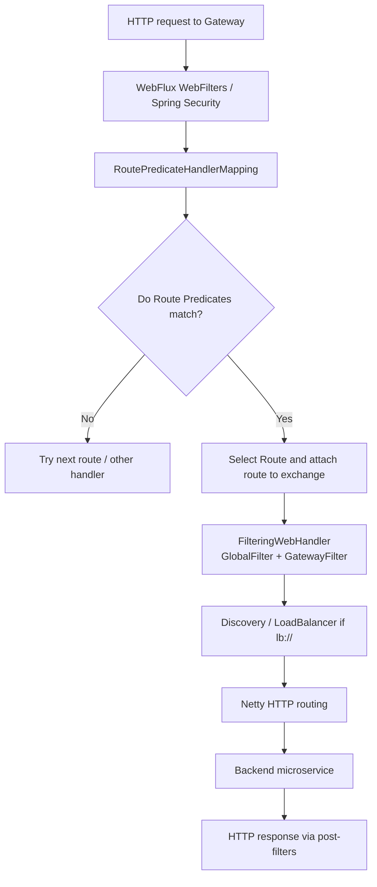
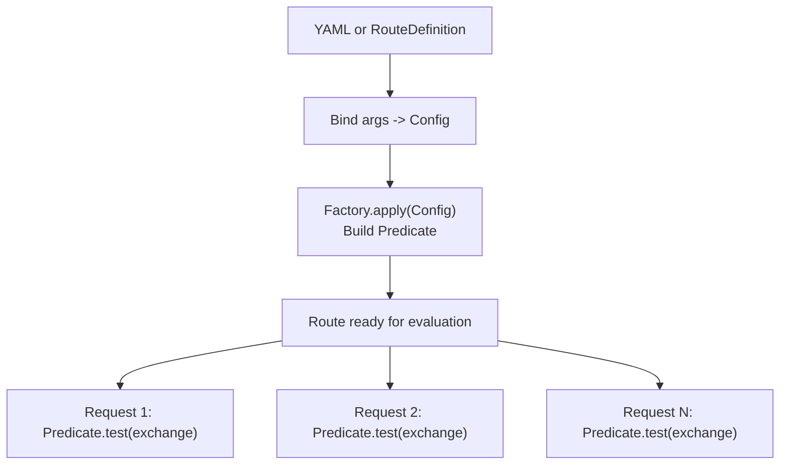
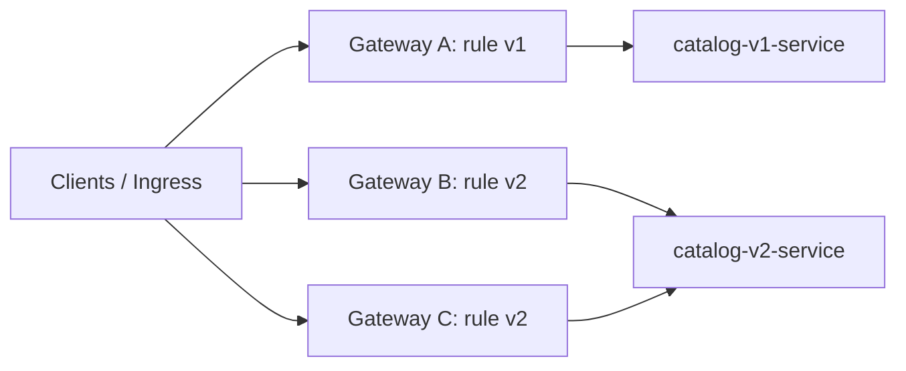
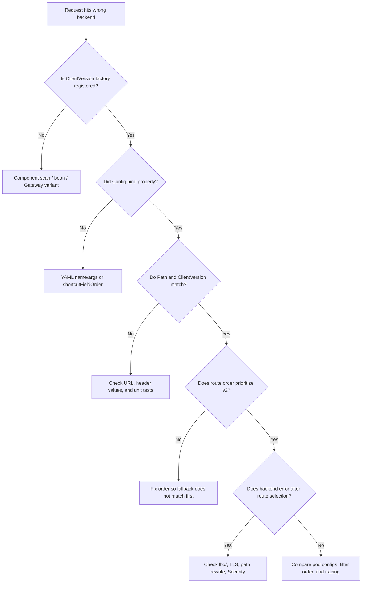

# Writing a Custom AbstractRoutePredicateFactory

In **Spring Cloud Gateway**, not every routing requirement is conveniently expressed with built-in predicates like `Path`, `Method`, `Host`, `Header`, or `Query`. For instance, a microservices system may want to route requests carrying **`X-Api-Version: v2`** to a new catalog version while sending all other requests to the default version. When a route selection rule needs a clear name, reusable configuration parameters, and custom matching logic, you can write your own **`RoutePredicateFactory`** by extending **`AbstractRoutePredicateFactory<Config>`**.

This lesson belongs to the **Custom Filters** chapter of the **SPRING_CLOUD_GATEWAY** module. Even though it sits in the Gateway extension chapter, the subject here is **predicates that decide which route matches**, not `GatewayFilter` instances that transform requests or responses. The lesson connects to the rest of the module: route predicates, filter chains, path/header transformations, service discovery via `lb://`, Spring Security, rate limiting, retries, circuit breakers, TLS, and request observability when operating a secure microservices gateway.

After this lesson, you will be able to:

1. Choose the right extension point: `AbstractRoutePredicateFactory`, `AbstractGatewayFilterFactory`, or `GlobalFilter`.
2. Write a purely synchronous custom predicate taking `ServerWebExchange` and returning `boolean`.
3. Declare `Config`, `shortcutFieldOrder()`, validate parameters, and configure the predicate name in YAML.
4. Combine a custom predicate with `Path`, `Method`, route order, and fallback routes.
5. Write unit tests, test through a live Gateway, and distinguish route non-matches from downstream errors.
6. Avoid using route predicates as an authentication layer, avoid blocking I/O, and prevent cache/state bugs across multiple Gateway replicas.

> **Version scope:** Content targets **Spring Cloud Gateway Server WebFlux**. Configuration examples using `spring.cloud.gateway.server.webflux.routes` target Gateway lines with the newer WebFlux namespace; earlier WebFlux releases typically use `spring.cloud.gateway.routes`. **Server Web MVC** declares predicates/routes differently. Verify compatible Spring Boot, Spring Cloud release train, Gateway, and JDK versions before copying code verbatim.

## 1. Where Do Route Predicates Fit in the Request Flow?

A request arriving at Gateway passes through these main steps:



A predicate answers the question:

> **"Is the current request eligible to use this route?"**

A filter answers a different question:

> **"Once a route is selected, how should the request/response be inspected, transformed, or further processed?"**

If a custom predicate returns `false`, Gateway simply continues evaluating other routes. It **does not return `403` on its own**, does not modify headers, does not call a backend, and does not provide circuit-breaker-style fallback. If no route or handler matches, the request may end with `404` or the application's own error handling.

### Comparing Extension Points

| Extension point | When is it invoked? | Return/effect | Best-suited scenarios |
| --- | --- | --- | --- |
| **`RoutePredicateFactory`** | While determining which route matches. | `Predicate<ServerWebExchange>` returning `true/false`. | Selecting routes by API version, non-sensitive business headers, synchronous conditions. |
| **`GatewayFilterFactory`** | After a route is selected, inside the route filter chain. | Creates a `GatewayFilter`; can mutate request/response or short-circuit. | Checking a header and returning 400, adding a correlation ID, rewriting paths. |
| **`GlobalFilter`** | In the Gateway filtering pipeline for Gateway-handled requests. | Gateway-wide filter with pre/post semantics. | Logging, latency measurement, policies shared across many routes. |
| **Spring Security WebFilter** | In the WebFlux WebFilter chain, typically before Gateway route handling. | Authentication, authorization, CORS/CSRF per configuration. | Verifying bearer JWTs, OAuth2 Login, request authorization. |
| **`RouteLocator` / `RouteDefinitionLocator`** | When supplying/building the list of routes. | Defines routes and predicates. | Loading routes from YAML, DiscoveryClient, or a custom source. |

**Do not use `AbstractRoutePredicateFactory` in place of `AbstractGatewayFilterFactory`.** The two classes look similar in name, but their contracts and execution timing are completely different.

## 2. When Should You Write a Custom RoutePredicateFactory?

Prefer built-in predicates before writing custom code. For example, if you only need to match a header with a simple regex, the built-in `Header` predicate may already suffice:

```yaml
predicates:
  - Path=/api/catalog/**
  - Header=X-Api-Version, v2
```

For more complex needs — such as a **packaged, reusable version rule** shared across many routes — a custom factory helps because:

- It provides a concise, consistent configuration name, e.g., `ClientVersion`.
- It has a `Config` class whose parameters are bound and validated in one place.
- It can evolve from exact string matching to version lists or other synchronous rules.
- It supports standalone unit tests for `true/false` behavior.
- It avoids forcing every team to duplicate raw logic across dozens of route definitions.

### Do Not Write a Custom Predicate If…

- Built-in `Path`, `Method`, `Host`, `Header`, `Cookie`, `Query`, `RemoteAddr`, etc. already solve the rule.
- You need to **return an error response directly** when a header is invalid: a `GatewayFilter` or Spring Security layer fits better.
- You plan to **call Redis, a database, an IdP, or an HTTP service inside `test()`** to check access rights. Synchronous predicates must not perform blocking I/O.
- You want to enforce JWT/permission checks across all APIs; **Spring Security** is the proper place.
- You want automatic retry/fallback when a backend fails; predicates only select routes, they do not handle responses after selection.

A good rule of thumb: **predicates should be simple, fast, and side-effect-free; filters or security enforce policy once the route is known**.

## 3. Practice Problem: Selecting Catalog v2 by a Header

Suppose the application has two backends:

```text
catalog-v1-service: GET /products/42 → legacy API
catalog-v2-service: GET /products/42 → new API
```

Clients call the same public URL:

```http
GET /api/catalog/products/42 HTTP/1.1
Host: api.example.com
X-Api-Version: v2
```

Policy:

| Request | Desired route |
| --- | --- |
| `X-Api-Version: v2` | `catalog-v2-route`. |
| Missing `X-Api-Version` | `catalog-default-route`. |
| `X-Api-Version: v1` | `catalog-default-route`, if that fallback is acceptable for the product. |
| `X-Api-Version: v3` | Fallback or rejection per API contract; **do not assume** it is automatically an error or v1. |
| URL outside `/api/catalog/**` | Neither catalog route applies, unless another route matches. |

We will write `ClientVersionRoutePredicateFactory` with two parameters:

- `headerName`: HTTP header to read, e.g., `X-Api-Version`.
- `requiredValue`: exact value required to match, e.g., `v2`.

The factory **only matches**; it does not read request bodies, modify JWTs, hit databases, or randomly pick backends. `X-Api-Version` is a **caller-selected API compatibility hint**, not proof that the caller is authorized to use API v2. If v2 contains restricted features, add real authentication/authorization.

## 4. Lifecycle of AbstractRoutePredicateFactory

A factory typically goes through two stages:



### Configuration Stage

1. Spring Boot discovers the factory bean in the application context.
2. Gateway looks up the factory by name, e.g., `ClientVersion`.
3. Parameters from YAML/route definition are bound into `Config`.
4. Gateway invokes `apply(Config)` to obtain a `Predicate<ServerWebExchange>`.
5. The predicate is attached to the runtime route for request matching.

### Request Stage

For each request evaluated against this route:

1. Gateway invokes the created predicate via `test(exchange)`.
2. The predicate reads the needed request data from `ServerWebExchange`.
3. The predicate returns `true` or `false` **synchronously**.
4. If a route has multiple predicates, they are combined with **AND** per route definition; if `Path` matches but `ClientVersion` fails, the route does not match.

This leads to two performance rules:

- **Validate/prepare configuration in `apply`:** e.g., verify `requiredValue` is non-empty, normalize parameters, pre-compile bounded regexes.
- **Keep `test()` extremely lightweight:** only inspect already-parsed request headers/path/query, do simple checks, and return a boolean. Never construct HTTP clients, read bodies, or call `block()`.

**Do not assume `apply()` runs only once over the process lifetime**: when routes refresh or definitions change, Gateway can rebuild runtime routes and predicates. Therefore `apply` must also have no side effects such as deducting quota or sending emails.

## 5. Complete Custom `ClientVersionRoutePredicateFactory`

The example class below is built for Spring Cloud Gateway **Server WebFlux**:

```java
package com.example.gateway.predicate;

import java.util.List;
import java.util.function.Predicate;

import org.springframework.cloud.gateway.handler.predicate.AbstractRoutePredicateFactory;
import org.springframework.stereotype.Component;
import org.springframework.util.StringUtils;
import org.springframework.web.server.ServerWebExchange;

@Component
public class ClientVersionRoutePredicateFactory
        extends AbstractRoutePredicateFactory<
            ClientVersionRoutePredicateFactory.Config> {

    public ClientVersionRoutePredicateFactory() {
        super(Config.class);
    }

    @Override
    public List<String> shortcutFieldOrder() {
        return List.of("headerName", "requiredValue");
    }

    @Override
    public Predicate<ServerWebExchange> apply(Config config) {
        if (config == null
                || !StringUtils.hasText(config.getHeaderName())
                || !StringUtils.hasText(config.getRequiredValue())) {
            throw new IllegalArgumentException(
                "ClientVersion requires headerName and requiredValue");
        }

        // Capture immutable config values when building the predicate; never keep
        // mutable Config around to read/write on every request.
        final String headerName = config.getHeaderName().trim();
        final String requiredValue = config.getRequiredValue().trim();

        return exchange -> {
            List<String> values = exchange.getRequest()
                .getHeaders()
                .get(headerName);

            return values != null
                && values.size() == 1
                && requiredValue.equals(values.get(0));
        };
    }

    public static class Config {
        private String headerName;
        private String requiredValue;

        public String getHeaderName() {
            return headerName;
        }

        public void setHeaderName(String headerName) {
            this.headerName = headerName;
        }

        public String getRequiredValue() {
            return requiredValue;
        }

        public void setRequiredValue(String requiredValue) {
            this.requiredValue = requiredValue;
        }
    }
}
```

### Explaining the Decisions in Code

| Component | Role | Note |
| --- | --- | --- |
| `@Component` | Registers factory as a Spring bean for Gateway discovery. | Must be in component-scan scope or explicitly registered as a bean. |
| `ClientVersionRoutePredicateFactory` | Follows Gateway naming convention. | Short predicate name in YAML becomes `ClientVersion`. |
| `extends AbstractRoutePredicateFactory<Config>` | Provides the factory contract to build a route predicate. | Not `AbstractGatewayFilterFactory`. |
| `super(Config.class)` | Declares the config class to bind. | Must match the factory's own `Config` class. |
| `shortcutFieldOrder()` | Specifies argument order in shortcut syntax. | `headerName` comes before `requiredValue`. |
| `apply(Config)` | Validates config and constructs the predicate. | Does not perform authentication or network calls. |
| `Predicate<ServerWebExchange>` | Inspects the request and returns `boolean` during route matching. | Must be fast, stateless, and non-blocking. |
| `get(headerName)` | Reads the list of HTTP header values. | Example accepts **exactly one value**; header name is case-insensitive, while value is matched exactly. |
| `Config` getters/setters | Allows the binder to populate fields from YAML args. | Avoid per-request state in Config or the factory. |

### Intentional Exact Matching

For example, when using:

```text
requiredValue = v2
```

`v2` matches, whereas `V2`, `v2-beta`, or `v2,v1` **do not match** under the current logic. The predicate requires **exactly one header value**; a request sending two `X-Api-Version` headers is rejected by the predicate instead of letting `getFirst()` silently ignore the second value. For protocol version headers, **requiring a single valid value** helps prevent discrepancies across proxies and clients.

If the contract requires case-insensitivity, an allowed-versions list, or semantic-version ranges, **explicitly update the matching algorithm and add tests** rather than changing matching behavior in production without updating the API contract.

### Why Not Inspect the Request Body to Select a Route?

Predicates run during route matching. Reading the body normally requires consuming/caching the reactive stream, adding overhead, risking body unavailability downstream, and complicating backpressure and memory management. If routing by body is truly required, use an appropriate filter/architecture and request-buffering policy; **never call `exchange.getRequest().getBody().blockFirst()` inside a predicate**.

## 6. Mapping the Factory Name to a Predicate in YAML

By Gateway naming convention:

```text
Java class:
ClientVersionRoutePredicateFactory

Predicate name in YAML:
ClientVersion
```

Gateway relies on the registered factory bean and its factory name to recognize `ClientVersion` in route definitions. Changing the class name, bean registration, or package/component scan can prevent the config from being recognized.

### Shortcut Syntax

```yaml
predicates:
  - Path=/api/catalog/**
  - ClientVersion=X-Api-Version,v2
```

Here:

- `X-Api-Version` binds to `Config.headerName`.
- `v2` binds to `Config.requiredValue`.
- Both fields appear in the exact `shortcutFieldOrder()`.

**Never reverse the order** as `ClientVersion=v2,X-Api-Version` if `shortcutFieldOrder()` is still `headerName, requiredValue`.

### Expanded Syntax (`name/args`)

```yaml
predicates:
  - Path=/api/catalog/**
  - name: ClientVersion
    args:
      headerName: X-Api-Version
      requiredValue: v2
```

Expanded syntax is easier to read when there are multiple properties and makes it clear which property is wrong if binding fails. Keys `headerName` and `requiredValue` must match `Config` properties/binding policy. When a custom factory has many optional fields, prefer `name/args` over long, hard-to-review shortcuts.

### Why Must the Factory Be Discovered?

Creating the Java class in a source directory is not enough. It must exist as a Spring bean in the **Gateway application context**, for example:

- Annotated with `@Component` under a package scanned by Spring Boot component scanning.
- Or explicitly registered via `@Bean`/`@Import`.

If `com.example.gateway.predicate` sits outside `@SpringBootApplication`'s scan scope, the factory will not exist in the context. When a route references `ClientVersion`, Gateway may fail to find the matching `RoutePredicateFactory`. Inspect startup logs and bean registrations instead of tweaking YAML arbitrarily to mask the error.

## 7. Defining Two Routes: Prioritizing v2 with a Clear Fallback

Complete example for the newer Gateway WebFlux branch:

```yaml
spring:
  cloud:
    gateway:
      server:
        webflux:
          routes:
            - id: catalog-v2-route
              order: -10
              uri: http://localhost:8082
              predicates:
                - Path=/api/catalog/**
                - ClientVersion=X-Api-Version,v2
              filters:
                - StripPrefix=2

            - id: catalog-default-route
              order: 0
              uri: http://localhost:8081
              predicates:
                - Path=/api/catalog/**
              filters:
                - StripPrefix=2
```

Assume backend v1 on `localhost:8081` and v2 on `localhost:8082` both serve `GET /products/42`.

### Route Matching by Order

| Request | `catalog-v2-route` | `catalog-default-route` | Expected outcome |
| --- | --- | --- | --- |
| `/api/catalog/products/42`, header `X-Api-Version: v2` | `Path` matches, `ClientVersion` matches. | `Path` also matches. | **Selects v2** because `order: -10` takes precedence. |
| Same URL, no version header | `ClientVersion` fails. | `Path` matches. | Routes to default/v1. |
| Same URL, `X-Api-Version: v1` | `ClientVersion` fails. | `Path` matches. | Routes to default/v1. |
| `/api/orders/123` | `Path` fails. | `Path` fails. | Evaluates other routes or matches none. |

**Important note:** routes sharing the same `Path` can both match. Lower `order` is evaluated first under route ordering; YAML entry position **should not be relied upon as the sole precedence contract**.

If the project **does not** want `X-Api-Version: v3` to fall back to v1, do not use a broad fallback route like the one above. Define an explicit contract:

- Create routes with exact predicates for each supported version.
- Omit the broad fallback for invalid versions, or add a dedicated filter/handler returning an appropriate error.
- Ensure client-facing errors are **intentional**, rather than hoping a backend returns 404.

### Replacing Fixed URIs with Service Discovery

Once Spring Cloud LoadBalancer and a `ServiceInstance` source are configured, you can switch to:

```yaml
uri: lb://catalog-v2-service
```

and:

```yaml
uri: lb://catalog-v1-service
```

The predicate still only decides **which route matches**. Afterward, Gateway resolves `lb://` to a backend instance. If the v2 route matches but `catalog-v2-service` has no instances, Gateway may return an upstream-unavailable error (e.g., `503` depending on configuration); it **does not automatically fall back to route v1**. That is a load-balancing/routing failure, not `ClientVersion` suddenly returning false.

## 8. Limits of a Synchronous Predicate

In the example, `apply(Config)` returns:

```java
Predicate<ServerWebExchange>
```

This means the final check must return a `boolean` **synchronously**.

### Do

- Read `exchange.getRequest().getHeaders()`, `getPath()`, `getQueryParams()`, or already-populated request metadata.
- Perform small, non-sensitive string/value comparisons.
- Normalize and validate config parameters inside `apply`.
- Return `false` quickly when headers are missing or invalid.
- Use read-only data and `final` captures inside the lambda.

### Do Not

- Call `RestTemplate`, JDBC, synchronous Redis, filesystem I/O, or `Thread.sleep` inside `Predicate.test()`.
- Call `Mono.block()` or `Flux.blockFirst()` on the Reactor Netty event-loop.
- Call an OAuth2 introspection/JWK endpoint on every request to decide access.
- Write current-user state into fields on the singleton factory.
- Call external APIs to pick routes on every request without latency budgets and proper reactive mechanisms.

If routing truly depends on rapidly changing external data, consider alternatives: **populate verified data into the request context before route handling**, update route definitions from a controlled control plane, or use a version-appropriate asynchronous Gateway API. Never "work around" it by blocking inside a synchronous predicate.

## 9. Unit Testing the Predicate Without Booting the Full Gateway

Because `apply(Config)` returns a pure `Predicate<ServerWebExchange>`, you can test its behavior using Spring Test's `MockServerWebExchange`.

### Test Dependency

In a Spring Boot project with the test starter, you can typically use:

```xml
<dependency>
    <groupId>org.springframework.boot</groupId>
    <artifactId>spring-boot-starter-test</artifactId>
    <scope>test</scope>
</dependency>
```

These tests require JUnit Jupiter and Spring WebFlux test classes; use versions managed by the Spring Boot BOM. Do not mix incompatible Spring Test/Framework versions with Gateway.

### JUnit 5 Example

```java
package com.example.gateway.predicate;

import static org.junit.jupiter.api.Assertions.assertFalse;
import static org.junit.jupiter.api.Assertions.assertThrows;
import static org.junit.jupiter.api.Assertions.assertTrue;

import java.util.function.Predicate;

import org.junit.jupiter.api.BeforeEach;
import org.junit.jupiter.api.Test;
import org.springframework.mock.http.server.reactive.MockServerHttpRequest;
import org.springframework.mock.web.server.MockServerWebExchange;
import org.springframework.web.server.ServerWebExchange;

class ClientVersionRoutePredicateFactoryTest {

    private ClientVersionRoutePredicateFactory factory;
    private Predicate<ServerWebExchange> predicate;

    @BeforeEach
    void setUp() {
        factory = new ClientVersionRoutePredicateFactory();

        var config = new ClientVersionRoutePredicateFactory.Config();
        config.setHeaderName("X-Api-Version");
        config.setRequiredValue("v2");
        predicate = factory.apply(config);
    }

    @Test
    void matchesExactVersion() {
        var request = MockServerHttpRequest
            .get("/api/catalog/products/42")
            .header("X-Api-Version", "v2")
            .build();

        assertTrue(predicate.test(MockServerWebExchange.from(request)));
    }

    @Test
    void rejectsMissingHeader() {
        var request = MockServerHttpRequest
            .get("/api/catalog/products/42")
            .build();

        assertFalse(predicate.test(MockServerWebExchange.from(request)));
    }

    @Test
    void rejectsDifferentOrMixedValue() {
        var v1 = MockServerHttpRequest
            .get("/api/catalog/products/42")
            .header("X-Api-Version", "v1")
            .build();

        var mixed = MockServerHttpRequest
            .get("/api/catalog/products/42")
            .header("X-Api-Version", "v2,v1")
            .build();

        assertFalse(predicate.test(MockServerWebExchange.from(v1)));
        assertFalse(predicate.test(MockServerWebExchange.from(mixed)));
    }

    @Test
    void rejectsMultipleHeaderValues() {
        var request = MockServerHttpRequest
            .get("/api/catalog/products/42")
            .header("X-Api-Version", "v2", "v1")
            .build();

        assertFalse(predicate.test(MockServerWebExchange.from(request)));
    }

    @Test
    void rejectsMissingConfiguration() {
        var invalid = new ClientVersionRoutePredicateFactory.Config();
        invalid.setHeaderName("X-Api-Version");

        assertThrows(
            IllegalArgumentException.class,
            () -> factory.apply(invalid));
    }
}
```

### Scope of Unit Tests

These tests verify the **Java logic inside the predicate**. They **do not prove**:

- Spring discovered the factory bean.
- YAML shortcut or `name/args` bound properly.
- Routes have the right `order`.
- `StripPrefix`/LoadBalancer/HTTP routing work.
- CORS, Security, and response headers are handled properly.

Therefore you still need **integration tests with the Gateway application context**. Fast unit tests help catch bugs like accidentally using `equalsIgnoreCase`, missing header checks, or overlooking duplicate header values before running the full system.

### Testing Case-Insensitive Header Names

Per HTTP semantics, header field names are case-insensitive. You can add:

```java
@Test
void matchesCaseInsensitiveHeaderName() {
    var request = MockServerHttpRequest
        .get("/api/catalog/products/42")
        .header("x-api-version", "v2")
        .build();

    assertTrue(predicate.test(MockServerWebExchange.from(request)));
}
```

This snippet is **an additional test method for the class above**, not a standalone Java file. It highlights the difference between **header name** (case-insensitive) and **header value** (exact match in this example).

## 10. Integration Testing: Proving Gateway Picks the Right Backend

### POC Environment

| Component | Address | Role |
| --- | --- | --- |
| Spring Cloud Gateway | `http://localhost:8080` | Has `ClientVersionRoutePredicateFactory` bean and two routes. |
| catalog v1 mock | `http://localhost:8081` | Returns backend v1 marker. |
| catalog v2 mock | `http://localhost:8082` | Returns backend v2 marker. |

Both mock backends expose `GET /products/42`, returning distinct test payloads:

```json
{"backend":"catalog-v1","productId":42}
```

and:

```json
{"backend":"catalog-v2","productId":42}
```

These are **custom mock payloads**, not default Spring Cloud Gateway responses.

### Case 1: With Header `v2`

```bash
curl -i \
  -H "X-Api-Version: v2" \
  "http://localhost:8080/api/catalog/products/42"
```

Expected **per the routes example in section 7**: Gateway selects `catalog-v2-route`, `StripPrefix=2` rewrites the path to `/products/42`, and mock v2 returns the `catalog-v2` payload.

### Case 2: Without Header

```bash
curl -i \
  "http://localhost:8080/api/catalog/products/42"
```

Expected: the v2 custom predicate does not match, and the default route is selected, returning the `catalog-v1` payload.

### Case 3: Non-Matching Header

```bash
curl -i \
  -H "X-Api-Version: v1" \
  "http://localhost:8080/api/catalog/products/42"
```

Expected per chosen fallback: `catalog-v1`.

### Case 4: Multiple Values or Unsupported Version

```bash
curl -i \
  -H "X-Api-Version: v2" \
  -H "X-Api-Version: v1" \
  "http://localhost:8080/api/catalog/products/42"

curl -i \
  -H "X-Api-Version: v3" \
  "http://localhost:8080/api/catalog/products/42"
```

The example `ClientVersion` predicate returns `false` on mismatched or multi-value headers. **However, the default route can still match** and return v1. If the product requires **rejecting invalid versions**, handle that through dedicated route/validation design rather than expecting predicate `false` to emit 400 automatically.

### Case 5: Non-Matching Path

```bash
curl -i \
  -H "X-Api-Version: v2" \
  "http://localhost:8080/api/orders/123"
```

Because `Path=/api/catalog/**` does not match, neither catalog route is selected. What happens next depends on whether another route handles `/api/orders/**`; do not assume 404 in an app that may have other handlers.

### Inspecting Runtime Routes

If the Actuator Gateway endpoint is enabled **and properly secured**, you can inspect loaded routes:

```http
GET /actuator/gateway/routes
```

This endpoint helps verify route IDs, URIs, predicates, and runtime filters per version capability. It **does not prove** requests actually hit the right backend; combine it with mock backend logs/traces or real response assertions.

**Never expose Actuator Gateway route-management endpoints to the public Internet without authorization.** Management/mutation endpoints, if enabled, must be restricted by roles and network access.

## 11. Unit Tests Are Not Enough: YAML Binding Cases to Test

A factory's logic can be sound while routes still fail to build due to wrong factory names or args. Test both syntaxes independently.

### Correct Shortcut

```yaml
predicates:
  - ClientVersion=X-Api-Version,v2
```

### Wrong-Order Shortcut

```yaml
predicates:
  - ClientVersion=v2,X-Api-Version
```

In this case, the binder may assign `v2` to `headerName` and `X-Api-Version` to `requiredValue`, causing the predicate never to match as intended. `hasText` checks **cannot catch** every valid-looking yet swapped configuration.

### Wrong Args Key Names

```yaml
predicates:
  - name: ClientVersion
    args:
      header: X-Api-Version
      value: v2
```

Keys `header` and `value` do not match `Config.headerName`/`requiredValue` in the example. Depending on the binder and when route conversion runs, config may error out or fail to produce the expected predicate. Do not assume the app always fails at startup; routes can be loaded/refreshed at other times.

### Right Args Key Names

```yaml
predicates:
  - name: ClientVersion
    args:
      headerName: X-Api-Version
      requiredValue: v2
```

### Do Not Mix Old and New Gateway WebFlux Namespaces

Older-branch example:

```yaml
spring:
  cloud:
    gateway:
      routes:
        - id: catalog-v2-route
          uri: http://localhost:8082
          predicates:
            - Path=/api/catalog/**
            - ClientVersion=X-Api-Version,v2
```

Do not declare both `spring.cloud.gateway.routes` and `spring.cloud.gateway.server.webflux.routes` "just to be safe". Read the Configuration Properties for your exact artifact, inspect bound routes, and standardize on one config model.

## 12. Validating and Constraining Config Proactively

The `ClientVersionRoutePredicateFactory` example already checks that `headerName` and `requiredValue` are non-empty using `StringUtils.hasText`. In production, you may also need to:

- Restrict `headerName` to a **fixed allowlist of header names** approved by the platform team.
- Bound parameter lengths; disallow malformed config inputs.
- Restrict supported versions and version formats.
- Validate regexes or globs if upgrading to pattern matching.
- Distinguish deployment-time config errors from unmatched client requests.
- Log route ID and config revision sufficiently for debugging without logging secrets.

### Fail Fast on Invalid Configuration

An `IllegalArgumentException` from `apply(Config)` clearly flags bad configuration, though **when the failure surfaces** depends on when runtime routes are constructed/refreshed. Some systems load routes after startup or refresh on events.

**Never treat a configuration error as a "valid non-match"** if it silently drops all traffic into an unintended fallback. Verify routes materialize cleanly in the deployment pipeline before sending traffic to that Gateway instance.

### Do Not Mutate Config on Each Request

Flawed design:

```java
return exchange -> {
    config.setRequiredValue("v2"); // Mutable shared config per request!
    return true;
};
```

The right approach is **validate config once and capture immutable values** when building the predicate:

```java
final String requiredValue = config.getRequiredValue().trim();
return exchange -> requiredValue.equals(
    exchange.getRequest().getHeaders().getFirst("X-Api-Version"));
```

This short snippet only illustrates capturing immutable values; **the full factory in section 5** also checks header value count and allows configuring `headerName`. Do not replace the full code with this snippet if you require duplicate-rejection policy.

## 13. Route Ordering, Fallback, and Error States

A custom predicate has no knowledge of how the backend responded; it is only evaluated before an upstream request is sent.

### Three Scenarios to Distinguish

| Scenario | Stage where it happens | Does it automatically try another route? |
| --- | --- | --- |
| `ClientVersion` returns `false` | Route matching | Gateway can continue checking other matching routes. |
| `ClientVersion` returns `true`, but `lb://catalog-v2-service` has no instances | LoadBalancer/routing after route selection | **Does not fall back to v1** just because route v2 failed. |
| `ClientVersion` returns `true`, backend v2 returns HTTP 500 | Backend response | Predicate is not re-run to select v1; fallback requires a separate resilience policy. |

### Shifting Traffic to v2 Gradually

Some teams route by header:

```text
X-Api-Version: v2
```

or feature flag. If the requirement is a **5% traffic canary rollout**, do not abuse a predicate calling `Math.random()` inside every `test()`. Randomness is unstable across requests, hard to debug, and does not stick to a user/session.

Better options:

- Use canary/weighted routing supported by Gateway or the edge proxy.
- If account-sticky rollout is needed, compute cohorts via a **deterministic hash of a verified identity** under an approved policy.
- Separate security constraints from traffic-splitting strategies.
- Maintain independent rollback and error/latency tracking for v1/v2.

Selecting v2 based on a client-sent header is **request opt-in**, not access control for security-sensitive features.

## 14. Spring Security, CORS, and Trust Boundaries

### 14.1. Predicates Do Not Replace Authentication

Any client can send:

```http
X-Api-Version: v2
```

arbitrarily. Therefore, if v2 exposes admin or tenant-specific APIs, `ClientVersion` is **not sufficient** to protect the route. You need:

1. Spring Security verifying bearer JWTs / OAuth2 sessions in the WebFilter chain.
2. Authorization policies checking trusted scopes/roles/tenants.
3. Backend Resource Servers verifying issuer, audience, and resource permissions.
4. Using the version header solely to **select API behavior**, never to decide whether a user is authorized.

### 14.2. Never Block on a `Mono<Principal>`

In WebFlux, `exchange.getPrincipal()` returns a `Mono<Principal>`. Never write:

```java
Principal principal = exchange.getPrincipal().block();
```

inside a route predicate. This can block the Reactor Netty event-loop, cause runtime failures, or severely degrade throughput. If routing truly must depend on user claims, design around the **Spring Security reactive flow** and supply verified data to route matching without blocking, or restructure routes/security. Never parse raw JWT bodies/queries/headers and assume the principal is authenticated.

### 14.3. CORS Preflight `OPTIONS` May Not Match

If you configure:

```yaml
predicates:
  - Path=/api/catalog/**
  - Method=GET
  - ClientVersion=X-Api-Version,v2
```

browser preflight requests use method `OPTIONS` and usually do not carry application headers like actual GET/POST requests—they carry `Access-Control-Request-*` instead. Preflight **does not match `Method=GET`** and may omit `X-Api-Version`. Never require preflight requests to carry a bearer JWT or actual-request version headers.

CORS must be handled by Spring Security / Gateway CORS configuration or the edge at the right layer, especially when `OPTIONS` requests match no route. `ClientVersion` applies only to actual route matching; it is **not a CORS policy**.

### 14.4. Trusted Proxy Identity vs. Client Headers

`X-Forwarded-For`, `X-Forwarded-Host`, or custom `X-Tenant` headers can be spoofed if Gateway accepts them directly from the Internet without ingress enforcement. If a custom predicate relies on proxy metadata, clearly define the **trust boundary**, proxy allowlist, header stripping/overwriting, and security validation prior to routing.

Never use unverified header data to route a user's token or request to another tenant's backend.

## 15. Integration with GatewayFilter, Rate Limiting, and Resilience

Once `ClientVersion` selects `catalog-v2-route`, the GatewayFilters attached to route v2 execute according to their effective order and configuration. This is the critical boundary between **route matching** and **traffic processing**.

| Component | Phase | Impact with a custom predicate |
| --- | --- | --- |
| **`Path`, `Method`, `ClientVersion`** | Matching | Determines whether v1 or v2 route is selected. |
| **`StripPrefix`/`RewritePath`** | Filtering | Converts public path to backend path after route selection. |
| **`AddRequestHeader`/`SetRequestHeader`** | Filtering | Can modify request headers before downstream dispatch; does not re-trigger predicate matching. |
| **`TokenRelay`** | Filtering | Attaches an access token when an authorized client/policy exists. |
| **`RequestRateLimiter`** | Filtering | Limits requests on the selected route via `KeyResolver`. |
| **`CircuitBreaker`** | Filtering | Protects backend calls, optionally with a configured fallback. |
| **`Retry`** | Filtering | Retries upstream when conditions match; does not re-evaluate route predicates. |
| **`LocalResponseCache`** | Filtering | Can return cached responses on eligible cacheable routes. |
| **`LoadBalancer`/`NettyRoutingFilter`** | Routing | Picks a backend instance and sends the HTTP request. |

### Route v1 and v2 Have Separate Quotas

If two routes have different IDs:

```text
catalog-v2-route
catalog-default-route
```

and each uses `RedisRateLimiter`, token buckets are typically keyed by **route ID + quota key**. That can give one account two independent buckets across v1 and v2 even though both represent one product API.

If policy requires a **shared quota** for catalog regardless of v1 or v2, design the quota domain accordingly; never assume two routes sharing a URI/path share a Redis bucket.

### Per-Route `TokenRelay` and Audience

Route v2 may target a different backend. If Gateway uses `TokenRelay`, backend v2 must still **verify token audience/scopes/issuer** for its API. A custom predicate triggered by a client-sent header must never silently forward a user's token to a new backend outside an audited trust boundary.

### Circuit Breaker Fallback vs. Route Fallback

Two distinct concepts:

1. **Route fallback:** v2 predicate returns false so Gateway picks route v1 during matching.
2. **Circuit breaker fallback:** route v2 was already picked, but upstream fails/times out and the resilience filter invokes its configured fallback.

Do not call both "fallback" expecting identical semantics. Circuit breaker fallbacks must also preserve idempotency, authorization, and response shape; for order-creating POSTs, unchecked retry/fallback can trigger duplicate business effects.

## 16. Performance and Determinism at High Traffic

Route predicates can run very frequently. A Gateway with many candidate routes may evaluate numerous predicates per request before finding a match. Thus, **CPU, allocations, regexes, and logging inside `test()`** directly impact gateway latency.

### Lightweight and Predictable Design

- Matching a small header is far cheaper than calling an external config service.
- If regexes are needed, **compile patterns in `apply()`** instead of every `test()`; bound config-supplied patterns to avoid ReDoS.
- If there is an allowlist of values, prepare an immutable `Set` in `apply()` for membership checks.
- Never fully parse a JWT inside a custom predicate; let Spring Security validate it.
- Avoid allocating large objects or data structures per request.
- Never make blocking calls on the Reactor Netty event loop.
- Never log at INFO level for every false predicate, since returning false is normal route-scanning behavior.

### Do Not Use Mutable Clocks or Randomness as Ambiguous Routing Conditions

A predicate like:

```java
return exchange -> Math.random() < 0.05;
```

may work to demonstrate a boolean, yet it is **not a production canary solution**: outcomes fluctuate per client, are hard to audit, and break across retries/follow-up requests. When weighted traffic is needed, use Gateway/edge-supported mechanisms or a deterministic routing strategy backed by tests and policy.

Similarly, conditions based on pod local clocks can drift across pods or out-of-sync config rollouts. When scheduled feature launches are needed, manage policy sources centrally with explicit validity windows and observability.

### Do Not Store Per-Request State in the Singleton Factory

Anti-pattern:

```java
private String lastVersionSeen;

public Predicate<ServerWebExchange> apply(Config config) {
    return exchange -> {
        lastVersionSeen = exchange.getRequest()
            .getHeaders().getFirst("X-Api-Version");
        return "v2".equals(lastVersionSeen);
    };
}
```

This is strictly an **illustrative anti-pattern**: requests run concurrently across threads, overwriting state and leaking context/data. Use local variables inside the lambda and capture immutable config as shown in the main example.

## 17. Rolling Deployments and Multiple Gateway Replicas

Suppose three Gateway pods sit behind an ingress:



If a rollout updates `ClientVersion` logic before completing across all pods, **the same request** can be routed differently depending on which pod handles it. This is a rollout/consistency issue, not "random" predicate behavior when each pod's code remains deterministic.

### Rollout Checklist

| Topic | Decision required |
| --- | --- |
| **Factory class** | All Gateway replicas run an artifact containing the factory before new route YAML is applied. |
| **Registration** | `@Component`/bean scanning does not diverge across deployments. |
| **Route definitions** | Route IDs, orders, predicates, and URIs stay consistent as needed. |
| **Compatibility** | Can old artifacts and new routes coexist? If not, use an ordered rollout. |
| **Fallback** | When v2 is not ready, should routes go to v1 or reject? Never auto-fallback after HTTP 500. |
| **Feature version** | What does `v2` in the header mean and how is it versioned? |
| **Metrics** | Tracked by route ID and Gateway version to detect divergence. |
| **Rollback** | Can route v2 be removed without clients sending `v2` hitting wrong data? |

If the app uses remote route definitions/refresh, updating one YAML/config source does not guarantee all replicas refresh simultaneously. Monitor route cache/refresh and config sync progress. **`RefreshRoutesEvent`/Actuator route refresh only covers runtime routes**, not proof that pods loaded a new predicate class or that backend v2 is healthy.

### Testing Cross-Pod Consistency

In a POC, you can hit two Gateway ports directly:

```bash
curl -i -H "X-Api-Version: v2" \
  "http://localhost:8080/api/catalog/products/42"

curl -i -H "X-Api-Version: v2" \
  "http://localhost:8083/api/catalog/products/42"
```

Identical requests/versions must reach the same target backend group on both pods once policy sync is declared. Otherwise, compare route IDs/orders, artifact revisions, config hashes, bean registrations, and service discovery.

## 18. Observing Custom Predicate Behavior Without Log Storms

A tricky property of route predicates is that **false** normally means "try another route", not an error. Logging WARN/ERROR on every false evaluation creates massive log volume even when every request succeeds.

### Practical Signals to Track

| Signal | Diagnostic value |
| --- | --- |
| **Selected route ID** | Which route ultimately handled the request? |
| **HTTP method/path template** | Which public API group did the request belong to? |
| **Gateway revision/pod ID** | Is there config drift across replicas? |
| **Backend service ID** | Which service did `lb://` target? |
| **Final status and latency** | Do v1 and v2 differ in errors or latency? |
| **Route count/refresh events** | Were route definitions loaded/refreshed cleanly? |
| **Predicate config validation errors** | Did bad parameters render a route unavailable? |
| **Quota/retry/circuit breaker status** | Did errors occur after route matching or during selection? |

An **illustrative** event an app might instrument, not a default log line:

```text
traceId:             [trace identifier]
gatewayPod:          gateway-b
routeId:             catalog-v2-route
routePolicyRevision: 2026-11
backendService:      catalog-v2-service
httpMethod:          GET
pathTemplate:        /api/catalog/**
httpStatus:          200
elapsedMs:           [measured value]
```

If you need match/non-match counts for a custom predicate, design low-overhead instrumentation with bounded metric tags. Never use **user IDs, raw JWTs, bearer tokens, cookies, full URLs with IDs, or arbitrary headers** as metric tags; that leaks data and causes cardinality explosions.

### Debugging by Route ID Instead of Guessing from Status Codes

An HTTP 404 can mean either **no route matched** or **the backend was called and returned 404**. Those two cases require different fixes. Tracing with route ID/downstream spans and mock backend access logs separates them.

Similarly, HTTP 503 can mean `lb://` found no instances; it does not mean the factory computed wrongly. HTTP 401/403 usually belongs to Security/backend policy, not the custom predicate.

## 19. Comprehensive Test Matrix

Before production sign-off, test unit, integration, and multi-replica scenarios:

| ID | Scenario | Expected evidence |
| --- | --- | --- |
| P01 | `X-Api-Version: v2` | `ClientVersion` returns true; v2 route selected by order. |
| P02 | Header absent | Predicate false; fallback selected if designed. |
| P03 | Header has `v1` | v2 predicate false; v1/default route selected. |
| P04 | Header `V2` | Fails exact match unless policy permits case-insensitivity. |
| P05 | Header `v2,v1` | Fails single-value match. |
| P06 | Two `X-Api-Version` headers | Predicate rejects duplicates; verify fallback behavior. |
| P07 | Lowercase header name | Still retrieved properly per HTTP case-insensitive header names. |
| P08 | Missing `headerName` | Config validation fails clearly; route is not silently published. |
| P09 | Wrong predicate name in YAML | Gateway fails to locate factory; check startup/route loading. |
| P10 | Swapped shortcut args order | Binding test catches route not matching as expected. |
| P11 | `Path` outside `/api/catalog/**` | Neither catalog route selected despite `v2` header. |
| P12 | Default route has wrong precedence order | Detects v2 requests being captured early by default route. |
| P13 | Backend v2 has no instances | v2 route is still chosen; `lb://` error handled per policy. |
| P14 | Backend v2 returns 500 | Does not auto-retry v1 via custom predicate. |
| P15 | Two Gateway replicas with differing config | Detects divergence and rolls back/updates config. |
| P16 | JWT lacks permission for v2 feature | Spring Security/backend authorization blocks even though predicate matches. |
| P17 | CORS preflight OPTIONS | CORS handled at the right layer regardless of actual-request headers. |
| P18 | RequestRateLimiter on both routes | Bucket/quota evaluated per selected route ID. |
| P19 | Path rewrite + header transforms | Backend receives expected URL/headers without re-running predicates. |
| P20 | Concurrent requests stress test | No state leaks, blocking, CPU/log storms, or unexpected memory growth. |

### Sign-Off Questions

Before concluding "the custom predicate works", answer:

1. **Is the factory registered as a bean?**
2. **Did Config bind accurately?**
3. **Does the predicate return the right true/false for test inputs?**
4. **Is the selected route prioritized in the right order?**
5. **Does the backend receive the expected URI/path/filters?**
6. **Are Security, CORS, and rate limits still enforced at the proper layers?**
7. **Do all Gateway replicas behave identically across rollouts?**

A single `200 OK` test does not prove all seven points.

## 20. Troubleshooting Common Errors

| Symptom | Possible cause | How to inspect and fix |
| --- | --- | --- |
| Gateway cannot find `ClientVersion` predicate | Factory is not a bean, wrong package scan, wrong Java class name, or wrong Gateway variant. | Check `@Component`, `@SpringBootApplication` base package, WebFlux dependency, and factory bean. |
| Route fails to load with shortcut | `shortcutFieldOrder()` mismatches arg count/order. | Compare `ClientVersion=X-Api-Version,v2` against `Config` fields. |
| `Config` receives null values | Wrong YAML keys, missing getters/setters, or binder mismatch. | Switch to `name/args` syntax; check `headerName` and `requiredValue`. |
| Route v2 is never selected | Predicate returns false, wrong route order, or path/method mismatch. | Run unit tests, inspect actual request headers, public path, and route ID/order. |
| Header `v2` still goes to v1 | Default route takes precedence or factory isn't active. | Ensure v2 route has `order: -10` and default has `order: 0`. |
| Header `v2` hits v2 route, backend returns 404 | `StripPrefix`/backend path mismatch. | Compare public path `/api/catalog/products/42` with backend path `/products/42`. |
| Header `v2` hits route, returns 503 | No `ServiceInstance` for `lb://catalog-v2-service`. | Check DiscoveryClient, LoadBalancer, registry, and instance health. |
| Header `v2` hits route, TLS fails | Backend HTTPS cert/CA/SNI or scheme issue. | Inspect outbound TLS and trust policy; do not change the predicate. |
| API returns `401`/`403` | Security or backend rejected the request. | Check token/issuer/audience/scopes and business permissions. |
| Browser fails CORS, `curl` succeeds | Preflight OPTIONS unhandled or missing CORS headers. | Check browser DevTools; configure CORS before authentication or valid Gateway CORS. |
| WARN/ERROR logs spike while API works | Logging predicate `false` as an error across routes. | Reduce per-`test()` logging; use contextual metrics. |
| High load causes abnormal latency | Blocking I/O, compiling regex/parsing JSON per request, heavy allocations. | Profile event loop/CPU; move setup into `apply`. |
| Same request sometimes hits v1, sometimes v2 | Pods have mismatched artifacts, config, route ordering, or rollout drift. | Compare config revision, route ID/order, and selected-route metrics per pod. |
| Error appears after route refresh | `apply` invoked with incomplete/bad config after source changed. | Validate new route definitions before refresh. |
| A `GET` consumes quota twice or skips quota | Different `RequestRateLimiter` order, retry/filter chain, and route IDs. | Inspect selected route, limiter decisions, and retry attempts. |
| Version header modified or stripped by proxy | Ingress/CDN/header policy altered request. | Compare direct Gateway vs. ingress requests; enforce trust boundaries. |
| Request with two header values hits fallback | Example predicate rejects duplicates while fallback route still matches. | To return 400, add validation/filter or an explicit rejection route. |

### Investigation Flowchart



## 21. Design Mistakes to Avoid

### "Predicate false means the request is rejected"

Incorrect. False only means the current route did not match; another route may match immediately afterward. To **reject invalid requests**, define an explicit error/validation policy and response producer.

### "A custom predicate can replace Spring Security"

No. Version, tenant, or client-type headers sent by callers can be spoofed. Never use `ClientVersion` to unlock admin privileges or skip JWT/OAuth2 verification.

### "Put a database call in `Predicate.test()` for convenience"

No. `Predicate<ServerWebExchange>` is a synchronous boolean contract; blocking I/O on the event loop degrades throughput or causes failures. Redesign where the condition is evaluated or use an appropriate reactive API.

### "Different route IDs alone tell Gateway which one is v2"

No. Route ID is a config/runtime identifier; requests are matched strictly by **predicates and ordering**, not because a route is named `catalog-v2-route`.

### "Gateway will fall back to v1 if catalog-v2 errors out"

Not automatically. Once route v2 matches, backend errors belong to routing/filter/resilience handling and do not rewind to route matching to try the default route.

### "Routes written earlier in YAML always win"

Do not rely on that. When routes overlap, configure explicit `order` values to express precedence and cover with integration tests.

### "Adding `@Order` to the factory determines route order"

Do not confuse **bean/factory registration order** with **route matching order**. To prioritize two routes, configure `order` on the routes themselves and verify at runtime.

### "Seeing `404` means the predicate failed"

Not necessarily. HTTP 404 can happen when the backend receives a rewritten path with no matching endpoint; verify whether a route matched and forwarded upstream.

### "If CORS preflight fails, add OPTIONS to ClientVersion"

That will not fix it if preflight omits the version header and the route also specifies `Method=GET`. Configure the CORS processor at the proper layer instead of turning a custom predicate into a preflight workaround.

### "Each Gateway pod can change route logic independently during rolling deploys"

Acceptable only if the rollout plan accounts for the expected behavior. When routing to distinct service versions, config drift leads to inconsistent behavior, skewed permissions, and painful rollbacks.

## 22. Pre-Production Checklist

- [ ] Confirmed **why built-in `Header`/`Path`/`Method` are insufficient**, instead of writing an unnecessary custom factory.
- [ ] Using **Gateway Server WebFlux** and `AbstractRoutePredicateFactory<Config>` from the running dependency, not mixed with MVC.
- [ ] Class is named `ClientVersionRoutePredicateFactory` to expose `ClientVersion` and registered as a Spring bean.
- [ ] `Config` has fields/getters/setters recognized by Gateway's binder; holds no request-scoped state.
- [ ] `shortcutFieldOrder()` matches argument order; `name/args` syntax has unit/integration tests.
- [ ] `apply(Config)` validates missing/invalid values and captures immutable values.
- [ ] `Predicate.test(exchange)` reads only needed request data, runs fast, with no blocking I/O or side effects.
- [ ] Missing headers, casing differences, duplicate values, and oversized headers are handled per API contract.
- [ ] Unverified headers are never used for authorization, tenant access, or privileged credentials.
- [ ] Spring Security enforces authentication/authorization; backends verify issuer/audience/scope and resource permissions.
- [ ] Both `Path` and the custom predicate are on the route; v2 route is not overly broad.
- [ ] Overlapping routes have explicit `order`; fallback for unknown versions is intentional.
- [ ] Distinction between **predicate false**, **no instances**, and **backend 5xx** is clear.
- [ ] CORS preflight is handled properly even when route Method/custom header do not match OPTIONS.
- [ ] Path rewrites/header transforms are tested after route matching.
- [ ] For `lb://`, LoadBalancer, `ServiceInstance` source, TLS, and timeouts are configured properly.
- [ ] RedisRateLimiter/RequestRateLimiter quota scope is clear when v1/v2 use separate route IDs.
- [ ] Retry/CircuitBreaker do not alter route matching; fallbacks preserve security and semantics.
- [ ] Unit tests cover boolean logic and integration tests cover two real/mock backends.
- [ ] Observability covers route ID, Gateway pod/version, backend service, status, and latency without logging tokens/PII.
- [ ] Config/artifact/route ordering is consistent across Gateway replicas with safe rollout/rollback procedures.
- [ ] Actuator Gateway endpoints are secured and used only by authorized operators to verify runtime config.
- [ ] No extra tests/builds or Content QA/refactoring are run at this writing step; the proficiency review occurs in the next workflow phase.

## 23. Self-Check Questions

1. How does `AbstractRoutePredicateFactory<Config>` differ from `AbstractGatewayFilterFactory<Config>` in contract and execution timing?
2. Why must the class be named `ClientVersionRoutePredicateFactory` to get the YAML predicate name `ClientVersion`?
3. What are the roles of `super(Config.class)` and `shortcutFieldOrder()`?
4. Why should `apply(Config)` validate/capture immutable configuration while `Predicate.test()` only inspects the request?
5. If `X-Api-Version` is absent, what happens when the custom predicate returns false and a default route shares the same path?
6. Why does route v2's `order: -10` need precedence over the default route's `order: 0`?
7. Why does a custom predicate not automatically return HTTP 400 on an unsupported `v3` header?
8. How does `getFirst()` differ from inspecting the full list of header values, and why test duplicate header values?
9. Why is a unit test `factory.apply(config).test(exchange)` insufficient to prove YAML binding and component scanning?
10. When route v2 matches but `lb://catalog-v2-service` has no instances, does Gateway automatically try the default route?
11. Why cannot a client version header replace Spring Security authorization?
12. Why is `exchange.getPrincipal().block()` inappropriate inside a synchronous WebFlux route predicate?
13. A v2 request produces different results across two Gateway pods. Which config/runtime values should you compare?
14. When route v1 and route v2 both use `RedisRateLimiter`, why can they create two separate quota buckets?
15. When a browser sends GET with `X-Api-Version`, why might CORS preflight be needed and why might OPTIONS not match the GET route?
16. Which metrics/log fields distinguish a route matching failure from a 503 LoadBalancer error and a backend 404?
17. Why verify route selection / `apply()` callbacks after a route definition refresh?
18. If you need a consistent 5% customer canary, why should you not simply write `Math.random()` inside the predicate?

## 24. Version-Specific References

Verify **APIs, route configuration, component naming, and filter ordering** against the exact Spring Boot/Spring Cloud release train used by your project:

- [Spring Cloud Gateway Server WebFlux — Route Predicate Factories](https://docs.spring.io/spring-cloud-gateway/reference/spring-cloud-gateway-server-webflux/route-predicate-factories.html)
- [Spring Cloud Gateway Server WebFlux — How It Works](https://docs.spring.io/spring-cloud-gateway/reference/spring-cloud-gateway-server-webflux/how-it-works.html)
- [Spring Cloud Gateway Server WebFlux — GatewayFilter Factories](https://docs.spring.io/spring-cloud-gateway/reference/spring-cloud-gateway-server-webflux/gatewayfilter-factories.html)
- [Spring Cloud Gateway Server WebFlux — Global Filters](https://docs.spring.io/spring-cloud-gateway/reference/spring-cloud-gateway-server-webflux/global-filters.html)
- [Spring Cloud Gateway — Configuration Properties](https://docs.spring.io/spring-cloud-gateway/reference/configprops.html)
- [Spring Cloud Gateway Server Web MVC — Reference](https://docs.spring.io/spring-cloud-gateway/reference/spring-cloud-gateway-server-webmvc/index.html)
- [Spring Framework WebFlux — ServerWebExchange](https://docs.spring.io/spring-framework/reference/web/webflux/reactive-spring.html)
- [Spring Security Reactive — Authorization](https://docs.spring.io/spring-security/reference/reactive/authorization/authorize-http-requests.html)
- [Spring Boot — Testing](https://docs.spring.io/spring-boot/reference/testing/index.html)

**Takeaway:** **`AbstractRoutePredicateFactory` defines route-selection conditions, not request-mutating filters or authentication mechanisms.** A solid factory has a clear name, bound and validated `Config`, accurate `shortcutFieldOrder()`, `apply()` preparing immutable configuration, and a fast, non-blocking `Predicate<ServerWebExchange>` returning true/false. Combine it with `Path` and route `order` to select backend versions; rely on Spring Security for access control, GatewayFilters for request processing, LoadBalancer for instance selection, and observability to verify behavior across all Gateway replicas.
