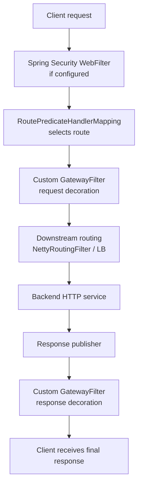
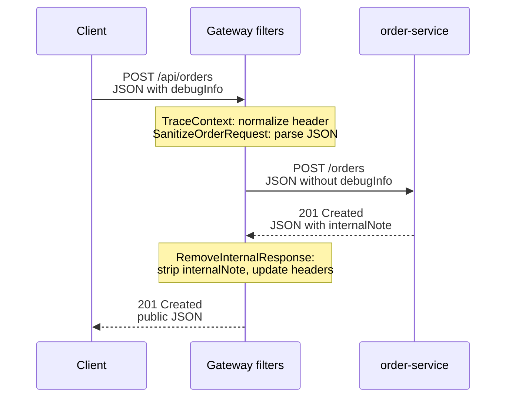

# Modifying Requests and Responses with Appropriate Decorators

An API Gateway does more than decide which request goes to which service. When forwarding to a microservice, Gateway sometimes needs to **attach a verified header**, **normalize a JSON request**, or **strip an internal property from a JSON response**. All of these are HTTP transformations, yet they act on different objects and **cannot be solved safely by mutating the original request/response directly**.

In **Spring Cloud Gateway Server WebFlux**, requests and responses follow a reactive model. To replace what downstream filters see, developers typically use **`ServerWebExchange.mutate()`**, **`ServerHttpRequest.mutate()`**, **`ServerHttpRequestDecorator`**, or **`ServerHttpResponseDecorator`**. In particular, when modifying bodies, you must understand **`Flux<DataBuffer>`**, buffer lifecycles, response commit timing, and metadata like `Content-Length` and `Content-Encoding`.

This lesson belongs to the **Custom Filters** chapter of the **SPRING_CLOUD_GATEWAY** module. The content ties into route predicates, filter chains, path/header rewrites, service discovery, authentication, rate limiting, circuit breakers, retries, TLS, and observability. The emphasis is on **choosing the right mechanism for the right layer**, avoiding turning a simple HTTP modification into memory leaks, broken JSON, bypassed authorization, or invalid client responses.

> **Version scope:** Examples use Spring Cloud Gateway **Server WebFlux** and Spring WebFlux APIs. Gateway 5.x uses the `spring.cloud.gateway.server.webflux.routes` namespace; some earlier 4.x lines use `spring.cloud.gateway.routes`. Never apply `ServerHttpRequestDecorator` or `ServerHttpResponseDecorator` directly to **Gateway Server MVC/Servlet**, which has different request, filter, and execution models.

## 1. Real-World Problem: Two-Way Transformation

Suppose a client sends an order-creation request:

```http
POST /api/orders HTTP/1.1
Host: api.example.test
Authorization: Bearer <access-token>
Content-Type: application/json
X-Trusted-User: admin

{
  "sku": "BOOK-1",
  "quantity": 2,
  "debugInfo": "client-side verbose trace"
}
```

Under an agreed policy, Gateway can:

1. **Request headers:** strip the client-supplied `X-Trusted-User`; if internal identity is needed, derive it strictly from the `Authentication` verified by Spring Security.
2. **Request body:** remove the `debugInfo` JSON field before forwarding to `order-service`.
3. **Response body:** the backend may return `internalNote` intended only for operations; Gateway removes that field before replying to the client, if API policy genuinely permits handling this at the Gateway.
4. **Response headers:** ensure final metadata matches the new body, rather than keeping the old JSON's length or ETag.

Assumed backend response:

```json
{
  "orderId": "ORD-42",
  "status": "CREATED",
  "internalNote": "handled by node-3"
}
```

Desired client response:

```json
{
  "orderId": "ORD-42",
  "status": "CREATED"
}
```

**Security note:** Stripping `debugInfo` or `internalNote` at the Gateway does not replace backend DTOs/allowlists and authorization. Another route might omit the filter, while new sensitive data could appear under a different field name. For personal data or secrets, prefer **never emitting that data from the backend** on public APIs.

## 2. Request, Response, and Exchange in WebFlux

A Gateway handler receives **`ServerWebExchange`**, which holds:

- **`getRequest()`:** `ServerHttpRequest`, including method, URI, headers, cookies, and body publisher.
- **`getResponse()`:** `ServerHttpResponse`, defining HTTP status, response headers, and body writing.
- **`getAttributes()`:** attribute map enabling WebFlux/Gateway filters to coordinate within one exchange.
- **`getPrincipal()`:** principal information when provided by the authentication pipeline.

WebFlux requests are designed so a single object processed by many components cannot be mutated arbitrarily. For bodies, `request.getBody()` returns **`Flux<DataBuffer>`**: data can arrive across multiple chunks, on a reactive schedule, and can typically be consumed only once.



The diagram shows the **logical flow**. In code, a Gateway filter creates the **response decorator before calling `chain.filter(...)`**, while body writing typically occurs on the **return path (post phase)** once the routing filter completes. Actual ordering of `GlobalFilter`, `GatewayFilter`, and `NettyWriteResponseFilter` must be verified on your running version.

### 2.1. How Is a Decorator Different from Mutation?

| Tool | When to use | Example |
| --- | --- | --- |
| **`ServerHttpRequest.mutate()`** | Change URI/path/query/headers/method via supported builder **without modifying the body**. | Strip forged headers, add correlation ID. |
| **`ServerWebExchange.mutate()`** | Let downstream filters see a replaced request/response. | `exchange.mutate().request(newRequest).build()`. |
| **`ServerHttpRequestDecorator`** | Override how the request supplies its body or HTTP request properties. | `getBody()` returns transformed JSON. |
| **`ServerHttpResponseDecorator`** | Intercept and transform the body when downstream writes the response. | Override `writeWith(...)`. |
| **`ModifyRequestBody` / `ModifyResponseBody`** | Transform typed bodies using Gateway's **built-in** filters. | Map DTOs, normalize JSON responses. |
| **`ServerWebExchange.getAttributes()`** | Pass **internal** metadata between filters; does not alter HTTP bodies. | Attach trace context for downstream logic. |

**Rule of thumb for choosing a solution:** For header or path changes only, **prefer builders or built-in filters**. For typed body changes, **prefer `ModifyRequestBody` or `ModifyResponseBody`**. Only write a custom decorator when you need low-level control over the publisher/stream and lifecycle not covered by built-in factories.

## 3. Modifying Headers and Paths: No Body Decorator Needed

The example below demonstrates a **custom GatewayFilterFactory** that strips a potentially client-spoofed identity header and overwrites a Gateway-generated correlation header:

```java
package com.example.gateway.filters;

import java.util.UUID;

import org.springframework.cloud.gateway.filter.GatewayFilter;
import org.springframework.cloud.gateway.filter.factory.AbstractGatewayFilterFactory;
import org.springframework.http.server.reactive.ServerHttpRequest;
import org.springframework.stereotype.Component;

@Component
public class TraceContextGatewayFilterFactory
        extends AbstractGatewayFilterFactory<
            TraceContextGatewayFilterFactory.Config> {

    public static class Config { }

    public TraceContextGatewayFilterFactory() {
        super(Config.class);
    }

    @Override
    public GatewayFilter apply(Config config) {
        return (exchange, chain) -> {
            String traceId = UUID.randomUUID().toString();

            ServerHttpRequest request = exchange.getRequest()
                .mutate()
                .headers(headers -> {
                    headers.remove("X-Trusted-User");
                    headers.set("X-Gateway-Trace", traceId);
                })
                .build();

            return chain.filter(
                exchange.mutate().request(request).build()
            );
        };
    }
}
```

This is an **HTTP metadata transformation**: it does not read the request body and allocates no `DataBuffer`. `headers.set(...)` **overwrites** the old value; `headers.add(...)` can append a second value and introduce ambiguity. For identity headers, you must **strip client-supplied values** and regenerate them only from a verified principal in a trusted design. The example above only adds a **trace ID**, never an arbitrary user ID.

To change the path without modifying the body:

```java
ServerHttpRequest rewritten = exchange.getRequest()
    .mutate()
    .path("/orders/42")
    .build();

return chain.filter(exchange.mutate().request(rewritten).build());
```

**Never hardcode `"/orders/42"` in production.** Use `StripPrefix`, `RewritePath`, or a builder computing the path properly from the incoming request. When only URL rewriting is needed, built-in filters are easier to test and less error-prone.

### 3.1. Configuring the Custom Filter in YAML

Spring Cloud Gateway discovers factories by the **`GatewayFilterFactory`** class name suffix. `TraceContextGatewayFilterFactory` is typically referenced by the short name **`TraceContext`**:

```yaml
spring:
  cloud:
    gateway:
      server:
        webflux:
          routes:
            - id: orders-api
              uri: lb://order-service
              predicates:
                - Path=/api/orders/**
              filters:
                - TraceContext
                - StripPrefix=1
```

Requirements: the filter bean is scanned by Spring, the starter is Server WebFlux, and LoadBalancer/discovery is configured if using `lb://`. The parameterless short form only fits factories without required arguments; for complex factories, use `name/args`.

## 4. Why Not Mutate the Old Request/Response Directly?

A common mistake is:

```java
// Not a reliable way to modify requests in WebFlux.
exchange.getRequest().getHeaders()
    .set("X-Gateway-Trace", "123");
```

HTTP request headers are often exposed as read-only or constrained wrappers; mutating directly can throw `UnsupportedOperationException`, remain invisible to downstream layers, or break immutability assumptions.

Likewise, **there is no API** to grab `request.getBody()` and assign a `String` into it. The body is a data publisher and must be replaced with **a new publisher** via a decorator or built-in body filter.

Standard pattern:

```java
ServerHttpRequestDecorator decorated =
    new ServerHttpRequestDecorator(exchange.getRequest()) {
        @Override
        public Flux<DataBuffer> getBody() {
            return someNewBodyPublisher;
        }
    };

ServerWebExchange wrapped =
    exchange.mutate().request(decorated).build();

return chain.filter(wrapped);
```

This is an **illustrative skeleton**, assuming `someNewBodyPublisher` has the right type and lifecycle handling. In real applications, only `getBody()` changes; other properties are delegated by the decorator unless overridden.

**Crucially:** If the body's byte count changes, revisit `Content-Length` and `Transfer-Encoding`. If the content type changes, update `Content-Type`; never keep stale metadata from the old body blindly.

## 5. DataBuffer: The Most Error-Prone Part of Manual Body Handling

`DataBuffer` is Spring's abstraction over memory regions holding data. With Reactor Netty, memory may come from **pooled buffers** requiring reference-count management. Body-processing code must obey three rules:

1. **Never assume a JSON body arrives in a single `DataBuffer`.** TCP chunk boundaries do not align with JSON tokens, UTF-8 characters, or business objects.
2. **Never consume the request body and leave downstream with an empty body.** Reactive request bodies generally cannot be re-read from the start once consumed by a filter.
3. **Never forget to release pooled buffers** once you take ownership of the data and finish reading it.

### 5.1. Wrong: Treating Each DataBuffer as a Complete JSON Object

```java
// INCORRECT for arbitrary JSON.
request.getBody().map(buffer -> {
    String text = buffer.toString(StandardCharsets.UTF_8);
    return parseAndRewriteJson(text);
});
```

Body:

```json
{"customer":{"name":"Nguyễn"},"quantity":2}
```

may arrive split across multiple chunks:

```text
Buffer 1: {"customer":{"name":"Ng
Buffer 2: uyễn"},"quant
Buffer 3: ity":2}
```

Even a single UTF-8 character can be split across buffers. Parsing each chunk independently fails or corrupts data. If you need **whole-object** JSON transformation, use a codec with proper streaming semantics or **join the body with a byte limit** and parse once.

### 5.2. `DataBufferUtils.join` with a Size Limit

Spring provides:

```java
Mono<DataBuffer> joined = DataBufferUtils.join(
    request.getBody(),
    256 * 1024 // max 256 KiB for this example
);
```

`join(Publisher, maxByteCount)` aggregates buffers and **emits `DataBufferLimitException` when exceeding the limit** per Spring Framework behavior. Limits are vital: if every request carries a 10 MB body with hundreds of concurrent requests, Gateway can consume massive memory just re-parsing payloads.

After receiving the joined buffer, read and release it:

```java
static byte[] readAndRelease(DataBuffer dataBuffer) {
    try {
        byte[] result = new byte[dataBuffer.readableByteCount()];
        dataBuffer.read(result);
        return result;
    } finally {
        DataBufferUtils.release(dataBuffer);
    }
}
```

Under `join`'s contract, if the aggregated buffer is returned as a composite, **releasing the joined buffer** handles the underlying buffers managed inside the composite. **Do not release individual source buffers a second time** after `join` manages them, as that can cause a double release.

### 5.3. "Read, Transform, Allocate New Buffer" vs. "Keep Old Buffer"

Once content is copied into a `byte[]`, you can release the joined buffer and create a new `DataBuffer` via:

```java
DataBuffer rewrittenBuffer =
    exchange.getResponse().bufferFactory().wrap(rewrittenBytes);
```

Even so, you must still verify with tests that the buffer is emitted downstream exactly once, handled on cancel/error, and never retained past the request lifecycle. **Never call `block()` or `subscribe()` inside a filter** to extract the body, as that breaks the reactive pipeline, risks blocking the event loop, and detaches body reading from the exchange lifecycle.

In complex custom publishers using `publishOn`, `filter`, or cancellation, consider `doOnDiscard(DataBuffer.class, DataBufferUtils::release)` and each operator's ownership rules to avoid leaks; **do not scatter arbitrary release calls** where the framework already owns the buffer.

## 6. Request Decorator Example: Removing a JSON Field Before Downstream

Scenario: Only the **`POST /api/orders`** route accepts small JSON objects. Gateway removes the `debugInfo` field from the body before forwarding.

### 6.1. Custom Factory with Bounded Body Processing

Java 17+ example using Jackson and Spring WebFlux:

```java
package com.example.gateway.filters;

import java.io.IOException;

import com.fasterxml.jackson.databind.JsonNode;
import com.fasterxml.jackson.databind.ObjectMapper;
import com.fasterxml.jackson.databind.node.ObjectNode;
import org.springframework.cloud.gateway.filter.GatewayFilter;
import org.springframework.cloud.gateway.filter.factory.AbstractGatewayFilterFactory;
import org.springframework.core.io.buffer.DataBuffer;
import org.springframework.core.io.buffer.DataBufferLimitException;
import org.springframework.core.io.buffer.DataBufferUtils;
import org.springframework.http.HttpHeaders;
import org.springframework.http.HttpStatus;
import org.springframework.http.MediaType;
import org.springframework.http.server.reactive.ServerHttpRequestDecorator;
import org.springframework.stereotype.Component;
import org.springframework.web.server.ResponseStatusException;
import reactor.core.publisher.Flux;
import reactor.core.publisher.Mono;

@Component
public class SanitizeOrderRequestGatewayFilterFactory
        extends AbstractGatewayFilterFactory<
            SanitizeOrderRequestGatewayFilterFactory.Config> {

    private static final int MAX_BYTES = 256 * 1024;
    private final ObjectMapper mapper;

    public static class Config { }

    public SanitizeOrderRequestGatewayFilterFactory(
            ObjectMapper mapper) {
        super(Config.class);
        this.mapper = mapper;
    }

    @Override
    public GatewayFilter apply(Config config) {
        return (exchange, chain) -> {
            var request = exchange.getRequest();
            MediaType contentType = request.getHeaders().getContentType();
            if (contentType == null ||
                    !MediaType.APPLICATION_JSON.isCompatibleWith(contentType)) {
                // Example handles application/json only;
                // real routes must define policies for other media types.
                return chain.filter(exchange);
            }
            if (request.getHeaders().containsKey(
                    HttpHeaders.CONTENT_ENCODING)) {
                return Mono.error(new ResponseStatusException(
                    HttpStatus.UNSUPPORTED_MEDIA_TYPE,
                    "Compressed request body not supported"));
            }

            Mono<byte[]> transformed = DataBufferUtils
                .join(request.getBody(), MAX_BYTES)
                .map(SanitizeOrderRequestGatewayFilterFactory::readAndRelease)
                .defaultIfEmpty(new byte[0])
                .flatMap(bytes -> Mono.fromCallable(
                    () -> removeDebugInfo(bytes)))
                .onErrorMap(DataBufferLimitException.class,
                    ex -> new ResponseStatusException(
                        HttpStatus.PAYLOAD_TOO_LARGE,
                        "Request JSON exceeds limit", ex));

            return transformed.flatMap(bytes -> {
                ServerHttpRequestDecorator decorated =
                    new ServerHttpRequestDecorator(request) {
                        @Override
                        public HttpHeaders getHeaders() {
                            HttpHeaders headers = new HttpHeaders();
                            headers.putAll(super.getHeaders());
                            headers.remove(HttpHeaders.TRANSFER_ENCODING);
                            headers.setContentLength(bytes.length);
                            return headers;
                        }

                        @Override
                        public Flux<DataBuffer> getBody() {
                            // Create a fresh DataBuffer per subscriber.
                            return Flux.defer(() -> Flux.just(
                                exchange.getResponse()
                                    .bufferFactory().wrap(bytes)));
                        }
                    };
                return chain.filter(
                    exchange.mutate().request(decorated).build()
                );
            });
        };
    }

    private byte[] removeDebugInfo(byte[] raw) throws IOException {
        if (raw.length == 0) {
            return raw;
        }
        JsonNode node = mapper.readTree(raw);
        if (!(node instanceof ObjectNode object)) {
            throw new IllegalArgumentException("Expected JSON object");
        }
        object.remove("debugInfo");
        return mapper.writeValueAsBytes(object);
    }

    private static byte[] readAndRelease(DataBuffer buffer) {
        try {
            byte[] bytes = new byte[buffer.readableByteCount()];
            buffer.read(bytes);
            return bytes;
        } finally {
            DataBufferUtils.release(buffer);
        }
    }
}
```

**Key parts of the example:**

1. **`DataBufferUtils.join(..., MAX_BYTES)`** handles multi-chunk bodies and rejects payloads over the limit.
2. **`readAndRelease`** frees the joined buffer after copying bytes into `byte[]`.
3. **Jackson `ObjectNode.remove`** deletes the property **structurally as JSON**, instead of raw regex string surgery.
4. **`getBody()`** on the request decorator supplies a **new** body publisher for downstream routing filters.
5. **`getHeaders()`** returns updated headers, removing old `Transfer-Encoding` and setting `Content-Length` to the **new byte count**, not Java character length.
6. **`exchange.mutate().request(decorated)`** passes the wrapped request to the rest of the chain.
7. **No `block()` or `subscribe()`**; the entire read/modify/route sequence runs in one reactive chain.

This is a **bounded learning sample**, not an all-media-type processor. For malformed JSON, `ObjectMapper` throws and the app's error mapper must clearly decide whether to return `400` or another status. Oversized downstream responses, multipart uploads, streaming, non-UTF-8 charsets, nested fields, cancellation, and retry synchronization all require additional design and tests. **Do not copy this class straight to production and consider it fully tested.**

### 6.2. Why Does Holding `byte[]` Still Carry Risk?

The `byte[]` lives inside the lambda and stays alive with the publisher/request until the pipeline completes. With hundreds of concurrent requests each buffering 256 KiB plus intermediate JSON trees, total memory can be several times `MAX_BYTES × request count` due to allocations, source buffers, and Jackson objects.

`Flux.defer(...)` allocates a fresh `DataBuffer` per subscription, yet **it does not make the operation streaming**: the full body is still buffered in memory. If a Retry filter is present, the same bytes can be replayed depending on order; that **does not guarantee** a POST business operation is safe to repeat.

### 6.3. Why Not Just Use `request.mutate().header(...)`?

`ServerHttpRequest.mutate()` suits **method, URI, path, and headers**. It provides no way to replace a `Flux<DataBuffer>` body with new JSON through a header call. Replacing the body requires a decorator like the example above or Gateway's body-transformation factories.

## 7. Response Decorator: Intercepting the Body Before the Client Sees It

For response bodies, data flows in reverse: the routing filter receives the backend response and writes it into `ServerHttpResponse`. A **`ServerHttpResponseDecorator`** can override **`writeWith(Publisher<? extends DataBuffer>)`** to intercept the publisher instead of letting content pass straight to the client.

**Conceptual template:**

```java
ServerHttpResponseDecorator decorated =
    new ServerHttpResponseDecorator(exchange.getResponse()) {
        @Override
        public Mono<Void> writeWith(
                Publisher<? extends DataBuffer> body) {
            // Transform the body, then write via super.writeWith(...).
            return super.writeWith(body);
        }
    };

return chain.filter(
    exchange.mutate().response(decorated).build()
);
```

This is a skeleton that **does not alter content yet**. A real response decorator must check:

- Whether a **body exists** (`204 No Content`, `304 Not Modified`, responses to `HEAD`).
- Whether the media type is standard JSON, `application/problem+json`, or binary/XML/SSE.
- Whether the body is **gzip/br/deflate** compressed before the decorator sees it.
- Whether the body is emitted across multiple chunks or via `writeAndFlushWith`.
- Metadata like `Content-Length`, `Content-Encoding`, `ETag`, and checksums/signatures.
- Whether the response has already **committed**; after commit, status/headers cannot change.

### 7.1. Example: Stripping `internalNote` from Root JSON Objects

The example below uses Jackson to **delete the top-level `internalNote` property** from `application/json` responses up to 256 KiB. As a learning example, it intentionally **rejects compressed JSON or streaming JSON** rather than silently leaking untransformed original data.

```java
package com.example.gateway.filters;

import java.io.IOException;

import com.fasterxml.jackson.databind.JsonNode;
import com.fasterxml.jackson.databind.ObjectMapper;
import com.fasterxml.jackson.databind.node.ObjectNode;
import org.reactivestreams.Publisher;
import org.springframework.cloud.gateway.filter.GatewayFilter;
import org.springframework.cloud.gateway.filter.factory.AbstractGatewayFilterFactory;
import org.springframework.core.io.buffer.DataBuffer;
import org.springframework.core.io.buffer.DataBufferLimitException;
import org.springframework.core.io.buffer.DataBufferUtils;
import org.springframework.http.HttpHeaders;
import org.springframework.http.HttpStatus;
import org.springframework.http.MediaType;
import org.springframework.http.server.reactive.ServerHttpResponseDecorator;
import org.springframework.stereotype.Component;
import org.springframework.web.server.ResponseStatusException;
import reactor.core.publisher.Flux;
import reactor.core.publisher.Mono;

@Component
public class RemoveInternalResponseGatewayFilterFactory
        extends AbstractGatewayFilterFactory<
            RemoveInternalResponseGatewayFilterFactory.Config> {

    private static final int MAX_BYTES = 256 * 1024;
    private final ObjectMapper mapper;

    public static class Config { }

    public RemoveInternalResponseGatewayFilterFactory(
            ObjectMapper mapper) {
        super(Config.class);
        this.mapper = mapper;
    }

    @Override
    public GatewayFilter apply(Config config) {
        return (exchange, chain) -> {
            ServerHttpResponseDecorator decorated =
                new ServerHttpResponseDecorator(exchange.getResponse()) {

                    @Override
                    public Mono<Void> writeWith(
                            Publisher<? extends DataBuffer> body) {
                        MediaType type = getHeaders().getContentType();
                        if (type == null ||
                                !MediaType.APPLICATION_JSON
                                    .isCompatibleWith(type)) {
                            return super.writeWith(body);
                        }

                        if (getHeaders().containsKey(
                                HttpHeaders.CONTENT_ENCODING)) {
                            return Mono.error(new ResponseStatusException(
                                HttpStatus.BAD_GATEWAY,
                                "Compressed JSON transformation unsupported"));
                        }

                        Mono<byte[]> transformed = DataBufferUtils
                            .join(Flux.from(body), MAX_BYTES)
                            .map(RemoveInternalResponseGatewayFilterFactory
                                ::readAndRelease)
                            .defaultIfEmpty(new byte[0])
                            .flatMap(bytes -> Mono.fromCallable(
                                () -> removeInternalNote(bytes)))
                            .onErrorMap(DataBufferLimitException.class,
                                ex -> new ResponseStatusException(
                                    HttpStatus.BAD_GATEWAY,
                                    "Downstream JSON exceeds limit", ex));

                        return transformed.flatMap(bytes -> {
                            // Old response byte length and ETag are no longer valid.
                            getHeaders().remove(HttpHeaders.CONTENT_LENGTH);
                            getHeaders().remove(HttpHeaders.ETAG);

                            DataBuffer out = bufferFactory().wrap(bytes);
                            return super.writeWith(Mono.just(out));
                        });
                    }

                    @Override
                    public Mono<Void> writeAndFlushWith(
                            Publisher<? extends Publisher<
                                ? extends DataBuffer>> body) {
                        MediaType type = getHeaders().getContentType();
                        if (type != null &&
                                MediaType.APPLICATION_JSON
                                    .isCompatibleWith(type)) {
                            return Mono.error(new ResponseStatusException(
                                HttpStatus.BAD_GATEWAY,
                                "Streaming JSON transformation unsupported"));
                        }
                        return super.writeAndFlushWith(body);
                    }
                };

            return chain.filter(
                exchange.mutate().response(decorated).build()
            );
        };
    }

    private byte[] removeInternalNote(byte[] raw)
            throws IOException {
        if (raw.length == 0) {
            return raw;
        }
        JsonNode json = mapper.readTree(raw);
        if (!(json instanceof ObjectNode object)) {
            throw new IllegalArgumentException("Expected JSON object");
        }
        object.remove("internalNote");
        return mapper.writeValueAsBytes(object);
    }

    private static byte[] readAndRelease(DataBuffer buffer) {
        try {
            byte[] bytes = new byte[buffer.readableByteCount()];
            buffer.read(bytes);
            return bytes;
        } finally {
            DataBufferUtils.release(buffer);
        }
    }
}
```

**Reading the example by lifecycle:**

1. The filter creates the **response decorator first**, then calls `chain.filter(...)` with the wrapped `exchange`.
2. When downstream writes the response, the decorator's `writeWith(...)` intercepts the `DataBuffer` stream.
3. If `application/json` without `Content-Encoding`, the example performs a bounded join, parses JSON, and removes one field.
4. **The joined input buffer is released.** New bytes are wrapped into an output `DataBuffer` for the underlying writer.
5. **Old `Content-Length` and `ETag` are removed** before writing the new body. Never assume hashes, signatures, or other cache headers update automatically.
6. For `writeAndFlushWith` on JSON streams, the example **errors out** instead of silently passing raw bytes because no proper streaming transform exists here.

**Boundaries of this example:** It does not automatically transform `application/problem+json`, root JSON arrays, compressed bodies, or streaming formats. It does not guarantee every error response is JSON and adds no authorization policy. If a response commits early or another filter writes directly to Netty, behavior may differ; test with a live Gateway and backend before production use.

### 7.2. Why Must a Response Decorator Intercept at Write Time?

An insufficient approach:

```java
return chain.filter(exchange)
    .then(Mono.fromRunnable(() -> {
        exchange.getResponse().getHeaders()
            .add("X-Processed", "true");
    }));
```

By the time `then(...)` runs, downstream may have already **committed** headers and body. Adding headers then may be ignored or fail depending on the adapter. To change the **response body**, you cannot wait until writing finishes and modify a non-existent `String` object. You must install the decorator **before downstream writes**; to tweak headers right before commit, register `beforeCommit(...)` at the right lifecycle moment, though that is still not a body-replacement step.

### 7.3. Not Every JSON Payload Can Be Transformed with a Whole-Body Parse

- **Small `application/json`:** can use Jackson with a bounded buffer.
- **`application/problem+json`:** requires explicit media-type support; do not assume an `application/json` check covers it.
- **Root array:** root-level `ObjectNode.remove(...)` will not strip fields inside array elements.
- **SSE/NDJSON/chunked JSON:** has message boundaries or multiple consecutive objects; joining the whole stream may never complete.
- **Compressed bodies:** must be decompressed before parsing and recompressed in order, or rejected/handled per a defined safe policy.
- **Binary/files:** must never be parsed as UTF-8 JSON.

**Never let a filter meant to redact sensitive fields silently "skip and pass the original body"** when it doesn't recognize the media type if the security contract requires the field always be removed. Prefer omitting the field in the backend DTO or failing closed with a controlled response.

## 8. Combining Request and Response Decorators on the Same Route

Both example factories can be attached to a route in the desired order:

```yaml
spring:
  cloud:
    gateway:
      server:
        webflux:
          routes:
            - id: create-order
              uri: lb://order-service
              predicates:
                - Path=/api/orders
                - Method=POST
              filters:
                - TraceContext
                - SanitizeOrderRequest
                - RemoveInternalResponse
                - StripPrefix=1
```

**4.x namespace option:** Earlier Gateway Server WebFlux versions may use `spring.cloud.gateway.routes` instead of `spring.cloud.gateway.server.webflux.routes`. Pick the right BOM/starter, confirm factory names are scanned, and inspect runtime routes.

### 8.1. End-to-End Transformation Flow



For valid requests and small well-formed JSON responses, this is the expected flow. In real systems, verify:

- The request body sent to the backend has **exact byte/JSON semantics** after modification.
- The final response **contains no internal fields** and has consistent HTTP metadata.
- `201 Created` status is preserved when the backend returns 201 and no other filter changes it.
- Full JSON containing PII is never logged.
- Other routes, 4xx/5xx errors, HTTP `HEAD`/`OPTIONS`, and content negotiation cannot accidentally bypass the policy.

### 8.2. Why Does Filter Order Matter?

Spring Cloud Gateway merges **`GlobalFilter`** and **`GatewayFilter`** into a single filter chain sorted by `Ordered`. Filters can act before routing and after routing. Once an earlier filter reads the request body, later filters cannot re-read it by default unless it is properly cached/decorated.

For example:

- `SanitizeOrderRequest` **before** a filter that reads/logs the request body: the later filter sees the sanitized content (provided the updated exchange is forwarded).
- If an earlier filter already consumed the body without replay, `SanitizeOrderRequest` may see an empty body.
- If a retry filter re-runs the chain behind it, the body publisher must support replay cleanly without emitting duplicate side effects.
- The response decorator must be attached to the exchange **before** response writing takes place.
- Another filter altering `Content-Encoding`, `Content-Type`, or caching responses can create incompatible ordering.

**Do not treat YAML line order as an absolute guarantee** when `GlobalFilter`s and custom `OrderedGatewayFilter`s are involved. Inspect Gateway runtime ordering and run integration tests.

## 9. Why `ModifyRequestBody` / `ModifyResponseBody` Are Usually Better

Spring Cloud Gateway already ships **`ModifyRequestBody`** and **`ModifyResponseBody`** in Server WebFlux. Official docs specify that **these two factories are configured via Java DSL**, not just a one-line YAML shortcut like simple filters.

Java DSL example transforming plain-text bodies:

```java
package com.example.gateway.routes;

import org.springframework.cloud.gateway.route.RouteLocator;
import org.springframework.cloud.gateway.route.builder.RouteLocatorBuilder;
import org.springframework.context.annotation.Bean;
import org.springframework.context.annotation.Configuration;
import org.springframework.http.MediaType;
import reactor.core.publisher.Mono;

@Configuration
public class TextBodyRoutes {

    @Bean
    RouteLocator bodyRoutes(RouteLocatorBuilder routes) {
        return routes.routes()
            .route("text-transform", r -> r
                .path("/api/text/**")
                .filters(f -> f
                    .modifyRequestBody(
                        String.class,
                        String.class,
                        MediaType.TEXT_PLAIN_VALUE,
                        (exchange, input) -> input == null
                            ? Mono.empty()
                            : Mono.just(input.trim()))
                    .modifyResponseBody(
                        String.class,
                        String.class,
                        (exchange, output) -> output == null
                            ? Mono.empty()
                            : Mono.just(output.toUpperCase()))
                )
                .uri("http://localhost:9090"))
            .build();
    }
}
```

This snippet **intentionally handles `text/plain`**, not JSON. Never use `String.replace(...)` or `toUpperCase()` to remove sensitive fields from JSON: JSON contains escapes, nested objects, arrays, and string values that naive text operations easily corrupt.

For JSON, these filters can use DTO classes or codec-compatible types to **decode → transform with types → encode**. Built-in factories handle more of the pipeline than manually wiring `DataBuffer`s, though you still must test memory, media types, null bodies, retries, and metadata.

### 9.1. Handling Empty Bodies

Spring Cloud Gateway docs note that when no body exists, the rewrite function of `ModifyRequestBody`/`ModifyResponseBody` may receive **`null`**. The standard pattern is:

```java
(exchange, body) -> body == null
    ? Mono.empty()
    : Mono.just(transform(body))
```

Never assume every request/response always has JSON. `204 No Content`, `HEAD`, or bodyless error responses must preserve HTTP semantics.

### 9.2. When to Use `CacheRequestBody`?

If you only need to **read the body for inspection/computation** and still forward the original body to the backend, consider `CacheRequestBody`. Gateway documentation explains that this filter decodes the body into a declared type and stores it in the exchange attribute `ServerWebExchangeUtils.CACHED_REQUEST_BODY_ATTR`, since reactive bodies normally cannot be read twice.

Remember **caching** consumes memory; do not treat it as a free pass to log entire requests, especially when bodies contain passwords, tokens, PII, or file uploads.

### 9.3. Comparing Options

| Requirement | Prefer |
| --- | --- |
| Add, remove, or overwrite headers | `AddRequestHeader`, `SetRequestHeader`, `RemoveRequestHeader`, or `request.mutate()` |
| Rewrite path | `StripPrefix`, `RewritePath`, `SetPath` |
| Modify a few JSON request fields | `ModifyRequestBody` with typed DTO/codec, or decorator if genuinely required |
| Change JSON response structure | `ModifyResponseBody`; prefer DTO at the source for security-sensitive fields |
| Strip JSON response field names | `RemoveJsonAttributesResponseBody` when supported by your version and root/recursive scope |
| Read body and still forward untouched | `CacheRequestBody` or a tested replay mechanism |
| Intercept/write body at custom publisher level | `ServerHttpRequestDecorator`/`ServerHttpResponseDecorator` with clear ownership |
| Check JWT/roles/scopes | Spring Security reactive; **never manually parse Authorization headers in a body filter** |
| Rate limiting | `RequestRateLimiter`, quota policies; never use body decorators to block requests ad hoc |

## 10. HTTP Metadata Must Stay Consistent After Changing the Body

This is a subtle source of bugs: re-serialized JSON can have a **different byte length** even when business values look nearly identical.

| Metadata | Risk when body changes | What to do |
| --- | --- | --- |
| **`Content-Length`** | Still reflects old body's byte length → client under-reads/over-reads, framing error | Recompute byte length or remove header so the stack handles framing properly |
| **`Transfer-Encoding`** | Conflicts with updated `Content-Length` or HTTP/2 | Let the HTTP stack select framing; avoid forcing inconsistent headers |
| **`Content-Type` / charset** | Header declares JSON while actual bytes use another format/charset | Parse/serialize with matching codec and charset |
| **`Content-Encoding`** | `gzip`/`br` bodies cannot be parsed directly as JSON | Decompress/transform properly or reject/skip per policy |
| **`ETag`** | Validator from old JSON no longer matches new bytes | Remove or recompute from the transformed body |
| **`Last-Modified` / `Cache-Control`** | Conditional requests/caches may rely on a different representation | Review API and gateway cache semantics |
| **Content checksum/signature** | Signature or digest was computed over old bytes | Re-sign with an authorized mechanism or do not alter signed bodies |
| **`Set-Cookie`** | Cookies can alter state across retries/redirects | Never duplicate or leak cookies accidentally |
| **Status code** | `204`/`304`/`HEAD` have no body by HTTP semantics | Do not force writing JSON just because a decorator sees an empty publisher |

**Never fix framing errors by setting `Content-Length` to Java character length.** For example, `"Trường"` takes more UTF-8 bytes than displayed `char` count; the header must reflect **the final encoded byte count**.

### 10.1. Headers/Status Can Only Be Changed Before Response Commit

`ServerHttpResponse.isCommitted()` indicates whether the response has already started writing to a point where changes are disallowed. You can use `beforeCommit(...)` for pre-commit header updates:

```java
exchange.getResponse().beforeCommit(() -> {
    exchange.getResponse().getHeaders()
        .set("X-Gateway-Processed", "true");
    return Mono.empty();
});

return chain.filter(exchange);
```

Register the callback **before downstream writes the response**. This snippet only adds a header; it **does not modify JSON bodies**. The callback should be lightweight, non-blocking, and free of risky side effects; once committed, there is no `uncommit()` to rewrite from scratch.

### 10.2. 204, HEAD, Caching, and Conditional Requests

Body transformation can inadvertently violate semantics of:

- **`204 No Content`**: never emit JSON `"null"` just to make responses uniform.
- **`HEAD`**: never emit a body even when the backend handles metadata similarly to GET.
- **`304 Not Modified`**: validators must match the representation cached by the client.
- **`Range` / `206 Partial Content`**: transforming an entire body invalidates partial byte offsets.
- **SSE / file downloads**: incompatible with buffering and whole-body JSON parsing.

For these cases, the safest choice is usually **skipping the body decorator**, preserving an unmodified API contract, or handling transformation at the backend.

## 11. Retry, Backpressure, and Request Cancellation

### 11.1. Reactive Request Bodies Normally Cannot Be Re-Read Arbitrarily

Suppose filter A reads all of `exchange.getRequest().getBody()` to inspect it, then calls `chain.filter(exchange)` with the **unreplaced** request. Downstream filters and routing may see an empty body or error because the stream was already consumed.

A proper request decorator must provide a **fresh publisher**. If retries re-execute downstream segments, that publisher must support repeated subscriptions cleanly. However:

**Being able to replay a request body ≠ safe business retry.** If a `POST` order creation already wrote to the database on attempt 1, retrying can still create duplicates even with byte-identical payloads.

### 11.2. Accounting for Backpressure and DataBuffer Lifecycle

Reactor `Flux<DataBuffer>` uses backpressure to regulate flow. `DataBufferUtils.join(...)`, however, buffers the body, forfeiting chunk-by-chunk streaming benefits for that payload and raising memory usage while waiting for the full body.

When supporting **large streaming payloads**:

- Choose algorithms that process streams semantically (without splitting JSON tokens or UTF-8 sequences).
- Define max size, max duration, and concurrency budgets.
- Never retain references to pooled buffers after the publisher completes.
- Test error/cancellation paths and release buffers according to ownership.
- Avoid `block()` and blocking I/O on the Netty event loop.
- Use built-in codecs/filters or push transformation down to the backend when possible.

### 11.3. Retry Combined with Custom Decorators

Spring Cloud Gateway Retry can re-run filters behind it according to filter order. Consider:

| Scenario | Risk |
| --- | --- |
| Retry before request decorator | Body may be parsed/transformed multiple times, increasing memory/CPU |
| Retry after request decorator | Must replay transformed body; cannot assume every publisher is cold/repeatable |
| Retry on POST/PUT | Backend side effects may repeat |
| Retry after response committed | Cannot produce a valid fresh response from scratch |
| Body-logging custom filter retried | Duplicate logs; sensitive content exposed multiple times |

Do not rely solely on YAML order; check effective `Ordered` values and integration tests. To protect data and quotas, decide whether rate limiters count **per inbound request** or **per attempt**.

## 12. Security: Decorators Do Not Replace Security Boundaries

A gateway might attach `X-Authenticated-User` so the backend knows the caller's identity. Writing:

```java
String userId = exchange.getRequest().getHeaders()
    .getFirst("X-User-Id");
request.mutate().header("X-Authenticated-User", userId).build();
```

lets any client send `X-User-Id` and impersonate someone else. That is the mistake of **turning untrusted data into a credential**. Instead, extract identity from the `Authentication/Principal` established by Spring Security, verify tenant/audience/role/scope, and use a trusted channel/protocol to pass it downstream.

### 12.1. Risks Specific to Body Rewriting

- **Data leaks:** removing only a denylisted `internalNote` field does not guarantee other sensitive fields are gone.
- **Request smuggling/framing:** altering the body while leaving stale `Content-Length`/`Transfer-Encoding` headers causes parser discrepancies across hops.
- **Compressed payloads:** you cannot parse or mask JSON by decoding raw gzip bytes directly as UTF-8.
- **Digital signatures:** modifying a request/response after a layer signed it breaks signature verification or compromises integrity guarantees.
- **JSON ambiguity:** duplicate keys, Unicode normalization, large numbers, and encodings require consistent parsing/serialization policies.
- **High memory cost:** malicious clients sending many large JSON payloads force Gateway to buffer data and exhaust memory.
- **Logging:** logging raw bodies before redaction leaks JWTs, payment details, or PII into logs.

**Never use a body decorator to validate JWTs by scanning strings in the body**, and never treat a client-supplied body property as an authorization permission. Authentication and authorization belong in trusted components—typically Spring Security and the backend.

### 12.2. When Must You Fail Closed?

If the business requirement states **"clients must never receive `internalNote`"**, skipping transformation when `Content-Type` is missing, the body is oversized, or the body is compressed cannot be treated as success. Two stronger options:

1. **Backend DTO/allowlist:** never serialize unpublished fields at the source.
2. **Fail-closed transformation policy:** if the payload falls outside supported format/size bounds, never send the raw response; test the error path and ensure the response is uncommitted.

A custom decorator can record transformation failure events, yet it alone cannot guarantee every response type is filtered; audit the **entire route graph** and handlers that produce errors or fallbacks directly.

### 12.3. TLS and Downstream Authentication

Body transformation does not protect data in transit. Use HTTPS between clients and Gateway, and TLS/mTLS or network policies between Gateway and backends per your threat model. Never disable certificate validation to "reduce body transformation errors"; TLS and JSON are separate layers.

## 13. End-to-End Integration Testing

A test that only calls `removeDebugInfo(...)` on a `byte[]` does not prove the request decorator is wired into the Gateway filter chain, preserves the body, or avoids buffer leaks. Test **real HTTP requests into Gateway**, what the backend stub receives, and what the client receives.

### 13.1. Test Environment

```text
WebTestClient / HTTP client
          |
          v
Spring Cloud Gateway (Server WebFlux)
  TraceContext
  SanitizeOrderRequest
  RemoveInternalResponse
          |
          v
Backend stub (HTTP, returns deterministic JSON)
```

Assumptions:

- Gateway listens on `localhost:8080`.
- Backend stub listens on `localhost:9090`, accepting `POST /orders`.
- Route `/api/orders` uses `StripPrefix=1` and forwards to `http://localhost:9090` in tests to avoid depending on service discovery.
- Backend verifies the transformed body and returns JSON containing `internalNote`.

### 13.2. Verifying the Request Arriving at the Backend

Test request:

```http
POST /api/orders HTTP/1.1
Content-Type: application/json
X-Trusted-User: admin

{"sku":"BOOK-1","quantity":2,"debugInfo":"should-remove"}
```

Expected structural JSON received by the backend stub:

```json
{
  "sku": "BOOK-1",
  "quantity": 2
}
```

Additionally:

- The backend **must not receive** the client-sent `X-Trusted-User` header.
- A Gateway-generated `X-Gateway-Trace` header is present per design.
- `Content-Length` or request framing matches the modified body bytes.
- No UTF-8 characters are split or corrupted, and chunks are not parsed individually.

**Test JSON structurally** (e.g., JsonPath/JSONAssert/Jackson) rather than comparing raw strings that may differ in whitespace, field order, or escaping after re-serialization.

### 13.3. Verifying the Response Returned to the Client

Backend returns:

```http
HTTP/1.1 201 Created
Content-Type: application/json
ETag: "original-payload"

{"orderId":"ORD-42","status":"CREATED","internalNote":"private"}
```

Expected client response:

```json
{
  "orderId": "ORD-42",
  "status": "CREATED"
}
```

And:

- `internalNote` is absent from the JSON response.
- The original `ETag` is no longer emitted as if the representation were unchanged.
- Body byte length and HTTP framing are valid.
- HTTP status remains `201` if no other filter alters it.
- Essential headers such as `Content-Type` are preserved.

### 13.4. Illustrative `WebTestClient` Assertion

In an integration test with a real Gateway route/filter and backend stub:

```java
webTestClient.post()
    .uri("/api/orders")
    .contentType(MediaType.APPLICATION_JSON)
    .header("X-Trusted-User", "admin")
    .bodyValue("""
        {"sku":"BOOK-1","quantity":2,
         "debugInfo":"should-remove"}
        """)
    .exchange()
    .expectStatus().isCreated()
    .expectHeader().contentTypeCompatibleWith(
        MediaType.APPLICATION_JSON)
    .expectBody()
    .jsonPath("$.orderId").isEqualTo("ORD-42")
    .jsonPath("$.internalNote").doesNotExist()
    .jsonPath("$.status").isEqualTo("CREATED");
```

This is an **assertion snippet**, not a complete test class. It requires the route to actually load the factories, the backend stub to return 201/JSON, and test authentication policies to be satisfied. You must verify the **backend's received request body and headers** with another assertion; testing the response alone does not prove the request decorator ran.

### 13.5. Test Matrix

| ID | Case | What to verify |
| --- | --- | --- |
| D1 | Normal JSON request | Root field removed, remaining fields intact |
| D2 | Multi-chunk JSON, multi-byte UTF-8 | No parse errors or split characters |
| D3 | Empty JSON request | Behavior matches API contract |
| D4 | Malformed JSON | Backend is not called with unchecked broken payload |
| D5 | Root is JSON array, not object | Rejected or handled per explicit policy |
| D6 | Request body exceeds limit | Returns 413 or policy status; no OOM |
| D7 | Gzip request | Does not parse compressed bytes directly |
| D8 | Input `Content-Length` differs from output | Final header/framing matches new body |
| D9 | Backend JSON contains `internalNote` | Client does not see that field |
| D10 | Backend JSON lacks the field | Does not drop other fields |
| D11 | Response carries `ETag` | Stale validator is not preserved after transformation |
| D12 | `204`, `304`, or `HEAD` response | Does not inject a body violating HTTP semantics |
| D13 | SSE / streaming / file response | Does not buffer infinitely or corrupt stream |
| D14 | Backend returns `application/problem+json` | Media-type policy is explicit, not overlooked |
| D15 | Backend returns compressed JSON | Does not leak sensitive raw JSON when transform is mandatory |
| D16 | Error/cancellation while reading buffers | No pooled `DataBuffer` leaks |
| D17 | Retry on POST | No duplicate side effects; body replays cleanly when permitted |
| D18 | Multiple Gateway replicas | Consistent filter versions/config and response contract |
| D19 | Client sends `X-Trusted-User` | Header is stripped, never treated as identity |
| D20 | Other route without the filter | Verify no bypass path around critical policies |
| D21 | Response committed before modification | Error/path is handled cleanly without attempting to uncommit |
| D22 | 100+ concurrent requests with large JSON | Measure memory, CPU, latency, and safe limits |

### 13.6. Testing `DataBuffer` Ownership and Leaks

With Netty pooled buffers, integration tests should also check:

- Does `IllegalReferenceCountException` occur from premature or double buffer release?
- Are there buffer leak warnings or steadily climbing memory across test iterations?
- If a client disconnects mid-stream, are buffered/in-flight buffers released cleanly?
- Can a filter ever read the body without forwarding a replacement body downstream?
- When a data source errors mid-JSON object, does the filter ever silently emit a half-written body?

A single passing test does not prove zero leaks; use scenarios combining concurrency, cancellation, timeouts, and memory monitoring in an authorized environment.

## 14. Observability and Operating Custom Decorators

Custom body transformation adds work on the Gateway, so you must measure its cost and failure rates.

| Metric | How to use | What not to do |
| --- | --- | --- |
| Route ID and filter name | Identify which route applied the transformation | Tag with raw user IDs |
| Request/response bytes before and after | Spot abnormal payload size shifts | Store entire payloads just to count bytes |
| Transformation latency | Measure p95/p99 of parse/serialize steps | Use blocking timers or slow logging on the event loop |
| Body decode/encode failures | Detect invalid media types/schemas | Return stack traces and sensitive bodies to clients |
| `DataBuffer` limit exceeded | Decide whether API contracts or max payloads need adjustment | Raise limits endlessly just to "silence errors" |
| Memory/GC pressure | Detect excessive body buffering | Monitor CPU alone while ignoring memory |
| 4xx/5xx from custom filter | Distinguish from backend and auth errors | Lump everything into "backend 502" |
| Retry attempts | Spot amplification when filter chains re-execute | Count every attempt as an inbound request |
| Response committed errors | Investigate responses flushed before filter changes | Attempt to write status/body a second time |

**Never log raw bodies before and after transformation** on real traffic. If you need to prove field redaction, use secret-free test data, integration assertions, and emit sanitized flags like `field_removed=true` or byte sizes and correlation IDs.

### 14.1. Performance and Timeout Budgets

Modifying bodies adds extra stages to a request:

1. Wait for the full request body to arrive.
2. Parse JSON.
3. Serialize new JSON.
4. Call the backend.
5. Wait for the full response body.
6. Parse/serialize the response.
7. Send the transformed response to the client.

With `DataBufferUtils.join`, body-reading stages **no longer stream directly through Gateway** for that route. Under high load, define per-route size limits, timeouts, concurrency limits, and memory budgets; coordinate `RequestRateLimiter`, circuit breakers, backend timeouts, and retry budgets together.

### 14.2. Common Failures

**Error A — Backend receives an empty body:** A filter consumed the request body without supplying a replacement publisher. Check the chain and `CacheRequestBody`/`ModifyRequestBody` config.

**Error B — Corrupted Unicode characters in JSON:** Code decoded chunks independently or used the wrong charset. Process JSON through proper semantic codecs/buffers.

**Error C — Client sees `PrematureCloseException` or truncated body:** Stale `Content-Length`, Netty errors, already-committed response, or wrong buffer lifecycle. Inspect framing before adjusting timeouts.

**Error D — 200 OK yet sensitive field still appears:** Wrong route matched, filter did not run, response media type outside handled scope, content encoding/streaming, or backend changed schema. Never assume "a custom filter makes it secure".

**Error E — 502/5xx spikes on large payloads:** Buffer limits, memory pressure, or JSON parse/serialize errors. Inspect payload sizes and concurrency rather than raising limits indefinitely.

**Error F — Duplicated request headers:** Used `headers.add(...)` on a retried path instead of `set(...)`, or filter ran multiple times. Inspect order and attempt counts.

**Error G — `DataBuffer` leaks:** Forgot to release joined buffer after reading, retained references too long, or mishandled cancellation. Follow `DataBufferUtils` ownership contracts and run load tests.

**Error H — Different outputs across Gateway replicas:** Mismatched starter/version, route/filter config, or custom classes. Inspect rollout state, runtime routes, and artifact versions.

## 15. Design Principles Before Production

1. **Choose the lowest transformation level needed:** builders/built-ins for headers/paths; codec-backed factories for structured bodies; decorators only when necessary.
2. **Define the API contract:** which methods/paths, JSON shape, changed fields, statuses, and media types.
3. **Bound bytes/CPU/concurrency:** body joining must have max sizes and never block the event loop.
4. **Preserve HTTP semantics:** `Content-Length`, `Transfer-Encoding`, `Content-Type`, `Content-Encoding`, `ETag`, and bodyless statuses.
5. **Manage `DataBuffer` ownership:** release on time, avoid double release, test error and cancellation paths.
6. **Never lose the request body:** after reading, pass a usable replacement publisher downstream.
7. **Protect security boundaries:** never trust client identity headers; never replace DTOs/authorization with body denylists.
8. **Review filter ordering:** coordinate rate limiting, retries, circuit breakers, caching, compression, and routing.
9. **Test end-to-end:** use a backend stub and `WebTestClient` to verify final bodies/headers, not just JSON helper unit tests.
10. **Monitor and roll back cleanly:** track memory/latency/error metrics, keep a kill switch for custom filters, and roll out consistent configs across all replicas.

## 16. Knowledge Self-Check

### Scenario A — Only Removing a Header

The client sends `X-Debug: true` and Gateway must strip it before forwarding.

**Question:** Do you need a `ServerHttpRequestDecorator` overriding `getBody()`?

**Answer:** No. Use `RemoveRequestHeader` or `request.mutate().headers(...)` without touching the body.

### Scenario B — Body Split Across Multiple DataBuffers

A 10 KiB JSON request enters Gateway in multiple chunks. The filter parses each chunk as a complete JSON object.

**Answer:** Wrong. Network chunks do not align with JSON/UTF-8 boundaries. Use a streaming-aware codec or bounded join before parsing.

### Scenario C — Reading the Body Leaves Downstream Empty

A filter calls `request.getBody()` to read content, then calls `chain.filter(exchange)` without mutating the request.

**Answer:** Downstream can receive no body because the stream was already consumed. You must supply a new body publisher or use `ModifyRequestBody`/`CacheRequestBody`.

### Scenario D — Shorter JSON While Content-Length Unchanged

Gateway strips `internalNote` from the response; the client hits a decode error.

**Answer:** Check `Content-Length`/framing and stale `ETag`. Recompute byte length or let the HTTP stack manage framing instead of keeping metadata from the old payload.

### Scenario E — Error Mid-Streaming Response

An SSE stream has emitted several events before throwing an exception; a filter tries to parse the full body and retry.

**Answer:** Unsafe. The response may already be committed and the stream may be open-ended. Use protocol-level resume/reconnect instead of buffering/retrying the whole response.

### Scenario F — Client Sends `X-Trusted-User`

Gateway reads that header and copies it into `X-Authenticated-User` for the backend.

**Answer:** Identity-spoofing vulnerability. Obtain the principal from Spring Security after authentication; strip/overwrite client-supplied headers and secure downstream connections.

### Scenario G — `ModifyResponseBody` Already Exists

To transform a JSON response via a DTO, a developer plans to write a custom `ServerHttpResponseDecorator` with `DataBufferUtils.join`.

**Answer:** Prefer `ModifyResponseBody` with a codec/DTO when it satisfies the requirement, reducing manual buffer-management risk.

### Scenario H — Retrying a POST

The request body was cached and replayed, yet the backend already created the order before the error response arrived.

**Answer:** Body replay does not guarantee business safety. Use idempotency keys, deduplication, or avoid retrying non-idempotent writes.

### Scenario I — Stripping a Field in Gzipped JSON

The backend returns `Content-Encoding: gzip`. A developer parses the bytes as UTF-8 text looking for `internalNote`.

**Answer:** Wrong. Compressed bytes are not raw UTF-8 JSON text. Handle decompression/recompression properly, return an error, or move responsibility to the backend per policy.

## 17. Key Takeaways

1. **`ServerWebExchange.mutate()`** passes replaced requests/responses to downstream filters; never mutate the original request directly.
2. **`ServerHttpRequest.mutate()`** fits headers/path/URI/method; never use a body decorator when body transformation is unnecessary.
3. **`ServerHttpRequestDecorator.getBody()`** can supply a new byte publisher downstream, provided headers and body stay consistent.
4. **`ServerHttpResponseDecorator.writeWith(...)`** lets you intercept the response body before the client receives it; account for `writeAndFlushWith`, commits, and streaming.
5. **`DataBuffer` can be pooled, bodies arrive in multiple chunks, and streams generally cannot be re-read by default.** When joining with `DataBufferUtils.join`, enforce max bytes and release the joined buffer per ownership rules.
6. **Never parse JSON chunk-by-chunk.** Use codecs/Jackson while handling null/empty/malformed JSON, charsets, and content encodings.
7. **When the body changes, HTTP metadata must follow:** `Content-Length`/`Transfer-Encoding`, `Content-Type`, `ETag`, and signatures/cache headers where applicable.
8. **Prefer built-in `ModifyRequestBody`, `ModifyResponseBody`, and `CacheRequestBody`** when they fit the job; avoid taking on custom publisher risks needlessly.
9. **Test both directions:** modified requests reaching the backend, modified responses reaching the client, zero buffer leaks, and intact security boundaries.

**Practical conclusion:** Modifying requests and responses in Spring Cloud Gateway WebFlux is not "swap a string and forward". It is a decision about **wrapped HTTP objects, forwarded data publishers, `DataBuffer` lifecycles, and response commit timing**. Use builders for metadata, built-in factories for structured bodies, and decorators only when low-level intervention is truly required. A dependable custom filter preserves HTTP semantics, bounds memory, protects identity, and passes end-to-end tests on a live Gateway.

### References

- [Spring Cloud Gateway Server WebFlux — GatewayFilter Factories](https://docs.spring.io/spring-cloud-gateway/reference/spring-cloud-gateway-server-webflux/gatewayfilter-factories.html): route filters and request/response modification capabilities.
- [Spring Cloud Gateway — ModifyRequestBody](https://docs.spring.io/spring-cloud-gateway/reference/spring-cloud-gateway-server-webflux/gatewayfilter-factories/modifyrequestbody-factory.html): modifying request bodies via Java DSL.
- [Spring Cloud Gateway — ModifyResponseBody](https://docs.spring.io/spring-cloud-gateway/reference/spring-cloud-gateway-server-webflux/gatewayfilter-factories/modifyresponsebody-factory.html): modifying response bodies via Java DSL.
- [Spring Cloud Gateway — CacheRequestBody](https://docs.spring.io/spring-cloud-gateway/reference/spring-cloud-gateway-server-webflux/gatewayfilter-factories/cacherequestbody-factory.html): caching request bodies and storing them in an exchange attribute.
- [Spring Framework — ServerHttpRequestDecorator](https://docs.spring.io/spring-framework/docs/current/javadoc-api/org/springframework/http/server/reactive/ServerHttpRequestDecorator.html): delegating and overriding `getBody` and `getHeaders`.
- [Spring Framework — ServerHttpResponseDecorator](https://docs.spring.io/spring-framework/docs/current/javadoc-api/org/springframework/http/server/reactive/ServerHttpResponseDecorator.html): intercepting `writeWith` and `writeAndFlushWith`.
- [Spring Framework — DataBufferUtils](https://docs.spring.io/spring-framework/docs/current/javadoc-api/org/springframework/core/io/buffer/DataBufferUtils.html): bounded join, release, and memory management.
- [Spring Framework — ServerWebExchange](https://docs.spring.io/spring-framework/docs/current/javadoc-api/org/springframework/web/server/ServerWebExchange.html): mutating exchanges and forwarding wrapped requests/responses.
