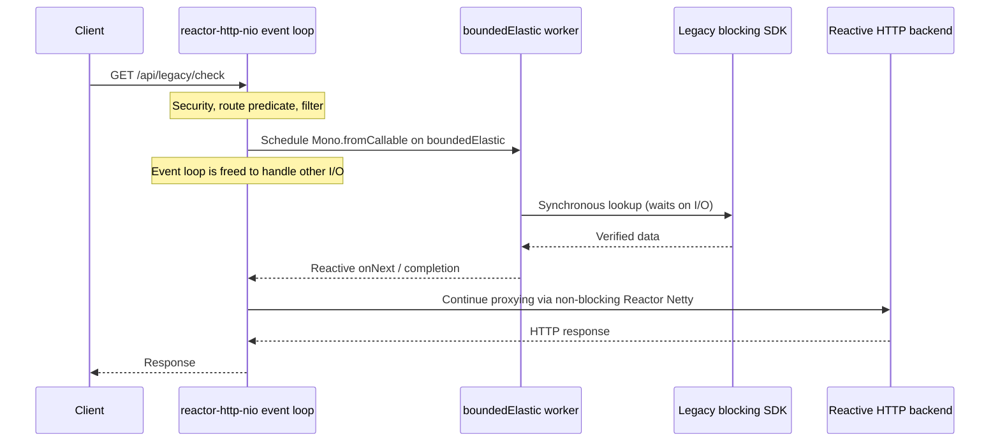

# Running Blocking Work Off the Event Loop When Truly Needed in Spring Cloud Gateway

## 1. Why Can One Small Wait Slow Down the Entire API Gateway?

**Spring Cloud Gateway** is the HTTP entry point for a microservices system: it uses **route predicates**, the **GatewayFilter/GlobalFilter chain**, path and header transformations, service discovery, authentication, rate limiting, circuit breakers, retries, TLS, and request observability. With **Gateway Server WebFlux**, a major part of its throughput comes from the **Reactor Netty non-blocking event loop** model.

The event loop consists of a relatively small number of threads handling socket events and non-blocking callbacks. When a backend is slow, a reactive HTTP client can **wait asynchronously** so the event loop continues serving other requests. However, if a custom filter calls `Thread.sleep(500)`, synchronous JDBC, a blocking-only SDK, or `Mono.block()` directly on the event loop, that thread is held hostage for the entire wait. Concurrent requests build up a backlog, raising p99 latency on **unrelated routes** even while their backends are healthy.

Suppose Gateway has three routes:

| Route | Work | Desired design |
|---|---|---|
| `GET /api/catalog/**` | Proxy to Catalog via Reactor Netty | Fully non-blocking |
| `GET /api/orders/**` | JWT, rate limit, and HTTP proxy | Non-blocking, token-based authorization |
| `GET /api/legacy/**` | Temporarily calls a quota-check SDK with **only a synchronous API** | Isolate the SDK on `boundedElastic`, never block the event loop |

The goal is **not to put blocking I/O in Gateway if any alternative exists**. When a legacy integration truly cannot be replaced immediately, **isolate only the blocking segment**, enforce concurrency limits, deadlines, and error policies, and return a `Mono<Void>` cleanly to the filter chain.

> **Scope:** This article targets **Spring Cloud Gateway Server WebFlux 4.3+/5.x**, Java + Reactor Core. Route examples use `spring.cloud.gateway.server.webflux.routes`. WebFlux 4.2 and earlier use the older `spring.cloud.gateway.routes` namespace; Gateway Server **Web MVC** is a separate Servlet stack—do not treat WebFlux `GatewayFilter` code as a drop-in replacement.

## 2. Identifying Work Types Before Choosing a Scheduler

Not every "time-consuming" operation is **blocking**, and not every slow HTTP call keeps a thread busy.

| Task | Blocks a thread by design? | Recommended approach in Gateway WebFlux |
|---|---|---|
| Reactor Netty HTTP/HTTPS backend proxy | No, when using Netty reactive routing | Use normal routing; add no extra scheduler |
| `WebClient` with Reactor Netty connector | Non-blocking | Compose `Mono`/`Flux` publishers; never call `block()` |
| `ReactiveRedisTemplate`, R2DBC client | Non-blocking with reactive drivers | Compose publishers directly |
| JDBC, synchronous JPA repositories | **Can block** waiting for DB/connections | Prefer moving to a separate service; if unavoidable, offload + bound pool |
| `RestTemplate`, synchronous `RestClient`, blocking HTTP SDKs | **Yes** | Prefer `WebClient`; if not yet replaceable, `fromCallable` + `boundedElastic` |
| `Files.readString(...)`, synchronous Java file I/O | **Can block** I/O | Avoid on request path; offload when unavoidable |
| `Thread.sleep(...)`, `Future.get()`, `CountDownLatch.await()` | **Yes** | Never run on event loop; avoid for network waiting |
| Heavy CPU compression/encryption/hashing | Primarily **CPU-bound**, not I/O waiting | Minimize on request path; consider bounded `parallel`/compute executor or separate service |
| Small string/header checks, route ID comparisons | Fast, non-blocking | Run directly in normal pipeline |
| `Mono.delay(Duration)` | Non-blocking timer | No dedicated sleeping thread needed |

**Rule:** If an API can "park and wait" on disk, network, locks, or a synchronous driver without yielding control back to the runtime, it is **blocking**. Conversely, `Mono` **does not guarantee** its internals are non-blocking: `Mono.just(legacySdk.call())` still calls the blocking SDK before the publisher is even created.

## 3. Event Loop, Reactive Subscription, and Where Blocking Starts



This diagram illustrates logical flow: some continuation steps may execute on another worker or thread depending on publishers and operators. **Never assume** every `chain.filter(exchange)` call automatically resumes on `reactor-http-nio-*` right after `fromCallable`. What you must guarantee is that **the blocking source never occupies the event loop**.

In WebFlux, every `GatewayFilter` follows the contract:

```java
public interface GatewayFilter {
    Mono<Void> filter(ServerWebExchange exchange, GatewayFilterChain chain);
}
```

`chain.filter(exchange)` returns a **publisher representing the rest of the chain**. A filter must **return the publisher**—never call `subscribe()` and return `Mono.empty()`, and never call `block()` to "wait" for a result. Once request preparation finishes, use `flatMap(... -> chain.filter(mutatedExchange))` or `then(chain.filter(exchange))` to sequence execution.

### 3.1. WRONG Example: Calling Blocking Code Before Returning `Mono`

```java
return (exchange, chain) -> {
    // WRONG: SDK runs immediately on the thread invoking filter (often the Netty event loop).
    String tier = legacySdk.lookupTier("user-42");
    return chain.filter(exchange);
};
```

### 3.2. WRONG Example: `Mono.just(...)` Does Not Defer the Method Call

```java
return (exchange, chain) ->
    Mono.just(legacySdk.lookupTier("user-42")) // SDK already ran RIGHT HERE
        .subscribeOn(Schedulers.boundedElastic())
        .then(chain.filter(exchange));
```

`subscribeOn` cannot "rewind time" to relocate synchronous work that already executed **before the publisher was constructed**. This is a common bug when developers assume **seeing `Mono` means it is already reactive**.

### 3.3. WRONG Example: Offloading and Immediately Calling `block()`

```java
// Still WRONG inside GatewayFilter/WebFlux event loop:
String tier = Mono.fromCallable(() -> legacySdk.lookupTier("user-42"))
    .subscribeOn(Schedulers.boundedElastic())
    .block();
```

Even though the callable runs on a worker, **the thread calling `block()` still blocks waiting**. Reactor can throw `IllegalStateException` when invoking a blocking operator on a thread marked `NonBlocking`; even when it does not throw, blocking the event loop breaks the concurrency model.

### 3.4. CORRECT: Wrapping the Blocking Segment in a Lazy Publisher

```java
Mono<String> tierMono = Mono
    .fromCallable(() -> legacySdk.lookupTier("user-42"))
    .subscribeOn(Schedulers.boundedElastic());

return tierMono.flatMap(tier -> {
    ServerHttpRequest request = exchange.getRequest().mutate()
        .header("X-Verified-Tier", tier)
        .build();
    return chain.filter(exchange.mutate().request(request).build());
});
```

This is an **illustration inside a `GatewayFilter` body**; it requires imports for `Mono`, `Schedulers`, `ServerHttpRequest`, and a real `legacySdk`. A complete example with authentication, tier validation, and error handling appears in section 5.

Execution sequence:

1. `fromCallable` builds a **lazy** publisher without invoking the SDK at assembly time.
2. `subscribeOn(Schedulers.boundedElastic())` controls where **subscription/source execution runs** once Gateway subscribes to the pipeline.
3. The blocking SDK executes on a `boundedElastic` worker; its result flows into `flatMap`.
4. After obtaining a valid tier, the request is mutated and the **`chain.filter(...)` publisher** is returned.
5. SDK errors emit `onError` and must be handled per policy, **never silently letting requests pass through a protected route**.

**Header note:** the `header(name, value)` overload can append values. When a header carries an identity/security assertion, use `headers(h -> { h.remove(...); h.set(...); })` to **overwrite any client-supplied value**, and ensure the backend verifies identity/permissions rather than trusting raw headers from the Internet.

## 4. `subscribeOn` vs. `publishOn` and `then`

| Reactor API | Primary effect | When should you use it? |
|---|---|---|
| `Mono.fromCallable(...)` | Creates a lazy source from a synchronous function returning a value or throwing | Wrapping **blocking** SDKs/DAOs |
| `Mono.fromRunnable(...)` | Wraps a synchronous action returning no value | `void` blocking work paired with `then(...)` |
| `subscribeOn(scheduler)` | Selects the execution context for upstream subscription/source | **Prefer right next to `fromCallable`/`fromRunnable`** |
| `publishOn(scheduler)` | Switches execution context for **downstream** operators from that point onward | Offloading a specific downstream operator stage |
| `flatMap(fn)` | Composes a publisher produced from the emitted value | Invoking `chain.filter(...)` after a lookup |
| `then(otherMono)` | Waits for the first publisher to complete, then subscribes to the next; discards first value | Blocking preconditions whose return value isn't needed |
| `timeout(Duration)` | Emits timeout/cancel if publisher does not finish in time | Bounding blocking latency; **does not guarantee stopping native I/O** |
| `doOnError(...)` / `onErrorResume(...)` | Observes or translates pipeline errors | Avoiding swallowed errors and bypassed protection |

### 4.1. Right and Wrong Ways to Use `publishOn`

Another way to offload a blocking function is switching execution context **before** that function:

```java
Mono.just("user-42")
    .publishOn(Schedulers.boundedElastic())
    .map(legacySdk::lookupTier);
```

However, this is easy to mis-scope if operators are added or reordered later. For a **synchronous blocking source**, Reactor more clearly recommends:

```java
Mono.fromCallable(() -> legacySdk.lookupTier("user-42"))
    .subscribeOn(Schedulers.boundedElastic());
```

Never place `publishOn(Schedulers.boundedElastic())` **after** `map(legacySdk::lookupTier)` expecting the earlier blocking step to move threads. And never use `Schedulers.parallel()` or `Schedulers.single()` as the default scheduler for **blocking I/O**.

### 4.2. The Blocking `void` Case

Suppose a legacy library only offers `void logAuditSync(AuditEvent event)`:

```java
return Mono.fromRunnable(() -> legacyAuditClient.logAuditSync(event))
    .subscribeOn(Schedulers.boundedElastic())
    .then(chain.filter(exchange));
```

**This task must complete BEFORE proxying.** If auditing should be asynchronous without adding latency, prefer sending events to a queue/non-blocking publisher with its own delivery policy. Never put blocking audit calls inside `doOnNext(...)`: that callback may run on the event loop. For compliance-mandatory audits, handle failure / fail-closed per contract rather than firing and forgetting as if the audit succeeded.

### 4.3. Do Not Blindly Offload the Entire Gateway Chain

```java
// DO NOT use this to "fix" a blocking SDK at one spot:
return chain.filter(exchange)
    .subscribeOn(Schedulers.boundedElastic());
```

This can shift the subscription point **of multiple upstream/downstream components** under Reactor mechanics without clearly isolating which SDK is blocking, complicating tracing, wasting workers, and causing unexpected interactions with other filters. Wrap **only the genuinely blocking API** in its own publisher.

## 5. Complete Custom `GatewayFilterFactory`: Reading Tiers from a Legacy SDK

Suppose an organization still has a synchronous `LegacyTierLookup` SDK that queries a legacy quota system. Before proxying `/api/legacy/**`, Gateway must look up `BASIC` or `PRO` **from the authenticated identity**, then attach an internal header for the backend within a clearly defined trust boundary.

**Safety boundaries of this example:**

- A synchronous SDK remains technical debt; keep it only temporarily until a reactive client or dedicated API service exists.
- Spring Security must **authenticate and authorize before** the custom route filter; if no principal is present, the filter refuses to proxy.
- Never read user IDs from `X-User-Id`, query strings, or self-asserted client data to make access decisions.
- Bound lookup duration, allowlist valid tiers, and prevent forged headers from reaching the backend.
- The backend **should not trust a plain header as absolute proof of identity**; combine mTLS/ACLs and proper authorization. Long-term, prefer signed assertions or audience-scoped access tokens.

### 5.1. Legacy SDK Contract

```java
package com.example.gateway.filters;

public interface LegacyTierLookup {
    // Blocking: waits on JDBC/SDK/network and returns BASIC or PRO.
    // May throw an exception or return null when no result exists.
    String findTierForSubject(String verifiedSubject);
}
```

You must supply a Spring bean implementing this interface backed by your real system client; **this lesson does not generate a database or SDK**. In production, configure timeouts at the **driver/socket/connection-pool** level in addition to the Reactor timeout, and validate outputs against the allowed set.

### 5.2. WebFlux Factory with Timeout and Spoofed-Header Protection

```java
package com.example.gateway.filters;

import java.time.Duration;
import java.util.Set;
import java.util.concurrent.TimeoutException;

import org.springframework.cloud.gateway.filter.GatewayFilter;
import org.springframework.cloud.gateway.filter.factory.AbstractGatewayFilterFactory;
import org.springframework.http.HttpStatus;
import org.springframework.http.server.reactive.ServerHttpRequest;
import org.springframework.stereotype.Component;
import org.springframework.web.server.ResponseStatusException;

import reactor.core.publisher.Mono;
import reactor.core.scheduler.Schedulers;

@Component
public final class LegacyTierGatewayFilterFactory
        extends AbstractGatewayFilterFactory<LegacyTierGatewayFilterFactory.Config> {

    private static final String INTERNAL_HEADER = "X-Trusted-Tier";
    private static final Set<String> ALLOWED_TIERS = Set.of("BASIC", "PRO");

    private final LegacyTierLookup lookup;

    public LegacyTierGatewayFilterFactory(LegacyTierLookup lookup) {
        super(Config.class);
        this.lookup = lookup;
    }

    @Override
    public GatewayFilter apply(Config config) {
        Duration timeout = Duration.ofMillis(config.getTimeoutMs());

        return (exchange, chain) -> exchange.getPrincipal()
            .switchIfEmpty(Mono.error(new ResponseStatusException(
                HttpStatus.UNAUTHORIZED, "Authentication required")))
            .flatMap(principal ->
                Mono.fromCallable(() ->
                        lookup.findTierForSubject(principal.getName()))
                    .subscribeOn(Schedulers.boundedElastic())
                    .timeout(timeout)
                    .switchIfEmpty(Mono.error(new ResponseStatusException(
                        HttpStatus.SERVICE_UNAVAILABLE, "Tier lookup unavailable")))
                    .onErrorMap(TimeoutException.class, error ->
                        new ResponseStatusException(
                            HttpStatus.SERVICE_UNAVAILABLE, "Tier lookup timeout", error))
                    .flatMap(tier -> {
                        if (!ALLOWED_TIERS.contains(tier)) {
                            return Mono.error(new ResponseStatusException(
                                HttpStatus.FORBIDDEN, "Tier not permitted"));
                        }

                        // Client-supplied header must be overwritten, never appended.
                        ServerHttpRequest trustedRequest = exchange.getRequest()
                            .mutate()
                            .headers(headers -> {
                                headers.remove(INTERNAL_HEADER);
                                headers.set(INTERNAL_HEADER, tier);
                            })
                            .build();

                        return chain.filter(exchange.mutate()
                            .request(trustedRequest)
                            .build());
                    })
            );
    }

    public static final class Config {
        private long timeoutMs = 800;

        public long getTimeoutMs() {
            return timeoutMs;
        }

        public void setTimeoutMs(long timeoutMs) {
            if (timeoutMs <= 0 || timeoutMs > 5000) {
                throw new IllegalArgumentException(
                    "timeoutMs must be between 1 and 5000");
            }
            this.timeoutMs = timeoutMs;
        }
    }
}
```

**Analysis of key points:**

1. The class ends with `GatewayFilterFactory` per Gateway naming convention, so YAML references the filter as **`LegacyTier`**.
2. `getPrincipal()` is a reactive publisher; **no `block()` is needed** to read identity. `switchIfEmpty` sits **before** the `flatMap` returning `Mono<Void>`; placing it after `chain.filter(...)` would be a bug because `Mono<Void>` completes empty even on success.
3. Only `lookup.findTierForSubject(...)` executes on `boundedElastic` upon subscription. The entire Netty event loop is not moved onto that pool.
4. `timeout(800ms)` only bounds the **reactive lookup**; if the SDK/JDBC driver ignores interrupts/cancellation, the underlying task can keep holding a `boundedElastic` thread after the client receives a timeout.
5. A `null` return causes `Mono.fromCallable` to complete **empty**; `switchIfEmpty` turns that into an error instead of silently skipping proxying.
6. `Set.of("BASIC", "PRO")` prevents unexpected tiers from reaching the backend; header values come strictly from the internal SDK.
7. `headers.remove + headers.set` strips forged client values instead of using `headers.add` which could expose multiple values to the backend.
8. `onErrorMap(TimeoutException.class, ...)` wraps only the **lookup**, before `flatMap(chain.filter)`, so backend routing timeouts are not mislabeled as "tier lookup timeout".
9. Unmapped errors—such as an SDK throwing `IllegalStateException`—still propagate as errors to the WebFlux handler. Gateway **does not proceed to proxy** if the lookup fails.

**Security note:** this example illustrates **attribute enrichment**, not a replacement for verifying JWTs/audiences/scopes and resource ownership in the backend. `X-Trusted-Tier` is an internal trust-boundary header; only backends that authenticate Gateway connections, block direct bypass access, and share a strict contract should consume it. For sensitive privileges, prefer signed assertions or audience-scoped access tokens.

### 5.3. YAML Route Using the Factory

```yaml
# application.yml — Spring Cloud Gateway Server WebFlux 4.3+/5.x
server:
  port: 8080

spring:
  security:
    oauth2:
      resourceserver:
        jwt:
          issuer-uri: https://idp.example.test/realms/shop
          audiences:
            - legacy-api
  cloud:
    gateway:
      server:
        webflux:
          routes:
            - id: legacy-checked
              uri: http://localhost:8081
              predicates:
                - Path=/api/legacy/**
                - Method=GET
              filters:
                - name: LegacyTier
                  args:
                    timeoutMs: 800
                - StripPrefix=1
```

When a client calls `GET /api/legacy/data`, the filter looks up the tier from the principal and mutates the header; next, `StripPrefix=1` removes `/api` so the backend receives `/legacy/data`. When the principal is missing or lookup fails, **the backend is never called**. `http://localhost:8081` is for local demos only: in containers/clusters, use real DNS/backend services with HTTPS/mTLS as required.

### 5.4. Spring Security for a Bearer-Only API

```java
package com.example.gateway.security;

import org.springframework.context.annotation.Bean;
import org.springframework.context.annotation.Configuration;
import org.springframework.security.config.Customizer;
import org.springframework.security.config.web.server.ServerHttpSecurity;
import org.springframework.security.web.server.SecurityWebFilterChain;

@Configuration(proxyBeanMethods = false)
public class LegacyApiSecurity {
    @Bean
    SecurityWebFilterChain legacySecurity(ServerHttpSecurity http) {
        return http
            // Strictly for stateless bearer APIs, not cookie-based sessions.
            .csrf(ServerHttpSecurity.CsrfSpec::disable)
            .authorizeExchange(exchanges -> exchanges
                .pathMatchers("/api/legacy/**")
                    .hasAuthority("SCOPE_legacy.read")
                .anyExchange().denyAll())
            .oauth2ResourceServer(oauth2 ->
                oauth2.jwt(Customizer.withDefaults()))
            .build();
    }
}
```

This example uses `spring-boot-starter-oauth2-resource-server` with real JWTs from an IdP—**never self-minted tokens**. `issuer-uri` and `audiences` must match real policy. Never copy `csrf.disable()` to a Gateway serving browser cookie sessions without CSRF analysis.

Spring Security WebFlux manages authentication via reactive context; never call `SecurityContextHolder.getContext()` on a blocking worker assuming `ThreadLocal` carries the user. In this factory, the principal is extracted **before offloading**, and only `principal.getName()` is passed into the SDK. If the SDK needs additional tenant/claim fields, extract them from the **verified JWT** and pass the minimum needed.

### 5.5. Java DSL Alternative to YAML Routes

When building routes with `RouteLocatorBuilder`, you can reuse the same filter factory:

```java
package com.example.gateway.routes;

import com.example.gateway.filters.LegacyTierGatewayFilterFactory;
import org.springframework.cloud.gateway.route.RouteLocator;
import org.springframework.cloud.gateway.route.builder.RouteLocatorBuilder;
import org.springframework.context.annotation.Bean;
import org.springframework.context.annotation.Configuration;

@Configuration(proxyBeanMethods = false)
public class LegacyRouteDsl {
    @Bean
    RouteLocator legacyRoute(RouteLocatorBuilder builder,
            LegacyTierGatewayFilterFactory factory) {

        LegacyTierGatewayFilterFactory.Config config =
            new LegacyTierGatewayFilterFactory.Config();
        config.setTimeoutMs(800);

        return builder.routes()
            .route("legacy-checked", r -> r
                .path("/api/legacy/**")
                .filters(f -> f
                    .filter(factory.apply(config))
                    .stripPrefix(1))
                .uri("http://localhost:8081"))
            .build();
    }
}
```

This is an **alternative** to the YAML route; never register two routes with the same ID in one test. The Java DSL here specifies only the path without `Method=GET` as in YAML: if you need the exact same contract, add the method predicate or restrict it in Spring Security. That illustrates how **route policy can differ** even with the same filter.

## 6. Global vs. Dedicated Schedulers: Controlling Real Load

`Schedulers.boundedElastic()` is Reactor's **shared** scheduler for unavoidable blocking work. Reactor caps backing threads (typically **10 × CPU cores** by default) plus a bounded task queue, yet **the default queue size is still very large**. When a legacy SDK slows down, concurrent requests can queue deeply, spiking latency and memory.

| Scheduler | Suitable for blocking I/O? | Notes |
|---|---|---|
| `Schedulers.boundedElastic()` | **Yes, when truly needed** | Shared, thread/queue capped; suitable for short-term legacy adapters |
| `Schedulers.newBoundedElastic(cap, queue, name)` | **Yes**, when workload isolation is needed | Custom limits and explicit lifecycle management |
| `Schedulers.parallel()` | **No** for blocking I/O | Intended for non-blocking CPU-bound compute jobs |
| `Schedulers.single()` | **No** for blocking I/O | Single shared thread easily stalls the entire chain |
| `Schedulers.immediate()` | **Does not** offload | Runs directly on the calling thread |
| `Schedulers.fromExecutorService(...)` | Depends on executor | Use only with deliberate pool/queue/monitoring design |

### 6.1. Dedicating a Separate Scheduler for the SDK

When `LegacyTierLookup` must be isolated from other blocking tasks, define a **dedicated boundedElastic bean**:

```java
package com.example.gateway.config;

import org.springframework.context.annotation.Bean;
import org.springframework.context.annotation.Configuration;
import reactor.core.scheduler.Scheduler;
import reactor.core.scheduler.Schedulers;

@Configuration(proxyBeanMethods = false)
public class LegacySchedulerConfig {
    @Bean(destroyMethod = "dispose")
    Scheduler legacyTierScheduler() {
        // Max 8 backing threads, 64 queued tasks per backing thread.
        return Schedulers.newBoundedElastic(8, 64, "legacy-tier");
    }
}
```

Inject `@Qualifier("legacyTierScheduler") Scheduler scheduler` into the factory and replace:

```java
.subscribeOn(Schedulers.boundedElastic())
```

with:

```java
.subscribeOn(scheduler)
```

This is an **architectural variant** of the factory in section 5: add the field and constructor parameter for the injected scheduler. Use `destroyMethod="dispose"` so the dedicated scheduler shuts down cleanly with the Spring context. **Never call `newBoundedElastic(...)` per request**, as that leaks threads/schedulers and defeats concurrency caps.

Reactor's thread cap does not automatically bound **JDBC connection pools** or legacy systems: size concurrency based on DB/SDK capacity (e.g., HikariCP max pool size, backend quotas, circuit breakers). Large queues usually inflate latency before failing; prefer smaller queue caps, failing fast, and Gateway rate limiting.

### 6.2. Do Not Treat `boundedElastic` as "Infinite Parallelism" Magic

For instance, with 8 workers and 2-second calls, throughput is bounded to only a few calls per second per worker without multiplexing; further requests wait in the queue. Raising threads recklessly can exhaust connection pools, spike memory/GC, and overwhelm the legacy backend.

Key metrics to watch: **scheduler pending tasks, active workers, queue rejections, SDK latency, connection-pool active/pending counts, Gateway p95/p99, HTTP 503/504/429**, and in-flight requests per route. Never use raw usernames, JWTs, IPs, or PII-bearing URLs as metric tags.

### 6.3. Java 21 Virtual Threads and `boundedElastic`

Starting in Reactor 3.6+, when running on Java 21+ with system property `reactor.schedulers.defaultBoundedElasticOnVirtualThreads=true`, the shared `boundedElastic()` can use a **virtual-thread-per-task** implementation instead of a platform-thread pool, depending on Reactor version.

**This does not magically make blocking JDBC/SDK libraries reactive**, does not remove legacy connection limits, does not exempt calls from timeouts, and can still hit pinning or lock contention with certain native/`synchronized` code. Always benchmark on your **actual JDK + Reactor + Gateway versions**, and never flip a global system property just to fix one route without measuring impact.

## 7. Timeouts, Cancellation, and Exceptions: Avoiding "Timed Out in Gateway, Still Running in SDK"

### 7.1. A `timeout(...)` Operator Does Not Guarantee Stopping Blocking Work

`Mono.timeout(Duration.ofMillis(800))` limits **how long the subscriber waits**. When exceeded, Reactor cancels the subscription and emits `TimeoutException`. However:

- Blocking SDKs may be stuck inside a JDBC driver, socket read, or native library.
- Some APIs abort only on `Thread.interrupt()`; others **ignore interrupts** or require driver-level timeouts.
- Even after Gateway returns 503, the worker thread may **remain occupied**; queues keep growing as new requests arrive.
- Client cancellation also does not necessarily roll back business transactions already started downstream.

Therefore, enforce **two timeout layers**:

1. **Real dependency timeouts:** JDBC query timeout, socket connect/read timeout, HTTP SDK deadline, DB connection acquisition timeout, etc.
2. **Reactive/route timeout:** limits how long Gateway waits for results so the pipeline never hangs indefinitely.

Illustrative budget:

| Boundary | Example threshold | Purpose |
|---|---:|---|
| SDK outbound connect | 200 ms | Fail fast when unreachable |
| SDK read/query | 500 ms | Return worker control when dependency stalls |
| Reactive `timeout` for lookup | 800 ms | Bound full lookup phase, including potential queue wait |
| Route response timeout to backend | 3 s | Bound the HTTP proxy segment |
| Client request deadline | 5 s | Overall SLA minus overhead across layers |

These numbers are **illustrative only**, not universal SLAs. When multiple timeout layers stack, actual times are affected by queueing, TLS, retries, and other filters; measure p95/p99 end-to-end.

### 7.2. Avoid Swallowing Errors to "Fail Open" Past Security Filters

Dangerous snippet:

```java
// DO NOT DO THIS when tier drives authorization:
Mono.fromCallable(() -> lookup.findTierForSubject(subject))
    .subscribeOn(Schedulers.boundedElastic())
    .onErrorReturn("PRO");
```

If the SDK or Redis/JDBC loses connectivity, that snippet accidentally **elevates privileges**. For authorization-relevant attributes, **fail closed** is safer: refuse to call the backend or return a clear error after authentication.

In the factory from section 5, `TimeoutException` maps to `ResponseStatusException(503)`; other unmapped errors propagate as errors and **never call `chain.filter(...)`**. Choosing 503, 403, or another code must follow your contract and error taxonomy; never convert arbitrary exceptions into 200.

### 7.3. Avoid Catching Errors from the Entire Downstream Chain

Compare:

```java
// ERROR-PRONE: can catch backend errors from chain.filter too.
return blockingLookup.flatMap(value -> chain.filter(exchange))
    .onErrorResume(error -> respondAsLegacyLookupFailure(exchange));
```

with this structure:

```java
// Better: translate errors only on the blocking lookup.
Mono<String> safeLookup = Mono.fromCallable(legacy::load)
    .subscribeOn(Schedulers.boundedElastic())
    .onErrorMap(LegacySdkException.class, error ->
        new ResponseStatusException(
            HttpStatus.SERVICE_UNAVAILABLE, "Dependency unavailable", error));

return safeLookup.flatMap(value -> chain.filter(exchange));
```

The second snippet is a **code illustration**; `legacy.load`, `LegacySdkException`, and imports must be supplied in a real app. Error handling sits **before the forwarding `flatMap`** so downstream HTTP errors or client cancellations are never misclassified as legacy lookup failures.

### 7.4. Never Retry Blocking Calls by Default

If an SDK call times out and Gateway's `Retry` filter replays the request, SDK invocations can exceed client request counts while timed-out calls continue running in the background. That multiplies queue depth and load on the legacy system.

Retry only when the operation is **idempotent**, the policy bounds attempts/backoff, and the dependency enforces proper timeouts/cancellation. For mutations such as granting entitlements, payments, or mandatory auditing, use explicit idempotency and dedicated design rather than unconditional retries.

## 8. Distinguishing Pre-Filter, Post-Filter, and Committed Responses

### 8.1. Pre-Filter: Blocking Lookup Before Proxying

Core logic from section 5:

```java
return Mono.fromCallable(() -> lookup.findTierForSubject(subject))
    .subscribeOn(Schedulers.boundedElastic())
    .flatMap(tier -> {
        ServerHttpRequest request = exchange.getRequest().mutate()
            .headers(h -> h.set("X-Trusted-Tier", tier))
            .build();
        return chain.filter(exchange.mutate().request(request).build());
    });
```

**Key point:** the request is sent **only after** the lookup returns a result. This is the right place when the result determines whether proxying is allowed.

### 8.2. Post-Filter: Performing Work After Downstream

```java
return chain.filter(exchange)
    .then(Mono.fromRunnable(() -> legacyAuditClient.writeSync(event))
        .subscribeOn(Schedulers.boundedElastic()));
```

This snippet **only illustrates reactive ordering**: wait for `chain.filter(exchange)` to complete, then run the blocking SDK audit on a worker. Once the response has committed, **you cannot modify HTTP status/headers here**. If the audit fails after the response has been sent, the client already received success while the audit failed.

Therefore, for **mandatory audits**, decide whether auditing must run **before proxying or before replying**, backed by at-least-once delivery or a transactional outbox. If auditing is best-effort telemetry, use asynchronous logging/exporters rather than adding a synchronous call to every HTTP request's hot path.

### 8.3. Response Body, `DataBuffer`, and Memory

**Never do the following in a filter:**

```java
// WRONG: blocks the event loop and risks mishandling body lifecycle.
DataBuffer body = exchange.getRequest().getBody().blockFirst();
```

Request/response bodies in WebFlux are `Flux<DataBuffer>` streams with lifecycles and backpressure. Accessing them requires preserving subscription, retain/release rules, buffer limits, and response commit semantics. When body edits are required, prefer `ModifyRequestBody`/`ModifyResponseBody` or version-documented body-aware filters; **never read streams with `blockFirst()` for "convenience"**.

If an entire body must be passed to a blocking SDK (e.g., a legacy document parser), consider moving that work to a **dedicated backend worker**; if kept in Gateway, enforce strict request-size limits, memory caps, cancellation handling, and clean buffer copy/release logic. `boundedElastic` does not prevent `DataBuffer` leaks or memory exhaustion from buffering whole payloads.

## 9. Security Context, Reactor Context, and MDC Across Thread Switches

Some legacy integrations rely on `ThreadLocal` to find the user or trace ID. However, a reactive pipeline can switch threads at `subscribeOn`, `publishOn`, or upon I/O completion.

| Mechanism | Can you rely on it on a blocking worker? | Proper approach |
|---|---|---|
| `exchange.getPrincipal()` | **Yes** as a publisher before passing data to the worker | Extract verified principal first and pass minimal values into the lambda |
| Default `SecurityContextHolder.getContext()` | **Do not assume** `ThreadLocal` behaves like WebMVC | Use `ReactiveSecurityContextHolder` or reactive principal/exchange |
| `Reactor Context` | Reactive context, not `ThreadLocal` | Use `contextWrite`, `deferContextual` when needed |
| `MDC.get("traceId")` | May be **empty** after worker switches | Use Micrometer Context Propagation/proper config or explicit context |
| Raw `X-User-Id` from request | **Untrusted** | Verify JWT/principal before trusting |
| `Thread.currentThread().getName()` | For scheduler debugging only | Never an authorization or correlation key |

Example passing minimal context into a callable without relying on `ThreadLocal`:

```java
return exchange.getPrincipal()
    .flatMap(principal -> {
        String verifiedSubject = principal.getName();
        return Mono.fromCallable(() ->
                legacySdk.loadForSubject(verifiedSubject))
            .subscribeOn(Schedulers.boundedElastic())
            .flatMap(result -> chain.filter(exchange));
    });
```

This is an **illustrative snippet**; `legacySdk` must exist, and production code must handle missing principals, null/failed lookups, and authorization checks as shown in section 5.

**Observability:** never log raw JWTs, access tokens, session cookies, request bodies, or sensitive exception messages when logging thread names. Configure Reactor/Micrometer context propagation properly for your version rather than treating `ThreadLocal` as proof that security context survived a scheduler switch.

## 10. Move the Blocking SDK to a Separate Service or Keep It in Gateway?

Offloading is a **transitional measure**, not necessarily the ideal long-term architecture. Compare:

| Option | Advantages | Cost / risks |
|---|---|---|
| Keep blocking SDK in Gateway + `boundedElastic` | Minimal legacy changes, fast rollout | Gateway carries heavy dependencies, thread/queue pressure, SDK bugs hit edge |
| Write a `WebClient`/reactive SDK equivalent | Preserves end-to-end non-blocking | Requires genuinely async APIs; migration investment |
| Move SDK into a dedicated **legacy-adapter service** | Isolates thread pools, connection pools, scaling, blast radius | Adds network hop, auth, SLA, and observability needs |
| Move work to a message broker/worker | Fits long background jobs with delivery retries | Requires job IDs, idempotency, eventual consistency |
| Gateway uses `forward:` to internal blocking handler | Does not solve underlying thread blocking | Still requires reactive/blocking separation; avoid as default workaround |

For a shared Gateway serving multiple microservices, keep **authentication, routing, rate limiting, circuit breaking, TLS, and observability** in Gateway, and move business computation or blocking JDBC/SDK integrations to the **owning service** whenever contracts allow.

**Signs you must extract it:** legacy calls take multiple seconds, traffic is high, the SDK needs its own Hikari/JDBC pool, it relies on native/JNI libraries, or SDK glitches still spike Gateway-wide p99 despite `boundedElastic`.

## 11. End-to-End Practice in a Demo Environment

### 11.1. Required Dependencies

For Spring Cloud Gateway Server WebFlux with Spring Security JWT, Maven example:

```xml
<!-- Versions managed by compatible Spring Boot parent and Spring Cloud BOM. -->
<dependency>
    <groupId>org.springframework.cloud</groupId>
    <artifactId>spring-cloud-starter-gateway-server-webflux</artifactId>
</dependency>
<dependency>
    <groupId>org.springframework.boot</groupId>
    <artifactId>spring-boot-starter-oauth2-resource-server</artifactId>
</dependency>
<dependency>
    <groupId>org.springframework.boot</groupId>
    <artifactId>spring-boot-starter-actuator</artifactId>
</dependency>
```

Gradle equivalent:

```groovy
dependencies {
    implementation 'org.springframework.cloud:spring-cloud-starter-gateway-server-webflux'
    implementation 'org.springframework.boot:spring-boot-starter-oauth2-resource-server'
    implementation 'org.springframework.boot:spring-boot-starter-actuator'
}
```

Because the example targets `http://localhost:8081`, **no service discovery/load balancer is needed** just to test the filter. If switching to `lb://legacy-api`, add `spring-cloud-starter-loadbalancer` and a service instance source. Actuator is optional for observability and not required for `GatewayFilterFactory` to function.

**Never add `spring-boot-starter-web` to Gateway Server WebFlux** just to use a synchronous SDK. If your app is Web MVC, choose the Servlet/MVC design intentionally instead of mixing stacks accidentally.

### 11.2. Replacing the Real SDK with an Intentionally Blocking Demo Adapter

Place the following bean **strictly under the `demo` profile** in the Gateway app:

```java
package com.example.gateway.filters;

import org.slf4j.Logger;
import org.slf4j.LoggerFactory;
import org.springframework.context.annotation.Profile;
import org.springframework.stereotype.Component;

@Component
@Profile("demo")
public final class DemoLegacyTierLookup implements LegacyTierLookup {
    private static final Logger log =
        LoggerFactory.getLogger(DemoLegacyTierLookup.class);

    @Override
    public String findTierForSubject(String verifiedSubject) {
        log.info("demo legacy lookup on thread={}",
            Thread.currentThread().getName());

        // INTENTIONALLY BLOCKING to observe scheduler behavior; NOT production code.
        try {
            Thread.sleep(350);
        } catch (InterruptedException exception) {
            Thread.currentThread().interrupt();
            throw new IllegalStateException("Demo lookup interrupted", exception);
        }

        return "BASIC";
    }
}
```

This bean simulates a blocking SDK with `Thread.sleep(350)`. **Use only in a test profile**—never copy sleep into production. To run the demo, activate the `demo` profile on Gateway and ensure no other unqualified `LegacyTierLookup` production bean is active simultaneously.

Check Gateway logs: the SDK call should execute on a `boundedElastic` worker (thread names can vary by Reactor/JDK/virtual threads), **not on `reactor-http-nio-*`** used by the Netty event loop. This is only a **signal**, not a substitute for latency testing and profiling which APIs block.

### 11.3. Minimal Echo HTTP Backend

In a **separate WebFlux backend app** on port `8081`:

```java
package com.example.legacydemo;

import java.util.Map;
import org.springframework.http.ResponseEntity;
import org.springframework.web.bind.annotation.GetMapping;
import org.springframework.web.bind.annotation.RequestHeader;
import org.springframework.web.bind.annotation.RestController;
import reactor.core.publisher.Mono;

@RestController
public class LegacyEchoController {
    @GetMapping("/legacy/data")
    Mono<ResponseEntity<Map<String, String>>> read(
            @RequestHeader("X-Trusted-Tier") String tier) {
        // DEMO ONLY: never treat a plain tier header as a production credential.
        return Mono.just(ResponseEntity.ok(Map.of(
            "route", "legacy-demo",
            "receivedTier", tier)));
    }
}
```

This backend intentionally **echoes** the value to verify header mutation. In production, business endpoints must validate tokens/mTLS and enforce real authorization; never let clients hit the backend directly with forged headers.

### 11.4. Sending Requests with `curl`

To pass the `SecurityWebFilterChain` from section 5.4, obtain a **real** test JWT signed by the IdP configured in `issuer-uri`, with the right audience and `legacy.read` scope. Once `TOKEN_VALID` is set in your environment via your test/secret workflow:

```bash
# Request with an authenticated identity.
curl -i \
  -H "Authorization: Bearer $TOKEN_VALID" \
  http://localhost:8080/api/legacy/data

# Deliberately spoof header PRO: Gateway must overwrite it with BASIC from the demo SDK.
curl -i \
  -H "Authorization: Bearer $TOKEN_VALID" \
  -H "X-Trusted-Tier: PRO" \
  http://localhost:8080/api/legacy/data

# Missing token: Security must reject before calling the SDK.
curl -i http://localhost:8080/api/legacy/data
```

In the demo, the first two commands should report `receivedTier=BASIC` from the backend. The spoofed `X-Trusted-Tier: PRO` header **must never become backend privilege**. The tokenless request should return `401` without invoking the SDK. A JWT lacking `legacy.read` scope should return `403`.

**If you lack a valid IdP and test token**, `401` is the expected Security outcome, not a scheduler bug. Never disable authentication or mint fake tokens just to see a 200 response.

### 11.5. Comparing Latency Under Concurrent Requests

In Bash, send a bounded demo burst:

```bash
# 12 parallel requests; use only in a test environment with test tokens.
for i in $(seq 1 12); do
  curl -sS -o /dev/null \
    -w "request=$i status=%{http_code} latency=%{time_total}s\n" \
    -H "Authorization: Bearer $TOKEN_VALID" \
    http://localhost:8080/api/legacy/data &
done
wait
```

In a simple setup, multiple `Thread.sleep(350)` calls on `boundedElastic` can execute concurrently rather than serializing entirely on one Netty event loop. **Do not predict exact latency numbers**: results depend on CPU, worker caps, SDK thread pools, JVM warm-up, auth/JWK verification, backends, and Gateway replica count.

To observe impact on unrelated routes, measure a **separate public health/echo route** before and during the burst against a non-blocking test backend. If latency on the unrelated route still rises, check for event-loop blocking elsewhere, scheduler starvation, CPU saturation, connection pools, and Netty worker metrics.

### 11.6. Testing Timeouts and Confirming Backend Is Not Called

In the `demo` profile, temporarily raise sleep from 350 ms to **1.5 seconds** while keeping `timeoutMs=800` on the route. After sending a test request, verify:

- Gateway does not forward `X-Trusted-Tier` to the backend when the lookup has not finished.
- The request can return **503** via `ResponseStatusException` for `TimeoutException`.
- Logs may show the SDK still running or interrupted depending on mock behavior; **never treat 503 as proof that the underlying task definitely stopped**.
- Subsequent requests must never fail open to bypass the tier check.

When `Thread.sleep` is interrupted, the demo throws `IllegalStateException`, so exact responses can depend on races between timeout/cancellation and the exception. Real tests should inspect both HTTP status and thread-pool activity.

### 11.7. Bounded Unit Test for Scheduling Behavior

A small test verifying that the source runs off the calling thread:

```java
import static org.junit.jupiter.api.Assertions.assertNotEquals;
import org.junit.jupiter.api.Test;
import reactor.core.publisher.Mono;
import reactor.core.scheduler.Schedulers;
import reactor.test.StepVerifier;

class BlockingSchedulerTest {
    @Test
    void sourceRunsOffCallingThread() {
        String caller = Thread.currentThread().getName();
        Mono<String> source = Mono
            .fromCallable(() -> Thread.currentThread().getName())
            .subscribeOn(Schedulers.boundedElastic());

        StepVerifier.create(source)
            .assertNext(workerName -> assertNotEquals(caller, workerName))
            .verifyComplete();
    }
}
```

This test uses `reactor-test` and JUnit 5 (typically via `spring-boot-starter-test`); it **only verifies Reactor scheduling**, not that the whole Gateway is free of blocking calls. When virtual threads are enabled, thread naming may differ; never use fixed thread-name prefixes as security tests.

Some teams use **BlockHound** in tests to detect common blocking APIs invoked on Reactor non-blocking threads; verify JDK/library compatibility and watch for false positives. BlockHound **does not guarantee detecting every SDK or native I/O call**, and does not replace load tests and thread-dump inspection.

## 12. Observability Signals When the Event Loop Stalls

| Signal | Likely explanation | What to inspect |
|---|---|---|
| Gateway p99 latency spikes across multiple routes at once | Event loop blocked, CPU/GC pressure, or connection exhaustion | Thread dumps, Netty workers, CPU profiles, custom filters |
| Thread dump shows `reactor-http-nio-*` inside JDBC/SDK | **Blocking running on the wrong thread** | Wrap source with `fromCallable`/`subscribeOn` or extract to a service |
| Thread dump shows `boundedElastic-*` waiting on DB | Offloaded, yet dependency itself is slow | JDBC/SDK timeouts, pool sizes, queue latency |
| Scheduler pending tasks/rejections climbing | Workers/queues saturated | Bound concurrency, shorten tasks, dedicated scheduler |
| Gateway returns 503 after ~800 ms | Reactive lookup timeout per example | Did SDK stop, queue delay, error handling |
| Gateway returns 500 on SDK failure | Unmapped exception other than `TimeoutException` | Classify errors, avoid leaking details, fail closed |
| Other routes stay fast while legacy route slows | Effective isolation | Measure SDK p95, worker saturation, and SLA |
| Netty event loop at 100% CPU | CPU-bound work or overly heavy callbacks | Profile, optimize algorithms, offload compute workloads |
| SSE/downloads drop mid-stream | Timeouts, body buffering, or response commit issues | Separate streaming routes, non-blocking body handling |
| Missing audit despite HTTP 200 | Post-response audit or fire-and-forget | Delivery contracts, queue/outbox, beforeCommit/after semantics |
| Empty `traceId` in worker logs | `ThreadLocal` MDC not propagated | Reactor Context / Micrometer context propagation |

### 12.1. Correlating Metrics and Thread Dumps with Routes

With Actuator/Micrometer and an appropriate exporter, monitor **Gateway route ID, status, response time, and active requests**, alongside JVM threads/CPU/direct memory, SDK/JDBC pool metrics, and scheduler instrumentation if enabled in your Reactor version. Do not assume a specific scheduler metric name is auto-exported identically in every version.

When taking thread dumps or JFR recordings, do so through authorized admin tooling under security procedures; **never expose Actuator heapdump/threaddump publicly**. In logs, use normalized route IDs and correlation IDs—never log payloads, raw `Authorization` headers, or personal data.

## 13. Very Common Mistakes in Custom Filters

| Symptom or code snippet | Why is it dangerous? | How to fix |
|---|---|---|
| `Mono.just(legacySdk.call())` | SDK already blocked **before** constructing the `Mono` | `Mono.fromCallable(legacySdk::call)` + `subscribeOn(boundedElastic)` |
| `fromCallable(...).subscribeOn(...).block()` | Thread calling `block()` still waits; blocks event loop or throws | Return the publisher; compose with `flatMap`/`then` |
| `chain.filter(exchange).subscribe()` then `return Mono.empty()` | Gateway loses lifecycle, error, cancellation, and backpressure control | **Return `chain.filter(exchange)`** |
| `publishOn(...)` placed **after** `map(legacySdk::call)` | Blocking map before it still runs on the wrong thread | Offload **before** the blocking segment; prefer `fromCallable` |
| `Schedulers.parallel()` for synchronous JDBC/HTTP SDKs | Ties up CPU workers while waiting on I/O | Use `boundedElastic` or an adapter service |
| Creating `newBoundedElastic(...)` per request | Leaks schedulers/threads and defeats caps | Define one managed bean with `dispose` |
| `Thread.sleep(...)` inside `GlobalFilter` | Stalls threads serving many HTTP requests | Never sleep; if simulating legacy, offload and test-only |
| `Mono<Void>.switchIfEmpty(...)` after `chain.filter` | Successful `Mono<Void>` completes empty, triggering the fallback branch | Check missing principal **before flattening to `Mono<Void>`** |
| `lookup()` returns `null` | `fromCallable` completes empty; `flatMap` is skipped | Add `switchIfEmpty(Mono.error(...))` before `flatMap` |
| `onErrorResume(...)` wrapping the whole downstream chain | Backend errors get disguised as lookup errors, yielding wrong status | Scope error handling **strictly to the lookup publisher** |
| 800 ms timeout yet threads stay busy | Blocking SDK ignores cancellation or lacks driver timeouts | Set SDK/socket/query timeouts and bound concurrency |
| Identity header receives two values | Used `headers.add` instead of replacing | `headers.remove(...)` + `headers.set(...)` |
| `SecurityContextHolder` empty after scheduler switch | Reactive Context is not automatically `ThreadLocal` | Use `exchange.getPrincipal()` / `ReactiveSecurityContextHolder` |
| Latency rises despite offloading | Worker queue/SDK pool full, CPU or GC saturated | Measure pending/active, cap queues/bulkheads, extract adapter |
| SSE/download gets buffered or leaks memory | Blocking body reads, unreleased `DataBuffer` | Use reactive body filters, streaming/backpressure, and size limits |
| Gateway upgrade breaks bean loading | Wrong package/starter, WebFlux vs. MVC mismatch, or out-of-scan bean | Check release train and developer guide for the right stack |

## 14. Design Checklist Before Putting a Blocking API in a Filter

1. **Prove necessity:** does the library truly lack a `WebClient`/reactive alternative? Can the work live in a backend adapter instead?
2. **Pinpoint scope:** offload **only the synchronous I/O call**, never the entire Gateway routing, response writing, or Security chain.
3. **Pick the right Reactor operator:** `Mono.fromCallable(...).subscribeOn(boundedElastic)` for values; `fromRunnable(...).then(...)` for `void`.
4. **Keep the chain reactive:** return `Mono<Void>`; never `subscribe()` or `block()` inside a filter.
5. **Authentication & authorization:** use verified principals/JWTs; never trust raw headers or query params for assertions or quota keys.
6. **Bound load:** dedicated scheduler when warranted, thread/queue caps, SDK connection pools, rate/concurrency limits.
7. **Protect deadlines:** driver/query/socket timeouts, Reactor timeout, total client SLA; test unresponsive SDKs and ignored interrupts.
8. **Design error handling:** fail closed for sensitive actions, distinguish 401/403/503/500; never turn dependency failures into fake successes.
9. **Restrict retries:** only for idempotent operations, with bounded attempts/backoff/deadlines so old work doesn't pile up.
10. **Preserve context:** extract identity from reactive security context, pass minimal values, and propagate tracing properly.
11. **Test the exact paths:** tokenless requests never call the SDK, spoofed headers are overwritten, null/timed-out lookups never proxy, and only successful SDK lookups proceed.
12. **Monitor production:** route latency/p99, scheduler saturation, SDK pools, event-loop blocking, CPU/GC, and timeouts.
13. **Protect bodies:** never call `blockFirst()` on `DataBuffer`; set upload limits if full aggregation is needed.
14. **Plan debt retirement:** measure legacy call frequency/cost and plan migration to a non-blocking client or owning service.

## 15. Practice Questions and Answers

**Exercise 1 — Event loop.** Why can `Thread.sleep(300)` inside a custom `GatewayFilter` hurt other routes even when their backends are healthy?

**Answer:** the event loop has a small pool of worker threads shared across many requests' I/O. `Thread.sleep` holds the thread instead of yielding, delaying callbacks for unrelated requests on that worker.

**Exercise 2 — `Mono.just`.** Is `Mono.just(blockingSdk.get()).subscribeOn(Schedulers.boundedElastic())` safe?

**Answer:** no. `blockingSdk.get()` runs **eagerly when constructing the Mono**, potentially on the event loop. Use `Mono.fromCallable(blockingSdk::get).subscribeOn(Schedulers.boundedElastic())`.

**Exercise 3 — `block()`.** You added `subscribeOn(boundedElastic)` yet still call `block()` before returning from the filter. Why is that wrong?

**Answer:** the thread calling `block()` still waits for completion; on a non-blocking scheduler it may throw `IllegalStateException`. Return the publisher and compose with `flatMap`/`then`.

**Exercise 4 — `publishOn`.** Does `Mono.just(user).map(legacySdk::find).publishOn(boundedElastic)` move `legacySdk.find` off the calling thread?

**Answer:** no. `publishOn` only switches the execution context for operators **after** it. Switch before the blocking function or use `fromCallable + subscribeOn`.

**Exercise 5 — Null.** `Mono.fromCallable(() -> legacySdk.find("42"))` returns `null`. If immediately followed by `flatMap(tier -> chain.filter(...))`, what happens?

**Answer:** Reactor's `Mono.fromCallable` completes empty, `flatMap` is skipped, the route is never proxied, and the response may be handled unexpectedly. Add `switchIfEmpty(Mono.error(...))` **before** flattening into `Mono<Void>`.

**Exercise 6 — Filter chain.** Why is `chain.filter(exchange).subscribe(); return Mono.empty();` wrong?

**Answer:** manual subscription detaches downstream execution from the Gateway-managed request lifecycle; errors and cancellations are disconnected. Always **return `chain.filter(exchange)`**.

**Exercise 7 — Timeout.** Gateway times out after 800 ms, yet the JDBC query keeps running for 5 seconds. Is `timeout()` broken?

**Answer:** `timeout()` only terminates/cancels observation at the reactive layer; blocking drivers may ignore interrupts. Enforce JDBC query/socket timeouts and limit workers/connections.

**Exercise 8 — Authentication.** A client sends `X-Trusted-Tier: PRO`, while the JWT only grants `legacy.read`. Can that header be treated as a trusted lookup result?

**Answer:** no. Client-supplied headers can be spoofed. The factory must read the authenticated principal, look up the tier from a trusted source, and **overwrite** the header; the backend must still verify source and permissions.

**Exercise 9 — Dedicated scheduler.** When should you consider `Schedulers.newBoundedElastic(8,64,"legacy-tier")`?

**Answer:** when isolating load from a legacy SDK, capping threads/queues, and monitoring its saturation separately. Create the bean once and dispose on shutdown; never instantiate a scheduler per request.

**Exercise 10 — CPU.** Should `boundedElastic` be used as a catch-all "place for all heavy work", including heavy CPU hashing?

**Answer:** no. `boundedElastic` is primarily for **blocking I/O**; heavy compute needs algorithm optimization, a bounded compute pool, or a separate worker service so Gateway does not spin up excessive threads.

**Exercise 11 — Post-filter.** A blocking audit runs in `chain.filter(exchange).then(...)`, after the response already committed. Will a failing audit reliably return 500 to the client?

**Answer:** no. Once the response is sent/committed, status cannot be safely changed. Mandatory audits require designing order, delivery, and failure handling before choosing a post-filter.

**Exercise 12 — Reactive context.** Does reading `SecurityContextHolder.getContext()` on a `boundedElastic` thread always return the logged-in JWT user?

**Answer:** never assume so. WebFlux Security relies on Reactor Context. Extract the principal/claims from the reactive context before offloading or use appropriate Reactor/Spring Security APIs.

**Exercise 13 — Blocking DataBuffer.** Why is `exchange.getRequest().getBody().blockFirst()` invalid for reading request bodies in Gateway?

**Answer:** it blocks a non-blocking thread, disrupts the body stream lifecycle, and risks buffer leaks or incomplete reads. Use `ModifyRequestBody` or reactive body-aware mechanisms with memory and backpressure controls.

**Exercise 14 — Long-term fix.** A legacy SDK takes 10 seconds per call, has 1,000 concurrent users, and needs its own Hikari pool. Should you simply raise `boundedElastic` max threads?

**Answer:** no. Raising threads can saturate the DB/SDK, bloat queues/memory, and destabilize the whole Gateway. Build a separate adapter service with queues/bulkheads/deadlines/quotas, and plan to migrate to a reactive SDK.

## 16. Official References

- [Spring Cloud Gateway – Developer Guide, custom GatewayFilterFactory](https://docs.spring.io/spring-cloud-gateway/reference/spring-cloud-gateway-server-webflux/developer-guide.html): naming `*GatewayFilterFactory`, extending `AbstractGatewayFilterFactory`, and returning `chain.filter(exchange)`.
- [Spring Cloud Gateway – Global Filters and Ordering](https://docs.spring.io/spring-cloud-gateway/reference/spring-cloud-gateway-server-webflux/global-filters.html): lifecycle and pre/post filter ordering.
- [Reactor Core – FAQ: How Do I Wrap a Synchronous, Blocking Call?](https://projectreactor.io/docs/core/release/reference/faq.html): `Mono.fromCallable(...).subscribeOn(Schedulers.boundedElastic())` pattern.
- [Reactor Core – Threading and Schedulers](https://projectreactor.io/docs/core/release/reference/coreFeatures/schedulers.html): `boundedElastic`, `parallel`, `publishOn`, `subscribeOn`, virtual threads, and queue caps.
- [Reactor Core – Schedulers API](https://docs.spring.io/projectreactor/reactor-core/docs/current/api/reactor/core/scheduler/Schedulers.html): `newBoundedElastic`, queue cap, thread cap, and `dispose`.
- [Spring Framework – WebFlux Overview and Concurrency Model](https://docs.spring.io/spring-framework/reference/web/webflux/new-framework.html): event loop, blocking vs. reactive, choosing WebFlux vs. MVC.
- [Spring Cloud Gateway – ModifyRequestBody GatewayFilter](https://docs.spring.io/spring-cloud-gateway/reference/spring-cloud-gateway-server-webflux/gatewayfilter-factories/modifyrequestbody-factory.html): reactive body handling instead of `blockFirst()`.
- [Spring Security – Reactive OAuth2 Resource Server JWT](https://docs.spring.io/spring-security/reference/reactive/oauth2/resource-server/jwt.html): JWT authentication and authorization in WebFlux.
- [Reactor Netty – Reference](https://docs.spring.io/projectreactor/reactor-netty/docs/current/reference/html/): event loop, connection lifecycle, and network observability.

**Takeaway:** **Never block the Reactor Netty event loop.** When calling a **blocking** API is truly unavoidable, wrap it with `Mono.fromCallable(...)` or `Mono.fromRunnable(...)`, place `subscribeOn(Schedulers.boundedElastic())` **right next to the source**, preserve the reactive `chain.filter(exchange)` pipeline, and enforce timeout, queue, and concurrency limits. `boundedElastic` only **isolates where waiting happens**—it does not make an SDK non-blocking, automatically abort work on timeout, or fix authorization or body-buffering bugs. When a legacy dependency creates heavy load, extract it into a backend/adapter service and keep Gateway focused on routing, security, and observability.
