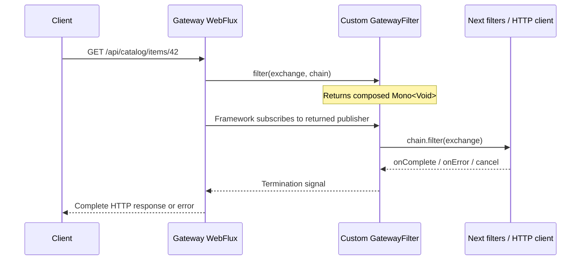
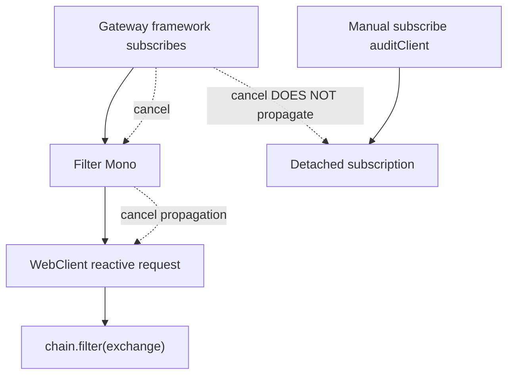

# Avoiding Manual subscribe() or block() Calls in the Processing Chain

## 1. Why Are These Two Calls Dangerous in Spring Cloud Gateway?

**Spring Cloud Gateway** is the API Gateway for microservices: route predicates select destinations, the filter chain transforms paths/headers/bodies, service discovery resolves backends, while authentication, rate limiting, circuit breakers, retries, TLS, and observability govern operations. When writing a **custom filter** in Gateway Server WebFlux, your logic runs inside a **reactive chain** orchestrated by Spring WebFlux and Reactor.

A subtle mistake is writing:

```java
// ANTI-PATTERN: NEVER use in a WebFlux GatewayFilter/GlobalFilter.
@Override
public Mono<Void> filter(ServerWebExchange exchange, GatewayFilterChain chain) {
    auditClient.sendAudit(exchange).subscribe(); // Detached execution!
    return chain.filter(exchange);
}
```

This may "appear to work" in a few manual tests, yet **Gateway does not wait for the audit to finish**, audit errors bypass the main chain, and the audit can keep running after the client disconnects. Replacing `subscribe()` with `block()` is even worse: the filter can **lock up a non-blocking thread** and strip Gateway of its ability to handle concurrent requests.

Objectives for this lesson in the **Custom Filters** chapter:

1. Understand the `Mono<Void> filter(ServerWebExchange, GatewayFilterChain)` contract and **who owns the subscription**.
2. Explain why calling `subscribe()` and `block()` inside the request-processing pipeline are anti-patterns.
3. Replace them with `flatMap`, `then`, `Mono.defer`, `onErrorResume`, `doFinally`, and appropriate Reactor operators.
4. Build a non-blocking **custom GatewayFilterFactory** and a pre/post-observing **GlobalFilter**.
5. Integrate non-blocking **`WebClient`**, timeouts, error scoping, context/cancellation, and unavoidable blocking work safely.
6. Write tests to catch race conditions, detached subscriptions, event-loop errors, and inconsistent HTTP responses.

> **Scope:** Examples focus on **Spring Cloud Gateway Server WebFlux 5.0.x**, Java 17+, compatible Spring Boot/Spring Cloud BOMs, and Reactor. Gateway Server Web MVC runs on Servlet/WebMvc.fn with a different API and threading model; do not copy WebFlux `GlobalFilter`/`GatewayFilterChain` directly into MVC. Examples do not replace real Spring Security mechanisms.

## 2. How Does Gateway WebFlux Process a Request Using Publishers?

### 2.1. The Filter Contract

In Gateway Server WebFlux, both `GatewayFilter` (attached to a route) and `GlobalFilter` (broader scope) implement:

```java
Mono<Void> filter(
    ServerWebExchange exchange,
    GatewayFilterChain chain
);
```

`ServerWebExchange` holds the request, response, and attributes. `GatewayFilterChain` represents the **rest of the filter chain**, ultimately leading to backend routing and writing the response. `Mono<Void>` is a publisher representing the **entire asynchronous work** of the request, not an "empty result because there is nothing to do".



**Core point:** the filter **returns a publisher** so the framework acts as the **subscriber at the request boundary**. Never call `subscribe()` just to "make sure it runs"; doing so creates an independent subscription and breaks lifecycle management.

### 2.2. Pre-Phase and Post-Phase

When a route matches, Gateway combines `GlobalFilter`s and route-specific `GatewayFilter`s, then sorts them by `Ordered`. Higher-precedence filters run **earlier** in pre and **later** in post.

```text
pre F1 → pre F2 → routing → post F2 → post F1
    |         |                   |         |
    +-- Each filter RETURNS a publisher composed with the next chain segment --+
```

Minimal standard example:

```java
@Override
public Mono<Void> filter(ServerWebExchange exchange, GatewayFilterChain chain) {
    return chain.filter(exchange);
}
```

**Returning** `chain.filter(exchange)` differs fundamentally from **subscribing manually** to this publisher. The framework knows when the request completes, when an error occurs, or when the connection must be canceled.

## 3. Cold Publishers, Subscriptions, and Lifecycle

### 3.1. Creating a `Mono` Usually Does Not Mean I/O Has Executed

Many Reactor publishers are **cold**: they describe work and execute only when subscribed.

```java
Mono<String> lookup = webClient.get()
    .uri("/flags/catalog")
    .retrieve()
    .bodyToMono(String.class);

// Only builds the publisher; does not force an HTTP request yet.
return lookup.flatMap(flag -> chain.filter(exchange));
```

Here `flatMap` composes reading the flag with running the rest of the chain. **Only when the framework subscribes to the returned result** is the HTTP request to `/flags/catalog` dispatched, followed by the Gateway chain. Therefore, you **do not** write `lookup.subscribe()`.

Do not overgeneralize that **every** Publisher is cold or every factory method is completely side-effect-free. Hot sources, eager side effects during assembly, and `share`/`cache` have distinct lifecycles; check the specific API. For Gateway filters, the rule remains **return a composed publisher**, never split off a manual subscription.

### 3.2. A Request Can Be Canceled

Client disconnects, Gateway timeouts, upstream errors, retries, or circuit breakers can cause a request subscription to be **canceled**. In a properly composed pipeline, cancellation propagates down to HTTP/WebClient calls and cleanup hooks. With manual `subscribe()`, the side task runs under a **different** subscription, so main-request cancellation **does not automatically cancel** it.



An audit event that **truly must run even after a request is canceled** (such as guaranteed business logging) should be sent to a queue/outbox/telemetry system with its own retry and durability guarantees. **Never use fire-and-forget `subscribe()` inside a request filter as a durability promise.**

## 4. Anti-Pattern 1: Calling `subscribe()` Manually

### 4.1. Calling a Policy Service Without Waiting for the Result

```java
// WRONG: policy check result cannot control the backend call.
public Mono<Void> filter(ServerWebExchange exchange, GatewayFilterChain chain) {
    policyService.isAllowed(exchange)
        .subscribe(allowed -> {
            if (!allowed) {
                exchange.getResponse().setStatusCode(HttpStatus.FORBIDDEN);
            }
        });

    return chain.filter(exchange);
}
```

Bugs that occur:

- **Race condition:** `chain.filter(exchange)` begins proxying the request before the policy returns.
- **Response already committed:** the policy callback tries to set status after the backend has already sent headers/body.
- **Does not block the request:** calling `setStatusCode(FORBIDDEN)` alone does not stop the chain.
- **Unrouted errors:** policy HTTP failures bypass the main request's `onErrorResume`.
- **Detached cancellation:** the client can cancel the request while the policy call keeps running.

This is a **security vulnerability** if the policy guards authentication or tenants. Never accept "it looked fine while debugging", because production latencies shift and the race will resurface.

### 4.2. Fixing with `flatMap` to Decide Before Proxying

```java
// STRUCTURALLY RIGHT: policyService.isAllowed(exchange) returns Mono<Boolean>.
public Mono<Void> filter(ServerWebExchange exchange, GatewayFilterChain chain) {
    return policyService.isAllowed(exchange)
        .flatMap(allowed -> {
            if (allowed) {
                return chain.filter(exchange);
            }

            exchange.getResponse().setStatusCode(HttpStatus.FORBIDDEN);
            return exchange.getResponse().setComplete();
        });
}
```

**Explanation:**

1. `isAllowed(exchange)` builds a publisher without subscribing manually.
2. `flatMap` waits for the Boolean emission before deciding.
3. `allowed=true` → returns `chain.filter(exchange)` so upstream runs within the proper lifecycle.
4. `allowed=false` → sets status and **returns `setComplete()`** without calling upstream.

This example needs hardening before production: if the policy `Mono` completes **empty**, `flatMap` never runs and the request ends without an explicit decision; if the policy **errors/times out**, a clear fail-closed rule is needed. Safer handling is shown in section 9.

### 4.3. Never Subscribe to `chain.filter(exchange)` Either

```java
// WRONG: framework receives Mono.empty() and thinks the request is already done.
public Mono<Void> filter(ServerWebExchange exchange, GatewayFilterChain chain) {
    chain.filter(exchange).subscribe();
    return Mono.empty();
}
```

Logically, `chain.filter(...)` is triggered on an out-of-contract subscription while `Mono.empty()` tells the main chain everything is finished. Outcomes include unwritten responses, detached exceptions, mistimed cleanup, and premature socket closure.

**Right way:**

```java
return chain.filter(exchange);
```

Never call `subscribe()` to "fix a Mono that isn't running" inside a `GatewayFilter`. Instead, **return the publisher containing that `Mono`** and verify whether the filter matched the route, was registered, and was subscribed by Gateway.

## 5. Anti-Pattern 2: Calling `block()` on the Event Loop

### 5.1. Why Is `block()` Incompatible with Gateway WebFlux?

`Mono.block()` **waits synchronously** for a result, holding the calling thread until the publisher completes or errors. In Gateway Server WebFlux, requests typically traverse **Reactor Netty event-loop threads**, where a small number of threads serve **many connections**. Blocking an event-loop thread stalls unrelated requests queued on that thread.

```java
// WRONG: can block the Netty event loop and throw an error.
public Mono<Void> filter(ServerWebExchange exchange, GatewayFilterChain chain) {
    Boolean allowed = policyService.isAllowed(exchange).block();

    if (Boolean.TRUE.equals(allowed)) {
        return chain.filter(exchange);
    }

    exchange.getResponse().setStatusCode(HttpStatus.FORBIDDEN);
    return exchange.getResponse().setComplete();
}
```

Depending on scheduler/runtime, Reactor can throw an error such as:

```text
java.lang.IllegalStateException:
block()/blockFirst()/blockLast() are blocking,
which is not supported in thread reactor-http-...
```

Even when no exception is thrown (for instance, if code happens to run on a thread not marked non-blocking), `block()` in a filter destroys async concurrency: **a thread stays pinned waiting on I/O**, increasing latency and risking thread exhaustion under load.

### 5.2. Not Just `block()`

Other synchronous calls carry similar risks in filters:

| Call | Why dangerous on the event loop | Alternative |
|---|---|---|
| `Mono.block()`, `Flux.blockFirst()`, `Flux.blockLast()` | Synchronously waits on a reactive source | `flatMap`/`then`/`zip`, return the publisher |
| `Thread.sleep(...)` | Pins the thread during the sleep | `Mono.delay(...)` if an async timer is truly needed |
| `Future.get()`, `CompletableFuture.join()` | Blocks waiting for an async result | `Mono.fromFuture(...)` or reactive APIs |
| Synchronous JDBC/JPA | Network I/O blocks the thread | Use R2DBC where suitable or isolate blocking calls |
| `RestTemplate` / blocking HTTP clients | Waits synchronously for HTTP responses | Non-blocking `WebClient` |
| Large synchronous filesystem calls | Can block on disk I/O | Async design or bounded `boundedElastic` |
| Long `synchronized`/lock waits | Contends/freezes the event loop | Avoid blocking critical sections; use concurrent/reactive state |

**Do not replace `block()` with `subscribe()`:** one **blocks the thread**, the other **detaches the subscription**; both break Gateway request orchestration.

### 5.3. When Is `block()` Acceptable?

At a **true imperative boundary**, such as a CLI tool or a dedicated test running on a thread where blocking is permitted, callers may wait synchronously for a publisher. Spring's `WebClient` docs also illustrate synchronous usage from imperative callers.

However, **inside a `GatewayFilter`, `GlobalFilter`, WebFlux controller, or Reactor callback running on the event loop**, the rule is **never `block()`**. "I called `block()` inside a helper method, not directly in the filter" **solves nothing** if that helper is still invoked from the Gateway pipeline.

## 6. Operator Alternatives Table: What Returns the Right Publisher?

| Goal | Suitable Reactor pattern | Notes |
|---|---|---|
| Wait for an async value then continue | `source.flatMap(value -> chain.filter(exchange))` | For `Mono<T>` emitting 1 item |
| Run a `Mono<Void>` task first, then the chain | `before.then(Mono.defer(() -> chain.filter(exchange)))` | `then` waits for **completion**, ignoring `before`'s value |
| Run two independent reads | `Mono.zip(a, b).flatMap(tuple -> ...)` | Use when truly safe to run concurrently |
| Attach logging/metrics on any terminal signal | `chain.filter(exchange).doFinally(signal -> ...)` | `doFinally` runs on complete/error/cancel |
| Log an error while still propagating it | `doOnError(ex -> log.warn(...))` | Does not swallow the error |
| Fall back when a `Mono` errors | `onErrorResume(ex -> replacementMono)` | Must **narrowly scope** caught errors |
| Handle a publisher completing with no value | `switchIfEmpty(Mono.just(fallbackValue))` | Distinguish empty from deny/error |
| Defer building part of the chain until subscription | `Mono.defer(() -> chain.filter(exchange))` | Useful when creation/subscription timing matters |
| Insert a non-blocking action into the chain | `Mono.fromRunnable(action).then(...)` | `action` runs on subscriber thread; never use for blocking I/O |
| Wrap an unavoidable blocking function | `Mono.fromCallable(...).subscribeOn(Schedulers.boundedElastic())` | Needs timeouts/load bounds and a replacement plan |

### 6.1. Sequencing `pre → chain` with `then()`

```java
Mono<Void> precheck = auditService.recordAttemptAsync(exchange);

return precheck.then(
    Mono.defer(() -> chain.filter(exchange))
);
```

This guarantees **the precheck completes successfully** before executing the chain. If `precheck` fails, the chain **does not run** unless you specify another error policy. Never use `Mono.when(precheck, chain.filter(exchange))` if the business rule requires **waiting for the precheck before proxying**: `when` can subscribe both branches concurrently.

### 6.2. Sequencing `chain → post` on Success

```java
return chain.filter(exchange)
    .then(Mono.fromRunnable(() -> {
        // Record only a fast, non-blocking local metric/counter.
        metrics.incrementCompleted();
    }));
```

`then` runs the post step only when the chain **completes normally**; it **does not run on error or cancel**. Also, the response may already be **committed** by then: never arbitrarily alter `Content-Type`, status, or headers here.

### 6.3. Observing Success, Error, and Cancellation Together

```java
long start = System.nanoTime();

return chain.filter(exchange)
    .doOnError(error ->
        log.warn("Gateway request failed, type={}",
            error.getClass().getSimpleName()))
    .doFinally(signalType ->
        metrics.recordDuration(System.nanoTime() - start, signalType.name()));
```

`doFinally` receives a `SignalType` such as `ON_COMPLETE`, `ON_ERROR`, or `CANCEL`. This is an appropriate spot for **fast, non-blocking metric** updates or simple cleanup. **Never call `auditClient.sendMetric(...).subscribe()` here to "push metrics"**; Micrometer/tracing integrations manage their own pipelines/buffers without stalling the event loop.

**Timing note:** `System.nanoTime()` outside the publisher is captured **when the filter method is invoked**, not necessarily when subscription begins. For exact per-subscription timing, use `Mono.defer(...)` or framework-supported metrics/tracing.

### 6.4. `doOnNext`/`doOnSuccess` Are Not for Running Business Workflows

`doOnNext`, `doOnSuccess`, and `doOnError` are primarily for **observing simple side effects**, not for firing new HTTP requests and ignoring their publishers. Specifically, on `Mono<Void>`, `doOnNext` **receives nothing** because no `Void` object is emitted; `doOnSuccess` is invoked with `null` when the `Mono` completes empty.

If a step **must finish** before the HTTP request is considered done, **compose its publisher** with `then`/`flatMap` rather than hiding required work inside `doOnSuccess(...subscribe())`.

## 7. Working Example: Custom `GatewayFilterFactory` Without `subscribe()` or `block()`

### 7.1. Lab Exercise: Attaching a Trace Response Header

Design a **`TraceResponseGatewayFilterFactory`** for a product route. Every request receives a unique `X-Gateway-Trace` response header while proxying normally to the backend. This is **very lightweight synchronous work** illustrating the **correct contract** and HTTP response commit timing, without external service calls.

In the Gateway Server WebFlux project, create `TraceResponseGatewayFilterFactory.java`:

```java
package com.example.gateway;

import java.util.UUID;
import org.springframework.cloud.gateway.filter.GatewayFilter;
import org.springframework.cloud.gateway.filter.factory.AbstractGatewayFilterFactory;
import org.springframework.stereotype.Component;
import reactor.core.publisher.Mono;

@Component
public class TraceResponseGatewayFilterFactory
        extends AbstractGatewayFilterFactory<
            TraceResponseGatewayFilterFactory.Config> {

    public TraceResponseGatewayFilterFactory() {
        super(Config.class);
    }

    @Override
    public GatewayFilter apply(Config config) {
        return (exchange, chain) -> {
            String traceId = UUID.randomUUID().toString();

            // Register before the response is written/committed.
            exchange.getResponse().beforeCommit(() -> {
                exchange.getResponse().getHeaders()
                    .set(config.getHeader(), traceId);
                return Mono.empty();
            });

            // Return the publisher so the framework manages subscription.
            return chain.filter(exchange);
        };
    }

    public static class Config {
        private String header = "X-Gateway-Trace";

        public String getHeader() {
            return header;
        }

        public void setHeader(String header) {
            this.header = header;
        }
    }
}
```

**Explanation:**

1. The `GatewayFilterFactory` class suffix lets routes reference it as `TraceResponse` per Gateway convention.
2. The factory is registered via `@Component` inside a Spring Boot-scanned package.
3. The `beforeCommit` callback sets the header **before response commit**; never assume status/headers remain editable after the body starts streaming.
4. The callback performs lightweight work and returns `Mono.empty()`: **no `subscribe()`** and **no `block()`**.
5. `chain.filter(exchange)` is **returned intact**. Gateway continues managing completion, errors, and cancellation.

### 7.2. Gateway `application.yml`

Add `spring-cloud-starter-gateway-server-webflux` matching a compatible Spring Boot/Cloud BOM. Example route:

```yaml
server:
  port: 8080

spring:
  application:
    name: custom-filter-gateway
  cloud:
    gateway:
      server:
        webflux:
          routes:
            - id: catalog-traced
              uri: http://localhost:8081
              predicates:
                - Path=/api/catalog/**
                - Method=GET
              filters:
                - StripPrefix=2
                - name: TraceResponse
                  args:
                    header: X-Gateway-Trace
```

`GET /api/catalog/items/42` reaches the backend as `GET /items/42`. `TraceResponse` does not handle routing itself or issue extra HTTP requests. Each client request gets a fresh Gateway-generated header.

**Security note:** never take a client-supplied `X-Gateway-Trace` value directly into logs without validating length, characters, and trust boundaries. This example generates a UUID on the Gateway so client input does not need to be trusted. In systems with tracing, prefer Micrometer/Observation/OpenTelemetry trace IDs rather than building a separate correlation system.

### 7.3. Small Echo Backend to Verify the Header

Create a separate **catalog-demo** app distinct from Gateway using Spring Boot Web MVC on port `8081`:

```java
package com.example.catalog;

import java.util.Map;
import org.springframework.boot.SpringApplication;
import org.springframework.boot.autoconfigure.SpringBootApplication;
import org.springframework.web.bind.annotation.GetMapping;
import org.springframework.web.bind.annotation.PathVariable;
import org.springframework.web.bind.annotation.RestController;

@SpringBootApplication
@RestController
public class CatalogApplication {

    public static void main(String[] args) {
        SpringApplication.run(CatalogApplication.class, args);
    }

    @GetMapping("/items/{id}")
    public Map<String, String> item(@PathVariable String id) {
        return Map.of("id", id, "name", "Catalog demo item");
    }
}
```

`application.yml` for **catalog-demo**:

```yaml
server:
  port: 8081
spring:
  application:
    name: catalog-demo
```

On Spring Boot 4.x, a Servlet project may use `spring-boot-starter-webmvc`; on Boot 3.x it typically uses `spring-boot-starter-web`. Pick the starter compatible with your BOM. **Do not add the Servlet starter into the Gateway WebFlux application** in this example.

### 7.4. Testing with `curl`

Start the backend first, then Gateway:

```bash
# Direct call to backend: no Gateway filter.
curl --noproxy '*' -i \
  'http://localhost:8081/items/42'

# Call through Gateway: includes X-Gateway-Trace.
curl --noproxy '*' -i \
  'http://localhost:8080/api/catalog/items/42'

# Call again to observe a different trace ID.
curl --noproxy '*' -i \
  'http://localhost:8080/api/catalog/items/42'
```

**Expected** response via Gateway:

```http
HTTP/1.1 200 OK
Content-Type: application/json
X-Gateway-Trace: 8eaa5551-1c09-44ef-a391-6b0e264f311e

{"id":"42","name":"Catalog demo item"}
```

The UUID is illustrative; every request gets a different ID. There is no `.subscribe()` or `.block()` in the factory. The header is registered **before commit** and the framework still proxies the request to the backend.

> This lab shows **expected outputs**, not commands executed during authoring of this lesson. Inside Docker/Kubernetes, `localhost:8081` refers to the Gateway's own network namespace; if the backend runs elsewhere, substitute its reachable address.

## 8. `GlobalFilter` Example Observing Duration Without Blocking

`GatewayFilterFactory` suits specific routes; `GlobalFilter` applies to the shared filter chain across route-matched requests. Measuring latency is a simple use case, provided **no tokens/PII are logged** and **no calls block**.

```java
package com.example.gateway;

import org.slf4j.Logger;
import org.slf4j.LoggerFactory;
import org.springframework.cloud.gateway.filter.GlobalFilter;
import org.springframework.cloud.gateway.filter.GatewayFilterChain;
import org.springframework.core.Ordered;
import org.springframework.stereotype.Component;
import org.springframework.web.server.ServerWebExchange;
import reactor.core.publisher.Mono;

@Component
public class TimingGlobalFilter implements GlobalFilter, Ordered {

    private static final Logger log =
        LoggerFactory.getLogger(TimingGlobalFilter.class);

    @Override
    public int getOrder() {
        return -1;
    }

    @Override
    public Mono<Void> filter(
            ServerWebExchange exchange,
            GatewayFilterChain chain) {

        // defer measures accurately from when subscription starts.
        return Mono.defer(() -> {
            long startedNanos = System.nanoTime();

            return chain.filter(exchange)
                .doFinally(signal -> {
                    long elapsedMs =
                        (System.nanoTime() - startedNanos) / 1_000_000;
                    log.debug("gateway signal={}, elapsedMs={}",
                        signal.name(), elapsedMs);
                });
        });
    }
}
```

**Meaning:**

- `@Component` creates the `GlobalFilter`, while `Ordered` sets its relative position in the filter chain.
- `Mono.defer` ensures `startedNanos` is captured **per subscription**, not when assembling the publisher.
- `doFinally` observes **complete/error/cancel**. It never modifies the response or spawns extra subscriptions.
- `log.debug` is a lightweight observation example, though logging **can also create I/O pressure** with synchronous appenders, high throughput, or verbose output. In production, prefer **Micrometer Observation/metrics**, sampling, and bounded async appenders.
- Never log raw `Authorization`, cookies, bodies, or queries containing PII.

**Never assume `GlobalFilter` runs before Spring Security:** Spring Security WebFlux has its own `WebFilter` chain, which can reject requests **before Gateway's HandlerMapping picks a route**. When debugging, separate the `SecurityWebFilterChain` lifecycle from `GatewayFilterChain`.

## 9. `WebClient` + Custom Filter: Safe Asynchronous Policy Checks

### 9.1. Goal and Boundaries

Suppose Gateway must ask an HTTP service `policy-demo:8082` whether a request may **proceed to the catalog backend**. This illustrates **asynchronous orchestration**; `policy-demo` below simply allows paths ending in `/42` for easy testing. It is **not a real authorization system**: it checks no JWT, tenant, actor, resource ownership, or token signature.

Flow to guarantee:

```text
Client
  ↓
Custom Policy GatewayFilter
  ↓ WebClient GET /decision (non-blocking, timeout)
  ├─ allowed=true     → chain.filter(exchange) → backend :8081
  ├─ allowed=false    → 403, backend not called
  └─ error/timeout/empty → 503, backend not called
```

**Design principle:** no `subscribe()`; no `block()`. The decision returns a `Mono`, and the composed flow is **returned** to the Gateway framework.

### 9.2. `GatewayFilterFactory` Using Non-Blocking `WebClient`

Create `RemotePolicyGatewayFilterFactory.java` in the Gateway WebFlux app:

```java
package com.example.gateway;

import java.time.Duration;
import org.slf4j.Logger;
import org.slf4j.LoggerFactory;
import org.springframework.cloud.gateway.filter.GatewayFilter;
import org.springframework.cloud.gateway.filter.factory.AbstractGatewayFilterFactory;
import org.springframework.http.HttpStatus;
import org.springframework.stereotype.Component;
import org.springframework.web.reactive.function.client.WebClient;
import reactor.core.publisher.Mono;

@Component
public class RemotePolicyGatewayFilterFactory
        extends AbstractGatewayFilterFactory<
            RemotePolicyGatewayFilterFactory.Config> {

    private static final Logger log =
        LoggerFactory.getLogger(RemotePolicyGatewayFilterFactory.class);

    private final WebClient policyClient;

    public RemotePolicyGatewayFilterFactory(WebClient.Builder builder) {
        super(Config.class);
        this.policyClient = builder
            .baseUrl("http://localhost:8082")
            .build();
    }

    @Override
    public GatewayFilter apply(Config config) {
        return (exchange, chain) -> {
            String path = exchange.getRequest().getPath().value();

            Mono<Outcome> decision = policyClient.get()
                .uri(uri -> uri.path("/decision")
                    .queryParam("path", path)
                    .build())
                .retrieve()
                .bodyToMono(PolicyReply.class)
                .map(reply -> reply.allowed()
                    ? Outcome.ALLOW : Outcome.DENY)
                .switchIfEmpty(Mono.just(Outcome.UNAVAILABLE))
                .timeout(Duration.ofMillis(config.getTimeoutMillis()))
                .onErrorResume(error -> {
                    // Never leak URLs/tokens or raw exceptions to clients.
                    log.warn("policy check unavailable, causeType={}",
                        error.getClass().getSimpleName());
                    return Mono.just(Outcome.UNAVAILABLE);
                });

            // Only decide whether to run the chain after the policy result arrives.
            return decision.flatMap(outcome -> {
                if (outcome == Outcome.ALLOW) {
                    return chain.filter(exchange);
                }

                exchange.getResponse().setStatusCode(
                    outcome == Outcome.DENY
                        ? HttpStatus.FORBIDDEN
                        : HttpStatus.SERVICE_UNAVAILABLE);
                return exchange.getResponse().setComplete();
            });
        };
    }

    enum Outcome { ALLOW, DENY, UNAVAILABLE }

    public record PolicyReply(boolean allowed) {}

    public static class Config {
        private long timeoutMillis = 300;

        public long getTimeoutMillis() {
            return timeoutMillis;
        }

        public void setTimeoutMillis(long timeoutMillis) {
            if (timeoutMillis <= 0) {
                throw new IllegalArgumentException(
                    "timeoutMillis must be > 0");
            }
            this.timeoutMillis = timeoutMillis;
        }
    }
}
```

**Why this structure is right:**

1. `WebClient` returns `Mono<PolicyReply>`; no manual threads or `subscribe()`.
2. `map` turns the reply into `Outcome.ALLOW` / `Outcome.DENY`.
3. `switchIfEmpty` handles an empty body from the policy service: **empty is never treated as ALLOW**.
4. `timeout` bounds waiting on policy. Timeout does not guarantee the remote policy server aborted its work, yet the HTTP client subscription can cancel.
5. `onErrorResume` wraps **only the policy publisher**, **before** `flatMap(chain...)`. Consequently, backend errors occurring **after approval** are never misclassified as policy errors and turned into 503.
6. `DENY` → 403; `UNAVAILABLE` → 503: two distinct states for clear observability.
7. Only the `ALLOW` branch executes the remainder of the Gateway filter chain.

**Do not use this illustration as production authorization:** real policies must verify Spring Security-authenticated identity, normalized paths, resource owner/scopes, trusted services, TLS/mTLS, retry budgets, and fail-closed defaults. Passing the raw path in a query param to `policy-demo` is strictly for this lab; request paths can carry PII and should not be logged or sent over untrusted channels.

### 9.3. Registering a Route with `RemotePolicy`

Replace `catalog-traced` from section 7.2 with this route to test policy, or use a **separate route ID** with a non-overlapping pattern:

```yaml
# Snippet under spring.cloud.gateway.server.webflux.routes:
- id: catalog-with-policy
  uri: http://localhost:8081
  predicates:
    - Path=/api/policy/catalog/**
    - Method=GET
  filters:
    - StripPrefix=3
    - name: RemotePolicy
      args:
        timeoutMillis: 300
    - name: TraceResponse
      args:
        header: X-Gateway-Trace
```

`GET /api/policy/catalog/items/42` is evaluated by `RemotePolicy`; if ALLOWED, `StripPrefix=3` delivers `/items/42` to the backend. When keeping both routes in the lab, make `Path` patterns distinct so a broader pattern does not capture requests first.

### 9.4. `policy-demo` Service for Testing

Create a **separate Spring Boot Web MVC app** (distinct from Gateway and the catalog backend) on `8082` with a simple controller:

```java
package com.example.policy;

import java.util.Map;
import org.springframework.boot.SpringApplication;
import org.springframework.boot.autoconfigure.SpringBootApplication;
import org.springframework.web.bind.annotation.GetMapping;
import org.springframework.web.bind.annotation.RequestParam;
import org.springframework.web.bind.annotation.RestController;

@SpringBootApplication
@RestController
public class PolicyApplication {

    public static void main(String[] args) {
        SpringApplication.run(PolicyApplication.class, args);
    }

    @GetMapping("/decision")
    public Map<String, Boolean> decision(@RequestParam String path) {
        return Map.of("allowed", path.endsWith("/42"));
    }
}
```

`application.yml` for **policy-demo**:

```yaml
server:
  port: 8082
spring:
  application:
    name: policy-demo
```

Because this is a mock service, `endsWith("/42")` is solely to prove execution order, **not proof of authorization to access product ID 42**. Real resources must verify user, scope, action, tenant, and authorization server claims.

### 9.5. Using `curl` to Test ALLOW, DENY, and Policy DOWN

Start **catalog-demo :8081**, **policy-demo :8082**, and **Gateway :8080**, then invoke:

```bash
# ALLOW: policy-demo returns {"allowed":true}, backend returns 200.
curl --noproxy '*' -i \
  'http://localhost:8080/api/policy/catalog/items/42'

# DENY: policy-demo returns {"allowed":false}, Gateway returns 403.
curl --noproxy '*' -i \
  'http://localhost:8080/api/policy/catalog/items/99'
```

Next, stop only `policy-demo`, keeping the backend and Gateway running:

```bash
# Policy unavailable: Gateway returns 503, backend must not be called.
curl --noproxy '*' -i \
  'http://localhost:8080/api/policy/catalog/items/42'
```

When the policy service errors or times out, Gateway **fails closed** instead of blindly allowing requests. Check backend logs or request counters to confirm only `ALLOW` requests reach the backend. **Do not treat curl's 403/503 status as sole proof**: another route or the backend could emit the same status; inspect route IDs, sanitized policy logs, and backend access logs.

## 10. What If a Library Forces Blocking Calls?

### 10.1. Prefer Keeping Blocking I/O Out of Gateway

Sometimes a custom filter must call a legacy SDK offering only JDBC, blocking HTTP, or synchronous file I/O. The **best option** is switching to a non-blocking API (such as `WebClient`, R2DBC, or reactive Redis), moving heavy work into a dedicated service, or redesigning the pipeline so Gateway stays focused at the edge.

If it **cannot be replaced immediately**, you can **isolate** the blocking call on an appropriate scheduler, treating it strictly as a **bounded transitional measure**, not something that turns the SDK genuinely reactive.

### 10.2. WRONG: Calling a Blocking API Inside `map`/`flatMap` on the Event Loop

```java
// WRONG: lookupSync can occupy the event loop.
return Mono.just(tenantId)
    .map(id -> legacyPolicySdk.lookupSync(id))
    .flatMap(decision -> decision.allowed()
        ? chain.filter(exchange)
        : exchange.getResponse().setComplete());
```

Wrapping `lookupSync` in `flatMap` **does not make it async**. The blocking call still executes on whatever thread runs the callback.

### 10.3. Transitional Right Direction: `fromCallable` + `boundedElastic`

```java
Mono<LegacyDecision> decision = Mono.fromCallable(
        () -> legacyPolicySdk.lookupSync(tenantId))
    .subscribeOn(reactor.core.scheduler.Schedulers.boundedElastic())
    .timeout(java.time.Duration.ofMillis(500));

return decision.flatMap(result -> {
    if (result.allowed()) {
        return chain.filter(exchange);
    }
    exchange.getResponse().setStatusCode(HttpStatus.FORBIDDEN);
    return exchange.getResponse().setComplete();
});
```

This is an **in-filter snippet** assuming `legacyPolicySdk` and `tenantId` are safely injected/derived, not a standalone class. It uses:

- `Mono.fromCallable`: defers the lookup until subscription.
- `subscribeOn(Schedulers.boundedElastic())`: moves the blocking source onto a bounded pool instead of the Netty event loop.
- `timeout`: enforces a waiting budget.
- `flatMap`: proxies only after receiving a decision.

**Practical limitations:**

1. `boundedElastic` has thread/queue caps and can **saturate** under concurrent load.
2. `timeout` cancels the publisher, yet **does not guarantee immediately stopping blocking I/O** if the SDK ignores interrupts/cancellation.
3. Enforce timeouts **inside the SDK**, bulkheads/concurrency caps, queue-latency metrics, and circuit breakers for external dependencies.
4. Handle `Mono.empty()`, errors, and timeouts as **fail closed** by default; never let a 503 turn into an access grant.
5. Never create `Schedulers.newBoundedElastic(...)` or a new thread pool **per request**. Use lifecycle-managed, capacity-bounded resources.

### 10.4. `subscribeOn` vs. `publishOn`

| Operator | Meaning | Does it automatically fix blocking code? |
|---|---|---|
| `subscribeOn(scheduler)` | Controls where subscription and upstream source run | **No**, only shifts the appropriate region's thread |
| `publishOn(scheduler)` | Switches execution of **subsequent** operators to the scheduler | **No**, if blocking happens before `publishOn` |
| `boundedElastic` | Scheduler better suited for unavoidable blocking I/O | Only an isolation measure; still needs limits |
| `parallel` | Designed for non-blocking CPU-bound tasks | Unsuitable for unbounded network blocking |

**Do not randomly swap schedulers just to dodge `block()` exceptions.** When you already have a reactive `Mono`, keep the chain reactive and **never block**. Use `boundedElastic` only for unavoidable synchronous APIs with capacity management.

## 11. Handling Request/Response Bodies: Never Subscribe to `DataBuffer`

### 11.1. A WebFlux Request Body Is a Data Stream

`ServerHttpRequest.getBody()` returns `Flux<DataBuffer>`. An HTTP body should not be read arbitrarily many times via separate subscriptions:

```java
// WRONG: reading the request body outside the chain.
exchange.getRequest().getBody()
    .subscribe(buffer -> log.info("body={}", buffer));

return chain.filter(exchange);
```

Problems:

- Can **consume the body** before routing filters or the backend read it.
- Breaks backpressure and request lifecycle coordination.
- Risks mismanaging `DataBuffer` retain/release, causing memory leaks or missing data.
- Risks accidentally **logging passwords, tokens, or PII**.
- When the client cancels, the detached subscription may keep reading or throw out-of-band errors.

Never call `getBody().blockFirst()` or `collectList().block()` in a filter. With Netty pooled buffers, managing raw bytes requires understanding **reference counting, `DataBufferUtils.release`**, memory caps, cancel/error cleanup, and single-consumption constraints.

### 11.2. Prefer `ModifyRequestBody` / `ModifyResponseBody` Factories

When the goal is **transforming content**, Spring Cloud Gateway provides dedicated filters instead of manually subscribing to the body. Example in **Java `RouteLocatorBuilder`**:

```java
@Bean
RouteLocator rewriteRoutes(RouteLocatorBuilder builder) {
    return builder.routes()
        .route("body-rewrite-demo", r -> r
            .path("/api/normalize/**")
            .filters(f -> f
                .modifyRequestBody(
                    String.class,
                    String.class,
                    (exchange, body) -> body == null
                        ? Mono.empty()
                        : Mono.just(body.trim())))
            .uri("http://localhost:8081"))
        .build();
}
```

This is a **method inside a `@Configuration` class** requiring imports for `RouteLocator`, `RouteLocatorBuilder`, `Mono`, and the WebFlux starter. `ModifyRequestBody` manages publisher/body decoding as supported by Gateway; you supply a **`RewriteFunction`** returning `Mono<String>` without calling `subscribe()` or `block()`.

**Limitations:** `String.trim()` only fits **small text payloads** with a clear contract. Never blindly trim arbitrary JSON/binary payloads or use full-body aggregation filters for SSE or large file downloads; verify `Content-Type`/`Content-Length`/`Content-Encoding`, memory caps, and error handling.

### 11.3. If You Truly Need a `DataBuffer` Decorator

When writing `ServerHttpRequestDecorator`/`ServerHttpResponseDecorator`:

1. **Return the transformed body publisher** to the framework; never subscribe manually.
2. Clearly define who **owns, retains, and releases** each `DataBuffer`'s reference count.
3. Call `DataBufferUtils.release` responsibly when dropping/replacing buffers; never release a buffer and then forward it downstream.
4. Guard error, cancel, timeout, and partial-read paths—not just the happy path.
5. Enforce body size limits and backpressure; avoid unbounded `collectList()` or stashing raw bodies in exchange attributes.
6. Write integration tests covering large payloads, aborted connections, streaming, and leak detection.

Buffer lifecycles are easy to get wrong; for standard business needs, prefer Spring-provided filters over manual byte-stream management.

## 12. Errors and Cancellation: Never Hide Downstream Failures

### 12.1. `onErrorResume` Must Be Scoped Properly

Compare two approaches:

```java
// BE CAREFUL: catches errors from chain/backend too.
return policyService.isAllowed(exchange)
    .flatMap(allowed -> allowed
        ? chain.filter(exchange)
        : deny(exchange))
    .onErrorResume(error -> serviceUnavailable(exchange));
```

The issue is that `onErrorResume` sits **outside** `flatMap(chain...)`, so response-writing errors, backend TLS errors, Netty timeouts, or downstream filter exceptions **can all be misreported as policy failures**. Worse, the response may already be committed, where writing a fresh status/body is unsafe.

**Properly scoped version:**

```java
Mono<Boolean> policy = policyService.isAllowed(exchange)
    .timeout(Duration.ofMillis(300))
    .switchIfEmpty(Mono.error(
        new IllegalStateException("Missing policy decision")))
    .onErrorResume(error -> {
        log.warn("policy unavailable: {}",
            error.getClass().getSimpleName());
        return Mono.error(new PolicyUnavailableException());
    });

return policy.flatMap(allowed -> {
    if (allowed) {
        return chain.filter(exchange);
    }
    return deny(exchange);
});
```

The second snippet illustrates **operator placement**, not a standalone runnable class (`PolicyUnavailableException`, `deny`, and `policyService` must be defined). In production, you can map policy errors to `Outcome.UNAVAILABLE` **before** `flatMap`, as in the **complete example in section 9**, avoiding swallowing backend exceptions.

### 12.2. When the Response Has Already Committed

Once downstream begins writing headers/body, Gateway cannot safely switch status to 403/503 or replace the error body. Therefore:

- **Allow/deny decisions** must finish **before `chain.filter(exchange)`**.
- **Response headers** needing updates should register via `response.beforeCommit(...)` where appropriate.
- Errors occurring **after commit** typically result in a dropped connection or stream error rather than a clean JSON error payload.
- Never treat `exchange.getResponse().setStatusCode(...)` alone as completing the request; when denying, return `exchange.getResponse().setComplete()` or a coordinated body writer.

### 12.3. `doFinally`, Cleanup, and Cancellation

`doFinally` suits **lightweight counters, timers, and synchronous cleanup**. If cleanup requires asynchronous operations (such as closing a reactive resource), use **`usingWhen`** to bind acquisition, usage, and release inside one pipeline rather than `doFinally(x -> cleanupMono.subscribe())`.

A `CancellationException` does not automatically flow through `onErrorResume` the same way: cancellation is its own signal. To track canceled requests, inspect `SignalType.CANCEL` in `doFinally` or use tracing/metrics support. Never declare a task succeeded merely because `doOnSubscribe` logged.

### 12.4. Retry and Double Subscription

If an upstream retry wraps a pipeline, the operator/framework can **resubscribe** to the source. Therefore:

- Avoid **non-idempotent side effects** inside `doOnSubscribe` without guards.
- Use idempotency keys for write operations (orders/payments).
- Size Retry/CircuitBreaker timeout budgets sensibly so each attempt doesn't trigger a flood of audit side effects.
- `Mono.cache()` and `share()` alter reuse/subscription semantics, yet **never treat them as a default Band-Aid for double subscriptions**; understand cache lifetimes and scopes first.

The `TraceResponseGatewayFilterFactory` example creates its trace ID inside the per-exchange `apply` callback without opening detached publishers. For exactly-once auditing, use dedicated persistence/outboxes instead of inferring from subscription counts.

## 13. Testing Filters with Reactor Test and `WebTestClient`

### 13.1. Why Never Use `sleep` to "Wait for Async to Finish"?

A test like:

```java
// ANTI-PATTERN: timing-dependent test that does not prove proper composition.
filter.filter(exchange, chain).subscribe();
Thread.sleep(500);
assertTrue(auditWasWritten);
```

often passes on a laptop yet flakes in CI under load and never verifies the request lifecycle. **Proper tests subscribe under control via `StepVerifier` or `WebTestClient`**, await terminal signals, and then assert—never fire-and-forget.

### 13.2. Test Dependencies

In a Maven project using the Spring Boot BOM:

```xml
<dependency>
    <groupId>io.projectreactor</groupId>
    <artifactId>reactor-test</artifactId>
    <scope>test</scope>
</dependency>
```

For WebFlux integration tests, add the testing starter matching your Spring Boot version (e.g., `spring-boot-starter-webflux-test` on Boot 4.x or `spring-boot-starter-test` per project/BOM) and use `WebTestClient`. This exercise **does not invoke Gradle/Maven**; snippets are examples for learners to add and verify in their projects.

### 13.3. Unit Test: The Chain Runs Only After Subscription

```java
package com.example.gateway;

import java.util.concurrent.atomic.AtomicInteger;
import org.junit.jupiter.api.Test;
import org.springframework.cloud.gateway.filter.GatewayFilter;
import org.springframework.cloud.gateway.filter.GatewayFilterChain;
import org.springframework.mock.http.server.reactive.MockServerHttpRequest;
import org.springframework.mock.web.server.MockServerWebExchange;
import reactor.core.publisher.Mono;
import reactor.test.StepVerifier;

import static org.junit.jupiter.api.Assertions.assertEquals;

class ReactiveFilterTest {

    @Test
    void callsNextChainOnlyWhenSubscribed() {
        var exchange = MockServerWebExchange.from(
            MockServerHttpRequest.get("/api/catalog/items/42").build());

        AtomicInteger nextCalls = new AtomicInteger();
        GatewayFilterChain next = ex -> {
            nextCalls.incrementAndGet();
            return Mono.empty();
        };

        GatewayFilter filter = (ex, chain) ->
            Mono.just(true)
                .flatMap(allowed -> allowed
                    ? chain.filter(ex) : Mono.empty());

        Mono<Void> pipeline = filter.filter(exchange, next);
        assertEquals(0, nextCalls.get());

        // StepVerifier acts as the subscriber in the TEST, not inside a request filter.
        StepVerifier.create(pipeline).verifyComplete();
        assertEquals(1, nextCalls.get());
    }
}
```

This test proves **the `flatMap` pattern invokes the rest of the chain only when the publisher is subscribed**. `StepVerifier.create(...)` drives subscription at the **test boundary**, which does not contradict the rule "never call `subscribe()` manually inside a `GatewayFilter`".

### 13.4. Unit Test: Cancellation Propagates to the Downstream Publisher

```java
@Test
void cancellationReachesDownstreamPublisher() {
    var exchange = MockServerWebExchange.from(
        MockServerHttpRequest.get("/api/test").build());
    java.util.concurrent.atomic.AtomicBoolean canceled =
        new java.util.concurrent.atomic.AtomicBoolean();

    GatewayFilterChain next = ex ->
        Mono.<Void>never().doOnCancel(() -> canceled.set(true));

    GatewayFilter filter = (ex, chain) -> chain.filter(ex);

    StepVerifier.create(filter.filter(exchange, next))
        .thenCancel()
        .verify();

    org.junit.jupiter.api.Assertions.assertTrue(canceled.get());
}
```

This is an **additional method for the test class in section 13.3**, reusing its imports. It tests cancellation on the composed publisher. If the filter used `subscribe()` to spawn a separate subscription, `StepVerifier`'s cancellation would **not automatically cancel** that detached subscription.

### 13.5. Testing That Response Headers Are Added Before Commit

You can test `TraceResponseGatewayFilterFactory`:

```java
@Test
void traceFilterAddsResponseHeader() {
    var exchange = MockServerWebExchange.from(
        MockServerHttpRequest.get("/api/catalog/items/42").build());

    var factory = new TraceResponseGatewayFilterFactory();
    var filter = factory.apply(
        new TraceResponseGatewayFilterFactory.Config());

    GatewayFilterChain next = ex -> ex.getResponse().setComplete();

    StepVerifier.create(filter.filter(exchange, next))
        .verifyComplete();

    org.junit.jupiter.api.Assertions.assertNotNull(
        exchange.getResponse().getHeaders().getFirst("X-Gateway-Trace"));
}
```

The response must be **committed/completed** in the test for `beforeCommit` callbacks to run. If you only construct the publisher without subscribing or completing the response, header assertions will check too early.

### 13.6. Which Cases Should Integration Tests Cover?

When using `WebTestClient` with a running Gateway and a backend stub, test:

| Case | Expected behavior |
|---|---|
| Unmatched route | Route-specific factory does not run |
| Valid GET | Backend receives one request; client gets 200 + trace header |
| Policy ALLOW | Backend receives request after policy allows |
| Policy DENY | Gateway returns 403; **backend receives no request** |
| Policy service timeout/500 | Gateway returns 503; **backend receives no request** |
| Backend 500 after policy ALLOW | Not misclassified as policy unavailable |
| Client cancels before policy finishes | Policy publisher cancels where supported; no unintended backend call |
| 100–1,000 concurrent requests (lab scale) | No event-loop stalls, no leaked subscriptions |
| Large bodies / streaming | Never read twice or swallowed if body filters exist |
| Retry / circuit breaker | No unintended duplicate side effects |

**Assert more than HTTP status alone:** verify backend/policy call counts, completion timing, callback counts, exception signals, and request cancellation. Under load tests, also watch CPU/heap, Netty event-loop utilization, and timeouts.

## 14. Context, Tracing, and Observability in Reactor

### 14.1. Reactive Context Is Not `ThreadLocal`

In reactive pipelines, execution can switch schedulers and threads. If a filter stores a user ID or trace ID in a `ThreadLocal` expecting to read it later in a `WebClient` callback, the value can be **lost or corrupted** without proper context propagation.

For data traveling with a subscription, Reactor provides `Context`:

```java
Mono<String> work = Mono.deferContextual(ctx -> {
    String traceId = ctx.getOrDefault("traceId", "missing");
    return Mono.just(traceId);
});

return work
    .flatMap(traceId -> chain.filter(exchange))
    .contextWrite(context -> context.put("traceId", "trace-demo"));
```

This is a **pattern illustrating Context usage inside a filter**, not a standalone Java file. Data in `Context` follows the subscription rather than any single thread. **Never store raw access tokens, cookies, or arbitrary PII in Context** without clear policies; context also requires proper lifecycle and access control.

In Spring Boot production, prefer **Micrometer Observation/Tracing/OpenTelemetry** with built-in context propagation instead of inventing a parallel correlation ID system that causes confusion.

### 14.2. Filter Latency Metrics Must Cover All Three Terminal Outcomes

| Signal | Meaning | Example |
|---|---|---|
| `ON_COMPLETE` | Pipeline completed normally | Upstream proxy replied and response ended |
| `ON_ERROR` | Publisher terminated with an error | Unhandled error not recovered by operators |
| `CANCEL` | Subscriber canceled the pipeline | Client closed connection, timeout/cancel |

Do not observe only `doOnSuccess` on `Mono<Void>` and assume every request "succeeded". HTTP 4xx/5xx responses **can arrive through normal completion**, so metrics must record both **status code** and terminal signal—never equate `ON_COMPLETE` with HTTP 200.

### 14.3. When to Log and When Not To

Log only security-appropriate fields:

- **Route ID**, HTTP method, status, exception category, elapsed duration, trace/request ID.
- Never log full request/response headers because they hold `Authorization`, `Cookie`, JWTs, or API keys.
- Never log raw bodies, especially for login, payment, and personal profile APIs.
- Never use raw unbounded URI queries/paths as metric tags (**high-cardinality** explosion and PII leaks).
- When enabling Netty wiretap/TRACE for investigations, strictly limit environment, duration, and access.

If `doFinally` logs through a slow synchronous appender, observability itself can cause **event-loop stalls**. Prefer non-blocking instrumentation or bounded async telemetry queues.

## 15. Comparing with Gateway Server Web MVC

Spring Cloud Gateway ships both **Server WebFlux** and **Server Web MVC** variants. Both are API Gateways, yet:

| Aspect | Server WebFlux | Server Web MVC |
|---|---|---|
| Runtime | Non-blocking Reactor Netty / WebFlux | Servlet / WebMvc.fn |
| Route-level filter | `GatewayFilter` / `AbstractGatewayFilterFactory` | `HandlerFilterFunction<ServerResponse, ServerResponse>` and before/after filters |
| Global filter | WebFlux `GlobalFilter` | Corresponding Servlet/MVC filter infrastructure |
| Chain result | Typically `Mono<Void>` | `ServerResponse` / Servlet API contract |
| HTTP client | Reactor Netty / `WebClient` | `RestClient` or MVC-configured client |
| `subscribe()` / `block()` | **Never call in reactive request filters** | Does not use WebFlux `Mono` chains; account for Servlet thread pools and blocking I/O |

**Never copy WebFlux `GlobalFilter` or `GatewayFilterChain` classes into a Gateway Server Web MVC app.** MVC has its own filter system and execution model. A Servlet handler can use synchronous APIs within its Servlet thread pool limits, yet that still **does not make uncontrolled `subscribe()` valid**, nor does it allow detaching unmanaged tasks outside the request lifecycle.

When transforming request/response bodies in MVC, use `BeforeFilterFunctions`/`AfterFilterFunctions` and the filters documented for Gateway Server Web MVC. This lesson focuses on **WebFlux's reactive contract**.

## 16. Pre-Production Custom Filter Review Checklist

### 16.1. Code Checklist

- [ ] Every `GatewayFilter`/`GlobalFilter` **returns the exact `Mono<Void>`** of the full pipeline.
- [ ] Zero `.subscribe()`, `.block()`, `.blockFirst()`, or `.blockLast()` calls inside request filters or helpers invoked by them.
- [ ] Zero `Thread.sleep`, `Future.get`, `CompletableFuture.join`, or blocking JDBC/HTTP calls on the event loop.
- [ ] Sequential steps use `flatMap`/`then`; never use `Mono.when` for checks that must complete before proxying.
- [ ] `Mono.empty()`, errors, and timeouts have explicit rules; requests never proceed unauthenticated by accident.
- [ ] On denial, **the chain is not called**; return a publisher completing the response via `setComplete()` or a proper writer.
- [ ] On allow, `chain.filter(exchange)` is called **once by design**; no double subscriptions.
- [ ] `onErrorResume` scopes strictly to expected errors; never swallows backend failures as policy errors.
- [ ] Response headers/status are modified **before commit**, never after the response body starts sending.
- [ ] Body handling never manually subscribes to `DataBuffer`, and enforces memory caps, cancellation, and cleanup.
- [ ] `boundedElastic` is reserved strictly for unavoidable blocking APIs, with concurrency/timeout caps and a migration plan.
- [ ] Loggers/metrics avoid heavy blocking I/O and never leak secrets.

### 16.2. System Checklist

- [ ] Route predicates and filter names are accurate, beans are scanned, and dependencies/BOMs match.
- [ ] Authentication/authorization still relies on Spring Security or verified policies, never client-asserted headers.
- [ ] `WebClient` calls to policy/metadata services use TLS/mTLS, timeouts, and verified service identity.
- [ ] Retries/circuit breakers do not cause duplicate side effects or stretch latency past client timeouts.
- [ ] Tests cover at least success/deny/error/empty/cancel and backend failures **after** policy ALLOW.
- [ ] Concurrency, long-lived responses, body/streaming payloads, and memory pressure are tested as needed.
- [ ] Confirmed free of event-loop stalls, Netty connection-pool exhaustion, or unsubscribed publishers.
- [ ] Actuator/logs/tracing are secured, and metrics distinguish HTTP status from Reactor termination signals.

## 17. Common Errors Troubleshooting Table

| Symptom | Common cause | How to inspect / fix |
|---|---|---|
| Callback runs yet client gets response first | Called `subscribe()` inside filter then returned chain | Compose with `flatMap`/`then`; let framework subscribe |
| Policy returns DENY yet backend still receives request | Chain started before policy decision returned | Call `chain.filter(exchange)` only in the ALLOW branch |
| Log shows `IllegalStateException: block()...` | `block()` called on Reactor Netty event loop | Trace blocking call and rewrite with reactive composition |
| Throughput collapses calling legacy SDK | Blocking JDBC/HTTP, `Future.get`, locks, or sleep on event loop | Use reactive clients; if unavoidable, bounded `boundedElastic` |
| Request succeeds yet audit fails out-of-band | Fire-and-forget `subscribe()` errored outside pipeline | Compose audit publisher via `then`, or use an independent queue/outbox |
| Client cancels yet policy/audit keeps running | Detached subscription or source ignores cancellation | Remove `subscribe()`; verify `doFinally(CANCEL)` and resource cleanup |
| HTTP body lost/empty after custom filter | Filter subscribed and consumed `getBody()` before routing | Use `ModifyRequestBody`/`ModifyResponseBody` or proper decorators |
| Netty pooled buffer leak | Dropped buffer never released or wrong lifecycle release | Audit `DataBufferUtils` ownership across cancel/error paths |
| Response status changed to 403 too late | Policy callback ran after chain/response commit | Wait for policy before proxying; use `setComplete()` on deny |
| Post-chain response header missing | Response already committed when `then(...)`/`doFinally(...)` ran | Register `beforeCommit(...)` early |
| Filter returns `Mono.empty()`, backend not called | Skipped `chain.filter(exchange)` without writing response | Return chain to proxy, `setComplete()` when intentionally blocking |
| Backend failure reported as "Policy unavailable" | `onErrorResume` wrapped `chain.filter(exchange)` too | Place error handler before `flatMap` joining the chain |
| Flaky tests | `Thread.sleep`, races, async state confusion | Use `StepVerifier`/`WebTestClient` and assert backend call counts |
| More backend requests than client requests | Retries or double subscription/side effects | Check filter order, attempt counts, and idempotency |
| MDC/`ThreadLocal` loses trace ID | Thread switches lacking context propagation | Use Reactor Context and tracing integration |
| Gateway HTTP 404 with no custom filter logs | Predicate mismatch or route not loaded | Check routes/Actuator, path/method/host |
| 500 calling policy service | Remote policy error, timeout, or `WebClient.retrieve()` 4xx/5xx | Map policy outcome before chain, log category, fail closed |

### 17.1. Actuator and Runtime Inspection

If your project includes Spring Boot Actuator, Gateway WebFlux can expose assembled routes/filters via the Gateway endpoint when **configured read-only and access-controlled**:

```yaml
management:
  endpoint:
    gateway:
      access: read-only
  endpoints:
    web:
      exposure:
        include: health,metrics,gateway
```

```bash
curl -sS 'http://localhost:8080/actuator/gateway/routes'
curl -sS 'http://localhost:8080/actuator/gateway/routes/catalog-traced'
curl -sS 'http://localhost:8080/actuator/gateway/globalfilters'
```

Actuator proves **routes/filters are registered**; it does not prove publishers are subscribed properly or free of blocking calls. Combine it with **backend/policy counters, `StepVerifier`, latency metrics, cancellation checks, and error logs**. Never expose admin endpoints or internal route URIs publicly on the Internet.

### 17.2. How to Investigate Suspected Event-Loop Blocking

1. Identify which routes/filters are slow and gather non-sensitive request IDs.
2. Measure p95/p99 across client → Gateway → backend; separate connect timeouts, policy I/O, and response timeouts.
3. Capture thread dumps/JFR in an authorized environment; look for Reactor Netty event-loop threads waiting on locks, blocking sockets, `Thread.sleep`, or synchronous SDKs.
4. Audit every helper reachable from `filter(...)`: `map`, `flatMap` callbacks, `doOnNext`, `doFinally`, and logging appenders.
5. Run BlockHound or blocking-call detectors in **test/dev** if compatible with dependencies/runtime; never enable blindly in production.
6. After fixing, run regression and concurrency tests measuring **both throughput and cancellation**, not just one happy-path request.

## 18. Practice Exercises and Self-Check Questions

**Exercise 1 — Code reading.** A filter calls `auditMono.subscribe()` and then returns `chain.filter(exchange)`. List three consequences of this implementation.

**Exercise 2 — Refactor to `flatMap`.** Rewrite a filter currently using `Boolean allowed = policyMono.block()` so it calls the backend only when policy returns `true`, returns 403 on `false`, and returns 503 on timeout/error.

**Exercise 3 — Pre and post chain.** A `Mono<Void>` must log "request started" (lightweight, non-blocking) before the chain, then measure duration on complete/error/cancel. Which operators should you use?

**Exercise 4 — Response commit.** Why can `return chain.filter(exchange).then(Mono.fromRunnable(() -> response.getHeaders().set(...)))` fail to add a response header? Write the `beforeCommit` solution.

**Exercise 5 — Subscribing to the chain.** Why is `chain.filter(exchange).subscribe(); return Mono.empty();` an especially severe bug?

**Exercise 6 — Policy check.** A policy API returns an empty body. With `policyMono.flatMap(...chain...)` and no `switchIfEmpty`, what happens to the request? Design a safe `UNAVAILABLE` outcome.

**Exercise 7 — Error scope.** If `onErrorResume` sits after `flatMap(decision -> chain.filter(exchange))`, which errors can mistakenly be blamed on the policy service?

**Exercise 8 — Body.** A custom filter subscribes to `request.getBody()` to log JSON, then lets Gateway proxy. List the risks to the body, memory, backpressure, and security.

**Exercise 9 — Blocking library.** A mandatory synchronous SDK exposes `lookupSync()`. Describe how to isolate it temporarily, cap concurrency, set timeouts, and plan replacement.

**Exercise 10 — Reactor cancellation.** A test must prove client cancellation cancels the downstream publisher. How do you write it with `StepVerifier`?

**Exercise 11 — MVC vs. WebFlux.** Why shouldn't you copy a WebFlux `GlobalFilter` into Gateway Server Web MVC? How do their execution models and contracts differ?

**Exercise 12 — Security.** A `TokenRelay` route calls a policy service with the raw JWT in the query string and prints the response body on errors. What is wrong with security and logging here?

### Answer Hints

1. Detaches subscription from the request, disconnects error/cancellation management, and lets audits run late or race with responses—providing no durability guarantee.
2. `policyMono.timeout(...).map(...).switchIfEmpty(...).onErrorResume(...).flatMap(outcome -> outcome == ALLOW ? chain.filter(exchange) : setStatusAndComplete(...))`; never `block()`.
3. `Mono.defer` or `Mono.fromRunnable` + `then` for the pre step, and `doFinally` to measure duration across complete/error/cancel.
4. Headers may already be committed; register `exchange.getResponse().beforeCommit(() -> { headers.set(...); return Mono.empty(); })` **before** `chain.filter(exchange)`.
5. The framework sees only `Mono.empty()` and loses control of the proxy subscription; responses may never finish writing and errors get detached.
6. An empty `Mono` emits no value so `flatMap` never runs; add `switchIfEmpty(Mono.just(UNAVAILABLE))` and return 503 per contract.
7. Backend network/TLS/timeout errors, body writers, and downstream filters get swallowed/rewritten as policy 503s; scope error handling to the policy `Mono` before joining the chain.
8. Body can be consumed twice or truncated, leak pooled buffers, lose backpressure/cancellation, and expose PII; use Spring-supported body filters.
9. `Mono.fromCallable(...).subscribeOn(Schedulers.boundedElastic())`, timeouts inside the SDK and pipeline, bulkheads/queue metrics; migrate to a reactive API or separate service long-term.
10. Have `GatewayFilterChain` return `Mono.never().doOnCancel(...)`, run `StepVerifier.create(filter.filter(...)).thenCancel().verify()`, and assert the flag.
11. MVC uses Servlet/WebMvc.fn with `HandlerFilterFunction`/`ServerResponse`, lacking WebFlux's `Mono<Void>` `GatewayFilterChain` contract; choose the matching starter/API.
12. Raw JWTs in queries/logs/responses leak through browser/proxy histories, metrics, traces, and third parties. Use secure bearer transport, redact logs, limit scopes/audiences, verify sources, and never echo tokens.

## Official References

- [Spring Cloud Gateway Server WebFlux 5.0 — Developer Guide](https://docs.spring.io/spring-cloud-gateway/reference/5.0/spring-cloud-gateway-server-webflux/developer-guide.html) — writing custom `GatewayFilterFactory`/`GlobalFilter`, `flatMap(chain::filter)` examples, and pre/post patterns.
- [Spring Cloud Gateway Server WebFlux 5.0 — Global Filters](https://docs.spring.io/spring-cloud-gateway/reference/5.0/spring-cloud-gateway-server-webflux/global-filters.html) — `GlobalFilter` interface, `Ordered`, and filter chain ordering.
- [Spring Cloud Gateway Server WebFlux 5.0 — How It Works](https://docs.spring.io/spring-cloud-gateway/reference/5.0/spring-cloud-gateway-server-webflux/how-it-works.html) — route handler, pre/post filters, and proxy lifecycle.
- [Project Reactor — Subscription Patterns](https://projectreactor.io/docs/core/release/reference/coreFeatures/simple-ways-to-create-a-flux-or-mono-and-subscribe-to-it.html) — why reactive applications normally avoid manual `subscribe()`.
- [Project Reactor — FAQ: Wrapping a Synchronous Blocking Call](https://projectreactor.io/docs/core/release/reference/faq.html#faq.wrap-blocking) — `fromCallable` and `boundedElastic` for unavoidable blocking I/O.
- [Project Reactor — Testing](https://projectreactor.io/docs/core/release/reference/testing.html) — `StepVerifier` and verifying completion, errors, and cancellation.
- [Spring Framework — WebClient](https://docs.spring.io/spring-framework/reference/web/webflux-webclient.html) — non-blocking HTTP client and reactive composition.
- [Spring Framework — Synchronous Use of WebClient](https://docs.spring.io/spring-framework/reference/web/webflux-webclient/client-synchronous.html) — where `block()` belongs at an **imperative boundary**, not in WebFlux filters.
- [Spring Framework — WebFlux HTTP Message Codecs](https://docs.spring.io/spring-framework/reference/web/webflux/reactive-spring.html) — reactive streams, event loop, and blocking work.
- [Spring Cloud Gateway Server WebFlux 5.0 — ModifyRequestBody](https://docs.spring.io/spring-cloud-gateway/reference/5.0/spring-cloud-gateway-server-webflux/gatewayfilter-factories/modifyrequestbody-factory.html) — processing request bodies via Java DSL.
- [Spring Cloud Gateway Server WebFlux 5.0 — Actuator API](https://docs.spring.io/spring-cloud-gateway/reference/5.0/spring-cloud-gateway-server-webflux/actuator-api.html) — inspecting registered routes, `GlobalFilter`s, and route filters.
