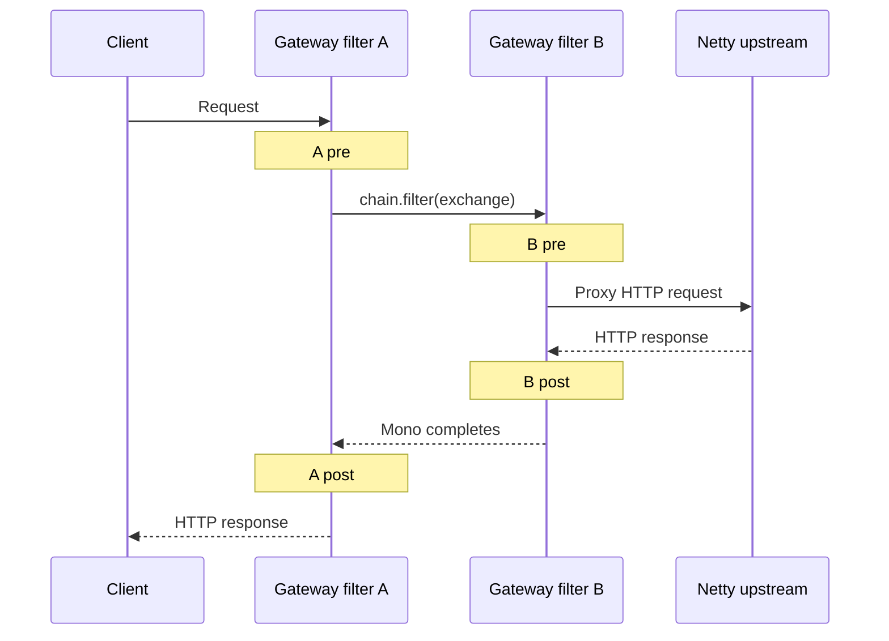

# Contract Testing Custom Filters Together with Built-in Filters

## 1. Why Does a Custom Filter Need "Contract" Testing with Other Filters?

In **SPRING_CLOUD_GATEWAY**, an HTTP request can pass through many processing layers: route predicates select a path, **Spring Security WebFilter** authenticates, **GatewayFilter**s and **GlobalFilter**s transform paths/headers, traffic control enforces limits, retries/circuit breakers handle resilience, and routing via `lb://` and Netty `HttpClient` forwards to a microservice. The system also needs TLS, observability, and downstream authorization. When writing a **custom filter**, unit-testing its isolated Java logic is not enough: that filter must cooperate properly with existing filters.

For example, the following route must do all of these together:

- Remove client-sent `X-Trace-Proof` (which could be spoofed).
- Run custom filter `TraceGuard`, requiring a valid `X-Correlation-Id` and setting a normalized `X-Trace-Proof` downstream.
- `SetRequestHeader` attaches Gateway context info; `StripPrefix` rewrites the path before proxying.
- `DedupeResponseHeader` removes duplicate response header values.
- `AddResponseHeader` appends a diagnostic response marker.

A unit test proving only that `TraceGuard` sets its own header **cannot prove** that `StripPrefix` rewrote the path, forged values were stripped, response headers were deduplicated, zero requests hit the backend when the guard rejects, or unrelated routes remain unaffected.

**Filter contract testing** here means verifying observable invariants **across the entire filter chain**: which inputs are accepted, what request actually reaches the backend, what response reaches the client, which errors must stop at Gateway, and which security properties must always hold.

### Learning Objectives

After this lesson, you will be able to:

1. Write an `AbstractGatewayFilterFactory<Config>` following naming conventions with a reactive `GatewayFilter`.
2. Define contracts for request mutation, response mutation, **pre/post** filter order, short-circuiting, errors, and cancellation.
3. Design a test matrix when a custom filter runs alongside `RemoveRequestHeader`, `SetRequestHeader`, `StripPrefix`, `DedupeResponseHeader`, and `AddResponseHeader`.
4. Unit-test the custom filter with `MockServerWebExchange`, a stub `GatewayFilterChain`, and `StepVerifier`.
5. Integration-test a real HTTP Gateway using `@SpringBootTest(RANDOM_PORT)`, `WebTestClient`, and an embedded Reactor Netty backend on a random port.
6. Verify zero upstream requests when a required header is missing/invalid, and verify route isolation.
7. Extend the contract to `Retry`, `CircuitBreaker`, `RequestRateLimiter`, `LocalResponseCache`, `TokenRelay`, TLS, and request observability.

> **Version scope:** examples use Spring Boot 3.5.x, Spring Cloud 2025.0.x, **Spring Cloud Gateway Server WebFlux 4.3.x**, and JDK 17+. Starter `spring-cloud-starter-gateway-server-webflux`, YAML routes under `spring.cloud.gateway.server.webflux.routes`. Not directly applicable to **Gateway Server MVC** (Servlet stack). `*.0` Maven versions merely illustrate a compatible release train; use supported patch versions for real systems.

## 2. What Does a `GatewayFilter` Contract Include?

A filter typically takes `ServerWebExchange` and `GatewayFilterChain`, returning `Mono<Void>`:

```java
@FunctionalInterface
public interface GatewayFilter {
    Mono<Void> filter(ServerWebExchange exchange, GatewayFilterChain chain);
}
```

This is a **simplified signature** for reading; the actual interface includes additional API inheritance details. The core point is that a filter **does not return a response body directly like a controller**, but rather a reactive publisher representing the processing pipeline.

| Contract aspect | Question to verify | Expected example |
| --- | --- | --- |
| **Input** | Which headers/paths/methods are valid? | `X-Correlation-Id: trace_42` is valid; missing or multi-value is rejected. |
| **Request mutation** | What actually reaches upstream? | Gateway-set `X-Trace-Proof`, never a client-forged value. |
| **Route scope** | Which routes run the filter? | `TraceGuard` runs only on `/api/echo/**`, never on `/open/**`. |
| **Pre/post ordering** | Does it run before/after built-ins? | Spoofed header removed before custom sets clean header; path stripped before HTTP routing. |
| **Short-circuit** | When invalid, is `chain.filter` called? | HTTP 400 at Gateway; backend counter stays unchanged. |
| **Response mutation** | Before commit, are headers right? | One `X-Trace-Accepted` and one `X-Contract-Stage` after dedupe. |
| **HTTP semantics** | Do status/body/headers honor the contract? | When valid, body comes from backend; when blocked, no backend body. |
| **Reactive lifecycle** | Does the filter subscribe/block twice? | No `block()`, no manual `subscribe()`, no unintended chain repetition. |
| **Security** | Is client data trusted as identity? | Correlation ID is for diagnostics only, **never an authorization principal**. |
| **Observability** | Can we tell whether the request hit the backend? | Compare backend counter with status/headers and route ID traces. |

A good **contract test** must include **negative cases** — missing header, blank header, repeated header, oversized value, unmatched route — rather than only the `200 OK` happy path.

### 2.1. What Does "Together with Built-in Filters" Mean?

Gateway provides many filter factories such as `StripPrefix`, `RewritePath`, `SetPath`, `AddRequestHeader`, `RemoveRequestHeader`, `SetRequestHeader`, `AddResponseHeader`, `DedupeResponseHeader`, `Retry`, `CircuitBreaker`, `RequestRateLimiter`, and `LocalResponseCache`. Each operates at a different phase and can alter the request/response seen by your custom filter.

Example:

```text
Client sends:
  GET /api/echo/item-7
  X-Correlation-Id: trace_42
  X-Trace-Proof: attacker-value

After RemoveRequestHeader:
  X-Trace-Proof: <absent>

After custom TraceGuard:
  X-Trace-Proof: trace_42

After SetRequestHeader:
  X-Gateway-Context: contract-lab

After StripPrefix=1:
  GET /echo/item-7  (backend path)

Response:
  Backend: X-Contract-Stage: origin (repeated 2 times)
  DedupeResponseHeader: retains only 1 origin value
  AddResponseHeader: X-Builtin-Response: gateway
  Custom beforeCommit: X-Trace-Accepted: trace_42
```

You cannot guarantee all of those outcomes by reading YAML alone. You must run real HTTP tests and verify filter ordering.

## 3. Pre/Post Ordering and Response Lifecycle

When a request matches a route, `FilteringWebHandler` combines `GlobalFilter`s and the route's `GatewayFilter`s, **sorting them by `Ordered`**. Higher-precedence filters (lower order values) run earlier in the **pre** phase, yet run later in the **post** phase.



With a custom filter:

```java
return (exchange, chain) -> {
    // PRE: inspect/mutate request before continuing.
    ServerHttpRequest request = exchange.getRequest().mutate()
            .header("X-Lab", "value").build();

    return chain.filter(exchange.mutate().request(request).build())
            .then(Mono.fromRunnable(() -> {
                // POST: runs when downstream chain completes normally.
                // Never assume response headers are still modifiable here.
            }));
};
```

If a header must be attached **before the response commits**, the safer pattern is registering an `exchange.getResponse().beforeCommit(...)` callback **during the pre phase**. Calling `response.getHeaders().set(...)` after commit can be ignored or throw state errors.

### 3.1. Do Not Infer Ordering Solely from YAML Position

Route filters typically receive positional orders when the route is constructed, yet **the combined chain also includes `GlobalFilter`s with their own orders**, and filters returning `OrderedGatewayFilter` can alter placement. A response-header filter running in the **post** phase may observe things differently from one acting in **pre**.

To verify real execution order:

1. Identify all filters implementing `Ordered` and check their `getOrder()`.
2. Inspect route IDs, predicates, and filter lists at runtime/Actuator (when enabled with proper access controls).
3. Send requests to a backend that records received paths/headers.
4. Compare **client-sent** request vs. **backend-received** request vs. **client-received** response.
5. When combining `Retry`/`CircuitBreaker`, count **downstream attempts**, not only client requests.

For built-in filters that post-process headers, reverse post-phase ordering can cause `DedupeResponseHeader` to run before another filter adds a header. That is why you must test the actual response rather than guessing from filter names.

### 3.2. When May a Filter Stop the Chain?

An input-rejecting guard can do:

```java
exchange.getResponse().setStatusCode(HttpStatus.BAD_REQUEST);
return exchange.getResponse().setComplete();
```

**Never call `chain.filter(exchange)`** on the rejection branch. On the allow branch, call the chain **exactly once** and return its publisher. Never call `chain.filter(...)` and then manually `.subscribe()`: that creates a side stream, breaks lifecycle/error/cancellation handling, and risks double proxying.

**Rule:** once the response has committed, never attempt to write status/headers/body again. For async errors after commit, you cannot safely "rewind" and change the HTTP status.

## 4. The Lesson's Custom Filter: `TraceGuardGatewayFilterFactory`

This lesson uses a **non-authenticating** filter: it validates `X-Correlation-Id` format, rejects blank/duplicate/malformed values, and sets `X-Trace-Proof` so the backend knows the request passed Gateway validation.

Contract conditions:

- Required header `X-Correlation-Id` has **exactly one value**.
- Value consists solely of letters, digits, hyphens, and underscores; length **1–32 characters**.
- Missing, blank, whitespace, multiple values, or disallowed characters → `400 Bad Request` **without calling downstream**.
- Valid value → Gateway **sets** `X-Trace-Proof` to the validated value, rejecting any client-sent `X-Trace-Proof`.
- Before response commit, Gateway sets `X-Trace-Accepted` to the correlation ID for verification.
- Filter never reads the request body, blocks, manually subscribes, or stores per-request state in shared mutable fields.

**Security note:** a client-chosen `X-Correlation-Id` **proves no identity**. Never use `X-Trace-Proof` as proof that "a user is logged in", as an authorization key, or as a tenant ID. The word "proof" here is purely a technical lab marker, not an authentication credential.

### 4.1. Complete Code

Create `src/main/java/com/example/gateway/TraceGuardGatewayFilterFactory.java` in your **own practice project**:

```java
package com.example.gateway;

import java.util.List;
import java.util.regex.Pattern;

import org.springframework.cloud.gateway.filter.GatewayFilter;
import org.springframework.cloud.gateway.filter.factory.AbstractGatewayFilterFactory;
import org.springframework.http.HttpStatus;
import org.springframework.http.server.reactive.ServerHttpRequest;
import org.springframework.stereotype.Component;
import org.springframework.util.StringUtils;
import org.springframework.web.server.ServerWebExchange;

import reactor.core.publisher.Mono;

@Component
public class TraceGuardGatewayFilterFactory
        extends AbstractGatewayFilterFactory<TraceGuardGatewayFilterFactory.Config> {

    private static final Pattern TRACE_FORMAT =
            Pattern.compile("[A-Za-z0-9_-]{1,32}");

    public TraceGuardGatewayFilterFactory() {
        super(Config.class);
    }

    @Override
    public GatewayFilter apply(Config config) {
        if (!StringUtils.hasText(config.getRequiredHeaderName())
                || !StringUtils.hasText(config.getForwardHeaderName())) {
            throw new IllegalArgumentException(
                    "requiredHeaderName and forwardHeaderName are mandatory");
        }

        return (exchange, chain) -> {
            List<String> values = exchange.getRequest().getHeaders()
                    .get(config.getRequiredHeaderName());

            if (values == null || values.size() != 1
                    || !TRACE_FORMAT.matcher(values.get(0)).matches()) {
                exchange.getResponse().setStatusCode(HttpStatus.BAD_REQUEST);
                return exchange.getResponse().setComplete();
            }

            String correlationId = values.get(0);

            ServerHttpRequest request = exchange.getRequest().mutate()
                    .headers(headers -> headers.set(
                            config.getForwardHeaderName(), correlationId))
                    .build();

            ServerWebExchange forwarded = exchange.mutate()
                    .request(request)
                    .build();

            // Register in PRE so the header is added before response commit.
            exchange.getResponse().beforeCommit(() -> {
                exchange.getResponse().getHeaders()
                        .set("X-Trace-Accepted", correlationId);
                return Mono.empty();
            });

            // Valid branch passes through downstream chain exactly once.
            return chain.filter(forwarded);
        };
    }

    public static class Config {
        private String requiredHeaderName = "X-Correlation-Id";
        private String forwardHeaderName = "X-Trace-Proof";

        public String getRequiredHeaderName() {
            return requiredHeaderName;
        }

        public void setRequiredHeaderName(String requiredHeaderName) {
            this.requiredHeaderName = requiredHeaderName;
        }

        public String getForwardHeaderName() {
            return forwardHeaderName;
        }

        public void setForwardHeaderName(String forwardHeaderName) {
            this.forwardHeaderName = forwardHeaderName;
        }
    }
}
```

**Bean registration note:** `@Component` together with Spring Boot scanning the package is sufficient; you do not need a separate `@ComponentScan` on this class. Keep the class under `@SpringBootApplication`'s root package or a subpackage so Spring registers the factory bean automatically.

**Why end the class name with `GatewayFilterFactory`?** Gateway derives the config filter name by stripping the suffix: `TraceGuardGatewayFilterFactory` is referenced as **`TraceGuard`**. This convention is recommended by the official Developer Guide; avoid suffixless shortcuts that may be dropped in future APIs.

### 4.2. Intentional Design Choices

| Decision | Why? |
| --- | --- |
| `AbstractGatewayFilterFactory<Config>` | Allows configuring the factory per route instead of scattering string checks across YAML. |
| `@Component` | Registers the Spring bean so Gateway discovers the factory. |
| `static final Pattern` | Shares an immutable compiled regex; holds no global per-request state. |
| `values.size() != 1` | Rejects duplicate headers before a proxy merges them unpredictably. |
| `TRACE_FORMAT.matcher(...).matches()` | Restricts marker format/length; **does not** authenticate principals. |
| `headers.set(...)` | Overwrites any old value instead of appending alongside forged client headers. |
| `exchange.mutate()` | Builds a new exchange/request with updated headers rather than mutating an immutable request directly. |
| `beforeCommit(...)` | Ensures response header modification runs at the right pre-commit moment. |
| `return chain.filter(forwarded)` | Preserves reactive lifecycle, error/cancellation propagation, and HTTP routing. |
| `setComplete()` on reject | Terminates the request at Gateway without opening a downstream connection. |

The lab code writes no response body on the 400 branch, keeping tests focused on status/headers without extra `DataBuffer` handling. In real applications you can return a structured JSON error, while managing content type, encoding, `DataBuffer` lifecycles, and never writing twice after commit.

### 4.3. Error and Cancellation Contract

Beyond 400/200, when downstream returns 500 or times out:

- `TraceGuard` must never swallow exceptions and return 200.
- `beforeCommit` runs **only if the response actually reaches commit**; do not rely on it for mandatory cleanup if a request cancels early.
- For timing/metrics, use `doFinally`/`doOnError` in a controlled, non-blocking manner; classify error/cancel/complete separately.
- Never retain `ServerWebExchange` in static maps or post-response schedulers: it can hold headers, tokens, and bodies, causing memory leaks.
- When integrating `Retry`, the filter may execute multiple times depending on chain wrapping; **idempotency of header mutations** is essential, and you must never mechanically assume "runs once".

## 5. Combining the Custom Filter with Built-in Filters

Use two routes:

1. `contract-route` at `/api/echo/**`: has `TraceGuard` and built-in transforms.
2. `open-route` at `/open/**`: omits `TraceGuard`, to test **route scope/isolation**.

Configure `src/main/resources/application.yml`:

```yaml
server:
  port: 8080

spring:
  application:
    name: custom-filter-contract-lab

  cloud:
    gateway:
      server:
        webflux:
          routes:
            - id: contract-route
              uri: ${lab.backend.uri:http://127.0.0.1:9001}
              predicates:
                - Path=/api/echo/**
              filters:
                - RemoveRequestHeader=X-Trace-Proof
                - name: TraceGuard
                  args:
                    requiredHeaderName: X-Correlation-Id
                    forwardHeaderName: X-Trace-Proof
                - SetRequestHeader=X-Gateway-Context, contract-lab
                - StripPrefix=1
                - DedupeResponseHeader=X-Contract-Stage, RETAIN_UNIQUE
                - AddResponseHeader=X-Builtin-Response, gateway

            - id: open-route
              uri: ${lab.backend.uri:http://127.0.0.1:9001}
              predicates:
                - Path=/open/**
              filters:
                - RemoveRequestHeader=X-Trace-Proof
                - StripPrefix=1
                - AddResponseHeader=X-Open-Route, yes
```

`lab.backend.uri` is a **property placeholder**: outside tests, it defaults to `http://127.0.0.1:9001`. In the integration test in section 8, `@DynamicPropertySource` supplies a random-port backend address before Spring initializes routes, avoiding reliance on a fixed port `9001`.

### 5.1. Effect of Each Filter and Test Contract

| Filter | Effect | Contract assertion |
| --- | --- | --- |
| `RemoveRequestHeader=X-Trace-Proof` | Strips any header the client might spoof. | Backend never sees `attacker-value`. |
| `TraceGuard` | Rejects missing/invalid `X-Correlation-Id`; sets `X-Trace-Proof`. | Missing → 400 / never hits backend; valid → backend sees clean ID. |
| `SetRequestHeader=X-Gateway-Context, contract-lab` | **Replaces** header value per config. | If client sends `X-Gateway-Context: evil`, backend only sees `contract-lab`. |
| `StripPrefix=1` | Drops the first path segment. | `/api/echo/item-7` → `/echo/item-7` at backend. |
| `DedupeResponseHeader=X-Contract-Stage, RETAIN_UNIQUE` | Deduplicates values of a response header. | Backend emits `origin` twice; client receives it once. |
| `AddResponseHeader=X-Builtin-Response, gateway` | Appends a route response header. | Client sees `X-Builtin-Response: gateway`. |
| `open-route` | Route without custom guard. | Does not require `X-Correlation-Id`; omits `X-Trace-Accepted`. |

On `open-route`, `RemoveRequestHeader=X-Trace-Proof` is still included to prevent clients from smuggling a "Gateway-verified" header to the backend. **Never assume routes without `TraceGuard` are automatically safe from identity spoofing**; enforce a consistent trust boundary across all routes.

### 5.2. Distinguishing `SetRequestHeader` from `AddRequestHeader`

- `SetRequestHeader` overwrites existing values for the same header. Appropriate when Gateway must **enforce** controlled internal metadata.
- `AddRequestHeader` appends a value, which can leave **multiple values** if the client or an earlier filter already set that header.
- `RemoveRequestHeader` strips the header before downstream when placed at the right position.

For any header carrying identity or security meaning, **never merely "add" a trusted value alongside a forged client value**. Strip/overwrite untrusted sources and still protect the Gateway → downstream channel via TLS/mTLS/network policies.

### 5.3. Pre vs. Post Header Timing

`RemoveRequestHeader`, `SetRequestHeader`, and `StripPrefix` act mainly on the request **before proxying**. `DedupeResponseHeader`, `AddResponseHeader`, and `beforeCommit` callbacks act on the **response** at different moments. Because post-phase ordering reverses relative to pre-phase, reordering a response filter can change the final result—re-test whenever adding `SetResponseHeader`, `SecureHeaders`, CORS, or custom response filters.

**Never check `exchange.getRequest()` inside your custom filter and assume the backend received the exact same request**: later built-in filters can still alter it. Capturing at the backend is the real boundary proof.

## 6. Practice Project and Maven Dependencies

Set up a standalone Spring Boot Gateway project with **JDK 17+ and Maven**. The `pom.xml` below uses Spring Boot `3.5.0` and Spring Cloud BOM `2025.0.0` to illustrate compatibility with the WebFlux 4.3 line; in production, pick supported patch releases rather than staying on `*.0`.

```xml
<?xml version="1.0" encoding="UTF-8"?>
<project xmlns="http://maven.apache.org/POM/4.0.0"
         xmlns:xsi="http://www.w3.org/2001/XMLSchema-instance"
         xsi:schemaLocation="http://maven.apache.org/POM/4.0.0
                             https://maven.apache.org/xsd/maven-4.0.0.xsd">
    <modelVersion>4.0.0</modelVersion>

    <parent>
        <groupId>org.springframework.boot</groupId>
        <artifactId>spring-boot-starter-parent</artifactId>
        <version>3.5.0</version>
        <relativePath/>
    </parent>

    <groupId>com.example</groupId>
    <artifactId>custom-filter-contract-lab</artifactId>
    <version>0.0.1-SNAPSHOT</version>

    <properties>
        <java.version>17</java.version>
    </properties>

    <dependencyManagement>
        <dependencies>
            <dependency>
                <groupId>org.springframework.cloud</groupId>
                <artifactId>spring-cloud-dependencies</artifactId>
                <version>2025.0.0</version>
                <type>pom</type>
                <scope>import</scope>
            </dependency>
        </dependencies>
    </dependencyManagement>

    <dependencies>
        <dependency>
            <groupId>org.springframework.cloud</groupId>
            <artifactId>spring-cloud-starter-gateway-server-webflux</artifactId>
        </dependency>
        <dependency>
            <groupId>org.springframework.boot</groupId>
            <artifactId>spring-boot-starter-test</artifactId>
            <scope>test</scope>
        </dependency>
        <dependency>
            <groupId>io.projectreactor</groupId>
            <artifactId>reactor-test</artifactId>
            <scope>test</scope>
        </dependency>
    </dependencies>

    <build>
        <plugins>
            <plugin>
                <groupId>org.springframework.boot</groupId>
                <artifactId>spring-boot-maven-plugin</artifactId>
            </plugin>
        </plugins>
    </build>
</project>
```

Create the entry point `src/main/java/com/example/gateway/GatewayApplication.java`:

```java
package com.example.gateway;

import org.springframework.boot.SpringApplication;
import org.springframework.boot.autoconfigure.SpringBootApplication;

@SpringBootApplication
public class GatewayApplication {
    public static void main(String[] args) {
        SpringApplication.run(GatewayApplication.class, args);
    }
}
```

Place the YAML from section 5 in `src/main/resources/application.yml` and `TraceGuardGatewayFilterFactory` in the right package. Do not add `spring-boot-starter-web`: this is **Gateway Server WebFlux**, not Servlet/MVC. `spring-boot-starter-test` and `reactor-test` are needed only for tests.

**Distinguishing test levels:**

| Test type | What runs? | What it proves | What it does not prove |
| --- | --- | --- | --- |
| Factory/filter unit test | `MockServerWebExchange` and fake chain | Branching, mutation, short-circuit, reactive completion. | Real HTTP routing and built-in ordering. |
| WebFlux slice test | `WebTestClient` with mock web context | Handler/security logic if imported properly. | Does not include route mapping, Gateway Netty routing, or real backends by default. |
| **Integration test** | Boot Gateway on random port + real HTTP backend | Route binding, built-in transforms, responses, request counts. | Does not automatically prove production security/Redis/TLS unless configured. |
| Staging E2E | Real ingress, IdP, Redis/LoadBalancer, TLS | Trust boundaries, latency, error paths, multi-instance. | Does not replace unit tests for pinpointing root causes. |

In the sections below, we write **both unit and integration tests**; never use one as a substitute for the other.

## 7. Unit Testing `TraceGuard`'s Contract

Unit tests use `MockServerWebExchange`, `MockServerHttpRequest`, a stub `GatewayFilterChain`, and `StepVerifier`. The goal is to prove **the rejection branch does not call the chain** and the allow branch mutates headers properly, without running a live backend.

Create `src/test/java/com/example/gateway/TraceGuardUnitTest.java`:

```java
package com.example.gateway;

import java.util.concurrent.atomic.AtomicInteger;

import org.junit.jupiter.api.Test;
import org.springframework.cloud.gateway.filter.GatewayFilter;
import org.springframework.cloud.gateway.filter.GatewayFilterChain;
import org.springframework.http.HttpStatus;
import org.springframework.mock.http.server.reactive.MockServerHttpRequest;
import org.springframework.mock.web.server.MockServerWebExchange;

import reactor.core.publisher.Mono;
import reactor.test.StepVerifier;

import static org.assertj.core.api.Assertions.assertThat;

class TraceGuardUnitTest {

    private final TraceGuardGatewayFilterFactory factory =
            new TraceGuardGatewayFilterFactory();

    private final GatewayFilter filter = factory.apply(
            new TraceGuardGatewayFilterFactory.Config());

    @Test
    void missingHeaderStopsChain() {
        var request = MockServerHttpRequest
                .get("/api/echo/item-7")
                .build();
        var exchange = MockServerWebExchange.from(request);

        AtomicInteger downstreamCalls = new AtomicInteger();

        GatewayFilterChain next = ex -> {
            downstreamCalls.incrementAndGet();
            return Mono.empty();
        };

        StepVerifier.create(filter.filter(exchange, next))
                .verifyComplete();

        assertThat(exchange.getResponse().getStatusCode())
                .isEqualTo(HttpStatus.BAD_REQUEST);
        assertThat(downstreamCalls.get()).isZero();
    }

    @Test
    void duplicateHeaderValuesAreRejected() {
        var request = MockServerHttpRequest
                .get("/api/echo/item-7")
                .header("X-Correlation-Id", "trace_a", "trace_b")
                .build();
        var exchange = MockServerWebExchange.from(request);

        AtomicInteger downstreamCalls = new AtomicInteger();

        StepVerifier.create(filter.filter(exchange, ex -> {
            downstreamCalls.incrementAndGet();
            return Mono.empty();
        })).verifyComplete();

        assertThat(exchange.getResponse().getStatusCode())
                .isEqualTo(HttpStatus.BAD_REQUEST);
        assertThat(downstreamCalls.get()).isZero();
    }

    @Test
    void validHeaderOverwritesClientForgedHeaderAndCommitsMarker() {
        var request = MockServerHttpRequest
                .get("/api/echo/item-7")
                .header("X-Correlation-Id", "trace_42")
                .header("X-Trace-Proof", "attacker-value")
                .build();
        var exchange = MockServerWebExchange.from(request);

        AtomicInteger downstreamCalls = new AtomicInteger();

        GatewayFilterChain next = ex -> {
            downstreamCalls.incrementAndGet();

            assertThat(ex.getRequest().getHeaders()
                    .getFirst("X-Trace-Proof"))
                    .isEqualTo("trace_42");

            // Simulate downstream completing the response.
            return ex.getResponse().setComplete();
        };

        StepVerifier.create(filter.filter(exchange, next))
                .verifyComplete();

        assertThat(downstreamCalls.get()).isEqualTo(1);
        assertThat(exchange.getResponse().getHeaders()
                .getFirst("X-Trace-Accepted"))
                .isEqualTo("trace_42");
    }

    @Test
    void invalidCharactersDoNotContinue() {
        var request = MockServerHttpRequest
                .get("/api/echo/item-7")
                .header("X-Correlation-Id", "hello with spaces")
                .build();
        var exchange = MockServerWebExchange.from(request);

        AtomicInteger downstreamCalls = new AtomicInteger();

        StepVerifier.create(filter.filter(exchange, ex -> {
            downstreamCalls.incrementAndGet();
            return Mono.empty();
        })).verifyComplete();

        assertThat(exchange.getResponse().getStatusCode())
                .isEqualTo(HttpStatus.BAD_REQUEST);
        assertThat(downstreamCalls.get()).isZero();
    }
}
```

### 7.1. What Do the Assertions Prove?

- `missingHeaderStopsChain`: missing header → 400 and **0** downstream calls. Tests short-circuiting directly, not just status.
- `duplicateHeaderValuesAreRejected`: avoids ambiguity when an HTTP client/proxy sends multiple values for the same header.
- `validHeaderOverwritesClientForgedHeaderAndCommitsMarker`: filter uses `set`, not `add`; `beforeCommit` writes the marker when the response completes.
- `invalidCharactersDoNotContinue`: malformed inputs never reach downstream.
- `StepVerifier` verifies publisher **completion**. Never turn the test into `filter.filter(...).subscribe()` followed by immediate assertions; async work may still be in progress.

**Limits of unit tests:** a fake chain never executes `StripPrefix`, Netty routing, `DedupeResponseHeader`, or a real HTTP backend. It cannot catch misspelled factory names in YAML, unscanned beans, or runtime filter ordering bugs.

### 7.2. Additional Cases to Add

For a factory requiring long-term stability, expand unit tests:

| Input or scenario | Expected outcome |
| --- | --- |
| Absent `X-Correlation-Id` | 400; 0 chain calls. |
| Empty or whitespace-only header | 400; 0 chain calls. |
| Header longer than 32 chars | 400; 0 chain calls. |
| Two `X-Correlation-Id` values | 400; 0 chain calls. |
| Invalid character like `trace/a` | 400; 0 chain calls. |
| Valid value `trace_42` | Chain called once; request header set. |
| Client sends `X-Trace-Proof: attacker-value` | Value passed downstream is replaced with `trace_42`. |
| Config missing required header name | `IllegalArgumentException` in `apply`, before the first request. |
| Downstream publisher errors | Error is not swallowed; caller handles it properly. |
| Downstream canceled | No detached subscription; exchange not retained in memory. |
| Response already committed | No arbitrary header/status writes afterward; use `beforeCommit` when needed. |

These tests do not all have to live in one giant class; JUnit `@ParameterizedTest` reduces duplication while still asserting **status + chain call count + headers**.

## 8. Integration Testing: Custom Filter with Built-in Filters Over Real HTTP

This is the most important test in the lesson. It boots a **real Gateway** on a random port alongside an embedded **Reactor Netty** HTTP backend on a random port in the same test JVM. No Docker, Redis, IdP, or service discovery is needed for this baseline scenario.

The test observes real requests flowing through:

```mermaid
sequenceDiagram
    participant T as WebTestClient
    participant G as Gateway HTTP server
    participant F as TraceGuard + Built-in filters
    participant U as Embedded Netty backend

    T->>G: GET /api/echo/item-7 + valid trace + forged headers
    G->>F: Route contract-route
    F->>F: Remove, validate, SetRequestHeader, StripPrefix
    F->>U: GET /echo/item-7; X-Trace-Proof=trace_42
    U-->>F: 200; repeated X-Contract-Stage headers
    F->>F: DedupeResponseHeader; AddResponseHeader; beforeCommit
    F-->>T: 200 + sanitized trace + unique response header

    T->>G: GET /api/echo/item-7 without trace
    G->>F: TraceGuard rejects
    F-->>T: 400; backend receives no request
```

### 8.1. Why Choose `@SpringBootTest(RANDOM_PORT)`?

- It boots the full `ApplicationContext`, route binding, and factory beans.
- Gateway receives real HTTP requests via Reactor Netty.
- `WebTestClient` sends HTTP requests and asserts status, headers, and body.
- The test backend records what **Gateway's Netty HttpClient** actually sends downstream, not just an intermediate mock exchange.
- Random ports prevent collisions with services listening on `8080`/`9001` on developer machines.
- When a test fails, you can isolate YAML/route issues, custom filter issues, built-in issues, or outbound proxy issues.

Boot 3.5 uses `org.springframework.boot.test.autoconfigure.web.reactive.AutoConfigureWebTestClient`. Do not copy Spring Boot 4.x imports if the lab uses 3.5.x.

### 8.2. Integration Test Code

Create `src/test/java/com/example/gateway/TraceGuardIntegrationTest.java`:

```java
package com.example.gateway;

import java.util.concurrent.atomic.AtomicInteger;

import org.junit.jupiter.api.AfterAll;
import org.junit.jupiter.api.Test;
import org.springframework.beans.factory.annotation.Autowired;
import org.springframework.boot.test.autoconfigure.web.reactive.AutoConfigureWebTestClient;
import org.springframework.boot.test.context.SpringBootTest;
import org.springframework.test.context.DynamicPropertyRegistry;
import org.springframework.test.context.DynamicPropertySource;
import org.springframework.test.web.reactive.server.WebTestClient;

import reactor.core.publisher.Mono;
import reactor.netty.DisposableServer;
import reactor.netty.http.server.HttpServer;

import static org.assertj.core.api.Assertions.assertThat;

@SpringBootTest(webEnvironment = SpringBootTest.WebEnvironment.RANDOM_PORT)
@AutoConfigureWebTestClient
class TraceGuardIntegrationTest {

    private static final AtomicInteger UPSTREAM_CALLS =
            new AtomicInteger();

    // Static startup runs before DynamicPropertySource requests the port.
    private static final DisposableServer BACKEND = HttpServer.create()
            .host("127.0.0.1")
            .port(0)
            .handle((request, response) -> {
                int callNo = UPSTREAM_CALLS.incrementAndGet();

                String trace = request.requestHeaders()
                        .get("X-Trace-Proof");
                String context = request.requestHeaders()
                        .get("X-Gateway-Context");

                // Intentionally emit two identical values to test Dedupe.
                response.responseHeaders().add(
                        "X-Contract-Stage", "origin");
                response.responseHeaders().add(
                        "X-Contract-Stage", "origin");

                return response.status(200)
                        .header("X-Upstream-Path", request.path())
                        .header("X-Upstream-Trace",
                                trace == null ? "missing" : trace)
                        .header("X-Upstream-Context",
                                context == null ? "missing" : context)
                        .header("X-Upstream-Call-No",
                                Integer.toString(callNo))
                        .sendString(Mono.just(
                                "echo path=" + request.path()))
                        .then();
            })
            .bindNow();

    @DynamicPropertySource
    static void upstreamUri(DynamicPropertyRegistry registry) {
        registry.add("lab.backend.uri", () ->
                "http://127.0.0.1:" + BACKEND.port());
    }

    @Autowired
    WebTestClient client;

    @AfterAll
    static void shutdownBackend() {
        BACKEND.disposeNow();
    }

    @Test
    void validTraceWorksAcrossCustomAndBuiltinFilters() {
        int before = UPSTREAM_CALLS.get();

        var result = client.get()
                .uri("/api/echo/item-7")
                .header("X-Correlation-Id", "trace_42")
                .header("X-Trace-Proof", "attacker-value")
                .header("X-Gateway-Context", "attacker-context")
                .exchange()
                .expectStatus().isOk()
                .expectHeader().valueEquals(
                        "X-Upstream-Path", "/echo/item-7")
                .expectHeader().valueEquals(
                        "X-Upstream-Trace", "trace_42")
                .expectHeader().valueEquals(
                        "X-Upstream-Context", "contract-lab")
                .expectHeader().valueEquals(
                        "X-Trace-Accepted", "trace_42")
                .expectHeader().valueEquals(
                        "X-Builtin-Response", "gateway")
                .expectBody(String.class)
                .isEqualTo("echo path=/echo/item-7")
                .returnResult();

        assertThat(result.getResponseHeaders()
                .get("X-Contract-Stage"))
                .containsExactly("origin");

        assertThat(UPSTREAM_CALLS.get()).isEqualTo(before + 1);
    }

    @Test
    void missingTraceStopsBeforeBackend() {
        int before = UPSTREAM_CALLS.get();

        client.get()
                .uri("/api/echo/item-7")
                .exchange()
                .expectStatus().isBadRequest()
                .expectHeader().doesNotExist("X-Trace-Accepted");

        assertThat(UPSTREAM_CALLS.get()).isEqualTo(before);
    }

    @Test
    void duplicateTraceIsRejectedBeforeBackend() {
        int before = UPSTREAM_CALLS.get();

        client.get()
                .uri("/api/echo/item-7")
                .header("X-Correlation-Id", "trace_a", "trace_b")
                .exchange()
                .expectStatus().isBadRequest();

        assertThat(UPSTREAM_CALLS.get()).isEqualTo(before);
    }

    @Test
    void otherRouteIsNotProtectedByTraceGuard() {
        int before = UPSTREAM_CALLS.get();

        client.get()
                .uri("/open/echo/item-7")
                .header("X-Trace-Proof", "attacker-value")
                .exchange()
                .expectStatus().isOk()
                .expectHeader().valueEquals(
                        "X-Upstream-Path", "/echo/item-7")
                .expectHeader().valueEquals(
                        "X-Upstream-Trace", "missing")
                .expectHeader().valueEquals(
                        "X-Open-Route", "yes")
                .expectHeader().doesNotExist("X-Trace-Accepted");

        assertThat(UPSTREAM_CALLS.get()).isEqualTo(before + 1);
    }

    @Test
    void unmatchedPathDoesNotReachBackend() {
        int before = UPSTREAM_CALLS.get();

        client.get()
                .uri("/no-route")
                .exchange()
                .expectStatus().isNotFound();

        assertThat(UPSTREAM_CALLS.get()).isEqualTo(before);
    }
}
```

### 8.3. How Does the Test Verify Each Contract?

| Assertion | What does it prove? | If it fails, where to look? |
| --- | --- | --- |
| `X-Upstream-Path=/echo/item-7` | `StripPrefix=1` applied **before Netty routing**. | Path predicate, StripPrefix, route selection. |
| `X-Upstream-Trace=trace_42` | Client-forged `X-Trace-Proof` was replaced. | RemoveRequestHeader, custom mutation, order. |
| `X-Upstream-Context=contract-lab` | `SetRequestHeader` overwrote `attacker-context`. | Header name, filter config, priority. |
| `X-Trace-Accepted=trace_42` | Custom filter's `beforeCommit` added the response marker. | Hook registered too late or response already committed. |
| `X-Builtin-Response=gateway` | Route's `AddResponseHeader` took effect. | Filter name/config and response phase. |
| `X-Contract-Stage` has `origin` once | `DedupeResponseHeader=..., RETAIN_UNIQUE` deduplicated the two identical upstream values. | Header name, dedupe strategy, post ordering. |
| Upstream counter increments by 1 on happy path | Exactly one HTTP request hit the backend. | Double subscribe/proxy/unexpected retry. |
| Missing/duplicate trace → 400, counter unchanged | Real short-circuit, not just changing status and still proxying. | `setComplete()` and `chain.filter` branches. |
| `/open/**` does not require trace | Custom factory does not run outside its attached route. | Route ID, unintended `GlobalFilter`. |
| `/no-route` → 404, counter unchanged | Request matched no routes; error is not guard's 400. | Route predicates or other handlers. |

### 8.4. Conditions and Limits for Stable Tests

- The test backend **binds a random port** via `.port(0).bindNow()` at class load so `@DynamicPropertySource` gets a valid address.
- `lab.backend.uri` in YAML is populated before Gateway initializes routes; run from a project containing **both the YAML and Java code** of this lesson.
- `UPSTREAM_CALLS` is a test counter; assertions assume tests do not run **in parallel**. If JUnit parallel execution is enabled, run sequentially/isolate state or key counters by request ID.
- The test backend is strictly an HTTP echo server; it does not perform authentication or simulate TLS/discovery. Add dedicated tests for those features.
- The test runs real HTTP, yet you do not need screenshot checks or `MockMvc` controller tests: Gateway WebFlux uses **`WebTestClient`**.
- Some CI environments restrict loopback socket binding. If CI forbids binding ports, use pure mock slices for unit tests, **without claiming Netty HTTP routing was verified**.

Run tests in your learner project:

```bash
mvn -Dtest=TraceGuardUnitTest,TraceGuardIntegrationTest test
```

With Maven Wrapper:

```bash
./mvnw -Dtest=TraceGuardUnitTest,TraceGuardIntegrationTest test
```

**Task scope note:** the commands above are instructions for **learners to run in their own lab project**, not worker commands run on the `java-learning` repository. STEP 4 only authors/writes Markdown; domain Content QA and platform builds occur in a later stage.

## 9. Manual Testing with `curl` and JDK `EchoBackend`

The integration test in section 8 is recommended because it manages the backend automatically and avoids port conflicts. If you want to observe individual HTTP requests directly in a terminal, create a simple Echo server on your **study machine**, without copying it into the lesson repository.

Create `EchoBackend.java` **outside Gateway's source tree**:

```java
import com.sun.net.httpserver.HttpServer;
import java.net.InetSocketAddress;
import java.nio.charset.StandardCharsets;
import java.util.concurrent.atomic.AtomicInteger;

public class EchoBackend {

    public static void main(String[] args) throws Exception {
        AtomicInteger counter = new AtomicInteger();

        HttpServer server = HttpServer.create(
                new InetSocketAddress("127.0.0.1", 9001), 0);

        server.createContext("/", exchange -> {
            int call = counter.incrementAndGet();
            String path = exchange.getRequestURI().getRawPath();
            String trace = exchange.getRequestHeaders()
                    .getFirst("X-Trace-Proof");
            String context = exchange.getRequestHeaders()
                    .getFirst("X-Gateway-Context");

            var responseHeaders = exchange.getResponseHeaders();
            responseHeaders.set("Content-Type",
                    "text/plain; charset=UTF-8");
            responseHeaders.set("X-Upstream-Path", path);
            responseHeaders.set("X-Upstream-Trace",
                    trace == null ? "missing" : trace);
            responseHeaders.set("X-Upstream-Context",
                    context == null ? "missing" : context);
            responseHeaders.add("X-Contract-Stage", "origin");
            responseHeaders.add("X-Contract-Stage", "origin");

            byte[] bytes = ("echo path=" + path)
                    .getBytes(StandardCharsets.UTF_8);

            System.out.println("UPSTREAM #" + call + " path="
                    + path + " trace=" + trace);

            exchange.sendResponseHeaders(200, bytes.length);
            try (var body = exchange.getResponseBody()) {
                body.write(bytes);
            }
        });

        server.start();
        System.out.println("EchoBackend listening at 127.0.0.1:9001");
    }
}
```

In **terminal A**:

```bash
java EchoBackend.java
```

In **terminal B**, from the Gateway project:

```bash
mvn spring-boot:run
```

Here YAML `uri: ${lab.backend.uri:http://127.0.0.1:9001}` uses its fallback `http://127.0.0.1:9001` since no `lab.backend.uri` override is supplied.

### 9.1. Happy Path with Spoofed Headers

```bash
curl -i \
  -H "X-Correlation-Id: trace_42" \
  -H "X-Trace-Proof: attacker-value" \
  -H "X-Gateway-Context: attacker-context" \
  "http://127.0.0.1:8080/api/echo/item-7"
```

Expected response contains:

```http
HTTP/1.1 200 OK
X-Upstream-Path: /echo/item-7
X-Upstream-Trace: trace_42
X-Upstream-Context: contract-lab
X-Trace-Accepted: trace_42
X-Builtin-Response: gateway
X-Contract-Stage: origin

echo path=/echo/item-7
```

Headers may appear in a different order; never compare header order literally. The two `X-Contract-Stage: origin` values emitted by the backend are reduced to **one** by `DedupeResponseHeader`. The backend terminal prints **one** new `UPSTREAM` line.

### 9.2. Missing/Invalid → Gateway Rejects

```bash
curl -i "http://127.0.0.1:8080/api/echo/item-7"

curl -i \
  -H "X-Correlation-Id: bad trace with spaces" \
  "http://127.0.0.1:8080/api/echo/item-7"
```

Expected 400, with **no** new `UPSTREAM` lines. If the backend counter still increments, the custom filter may have called the chain in the rejection branch or a different route matched.

### 9.3. Route Without the Guard

```bash
curl -i \
  -H "X-Trace-Proof: attacker-value" \
  "http://127.0.0.1:8080/open/echo/item-7"
```

Expected 200, with `X-Open-Route: yes` and **no** `X-Trace-Accepted`; the backend sees `X-Trace-Proof` as missing because `open-route` also uses built-in `RemoveRequestHeader`.

### 9.4. Checking an Unmatched Route

```bash
curl -i "http://127.0.0.1:8080/no-route"
```

If no other handler or security rule applies, you typically receive 404. This differs from `TraceGuard`'s 400: route filters do not run when no route is selected.

## 10. Contract Variations When Adding Other Filters

The baseline lab does not include every Spring Cloud Gateway filter. When expanding a system, re-verify the contract based on **request state and path** rather than just filter names.

| Built-in filter or layer | Interaction with custom filter | Tests to add |
| --- | --- | --- |
| `RewritePath`, `SetPath`, `PrefixPath` | Alters path before proxy; can affect custom logic that reads the path. | Original path, forwarded path, path traversal/encoding, and regex groups. |
| `RemoveRequestHeader` | Strips untrusted values. | Forged client header never reaches backend; order before/after custom. |
| `AddRequestHeader`, `SetRequestHeader` | Append vs. overwrite; can create multi-value headers. | Backend sees exactly 1 value for security headers, zero forged values. |
| `AddResponseHeader`, `SetResponseHeader` | Modifies response in post phase. | Header appears once with expected value, written before commit. |
| `DedupeResponseHeader` | Handles duplicate header values. | `RETAIN_FIRST`, `RETAIN_LAST`, `RETAIN_UNIQUE`, and post ordering. |
| `RequestRateLimiter` | Can reject requests before reaching backend. | 429 and upstream counter = 0; limiter key comes from a trusted source. |
| `CircuitBreaker` / `fallbackUri` | Can short-circuit when OPEN or forward to a fallback handler. | Backend counter, fallback status, exception propagation, no data leakage. |
| `Retry` | Can re-run part of the downstream chain multiple times. | Attempt counts, idempotency, body replay, no duplicated custom side effects. |
| `LocalResponseCache` | Cache hit can skip Netty routing. | Backend counter unchanged on hit; auth/quota not bypassed; no private data cached. |
| `TokenRelay` | Forwards access token downstream when OAuth2 Client is configured. | Right audience/scopes, not logged; backend still verifies token. |
| `SaveSession` | May be needed when session state must persist before proxying. | Session/authorized-client lifecycle and request side effects. |
| `SecureHeaders` / CORS | Adds/updates security response headers. | No duplicate/conflicting security headers; no unintended open origins. |
| `lb://service-id` | Picks backend instance after route mapping. | Headers/paths remain consistent across replicas; never trust client-forged `Host`. |
| Outbound TLS/mTLS | Protects and authenticates peers from Gateway → backend. | Valid CA/hostname/SAN; TLS never bypassed when custom filter runs. |

Filters can have **default or custom orders**. Whenever adding a filter, update at least one integration test asserting what the **backend receives** and one negative test proving when requests **must not** be forwarded. For response changes, add assertions after response commit or via a real HTTP client.

### 10.1. Example with `Retry`: "Once" Does Not Always Mean One HTTP Attempt

Suppose a GET request passes through a custom filter and `Retry`:

```text
Client request: 1

Gateway TraceGuard:
  Validates correlation ID and sets header

Gateway Retry:
  Attempt 1 -> backend 503
  Attempt 2 -> backend 503
  Attempt 3 -> backend 200

Client response: 200
Backend request count: 3
```

Depending on `Retry`'s position in the combined chain, a custom filter may run **once per logical request** or **re-run on every attempt**. Therefore:

- Never use a non-thread-safe global counter to generate headers assuming it runs once.
- If a filter causes side effects (DB writes, messages, payments), design an **idempotency key**—and avoid putting such side effects in filters whenever possible.
- Assert **upstream attempt count and side-effect count**, not just final status 200.
- Never blindly retry non-idempotent `POST`/`PATCH` or arbitrary 4xx responses (such as 401/403/429).
- Account for raw response bodies, methods, request body caching, and cancellation; body replay is not free.

### 10.2. Example with `CircuitBreaker` and Fallback

When a backend fails, `CircuitBreaker` can return a fallback response without proxying. However, a **503 fallback** can happen **after calling a failing backend while CLOSED**, or **without calling the backend when OPEN**.

Contract checks: verify fallback status; verify backend counter reflects OPEN/half-open; ensure custom filters do not disguise fallbacks as fake successes; ensure fallbacks never bypass authentication/authorization. A custom filter merely seeing a 503 response is **not enough** to conclude the breaker is OPEN.

### 10.3. Example with `RateLimiter` and `SecurityWebFilterChain`

```text
Spring Security WebFilter
    | verify JWT/session + coarse authorization
    v
Gateway Route + RequestRateLimiter
    | resolve trusted key, check quota
    v
Custom filter + Gateway transformations
    v
Netty upstream routing
```

This is a **target design diagram**, not a guarantee of filter ordering in every project. When identity is invalid, Spring Security can return 401/403 **before Gateway route filters**. When quota runs out, `RequestRateLimiter` typically returns 429 for valid keys. This lab's custom guard uses 400 for missing/invalid correlation IDs. In integration tests, distinguish **status origins**:

- 400: `TraceGuard` input validation.
- 401/403: authentication/authorization or another custom rule.
- 429: rate limiting.
- 5xx: upstream/proxy timeouts/circuit breaker, not the custom filter by default.

When requests do not reach the backend, identify which filter short-circuited rather than looking solely at the client status.

## 11. Contracts Related to Response Lifecycle and Reactivity

### 11.1. Never Modify a Response After Commit

In WebFlux, `ServerHttpResponse` follows a lifecycle: set status/headers → commit → write body. Once committed, a filter cannot freely add headers or alter status as it could in the pre phase.

Pattern to use when a custom filter must add a header:

```java
exchange.getResponse().beforeCommit(() -> {
    exchange.getResponse().getHeaders()
            .set("X-Contract-Marker", "processed");
    return Mono.empty();
});
return chain.filter(exchange);
```

Pattern to **avoid** when unsure whether the response is still editable:

```java
return chain.filter(exchange)
        .then(Mono.fromRunnable(() -> {
            // May be too late if a component already committed the response.
            exchange.getResponse().getHeaders()
                    .set("X-Contract-Marker", "processed");
        }));
```

A very low-order (high-precedence) `GlobalFilter` or `NettyWriteResponseFilter` also affects when the response writes; contract tests should use a **real HTTP client** to catch headers disappearing on commit.

**Keep callback roles distinct:**

- `beforeCommit`: adjusts headers/metadata right before response commit. Never use it as a guaranteed `finally` block.
- `doOnError`: observes errors in the publisher; never silently converts errors to 200.
- `doFinally`: observes complete/error/cancel; avoid blocking code and never touch response bodies after commit.
- `onErrorResume`: translates errors into a fallback when permitted by contract; verify which errors are handled and which HTTP status is emitted.

### 11.2. Cancellation Is Also an Outcome to Design For

Clients can drop connections mid-flight, Netty connections can time out, or `Retry`/`CircuitBreaker` can cancel a publisher. A custom filter **must never**:

- Manually `.subscribe()` to a side publisher and ignore main-request cancellation.
- Run `Thread.sleep`, `Future.get`, `block()`, or synchronous JDBC on the Netty event loop.
- Store `ServerWebExchange` references in static maps to "clean up later".
- Write a body a second time after downstream has already written.
- Store request data in a mutable field on the factory bean, since concurrent requests share the same bean/filter instance.

If a custom filter must perform external I/O (Redis, DB, HTTP client), use reactive clients or isolate blocking work on a proper scheduler with backpressure and timeouts. Benchmark performance in integration and load tests; do not assert data alone.

### 11.3. Header Injection, Encoding, and Sensitive Data

Client-supplied correlation IDs must be bounded in length and format to prevent log pollution, header injection, and cardinality explosions. The lab regex is only a syntactic check, not a comprehensive anti-spoofing system.

Never:

- Put `Authorization`, `Cookie`, access tokens, API keys, or refresh tokens in response markers or logs.
- Use a client-asserted correlation ID as a user ID, tenant ID, or authorization key.
- Trust client-sent `X-Forwarded-For`, `Forwarded`, or `X-Forwarded-Host` without a trusted proxy chain.
- Put raw URLs/queries containing PII/tokens into metric labels.
- Send "Gateway-verified" headers to a backend without preventing clients from **bypassing Gateway** or spoofing internal connections.

If an internal header genuinely represents identity, use **Spring Security/OAuth2/JWT** or service-to-service authentication, emit the header only after verification, secure Gateway → backend with TLS/mTLS and network policies, and still enforce resource permissions in the backend.

## 12. Common Integration Failures

| Symptom | Possible cause | How to diagnose |
| --- | --- | --- |
| Startup reports `TraceGuard` not found | Missing `@Component`, outside component scan, missing `GatewayFilterFactory` suffix. | Check bean registration, class name, and route binding. |
| YAML loads, yet custom filter isn't called | Route predicate mismatch or another route has higher precedence. | Check route ID/Path/Method and backend captures. |
| Forged client header still reaches backend | `RemoveRequestHeader` positioned wrong; custom used `add` instead of `set`. | Capture raw request headers at the HTTP backend. |
| `X-Gateway-Context` still shows `attacker-context` | `SetRequestHeader` not applied or different filter order. | Compare YAML with `X-Upstream-Context` response. |
| Backend receives `/api/echo/item-7` instead of `/echo/item-7` | `StripPrefix=1` missing or misconfigured; different route matched. | Inspect `X-Upstream-Path` and backend logs. |
| `X-Trace-Accepted` is missing | Response committed before callback registered; guard returned 400; wrong route. | Check `beforeCommit`, route ID, and response status. |
| Two `X-Contract-Stage: origin` values appear | `DedupeResponseHeader` didn't run or wrong header/strategy. | Assert header list via `WebTestClient` rather than a joined string. |
| 400 yet backend counter still increments | Custom filter called `chain.filter` before setting status, or another route proxied. | Unit-assert chain=0; integration-assert backend calls=0. |
| 200 yet no backend body | Response already committed or custom filter consumed body without replay. | Inspect body lifecycle, `NettyWriteResponseFilter`, and custom body modifiers. |
| Tests pass alone, fail in parallel | Shared `AtomicInteger`, static ports, order-dependent tests, shared cache/retry state. | Use random ports, isolated contexts, and control test parallelism. |
| Multiple backend HTTP calls per client request | `Retry`, double subscribe, or client retrying on timeout. | Count attempts/backend logs; check filter order and retry config. |
| 401/403 instead of expected 400 | `SecurityWebFilterChain` rejected early before Gateway filters. | Check auth policies, token issuer/audience, and routes. |
| Spoofed header remains on `/open/**` | Client header not stripped on that route. | Apply `RemoveRequestHeader` or an appropriate global policy. |
| Inconsistent results with `lb://` across replicas | Backend implementations/policies diverge or discovery returns inconsistent instances. | Test each replica or use symmetric mock servers; log selected service. |
| TLS/Netty reports 5xx | CA/SAN/hostname mismatch, wrong HTTP/HTTPS scheme, connect timeout. | Separate TLS handshake, DNS, and TCP from filter contracts. |
| `LocalResponseCache` keeps backend counter unchanged | Valid cache hit, not a guard short-circuit. | Test with cache disabled / unique paths and verify auth/header policies. |
| Response headers change depending on order | Reverse post-phase ordering; `SetResponseHeader`/secure headers/CORS conflict. | Assert final headers and inspect filter `Ordered` values. |

### 12.1. Procedure to Isolate a Failing Test

1. **Startup/route:** Was the factory scanned? Does `name: TraceGuard` match the class suffix? Did the route ID match the request?
2. **Pre-filter:** Did the input header have exactly one value? Did the guard return 400 with chain=0 when expected?
3. **Built-in request transforms:** Did `RemoveRequestHeader`, `SetRequestHeader`, and `StripPrefix` produce the expected values at the backend?
4. **HTTP routing:** Is the backend listening at the real URI? Did `lb://`, TLS, DNS, timeouts, or retries alter the path?
5. **Response:** What status/body came from the backend? Did `DedupeResponseHeader`, `AddResponseHeader`, and `beforeCommit` produce the expected final headers?
6. **Async:** Were there errors, cancellations, or double subscriptions? Did any filter write after commit?
7. **Isolation:** Were unguarded routes affected? Did concurrent requests share state?
8. **Security:** Are headers verified? Is sensitive data absent from logs, bodies, and metric tags?

Only after ruling out route/filter binding errors should you investigate higher layers such as auth policies, rate-limiter backends (Redis), circuit-breaker state, cache TTLs, or service discovery.

## 13. Contract Matrix for CI

In real projects, capture these invariants in a test specification table so every route/filter change runs regression tests.

| ID | Input | Expected Gateway | Expected backend | Contract protected |
| --- | --- | --- | --- | --- |
| C01 | GET `/api/echo/item-7`, valid trace | 200, trace response marker | 1 call, path `/echo/item-7` | Route + mutation + proxy. |
| C02 | Missing `X-Correlation-Id` | 400 | 0 calls | Missing input short-circuit. |
| C03 | Trace with whitespace | 400 | 0 calls | Format validation. |
| C04 | Trace longer than 32 chars | 400 | 0 calls | Size validation. |
| C05 | Duplicate trace header values | 400 | 0 calls | Ambiguity rejection. |
| C06 | Valid trace + `X-Trace-Proof: evil` | 200 | Sees only valid trace | Remove + Set precedence. |
| C07 | Valid trace + `X-Gateway-Context: evil` | 200 | Sees only `contract-lab` | `SetRequestHeader`. |
| C08 | Backend sends `X-Contract-Stage: origin` twice | 200, single `origin` value | 1 call | `DedupeResponseHeader`. |
| C09 | Backend returns 200, no custom response body logic | 200 + original body | 1 call | Body transparency. |
| C10 | GET `/open/echo/item-7`, no trace | 200, no `X-Trace-Accepted` | 1 call, no forged proof | Route isolation. |
| C11 | GET `/no-route` | Typically 404 | 0 calls | No unintended route/filter. |
| C12 | 100 concurrent requests with distinct traces | No mixed markers/headers | No mixed request state | Concurrency. |
| C13 | Downstream 500 | Error propagated/handled per policy | 1 call if no retry | Error propagation. |
| C14 | Slow backend, client cancels | No leaks or detached subscriptions | No abnormal side effects | Cancellation. |
| C15 | Retry enabled (2 retries) | Status per retry policy | Accurate attempt count | Retry/idempotency. |
| C16 | Breaker OPEN | Fallback per policy | 0 outbound calls | Circuit short-circuit. |
| C17 | Rate limit quota exhausted | 429 (with valid key) | 0 calls | RateLimiter before routing. |
| C18 | Cache hit on public route | 200 from cache, auth policy intact | 0 new calls | Cache/authorization boundary. |
| C19 | Invalid/missing token on protected route | 401/403 per policy | 0 calls | Authentication before proxy. |
| C20 | Upstream TLS cert wrong SAN | Handshake fails, validation kept | No valid HTTP request | TLS peer verification. |

**Invariants matter more than exact snapshots of every header.** Headers like `Date`, `Server`, `Transfer-Encoding`, `Connection`, and `Content-Length` can vary across Reactor Netty and proxies. Assert only business/security-relevant headers alongside required formats, statuses, and bodies. Never write brittle tests tied to header order or fixed millisecond timings.

### 13.1. Notes on Testing Concurrent Requests

When testing concurrency, generate `N` distinct correlation IDs and verify `X-Trace-Accepted` on **each** response matches its corresponding request ID. Never store a mutable field like `currentId` inside `TraceGuardGatewayFilterFactory`; the factory bean is shared across requests and will mix traces.

Likewise, when using Reactor Context for tracing or Spring Security context, never switch to manual `ThreadLocal` expecting data to follow requests across schedulers. Include concurrent requests and async boundaries in your tests.

### 13.2. Tiering Tests in CI

An effective CI pipeline:

- **Unit tests** run on every commit to catch input/output rule bugs and chain-invocation bugs.
- **HTTP integration tests** run on every pull request to verify YAML routes + custom factories + built-in behavior.
- **Security tests** verify header spoofing, tokens/JWTs/tenants, and HTTP statuses on blocked branches.
- **Resilience tests** exercise Redis/Retry/CircuitBreaker/Cache/LoadBalancer in an appropriate test environment.
- **Staging E2E** tests ingress, TLS/mTLS, multi-instance, and observability prior to release.

This tiering balances CI feedback speed and confidence. Never replace full HTTP integration tests with a stub-chain unit test and consider the filter chain verified.

## 14. Pre-Release Checklist for Custom Filters

- [ ] Factory class ends with `GatewayFilterFactory`, is registered as a Spring bean, and YAML uses the right name.
- [ ] Routes match accurately; custom filter never runs on unintended routes.
- [ ] `Config` has sensible defaults/validation; invalid configs fail clearly.
- [ ] Input headers/paths/queries/bodies are validated against schemas and size limits.
- [ ] Unverified headers are never trusted for user/tenant/IP; raw tokens are never logged.
- [ ] Rejection branches **never call** `chain.filter` and never proxy.
- [ ] Allow branches call the chain **exactly once** per contract logic.
- [ ] Built-in `RemoveRequestHeader` and `SetRequestHeader` keep forged data away from the backend.
- [ ] `StripPrefix`/`RewritePath` deliver the expected paths per route.
- [ ] Response headers are set cleanly before commit; dedupe/order verified via HTTP tests.
- [ ] No blocking I/O, `Thread.sleep`, `block()`, or manual `subscribe()` on the request path.
- [ ] Errors, timeouts, cancellations, and retries have defined behaviors.
- [ ] Filter keeps no per-request state in fields on the Spring singleton.
- [ ] Unit tests assert chain call counts; integration tests assert backend call counts.
- [ ] Tests cover missing/blank/duplicate/malicious inputs, other routes, and unmatched routes.
- [ ] When using Auth/RateLimit/CircuitBreaker/Cache/TLS, trust boundaries and short-circuits are re-tested.
- [ ] Metrics/logs never expose access tokens, cookies, user IDs, or sensitive request bodies.
- [ ] Supported Gateway/Spring Boot patch versions chosen and behavior verified on the real artifact.

## 15. Self-Check Questions

**1. Why is testing `TraceGuard` alone with a mock chain insufficient to prove the route works?**

Because a fake chain does not execute built-in filters, route binding, Netty routing, or real HTTP response commits. You need integration tests inspecting requests and responses at both backend and client boundaries.

**2. When `TraceGuard` rejects a missing header, what assertion is stronger than HTTP 400?**

`GatewayFilterChain` is never called and **the backend request counter stays unchanged**. If it still hits the backend, short-circuiting failed even if the client sees 400.

**3. How does `SetRequestHeader` differ from `AddRequestHeader` for spoofable headers?**

Set overwrites old values; Add can retain multiple values. Trust-relevant headers must be sanitized/overwritten rather than merely appended alongside client data.

**4. Why should a custom filter use `beforeCommit` when attaching a response header?**

Because post-phase `.then(...)` may execute after the response has already committed. `beforeCommit` gives a hook right before writing the response.

**5. Why might `DedupeResponseHeader` fail to deduplicate a value added by another filter?**

Because post-phase filters execute in reverse pre-phase order; if dedupe ran before the other filter added its header, the later addition is not deduped. Always test the final response.

**6. With `Retry` enabled, if the backend receives three requests for one client request, is that necessarily a bug in the custom filter?**

Not necessarily. Retry can issue multiple downstream attempts; verify filter ordering and retry policies. If custom side effects duplicate, add idempotency or adjust design.

**7. Can a client-sent `X-Correlation-Id` be used as user identity?**

No. Correlation IDs are strictly metadata/tracing. User identity must be verified by a trustworthy mechanism such as Spring Security JWT/sessions or mTLS/service identity.

**8. Why does `/open/**` still need `RemoveRequestHeader=X-Trace-Proof` even without the custom guard?**

Because clients can send forged "internal" headers on **any route**. If downstream trusts that header, skipping sanitization on another route opens a vulnerability.

**9. Why should tests use random ports and avoid asserting literal HTTP header order?**

Random ports avoid CI port collisions; header ordering is not a stable guarantee across Netty and proxies. Assert the required header values and semantics instead.

**10. Does receiving 401 when a JWT is missing prove `TraceGuard` rejected a missing header?**

No. Spring Security can reject early in WebFlux `SecurityWebFilterChain` before the request reaches Gateway route filters. Identify which layer emitted the status and test the guard separately.

## Conclusion

Testing a **custom `GatewayFilterFactory`** goes well beyond testing a single Java method. In **Spring Cloud Gateway Server WebFlux**, a filter must uphold its contract with **route predicates**, **the pre/post ordered filter chain**, built-in request/response transformations, HTTP routing, and security/operational layers.

This lab used `TraceGuardGatewayFilterFactory` to demonstrate the core principle: **invalid input → short-circuit without calling the backend; valid input → controlled request mutation, single chain invocation, and pre-commit response update**. Unit tests verify branching and lifecycle; `WebTestClient` with an embedded Reactor Netty backend verifies real requests and responses alongside `RemoveRequestHeader`, `SetRequestHeader`, `StripPrefix`, `DedupeResponseHeader`, and `AddResponseHeader`.

When extending to `Retry`, `CircuitBreaker`, `RequestRateLimiter`, `LocalResponseCache`, OAuth2/`TokenRelay`, `lb://`, and TLS, update your contract matrix for **attempt counts, filter order, short-circuiting, access control, and observability**. The goal is not "making tests green", but proving Gateway **never forwards forged data, preserves HTTP semantics, and never bypasses security boundaries**.

### Official References

- [Spring Cloud Gateway Server WebFlux 4.3 — Developer Guide: Writing Custom GatewayFilter Factories](https://docs.spring.io/spring-cloud-gateway/reference/4.3/spring-cloud-gateway-server-webflux/developer-guide.html)
- [Spring Cloud Gateway Server WebFlux 4.3 — Global Filters and Combined Ordering](https://docs.spring.io/spring-cloud-gateway/reference/4.3/spring-cloud-gateway-server-webflux/global-filters.html)
- [Spring Cloud Gateway Server WebFlux 4.3 — GatewayFilter Factories](https://docs.spring.io/spring-cloud-gateway/reference/4.3/spring-cloud-gateway-server-webflux/gatewayfilter-factories.html)
- [Spring Cloud Gateway Server WebFlux 4.3 — RemoveRequestHeader](https://docs.spring.io/spring-cloud-gateway/reference/4.3/spring-cloud-gateway-server-webflux/gatewayfilter-factories/removerequestheader-factory.html)
- [Spring Cloud Gateway Server WebFlux 4.3 — SetRequestHeader](https://docs.spring.io/spring-cloud-gateway/reference/4.3/spring-cloud-gateway-server-webflux/gatewayfilter-factories/setrequestheader-factory.html)
- [Spring Cloud Gateway Server WebFlux 4.3 — StripPrefix](https://docs.spring.io/spring-cloud-gateway/reference/4.3/spring-cloud-gateway-server-webflux/gatewayfilter-factories/stripprefix-factory.html)
- [Spring Cloud Gateway Server WebFlux 4.3 — DedupeResponseHeader](https://docs.spring.io/spring-cloud-gateway/reference/4.3/spring-cloud-gateway-server-webflux/gatewayfilter-factories/deduperesponseheader-factory.html)
- [Spring Cloud Gateway Server WebFlux 4.3 — AddResponseHeader](https://docs.spring.io/spring-cloud-gateway/reference/4.3/spring-cloud-gateway-server-webflux/gatewayfilter-factories/addresponseheader-factory.html)
- [Spring Boot 3.5 — Testing Spring Boot Applications (WebTestClient, RANDOM_PORT)](https://docs.spring.io/spring-boot/3.5/reference/testing/spring-boot-applications.html)
- [Spring Framework — Testing with WebTestClient](https://docs.spring.io/spring-framework/reference/testing/webtestclient.html)
- [Spring Cloud — Release Train compatibility](https://spring.io/projects/spring-cloud/)
