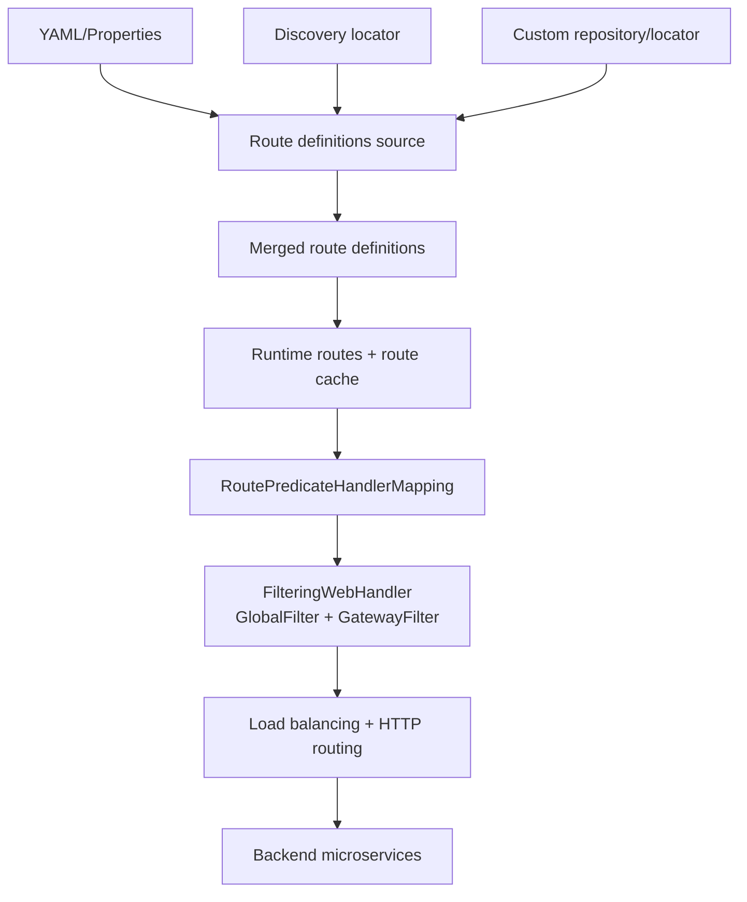
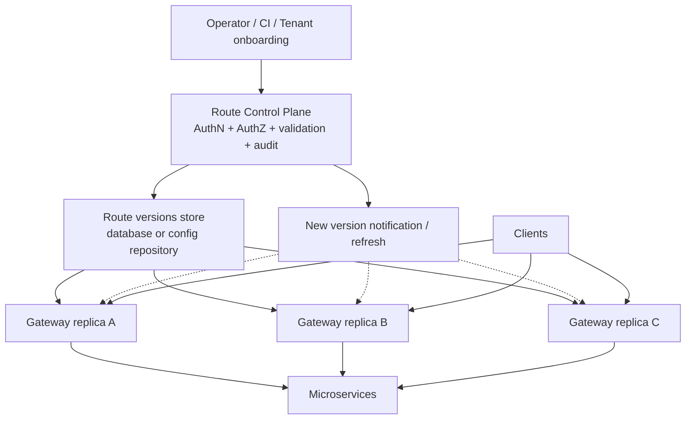
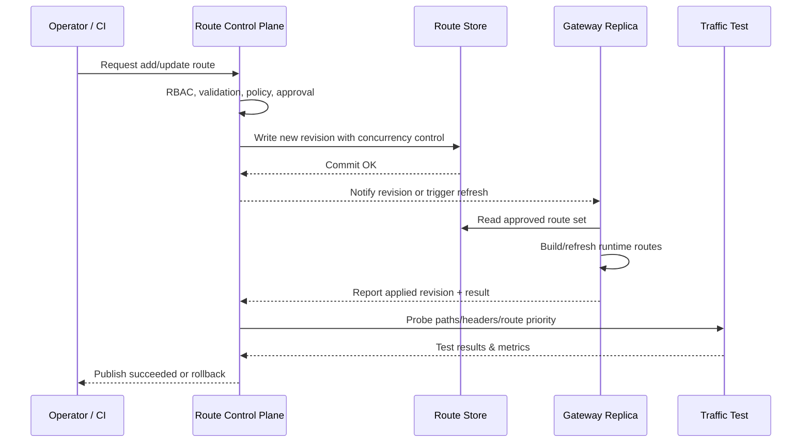

# When to Use Static Routes and When You Need a Dynamic Route Source

## Lesson Objectives

In the **Dynamic Routes** chapter, this lesson helps you choose how to manage **route definitions** in **Spring Cloud Gateway Server WebFlux**: declaring static routes alongside source code/deployment configuration, or fetching and updating routes from a **dynamic data source** while the Gateway is running.

After this lesson, you will be able to:

- Distinguish between **route definition**, **route runtime**, **service discovery**, and **dynamic route updates**.
- Choose static routes for stable systems requiring strict change control; identify requirements that genuinely call for a dynamic route source.
- Compare YAML/Java DSL configuration, Spring Cloud Config/GitOps, discovery-based routes, and custom `RouteDefinitionRepository` implementations.
- Understand the roles of `RouteDefinitionLocator`, `RouteDefinitionWriter`, `RouteDefinitionRepository`, `RouteLocator`, and cache/refresh in Gateway.
- Know why a route just written to a store is not guaranteed to be used **immediately** by all Gateway replicas.
- Design a **validate → approve → publish → refresh → verify → rollback** lifecycle for route updates.
- Identify risks from arbitrary URLs, `Path=/**`, route order, header manipulation, CORS, authentication, TLS, and filter chain changes.
- Design testing, monitoring, and recovery plans to control dynamic routing without turning the Gateway into a weak point of your microservices architecture.

> **Scope:** this lesson uses Spring Cloud Gateway **Server WebFlux** with route predicates, filter chains, `lb://` service discovery, and Spring Boot. Property names, actuator endpoints, and refresh mechanisms may differ across Spring Cloud Gateway lines. The configuration examples below illustrate the `spring.cloud.gateway.routes` namespace from many earlier versions; newer releases may use `spring.cloud.gateway.server.webflux.routes`. Always verify your system's release train before copying configuration.

## 1. What Makes Up a Route in Spring Cloud Gateway?

A **route** typically consists of the following components:

| Component | Meaning | Example |
| --- | --- | --- |
| `id` | Route identifier | `orders-read` |
| `uri` | Destination of the request | `lb://order-service` |
| `predicates` | Conditions for the route to be selected | `Path=/api/orders/**`, `Method=GET` |
| `filters` | Request-response transformation/control steps | `StripPrefix`, `RequestRateLimiter`, `CircuitBreaker` |
| `order` | Priority order when multiple routes can match | `-10` |
| `metadata` | Additional metadata for the route, which may include CORS/timeouts | Per-route CORS policy |

Example:

```yaml
spring:
  cloud:
    gateway:
      routes:
        - id: orders-read
          order: -10
          uri: lb://order-service
          predicates:
            - Path=/api/orders/**
            - Method=GET
          filters:
            - StripPrefix=1
```

A client accesses `GET /api/orders/42`; the Gateway evaluates predicates, applies filters, and then forwards the request to an instance of `order-service` (assuming Spring Cloud LoadBalancer and an instance registry source are integrated).

**Static routes** and **dynamic routes** do not necessarily differ in route content. They primarily differ in **where the route is defined, when it is loaded/updated, who has permission to change it, and how Gateway instances observe the new version**.

### 1.1. Distinguishing Four Things Often Lumped Together as "Dynamic Routing"

1. **Static route definition:** The `orders-read` route exists in YAML/code; changing `Path`, filters, or the logical destination requires changing configuration/deployment through a release process.
2. **Dynamic service discovery:** The route remains `lb://order-service`, while the list of instances such as `10.0.1.8:8080`, `10.0.1.9:8080` changes without modifying the route.
3. **Dynamic route definition source:** A database, registry, or control plane can add, update, or delete **entire route definitions** without editing the original YAML and rebuilding the application.
4. **Configuration or cache refresh:** The Gateway reloads/applies new definitions after a refresh event, property update, or rollout. Refresh is **a state synchronization step**, not something that automatically turns every configuration store into a dynamic route source.

Example:

```text
Fixed route definition:
  id: orders-read
  uri: lb://order-service

Service discovery updates:
  instance A: 10.0.1.8:8080   (removed)
  instance B: 10.0.1.9:8080
  instance C: 10.0.1.10:8080  (added)
```

In this scenario, **the physical destination changes while the route definition stays unchanged**. There is no need to build a dynamic route database just so the Gateway can discover new instances of the same service.

## 2. Route Processing Flow in Gateway

A high-level view:



The Gateway can pull route definitions from **multiple sources**. They are converted into runtime routes containing compiled predicates/filters for HTTP request handling. To optimize performance, the Gateway typically caches runtime routes; you should not place a slow database query on **every request** just to determine which route can match.

Key API names:

| API/Component | Responsibility |
| --- | --- |
| `RouteDefinition` | Route declaration data: ID, URI, predicates, filters, order, metadata |
| `RouteDefinitionLocator` | Provides a `Flux<RouteDefinition>` from a declaration source |
| `RouteDefinitionWriter` | Interface for saving/deleting route definitions |
| `RouteDefinitionRepository` | Combines **locator** and **writer** for a readable/writable route store |
| `RouteLocator` | Provides runtime routes (`Flux<Route>`) ready for matching |
| Route cache and refresh | Ensures changes in the route source are reflected in the active route set |
| `RoutePredicateHandlerMapping` | Selects a matching route for an incoming HTTP request |
| `FilteringWebHandler` | Executes the filter chain of the selected route |

**Do not confuse `RouteDefinitionRepository` with `RouteLocator`.** One generally represents the definition data source; the other represents executable runtime route objects. Nor should you assume that every `save()` call to a repository immediately forces every replica in a cluster to synchronize and switch traffic to the new route.

## 3. Static Routes: A Sensible Default Choice for Many Projects

If a system has a handful of services with stable APIs:

```text
/api/catalog/**  → catalog-service
/api/orders/**   → order-service
/api/users/**    → identity-service
```

then route definitions in `application.yml` or Java DSL are very easy to manage.

### 3.1. Static YAML Example

```yaml
spring:
  cloud:
    gateway:
      routes:
        - id: catalog
          order: 0
          uri: lb://catalog-service
          predicates:
            - Path=/api/catalog/**
          filters:
            - StripPrefix=1

        - id: orders
          order: 0
          uri: lb://order-service
          predicates:
            - Path=/api/orders/**
          filters:
            - StripPrefix=1
            - name: RequestRateLimiter
              args:
                key-resolver: "#{@authenticatedUserKeyResolver}"
                redis-rate-limiter.replenishRate: 20
                redis-rate-limiter.burstCapacity: 40
                redis-rate-limiter.requestedTokens: 1
```

This example only illustrates routes and rate limiting; to run it, you need dependencies for `lb://`, Redis rate limiting, and a properly declared `authenticatedUserKeyResolver` bean. This is not a complete authentication/authorization configuration.

### 3.2. Java DSL Can Also Be Static Routes

```java
import org.springframework.cloud.gateway.route.RouteLocator;
import org.springframework.cloud.gateway.route.builder.RouteLocatorBuilder;
import org.springframework.context.annotation.Bean;
import org.springframework.context.annotation.Configuration;

@Configuration
class FixedRoutesConfiguration {

    @Bean
    RouteLocator fixedRoutes(RouteLocatorBuilder builder) {
        return builder.routes()
            .route("orders-read", r -> r
                .path("/api/orders/**")
                .filters(f -> f.stripPrefix(1))
                .uri("lb://order-service"))
            .build();
    }
}
```

This is Java configuring a runtime route when the application is created. **Simply declaring routes in Java instead of YAML does not automatically make them dynamic.** If you want to change `Path` or `uri` in this DSL snippet, you typically must edit code/config and redeploy, or build a dedicated update mechanism yourself.

### 3.3. When Are Static Routes the Preferred Choice?

Static routes are appropriate when:

- The number of API groups is not overly large, and paths and service names are relatively stable.
- Routes are treated as **infrastructure-as-code**, requiring code review, testing, versioning, and rollback.
- Deployments already use **GitOps/CI/CD** with safe rolling deployments.
- Operations teams do not need to update routes dozens of times per day.
- Route-related security policies must change **in lockstep** with API code.
- You want to avoid runtime route mutation administration endpoints, reducing the attack surface.

Advantages:

| Advantage | Why It Helps |
| --- | --- |
| **Easy to audit** | Route changes go through commits, pull requests, and pipelines |
| **Easy to reproduce** | A given build/config has a predictable set of routes |
| **Lower operational complexity** | No separate control plane or route store needed |
| **Simple rollback** | Redeploy a known good revision |
| **Lower risk of unexpected updates** | Routes do not change unexpectedly from an uncontrolled external source |
| **Compliance friendly** | Clear review and approval history |

The drawback is that every route modification may require **changing configuration and performing a rollout**. However, if your deployment pipeline is fast, automated, tested, and supports rollback, this cost is usually smaller than building and operating an entire dynamic route management system.

## 4. What Is a Dynamic Route Source?

A **dynamic route source** is a provider of route definitions that can change while the Gateway is running, paired with a mechanism for the Gateway to **detect and apply** those changes.

Example architecture:



Here:

- The **Control plane** determines which routes are allowed to exist, who has permission to change them, performs validation/approval, and publishes revisions.
- The **Data plane** consists of Gateway replicas receiving HTTP requests and routing them using their **applied route set**.
- The **Route store** holds managed definitions and can support version history and rollback.
- **Refresh/reconciliation** enables each replica to pick up new configurations.

A database storing routes that the Gateway only reads **once at startup** is not enough to satisfy **online update** requirements. Conversely, having the Gateway poll the route source on every request is also poor design: it puts database latency and failures directly on the hot HTTP processing path.

### 4.1. Requirements That Can Justify Dynamic Routes

1. **Onboarding many customers/tenants:** creating or removing routes per contract with dedicated hostnames/paths at high frequency.
2. **API product platform:** self-service API configuration with explicit permissions, approvals, quotas, and lifecycle management.
3. **Traffic migration:** switching targets for a group of routes, enabling/disabling canary or weighted routing under continuous observation.
4. **Incident operations:** isolating an upstream, shifting a route to an approved backup service, or disabling an entry point.
5. **Very large route counts:** a large set of routes evolving independently from the Gateway application's release lifecycle.
6. **Central policy management:** an organization operating multiple Gateway clusters that wants a single controlled and synchronized configuration source.

A critical condition: the benefits of online updates must **outweigh the costs of security, consistency, distribution, and operations**. If you only have three routes that change a few times per quarter, adding a dedicated control plane, database, and event bus is usually unnecessary.

## 5. Comparing Static Routes and Dynamic Routes

| Criterion | Static Routes | Dynamic Route Source |
| --- | --- | --- |
| Where defined | YAML/properties, Java DSL, GitOps config | Repository, control plane, discovery locator, or custom source |
| Route changes | Usually via build/config release/rollout | Can be published and refreshed at runtime |
| Review process | Familiar PR/CI/CD | Requires dedicated RBAC, approval, audit, versioning, and validation |
| Multi-replica consistency | Usually via deployment revision | Requires distribution/refresh mechanism and drift detection |
| New failure points | Minimal runtime dependency on a route store | May introduce DB, event bus, management API, and cache failure modes |
| Recovery | Roll back deployment/config | Roll back route revision; may require re-refreshing the entire cluster |
| Security | Controlled by Git/deploy permissions | Runtime mutation endpoint is a sensitive attack surface |
| Best fit | Infrequently changing APIs, release-tied policies | Frequently changing routes, automated onboarding/traffic control |
| Control overhead | Mostly at startup/rollout | Additional read/write load and events on config changes |
| Testing complexity | Static route integration tests | Adds concurrency, reconciliation, failure, and rollback tests |

**There is no universal rule that "dynamic routes are always better."** A system with few routes deployed through fast rolling deployments can achieve both high reliability and agility without a dynamic source.

### 5.1. A Decision Heuristic

Ask these questions in order:

1. Do we need to change the **route definition** itself, or do we only need backend instances to update automatically?
2. Can a route change wait until the next deployment pipeline?
3. Who is authorized to modify `uri`, `predicates`, `filters`, `order`, and security metadata?
4. Must multiple Gateway replicas switch within a very tight time window?
5. If a new configuration is faulty, can we roll back **automatically and safely**?
6. Do we have the capacity to operate a configuration store/control plane **24/7** and monitor each replica's applied revision?

If the answer to (1) is **"only changing instances of the same service"**, start with **service discovery + load balancing**. If (2) is **"it can wait and changes are rare"**, prefer **static routes**. When the need to manage thousands of frequently changing routes is genuine and you can answer the remaining security and operational questions, consider a **dynamic route source**.

## 6. Multiple Paths to Changing Routing

Not every route update solution has to be a custom `RouteDefinitionRepository`.

### 6.1. YAML + GitOps/Deploy

Workflow:

```text
Developer edits application.yml
  → Pull request
  → Review and test
  → Build/config release
  → Rolling deployment
  → Verify and rollback when needed
```

This is the **static** approach that is usually easiest to operate. A route can still point to `lb://order-service` to automatically pick up changing backend instances.

### 6.2. Externalized Configuration / Spring Cloud Config

Route definitions can live in a configuration source outside the artifact (such as a Git repository served via a config service). However, keep these distinctions in mind:

- **Configuration living outside the JAR** does not automatically mean the Gateway **reloads it immediately when the file changes**.
- You need a mechanism to update `Environment`/configuration properties and refresh runtime routes consistently with the revision.
- A route cache refresh alone **does not guarantee** Spring Boot has reloaded property values from a remote source.
- You must address how multiple replicas receive the same revision and how to observe successful refreshes.

This approach fits organizations already operating externalized config that still want changes primarily governed by **Git review and release control**, rather than granting applications arbitrary runtime route-creation permissions.

### 6.3. Discovery-Based RouteDefinitionLocator

Spring Cloud Gateway provides a mechanism to generate route definitions from services reported by **DiscoveryClient** in supported versions. Example using the traditional namespace:

```yaml
spring:
  cloud:
    gateway:
      discovery:
        locator:
          enabled: true
          lower-case-service-id: true
```

This feature can generate routes for discovered services using default or property-customized predicates and filters. **Do not enable it blindly on a public Gateway**: a newly registered internal service could accidentally get a public URL through the Gateway if the route-generation policy is too permissive.

Safe practices:

- Restrict **which service IDs are allowed to be exposed** via controlled policies/predicates.
- Test path rewriting, authorization, CORS, and rate limiting on auto-generated routes.
- Never treat a service's presence in the registry as proof that it is **approved for public exposure**.
- Verify the actual generated routes; do not rely on assumptions about discovery locator defaults across every version.

`discovery.locator` generates **route definitions from the registry**; this differs from a static route `lb://order-service` that only uses the registry to resolve instances.

### 6.4. Custom RouteDefinitionLocator

When routes are maintained in a separate database or config service, you can provide a bean implementing `RouteDefinitionLocator` to read those definitions:

```java
import org.springframework.cloud.gateway.route.RouteDefinition;
import org.springframework.cloud.gateway.route.RouteDefinitionLocator;
import reactor.core.publisher.Flux;

interface ApprovedRouteSource {
    Flux<RouteDefinition> loadApprovedRoutes();
}

final class DatabaseRouteLocator implements RouteDefinitionLocator {
    private final ApprovedRouteSource source;

    DatabaseRouteLocator(ApprovedRouteSource source) {
        this.source = source;
    }

    @Override
    public Flux<RouteDefinition> getRouteDefinitions() {
        return source.loadApprovedRoutes();
    }
}
```

This is an **illustrative skeleton**: you still need to register the bean in the Spring context, implement `ApprovedRouteSource`, validate data, configure timeouts, avoid blocking I/O, and design refresh/caching. `Flux<RouteDefinition>` supplies **route data**, not a command that automatically triggers refresh across all Gateway replicas.

If the database source uses a blocking driver, never execute blocking queries directly on the Reactor Netty event loop. Consider a reactive client, updating the route cache off the hot path, or offloading appropriately onto bounded, controlled schedulers.

### 6.5. RouteDefinitionRepository for Both Reading and Writing

`RouteDefinitionRepository` is the contract used when you need a route source that supports **writes/deletes** in addition to listing routes. It is suitable when a control plane or management API updates definitions under an approval workflow.

When choosing a custom repository, answer these questions:

- Where are routes stored, and do they persist across restarts?
- Who validates and approves URIs, predicates, and filters?
- Does a `save()` operation require transactionality or version checks?
- How do all Gateway replicas refresh and know which revision is active?
- If the DB is unavailable, should the Gateway retain the last valid route cache or stop serving traffic?
- When a route is deleted, how are in-flight requests using the old route handled?

Never use an in-memory `Map<String, RouteDefinition>` inside a single JVM and claim you have **distributed dynamic routing**.

## 7. Example: An In-Memory RouteDefinitionRepository for Learning the API

The example below only demonstrates how to implement the interface. It has **no** persistence, RBAC, deep validation, revision history, multi-pod distribution, or cache synchronization; it should not be used as-is in production.

```java
import java.util.ArrayList;
import java.util.Map;
import java.util.concurrent.ConcurrentHashMap;

import org.springframework.cloud.gateway.route.RouteDefinition;
import org.springframework.cloud.gateway.route.RouteDefinitionRepository;
import reactor.core.publisher.Flux;
import reactor.core.publisher.Mono;

public final class LearningRouteRepository
        implements RouteDefinitionRepository {

    private final Map<String, RouteDefinition> routes =
        new ConcurrentHashMap<>();

    @Override
    public Flux<RouteDefinition> getRouteDefinitions() {
        // Snapshot limits the impact when the collection changes
        // during iteration. Not a cluster-wide transactional snapshot.
        return Flux.defer(() ->
            Flux.fromIterable(new ArrayList<>(routes.values()))
        );
    }

    @Override
    public Mono<Void> save(Mono<RouteDefinition> incoming) {
        return incoming.flatMap(route -> {
            String id = route.getId();
            if (id == null || id.isBlank()) {
                return Mono.error(
                    new IllegalArgumentException("Missing route ID")
                );
            }

            // Only checks ID to demonstrate the contract.
            // Production must validate URI, predicates, filters, metadata.
            routes.put(id, route);
            return Mono.<Void>empty();
        });
    }

    @Override
    public Mono<Void> delete(Mono<String> routeId) {
        return routeId.flatMap(id -> {
            RouteDefinition removed = routes.remove(id);
            return removed == null
                ? Mono.<Void>error(
                    new IllegalArgumentException("Unknown route ID")
                )
                : Mono.<Void>empty();
        });
    }
}
```

Explanation:

- `getRouteDefinitions()` emits a `Flux<RouteDefinition>` so the Gateway can read the definitions.
- `save()` and `delete()` return **reactive publishers**. Do not manually call `subscribe()` and report completion before the operation finishes.
- `ConcurrentHashMap` protects individual map operations inside one JVM; it does **not** guarantee transactional edits across multiple fields or multiple Gateway replicas.
- An in-memory singleton repository loses all data on restart and leaves each pod with independent state.
- You should also avoid mutating route objects held in the map after publishing; use **snapshots, defensive copies, or immutable representations** in production management code.
- **Important:** writing/deleting in the repository is **not enough** to guarantee the runtime route cache updates. An appropriate refresh workflow is required.

To integrate this source into Gateway, declare it as a bean via `@Bean` or a suitable registration mechanism, and **avoid** creating multiple route repositories with colliding IDs or inadvertently overwriting static routes.

### 7.1. Creating a RouteDefinition Programmatically

Example constructing a definition for a read-only API:

```java
import java.net.URI;
import java.util.List;

import org.springframework.cloud.gateway.filter.FilterDefinition;
import org.springframework.cloud.gateway.handler.predicate.PredicateDefinition;
import org.springframework.cloud.gateway.route.RouteDefinition;

RouteDefinition route = new RouteDefinition();
route.setId("orders-read");
route.setUri(URI.create("lb://order-service"));
route.setOrder(-10);
route.setPredicates(List.of(
    new PredicateDefinition("Path=/api/orders/**"),
    new PredicateDefinition("Method=GET")
));
route.setFilters(List.of(
    new FilterDefinition("StripPrefix=1")
));
```

This is a **code fragment**, not a production management REST API. A real implementation must validate the entire route before saving/publishing and ensure every route ID has an owner, revision, and security policy.

### 7.2. Why Not Let Clients Pass Arbitrary RouteDefinitions?

If a public endpoint accepts JSON like:

```json
{
  "id": "unsafe-route",
  "uri": "http://127.0.0.1:8081",
  "predicates": ["Path=/**"],
  "filters": ["RemoveRequestHeader=Authorization"]
}
```

and saves it straight into the repository, an attacker can:

- Create a wildcard route that hijacks traffic from other routes.
- Forward requests to internal addresses, loopback interfaces, or cloud provider metadata endpoints, leading to **server-side request forgery (SSRF)** and data exfiltration.
- Strip or overwrite security headers, or open up overly permissive CORS policies.
- Route an authenticated/rate-limited API through a new route lacking equivalent controls.
- Point a route destination back at the Gateway itself, causing loops and traffic amplification.

**Never** turn a route management endpoint into an API where users can pass arbitrary `uri`, `filter`, or `predicate` values. You need strict RBAC, allowlists for service IDs/schemes/hosts/ports, path restrictions, filter validation, an approval workflow, and auditing.

## 8. Updating Runtime Routes: Refresh Differs from Save

The Gateway usually maintains a **cache of built routes** for fast request processing. When the source changes, there must be a way to instruct the Gateway to **reload and rebuild the runtime route set**.

A common mechanism in Spring Cloud Gateway Server WebFlux is the event:

```java
import org.springframework.cloud.gateway.event.RefreshRoutesEvent;
import org.springframework.context.ApplicationEventPublisher;

// When a new revision has been successfully written to the route source.
publisher.publishEvent(new RefreshRoutesEvent(this));
```

Here `publisher` is an `ApplicationEventPublisher` injected by Spring into an internal coordination component. This pattern illustrates **publishing an event within a single application context** so the Gateway's route cache/locator can refresh according to the mechanism supported by that version.

**Do not assume:**

- An event in pod A **automatically propagates** to pods B and C.
- The event automatically makes Spring Boot reload **remote YAML properties**.
- The event guarantees the new route has been **validated, built, and is serving traffic successfully**.
- The event guarantees every in-flight request switches routes atomically.

### 8.1. Controlled Update Lifecycle



In practice, notification, refresh, readback, and verification can be asynchronous. **A refresh command returning an HTTP success status does not by itself prove all Gateway instances are running the new revision.**

### 8.2. Actuator Gateway Endpoints

When Spring Boot Actuator is enabled and appropriately exposed, some Gateway versions provide endpoints for inspecting routes and **requesting a refresh**, commonly under paths such as:

```text
GET  /actuator/gateway/routes
POST /actuator/gateway/refresh
```

Some versions/configurations also support **adding or deleting routes** via the Gateway actuator or built-in management components. **Do not assume every release enables write operations by default**; actuator access/exposure and route mutation features may be restricted or vary by version.

In production:

- Expose only **the endpoints that are genuinely needed**, preferably on a private management port/network.
- Protect them with strong authentication, role-based authorization, TLS, and ingress/network policies.
- Never expose management mutation operations publicly where a frontend or partner could modify routes.
- Do not use actuator write endpoints as a substitute for a control plane with validation, approvals, revisions, and rollback.
- With multiple replicas, know **which replica** an actuator request hits and track the refresh state of all remaining replicas.

### 8.3. The Final Route Set Is What Must Be Verified

After a refresh, verify:

1. Does the new route ID appear in the runtime route set?
2. Are `Path`, `Method`, `Host`, and `order` applied accurately?
3. Does the URI after `RewritePath` or `StripPrefix` point to the right target?
4. Do Headers/CORS/Security/RateLimiter preserve their policies?
5. Is there an old route with a duplicate ID or a wildcard route matching before the new route?
6. Have all Gateway replicas applied the same revision?
7. Are any HTTP requests returning unexpected 404/502/503 errors during the transition?

`save`/`delete` calls and refresh events are **the mechanism**; behavioral testing and reading back the active state are **the proof**.

## 9. Issues When Running Multiple Gateway Replicas

Suppose you have three Gateway pods:

```text
Gateway A: route revision 41
Gateway B: route revision 41
Gateway C: route revision 40
```

If a load balancer distributes requests across all three, clients may sometimes hit the new route and sometimes hit the old one. This is **configuration drift**, not a service discovery bug.

### 9.1. Consistency: Not Every Pod Switches in the Same Nanosecond

You cannot always achieve a **cluster-wide atomic cutover** using refresh alone. You need to choose an approach:

- **Bounded eventual consistency:** accept a brief window where pods run different revisions, and measure convergence time.
- **Staged rollout:** publish the new routes first, then shift traffic once replicas confirm successful loading.
- **Blue/green gateway:** spin up a Gateway cluster with the new route revision, test it thoroughly, and then switch ingress traffic.
- **Central control plane reconciliation:** pods periodically compare their applied revision against the source and self-correct drift.

For changes affecting security or broad routing behavior, **blue/green or staged activation** is generally safer than writing routes and broadcasting an unverified refresh.

### 9.2. Stale Cache and Database Outages

If the route store becomes unavailable:

| Policy | Benefit | Risk |
| --- | --- | --- |
| Keep last-known-good route cache | Keeps serving existing traffic | May fail to apply an emergency route revocation |
| Replace cache with an empty set on read error | Avoids using potentially stale data | Gateway loses all routing capability |
| Fail startup if valid config cannot be loaded | Fails fast for security-sensitive setups | Availability depends on route store at startup |
| Use versioned snapshot/backup | Recovers from source outages | Must protect snapshots, expiry, and validity checks |

There is no single strategy that fits every product. You must explicitly define **fail-closed vs. fail-open per route type**, acceptable cache staleness, recovery time, and an emergency revocation mechanism.

### 9.3. Concurrent Writes and Route Revisions

Suppose two admins edit the `orders-read` route concurrently:

```text
Admin A reads revision 20 → wants to change uri
Admin B reads revision 20 → wants to change auth-related metadata
Admin A writes revision 21
Admin B overwrites revision 21 with a version based on revision 20
```

Without **optimistic locking** or version checks, Admin A's change can be lost or Admin B can inadvertently reinstate stale configuration. A safe control plane should:

- Require `expectedRevision` or an ETag/`If-Match` header.
- Reject updates based on a stale revision.
- Store an audit log of actor, change-set, approval, and publish outcome.
- Allow rolling back to **a complete revision** containing all related policies.
- Never allow a partial new route set to be published mid-transaction.

## 10. Security: Dynamic Routes Mean Traffic Control Authority

A route configuration is not merely "picking a URL"; it can alter the **security boundary** of your system.

### 10.1. Fields That Must Be Validated

| Field | Risk | Recommended Policy |
| --- | --- | --- |
| `id` | Colliding with or overwriting sensitive routes | Namespace, owner, uniqueness, versioning |
| `uri` | SSRF, internal network access, routing loops | Allowlist scheme/service ID/host/port; block unapproved targets |
| `Path` predicate | Wildcard `/**` hijacking traffic | Path ownership rules, overlap checks |
| `Host` predicate | Spoofing unauthorized hosts/public domains | Restrict to organization-owned domains |
| `Method` predicate | Unintentionally exposing POST/DELETE | Constrain to API contract |
| `order` | New route matching ahead of older protected routes | Automated priority/collision checks |
| `filters` | Stripping auth headers, rewriting to unintended paths, opening CORS | Allowlist factories + args, policy enforcement |
| `metadata.cors` | Untrusted browser origins reading responses | Exact allowed origins, strict credential policy |
| Other `metadata` | Excessive timeouts, relaxed policies | Schema and allowed-value checks per version |

**SSRF is especially dangerous** if route management accepts arbitrary `uri` values: the Gateway sits on an internal network and holds operational credentials that an Internet client does not have. Therefore, **never** trust a URL just because it parses cleanly. You must enforce controls over scheme, port, DNS resolution, redirects, service identity, and blocked addresses across trust boundaries.

### 10.2. Can a New Route Bypass Authentication?

Suppose the original system has:

```text
/api/admin/** → Admin Service
```

protected by Spring Security WebFlux based on path. A dynamic route:

```text
/internal/admin/** → same Admin Service
```

can open a **new entry point** that does not match the old security rule if `SecurityWebFilterChain` only protects `/api/admin/**`.

Therefore:

1. Enforce a **deny-by-default** policy for unapproved paths.
2. Dynamic route creation must undergo security review for every public path.
3. Never trust tenant-supplied route `metadata` as proof of authentication or authorization.
4. Backends must still verify identity and object-level permissions; never rely solely on the Gateway.
5. Use a route policy scanner/test to detect newly exposed endpoints lacking proper authentication.

A per-route `GatewayFilter` cannot replace `SecurityWebFilterChain` for protecting requests outside the route chain. Design security independently for actuator endpoints and special handlers.

### 10.3. Dynamic Routes and CORS

Changing `metadata.cors` can break or expose the frontend even when the upstream does not change. Always test:

- Whether `OPTIONS` preflight requests match the route (especially if the route specifies `Method=GET`).
- Whether `allowedOrigins` strictly restricts domain/port/scheme.
- That `allowCredentials: true` is never paired with an unsafe wildcard origin.
- Whether Gateway, Spring Security, ingress, and backend emit duplicate CORS headers.
- Whether 401/403/429/503 error responses include appropriate CORS headers.

Never let clients add `allowedOrigins: '*'` on a sensitive data route simply to silence a browser error.

### 10.4. Dynamic Routes Do Not Automatically Update TLS or Identity

If a new route includes `Host=api.partner.example`, that **does not automatically provision an inbound TLS certificate** for the domain, does not configure ingress/SNI, and does not prove the partner owns the domain. Likewise, switching `uri` from HTTP to HTTPS requires verifying the Gateway's **outbound trust chain and hostname verification**.

A new route targeting `lb://partner-service` also requires discovery, healthy instances, and appropriate network authorization. **Route discovery is not security approval.**

## 11. Filter Chains, Route Order, and Breaking Changes

A new route might specify:

```yaml
predicates:
  - Path=/api/**
order: -100
```

while an existing route specifies:

```yaml
predicates:
  - Path=/api/orders/**
order: 0
```

Because lower `order` values generally take precedence during route selection, the broad `Path=/api/**` route can match first and send `/api/orders/**` to the wrong backend or bypass protective filters.

### 11.1. Never Assume "The Most Specific Path Always Wins"

When multiple routes match:

- You must inspect `order`, predicates, and how the route locator supplies routes.
- Do not infer precedence solely from database insertion order or route names.
- Always test **overlapping path regions**, not just the new path in isolation.
- Build validators that detect wildcard routes capable of shadowing sensitive routes.

### 11.2. Filter Changes Can Alter HTTP Semantics

For example, changing:

```text
StripPrefix=1
```

to:

```text
StripPrefix=2
```

on `/api/orders/42` shifts the upstream path from `/orders/42` to `/42`, causing 404 errors or hitting the wrong handler.

Similarly:

- `RemoveRequestHeader=Authorization` can cause backends to lose tokens.
- `SetRequestHeader` can enable identity spoofing if populated from untrusted values.
- `Retry` on `POST` can trigger duplicate transactions if idempotency is missing.
- `CircuitBreaker` fallbacks can return responses violating the API contract.
- `RequestRateLimiter` requires an authenticated `KeyResolver` and proper Redis state.
- `ModifyRequestBody` can impact `Content-Length`, `Content-Encoding`, and memory usage.

**Dynamic deployment does not exempt you from testing filters and route predicates.** Operationally, a filter change in a database is still a code/behavior change to your API Gateway.

## 12. A Safe Dynamic Route Release Workflow

Instead of a "save and pray" endpoint, use a versioned model:

```text
Draft RouteSet v57
  ↓
Schema validation + security validation
  ↓
Test predicates/filters/URI + policy checks
  ↓
Review / Approve
  ↓
Persist immutable revision v57
  ↓
Publish desired revision
  ↓
Refresh/Reconcile each Gateway replica
  ↓
Observe actual applied revision
  ↓
Smoke test / canary
  ↓
Mark stable or rollback v56
```

### 12.1. Essential Steps

**Step 1 — Draft the change.** The control plane creates a `RouteSet` with a revision, author, change reason, and the set of affected route IDs.

**Step 2 — Static validation.** Check structure, URI scheme/host/port, predicate syntax, filter allowlist/arguments, route order, path conflicts, and security/CORS policies.

**Step 3 — Test in staging.** Send representative HTTP requests to verify path/Host/Method matching, rewrites, auth, rate limits, fallbacks, and backend behavior.

**Step 4 — Review.** New public routes or edits to security-sensitive fields require proper approval. Never allow one tenant to modify another tenant's routes.

**Step 5 — Persist a consistent revision.** Persist **a complete configuration snapshot** or use a rollback-capable transaction rather than updating unrelated routes individually and exposing a half-applied state to clients.

**Step 6 — Publish.** Notify Gateway replicas of the new revision; do not conflate DB write privileges with unrestricted authority to alter all runtime routes.

**Step 7 — Reconciliation.** Each replica attempts to read, validate, and build runtime routes, reporting its applied version and any specific errors.

**Step 8 — Verify/canary.** Check route matching, live requests, CORS/Auth, TLS connectivity, HTTP 4xx/5xx rates, p95/p99 latency, and fallback rates.

**Step 9 — Rollback.** On failure, republish a previously verified safe revision and refresh/reconcile all replicas. Monitor until the cluster converges rather than firing a single rollback command and walking away.

### 12.2. A RouteSet Needs an Explicit Version ID

A route revision record might carry logical metadata like:

```json
{
  "revision": 57,
  "approvedBy": "gateway-ops",
  "routes": [
    {
      "id": "orders-read",
      "uri": "lb://order-service",
      "predicates": ["Path=/api/orders/**", "Method=GET"],
      "filters": ["StripPrefix=1"],
      "order": -10
    }
  ]
}
```

This is an **illustrative control-plane descriptor format**, **not a standard JSON schema** across all Spring Cloud Gateway repositories or Actuator APIs. Do not stuff `approvedBy` or `revision` into `RouteDefinition` expecting the framework to synchronize revisions automatically; build a dedicated versioning mechanism.

## 13. Canary, Weighted Routing, and Migration

A frequently cited reason for dynamic routes is **rapidly shifting traffic distribution** between old and new backends. Spring Cloud Gateway provides a **Weight route predicate** in supported releases:

```yaml
spring:
  cloud:
    gateway:
      routes:
        - id: catalog-v1
          uri: lb://catalog-v1
          predicates:
            - Path=/api/catalog/**
            - Weight=catalog-rollout,90

        - id: catalog-v2
          uri: lb://catalog-v2
          predicates:
            - Path=/api/catalog/**
            - Weight=catalog-rollout,10
```

Two routes in the same weight group `catalog-rollout` distribute traffic according to **relative proportions**, without guaranteeing an exact 90/10 split over any single 10-request window or **sticky sessions** per user. You must test with versions, sufficient traffic volume, per-route metrics, and API compatibility checks.

You can manage weights via static files through a release pipeline or via a dynamic source. Therefore, **canary routing does not strictly require a dynamic repository**. Choose dynamic when adjustment speed/volume and your governance model truly demand it.

### 13.1. Multi-Step Rollout

```text
v1: 100%, v2: 0%
→ v1: 95%, v2: 5%
→ v1: 75%, v2: 25%
→ v1: 50%, v2: 50%
→ v1: 0%,  v2: 100%
```

At each step, monitor error rates, p95/p99 latency, circuit states, retry attempts, business data integrity, and authorization. If v2 fails, revert the route revision/weights instead of trying to mask errors with infinite retries.

If an API returns compatible responses but the backend data schemas differ, weighted routing can cause erratic behavior for clients; consider versioned endpoints, a purpose-built sticky strategy, or migrating data beforehand.

## 14. Observing Dynamic Routes in Production

Metrics that merely state "Gateway 5xx increased" are not enough to tell whether the fault lies in the **route revision**, the **backend**, or a **security policy**.

| Signal | Why It Matters |
| --- | --- |
| `desiredRevision` and `appliedRevision` per replica | Detects pods that have not updated |
| Time from publish until all replicas converge | Measures route synchronization latency |
| Runtime route count and validation-rejected route count | Detects missing or invalid routes |
| HTTP requests by route ID and status | Tracks traffic across new and old routes |
| 404s due to unmatched routes | Detects dropped paths during updates |
| 502/503s from upstream/routing | Detects wrong URIs, missing instances, or backend errors |
| Route matching latency | Detects predicate count/complexity impacting routing |
| Retry attempts, circuit states, rate denials | Distinguishes policy vs. health changes |
| CORS preflight failures | Detects incompatible CORS metadata |
| Route change audit log | Tracks who changed what, when, approvals, and rollbacks |

### 14.1. Metric Labels Must Not Have Unbounded Cardinality

Values such as stable route IDs, policy groups, environments, and revisions are useful for observability. However, avoid:

- Using full dynamic URLs, user-generated paths, or query strings as labels.
- Using raw bearer tokens, API keys, cookies, or tenant-provided headers as metric labels.
- Generating a new route ID per request; metric series counts will explode uncontrollably.

If dynamic route counts can reach tens of thousands, design cardinality limits and retention before enabling detailed per-route metrics in your monitoring system.

### 14.2. Separating Route Updates from Upstream Failures

For example, after a publish:

```text
desiredRevision = 57
appliedRevision = 57
route=orders-read
status=503
```

This only indicates that the new revision was marked applied and requests are returning 503; it **does not prove the route URI is wrong**. A 503 can stem from the load balancer finding no healthy instances, rate/bulkhead policies, a `CircuitBreaker` fallback, or genuine upstream failures. Trace and inspect the routing outcome rather than reverting routes blindly on a single status code.

## 15. Testing: Static and Dynamic Routes

### 15.1. Static Route Tests

For the YAML in section 3, verify:

1. Route IDs load correctly for your namespace/version.
2. `/api/orders/42` matches the orders route; `/api/catalog/42` matches catalog.
3. `StripPrefix=1` produces the expected backend path.
4. `Method`, `Host`, and `Path` combine as intended.
5. Route `order` works properly when predicates overlap.
6. Security, CORS, Retry, CircuitBreaker, and RateLimiter remain effective.
7. Config/deployment rollback restores the previous routes.

### 15.2. Dynamic Route Tests

In addition to the cases above, you must test the **update lifecycle**:

| Case | Test Step | Expected Proof |
| --- | --- | --- |
| Add route | Publish new revision, refresh | New path works once applied |
| Update route | Change URI or predicate with a new version | Traffic hits the right target; old routing stops outside the transition window |
| Delete route | Revoke route, refresh | Route no longer matches on any replica after convergence |
| Duplicate route ID | Add an existing `id` | Rejected or updated per explicit contract/version, no silent override |
| Overlapping path | Add a high-priority wildcard | Validator/tests detect shadowing |
| Forbidden URI | `127.0.0.1`, metadata IP, invalid scheme | Control plane rejects before publish |
| Forbidden filter | Remove/overwrite auth header | Rejected before publish |
| Missing admin privilege | Caller without RBAC | Cannot save or delete routes |
| Concurrent update | Two admins using the same base revision | Stale write rejected, no lost updates |
| Pod fails to refresh | Simulate event/network failure | Reports drift, retries/reconciles safely |
| Route store unavailable | Shut down route source | Explicit fail policy, does not wipe route cache recklessly |
| Bad revision | New route causes 5xx errors | Rolls back to old revision, all pods converge |
| Pod restart | Restart a Gateway replica | Loads the currently published revision |
| Canary shift | Change weight 95/5 → 75/25 | Distribution/health observed, rollback works |
| CORS | Preflight to the new route | Allowed origins/methods are accurate |
| Security | New route to admin service | Cannot bypass auth/authorization |
| TLS | Route to HTTPS upstream | Hostname/CA verified |

### 15.3. An Integration Test Sketch for Refresh

Assuming a **test-only route repository** and a running Gateway, a test can do:

```java
// Pseudocode illustrating the lifecycle, not a standalone runnable test.
RouteDefinition rd = createApprovedTestRoute(
    "test-orders", "Path=/api/orders/**", "http://localhost:9001"
);

repository.save(Mono.just(rd)).block(); // ONLY in test orchestration.
publisher.publishEvent(new RefreshRoutesEvent(this));

// Poll/read runtime routes or send HTTP probes until the route matches.
// Assert GET /api/orders/42 reaches the backend stub.

repository.delete(Mono.just("test-orders")).block(); // ONLY in test.
publisher.publishEvent(new RefreshRoutesEvent(this));

// Assert after refresh the path no longer matches route test-orders.
```

**Never put `.block()` in a production Gateway filter, event loop, or request handler.** The snippet above is **test-harness pseudocode** requiring concrete imports, dependencies, route cache behavior, a backend stub, and event synchronization to execute. In practice, avoid fixed sleeps: poll until the route is present/absent at runtime with a **bounded deadline**.

If a test starts **multiple Gateway instances**, you cannot publish `RefreshRoutesEvent` to a single instance and conclude the whole cluster updated. You must publish/refresh through the actual cluster mechanism and verify each replica.

### 15.4. Test HTTP Behavior, Not Just Route Definitions

A route appearing in the listing after a refresh **does not guarantee**:

- The URI has an available backend.
- The `Path` predicate works for real URLs.
- Gateway filters do not corrupt requests/responses.
- Spring Security permits the right set of clients.
- CORS works in real browsers.
- Clients are not rejected with 429/503 by policies.

Use **WebTestClient** or an HTTP client against a running Gateway, combined with a request-counting backend stub, to verify end-to-end behavior at the appropriate level.

## 16. Practical Scenarios: Three Architectural Choices

### Case A — E-Commerce Platform with Six Microservices

Paths:

```text
/api/catalog/**
/api/orders/**
/api/payments/**
/api/customers/**
/api/shipping/**
/api/reviews/**
```

Only a few changes occur per month; every change goes through CI/CD. Service instances scale dynamically in Kubernetes.

**Recommendation:** keep **static route definitions** in Git/config, and use `lb://` with discovery/load balancing to locate backend instances. Do not build a dynamic route DB just to handle pods changing IP addresses.

### Case B — API Marketplace for Thousands of Partners

Many partners onboard daily, each needing dedicated API hosts/paths, quota policies, CORS rules, and API publication approvals.

**Recommendation:** evaluate a **route control plane + dynamic source** with RBAC/approval, URI/filter allowlists, versioned `RouteSet`s, per-replica applied revisions, staging tests, and rollback. If only routes are dynamic while auth/rate/CORS policies fail to update in sync, the system can expose APIs insecurely.

### Case C — Constantly Scaling Order Service Pods Up and Down

The current route:

```yaml
uri: lb://order-service
```

remains valid; only the instance list in the registry changes.

**Recommendation:** solve this with **service discovery/LoadBalancer**—no route definition changes needed. Only consider a dynamic source when you frequently need to change the `Path` itself, logical service names, filter policies, or traffic splits.

## 17. Self-Check Questions with Explanations

1. **Is a YAML route with `uri: lb://order-service` a dynamic route?**  
   Not solely because it uses `lb://`. The route definition can remain fixed while discovery dynamically updates the backend instance list.

2. **Does declaring routes with Java's `RouteLocatorBuilder` automatically allow online route updates?**  
   No. Java DSL normally constructs runtime routes from code/config; you need a dedicated update and refresh mechanism for online mutation.

3. **Does calling `RouteDefinitionRepository.save()` guarantee every pod picks up the route immediately?**  
   No. You must ensure persistence, cache refresh/reconciliation, version distribution, and verification on every replica.

4. **Should automatic discovery locator be enabled on a public Internet Gateway?**  
   Only after reviewing and restricting service IDs, paths, and policies; a service existing in a registry does not mean it is approved for public access.

5. **Two routes both match `/api/orders/**`; which one wins?**  
   It depends on predicates, `order`, and the selected runtime route; always test overlapping routes rather than assuming a more specific path always wins.

6. **Why does dynamic route management require strong RBAC?**  
   Because anyone authorized to alter routes can redirect traffic to another upstream, expose APIs, strip security filters, or trigger SSRF.

7. **Why is `RefreshRoutesEvent` insufficient to synchronize three pods?**  
   It is typically an event local to a single application context; you need a cluster distribution/reconciliation mechanism and readback verification.

8. **If config is stored in Git but has a refresh mechanism, is it static or dynamic?**  
   Describe it precisely: Git-versioned source with externalized config and online refresh capability if implemented. What matters is **how changes reach runtime**, not the label alone.

9. **Does a 90/10 canary require a dynamic route DB?**  
   Not necessarily. You can ship `Weight` predicate configs via GitOps rollouts, or use a dynamic source if frequent adjustments are required.

10. **If a new route has `Host=api.partner.example`, does a TLS certificate appear automatically?**  
    No. You must configure DNS/ingress/SNI/certificates and corresponding trust policies.

11. **When the route store fails, is clearing the cache to zero routes always safe?**  
    No. That is a fail-closed policy that can take down the entire system; choose based on your threat model and SLOs, distinguishing between route types.

12. **How do you know a route change is complete?**  
    Verify the applied revision on each replica, runtime routes, HTTP behavior, security/CORS, metrics, and rollback readiness.

## 18. Implementation Checklist

Before choosing a dynamic route source, verify:

- [ ] Is there a genuine need for **online route definition changes**, not just changing backend instances?
- [ ] Have you compared it against YAML/Java DSL, GitOps, Spring Cloud Config, and discovery locator?
- [ ] Have you defined who may create, edit, and delete routes and what the source of truth is?
- [ ] Are route IDs, versions, and ownership clear, with optimistic locking for concurrent writes?
- [ ] Is `uri` validated against SSRF/loops with an allowlist of target services/hosts/ports?
- [ ] Are `Path`, `Host`, `Method`, and `order` checked to prevent shadowing/hijacking?
- [ ] Are filter factories and args validated so auth/rate policies cannot be disabled unauthorizedly?
- [ ] Are CORS, CSRF, TLS, JWT/scopes, and backend authorization checked when adding routes?
- [ ] Is there an approval workflow, audit log, immutable revisions, staging, and rollback?
- [ ] Does the repository/cache handle source outages according to an approved failure policy?
- [ ] Does each replica track `desiredRevision`/`appliedRevision` and perform reconciliation?
- [ ] Does refresh avoid running blocking I/O on the Netty request path?
- [ ] Are there tests for add/update/delete, concurrency, multi-pod drift, store failures, and rollback?
- [ ] Are there integration tests with real HTTP requests, backend stubs, and overlapping routes?
- [ ] Do metrics/logs avoid leaking tokens, cookies, or request bodies, and avoid unbounded cardinality?
- [ ] Have you weighed the operational cost of a control plane against release speed via GitOps?

## Summary

**Static routes** are simple, easily auditable, and usually the preferred choice when your API set is relatively stable, changes flow through CI/CD, and backend instances are managed by **service discovery**. A static route using `lb://order-service` still discovers new instances without needing a dynamic route source.

A **dynamic route source** is valuable when you need to change **the route definitions themselves** frequently—such as partner onboarding, self-service API publishing, adjusting traffic splits, or managing multiple Gateway clusters—where static deployment workflows fall short. However, a dynamic source demands a **control plane, validation, RBAC, versioning, refresh/reconciliation, observability, and rollback**. In Spring Cloud Gateway Server WebFlux, APIs like `RouteDefinitionLocator`, `RouteDefinitionRepository`, and `RefreshRoutesEvent` provide the building blocks; they **do not automatically guarantee multi-replica synchronization or safety when arbitrary updates are allowed**.

Final selection rule: **use static routes for stable routes; use discovery for dynamic instances; only use a dynamic route source when online route updates deliver clear value and your team can operate the full safe change lifecycle**. Either option must uphold proper route predicates, filter chains, authentication, rate limiting, TLS, Retry/CircuitBreaker, and observability so your microservices entry point remains reliable.
