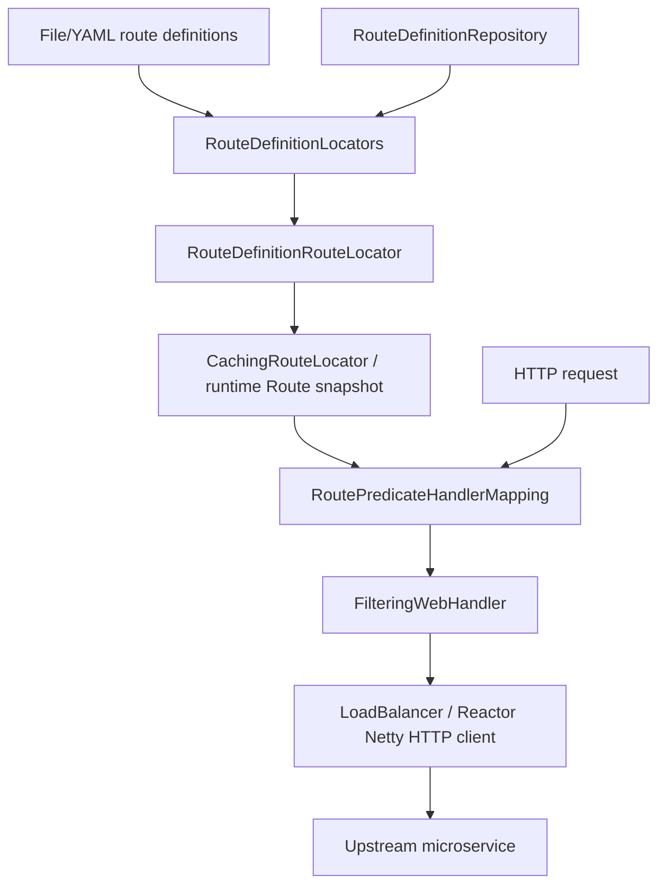
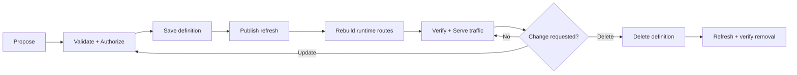
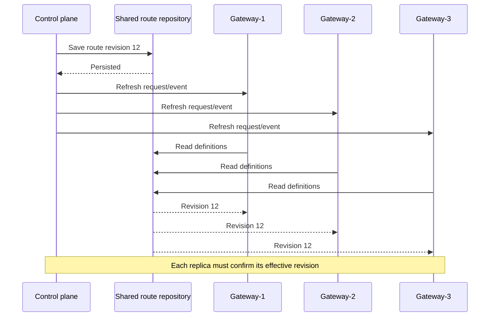

# RouteDefinitionRepository and the Route Definition Lifecycle

An API Gateway can be configured using static routes in `application.yml`. However, when a microservices system needs to launch a new service, change paths, shift traffic to another backend version, or temporarily disable an API, editing a file and restarting the entire Gateway is not always suitable. **Spring Cloud Gateway** provides the **route definition (`RouteDefinition`)** model along with read/write abstractions for managing dynamic routes.

In the **Dynamic Routes** chapter, this lesson focuses on **`RouteDefinitionRepository` and the lifecycle of a route definition**: creating, updating, saving, loading into the runtime router, refreshing, observing, deleting, and synchronizing across Gateway replicas. The material connects directly to route predicates, filter chains, path/header rewriting, service discovery via `lb://`, Spring Security, rate limiting, circuit breakers, retries, TLS, and safe Gateway operations.

The most important point is: **saving a `RouteDefinition` successfully does not mean every Gateway instance immediately uses the new route**. A repository provides configuration data; the runtime route locator/cache and the refresh notification mechanism are separate components.

> **Scope:** Examples use **Spring Cloud Gateway Server WebFlux**. Class names and several APIs remain fairly stable across versions, though auto-configuration, route property prefixes, Actuator endpoints, and repository implementations may vary. Gateway Server MVC should not apply this reactive flow verbatim. Every route update operation must be restricted by administrative authorization, validation, and a rollout process.

## 1. When Do You Need Dynamic Routes?

There are two common ways to manage routes:

| Management Approach | Example | Advantages | Limitations |
| --- | --- | --- | --- |
| **Static/declarative config** | `spring.cloud.gateway.routes` in YAML or a config server | Easy code review, version control, environment reproducibility | Changes require a reload/deployment mechanism and config sync process |
| **Dynamic route definitions** | Writing `RouteDefinition` via a repository/management API | Updates routes while Gateway is running; suits a control plane | Requires persistence, validation, refresh, authz, auditing, multi-replica sync |

For example, previously the system only had:

```text
GET /api/orders/** -> lb://order-service
```

Now it needs to release:

```text
GET /api/orders/**       -> lb://order-service
GET /api/reports/**      -> lb://report-service
GET /api/partner/v2/**   -> lb://partner-service
```

If operations has a **control plane** approving route changes, it can persist the new definitions and instruct Gateway replicas to reload without restarting the entire application.

**Dynamic routes do not mean discovering individual pods/backends.** The URI `lb://order-service` can remain unchanged while service instances scale up or down. `RouteDefinitionRepository` manages **route definitions**, not `DiscoveryClient` IP lists or Spring Cloud LoadBalancer's instance cache.

## 2. Layers in Gateway's Routing Architecture

Before modifying runtime configuration, distinguish these concepts:

| Component | Data / Role | Question Answered |
| --- | --- | --- |
| `RouteDefinition` | Route description in config form: ID, URI, predicates, filters, order, metadata | "How is the route declared?" |
| `RouteDefinitionLocator` | Provides a `Flux<RouteDefinition>` stream | "Which source do definitions come from?" |
| `RouteDefinitionWriter` | Interface for saving/deleting definitions | "How are definitions written/deleted?" |
| `RouteDefinitionRepository` | Combines locator and writer for a mutable definition store | "How to read and write route definitions from a store?" |
| `RouteDefinitionRouteLocator` | Converts route definitions into runtime route objects with bound predicates/filters | "How is config turned into executable routes?" |
| `RouteLocator` | Provides `Flux<Route>` for runtime | "Which routes are eligible for matching?" |
| `CachingRouteLocator` | Caches a snapshot of resolved runtime `Route`s | "Which route snapshot is the Gateway using?" |
| `RoutePredicateHandlerMapping` | Selects a route based on the request and predicates | "Which route matches this request?" |
| `FilteringWebHandler` | Runs the `GlobalFilter` and `GatewayFilter` chain of the selected route | "What processing is applied to the request/response?" |



The diagram shows the **logical data flow**. In a real application, multiple composite locators and different caching layers may exist. Do not assume "Gateway has one single cache and one single repository" across all setups.

### `RouteDefinition` vs. `Route`

`RouteDefinition` is a storable/serializable description. `Route` is the runtime representation constructed for Gateway to perform matching and filtering.

Example definition:

```yaml
id: orders-read
uri: lb://order-service
predicates:
  - Path=/api/orders/**
  - Method=GET
filters:
  - StripPrefix=1
order: 10
metadata:
  owner: platform
  visibility: internal
```

After factories process this, the runtime needs predicates to inspect requests, a filter executing `StripPrefix`, the logical URI, order, and metadata. **Modifying a config object in the repository does not directly replace every cached `Route` in handler mapping**; that is why the refresh step matters.

## 3. What Operations Does `RouteDefinitionRepository` Provide?

In Spring Cloud Gateway Server WebFlux versions using this API, `RouteDefinitionRepository` combines two contracts:

```java
// Signatures describing the conceptual contract,
// corresponding to the interfaces in Spring Cloud Gateway.
public interface RouteDefinitionRepository
        extends RouteDefinitionLocator, RouteDefinitionWriter {
}
```

```java
public interface RouteDefinitionLocator {
    Flux<RouteDefinition> getRouteDefinitions();
}

public interface RouteDefinitionWriter {
    Mono<Void> save(Mono<RouteDefinition> route);
    Mono<Void> delete(Mono<String> routeId);
}
```

Meaning:

- `getRouteDefinitions()` emits the definitions the repository currently supplies to the pipeline.
- `save(Mono<RouteDefinition>)` persists a definition; depending on the implementation, it may have **create-or-overwrite by ID** semantics.
- `delete(Mono<String>)` deletes a definition by route ID; whether missing route IDs fail depends on the implementation.
- `Mono<Void>` signals operation completion or failure per Reactive Streams.
- `Flux<RouteDefinition>` is neither a fixed array nor an inherently blocking API.

**Remember:** `save` does not mean "the route is already serving new traffic across all replicas." It signals that the write operation completed per the repository contract. Refreshing, verifying runtime routes, and converging across replicas are separate steps.

### Reactive Execution: Subscription Is Required

In Reactor, a call such as:

```java
repository.save(Mono.just(definition));
```

is **not enough to guarantee the operation executes** if no subscriber triggers the publisher. In a WebFlux controller, you should **return the `Mono`** so the framework subscribes within the HTTP request lifecycle.

```java
// Illustrates the idea: return Mono so WebFlux manages the subscription.
Mono<Void> saveDefinition(RouteDefinition definition) {
    return repository.save(Mono.just(definition));
}
```

Do not arbitrarily call `.subscribe()` in a controller/service just to "write in the background": clients may receive success prematurely, exceptions get detached from the HTTP response, and cancellation/transactions become difficult to manage. Never call `.block()` on the Reactor Netty event loop.

## 4. The Complete Lifecycle of a Route Definition

A dynamically created route typically passes through these stages:

1. **Proposal:** a control plane or administrator submits a new definition.
2. **Validation:** checks ID, URI scheme/host, predicates, filters, order, metadata, and permitted scope.
3. **Persistence:** saves the definition into a reliable repository.
4. **Refresh:** asks the Gateway to reload its runtime route snapshot.
5. **Conversion/binding:** `RouteDefinitionRouteLocator` looks up predicate/filter factories and builds runtime routes.
6. **Activation:** the route appears in the matchable set; matching requests begin using it.
7. **Observation:** verifies route ID, metadata, route order, and live requests.
8. **Update:** creates a new revision, overwrites/replaces the definition under control, and refreshes again.
9. **Delete/retire:** deletes the definition, refreshes, verifies new requests no longer match, and handles in-flight connections/requests.
10. **Recovery:** on restart or when a new replica launches, reloads definitions from the durable store.



**This is an operational model, not a built-in distributed transaction in Gateway.** Between `save` and `refresh`, there can be a window where the repository holds the new configuration while the runtime route cache still uses the old snapshot.

### Practical State Table

| Stage | In Repository | In Runtime Snapshot | New Requests |
| --- | --- | --- | --- |
| Before creation | No `reports` | No `reports` | Do not match that route |
| After `save`, before refresh | `reports` present | Possibly still absent | Not guaranteed to match |
| Refresh completed successfully | `reports` present | `reports` loaded | Can match per predicate/order |
| After update, before refresh | New definition | May still hold old route | May use old behavior |
| After `delete`, before refresh | Deleted | May still cache old route | May briefly still match |
| After deletion and convergence | Gone | Gone | Route no longer in snapshot |

You cannot treat an **HTTP 200 from a save management API** as confirmation that the route is active across every Gateway replica.

## 5. Java RouteDefinition Example

A route constructed programmatically:

```java
RouteDefinition ordersRoute() {
    RouteDefinition definition = new RouteDefinition();

    definition.setId("orders-read-v2");
    definition.setUri(URI.create("lb://order-service"));
    definition.setOrder(10);

    definition.setPredicates(List.of(
        new PredicateDefinition("Path=/api/v2/orders/**"),
        new PredicateDefinition("Method=GET")
    ));

    definition.setFilters(List.of(
        new FilterDefinition("StripPrefix=2")
    ));

    definition.setMetadata(Map.of(
        "owner", "platform-team",
        "changeTicket", "CHG-2026-001"
    ));

    return definition;
}
```

Types belonging to Spring Cloud Gateway are `RouteDefinition`, `PredicateDefinition`, and `FilterDefinition`; `URI`, `List`, and `Map` belong to Java. Appropriate **Gateway Server WebFlux** dependencies/modules are required.

For `GET /api/v2/orders/42`:

- `Path=/api/v2/orders/**` matches.
- `Method=GET` matches.
- `StripPrefix=2` removes the first two segments `api` and `v2`, leaving `/orders/42`.
- `lb://order-service` lets LoadBalancer select an upstream instance.
- `order=10` affects route evaluation priority when multiple routes compete.

**A Route ID is the long-lived technical identity of a definition**, not a URL. Keeping the ID stable when updating the same route helps tooling, metrics, and auditing track history; changing the ID usually means adding a new route and deleting the old one.

### Pre-Save Validation Is Mandatory

The snippet above only constructs an object. A secure control plane must verify:

- The ID follows naming rules and does not collide with routes outside the caller's administrative scope.
- The URI scheme belongs to an allowlist (`lb`, `https`, or `http` depending on environment).
- The URI host/service ID is permitted; does not point to metadata endpoints or sensitive internal networks.
- Predicate and filter factories are allowlisted; regex/SpEL/header-rewrite arguments contain no dangerous configuration.
- `Path` does not claim prefixes outside the service's boundary; `Host` is verified to belong to a managed domain.
- Authn/authz, CORS, rate limiters, circuit breakers, and TLS policies are not inadvertently stripped.
- `order` does not let the new route hijack requests meant for higher-protection routes.
- Metadata includes owner, revision, and change reason for auditing.

Never allow public clients to post raw `RouteDefinition` payloads directly to a Gateway management endpoint.

## 6. Saving a Route Definition and Requesting Refresh in Code

An internal service can use the repository and `ApplicationEventPublisher` to persist a definition and emit `RefreshRoutesEvent`:

```java
@Service
public class DynamicRouteAdministration {

    private final RouteDefinitionRepository repository;
    private final ApplicationEventPublisher publisher;

    public DynamicRouteAdministration(
            RouteDefinitionRepository repository,
            ApplicationEventPublisher publisher) {
        this.repository = repository;
        this.publisher = publisher;
    }

    public Mono<Void> upsert(RouteDefinition validatedDefinition) {
        // The caller must authenticate/authorize and validate the full definition.
        return repository.save(Mono.just(validatedDefinition))
            .then(Mono.fromRunnable(() ->
                publisher.publishEvent(new RefreshRoutesEvent(this))));
    }

    public Mono<Void> delete(String validatedRouteId) {
        return repository.delete(Mono.just(validatedRouteId))
            .then(Mono.fromRunnable(() ->
                publisher.publishEvent(new RefreshRoutesEvent(this))));
    }
}
```

This snippet illustrates **the basic technical sequence**, not a complete secure management API:

1. `repository.save/delete` completes before the publisher emits the event.
2. `RefreshRoutesEvent` asks listening components to refresh the route list.
3. `Mono.fromRunnable` chains event publication onto reactive completion.
4. Methods return `Mono<Void>`, which the framework/caller must subscribe to.

**There is no distributed transaction guarantee:** In a system storing routes in Redis/DB or running multiple Gateway replicas, publishing an event on the replica receiving the request **does not automatically propagate to all other replicas**. Nor does it guarantee listeners finished rebuilding before the `Mono` completes; you need a dedicated rollout/activation verification mechanism.

### Note Ordering and Failure Conditions

If `save` fails, `then(...)` does not execute: the refresh event is not emitted in this flow. If `save` succeeds but refresh fails or the route fails to bind, the repository still contains the new definition. You need a verified **rollback/restore last-known-good** procedure rather than merely returning "update failed" and leaving an inconsistent intermediate state.

Validating after `save` is too late: dangerous config could be loaded when a replica refreshes. Validation must be a precondition **before writing**.

## 7. `RefreshRoutesEvent` Differs from Refreshing Service Discovery

`RefreshRoutesEvent` deals with **refreshing the runtime route set**. It is not a magic command to refresh every kind of cache inside the Gateway.

| Change | Layer Needing Refresh / Inspection |
| --- | --- |
| Add route `/api/reports/**` | Route definitions and runtime route cache |
| Edit route `Path`/`RewritePath` | Bound runtime route from the new definition |
| Delete route `orders` | Route repository + route cache across replicas |
| `order-service` adds a pod | Discovery client / LoadBalancer instance supplier/cache |
| Backend DNS changes IP | DNS resolver + connection lifecycle |
| `LocalResponseCache` holds old body | Response cache TTL/invalidation |
| Auth Server rotates JWT signing key | Security/JWK cache via its own mechanism |
| Rate limiter config changes | Policy/configuration layer, not just route refresh |

**Refreshing routes is not equivalent to restarting the application**: singleton beans, `SecurityWebFilterChain`, HTTP connections, and other caches each have their own lifecycles.

### Refreshing One vs. Multiple Gateway Replicas

Suppose Gateway-1 and Gateway-2 share a persistent repository:

```text
Shared repository: new route "reports" has been saved.

Gateway-1: received RefreshRoutesEvent -> runtime has "reports".
Gateway-2: has not received refresh yet -> runtime still lacks "reports".
```

Clients behind a front load balancer may see intermittent failures. This is a **configuration convergence issue**.

To ensure safe rollouts, the control plane must coordinate refresh across **all replicas** or use a reliable event/cache-invalidation architecture with per-replica confirmation status. Never assume `ApplicationEventPublisher` has built-in network broadcasting.

## 8. In-Memory Repositories vs. Persistent Shared Repositories

### In-Memory

`InMemoryRouteDefinitionRepository` is an implementation provided by Gateway in supported release lines. It is convenient for demos or local route state:

- Stores definitions in **a single process's** memory.
- Does not automatically synchronize with other Gateway processes.
- Routes written at runtime can be lost when the process restarts.
- Requires a separate mechanism to reinitialize routes or use persistent configuration.

Example scenario:

```text
Gateway replica A:
  memory route definitions = [orders, reports]

Gateway replica B:
  memory route definitions = [orders]

Restart A:
  memory-only data added at runtime via API may be lost
```

**Do not use an in-memory repository as your sole configuration store** if dynamic routes must survive rolling restarts or scale-out events.

### Redis/DB/Shared Repository

Some Spring Cloud Gateway versions provide a Redis-based repository implementation or extensions supplied by your application. A custom repository can also read/write a database:

```text
             +-------------------------+
             | Control plane (approved)|
             +------------+------------+
                          |
                          v
                  Shared route store
                          |
             +------------+------------+
             |                         |
             v                         v
        Gateway-1                  Gateway-2
   Repository locator         Repository locator
   Runtime route cache         Runtime route cache
```

Shared storage solves **persistence and a single source of truth**, but **does not automatically guarantee identical runtime snapshots instantaneously**. Gateway-1 and Gateway-2 still must reload and refresh at the right time.

### Choosing a Repository Based on Needs

| Criterion | In-Memory | Shared Persistent |
| --- | --- | --- |
| Ease of setup | High | Additional infrastructure |
| Survives restart for runtime-written routes? | Unlikely; typically lost if memory-only | Yes, if backed by durable storage |
| Multiple replicas automatically share data? | No | Same source, still needs refresh to converge |
| Supports versioning/audit/rollback? | Must build yourself | Can be designed into control plane/storage |
| Network/DB risk on fetch | Low | Needs cache/fallback when store is unavailable |
| Production suitability for dynamic routes | Mostly demos / local tasks | Usually better suited when well designed |

Do not assume every Redis repository uses the same schema, keys, cluster behavior, or refresh capabilities. Check the documentation for **the exact version and implementation** you run.

## 9. Updates and Deletes: Upsert Is Not In-Place Mutation of Running Routes

Suppose the current route is:

```yaml
id: orders
uri: lb://order-service-v1
predicates:
  - Path=/api/orders/**
filters:
  - StripPrefix=1
order: 10
```

To shift traffic to `order-service-v2` while **keeping the same route ID**, the control plane writes the new definition:

```yaml
id: orders
uri: lb://order-service-v2
predicates:
  - Path=/api/orders/**
filters:
  - StripPrefix=1
order: 10
```

Conditions for success:

1. The repository persisted the new revision of ID `orders`.
2. Each Gateway replica's runtime route cache refreshed successfully.
3. `lb://order-service-v2` actually has healthy available service instances.
4. Backend v2 supports the expected path/header/auth contract.
5. New requests after convergence route to v2 as expected.

**You cannot guarantee that every in-flight request currently proxying to v1 switches mid-stream to v2.** Requests that already selected a route/instance and opened a connection may finish along the old path. For cutovers, plan readiness checks, connection draining, timeout budgets, and rollback.

### Deleting Routes and Traffic Impact

After `delete("orders")` and refresh:

- **New** requests may stop matching `orders` or match a different route depending on route order.
- Requests **already past matching** before the refresh may still complete on the old route.
- A catch-all route like `Path=/**` may absorb URLs after `orders` is deleted, producing unexpected responses.
- If a route must be disabled immediately due to a security incident, enforce blocking at a trusted layer (Ingress/Security/policy) rather than relying solely on eventually consistent refreshes.

**Deleting a route does not delete the backend service**; `order-service` can still be reached by other clients or other routes.

## 10. Route IDs, Order, and Conflicts Across Multiple Configuration Sources

Gateway can combine:

- Route definitions from YAML/properties.
- Route definitions in a repository.
- Definitions generated by the service discovery locator.
- Routes created via Java DSL or custom locators.

Providing the same route ID from multiple sources **is not a clean configuration override strategy**. Depending on how composite locators merge definitions, conflicts or unpredictable outcomes can arise. Your design should assign **one owner per route ID namespace**.

Example namespaces:

```text
static-public-catalog
dynamic-partner-acme
dynamic-invoice-v2
discovery-internal-inventory
```

Route `order` affects predicate evaluation order when multiple routes match:

| Route | Predicate | Order | Potential Consequence |
| --- | --- | ---: | --- |
| `generic-api` | `Path=/api/**` | 100 | Catch-all API |
| `specific-orders` | `Path=/api/orders/**` | 10 | Likely evaluated ahead of generic |
| `admin-api` | `Path=/api/admin/**` | 0 | For Admin use; requires separate Security |

Lower order values generally take priority under Spring ordering. When adding a new route, test against overlapping URLs to avoid hijacking requests meant for another API. **Predicate matching is no substitute for authorization**: even if the admin route takes precedence properly, Gateway/backends must still enforce user permissions.

### Metadata and Revisions

`RouteDefinition` can carry `metadata` for management purposes such as owner/changeTicket/revision. However, **metadata is not by default an authorization policy or a concurrency-control mechanism**. If you want conditional updates by revision, the control plane/storage must enforce revision checks and atomicity.

Never let an arbitrary client simply attach `metadata.owner=platform` to gain permission to overwrite platform routes.

## 11. Validation and Trust Boundaries for Route Management APIs

Changing routes is a highly privileged operational capability. A route can redirect all traffic, alter headers, affect authentication context, and make the Gateway call arbitrary destinations.

### Common Risks

| Risk | Example | Mitigation |
| --- | --- | --- |
| **SSRF** | New route points to a metadata endpoint or forbidden internal IP | Allowlist schemes/service IDs/hosts/network egress |
| **Privilege bypass** | New route exposes `/api/admin/**` to an unauthenticated service | Review path/order; verify Security and backend authz |
| **Token leakage** | Route forwards Bearer tokens to an attacker-controlled host | Outbound destination policy, header scrubbing, token audience |
| **Header spoofing** | Filter injects `X-User-Id` from untrusted input | Sanitization, signed identity, never trust client headers |
| **Regex DoS / route shadowing** | Expensive predicate/filter regex or catch-all route | Validate regexes, filter allowlists, overlap checks |
| **Excessive retries / rate bypass** | Route omits rate limiter or enables unbounded retries | Enforce mandatory security/traffic guardrails |
| **CORS misconfiguration** | Route accidentally allows wildcard origins with credentials | Centralized CORS policies and testing |
| **TLS downgrade** | Switching `https://` to `http://` for sensitive backends | Scheme/TLS policy, truststores, and mTLS |
| **Information disclosure** | Actuator exposes routes/filters publicly | Secure management endpoints |
| **Cache contamination** | Private route enables shared response caching | Review cache eligibility and identity scoping |

**Never treat `RouteDefinition` as benign plain data.** It directly governs how the Gateway handles network traffic. Therefore, route creation/updates must enforce strong authentication, namespace-scoped authorization, immutable auditing, and change approvals where appropriate.

### A Sensible Permission Model

- **Reader:** views definitions and route status; cannot modify.
- **Namespace editor:** proposes routes within permitted prefixes and service IDs.
- **Approver/operator:** approves and activates validated revisions.
- **Emergency operator:** has controlled disable/rollback permissions with audit logging.
- **Platform admin:** manages allowlist policies; never exposed on the public Internet.

Isolate management APIs from public APIs via network policies, mTLS, or commensurate authentication/authorization. Never rely solely on `Origin`/CORS; non-browser clients can call management APIs directly.

## 12. Actuator Gateway Endpoints and the Route Lifecycle

Some Spring Cloud Gateway releases expose **Actuator Gateway endpoints** to inspect/manage routes, with common paths such as:

```text
GET    /actuator/gateway/routes
GET    /actuator/gateway/routes/{id}
GET    /actuator/gateway/routedefinitions
POST   /actuator/gateway/routes/{id}
DELETE /actuator/gateway/routes/{id}
POST   /actuator/gateway/refresh
```

**Do not assume all of these endpoints/methods are enabled or allow writes by default in your version.** Spring Boot Actuator and Spring Cloud Gateway have changed exposure/access defaults across versions; dangerous actions often require explicitly enabling management access. Check which endpoints are actually supported and protect them via authz and network controls.

### Distinguishing Management APIs from Runtime State

- A route write API may modify **the repository**.
- A refresh API may ask **the runtime route locator/cache** to reload.
- Reading `/routes` typically reflects **effective runtime routes**.
- `/routedefinitions`, when supported, can display **definitions** from sources.

Consequently, these two inspection endpoints can disagree during the window between save and refresh, or if a route fails to bind. That discrepancy is diagnostic evidence for the lifecycle, not simply "a broken API."

### Never Expose Full Actuator Publicly for Quick Testing

Management endpoints can leak route URIs, internal service IDs, and filter arguments, or allow redirecting traffic to arbitrary hosts. Expose only the endpoints genuinely needed, on an appropriate port/network, with authentication/authorization, audit logging, and restricted HTTP methods. When write endpoints are not needed after deployment, disable write access.

## 13. Multiple Gateway Replicas: From Persistence to Eventual Consistency

Suppose Gateway has three replicas:



**A shared repository is necessary but not sufficient.** Any of the following can occur:

- Gateway-1 refreshes revision 12 successfully.
- Gateway-2 misses the event and stays on revision 11.
- Gateway-3 receives the event but fails to bind a new predicate/filter.
- The front load balancer keeps distributing requests across all three.

The user experience is a route that **sometimes matches and sometimes returns 404/503** depending on which replica handles the request.

### Designing a Convergence Mechanism

A reliable control plane requires:

1. **Revision/version:** each change carries a distinct revision.
2. **Persist first, activate second:** validate new config before publishing when needed.
3. **Refresh fan-out:** notify all Gateway replicas through an appropriate reliable mechanism.
4. **Readback:** each replica reports back its loaded revision or effective route set.
5. **Health/canary:** verify live requests over the new route on a subset of replicas before broad rollout.
6. **Bounded timeouts/retries:** enforce deadlines while waiting on replicas and alert on partial convergence.
7. **Rollback:** know the previous revision, restore the store, and trigger refresh again.
8. **Audit:** record who proposed, who approved, when persisted, and when activated.

Never assume an HTTP 202/200 from a control plane means **100% of replicas are serving the new revision**. Your API should clearly distinguish states like "persisted", "refresh requested", "active on N/M replicas", "failed", and "rolled back".

## 14. Concurrency and Lost Updates When Multiple Users Edit the Same Route

Suppose two operators read revision `v7` concurrently:

```text
Operator A: v7 -> change uri to order-v2
Operator B: v7 -> add RateLimiter

A saves v8 (uri=order-v2).
B saves v8 (from v7, only adding RateLimiter).

If last-write-wins: A's uri update can be lost.
```

`RouteDefinitionWriter.save(...)` by itself does not define cluster-wide **optimistic locking**. Custom repositories can have varying update semantics; to prevent lost updates, the control plane/storage should provide:

- A per-route `revision`/version.
- An API accepting `If-Match` or `expectedRevision`.
- Atomic compare-and-swap writes in the store.
- Conflict responses such as `409 Conflict` when the revision is stale.
- Publishing refreshes only after the update commits.
- Auditing before/after revisions and rollback paths.

Logical contract example:

```http
PUT /internal/route-admin/routes/orders HTTP/1.1
If-Match: "route-orders-v7"
Content-Type: application/json

{"id":"orders","uri":"lb://order-service-v2", "...":"..."}
```

**This API is only a control-plane design example**, not a default Spring Cloud Gateway endpoint. Real payloads must conform to a validated schema; never let unauthorized admins arbitrarily modify filters or security headers.

### Handling Races During Delete

If A updates a route while B deletes it, transaction ordering can resurrect the just-deleted route. Use versioned deletes/tombstones or appropriate transactions/locking to prevent accidental resurrection, especially with event-driven refresh consumers.

## 15. Failed Refreshes and Managing Last-Known-Good Configuration

A new route can be saved successfully yet fail to load:

- Misspelled predicate factory name.
- Filter factory missing from dependencies.
- Invalid URI or unsupported scheme.
- Unparseable regex.
- Missing or wrongly typed filter arguments.
- Route metadata or order violating policy.
- Repository unreachable during refresh.
- Bug in a custom predicate/filter factory.

**Distinguish route-loading errors from backend call errors:**

| Symptom | Where the Failure Occurred | What to Check |
| --- | --- | --- |
| Save fails | Repository/DB/validation | Persistence and input payload |
| Refresh/conversion fails | `RouteDefinitionRouteLocator` or factory binding | Predicate/filter args and refresh logs |
| Route does not match | Handler mapping/predicate/order | Effective routes, path/method/host |
| Route matches but `lb://` finds no service | Discovery/LoadBalancer | Instances, service ID, cache |
| Route matches but upstream returns 503 | Backend/network/filter | Upstream health, circuit breaker |
| TLS handshake error | Reactor Netty HTTP client | Certificate, hostname/SNI, truststore |
| Authn returns 401 before mapping | Spring Security WebFilter | JWT/session/route policy |

**Do not assume Gateway automatically rolls back every invalid change.** Refresh error handling and fallback to stale caches can differ by version and configuration. Your operational setup should verify effective routes, store the last-known-good revision, and restore it if a new version fails.

### A Safer Workflow

```text
1. Draft route -> validate syntax + policy.
2. Test on staging/canary Gateway.
3. Save new revision to repository.
4. Send controlled refresh to canary Gateway group.
5. Verify effective route and end-to-end request.
6. Expand rollout to remaining replicas.
7. Monitor errors/latency/circuit breaker.
8. If thresholds exceeded -> restore previous revision + refresh.
```

Never rely on immediate 100%-replica refresh as your sole mechanism when a route change risks breaking critical APIs.

## 16. Dynamic Routes and Filter Chains: Updates Can Alter Security and Performance

A route might contain filters like:

```yaml
filters:
  - StripPrefix=1
  - name: RequestRateLimiter
    args:
      redis-rate-limiter.replenishRate: 20
      redis-rate-limiter.burstCapacity: 40
  - name: CircuitBreaker
    args:
      name: ordersBreaker
      fallbackUri: forward:/fallback/orders
  - name: Retry
    args:
      retries: 2
      methods:
        - GET
      series:
        - SERVER_ERROR
```

When updating a dynamic route:

- The new **route predicate** determines which requests hit the route.
- The new **filter list** can change authentication-related headers, traffic limits, and retry/circuit-breaker policies.
- The new **route order** can starve other routes of traffic.
- A new **`lb://` URI** switches destinations to another service ID.
- Enabling a **response cache** on a private route without controls can leak data.
- A **fallback URI** might point to a handler returning responses incompatible with the API contract.
- **Outbound client TLS settings** do not automatically adjust just because a route refreshed.

Therefore, the control plane must restrict **which filters and predicates are allowed to be dynamically modified**. Never let a tenant create a route calling arbitrary backends or disable rate limiting/authz by altering the filter list.

### Filter Arguments Need Versioning

`GatewayFilterFactory` names and arguments can change when upgrading Spring Cloud Gateway. A `RouteDefinition` stored months earlier might no longer bind after deploying a newer framework version. When upgrading versions:

1. Scan definitions in the repository.
2. Validate factory names and args against the new version.
3. Run migration/dry-run checks in staging.
4. Keep a rollback plan if conversion fails.
5. Monitor critical routes during rolling upgrades across Gateway replicas.

This is a **schema compatibility** concern for dynamic config data; do not neglect it just because routes live in Redis/DB instead of YAML.

## 17. Interactions with Service Discovery, TLS, and CORS

### Discovery: Instance Changes Do Not Require New Routes

`lb://order-service` is a logical URI targeting a service ID. When the service scales from 2 to 4 instances, the `orders` definition stays unchanged. `LoadBalancer` and `DiscoveryClient` handle the instance list. Never create a separate route per pod, as changing pod IPs will bloat the repository with unmanageable routes.

If a new service ID `order-service-v2` is not yet registered in discovery, the route update may activate while requests fail with **no available instance**. Always check readiness and service discovery before cutover.

### TLS: Changing URIs Does Not Provision Certificates

If a route shifts from `https://orders.internal.example` to `https://orders-green.internal.example`, the Reactor Netty HTTP client needs a matching trust chain and hostname verification. The repository does not automatically configure truststores, mTLS, or SNI for arbitrary targets; certificate mismatches will fail requests even if the route definition saves and refreshes cleanly.

Never permit dynamic routes to downgrade HTTPS to HTTP when policy mandates TLS.

### CORS and Security: Prevent Dynamic Config from Crossing Trust Boundaries

CORS policies are typically enforced in WebFlux/Spring Security/Gateway handler mapping. Adding a new route while forgetting preflight policies can cause `OPTIONS` requests to fail with 401/404 or emit duplicate headers. Crucially, **CORS is not authentication**: if a route exposes an admin API, blocking browser origins does not stop non-browser clients from calling it.

In particular, routes for administrative APIs must have strong authentication and authorization at both Gateway and backend; never treat a `Path` predicate as access control.

## 18. Testing the Repository: Save, Get, Update, Delete

First verify the **data contract** without even needing a full HTTP server.

### Test Sketch with Reactor `StepVerifier`

```java
@Test
void savesAndListsRouteDefinition() {
    RouteDefinition def = new RouteDefinition();
    def.setId("test-orders");
    def.setUri(URI.create("http://localhost:8081"));
    def.setPredicates(List.of(
        new PredicateDefinition("Path=/test/orders/**")));

    StepVerifier.create(repository.save(Mono.just(def)))
        .verifyComplete();

    StepVerifier.create(
            repository.getRouteDefinitions()
                .filter(route -> route.getId().equals("test-orders"))
                .single())
        .assertNext(saved -> {
            assertEquals("test-orders", saved.getId());
            assertEquals(URI.create("http://localhost:8081"), saved.getUri());
        })
        .verifyComplete();
}
```

This is an illustrative test snippet; `repository` must be instantiated from a real implementation with the appropriate imports, JUnit 5, Reactor Test, and assertions.

### Testing Delete

```java
@Test
void deletesRouteDefinition() {
    StepVerifier.create(
        repository.delete(Mono.just("test-orders")))
        .verifyComplete();

    StepVerifier.create(
        repository.getRouteDefinitions()
            .filter(route -> route.getId().equals("test-orders")))
        .verifyComplete();
}
```

This test assumes the route exists before deletion. If your repository implementation errors on a missing ID, test that explicit contract rather than assuming deletes are always idempotent.

**Repository tests only prove the persistence contract**; they do not prove the runtime router has refreshed and is serving traffic.

## 19. Integration Testing: Verifying the Route Actually Works

An integration test should wire up the Gateway, repository, secured internal management endpoint (or management service in the test fixture), upstream stub, and `WebTestClient`.

Scenario:

```text
T0: No route /dynamic/orders/**
    GET /dynamic/orders/42 -> no match (per test config)

T1: Save definition:
    id=dynamic-orders
    Path=/dynamic/orders/**
    uri=http://localhost:8081
    StripPrefix=1

T2: Refresh local route runtime.
    Verify effective route list contains dynamic-orders.

T3: GET /dynamic/orders/42
    Upstream mock receives GET /orders/42.
    Client receives body/status per contract.

T4: Update same route ID:
    uri=http://localhost:8082

T5: Refresh and verify.
    GET /dynamic/orders/42 -> upstream 8082 receives; 8081 receives no new requests.

T6: Delete definition, refresh.
    GET /dynamic/orders/42 -> no longer matches dynamic-orders.
```

**Never assert "save Mono completed → next request immediately uses the new route"** if asynchronous refresh has not been confirmed. Use signals or mechanisms confirming the effective runtime snapshot along with proper test deadlines.

### `WebTestClient` Example After Route Activation

```java
@Test
void dynamicRouteForwardsToExpectedBackend() {
    // Test fixture already saved the route, refreshed, and confirmed activation.

    webTestClient.get()
        .uri("/dynamic/orders/42")
        .exchange()
        .expectStatus().isOk()
        .expectBody()
        .jsonPath("$.id").isEqualTo("42");

    wireMockServer.verify(
        1, getRequestedFor(urlEqualTo("/orders/42")));
}
```

This is a test fragment requiring its corresponding fixture. If route predicates, filter order, or Security block the request, adjust the test to verify the right layer. An HTTP `200` does not prove the right backend handled the request if it came from a cache or fallback; inspect the upstream request journal as well.

## 20. Route Definition Lifecycle Test Matrix

| Case | Action | Key Assertion |
| --- | --- | --- |
| T1 | Save valid route | Repository contains definition with matching ID/URI |
| T2 | Save without refresh | Do not assume runtime has picked up the new route |
| T3 | Refresh after save | New effective route appears |
| T4 | GET matching path/method | Reaches right upstream/path after filters |
| T5 | Update same route ID | New definition replaces old route after refresh |
| T6 | Delete route | Runtime no longer matches after convergence |
| T7 | Delete non-existent ID | Behavior matches repository contract |
| T8 | Duplicate ID across sources | Detected/blocked by naming policy |
| T9 | New route shadows `/api/admin/**` | Validation rejects or precedence is safe |
| T10 | URI targets forbidden IP/internal metadata | SSRF validation blocks it |
| T11 | Invalid filter/predicate factory | Faulty config is not activated |
| T12 | Repository write failure | No active-success notification emitted |
| T13 | Refresh fails after save | Mismatch detected and controlled rollback runs |
| T14 | Concurrent update on same revision | Conflict raised; no lost updates |
| T15 | Concurrent delete and update | Deleted route is not resurrected |
| T16 | Restart in-memory Gateway | Verify whether dynamic data was lost |
| T17 | Restart Gateway with shared store | Reloads definitions per policy |
| T18 | Multiple Gateway replicas | All converge to the same revision |
| T19 | Replica slow to refresh | Control plane reports partial rollout |
| T20 | `lb://` has no instances yet | Route active, proxy failure classified accurately |
| T21 | Backend TLS hostname mismatch | Certificate validation is not bypassed |
| T22 | Security missing token | Not bypassed by dynamic route |
| T23 | RateLimiter/CircuitBreaker/Retry filters | Execute within proper scope after update |
| T24 | Private route accidentally enables response cache | Guardrails block and tests verify no leaks |
| T25 | In-flight requests during delete | Do not assume immediate cancellation |
| T26 | Rolling upgrade of Gateway | Older definitions still bind or are migrated |

**Dual confirmation:** verify both that the repository holds the right definition **and** that the Gateway runtime is serving the right route. Verify across every replica in multi-process deployments.

## 21. Observability: Distinguishing Persisted, Active, and Matched

A route management system must observe at least three layers:

1. **Persisted:** which configuration has been written to the repository?
2. **Active/effective:** which configuration has the route locator/cache loaded into `Route` instances?
3. **Matched/used:** which route and upstream actually handled live requests, and with what outcome?

| Field / Metric / Event | Question Answered |
| --- | --- |
| Route ID, revision, owner | Which definition are we inspecting? |
| Save/delete operation status | Did the repository accept the change? |
| Refresh event timestamp | When was reload requested? |
| Refresh completion/error | Did runtime route building succeed? |
| Effective route count / list hash | Which snapshot is the replica running? |
| Gateway replica ID | Is any replica lagging in revision? |
| Route match count | Is the new route receiving traffic? |
| Upstream service ID/URI | Are logical and physical destinations right? |
| HTTP status/latency | Is post-cutover traffic healthy? |
| Rate limiter/CircuitBreaker/Retry metrics | Are the new filter policies taking effect? |
| Audit actor / change ticket | Who proposed/approved the change? |
| Rollback event | When and why was an older revision restored? |

Metric names and actuator endpoints depend on your version and Micrometer instrumentation. Do not assume Gateway provides a built-in `revision` field on every route; that may be custom metadata managed by your control plane. Never emit raw tokens, secret filter args, or sensitive data into logs or metric labels.

### Troubleshooting a Route Receiving No Traffic

If a route is in the repository yet requests return 404 or 503:

1. **Does the runtime route exist after refresh?** If not, it is a lifecycle issue.
2. **Do predicates match?** Inspect path, method, host, headers, and route order.
3. **Did Security block before routing?** `401`/`403` differs from routing.
4. **Did filters corrupt the path?** Check `StripPrefix`/`RewritePath`.
5. **Does service discovery have instances?** Is the `lb://` service ID right?
6. **Are TLS/DNS/connect failing?** A matched route can still fail while proxying.
7. **Is a fallback or cache masking the error?** The final HTTP status does not always pinpoint the upstream.
8. **Which replica served the request?** The route update might only be active on part of the cluster.

## 22. Common Misconceptions

| Misconception | Accurate Understanding |
| --- | --- |
| "`save()` succeeded so the route is active right away" | Refresh/activation and runtime verification are still required |
| "`RouteDefinitionRepository` picks the route on every request" | The repository supplies definitions; runtime locator/mapping selects routes |
| "`RouteDefinition` and `Route` are the same object" | Definition is configuration data; `Route` is the runtime representation |
| "`RefreshRoutesEvent` broadcasts to all Gateway replicas" | It is a local event; distributed refresh requires additional design |
| "A shared repository means all replicas share the same snapshot" | Refresh and convergence confirmation are still required |
| "Routes in RAM survive restarts" | In-memory data is typically lost when the process stops |
| "Deleting a route immediately aborts running requests" | In-flight requests may continue; separate drain/cutoff policies are needed |
| "Every backend pod needs its own route definition" | `lb://service-id` and discovery handle instance changes |
| "Duplicate route IDs across two sources override cleanly" | Enforce namespaces/ownership and prevent collisions |
| "Owner metadata grants edit permissions automatically" | Metadata is not authorization |
| "Route order does not affect security" | Route shadowing can divert requests to the wrong backend |
| "One refresh clears DNS/response caches" | Caches have independent lifecycles |
| "Actuator route-write endpoints can be public for convenience" | They carry high privilege with SSRF and bypass risks |
| "A loaded route guarantees a healthy backend" | LB/discovery/TLS/upstream can still fail |
| "Rolling back in the DB rolls back runtime immediately" | You must refresh and verify each replica |
| "HTTP 200 from a save API confirms the whole cluster" | It only reflects the management API's own contract |

## 23. Production Runbook for Creating or Updating Dynamic Routes

**Before the change:**

1. Record the request and route owner; identify the currently active revision.
2. Review policies for URL prefix, service ID, TLS, security, CORS, rate limiting, caching, and retries.
3. Check for route conflicts, order precedence, and overlap with admin/private routes.
4. Validate schema and factory arguments against the running Spring Cloud Gateway version.
5. Prepare the rollback definition and assess blast radius.

**During rollout:**

6. Save the new revision using concurrency controls.
7. Trigger controlled refreshes, preferring a canary replica first for critical changes.
8. Read back runtime/effective route state; do not rely solely on the repository.
9. Send real test requests via the target path/method/host and verify upstream delivery.
10. Collect per-replica status; monitor latency, 4xx/5xx, rate limits, circuit breakers, and retries.

**After rollout:**

11. Observe long enough relative to traffic volume and timeout budgets.
12. If partial rollout occurs, identify lagging replicas/revisions and perform bounded repair.
13. If errors exceed thresholds, restore the previous revision, refresh, and verify cluster-wide.
14. Persist audit records: actor, timestamp, route ID, before/after revisions, and outcome.
15. For retired routes, monitor in-flight requests/connection drain and finalize cleanup once safe.

### Emergency Rule

If a route inadvertently exposes an internal endpoint or leaks tokens to an unintended host, prioritize **blocking traffic at a trusted boundary** and disabling the route cluster-wide, then review active connections and audit evidence. Never call delete on a single replica and assume the incident is over.

## 24. Practice Exercise: Managing Dynamic Routes Across Three Gateway Replicas

A SaaS system runs:

- Three Gateway replicas: `gateway-a`, `gateway-b`, `gateway-c`.
- A shared route store managed by a control plane.
- Existing route `orders`: `Path=/api/orders/**`, `uri=lb://order-service-v1`.
- New route `reports`: `Path=/api/reports/**`, `uri=lb://report-service`.
- All API requests must pass through Spring Security; admin routes must never be public.
- A generic catch-all route `Path=/api/**` with `order=100`.

### Task 1 — Add `reports`

Create a `RouteDefinition`:

```yaml
id: dynamic-reports
uri: lb://report-service
predicates:
  - Path=/api/reports/**
  - Method=GET
filters:
  - StripPrefix=1
order: 10
metadata:
  owner: platform
  revision: "12"
```

After validation and saving, trigger refresh across all three replicas and verify:

- Does `dynamic-reports` appear in each replica's effective route snapshot?
- Does `GET /api/reports/42` reach `report-service` at path `/reports/42`?
- Does `POST /api/reports/42` fall through to another route, and does it obey security policies?
- Are unauthorized users blocked by Spring Security or the backend?
- If `report-service` has no instances yet, is the failure classified as a discovery issue rather than a missing route?

### Task 2 — Update `orders`

Change the URI of route ID `orders` from `lb://order-service-v1` to `lb://order-service-v2` **without deleting and recreating the ID**. Assign a new revision and use optimistic locking to prevent lost updates. Canary on one replica, verify v2 readiness/TLS/auth contracts, and then refresh the entire cluster.

### Task 3 — Delete `reports`

Delete `dynamic-reports` under an approved revision. Refresh and verify runtime routes no longer match; pay attention to whether catch-all `/api/**` picks up requests after the specific route is removed. If the goal is returning an explicit `410 Gone` or `404`, design an explicit policy instead of assuming route deletion always yields a fixed status.

### Self-Check Questions

1. Which two interfaces does `RouteDefinitionRepository` combine?
2. How do `RouteDefinition` and `Route` differ?
3. What type does `save(Mono<RouteDefinition>)` return, and when does the operation actually run?
4. Why does a successful save not guarantee the very next request uses the new route?
5. Which cache does `RefreshRoutesEvent` affect, and which caches does it leave untouched?
6. How does an in-memory repository differ from a shared persistent repository on Gateway restart?
7. Is a shared repository alone enough to keep three Gateway replicas on the same route revision?
8. If one replica fails to bind a new filter, what status should the control plane report?
9. Why should route IDs have clear namespaces/owners when multiple route definition sources exist?
10. Why can changing a route's `order` cause route shadowing?
11. If `lb://service` launches a new pod, do you need to write a new `RouteDefinition` for that pod?
12. Does deleting a route immediately cancel active streaming requests?
13. Do owner/revision metadata fields replace authentication and optimistic locking?
14. Why must a control plane not accept arbitrary URIs/hosts from insufficiently privileged admins?
15. What distinct things do repository tests and end-to-end HTTP tests prove?
16. When a route is active yet clients receive `503`, which layers must be distinguished?
17. Why should Actuator Gateway write endpoints never be exposed publicly?
18. How do you prevent lost updates when multiple people edit the same route?
19. If you roll back a definition in the DB, what additional step is needed to restore runtime behavior?
20. How do the three states—**persisted**, **active**, and **matched**—help diagnose dynamic routes?

**Key takeaway:** **`RouteDefinitionRepository` is a source for reading/writing route definitions, not the runtime router itself**. Dynamic routes move through **validate → save → refresh → convert → active → observe → update/delete → refresh/reconcile**. In multi-replica Gateway clusters, a shared repository does not automatically synchronize route caches; you need revisions, refresh fan-out, readback, rollback, and auditing. Lock down management APIs, validate route order/filters/URIs, and distinguish the route cache from service discovery, DNS, TLS, and response caches so Spring Cloud Gateway can evolve configurations safely without widening security risks or introducing subtle routing bugs.
