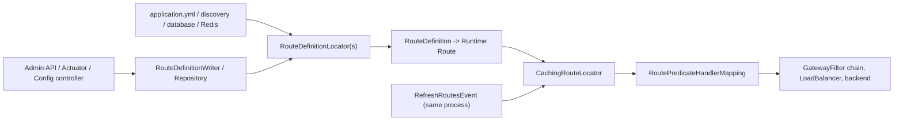
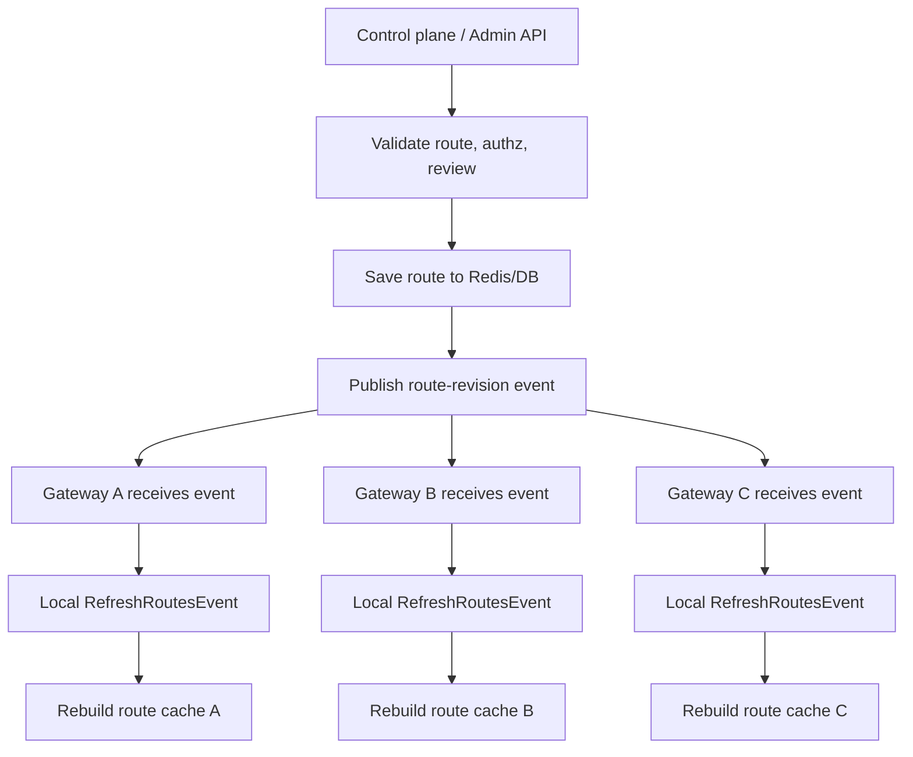
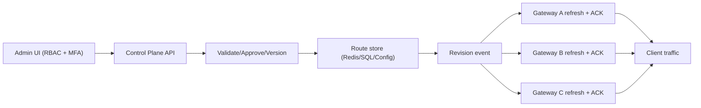
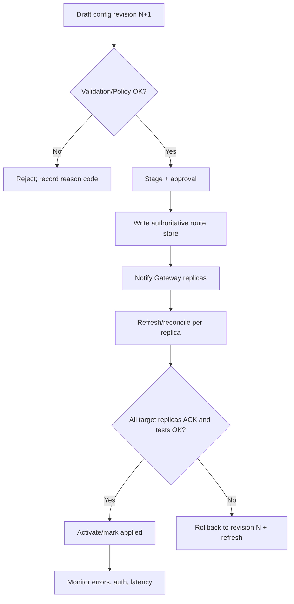

# Storing Routes in Memory, Redis, or Custom Stores by Supported Version

**Chapter:** Dynamic Routes  
**Module:** `SPRING_CLOUD_GATEWAY` — Spring Cloud Gateway

In an API Gateway for microservices, routes determine which requests are accepted, which service they are forwarded to, and which predicates and filters they pass through. Static routes placed in `application.yml` work well when changes are infrequent, whereas a platform with many services may need to **create, update, disable, or delete routes while the Gateway is running** without restarting the entire cluster. This raises critical questions: **where are dynamic route definitions stored, do they survive restarts, and when do Gateway replicas observe changes?**

Spring Cloud Gateway **Server WebFlux** provides the `RouteDefinitionRepository` abstraction along with version-dependent implementations, including `InMemoryRouteDefinitionRepository` and `RedisRouteDefinitionRepository`. Additionally, applications can build their own route store backed by SQL, Redis, Config Server, or a custom source through the appropriate interfaces. However, successfully saving a `RouteDefinition` **does not automatically guarantee** that the route has been applied inside every process's `CachingRouteLocator`. Definitions, runtime routes, and caches must be clearly distinguished; route changes also interact with authentication, rate limiting, circuit breakers, retries, TLS, service discovery, governance, and audit logs.

> **Version scope:** The primary hands-on examples use **Spring Cloud Gateway Server WebFlux** with starter names and configuration prefixes from recent release trains (such as Gateway 5.0/5.1, matching the Spring Cloud/Boot versions selected by the BOM). Current WebFlux documentation includes a *Sharing Routes between multiple Gateway instances* page where some guide snippets still show the older `spring.cloud.gateway.redis-route-definition-repository.enabled` property; the 5.0/5.1 Configuration Properties reference uses the `spring.cloud.gateway.server.webflux.redis-route-definition-repository.enabled` prefix. Always verify against the exact **running version** rather than assuming these names are interchangeable. Gateway **Server Web MVC** and **Proxy Exchange** have different pipeline and extension models: do not copy reactive interfaces, endpoints, or WebFlux configurations verbatim without consulting the documentation for the same release train.

## 1. Learning Objectives

After this lesson, you will be able to:

1. Distinguish `RouteDefinition`, runtime `Route`, `RouteDefinitionLocator`, `RouteDefinitionWriter`, `RouteDefinitionRepository`, and `RouteLocator`.
2. Explain the lifecycle **save definition → emit refresh event → build runtime route → route requests**.
3. Evaluate trade-offs between **in-memory**, **Redis**, and **custom stores** in terms of durability, consistency, HA, and operations.
4. Use Actuator APIs safely to add/read/delete dynamic routes on a **locally running test** WebFlux Gateway.
5. Enable `RedisRouteDefinitionRepository` with the Reactive Redis dependency and identify the version-appropriate property key.
6. Design a mechanism to refresh all Gateway replicas after shared store updates without equating "shared storage" with "synchronized caches."
7. Sketch a custom `RouteDefinitionRepository` backed by durable storage while handling race conditions, write errors, idempotency, auditing, and rollback.
8. Mitigate dynamic route risks such as SSRF, exposed Actuator write endpoints, route shadowing, authorization bypass, header/path corruption, token relay issues, and TLS misconfiguration.
9. Build a test checklist covering create/update/delete/restart/failover/refresh/observability for the exact Gateway version deployed.

## 2. `RouteDefinition` vs. Runtime `Route`

A typical route configuration:

```yaml
spring:
  cloud:
    gateway:
      server:
        webflux:
          routes:
            - id: catalog-public
              uri: lb://catalog-service
              predicates:
                - Path=/api/catalog/**
                - Method=GET
              filters:
                - StripPrefix=2
                - AddRequestHeader=X-Gateway-Route, catalog-public
              order: 10
```

Here, `catalog-public` is the **route ID**; `lb://catalog-service` is the **logical target URI** resolved to an instance by LoadBalancer; `Path`/`Method` decide which requests match; filters transform paths/headers; and `order` guides precedence across routes.

Classes in Gateway Server WebFlux carry distinct responsibilities:

| Concept | Responsibility |
|---|---|
| `RouteDefinition` | Data representation of a route: `id`, `uri`, `predicates`, `filters`, `order`, metadata |
| `RouteDefinitionLocator` | Source for **reading** `RouteDefinition`s; method `Flux<RouteDefinition> getRouteDefinitions()` |
| `RouteDefinitionWriter` | Capability to **write/delete** definitions; methods `save(Mono<RouteDefinition>)` and `delete(Mono<String>)` |
| `RouteDefinitionRepository` | Interface combining **Locator + Writer**; suited for mutable dynamic route stores |
| `RouteLocator` | Supplies built **runtime `Route`** instances with executable predicates and filters |
| `CachingRouteLocator` | Caches runtime routes to avoid rebuilding definitions on every request; listens for refresh events to update |
| `RoutePredicateHandlerMapping` | Finds a matching runtime route for a request and selects its handler/filter chain |
| `RefreshRoutesEvent` | Signal requesting a refresh of runtime routes **within the current ApplicationContext** |



**Core point:** `RouteDefinitionRepository` is where **definitions are stored and retrieved**. It is not the cache queried to select a route on every HTTP request. Thus, updating a database or Redis may not take immediate effect if `CachingRouteLocator` still holds stale data.

### 2.1. A Gateway Can Have Multiple `RouteDefinition` Sources

Per the configuration documentation, `PropertiesRouteDefinitionLocator` loads routes from properties/YAML; additional locators may exist for service discovery or dynamic repositories. The framework typically aggregates these sources. Seeing a route in `GET /actuator/gateway/routes` does not mean it is stored in Redis:

- **YAML/property routes:** created from application config; Actuator generally treats them as **read-only**.
- **Java `RouteLocator` beans:** routes built in code, not entries managed by a writable repository.
- **DiscoveryClient locator:** can auto-generate routes from discovered services, not entries manually saved by admins.
- **InMemory/Redis/custom repository:** dynamic route data source managed via save/delete.

If **route IDs or predicates/paths overlap** across sources, never assume the system always merges or prioritizes the new source safely. Establish ID conventions, `order`, source inventories, and tests verifying which route is actually selected.

### 2.2. Three Distinct States

```text
(1) Persistent route definition:
      catalog-dynamic -> uri=http://catalog-v2:8081

(2) Runtime route cache on Gateway A:
      catalog-dynamic -> uri=http://catalog-v1:8081

(3) Runtime route cache on Gateway B:
      catalog-dynamic -> route does not exist yet
```

This can occur temporarily when saving to the route store succeeds, yet one or more Gateway instances have not refreshed. **"Redis holds v2" does not prove the entire cluster has shifted traffic to v2.**

## 3. Comparing Three Storage Approaches

| Criterion | In-Memory | Built-In Redis | Custom Store |
|---|---|---|---|
| Implementation | `InMemoryRouteDefinitionRepository` | `RedisRouteDefinitionRepository` (when supported by version) | Custom `RouteDefinitionRepository` or appropriate locator/writer |
| Survives Gateway restart | **No** for RAM-only routes | Can persist if Redis retains data per persistence/retention policy | Follows DB/KV/Config Store durability |
| Shared data across replicas | No | Yes, when sharing the same Redis namespace/connection | Yes when all replicas read the same store |
| Auto-synced runtime route cache | No | **Do not assume**; requires refresh on each replica | Requires designing refresh/notification |
| Complexity | Low | Medium: Redis HA/auth/TLS/namespace | High: schema, codecs, versioning, auditing, retries, failover |
| Change coordination | Single process | Shared storage + refresh fan-out | Control plane / DB transactions + refresh fan-out |
| Best suited for | Demos, single-instance dev, ephemeral state | Multiple Gateways sharing the same definitions | Production requiring audits, approvals, migrations/rollback |
| Key risks | Lost routes on restart, replica drift | Stale route cache, Redis outage, missing ACLs | Blocking I/O, bad schemas, dual-write/races, buggy custom code |

**None of these options gives consistency for free.** Shared storage solves "reading from the same source," but it does not solve whether every process *has* reloaded that source, which revision is accepted, or whether bad routes are blocked before activation.

## 4. Choosing the Right Version, Gateway Flavor, and Endpoints

For recent **Gateway Server WebFlux** releases, static route config usually lives under:

```properties
spring.cloud.gateway.server.webflux.routes[0].id=catalog-public
spring.cloud.gateway.server.webflux.routes[0].uri=http://localhost:8081
```

Older documentation may use:

```properties
spring.cloud.gateway.routes[0].id=catalog-public
spring.cloud.gateway.routes[0].uri=http://localhost:8081
```

Similarly, the Redis repository has a new property key in Configuration Properties 5.0/5.1:

```properties
spring.cloud.gateway.server.webflux.redis-route-definition-repository.enabled=true
```

In some **Sharing Routes** pages and earlier release trains, you will still encounter:

```properties
spring.cloud.gateway.redis-route-definition-repository.enabled=true
```

**Rule of thumb:** check the *Configuration Properties* reference matching **the exact artifact version in your application**, verify property binding and auto-configuration at runtime, and only then select the key. Do not enable both properties "just in case," and do not treat `/docs/current/reference/html` URLs as proof of the latest version; those pages may reflect older releases.

| Variant | Specific Notes |
|---|---|
| **Gateway Server WebFlux** | Reactive `RouteDefinitionRepository`, `RefreshRoutesEvent`, and Actuator APIs covered in this lesson |
| **Gateway Server Web MVC** | WebMvc.fn/Servlet pipeline; check the exact route update and repository support in that release's reference |
| **Proxy Exchange** | Helper for proxying inside annotated controllers; does not provide the full Gateway route repository mechanism |

**Spring Cloud BOM:** use a release train compatible with your Spring Boot version; do not mix `spring-cloud-gateway-server` 5.x with incompatible Spring Boot or Spring Cloud Commons versions. If running Spring Boot 3.x, check the matching starter and Actuator access configuration; if running Boot 4.x, select dependencies and plugins provided by that BOM/Initializr.

## 5. Lab — Building a Backend to Verify Routed Paths and Headers

We will use a simple Spring Boot MVC backend listening only on `8081` with a `GET /items/{sku}` endpoint. The backend helps distinguish "route does not exist" from "route exists, but path rewrite or backend is wrong."

| Component | Port | Role |
|---|---|---|
| `catalog-backend` | `8081` | Returns JSON showing received path and header |
| `catalog-gateway` | `8080` | Accepts public requests; creates/deletes dynamic routes |
| Gateway management server | `9090`, **localhost-only** in lab | Actuator endpoints to create/read/delete/refresh routes |
| Redis (extension lab) | `6379` | Shared route store, used only for the Redis portion |

### 5.1. Create the Backend

At [Spring Initializr](https://start.spring.io/), create a Maven project on Java 17+ with Spring Web on a compatible Spring Boot 3.x version, using package `com.example.catalog`. If using Boot 4.x, choose the matching starter provided by that version's Initializr.

`src/main/resources/application.yml`:

```yaml
server:
  port: 8081
spring:
  application:
    name: catalog-backend
```

`CatalogApplication.java`:

```java
package com.example.catalog;

import org.springframework.boot.SpringApplication;
import org.springframework.boot.autoconfigure.SpringBootApplication;

@SpringBootApplication
public class CatalogApplication {
    public static void main(String[] args) {
        SpringApplication.run(CatalogApplication.class, args);
    }
}
```

`CatalogController.java`:

```java
package com.example.catalog;

import java.util.LinkedHashMap;
import java.util.Map;
import jakarta.servlet.http.HttpServletRequest;
import org.springframework.http.ResponseEntity;
import org.springframework.web.bind.annotation.GetMapping;
import org.springframework.web.bind.annotation.PathVariable;
import org.springframework.web.bind.annotation.RestController;

@RestController
public class CatalogController {

    @GetMapping("/items/{sku}")
    public ResponseEntity<Map<String, String>> item(
            @PathVariable String sku,
            HttpServletRequest request) {
        Map<String, String> result = new LinkedHashMap<>();
        result.put("service", "catalog-backend");
        result.put("sku", sku);
        result.put("path", request.getRequestURI());
        result.put("routeMarker", request.getHeader("X-Route-Marker"));

        return ResponseEntity.ok()
            .header("X-Backend", "catalog-8081")
            .body(result);
    }
}
```

The `routeMarker` field shows whether the Gateway filter actually added the request header; it is **not user authentication**. Never grant data access based on a header that a client could spoof.

### 5.2. Run the Backend and Verify Directly

In the backend directory:

```bash
./mvnw spring-boot:run
```

On Windows PowerShell:

```powershell
.\mvnw.cmd spring-boot:run
```

In another terminal:

```bash
curl -i "http://localhost:8081/items/SKU-42"
```

Sample output:

```json
{
  "service": "catalog-backend",
  "sku": "SKU-42",
  "path": "/items/SKU-42",
  "routeMarker": null
}
```

If the direct backend call returns 404 or fails to connect, fix the backend/port before testing dynamic routes. If Gateway runs inside a separate container, `localhost:8081` from within Gateway will **not** point to the backend container; use a valid network/DNS address.

## 6. Lab — WebFlux Gateway Using an In-Memory Route Store

Create a separate **Spring Cloud Gateway Server WebFlux** project on port `8080`, package `com.example.gateway`. Configure a Spring Cloud BOM compatible with Boot, then add the Gateway and Actuator starters; on modern release trains these are named:

```xml
<dependencies>
    <dependency>
        <groupId>org.springframework.cloud</groupId>
        <artifactId>spring-cloud-starter-gateway-server-webflux</artifactId>
    </dependency>
    <dependency>
        <groupId>org.springframework.boot</groupId>
        <artifactId>spring-boot-starter-actuator</artifactId>
    </dependency>
</dependencies>
```

**No Redis is needed** for this first part. Without another writable repository overriding the default bean, Gateway WebFlux can use `InMemoryRouteDefinitionRepository`. Routes created via write endpoints exist only in the RAM of **the current Gateway instance**.

### 6.1. Gateway `application.yml`

```yaml
server:
  port: 8080

spring:
  application:
    name: catalog-dynamic-gateway-lab
  cloud:
    gateway:
      server:
        webflux:
          routes:
            - id: catalog-static
              uri: http://localhost:8081
              predicates:
                - Path=/static/items/**
                - Method=GET
              filters:
                - StripPrefix=1
                - AddRequestHeader=X-Route-Marker, static-route

management:
  server:
    port: 9090
    address: 127.0.0.1
  endpoint:
    gateway:
      access: unrestricted
  endpoints:
    web:
      exposure:
        include: health,info,gateway
```

Here **only the `catalog-static` route is in YAML**. We will create `catalog-dynamic` via Actuator without adding it to `application.yml`. That makes the difference between fixed routes and repository-managed writable/deletable routes crystal clear.

**Security warning:** Setting `management.endpoint.gateway.access: unrestricted` permits **route write operations**. `management.server.address: 127.0.0.1` restricts the management endpoint to loopback during this local lab, and port `9090` is separate from `8080`. **Never copy this configuration onto a public server or the Internet.** Production environments should set `read-only` or disable write access altogether; if a write API is truly required, you must enforce network isolation, strong authentication/authorization, auditing, and restrictions on allowed URIs, predicates, and filters.

Older Spring Boot/Gateway versions may use `management.endpoint.gateway.enabled=true` or another config namespace; current docs recommend `access=read-only` and require `unrestricted` for POST/DELETE/refresh operations. Never assume an endpoint is protected just because its path starts with `/actuator/`. If Spring Security is enabled in your deployment, check the `SecurityWebFilterChain` governing the management context.

### 6.2. Start Gateway and Verify the Static Route

Start the backend on `8081` first, then Gateway on `8080`. Test:

```bash
curl -i "http://localhost:8080/static/items/SKU-42"
```

Expected: backend receives `/items/SKU-42` and `routeMarker=static-route`. Next:

```bash
curl -i "http://localhost:8080/dynamic/items/SKU-42"
```

Since no matching route exists yet, this normally returns **404 from Gateway** without reaching the backend. This is an important baseline before dynamic creation.

### 6.3. Check Actuator (on the Machine Running Gateway)

```bash
curl -i "http://127.0.0.1:9090/actuator/health"
curl -i "http://127.0.0.1:9090/actuator/gateway/routes"
```

The route list should contain `catalog-static`. You can also check `GET /actuator/gateway/routedefinitions` to inspect definitions, though **runtime routes** and **route definitions** do not share identical JSON shapes. In some versions, `GET /actuator/gateway/routes/{id}` returns representations of built predicates/filters, **not a JSON payload ready to be posted back to create a route**.

If `/actuator/gateway/routes` is unreachable: check the management port, `management.endpoints.web.exposure.include`, `management.endpoint.gateway.access`, Spring Security, the release train, and the exact loopback address. If Gateway runs inside a container, container `127.0.0.1` is not directly reachable from the host without proper network administration; never expose the management port publicly just to work around a lab connectivity issue.

## 7. Creating a Route via Actuator: Storing in RAM and Refreshing

According to the current **Gateway Server WebFlux Actuator API** reference, creating a route via:

```text
POST /actuator/gateway/routes/{id}
```

accepts JSON with `predicates` and `filters` in **shortcut DSL string form**, for example:

```json
{
  "uri": "http://localhost:8081",
  "predicates": [
    "Path=/dynamic/items/**",
    "Method=GET"
  ],
  "filters": [
    "StripPrefix=1",
    "AddRequestHeader=X-Route-Marker, dynamic-route"
  ],
  "order": 0
}
```

This is the **POST body**, while the route ID `catalog-dynamic` goes into the management endpoint path. It does not use `route_id` or the verbose JSON format of a runtime `Route`. If an older version expects a different structure, verify against the **Actuator API docs for that exact version** before sending; never copy the JSON response of `GET /routes/{id}` assuming it works as a PUT/PATCH payload.

### 7.1. Create the Route with cURL (Bash)

```bash
curl -i -X POST \
  "http://127.0.0.1:9090/actuator/gateway/routes/catalog-dynamic" \
  -H "Content-Type: application/json" \
  --data '{
    "uri": "http://localhost:8081",
    "predicates": ["Path=/dynamic/items/**", "Method=GET"],
    "filters": [
      "StripPrefix=1",
      "AddRequestHeader=X-Route-Marker, dynamic-route"
    ],
    "order": 0
  }'
```

Current Actuator docs specify **201 Created** on success. After this step, the definition is saved in the repository, but you **must refresh the route cache**:

```bash
curl -i -X POST "http://127.0.0.1:9090/actuator/gateway/refresh"
```

Per the documentation, the refresh endpoint returns HTTP `200` with an empty body. Internal refresh steps may run asynchronously; in real systems, you must **verify that the new route appears and serves requests**, rather than relying solely on the 200 status.

### 7.2. Create the Route with PowerShell

To avoid JSON escaping headaches on Windows, use a PowerShell here-string:

```powershell
$body = @'
{
  "uri": "http://localhost:8081",
  "predicates": ["Path=/dynamic/items/**", "Method=GET"],
  "filters": [
    "StripPrefix=1",
    "AddRequestHeader=X-Route-Marker, dynamic-route"
  ],
  "order": 0
}
'@

Invoke-RestMethod -Method Post -Uri "http://127.0.0.1:9090/actuator/gateway/routes/catalog-dynamic" -ContentType "application/json" -Body $body
Invoke-RestMethod -Method Post -Uri "http://127.0.0.1:9090/actuator/gateway/refresh"
```

In PowerShell, `curl` may be an alias for `Invoke-WebRequest`; if you want genuine cURL syntax, invoke `curl.exe`. Never embed client secrets or admin bearer tokens in shared shell scripts or terminal histories.

### 7.3. Verify the Route Has Been Applied

```bash
curl -i "http://127.0.0.1:9090/actuator/gateway/routes"
curl -i "http://localhost:8080/dynamic/items/SKU-42"
```

Sample JSON returned by the backend:

```json
{
  "service": "catalog-backend",
  "sku": "SKU-42",
  "path": "/items/SKU-42",
  "routeMarker": "dynamic-route"
}
```

This proves:

1. `Path=/dynamic/items/**` matched the external request;
2. `StripPrefix=1` stripped `dynamic` so downstream received `/items/SKU-42`;
3. `AddRequestHeader` was applied by the dynamic route;
4. **No Gateway restart was needed** for the new route to become active on that instance.

If you get a 404 after `POST /routes` succeeded, check `POST /refresh`, the route ID, the `Method` predicate, the `StripPrefix` filter, endpoint/backend logs, and route `order`. Do not jump to the conclusion that the repository lost data when the route is saved but `CachingRouteLocator` has not yet rebuilt.

## 8. Update, Delete, Restart: Verifying RAM Store Durability

### 8.1. Do Not Blindly Overwrite a Route ID with POST

Current WebFlux Actuator documentation contains an important warning: **do not POST an already existing route ID** to update it through this management endpoint. In the documented implementation/flow, doing so can leave duplicate internal route definitions and cause `GET /actuator/gateway/routes` to fail with `500`. To update a route **created via Actuator**, the documented procedure is:

1. `DELETE /actuator/gateway/routes/catalog-dynamic`.
2. `POST /actuator/gateway/routes/catalog-dynamic` with the new body.
3. `POST /actuator/gateway/refresh`.

Example updating the route marker:

```bash
# 1) Delete the Actuator-created route.
curl -i -X DELETE \
  "http://127.0.0.1:9090/actuator/gateway/routes/catalog-dynamic"

# 2) Recreate the same ID with new configuration.
curl -i -X POST \
  "http://127.0.0.1:9090/actuator/gateway/routes/catalog-dynamic" \
  -H "Content-Type: application/json" \
  --data '{
    "uri": "http://localhost:8081",
    "predicates": ["Path=/dynamic/items/**", "Method=GET"],
    "filters": [
      "StripPrefix=1",
      "AddRequestHeader=X-Route-Marker, updated-route"
    ],
    "order": 0
  }'

# 3) Apply the new route.
curl -i -X POST \
  "http://127.0.0.1:9090/actuator/gateway/refresh"

# 4) Verify the backend receives the new marker.
curl -i "http://localhost:8080/dynamic/items/SKU-42"
```

**Limitation of this approach:** DELETE → POST → refresh is **not an atomically visible transaction** across concurrent requests or replicas; there is a window where the old route is removed from the store before the new config is saved, and route caches may diverge. For production, you need a control plane with versioning, validation, staging/canary, compare-and-swap, rollback, and an explicit refresh/ACK protocol.

### 8.2. Cannot Delete a Static YAML Route via the Same Endpoint

Try this in the lab:

```bash
curl -i -X DELETE \
  "http://127.0.0.1:9090/actuator/gateway/routes/catalog-static"
```

According to current Gateway Actuator docs, routes declared in `application.yml` or created via `@Bean` are **not entries in the writable repository**, so `DELETE` can return **404 Not Found**. That does not mean Gateway lacks `catalog-static`: the route still exists because it comes from another `RouteDefinitionLocator`/source.

Similarly, a route generated by `DiscoveryClient` does not automatically become a writable entry just because an administrator sees it in `GET /routes`. Management tooling must identify **which source owns a route** before attempting writes or deletes.

### 8.3. Deleting a Dynamic Route and Refreshing

```bash
curl -i -X DELETE \
  "http://127.0.0.1:9090/actuator/gateway/routes/catalog-dynamic"

curl -i -X POST \
  "http://127.0.0.1:9090/actuator/gateway/refresh"

curl -i "http://localhost:8080/dynamic/items/SKU-42"
curl -i "http://localhost:8080/static/items/SKU-42"
```

Expected: `/dynamic/items/**` is no longer handled by the deleted route (typically 404 if no other route matches), while `/static/items/**` continues working. If `/dynamic/items/**` still returns 200, check for another route with a matching predicate, an incomplete refresh, a different instance handling the request, or repository state that was not actually deleted.

### 8.4. Testing Restart of the RAM-Backed Gateway

After **recreating** `catalog-dynamic` and verifying it works, restart **only the Gateway**, leaving the backend running. With `InMemoryRouteDefinitionRepository`:

```text
Before restart:
  catalog-static   -> from application.yml
  catalog-dynamic  -> from RAM via Actuator

After restart:
  catalog-static   -> remains, because it is recreated from YAML
  catalog-dynamic  -> lost, because the RAM repository is recreated empty
```

Check `GET /actuator/gateway/routes` and request `/dynamic/items/SKU-42` again. Never confuse the durability of `application.yml` with the durability of an in-memory repository: **they are two separate route sources**.

### 8.5. When Is RAM-Only Storage Reasonable?

A RAM repository is suitable for:

- Labs, demos, and single-instance development environments.
- Short-lived routes that can be reconstructed from another authoritative source.
- Routing experiments that do not require persistence across restarts.

RAM is unsuitable as the **source of truth** for a production cluster if every replica must see the same dynamic routes. If Gateway A holds a route while B does not, a client-facing load balancer will produce intermittent **200 vs. 404** failures even while both processes appear healthy.

## 9. Programmatic Control: Writing Routes via `RouteDefinitionWriter` and Emitting Refresh

In Gateway Server WebFlux, you do not have to expose writable Actuator endpoints for an internal management system. An **authenticated and authorized** control plane can use the `RouteDefinitionWriter` abstraction directly; code must keep everything inside the reactive pipeline and emit refresh **only after saving succeeds**.

```java
package com.example.gateway;

import org.springframework.cloud.gateway.event.RefreshRoutesEvent;
import org.springframework.cloud.gateway.route.RouteDefinition;
import org.springframework.cloud.gateway.route.RouteDefinitionWriter;
import org.springframework.context.ApplicationEventPublisher;
import org.springframework.stereotype.Service;
import reactor.core.publisher.Mono;

@Service
public class RouteChangeService {
    private final RouteDefinitionWriter writer;
    private final ApplicationEventPublisher publisher;

    public RouteChangeService(
            RouteDefinitionWriter writer,
            ApplicationEventPublisher publisher) {
        this.writer = writer;
        this.publisher = publisher;
    }

    // Call only with a validated/allowlisted RouteDefinition.
    public Mono<Void> saveAndRefresh(RouteDefinition validated) {
        return writer.save(Mono.just(validated))
            .then(Mono.fromRunnable(
                () -> publisher.publishEvent(new RefreshRoutesEvent(this))));
    }

    public Mono<Void> deleteAndRefresh(String id) {
        return writer.delete(Mono.just(id))
            .then(Mono.fromRunnable(
                () -> publisher.publishEvent(new RefreshRoutesEvent(this))));
    }
}
```

Key notes on this code:

- `save(Mono<RouteDefinition>)` and `delete(Mono<String>)` are **reactive operations**; never call `.block()` or `.subscribe()` carelessly inside services or controllers.
- `.then(...)` guarantees the publisher runs **only after the save/delete operation completes successfully**.
- `RefreshRoutesEvent` is published only inside the **ApplicationContext of the current Gateway instance**.
- Publishing the event **does not create a distributed transaction** and does not guarantee all replicas have updated their route caches.
- `saveAndRefresh` **does not inherently provide create-if-absent, optimistic locking, or safe upserts across all implementations**. Depending on the repository, duplicate route IDs may require an explicit replacement policy; in particular, do not cite this method to claim Actuator POSTs on the same ID are safe.
- This method assumes `RouteDefinition` has already passed authentication and validation; it lacks SSRF checks, admin authz, versioning, auditing, and rollback, so it is **not yet a production control plane**.

### 9.1. Why Not Call `subscribe()` Right After `writer.save`?

Writing:

```java
// Not recommended: the two tasks are not ordered sequentially.
writer.save(Mono.just(route)).subscribe();
publisher.publishEvent(new RefreshRoutesEvent(this));
```

can emit the refresh **before** the save completes—or even if it fails—causing Gateway to reload stale data. Chaining reactively with `then(...)` preserves ordering within a single request handler. Meanwhile, **propagating the event to other replicas** remains a separate problem.

### 9.2. What Happens When a Route Is Deleted or Changed Mid-Traffic?

A route can be deleted while:

- One request has already been matched by Gateway and is executing its filter chain;
- Another request has not started route selection yet;
- A runtime cache has not refreshed yet;
- A backend is still processing an earlier request.

Never expect deleting a route to **cleanly abort every in-flight request** or immediately revoke an access token that was already relayed. For emergency access revocation, combine authorization/revocation and network policies rather than relying solely on route deletion.

## 10. `RedisRouteDefinitionRepository`: Sharing Definitions Across Replicas

In supported **Gateway Server WebFlux** versions, `RedisRouteDefinitionRepository` is a `RouteDefinitionRepository` implementation enabling multiple Gateway instances to read and write **the same route store** in Redis. It is **distinct from** `RedisRateLimiter`: even though both can use Redis, one stores **route definitions** while the other manages counters/token buckets.

### 10.1. Reactive Redis Dependency

In the Gateway project from section 6, add:

```xml
<dependency>
    <groupId>org.springframework.boot</groupId>
    <artifactId>spring-boot-starter-data-redis-reactive</artifactId>
</dependency>
```

This is the dependency specified in Gateway's *Sharing Routes* documentation. Do not add only the synchronous `spring-boot-starter-data-redis` expecting the reactive repository to have all required beans, and do not assume adding Redis RateLimiter automatically wires up route storage properly.

### 10.2. Configuring Gateway to Use Redis (New Namespace)

To switch the lab to Redis, keep the Gateway/Actuator configuration from section 6 and add:

```yaml
spring:
  data:
    redis:
      host: 127.0.0.1
      port: 6379
  cloud:
    gateway:
      server:
        webflux:
          redis-route-definition-repository:
            enabled: true
```

This is an **incremental configuration snippet** to merge into your existing `application.yml`, not a full file replacement. The `enabled` property here matches **Gateway Server WebFlux 5.0/5.1 Configuration Properties**; older releases may use `spring.cloud.gateway.redis-route-definition-repository.enabled`.

In Configuration Properties tables of several recent releases, `redis-route-definition-repository.enabled` defaults to `true`; however, **auto-configuration conditions also depend on the Redis starter, beans, and classpath**. Writing `enabled: true` explicitly in the lab clarifies intent; do not assume the Redis repo bean was created solely because the property is `true`. Verify the Spring context, logs, and restart behavior.

**Environment note:** `127.0.0.1:6379` only applies when Redis and Gateway share the same local network environment. If Gateway runs in Docker or a different Kubernetes namespace, use the appropriate DNS/service/host instead of pointing to the developer laptop's localhost.

### 10.3. Running a Local Test Redis Instance

If Redis is not installed locally and Docker is permitted, you can start **an unauthenticated, loopback-bound Redis** strictly for this lab:

```bash
docker run --rm --name redis-route-lab \
  -p 127.0.0.1:6379:6379 \
  redis:7
```

Never bind test Redis ports to a public network, and never run `FLUSHALL` or wipe data on a Redis shared across multiple applications or tenants. To test persistence across Redis restarts, configure Redis AOF/RDB with a persistent volume; the `--rm` container in this example is **not a Redis durability test**.

### 10.4. Creating a Route via Actuator with Redis Repository Active

Start Redis, backend `8081`, and Gateway `8080/9090`. Ensure no route with ID `catalog-dynamic` already exists in Redis; if one remains from an earlier test, delete **only that lab route** and refresh rather than wiping the entire DB.

Send the POST body from section 7, then run:

```bash
curl -i -X POST "http://127.0.0.1:9090/actuator/gateway/refresh"
curl -i "http://localhost:8080/dynamic/items/SKU-42"
```

If the Redis repository is properly wired, the definition is stored in Redis instead of only in the default `InMemoryRouteDefinitionRepository`. Still, **verify** which repository/writer bean is actually active: an application context with custom repositories, duplicate beans, or the wrong property namespace can behave unexpectedly.

### 10.5. Testing Across a Gateway Restart

Keep Redis running **without deleting its data**, and restart Gateway. On startup, route definitions are loaded from Redis if the repository is configured correctly. Once runtime routes are built, `/dynamic/items/SKU-42` should work again without re-creating the route via Actuator.

Comparison:

| Event | RAM Repository | Redis Repository |
|---|---|---|
| Restart one Gateway | Dynamic routes in RAM are lost | Routes can reload from Redis if data remains |
| Restart Redis without disk persistence | N/A | Data may be lost depending on Redis persistence |
| Create route on Gateway A | Only A stores a local entry | A writes to shared Redis |
| Running Gateway B | Does not see A's route | **Can see it after B refreshes** from shared Redis |
| Redis loses connectivity | Redis not needed | Saving/refreshing/reading routes from store may fail; old runtime cache may persist temporarily |

**Never promise zero downtime** based on Redis alone. If Gateway cannot load routes at startup, dynamic routes may be missing. Production Redis requires authentication, ACLs, network isolation, TLS, HA, backup/restore, and resilience testing.

## 11. Two Gateway Replicas: Shared Redis ≠ Shared Runtime Route Cache

Consider:

```text
                  +-------------------+
Admin API ------> | Redis route store |
                  +-------------------+
                      ^           ^
                      |           |
       Gateway A (8080/9090)  Gateway B (8082/9092)
         CachingRouteLocator    CachingRouteLocator
            independent            independent
```

Two instances can read **the same definitions** yet hold **separate runtime caches**. Saving a route to Redis does not automatically broadcast `RefreshRoutesEvent` into Gateway B's Spring ApplicationContext.

### 11.1. Running a Second Instance for the Lab

On a development machine, you can start a second instance of the same Gateway app with:

```bash
SERVER_PORT=8082 MANAGEMENT_SERVER_PORT=9092 ./mvnw spring-boot:run
```

If using PowerShell:

```powershell
$env:SERVER_PORT = "8082"
$env:MANAGEMENT_SERVER_PORT = "9092"
.\mvnw.cmd spring-boot:run
```

Run this in a **second terminal** pointing to the same Redis and backend. If a Maven wrapper/build directory is locked by another process, run two pre-built JARs or separate container environments rather than letting concurrent builds fight over build output.

Management port `9092` must also bind only to loopback or a private management network. Never expose both Actuator ports publicly just to test multi-instance behavior.

### 11.2. Observing Drift Before Refresh

1. Create `catalog-dynamic` via **A**'s actuator (`9090`).
2. Refresh **A** and verify `http://localhost:8080/dynamic/items/SKU-42` succeeds.
3. Call `http://localhost:8082/dynamic/items/SKU-42` on **B** before explicitly refreshing B.
4. If B still returns 404, that proves B's route cache has not loaded the new definition yet.
5. Run:

```bash
curl -i -X POST "http://127.0.0.1:9092/actuator/gateway/refresh"
curl -i "http://localhost:8082/dynamic/items/SKU-42"
```

After refreshing, B reads Redis and the route starts working. **Do not claim B always returns 404 before refresh**: another sync/refresh mechanism, a restart, or a pre-existing route could make B aware of it earlier. Start experiments from a clean, known state and inspect each instance and route ID individually.

### 11.3. Why Is a Distributed Refresh Event Needed?

In a real cluster, operators cannot manually call an endpoint on every pod after every change. You need a **fan-out** mechanism:



Implementation options include Spring Cloud Bus (when compatible with your version/infrastructure), Redis Pub/Sub, a message broker, an event stream, or periodic polling by `route-config-revision`. **This is an additional operational design**, not something `RedisRouteDefinitionRepository` provides out of the box.

### 11.4. Refresh Events Can Be Lost

Redis Pub/Sub does not guarantee message retention for offline consumers. If Gateway B disconnects right when a route changes, it can miss the notification. Production therefore needs **reconciliation**:

- Store the route set's **revision/version** alongside the route data;
- Each Gateway tracks the latest revision it has applied;
- On startup or reconnect, compare the local revision against the authoritative store;
- Poll periodically or reload upon receiving an event;
- Record `desiredRevision`/`appliedRevision` and retry with backoff;
- Report "cluster-wide route rollout succeeded" only once the policy-defined quorum/replica count has confirmed.

Never treat a `200` from `POST /actuator/gateway/refresh` as an ACK from **the whole cluster**. It only reports on the instance that received the request; data loading and validation may even happen asynchronously.

### 11.5. Securing Redis in Production

Keep these safeguards in place:

1. Use Redis ACLs/users with passwords from a secret manager; never hardcode credentials in config files or URL logs.
2. Enable TLS and verify certificates/hostnames when connecting to Redis across untrusted networks.
3. Isolate **route control-plane** Redis from transient rate-limit counters when quota or performance profiles differ.
4. Configure persistence (AOF/RDB per RPO/RTO), backup/restore, and appropriate HA.
5. Restrict who can write route keys and trigger refreshes; cap route definition sizes.
6. Use explicit namespaces/tenants on shared Redis; never run `FLUSHDB/FLUSHALL` on a shared store.
7. Monitor latency, connection pools, read failures, and memory eviction, and test Gateway behavior when Redis is unreachable.

If Redis is also used for Spring Cloud Gateway's `RateLimiter`, do not assume the rate limiter and route repository share identical failure modes; the two features have different semantics.

## 12. Custom Store: `RouteDefinitionLocator` or `RouteDefinitionRepository`?

Not every system wants routes stored in Redis. Some require approval workflows, author tracking, revision history, tenant isolation, staging/active states, and rollback. In those cases, a relational database or Config Service may serve as the **source of truth**.

Choose the interface matching the required capability:

| Need | Appropriate Extension Point |
|---|---|
| Only **read** routes from an API/DB/config owned elsewhere | `RouteDefinitionLocator` |
| Need **writes/deletes** via Gateway Writer/Actuator | `RouteDefinitionRepository` (Locator + Writer) |
| Build runtime `Route`s in static code | `RouteLocator` or `RouteLocatorBuilder` |
| Route services via service discovery | `DiscoveryClientRouteDefinitionLocator` |
| Route data needing versioning/canary/approval | Control-plane service + DB + `RouteDefinitionLocator`/`Repository` + fan-out refresh |

If the system **only wants Gateway to read** configurations managed by a central service, a **read-only** `RouteDefinitionLocator` can be safer than letting Gateway write directly to the store. Conversely, if you need save/delete operations through Gateway's abstraction, `RouteDefinitionRepository` fits.

### 12.1. Avoid Blocking Database Reads in the Reactive Route Pipeline

In Gateway WebFlux, `getRouteDefinitions()` returns `Flux<RouteDefinition>`. Avoid writing:

```java
// DO NOT DO THIS: blocking JDBC on a reactive thread.
public Flux<RouteDefinition> getRouteDefinitions() {
    List<RouteDefinition> definitions = jdbcTemplate.query(...);
    return Flux.fromIterable(definitions);
}
```

The design flaw is **executing blocking JDBC before returning the `Flux`**, which can stall Netty threads or the refresh pipeline. If storing routes in Postgres, consider **Spring Data R2DBC**/reactive drivers, or isolate JDBC polling onto a controlled, bounded scheduler. For use cases requiring strong transactional DDL/approvals, keep the control plane blocking in a separate service and have Gateway consume only approved snapshots.

### 12.2. Postgres + R2DBC Example for a `RouteDefinition` Store

This is a **reference architectural example** on Gateway Server WebFlux / Spring Framework 6.x, **not a production-ready repository**. Its goal is to show how the interface's three methods connect to durable storage; you must add validation, versioning, auditing, and codec tests before real-world use.

Dependencies (inside the project with the Gateway starter from section 6):

```xml
<dependency>
    <groupId>org.springframework.boot</groupId>
    <artifactId>spring-boot-starter-data-r2dbc</artifactId>
</dependency>
<dependency>
    <groupId>org.postgresql</groupId>
    <artifactId>r2dbc-postgresql</artifactId>
</dependency>
```

PostgreSQL schema managed by a **migration tool**:

```sql
CREATE TABLE gateway_route_definitions (
    route_id       VARCHAR(128) PRIMARY KEY,
    definition_json TEXT NOT NULL,
    updated_at     TIMESTAMPTZ NOT NULL DEFAULT CURRENT_TIMESTAMP
);
```

Example connection configuration **for a lab environment**:

```yaml
spring:
  r2dbc:
    url: r2dbc:postgresql://127.0.0.1:5432/gateway_lab
    username: route_admin
    password: ${ROUTE_DB_PASSWORD}
  cloud:
    gateway:
      server:
        webflux:
          redis-route-definition-repository:
            enabled: false
```

When using this approach, **do not enable `RedisRouteDefinitionRepository` at the same time**, and do not create multiple writable repositories with overlapping roles without explicit bean composition. Spring Boot can provide an auto-configured Jackson `ObjectMapper`; the code below assumes this bean and an R2DBC `DatabaseClient` exist.

`SqlRouteDefinitionRepository.java`:

```java
package com.example.gateway;

import com.fasterxml.jackson.core.JsonProcessingException;
import com.fasterxml.jackson.databind.ObjectMapper;
import org.springframework.cloud.gateway.route.RouteDefinition;
import org.springframework.cloud.gateway.route.RouteDefinitionRepository;
import org.springframework.r2dbc.core.DatabaseClient;
import org.springframework.stereotype.Repository;
import reactor.core.publisher.Flux;
import reactor.core.publisher.Mono;

@Repository
public class SqlRouteDefinitionRepository
        implements RouteDefinitionRepository {

    private final DatabaseClient db;
    private final ObjectMapper json;

    public SqlRouteDefinitionRepository(
            DatabaseClient db, ObjectMapper json) {
        this.db = db;
        this.json = json;
    }

    @Override
    public Flux<RouteDefinition> getRouteDefinitions() {
        return db.sql("""
                SELECT definition_json
                FROM gateway_route_definitions
                ORDER BY route_id
                """)
            .map((row, meta) -> row.get("definition_json", String.class))
            .all()
            .map(this::parseRoute);
    }

    @Override
    public Mono<Void> save(Mono<RouteDefinition> routeMono) {
        return routeMono.flatMap(route ->
            Mono.fromCallable(() -> json.writeValueAsString(route))
                .flatMap(payload -> db.sql("""
                        INSERT INTO gateway_route_definitions
                            (route_id, definition_json)
                        VALUES (:id, :json)
                        ON CONFLICT (route_id)
                        DO UPDATE SET
                            definition_json = EXCLUDED.definition_json,
                            updated_at = CURRENT_TIMESTAMP
                        """)
                    .bind("id", route.getId())
                    .bind("json", payload)
                    .fetch()
                    .rowsUpdated()
                    .then()))
            .then();
    }

    @Override
    public Mono<Void> delete(Mono<String> routeIdMono) {
        return routeIdMono.flatMap(id ->
            db.sql("""
                    DELETE FROM gateway_route_definitions
                    WHERE route_id = :id
                    """)
                .bind("id", id)
                .fetch()
                .rowsUpdated()
                .flatMap(rows -> rows > 0
                    ? Mono.<Void>empty()
                    : Mono.error(new IllegalArgumentException(
                        "Unknown route id: " + id))))
            .then();
    }

    private RouteDefinition parseRoute(String payload) {
        try {
            return json.readValue(payload, RouteDefinition.class);
        } catch (JsonProcessingException ex) {
            throw new IllegalStateException(
                "Invalid stored RouteDefinition", ex);
        }
    }
}
```

**Characteristics of this skeleton:**

- `getRouteDefinitions` queries SQL via **non-blocking R2DBC**, returning `Flux<RouteDefinition>`. It does not poll the DB every second; new data enters runtime routes only when Gateway refreshes.
- `save` serializes `RouteDefinition` to JSON and performs an **UPSERT** by ID; `ON CONFLICT` syntax is PostgreSQL-specific. This is a design choice in a **custom repository**, not an endorsement of blindly POSTing duplicate IDs to Actuator against the endpoint's warning.
- `delete` removes by ID and returns an error if not found. In a real implementation, use typed exceptions mapped to clean HTTP statuses in the control plane without logging sensitive route IDs.
- `ObjectMapper` needs codecs compatible with `RouteDefinition` fields for your release train; test round-trip serialization of `predicates`, `filters`, `URI`, and `metadata`. Never enable untrusted polymorphic deserialization.
- `@Repository` registers the bean; if the project also has a Redis repo or other `RouteDefinitionRepository` beans, explicitly resolve a **single authoritative writer** and reader source rather than relying blindly on `@Primary` to mask duplicate route definitions.
- This example **lacks optimistic locking, control-plane transactions, revisions, schema migration versioning, conflict handling, validation, and auditing**. Do not copy it straight into production for sensitive routes.
- `ObjectMapper`/Boot APIs may differ in Boot 4 / Jackson 3; if using newer releases, choose the matching version's codec instead of forcing older dependencies.

### 12.3. Why Are Revisions and Optimistic Locking Needed?

Suppose two admins edit `catalog-dynamic` concurrently:

```text
Admin A reads revision 10, changes backend to catalog-v2
Admin B reads revision 10, changes filters to RemoveRequestHeader
A saves the new route
B saves its route afterward
Last-write-wins result: A's change may be lost
```

Production should store `revision BIGINT`, `updated_by`, and status (`draft`/`approved`/`active`), and use compare-and-swap inside a transaction:

```sql
UPDATE gateway_route_definitions
   SET definition_json = :new_json,
       revision = revision + 1,
       updated_at = CURRENT_TIMESTAMP
 WHERE route_id = :id
   AND revision = :expected_revision;
```

When `rowsUpdated = 0`, reject the update as a conflict (e.g., HTTP 409 in the control plane) instead of silently overwriting. Maintain audit logs and rollback snapshots, especially when a new route alters security filters or targets.

### 12.4. Consistency Between Saving and Emitting Refresh

If the control plane commits to the DB and crashes **before publishing the event**, Gateway replicas will never receive the signal. This is the classic **dual-write** problem between a data store and a message broker.

More resilient operational patterns include:

- **Transactional outbox:** persist the route/revision and an outbox event record in the same transaction; a worker relays the event post-commit with retries.
- **Version polling:** each Gateway periodically compares `desiredRevision` against `appliedRevision`.
- **Reconciliation on startup/reconnect:** synchronize snapshots instead of trusting transient events alone.
- **Idempotent apply:** receiving the same revision multiple times does not create duplicate routes or trigger endless refreshes.

Never advertise "saved to SQL then published to Kafka" as an atomic distributed transaction unless you implement an outbox or compensation strategy.

## 13. Designing a Secure Route Control Plane

A production deployment should separate concerns:



The control plane governs **who** may create which routes and **to which targets**; the Gateway data plane strictly enforces already-approved definitions. Just because route JSON is durably stored does not make it safe.

### 13.1. Pre-Write Validation

| Route Component | Recommended Validation Rule |
|---|---|
| `id` | Allowed character set, unique, namespaced/owned, cannot overwrite system routes |
| `uri` | Allowlist schemes, hostnames/service IDs, ports, and environments; disallow arbitrary URLs |
| `Path`/`Host`/`Method` | Reject overly broad routes or overlaps with `/actuator/**`, `/login/**`, or admin endpoints |
| `Header`/`Cookie` predicates | Never rely on client-supplied headers as an authorization mechanism |
| `filters` | Allowlist permitted filters; block arbitrary auth removal or token relaying |
| `order` | Prevent route shadowing and priority hijacks, especially with catch-all paths |
| `metadata` | Validate types/limits; never store secrets or PII in route metadata |
| Payload size | Cap total routes, predicate/filter counts, regex lengths, and JSON sizes |
| Revision | Optimistic locking, auditing, staging/approval/rollback |

### 13.2. SSRF Risks from Dynamic Destination URIs

If an attacker controls:

```json
{"uri":"http://169.254.169.254","predicates":["Path=/internal/**"]}
```

Gateway can be abused for **server-side request forgery (SSRF)** to access sensitive infrastructure on its internal network. This is why a route-write endpoint is far more dangerous than a typical "config tweak" endpoint.

Policies should block arbitrary destinations—especially loopback, private, link-local, and metadata services per your network trust model; restrict schemes (`http/https/lb/ws/wss/forward`) to approved purposes; restrict service IDs/ports; enforce outbound firewall/egress rules; and never rely solely on hostname regexes. DNS rebinding and HTTP redirects must also be accounted for if arbitrary HTTP URLs are ever permitted.

### 13.3. Dynamic Routes Can Bypass Authentication

Suppose an official route exists:

```yaml
- id: orders-secure
  uri: lb://orders-service
  predicates:
    - Path=/api/orders/**
  filters:
    - TokenRelay
    - RequestRateLimiter=...
```

If an admin or attacker creates another route whose predicate covers `/api/orders/**` with higher priority (`order`) **but omits proper auth/authorization**, requests can match the new route and bypass expected controls.

**Note:** `TokenRelay` merely forwards an existing access token—it does not verify authorization itself; Spring Security at the `WebFilter` layer can intercept before routing, whereas a **route-scoped** auth filter can be bypassed if a new route omits it. Design with defense in depth: Gateway Security policies + backend Resource Server/mTLS + route allowlists and route-overlap tests.

### 13.4. Header Transformation and Credential Leakage

Filters like `AddRequestHeader`, `SetRequestHeader`, `RemoveRequestHeader`, `RewritePath`, or `TokenRelay` strongly impact security. Never permit arbitrary tampering with:

- `Authorization` and cookie/session headers;
- `Forwarded`/`X-Forwarded-*` or `Host` without a trusted proxy policy;
- Headers carrying user IDs, roles, or tenants;
- HTTP response headers used for CORS, CSP, HSTS, or redirects;
- `RewritePath`/`SetPath` bypassing prefix-based route policies.

If a public request is routed to a backend **with a different access-token audience**, never automatically relay the token simply because the route was created cleanly.

### 13.5. Never Expose Writable Actuator Publicly

In production, default to:

```yaml
management:
  endpoint:
    gateway:
      access: read-only
  endpoints:
    web:
      exposure:
        include: health,info,gateway
```

Even with `read-only`, the endpoint can reveal URIs, predicates, backend hosts, and service names. Restrict network access and viewing permissions. When dynamic route updates are required, prefer an **authenticated control plane** with RBAC/MFA, auditing, and policy enforcement; if writable Actuator must be used, isolate management networks, never expose it over public Gateway paths, and thoroughly test filter and security boundaries.

## 14. How Other Gateway Features Are Affected by Dynamic Route Changes

Saving a `RouteDefinition` changes more than a URI. The entire predicate/filter chain can shift; therefore, you must verify boundaries across all other Spring Cloud Gateway features.

### 14.1. Route Predicates and Precedence

Two routes matching `/api/catalog/**` with different `order` values can send requests to different backends. A high-priority `Path=/**` route can **shadow** specific routes so they are never selected. A dynamic route with `Method=GET` will reject `POST`; browser `OPTIONS` preflights may fail to match as discussed under CORS.

When modifying routes:

1. Collect all active route IDs, predicates, and `order` values across every source.
2. Detect `Host`/`Path`/`Method`/`Header`/`Cookie` conflicts.
3. Verify which requests begin matching the new route and which lose matches.
4. Verify the route does not circumvent auth/tenant policies or service path rewrites.
5. Run canary tests or shadow validation before serving full production traffic.

### 14.2. Service Discovery and `lb://` Are Not Route Persistence

If a dynamic route is stored as:

```yaml
id: orders-public
uri: lb://orders-service
predicates:
  - Path=/api/orders/**
filters:
  - StripPrefix=2
```

then `RedisRouteDefinitionRepository` only persists **the logical URI and route config**. To call an actual backend, Gateway still requires **Spring Cloud LoadBalancer** and a valid `ServiceInstance` source (Eureka, Consul, Kubernetes, SimpleDiscoveryClient, etc.). A `503` caused by missing instances does not prove Redis lost the route.

**`DiscoveryClient` Route Definition Locator** can auto-generate routes for newly discovered services. This is **discovering/generating routes from a registry**, distinct from an administrator writing a definition into Redis. If both are enabled, inspect route IDs, URIs, public paths, and security—do not assume discovered routes are persisted to Redis.

### 14.3. Retry, Circuit Breaker, and Timeouts

A dynamic route adding:

```yaml
filters:
  - name: CircuitBreaker
    args:
      name: ordersBreaker
      fallbackUri: forward:/fallback/orders
  - name: Retry
    args:
      retries: 2
```

requires Resilience4j dependencies/configs compatible with **Gateway WebFlux**, a working internal fallback handler, and retry idempotency policies. If an admin can create arbitrary routes while the service lacks a `ReactiveCircuitBreakerFactory`, the route may fail to build; if the filter builds but the backend fails, the fallback URI could return 404.

For requests with bodies, retries may require body caching/replay and increase memory pressure; a `POST` request might already execute business logic before timing out. Never allow dynamic routes to enable retries on payment endpoints or forward tokens to external fallback services without review.

### 14.4. Rate Limiting and Quotas

A dynamic route might omit `RequestRateLimiter`, pick a different `KeyResolver`, or change `RedisRateLimiter` settings—causing a previously user-rate-limited endpoint to suddenly become unlimited after a route edit. **Redis route repository** does not automatically configure **RedisRateLimiter** or vice versa. Both can share Redis infrastructure while using completely separate schemas, keys, and semantics.

Governance must mandate baseline policies for public routes—such as auth + rate limits + request size caps—and test every new route for required filters. Global `default-filters` can establish a baseline layer, though you must still review ordering, security, and per-route exceptions.

### 14.5. TLS/HTTPS and Outbound Policy

A dynamic route might switch targets from:

```text
http://catalog.internal:8081
                |
                v
https://catalog.internal:8443
```

Changing schemes does not guarantee Gateway has the right truststore, matching hostname/SNI, or mTLS client certificate for the new backend. TLS errors cause `5xx` responses or trip circuit breakers as dependency failures. Verify:

- Schemes `http`/`https`/`lb`/`ws`/`wss`/`forward` are allowlisted by route category;
- DNS resolution, egress firewall rules, host/port, and resolved IPs;
- Truststore/certificate validation, SNI, and mTLS where required;
- `Host`/`X-Forwarded-*` headers cannot be spoofed by clients against trust policies;
- Backend paths and API contracts after `RewritePath`/`StripPrefix` match the target deployment.

Never disable TLS certificate validation just to make a new dynamic route "work."

### 14.6. CORS, Sessions, and `TokenRelay`

If a dynamic route sets `Method=GET,POST`, browser `OPTIONS` preflight requests may **not match the route**; global CORS and Spring Security may need separate handler-mapping preflight support. Whenever changing route predicates or CORS metadata, verify CORS settings refresh cleanly.

Older releases experienced an interaction bug between **`RedisRouteDefinitionRepository`**, `RefreshRoutesEvent`, and CORS configuration: asynchronous reload callbacks could leave CORS policies reading an outdated route snapshot. Spring Cloud Gateway issue [#3774](https://github.com/spring-cloud/spring-cloud-gateway/issues/3774) was addressed in 2025 maintenance releases. This illustrates why **checking patch versions and testing after refresh** matters, rather than implying every current version still carries that bug.

With OAuth2/OIDC login and `TokenRelay`, switching a route to a backend with a different audience **does not grant permission to relay the old token**. The backend Resource Server must validate tokens, scopes/audiences, and permissions; a session cookie does not authorize forwarding requests to arbitrary services. Likewise, editing a route does not automatically revoke active login sessions or issued tokens.

### 14.7. Per-Route Response Caching

When a dynamic route changes backends or filters, response caches can continue serving stale data for each layer's TTL unless invalidated properly. Gateway Server WebFlux's `LocalResponseCache` must be used cautiously on public routes; never cache responses tied to users, cookies, or tokens. If multiple routes share a URI, verify cache key/route boundaries and apply relevant security patches. A route refresh should not be relied on to purge CDN, browser, or business Redis caches.

## 15. Observability, Testing, and Rollback for Dynamic Route Rollouts

### 15.1. Saving a Route Successfully Is Not Enough

A production workflow needs at least these phases:



Staging, activation, and ACKs belong to **control-plane design**, not APIs built into `RedisRouteDefinitionRepository`. In the Actuator lab, saving and refreshing merely demonstrate the lower-level primitives.

### 15.2. Essential Metrics and Logs

| Signal | Why It Matters |
|---|---|
| `desiredRouteRevision`, `appliedRouteRevision` per replica | Spots instances lagging behind new data |
| `RouteDefinition` count in store vs. runtime `Route` count per Gateway | Spots build failures or unrefreshed caches |
| Route ID, source, owner, version, `changedAt` | Audits whether a route comes from YAML, discovery, Redis, or SQL |
| Route match count / HTTP 404s | Spots missing routes or overly narrow predicates |
| Backend URI/service ID and status class | Spots wrong targets, missing instances, or TLS/backend errors |
| HTTP latency p50/p95/p99, retries, breaker state | Measures rollout impact |
| Auth deny rate, rate limiter outcomes, CORS failures | Spots new routes bypassing or breaking policies |
| Redis/DB read-write latency, connection failures | Detects route store unavailability |
| Refresh event count, errors, and duration | Confirms refreshes actually ran |
| Audit actor / approval / change diff | Tracks who changed which route and why |

Spring Boot Actuator can expose Gateway route/route-definition counts depending on version and dependencies, though it **does not automatically publish a cluster-wide `appliedRevision` gauge**. Add instrumentation/version bookkeeping if your policy requires ACKs.

### 15.3. Never Leak Sensitive Data into Telemetry

Never log:

- `Authorization` bearer tokens, cookie/session IDs, or OAuth2 codes/states;
- Raw request/response bodies containing customer data;
- Redis/DB passwords or connection URLs with credentials;
- Sensitive config secrets or keystore paths inside dynamic route metadata;
- Full route definitions when they contain literal secrets.

Metric labels should use stable route IDs, status classes, and bounded version hashes; never use raw URLs containing user IDs, request IDs, or arbitrary hostnames as high-cardinality labels.

### 15.4. Create/Update/Delete/Restart Test Matrix

| Case | In-Memory A | Redis A/B | Custom Store |
|---|---|---|---|
| Create route + refresh A | A receives route | A receives; B needs sync | Follows write + refresh |
| GET route definitions | Contains A's entry | Contains shared Redis entry | Returns DB snapshot |
| Restart A | RAM route lost | A reloads if Redis retains data | A reloads if DB retains data |
| Update same ID | Follow Actuator warning | Needs API update policy + refresh | Can use revision/CAS depending on impl |
| Delete route + refresh A | A removes route | Shared store removes; B needs refresh | DB deletes, emits event, reconciles |
| Network outage to store | RAM keeps working | Writes/reloads to store can fail | Depends on retry/failover/read cache |
| B gets event but reload fails | N/A | Needs metrics/ACK/retry | Needs revision tracking |
| Security check on URI/filter | Mandatory | Mandatory | Mandatory |
| `lb://` route with no instances | 503/404 per config | Not a Redis bug | Not a DB bug |

### 15.5. Rollback Differs from Deleting a Route

Safe rollback requires knowing **the previous valid definition**, not merely deleting the entry:

```text
revision 21: /api/catalog/** -> catalog-v1 (approved)
revision 22: /api/catalog/** -> catalog-v2 (canary)
revision 23: rollback -> catalog-v1 (new approved revision)
```

Creating **a new revision that restores the old configuration** preserves a cleaner audit trail than overwriting revision 22 in place without history. If the route affected payments, sessions, or auth, assess requests that already hit backend v2; rolling back a route **does not undo backend side effects**.

## 16. Common Pitfalls and How to Resolve Them

| Symptom | Most Likely Cause | Fix |
|---|---|---|
| POST route returns 201 but business GET returns 404 | Missing refresh or wrong Path/Method | POST refresh, inspect runtime routes and backend path |
| `GET /actuator/gateway/routes` shows route but fails to forward | Runtime predicate mismatch or bad filter path | Inspect route filters and backend request URI |
| Route disappears after Gateway restart | InMemory repo | Use Redis/DB or durable config source; test startup reload |
| Gateway A sees route, B returns 404 | Shared Redis, separate caches; B not refreshed | Fan out `RefreshRoutesEvent` and reconcile revisions |
| Redis key exists but Gateway ignores it | Wrong property/bean/autoconfig; another repo active | Check version-specific Configuration Properties and active writer/locator |
| Added Redis starter but still using RAM | Redis repository disabled or conditions unmet | Inspect auto-config report, property namespace, and dependencies |
| Gateway fails startup when Redis is down | Route store unreachable at load time | Add HA/retry/failover and startup policy; avoid false availability claims |
| Route updated but CORS stays stale | CORS refresh timing / older Gateway bug | Check Gateway patch level, routes, and CORS behavior post-refresh |
| Actuator POST on same ID duplicates route / 500 | Overwriting via endpoint against documented workflow | Follow DELETE/POST/refresh docs; restore from version if corrupted |
| Actuator DELETE on YAML route returns 404 | YAML route is not in writable repo | Update config source/rollout; do not force Actuator delete |
| Admin cannot access management API | Endpoint not exposed, `access=read-only`, localhost bind, Security | Verify endpoint/security config; never open ports publicly to debug |
| Dynamic route hits unintended internal IP/host | Weak `uri` validation / SSRF | Stop route, block egress, allowlist destinations |
| New route bypasses authentication | Predicate/order/filter diverges from policy | Inspect `SecurityWebFilterChain` and backend auth; roll back |
| Two routes with same Path pick unexpected backend | Overlapping predicates/order or locator source | Compare route IDs/orders; test precedence |
| New `lb://` route returns 503 | Discovery/LoadBalancer finds no instances | Verify service ID, registry, scheme, and TLS |
| `X-Route-Marker` header missing | Filter belongs to another route or was stripped | Check `GatewayFilter` chain and backend controller |
| Refresh returns 200 yet replica hasn't applied it | Missing async refresh/fan-out or reload error | Inspect logs/applied revision; wait for ACK/test request |
| Corrupt JSON in SQL store breaks route loading | Weak codec or route validation | Quarantine invalid data, migrate, pre-validate |
| Cannot edit route at same revision | Optimistic locking conflict | Re-read latest revision, merge/review; never overwrite blindly |
| Lost Redis Pub/Sub message | Replica offline/reconnecting | Poll/reconcile revisions and retry with backoff |
| Latency spikes on large route updates | Too many routes/heavy regexes, frequent reloads | Batch updates, constrain regexes, measure CPU/GC, debounce refreshes |
| Metrics show differing route counts across replicas | Cache/version drift | Inspect desired/applied revisions, refresh state, and per-instance health |

### 16.1. Step-by-Step Debugging

1. **Check the route source:** YAML, Java DSL, discovery, or dynamic repository?
2. **Check ID and configuration:** unique `id`, `Path`/`Method`/`Host`, `uri`, filters/order.
3. **Check persistence:** did repository save/delete actually finish? Do Redis/SQL use the expected schema/namespace?
4. **Check refresh:** did the event fire in the target process, did the route cache rebuild, were there async errors?
5. **Check instances:** do A/B/C report the same desired/applied revision and route count?
6. **Check networking:** are the backend URI/DNS/`lb://`/TLS reachable from Gateway?
7. **Check security:** were auth/tenant/rate-limit/egress policies altered or bypassed?
8. **Check a live request:** cURL Gateway and trace what path/headers the backend received; distinguish Gateway 404 from backend 404.
9. **Check audit/rollback:** which configuration was last approved, and how do you restore it?

Never treat a full cluster restart as your universal fix for route issues: restarting can wipe RAM routes or mask race conditions while leaving the root cause—inconsistent refreshes, caches, or route sources—unresolved.

## 17. Practice Exercises

Perform these exercises **only on your lab Gateway/backend/Redis/DB** or an approved test environment. Never enable Actuator write endpoints in production for practice, and never test routes pointing to sensitive metadata or internal IPs.

### Exercise 1 — Creating an In-Memory Route

1. Start the backend on `8081` and WebFlux Gateway on `8080` / management `9090` **without any Redis dependency**.
2. Call `GET /dynamic/items/SKU-42` and record the status.
3. Create route `catalog-dynamic` using `POST /actuator/gateway/routes/{id}`.
4. Call `POST /actuator/gateway/refresh`.
5. Call the URL again; verify the backend sees `/items/SKU-42` and the `X-Route-Marker` added by the route.

**Question:** why is a `201` from Actuator insufficient proof that the runtime router is selecting the route?

### Exercise 2 — Updating a Route Using the Actuator Workflow

For the Actuator-created route, execute DELETE → POST new body → refresh. Change the marker header from `dynamic-route` to `updated-route` and verify. Discuss why DELETE + POST is non-atomic for in-flight requests and how production should handle versioning/approval instead.

### Exercise 3 — YAML Routes Cannot Be Deleted via Actuator

Attempt `DELETE /actuator/gateway/routes/catalog-static`, observe the HTTP status, and confirm `/static/items/SKU-42` still works. Explain the difference between a writable repository and `PropertiesRouteDefinitionLocator`.

### Exercise 4 — Durability Across Restarts

After creating a dynamic route in RAM:

1. Record the route list before restarting.
2. Restart Gateway.
3. Record the route list after restarting.
4. Keep the YAML route untouched throughout the test.

Compare which route disappeared, which remained, and why. Then switch to the Redis repository and repeat, ensuring Redis retains its data.

### Exercise 5 — Two Gateway Instances

Run Gateway A on `8080/9090` and B on `8082/9092` sharing one Redis. Create the route via A, refresh A, then test B before and after refreshing B. Record:

| Observation | Gateway A | Gateway B |
|---|---|---|
| Is route definition in shared Redis? | Readable | Readable |
| Has runtime route refreshed? | Check via Actuator | Check via Actuator |
| GET `/dynamic/items/SKU-42` | Status? | Status? |
| `routeMarker` | Value? | Value? |

Why does shared Redis not mean A's and B's route caches update simultaneously?

### Exercise 6 — Losing Redis Connectivity

Strictly in the lab, after routes have loaded, stop Redis or alter test network policies and observe:

1. How do routes already in the cache handle requests?
2. What errors do new create/delete calls return?
3. Does `POST /refresh` work?
4. What happens when Gateway restarts while Redis is unavailable?

Do not assume every setup produces one fixed status: the runtime may retain stale cache entries, fail reloads, or lack routes depending on config and version.

### Exercise 7 — Designing a Safe SQL Repository

Starting from the `SqlRouteDefinitionRepository` skeleton, sketch **design additions** for:

- A `revision` column and optimistic locking;
- `created_by`, `approved_by`, and `draft/active` states;
- A transactional outbox to emit events post-commit;
- Rolling back to a prior revision;
- Pre-write allowlist validation.

You do not need to build the entire control plane in this exercise, but pinpoint exactly where each check occurs.

### Exercise 8 — Conflicting Route Predicates

In a test environment, create two routes with similar predicates but different `order` values, pointing only to public/mock backends. Record which route actually matches; then edit `order` and refresh. Explain why route ID/priority policies are necessary and why arbitrary `Path=/**` catch-alls are dangerous.

### Exercise 9 — Service Discovery and Route Repositories

Switch the test route's `uri` from `http://localhost:8081` to `lb://catalog-service` **only after** Spring Cloud LoadBalancer and a `ServiceInstance` source are configured. If the route appears in the repository yet returns 503, determine whether the fault is instance discovery or route persistence.

### Exercise 10 — Security Review of a Dynamic Route

Suppose an admin attempts to add:

```json
{
  "uri": "http://example-backend.invalid:8080",
  "predicates": ["Path=/api/orders/**"],
  "filters": ["StripPrefix=2"],
  "order": -100
}
```

Do not send this request to a live Gateway. Describe the review checks: who owns `/api/orders/**`, does the new route shadow protected order routes, is the target URI allowlisted, are auth/rate limits missing, and why `order=-100` is risky. Propose rejection or approval criteria.

### Exercise 11 — Post-Refresh Observability

Design `desiredRevision` and `appliedRevision` tracking per Gateway replica. When an event is published while replica C is offline, how will you detect and restore synchronization? Describe the roles of polling/reconnect reconciliation and ACKs rather than relying solely on a transient Pub/Sub notification.

### Assessment Rubric

| Competency | Passing Criteria |
|---|---|
| Understands architecture | Distinguishes `RouteDefinition`, runtime `Route`, and `CachingRouteLocator` |
| Selects repository | Accurately states trade-offs of RAM, Redis, and SQL/custom stores |
| Uses Actuator | Creates/deletes/refreshes lab routes and verifies backend delivery |
| Manages sources | Knows YAML/`@Bean` routes do not edit/delete like Actuator routes |
| Avoids unsafe overwrites | Knows the Actuator warning against POSTing existing route IDs |
| Understands persistence | RAM routes vanish on restart; Redis routes survive while data store holds them |
| Understands clustering | Shared Redis does not auto-refresh route caches across replicas |
| Knows extension points | Chooses read-only `Locator` vs. writable `Repository` appropriately |
| Writes reactive code | Avoids blocking JDBC or careless `.subscribe()` inside WebFlux |
| Ensures consistency | Uses revisions, conflict checks, event fan-out, reconciliation, and rollback |
| Enforces security | Blocks SSRF, route shadowing, and auth bypasses |
| Observability | Tracks per-replica logs/metrics/ACKs while protecting secrets |

## 18. Review Questions and Guided Answers

**1. How does `RouteDefinitionRepository` differ from `RouteLocator`?**  
The repository reads/writes **route definitions**; `RouteLocator` supplies **runtime `Route`s** for Gateway request matching. `CachingRouteLocator` may retain an unrefreshed runtime snapshot even after the repository changes.

**2. When is `InMemoryRouteDefinitionRepository` sufficient?**  
For labs, dev environments, or ephemeral routes that can be regenerated; it is unsuitable as the primary store for multi-replica production Gateways needing persistence and consistency.

**3. Does `RedisRouteDefinitionRepository` automatically sync route caches across replicas?**  
Do not assume it does. It shares route definition data; local runtime caches require dedicated refresh and reconciliation.

**4. What is the new Redis property in Gateway Server WebFlux 5.0/5.1?**  
`spring.cloud.gateway.server.webflux.redis-route-definition-repository.enabled`. Some Sharing Routes pages still reference the older prefix; always check the Configuration Properties table for your exact version.

**5. Why does the Redis route repository require `spring-boot-starter-data-redis-reactive`?**  
Because Gateway WebFlux's integration uses Reactive Redis to read/write definitions without blocking the reactive pipeline.

**6. Does receiving HTTP 201 when POSTing a route mean business requests immediately use the new route?**  
No. You must refresh the local route cache and verify the runtime route, predicates, and backend path.

**7. Does `RefreshRoutesEvent` published in Gateway A automatically reach Gateway B?**  
No. It is an event scoped to the local `ApplicationContext`; cluster synchronization requires a distribution and reconciliation mechanism.

**8. Can a route declared in `application.yml` be deleted via `DELETE /actuator/gateway/routes/{id}`?**  
Per current Actuator docs, routes supplied by YAML or `@Bean` are treated as read-only by that endpoint; edit the actual config source and roll out accordingly.

**9. Should you POST the same route ID again to update it via Actuator?**  
Current docs warn this can create duplicate definitions. The recommended flow for Actuator-managed routes is DELETE → POST → refresh; production should use a versioned control plane to minimize transition windows.

**10. Which extension point is needed if Gateway only reads routes from a DB?**  
A read-only `RouteDefinitionLocator` can suffice; there is no need to implement a writer if Gateway should not modify the store.

**11. When should you build a custom `RouteDefinitionRepository`?**  
When Gateway must read and write/delete definitions in a custom store and you accept responsibility for codecs, transactions, versioning, auditing, refreshes, and operations.

**12. Does having `lb://orders-service` in the repository guarantee the backend is reachable?**  
No. LoadBalancer/DiscoveryClient still must resolve healthy instances, and networking/TLS/paths must still be valid.

**13. Why can dynamic routes introduce SSRF?**  
If a route creator supplies arbitrary URIs, Gateway can connect to internal or link-local targets unreachable by external clients. Allowlists, egress protection, and admin auth are mandatory.

**14. Why is adding `TokenRelay` to a new route not enough for security?**  
Token relay is not authorization; you need matching audiences/scopes, backend Resource Server enforcement, and policies preventing tokens from being relayed outside trust boundaries.

**15. Why should `management.endpoint.gateway.access=unrestricted` never be exposed to the Internet?**  
Because endpoints that create/delete routes control where requests are forwarded, which filters run, and route precedence; that is sensitive infrastructure admin authority, not a read-only API.

**16. How can missed Redis Pub/Sub messages be mitigated?**  
Track desired/applied revisions, run polling/reconciliation on reconnect and startup, and require ACKs instead of trusting a single transient event.

**17. If a route is deleted while a request is running, is that request guaranteed to abort?**  
No. An in-flight request may have already matched the route and begun filter/downstream execution. Deleting a route definition is neither permission revocation nor transaction cancellation.

**18. What is the benefit of optimistic locking on route definitions?**  
It prevents two admins from editing the same revision and silently overwriting each other's changes; conflicts are surfaced explicitly.

**19. When Redis disconnects, is Gateway guaranteed to return 503 for all requests?**  
Not necessarily. The runtime route cache may remain active in memory while writes and reloads fail; verify the exact failure behavior on your version and deployment.

**20. Why can route counts differ between Redis and Gateway?**  
Because of additional locators (YAML/discovery), stale runtime caches, route validation/build failures, delayed refreshes, or version drift; compare **source + revision + runtime**.

## 19. Dynamic Routing Operations Checklist

- [ ] Identified Gateway **Server WebFlux** vs. **Server Web MVC** and matched documentation to the exact version.
- [ ] Spring Boot/Spring Cloud BOMs are compatible; `spring.cloud.gateway.server.webflux.*` matches the running release.
- [ ] Documented all route sources: YAML, Java DSL, discovery, InMemory, Redis, or custom.
- [ ] Enforced unique route IDs/namespaces, route order rules, and overlapping-predicate handling.
- [ ] Enabled writable Actuator only in **strictly protected admin environments**; defaulted to `read-only` or disabled.
- [ ] Protected admin write APIs with RBAC/MFA, auditing, IP/network restrictions, and rate limits.
- [ ] Validated/allowlisted destination URIs, paths, hosts, methods, filters, and order against SSRF and bypasses.
- [ ] Blocked dynamic routes from stripping auth, rate limits, request size caps, security headers, or leaking credentials.
- [ ] For InMemory repo: accepted definition loss on restart or established a recovery source.
- [ ] For Redis: verified reactive starter, credentials, TLS, HA, persistence, and namespaces/retention.
- [ ] For custom DB: handled schema/codec migrations, R2DBC/async access, optimistic locking, and auditing.
- [ ] Persisted data succeeds **before** refresh events are published.
- [ ] Implemented refresh/reconciliation across **every Gateway instance**, not just the instance receiving POST.
- [ ] Tracked desired/applied revisions, ACKs, or drift monitoring per operational policy.
- [ ] Established rollback/canary/staging workflows; never overwrite approved versions without history.
- [ ] Tested create/update/delete, restarts/failovers, Redis/DB outages, duplicate IDs, and invalid route JSON.
- [ ] Verified downstream `http/https/lb/ws/wss/forward`, TLS hostnames, service discovery, and path rewrites.
- [ ] Verified OAuth2/`TokenRelay`, Authorization, CORS preflight, rate limiting, and circuit breakers after route updates.
- [ ] Scrubbed raw tokens/cookies, secrets, sensitive request bodies, and arbitrary URIs from metrics and logs.
- [ ] Configured alerting on route counts, HTTP 404/5xx rates, refresh errors, backend latency, and revision drift.
- [ ] Avoided using cluster restarts as the primary route recovery tool; maintained a clear refresh/reconcile runbook.

## 20. Summary

**Dynamic route storage** in Spring Cloud Gateway Server WebFlux involves two **distinct** concerns: where `RouteDefinition`s are persisted and how new runtime `Route`s are applied inside each Gateway process. `InMemoryRouteDefinitionRepository` works well for single-instance demos but **does not persist across restarts**. `RedisRouteDefinitionRepository` lets multiple Gateways read from a shared definition store in supported versions, yet **does not automatically synchronize caches across replicas**. When audits, approvals, revisions, or rollbacks are required, applications can implement a custom `RouteDefinitionLocator` (read-only) or `RouteDefinitionRepository` (read/write) backed by SQL or another store—while taking on responsibility for transactions, reactive I/O, codecs, event fan-out, and reconciliation.

For safe route updates, follow **validate and persist → refresh the right instances → inspect/reconcile runtime routes → verify live requests**. Actuator can create/delete routes in a lab, though write endpoints are dangerous on the public Internet; configurations from YAML or `@Bean` are not writable repository entries by default. When moving across environments, verify **Gateway flavor and release train**, since Redis, route, and Actuator prefixes have evolved across product lines.

Every new route also modifies your **security and operational plane**: URIs can introduce SSRF, predicates/orders can shadow protected routes, filters can rewrite paths/headers or relay tokens to untrusted targets, and missing rate limits, TLS checks, or circuit breakers can overload backends or expose data. Treat dynamic routes with the rigor of critical infrastructure changes—backed by allowlists, RBAC, auditing, staging, rollback, and per-replica observability.

## Official References

1. [Spring Cloud Gateway Server WebFlux — Configuration](https://docs.spring.io/spring-cloud-gateway/reference/spring-cloud-gateway-server-webflux/configuration.html) — `RouteDefinitionLocator` and property-based routes.
2. [Spring Cloud Gateway Server WebFlux — Sharing Routes between multiple Gateway instances](https://docs.spring.io/spring-cloud-gateway/reference/spring-cloud-gateway-server-webflux/sharing-routes.html) — `InMemoryRouteDefinitionRepository` and `RedisRouteDefinitionRepository`.
3. [Spring Cloud Gateway — Configuration Properties](https://docs.spring.io/spring-cloud-gateway/reference/configprops.html) — `spring.cloud.gateway.server.webflux.redis-route-definition-repository.enabled` namespace in modern releases.
4. [Spring Cloud Gateway Server WebFlux — Actuator API](https://docs.spring.io/spring-cloud-gateway/reference/spring-cloud-gateway-server-webflux/actuator-api.html) — create/delete/refresh, shortcut DSL JSON, and access policies.
5. [Spring Cloud Gateway Server WebFlux — Route Predicate Factories](https://docs.spring.io/spring-cloud-gateway/reference/spring-cloud-gateway-server-webflux/request-predicates-factories.html) — `Path`, `Method`, `Host`, `Header`.
6. [Spring Cloud Gateway Server WebFlux — GatewayFilter Factories](https://docs.spring.io/spring-cloud-gateway/reference/spring-cloud-gateway-server-webflux/gatewayfilter-factories.html) — `StripPrefix`, `RewritePath`, `TokenRelay`, and related filters.
7. [Spring Boot Actuator — Endpoints](https://docs.spring.io/spring-boot/reference/actuator/endpoints.html) — exposure and access control.
8. [Spring Data Redis — Reactive Redis Support](https://docs.spring.io/spring-data/redis/reference/redis/redis-reactive.html) — reactive Redis operations and serialization.
9. [Spring Data R2DBC — Reference](https://docs.spring.io/spring-data/relational/reference/r2dbc.html) — reactive database access.
10. [Spring Cloud Gateway GitHub Issue #3774 — Redis refresh and CORS](https://github.com/spring-cloud/spring-cloud-gateway/issues/3774) — example of a refresh timing bug addressed in maintenance releases.
11. [Spring Cloud Gateway Server WebFlux — DiscoveryClient Route Definition Locator](https://docs.spring.io/spring-cloud-gateway/reference/spring-cloud-gateway-server-webflux/the-discoveryclient-route-definition-locator.html) — distinguishing auto-generated discovery routes from dynamically stored routes.

> **Final note:** Some *Sharing Routes* pages still show the older Redis property prefix, whereas *Configuration Properties* 5.0/5.1 uses the `server.webflux` namespace. This lesson intentionally highlights that difference so learners check their actual release rather than assuming snippets across versions are identical. The `unrestricted` Actuator, unauthenticated Redis, and PostgreSQL repository skeleton examples are strictly for isolated labs; they do not replace security reviews, integration tests, or STEP 6 academic QA.
