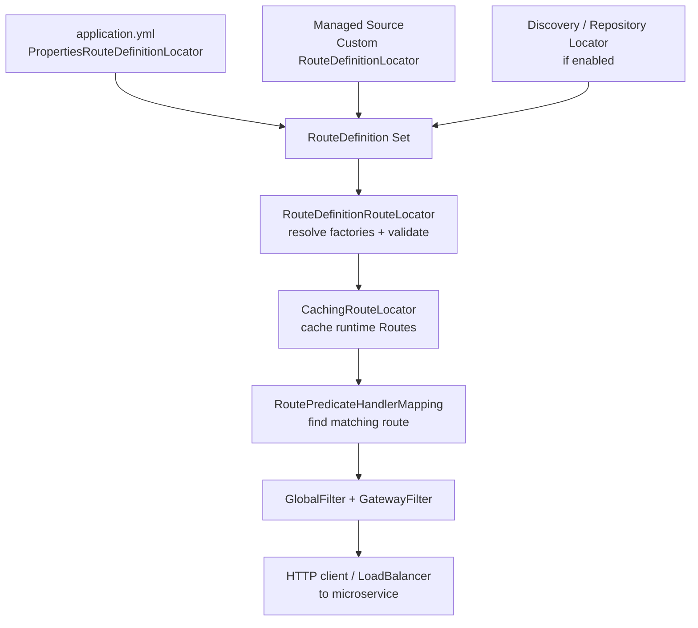
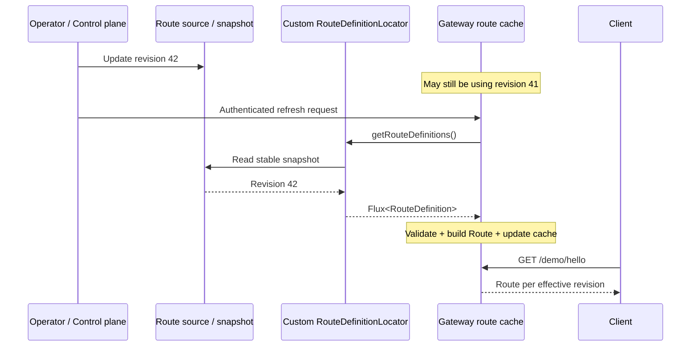
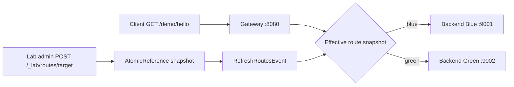
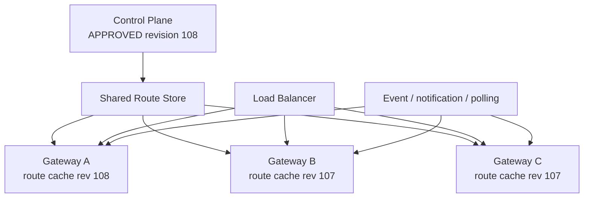
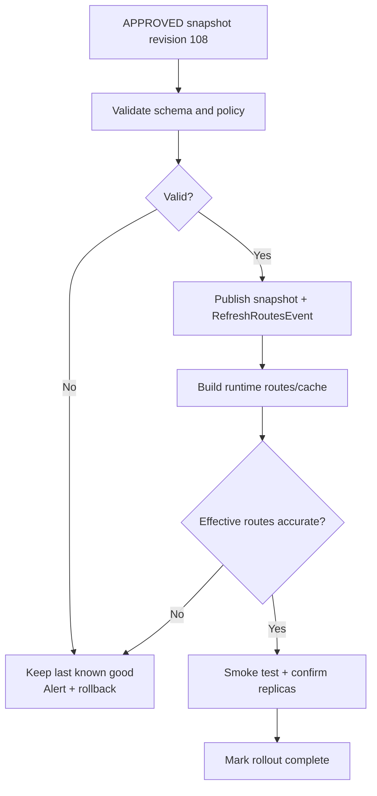

# Loading Routes with a Custom `RouteDefinitionLocator` in Spring Cloud Gateway

In a microservices architecture, **Spring Cloud Gateway** serves as the common client entry point. The Gateway evaluates *route predicates*, executes *filter chains*, transforms paths/headers, and forwards requests to upstreams—combining authentication, rate limiting, circuit breaking, retries, TLS, and request observability. When services, tenants, or deployment targets change frequently, editing `application.yml` and restarting the Gateway just to add a single route becomes an operational bottleneck.

A **custom `RouteDefinitionLocator`** solves the task of **fetching route definitions from an application-managed source**: memory, a database, a configuration service, an approved route governance store, or a versioned data source. It does not automatically mean "routes update instantaneously across every replica." Implementing it properly requires understanding **route definitions**, **executable routes**, **route caches**, **refresh mechanics**, and **the security boundaries of configuration sources**.

This lesson belongs to the **Dynamic Routes** chapter of the `SPRING_CLOUD_GATEWAY` module. Its focus is how to **implement a custom `RouteDefinitionLocator`**, transform configuration data into `RouteDefinition`s, trigger reloads, verify outcomes, and design safely for multi-instance Gateway deployments.

> **Scope:** Examples use **Spring Cloud Gateway Server WebFlux 5.0.x**, Spring Cloud 2025.1.x, and compatible Spring Boot 4.x. On this version, YAML-declared routes use the prefix `spring.cloud.gateway.server.webflux.routes`. Guides for Gateway 4.x may use `spring.cloud.gateway.routes`; Server Web MVC has a different API and route model. The route management examples here bind only to **loopback in the lab** and are not templates for public management endpoints.

## 1. Learning Outcomes

After this lesson, you will be able to:

1. Distinguish `RouteDefinition`, `RouteDefinitionLocator`, `RouteLocator`, `RouteDefinitionRouteLocator`, and the compiled route cache.
2. Explain accurately when `getRouteDefinitions(): Flux<RouteDefinition>` is invoked and why changing a data source does not necessarily switch active traffic immediately.
3. Write a custom `RouteDefinitionLocator` with **atomic snapshots** that reloads cleanly on every refresh.
4. Build routes from `id`, `uri`, `order`, `predicates`, `filters`, and `metadata` using valid factory names and arguments.
5. Publish `RefreshRoutesEvent` in-app and inspect effective routes via Actuator without exposing management endpoints to the Internet.
6. Practice switching routes between two backends at runtime without restarting Gateway, verifying results with `curl` and logs.
7. Design validation, authorization, versioning, rollout/rollback, and multi-replica consistency when loading dynamic routes.

## 2. Lifecycle of a Route: From Definition to Live Request

Distinguish three levels:

- **`RouteDefinition`:** a serializable or source-generated description containing `id`, `uri`, `order`, predicate/filter lists, and metadata.
- **`Route`:** the runtime object constructed using concrete `RoutePredicateFactory`/`GatewayFilterFactory` instances, holding executable predicates and instantiated filters.
- **Requests flowing through Gateway:** matched against runtime `Route`s—not by querying the configuration database on every HTTP request by default.

Conceptual flow:



This diagram models layers of responsibility. Bean names, composite/cache structures, and internal events may change across releases; the key insight is that **the definition source is not directly the route table consulted per request**.

### 2.1. What Does `RouteDefinitionLocator` Do?

Gateway 5.0 documentation describes the interface:

```java
public interface RouteDefinitionLocator {
    Flux<RouteDefinition> getRouteDefinitions();
}
```

When a bean implementing this interface is registered in the Spring Context, Gateway can combine it with other locators to gather route definitions. `Flux` is a reactive publisher; **never manually call `subscribe()` inside a locator just to return routes**.

Common sources:

| Source | Purpose | Key Considerations |
|---|---|---|
| `PropertiesRouteDefinitionLocator` | Routes declared in Boot config | Loaded from `application.yml`/configuration properties |
| Custom `RouteDefinitionLocator` | Routes from a database, registry, or app snapshot | You own validation and source lifecycle |
| Discovery-based locator | Generates routes from service discovery when enabled | Does not replace route authorization/policies |
| `RouteDefinitionRepository` | Read/write/delete route definitions via one abstraction | Has its own write/delete lifecycle; differs from a read-only custom locator |
| Java DSL `RouteLocatorBuilder` | Builds `Route`s in Java code | Produces runtime routes via `RouteLocator`, not necessarily via `RouteDefinition` |

**Do not confuse `RouteDefinitionLocator` with `RouteLocator`.** The former supplies descriptions; the latter supplies executable `Route`s. If your database already stores `id`, `uri`, `Path`, and `StripPrefix`, `RouteDefinitionLocator` is usually the natural integration point; if all routes are immutable Java DSL code, `RouteLocatorBuilder` may be simpler.

### 2.2. When Is `RouteDefinitionRepository` Used?

`RouteDefinitionRepository` extends reading definitions with save/delete operations per its contract. It is useful if you want route CRUD over a persistence layer with clear governance policies. However, this lesson focuses on a **read-only custom locator** backed by snapshots to cleanly separate two concerns:

1. **Who is the source of truth and who may change route configurations?**
2. **How does Gateway read and apply that definition revision?**

Putting CRUD into a single public controller does not make a dynamic design better. A separate admin plane can persist records while Gateway reads only **validated and published snapshots**.

### 2.3. What Fields Does a `RouteDefinition` Contain?

| Field | Example | Meaning |
|---|---|---|
| `id` | `catalog-dynamic` | Route identifier; must be stable and unique within the applied scope |
| `uri` | `http://127.0.0.1:9001` | Target once matched; can be `lb://service-id` when LoadBalancer is enabled |
| `order` | `-10` | Route selection precedence; **smaller numbers take higher priority** when multiple routes match |
| `predicates` | `Path=/demo/**`, `Method=GET` | Conditions required to select the route |
| `filters` | `StripPrefix=1`, `AddRequestHeader=...` | Request/response transformations in the filter chain |
| `metadata` | `source=control-plane`, `revision=42` | Descriptive metadata for auditing/route config; not automatically a security policy |

A route with `order=-10` is not guaranteed to match unconditionally; its predicates must still evaluate true. Furthermore, **route** `order` is distinct from **filter** `Ordered.getOrder()`. Never trust externally supplied metadata to infer access permissions without an explicit verification policy.

## 3. Dynamic Route Loading Does Not Mean Querying the Database Per Request

A common misconception:

> "I updated a database row. Since `getRouteDefinitions()` reads the database, the very next request will definitely take the new route."

This assumption ignores the compiled `Route` cache. Gateway typically **loads and caches the runtime route set** to handle requests efficiently. Even if the database or the locator's `AtomicReference` changes, the active cache table serving requests may still hold the previous routes.



### 3.1. Three States Frequently Confused

| Layer | State | Verification Question |
|---|---|---|
| **Data source** | Has the new revision been saved? | Read back from the management source |
| **Route definitions** | Does the locator emit the new revision when subscribed? | Test `getRouteDefinitions()` and `/actuator/gateway/routedefinitions` |
| **Effective runtime routes** | Does Gateway's cache hold the new `Route`? | Check `/actuator/gateway/routes` and live requests on Gateway's port |

One step reporting success does not mean downstream steps are finished. In systems with asynchronous refreshes, **receiving HTTP 200/202 from a refresh command does not prove every request on every replica has switched**. Check the effective state and maintain a rollback procedure.

### 3.2. Where Is `Flux.defer` Useful?

If a locator is written as:

```java
return Flux.fromIterable(snapshot.get());
```

then `snapshot.get()` is evaluated **when the method is invoked**, creating a publisher over that instant's snapshot. This can suffice if Gateway re-invokes the method on every refresh.

Writing:

```java
return Flux.defer(() -> Flux.fromIterable(snapshot.get()));
```

makes explicit that **each subscription** reads the locator's latest snapshot. It **does not automatically trigger refreshes**: while Gateway's `Route` cache remains stale, incoming requests do not re-subscribe to the locator. `Flux.defer` only controls when the publisher accesses the source—it does not replace `RefreshRoutesEvent`.

### 3.3. A Refresh Can Fail

If a locator returns a nonexistent predicate, an invalid URI, or a `GatewayFilterFactory` missing required arguments, converting `RouteDefinition` into `Route` can fail. Gateway 5.0 exposes `spring.cloud.gateway.server.webflux.fail-on-route-definition-error` (listed as defaulting to `true`), which governs how route definition errors are handled.

Never use `fail-on-route-definition-error: false` to sweep bad configurations under the rug without alerts and tests: a skipped route can cause unexpected 404s or misrouting. In production, **validate snapshots before publishing** and retain the "last known good" revision whenever new data is invalid.

## 4. Lab Setup: One Gateway, Two Independent Backends

This lab demonstrates a route named `dynamic-greeting` with predicate `Path=/demo/**`, rewriting `/demo/hello` to `/hello` via `StripPrefix=1`.

- Initially, the route points to **backend blue** at `127.0.0.1:9001`.
- After an update request, **the same route ID** points to **backend green** at `127.0.0.1:9002`.
- Gateway does not restart, though it must refresh its route cache.
- Operators may choose only between **two fixed targets** in the lab—arbitrary Internet URLs are disallowed.



### 4.1. Create the Server WebFlux Application

Use Spring Initializr or a Maven project with Spring Boot 4.x compatible with Spring Cloud 2025.1.x. Core dependencies:

```xml
<dependencies>
    <dependency>
        <groupId>org.springframework.cloud</groupId>
        <artifactId>spring-cloud-starter-gateway-server-webflux</artifactId>
    </dependency>
    <dependency>
        <groupId>org.springframework.boot</groupId>
        <artifactId>spring-boot-starter-actuator</artifactId>
    </dependency>
</dependencies>
```

This is **not a complete `pom.xml`**: the project still needs the Spring Boot parent/plugin and matching Spring Cloud BOM. Do not add the Spring MVC starter to a Gateway Server WebFlux project, as it alters the runtime stack and breaks WebFlux behavior.

Main class:

```java
import org.springframework.boot.SpringApplication;
import org.springframework.boot.autoconfigure.SpringBootApplication;

@SpringBootApplication
public class DynamicRouteGatewayApplication {
    public static void main(String[] args) {
        SpringApplication.run(DynamicRouteGatewayApplication.class, args);
    }
}
```

Place your Java classes in the same package or subpackages so Spring Boot component scanning detects them.

### 4.2. Lab `application.yml`

```yaml
server:
  address: 127.0.0.1
  port: 8080

spring:
  application:
    name: dynamic-route-gateway
  cloud:
    gateway:
      server:
        webflux:
          # Do not declare a /demo/** route overlapping with the Java locator.
          routes: []

management:
  endpoint:
    gateway:
      access: read-only
  endpoints:
    web:
      exposure:
        include: health,info,gateway
```

**Why `server.address: 127.0.0.1`?** The lab includes an HTTP controller that switches routes for hands-on testing. We bind Gateway strictly to local loopback so the management port is not exposed to the LAN or Internet. In production, **never deploy this lab controller on a public listener**; use a separate control plane with strong authentication, authorization, auditing, and network policies.

`management.endpoint.gateway.access: read-only` allows inspecting routes via Actuator while **disabling CRUD/refresh over Actuator**. In this lab, Java code publishes `RefreshRoutesEvent` in the next step. Never turn on `unrestricted` in production just for convenience.

YAML routes are `[]` because our custom locator provides the main route. Spring Cloud Gateway can combine **multiple** locators, yet two sources returning **duplicate IDs** cause unpredictable results or errors. Do not also define `dynamic-greeting` in YAML when running the Java class below.

## 5. Implementing a Custom `RouteDefinitionLocator` with Atomic Snapshots

Create `InMemoryDynamicRouteDefinitionLocator.java`:

```java
import java.net.URI;
import java.util.List;
import java.util.Map;
import java.util.concurrent.atomic.AtomicReference;

import org.springframework.cloud.gateway.filter.FilterDefinition;
import org.springframework.cloud.gateway.handler.predicate.PredicateDefinition;
import org.springframework.cloud.gateway.route.RouteDefinition;
import org.springframework.cloud.gateway.route.RouteDefinitionLocator;
import org.springframework.stereotype.Component;

import reactor.core.publisher.Flux;

@Component
public final class InMemoryDynamicRouteDefinitionLocator
        implements RouteDefinitionLocator {

    // Create a NEW RouteDefinition on each route change.
    // Do not mutate RouteDefinition objects from the old snapshot.
    private final AtomicReference<List<RouteDefinition>> snapshot =
            new AtomicReference<>(List.of(buildRoute("blue")));

    private final AtomicReference<String> desiredTarget =
            new AtomicReference<>("blue");

    @Override
    public Flux<RouteDefinition> getRouteDefinitions() {
        // Each subscription reads the locator's current snapshot.
        // Do not query the network or block the event loop.
        return Flux.defer(() -> Flux.fromIterable(snapshot.get()));
    }

    public synchronized void switchTarget(String target) {
        if (!"blue".equals(target) && !"green".equals(target)) {
            throw new IllegalArgumentException("Unknown target");
        }

        RouteDefinition next = buildRoute(target);
        snapshot.set(List.of(next));
        desiredTarget.set(target);
    }

    public String desiredTarget() {
        // Snapshot at source only; NOT proof of the effective cache.
        return desiredTarget.get();
    }

    private static RouteDefinition buildRoute(String target) {
        URI uri = "blue".equals(target)
                ? URI.create("http://127.0.0.1:9001")
                : URI.create("http://127.0.0.1:9002");

        RouteDefinition definition = new RouteDefinition();
        definition.setId("dynamic-greeting");
        definition.setUri(uri);
        definition.setOrder(-10);

        definition.setPredicates(List.of(
                new PredicateDefinition("Path=/demo/**"),
                new PredicateDefinition("Method=GET")
        ));

        definition.setFilters(List.of(
                new FilterDefinition("StripPrefix=1")
        ));

        // Do not store secrets/tokens in metadata that may be exposed via Actuator.
        definition.setMetadata(Map.of(
                "source", "memory-lab",
                "target", target
        ));

        return definition;
    }
}
```

**Key points about this class:**

1. `@Component` registers a `RouteDefinitionLocator` bean; Gateway collects routes from it alongside any other locators.
2. `getRouteDefinitions()` never calls `subscribe()` and does not handle HTTP requests. It returns a reactive publisher of **route definitions**.
3. `AtomicReference<List<RouteDefinition>>` swaps **the entire source route list** atomically within the JVM.
4. `List.of(...)` creates an immutable list; each revision constructs a fresh `RouteDefinition` so older objects are never mutated while another subscription reads them.
5. `switchTarget()` uses `synchronized` in this **single-JVM lab** to prevent concurrent management calls from overwriting updates; it is **not a distributed lock**.
6. `URI` is selected from a **fixed allowlist**. Never accept arbitrary `uri` values from JSON requests and proxy to arbitrary hosts.
7. `PredicateDefinition("Path=/demo/**")` and `FilterDefinition("StripPrefix=1")` use Gateway's official shortcut syntax; `Method=GET` keeps the route from matching management POSTs.
8. `metadata` helps operators observe the snapshot target, but does **not** automatically turn into an authorization policy or matching condition.

### 5.1. Why Not Build Runtime `Route`s Directly?

Another option is creating a `RouteLocator` directly with Java DSL. However, this lesson addresses **route definitions originating from a data store**, so we use `RouteDefinition` and let Gateway resolve predicate/filter names into their respective factories.

Benefits of modeling routes at the `RouteDefinition` level:

- Easy to persist as JSON/YAML/control-plane schemas.
- Consistent `id`, `uri`, `order`, and `metadata`.
- Easy to list for inspection and auditing.
- Validation can be enforced prior to publishing.
- The configuration service does not need to know how to construct Java lambdas or concrete `GatewayFilter` objects.

In exchange, any custom filter written solely in Java code must still have its **factory registered on Gateway**. You cannot send an uninstalled factory name in JSON and expect the data alone to conjure up that behavior.

### 5.2. Atomic Snapshots Do Not Equal Cluster-Wide Consistency

In the lab, `AtomicReference` only guarantees **a single JVM** gets the new snapshot without seeing a partially edited list. With three Gateway replicas:

```text
A: revision 12, route → blue
B: revision 11, route → green
C: revision 12, route → blue
```

they do **not** share the same `AtomicReference`. Even our lab controller mutates state only in the process that handles the request. An update sent through a load balancer could flip A while leaving B and C untouched. Production needs a dedicated revision distribution and refresh mechanism, covered later.

### 5.3. Distinguish Filter Chains from Route Order

`definition.setOrder(-10)` governs **route precedence** when multiple routes match. It does not decide whether `StripPrefix` runs before or after `NettyRoutingFilter`. For this route:

```text
Client: GET /demo/hello
  → Predicate Path=/demo/** and Method=GET
  → Filter StripPrefix=1
  → Backend blue/green receives GET /hello
```

Do not use `order` to fix a filter-chain bug; if you need custom filter ordering, rely on `Ordered` on the respective `GatewayFilter`/`GlobalFilter` implementations and inspect the assembled chain.

## 6. Emitting `RefreshRoutesEvent` to Load New Routes

With `RouteDefinitionLocator`, one way to signal a refresh within **the same Spring ApplicationContext** is `ApplicationEventPublisher`:

```java
applicationEventPublisher.publishEvent(new RefreshRoutesEvent(this));
```

`RefreshRoutesEvent` instructs Gateway to rebuild its route set. It is **not** automatically broadcast to all Gateway replicas, nor does it guarantee HTTP requests switch routes on the very next line of code.

### 6.1. Lab-Only Controller

Create `DynamicRoutesLabController.java`:

```java
import java.util.Map;

import org.springframework.cloud.gateway.event.RefreshRoutesEvent;
import org.springframework.context.ApplicationEventPublisher;
import org.springframework.http.ResponseEntity;
import org.springframework.web.bind.annotation.GetMapping;
import org.springframework.web.bind.annotation.PostMapping;
import org.springframework.web.bind.annotation.RequestMapping;
import org.springframework.web.bind.annotation.RequestParam;
import org.springframework.web.bind.annotation.RestController;

@RestController
@RequestMapping("/_lab/routes")
public class DynamicRoutesLabController {

    private final InMemoryDynamicRouteDefinitionLocator locator;
    private final ApplicationEventPublisher publisher;

    public DynamicRoutesLabController(
            InMemoryDynamicRouteDefinitionLocator locator,
            ApplicationEventPublisher publisher) {
        this.locator = locator;
        this.publisher = publisher;
    }

    @GetMapping("/target")
    public ResponseEntity<Map<String, String>> desiredTarget() {
        // This is the SOURCE state, not proof that the route cache changed.
        return ResponseEntity.ok(Map.of(
                "desiredTarget", locator.desiredTarget()
        ));
    }

    @PostMapping("/target")
    public ResponseEntity<Map<String, String>> changeTarget(
            @RequestParam("target") String target) {

        if (!"blue".equals(target) && !"green".equals(target)) {
            return ResponseEntity.badRequest().body(Map.of(
                    "error", "TARGET_NOT_ALLOWED"
            ));
        }

        locator.switchTarget(target);
        publisher.publishEvent(new RefreshRoutesEvent(this));

        // 202: update request accepted, but does not promise refresh
        // and all HTTP requests reflect the result immediately.
        return ResponseEntity.accepted().body(Map.of(
                "desiredTarget", target,
                "state", "REFRESH_REQUESTED"
        ));
    }
}
```

**Explicit limitations:**

- `@PostMapping` performs **configuration administration**, not business logic. It is isolated in the lab by `server.address: 127.0.0.1`; never ship it on a public Gateway without admin authentication/authorization, appropriate CSRF policy, network isolation, and auditing.
- `locator.switchTarget(...)` swaps the snapshot **in one JVM**.
- `publishEvent(new RefreshRoutesEvent(this))` delivers the notification **within that JVM**. External dynamic sources can publish events from a control plane with a per-replica delivery mechanism.
- `202 Accepted` says **the request was accepted**, not that runtime routes updated atomically with the controller's HTTP response.
- `GET /_lab/routes/target` only reflects `desiredTarget` at the source; reliable proof of **effective routes** comes from `/actuator/gateway/routes` and live `GET /demo/hello` requests.
- Selecting between blue and green uses a **hard-coded allowlist** so API callers cannot inject arbitrary `uri`s leading to SSRF or egress policy violations.

### 6.2. Never Use `block()` in WebFlux Processing Flows

`getRouteDefinitions()` returning `Flux` is a reactive contract. When fetching from R2DBC, reactive Redis, or `WebClient`, keep the chain non-blocking:

```java
@Override
public Flux<RouteDefinition> getRouteDefinitions() {
    return repository.findAllApprovedRoutes()
            .map(this::toRouteDefinition);
}
```

**This is illustrative pseudo-code**, not a complete compilable class: `repository` and `toRouteDefinition` must be implemented against your real schema.

Avoid:

```java
// ANTI-PATTERN in reactive/event-loop threads:
List<RouteDefinition> routes = jdbcRepository.findAll();
return Flux.fromIterable(routes);
```

If you must use synchronous JDBC or SDKs, run **snapshot loading on a managed worker thread** and publish immutable snapshots, or offload onto an appropriately bounded scheduler; never block Gateway's Reactor Netty event loop during refreshes or request handling. Do not treat `subscribeOn(boundedElastic())` as an automatic cure-all for transactions, timeouts, consistency, or race conditions.

### 6.3. Refreshes Can Be Asynchronous

Gateway 5.0 Actuator documentation notes that route cache refreshes can run asynchronously, and when a refresh fails, the existing active route set remains unchanged in that endpoint flow. Therefore, define three distinct milestones:

1. `SOURCE_UPDATED`: desired data/snapshot has changed.
2. `REFRESH_REQUESTED`: event or API trigger has been sent.
3. `EFFECTIVE_REVISION_CONFIRMED`: each Gateway replica has converted definitions cleanly and its effective routes have been verified.

In the lab we only have `202 Accepted` plus route inspection and `curl`. Production typically requires a **revision ID**, health checks, and per-replica rollout confirmation before declaring a release complete when routes might not yet have switched.

## 7. Lab Backends: Running Blue and Green to Observe Changes

Use a tiny JDK server to distinguish backends by response body. Create `ColorEchoBackend.java` in a practice directory outside the Gateway project:

```java
import com.sun.net.httpserver.HttpServer;
import java.net.InetSocketAddress;
import java.nio.charset.StandardCharsets;

public class ColorEchoBackend {
    public static void main(String[] args) throws Exception {
        if (args.length != 2) {
            throw new IllegalArgumentException(
                    "Usage: ColorEchoBackend <port> <label>");
        }

        int port = Integer.parseInt(args[0]);
        String label = args[1];

        HttpServer server = HttpServer.create(
                new InetSocketAddress("127.0.0.1", port), 0);

        server.createContext("/", exchange -> {
            if (!"GET".equals(exchange.getRequestMethod())) {
                exchange.sendResponseHeaders(405, -1);
                exchange.close();
                return;
            }

            String response = "backend=" + label + "\n"
                    + "path=" + exchange.getRequestURI().getRawPath() + "\n";
            byte[] body = response.getBytes(StandardCharsets.UTF_8);

            exchange.getResponseHeaders().set(
                    "Content-Type", "text/plain; charset=utf-8");
            exchange.sendResponseHeaders(200, body.length);

            try (var output = exchange.getResponseBody()) {
                output.write(body);
            }

            System.out.println(label + " received "
                    + exchange.getRequestURI().getRawPath());
        });

        server.start();
        System.out.println(label + " on 127.0.0.1:" + port);
    }
}
```

Open **two terminals** in that directory and start each backend:

```bash
# Terminal 1: Blue
java --add-modules jdk.httpserver ColorEchoBackend.java 9001 blue

# Terminal 2: Green
java --add-modules jdk.httpserver ColorEchoBackend.java 9002 green
```

JDK 17+ supports running single-file Java source directly like this. Both backends bind `127.0.0.1` strictly for local testing—this is not a production HTTP server.

### 7.1. Verify Backends Before Starting Gateway

```bash
curl -i http://127.0.0.1:9001/hello
curl -i http://127.0.0.1:9002/hello
```

Sample responses:

```text
HTTP/1.1 200 OK
...
backend=blue
path=/hello
```

and:

```text
HTTP/1.1 200 OK
...
backend=green
path=/hello
```

If both responses look identical, check the port and label arguments on each backend process first. Never troubleshoot dynamic Gateway routing before confirming upstreams are ready.

## 8. Hands-On: Switching Routes Without Restarting Gateway

Start the Gateway application in a third terminal:

```bash
# Linux/macOS
./mvnw spring-boot:run

# Windows PowerShell
.\mvnw.cmd spring-boot:run
```

### 8.1. Initial State: Route Points to Blue

```bash
curl -i http://127.0.0.1:8080/demo/hello
```

Expected:

```text
HTTP/1.1 200 OK
...
backend=blue
path=/hello
```

What this confirms:

- `Path=/demo/**` and `Method=GET` matched.
- `StripPrefix=1` stripped the `demo` segment, so the backend saw `/hello`.
- Initial `URI` was `http://127.0.0.1:9001`.
- The request was proxied through Gateway's HTTP client; the lab admin controller was not involved.

Try a `POST` request to see predicates in action:

```bash
curl -i -X POST http://127.0.0.1:8080/demo/hello
```

Since no `Method=POST` route exists for this path, Gateway returns `404` (or another status if you added Security/custom config). It does not forward `POST` to Blue.

### 8.2. Switch the Route to Green

Call the lab admin endpoint over loopback:

```bash
curl -i -X POST \
  "http://127.0.0.1:8080/_lab/routes/target?target=green"
```

Expected HTTP `202 Accepted` with a body like:

```json
{
  "desiredTarget": "green",
  "state": "REFRESH_REQUESTED"
}
```

Inspect the locator's **source** data:

```bash
curl -i http://127.0.0.1:8080/_lab/routes/target
```

It returns `{"desiredTarget":"green"}`. **Do not stop here**; this result does not prove the route cache has applied the new revision.

### 8.3. Verify the Effective Runtime Route

Since Actuator is enabled read-only on loopback in the lab, inspect:

```bash
curl -i http://127.0.0.1:8080/actuator/gateway/routedefinitions
curl -i http://127.0.0.1:8080/actuator/gateway/routes
curl -i http://127.0.0.1:8080/actuator/gateway/routes/dynamic-greeting
```

Once refresh finishes and the route builds cleanly, `/actuator/gateway/routes` shows `dynamic-greeting` targeting `http://127.0.0.1:9002`. Actuator's JSON format is runtime-specific; do not hard-code array indices without verifying the schema.

Next:

```bash
curl -i http://127.0.0.1:8080/demo/hello
```

Expected:

```text
HTTP/1.1 200 OK
...
backend=green
path=/hello
```

If a request immediately following HTTP `202` still returns Blue, **do not jump to calling it a bug**: refresh may not have completed yet. Re-verify once the route list shows the new URI. If it persists, check route conversion/cache logs and definition errors.

### 8.4. Switch Back to Blue and Test an Invalid Target

```bash
curl -i -X POST \
  "http://127.0.0.1:8080/_lab/routes/target?target=blue"

curl -i -X POST \
  "http://127.0.0.1:8080/_lab/routes/target?target=invalid"
```

The first command requests a refresh back to Blue. The second **must** return `400 Bad Request` with `TARGET_NOT_ALLOWED`; the source state must not change to `invalid`.

If a controller accepted `http://169.254.169.254` or arbitrary `https://attacker.example`, you would turn dynamic routing into a potential SSRF vector. The lab deliberately **forbids** raw URL input.

### 8.5. Distinguishing Failures During Testing

| Observation | Possible Cause | What to Check |
|---|---|---|
| `GET /demo/hello` returns 404 | Route not loaded/matched; wrong Method/Path | Actuator routes, predicate factory, logs |
| Returns 502/503 | New target not running, HTTP client error | Backend `:9001`/`:9002`, network, port |
| Source shows Green yet requests hit Blue | Route cache not refreshed or refresh failed | Actuator effective routes, refresh logs |
| Two `dynamic-greeting` routes appear | Duplicate ID across multiple locators | Remove duplicate route in YAML or another source |
| `POST /_lab/routes/target` misses controller | Wrong web runtime or path intercepted by route/security | WebFlux starter, handler mappings, security chain |
| Actuator gateway returns 404/forbidden | Actuator disabled or secured | `management.endpoint.gateway.access` and exposure |
| Controller returns 202 yet new route never appears | Converter/filter/predicate error or event not applied | Definition validity, conversion, refresh result |
| Reverts to Blue after restart | Snapshot lives only in JVM RAM | Expected in lab; production needs a durable source |

**Never disable authentication, TLS, or authorization in production** to "fix" HTTP 401/403 during route testing. First identify which layer rejected the request.

## 9. From In-Memory Snapshots to External Configuration Sources

In production, the goal is rarely toggling Blue/Green via a controller inside Gateway. Rather, **Gateway loads an approved route set** with history, versioning, and multi-replica synchronization.

A control-plane data model might look like:

```json
{
  "revision": 108,
  "state": "APPROVED",
  "routes": [
    {
      "id": "catalog-public",
      "path": "/public/catalog/**",
      "method": "GET",
      "serviceId": "catalog-service",
      "stripPrefix": 1,
      "order": -10,
      "policy": "PUBLIC_READ"
    }
  ]
}
```

This is an **illustrative application-defined route governance schema**, not the direct JSON schema of `RouteDefinition`. An adapter layer validates the record and maps it into:

```text
id         = catalog-public
uri        = lb://catalog-service
order      = -10
predicates = Path=/public/catalog/**; Method=GET
filters    = StripPrefix=1
metadata   = source=control-plane; revision=108
```

This keeps the configuration source from **injecting raw Java expressions, class names, arbitrary filter factories, secrets, or unvalidated URLs**. A database JSON row should never be able to rewrite proxy behavior toward dangerous hosts.

### 9.1. Safe Conversion Steps

| Step | Action | Reason |
|---|---|---|
| 1 | Read **one complete revision** | Avoid mixing routes from two releases |
| 2 | Verify `APPROVED` state, signature/publish permissions | Avoid loading drafts or untrusted data |
| 3 | Validate `id`, route count, config size, uniqueness | Prevent duplicates and metadata bloat |
| 4 | Validate `Path`/`Method` and route overlaps | Prevent routes from hijacking sensitive traffic |
| 5 | Map `serviceId` to `lb://...` via allowlist | Avoid open HTTP proxying / SSRF |
| 6 | Apply filter policies from an approved catalog | Preserve auth, TLS, rate limits; forbid arbitrary dangerous filters |
| 7 | Build a **new `RouteDefinition` list** | Never mutate the snapshot currently serving requests |
| 8 | Verify parsing/factory config and smoke test | Catch routes that fail runtime conversion |
| 9 | Publish snapshot + trigger refresh on each instance | Update Gateway route caches |
| 10 | Confirm effective revision and maintain rollback | Never stop at "saved in database" |

Specifically for `lb://serviceId`, Gateway requires Spring Cloud LoadBalancer and an appropriate discovery or static instance supplier. Writing `lb://catalog-service` alone does not create backend instances or mTLS policies. When upstream TLS is needed, verify instance schemes, hostnames/SANs, and the HTTP client SSL context.

### 9.2. Adapter Example Using a Reactive Repository (Illustrative)

Once you have a repository reading **approved snapshots**, the locator can map data in a reactive chain:

```java
// PSEUDO-CODE: illustrates structure, not a compilable class
// without creating RouteSnapshotStore, RouteRecord, and mapApprovedRoute.
public Flux<RouteDefinition> getRouteDefinitions() {
    return Flux.defer(() ->
        routeSnapshotStore.loadCurrentApprovedRevision()
            .flatMapMany(revision ->
                Flux.fromIterable(revision.routes())
                    .map(this::mapApprovedRoute))
    );
}
```

In practice, bound query timeouts, record counts, response sizes, and concurrency. Never let the locator load **all historical revisions** and filter in memory. If the repository maintains its own cache, define a rule to invalidate/refresh it whenever the control plane publishes a new revision—otherwise Gateway could refresh routes only to receive the same old snapshot.

**Never write `getRouteDefinitions()` to hit the database per incoming request assuming every request queries fresh data.** Gateway caches routes; the definition source should be read during refresh/startup or a snapshot preload pipeline, not as a per-HTTP-request database lookup.

### 9.3. Atomic Snapshots Matter More Than "Row-by-Row List Updates"

A dangerous update pattern:

```text
UPDATE route A -> revision 108
UPDATE route B -> revision 108
UPDATE route C -> revision 108

Gateway refreshes mid-way through the three steps and sees new A, old B/C.
```

A safer strategy:

```text
DRAFT revision 108:
    insert A/B/C
    validate entire set
    transition state to APPROVED via transaction / publish pointer
CURRENT_REVISION = 108
```

Gateway reads **a single completed approved revision**. For multi-tenant setups, define the scope of revisions/transactions and route IDs; never read a half-written snapshot.

With `AtomicReference` in the lab, swapping the list is atomic **in RAM**. With a database, atomicity comes from the store's transaction/snapshot publication design, not from `Flux` itself.

### 9.4. Source Read Failure: Last-Known-Good or Fail-Closed?

Suppose the route governance database is temporarily unreachable while a Gateway instance holds revision 107:

- **Last-known-good:** retain the active route set and alert the control plane; preserves availability.
- **Intentional fail-closed:** reject a subset of routes if security policy forbids delaying an emergency revocation.
- **No routes yet:** if Gateway boots fresh and has never loaded a snapshot, enforce a clear bootstrap policy—never fall back to opening a wildcard `/**` route to an arbitrary service.

Your choice depends on your threat model. Last-known-good is **not always safe** if the new revision revokes access or removes a compromised route. Distinguish routine updates from **security revocations / kill switches**, with emergency shutdown procedures and policy-enforced TTLs.

Every failure must emit logs, metrics, and alerts; never silently return `Flux.empty()` just to "avoid a stack trace" if doing so wipes out all routes unnoticed.

## 10. Multiple Gateway Replicas: A Shared Source Is Not Enough

Suppose a load balancer distributes traffic across A, B, and C:



Even when all three Gateways **point to the same database**, B and C can still serve from an older runtime cache if they have not refreshed. Or A's refresh may fail while B's succeeds. You therefore need **two synchronization layers**:

1. **Shared source of truth:** where every instance can read the same `APPROVED` revision.
2. **Per-instance activation:** each instance receives a refresh signal, compiles definitions into runtime routes, and reports the applied revision.

### 10.1. Change Distribution Models

| Approach | Benefits | Risks to Mitigate |
|---|---|---|
| Periodic polling by revision | Simple, minimal reliance on event delivery | Latency up to poll interval; needs jitter and read-load protection |
| Event bus / pub-sub on `APPROVED` | Updates propagate quickly | Events can be dropped, duplicated, or reordered; still verify revision |
| Control plane calls per-instance admin endpoint | Clear per-instance feedback | Complex networking/auth/routing; LB won't hit every pod |
| Event-driven + periodic reconciliation | Fast via events, self-healing on missed events | More moving parts; must be idempotent |
| Rolling restart with immutable config | Deployment-bound version control | Slow, requires rollout and capacity planning; not true runtime refresh |

**Include periodic reconciliation** even when using events, because a pod may be offline when an event fires. Handle duplicate events idempotently (apply only newer revisions), and on out-of-order events, never revert to an older revision outside an approved rollback workflow.

### 10.2. `RedisRateLimiter` Is Not `RedisRouteDefinitionRepository`

Spring Cloud Gateway WebFlux includes `RedisRateLimiter`, which uses Redis for **token buckets**. A separate feature, `RedisRouteDefinitionRepository`, uses Redis to **store route definitions** when configured and supported by dependencies. They are not interchangeable.

In **Configuration Properties 5.0**, the repository property is:

```yaml
spring:
  cloud:
    gateway:
      server:
        webflux:
          redis-route-definition-repository:
            enabled: true
```

**This snippet only illustrates the property namespace; it is not enabled in our lab** because the lab uses an in-JVM snapshot locator without Redis. A real setup requires `spring-boot-starter-data-redis-reactive`, Redis connectivity, write/delete policies, and per-instance refresh per your version's docs. Do not copy the older `spring.cloud.gateway.redis-route-definition-repository.enabled` key assuming it applies unaltered to Gateway 5.0.

If your organization operates its own config service, writing a **custom `RouteDefinitionLocator` reading an approved source** still makes complete sense even when Gateway provides a Redis repository. Choosing a storage backend and refreshing routes are **two independent problems**.

### 10.3. Cluster-Wide Revision Rollout

A recommended route revision release flow:

1. Control plane publishes `revision=108` with checksums/signed metadata.
2. Each Gateway loads the snapshot, validates it, prepares definitions, and triggers refresh.
3. Gateway verifies `/actuator/gateway/routes` shows the expected URIs, predicates, and filters for 108.
4. Gateway emits `route_revision_effective{instance=...}` metrics or sends an acknowledgment to the control plane.
5. Only when quorum/policy is met is the revision marked "deployed." For sensitive routes, require **100% of instances**, not just a majority quorum.
6. On errors or rising `404/5xx` rates, the control plane publishes a rollback revision or reverts the pointer to the last approved snapshot.
7. Instances absent during rollout must reconcile before serving traffic or obey availability-gating policies.

Do not store `revision` in route `metadata` assuming `CachingRouteLocator` reads or checks it automatically. Metadata is **informational**; confirming the effective revision and orchestrating rollbacks are responsibilities you build.

### 10.4. Divergent Routes During Transition Windows

While A serves the new revision and B/C serve the old one, identical `GET /demo/hello` requests may hit different backends depending on load balancing. This can be acceptable for **deliberately designed canary/blue-green rollouts**, yet dangerous for authorization changes, payment endpoints, or breaking API contracts.

If you need **simultaneous** cutover across the entire cluster, asynchronous route refreshes do not deliver *atomic cluster-wide cutover* on their own. Consider deployment generations, versioned hostnames/paths, load-balancer traffic switches, or a control plane with quorum/health gates matching your consistency requirements.

## 11. Dynamic Configuration Is a Security Boundary

A route record can alter **target URIs**, predicates, filters, and route order. Anyone allowed to edit routes can influence **where user requests go** and **which security controls apply**. Treat route modification as a **high-privilege operational capability**, equivalent to reconfiguring a reverse proxy.

### 11.1. Preventing SSRF and Open Proxying

An admin form permitting arbitrary URLs:

```json
{"id":"demo","uri":"http://169.254.169.254/"}
```

can direct requests to infrastructure metadata services or restricted internal networks if unconstrained. Loopback (`localhost`/`127.0.0.1`), private ranges, link-local addresses, Unix socket proxies, internal hostnames, and DNS rebinding must all be evaluated against your threat model.

Mitigations:

- **Never accept arbitrary URIs from client/user input.** Use allowlisted registry service IDs mapped to `lb://service-id` after validation.
- Allow only approved schemes, ports, and upstream domains, backed by external egress firewalls/network policies.
- Never bypass outbound TLS certificate, hostname/SAN, or mTLS verification just to get a route "working."
- Scope editable route IDs and path prefixes by operator role/tenant.
- Prevent one tenant from registering `Path=/**` or `Host=**` routes that hijack another tenant's traffic.
- Isolate the control plane from public HTTP listeners; enforce strong authentication, authorization, mTLS/service identity, approvals/audits, and rate limiting on admin APIs.

In the Blue/Green lab, the URI comes from two **fixed** choices; that is an intentional safety boundary in the example, not a limitation of `RouteDefinitionLocator`.

### 11.2. Allowlist Factory Names and Expressions

An untrusted data source might inject:

- `RequestHeaderToRequestUri` or filters rewriting the target URL unexpectedly.
- `RedirectTo` sending clients to untrusted domains.
- `SetStatus` masking upstream failures or returning fake 200s.
- `RewritePath` with catastrophic/unbounded regexes.
- `AddRequestHeader` injecting forged security headers or leaking `Authorization` to unintended upstreams.

Therefore, when mapping records into `PredicateDefinition` and `FilterDefinition`, do not blindly pass raw user-supplied strings to constructors. Use business-level schemas, validate **factory names and arguments** against an allowlist, bound regex/payload sizes, and test behavior on critical routes.

Predicate/filter configuration can support SpEL in certain contexts; never allow arbitrary expression evaluation from untrusted sources. Gateway 5.0 includes `spring.cloud.gateway.server.webflux.restrictive-property-accessor.enabled` to restrict property/method access in SpEL; keep framework safeguards enabled and never rely on them as a replacement for control-plane validation.

### 11.3. Auth, Rate Limiting, and Dynamic Routes Must Align

Suppose `/api/payments/**` is added dynamically while `SecurityWebFilterChain` only protects `/api/orders/**`. If `anyExchange().permitAll()` is misconfigured, the new route could inadvertently bypass authentication.

**Rules:**

- Default-deny sensitive APIs; open public routes only under approved policies.
- Enforce authentication and authorization **independently of route loading** at the Security layer.
- Apply quotas/rate limits and backend protections wherever abuse is possible.
- Never trust client-supplied `X-User-Id` headers to determine tenant context or bypass auth.
- When a route changes upstreams, verify token audiences, identity propagation, mTLS, and backend authorization.
- If the control plane attaches policy labels such as `PUBLIC_READ`, validate and translate them into real Security rules; route metadata alone creates no Spring Security rules.

### 11.4. Revisions, Auditing, and Rollback

Every production route change should record:

| Audit Field | Purpose |
|---|---|
| `revision` and `previousRevision` | Traceability and rollback |
| User or workload initiating the request | Accountability beyond IP addresses |
| Approver and change ticket | Procedural authorization |
| Secret-scrubbed diff of route ID, predicates, filters, URI | Understanding the exact change |
| Validation and dry-run results | Preventing bad definitions from publishing |
| Timestamp / rollout scope | Incident investigation |
| Gateway instances confirming the revision | Detecting state drift |
| Rollback / kill-switch reason | Postmortem analysis |

Never write private keys, access tokens, URI credentials, raw `Authorization` headers, or sensitive request payloads into audit logs.

## 12. Actuator Route Refresh: A Diagnostic Tool, Not a Public API

Gateway Server WebFlux exposes `/actuator/gateway` with read and management endpoints, **subject to Actuator configuration**:

| Endpoint | Purpose |
|---|---|
| `GET /actuator/gateway/routedefinitions` | View the set of route definitions Gateway currently reports |
| `GET /actuator/gateway/routes` | View runtime/verbose routes after conversion |
| `GET /actuator/gateway/routes/{id}` | Inspect a single loaded route |
| `GET /actuator/gateway/globalfilters` | Inspect global filter ordering |
| `POST /actuator/gateway/refresh` | Request a route cache refresh **when management write access is enabled** |
| `POST /actuator/gateway/routes/{id}` | Add a definition via management API when permitted |
| `DELETE /actuator/gateway/routes/{id}` | Delete a manageable definition via API when permitted |

Gateway 5.0 documentation recommends `management.endpoint.gateway.access: read-only`. Under that setting, **POST refresh and CRUD operations are denied**; our lab uses Spring application events instead. Enable `unrestricted` only behind a tightly secured control plane—never expose management endpoints on the same public Internet path as client APIs.

### 12.1. Distinguishing Actuator Create/Delete from a Custom Locator

If your app uses a custom locator reading from a database, `POST /actuator/gateway/routes/{id}` does not magically edit rows in **your** database. It operates on the runtime mechanism/repository supported by the Actuator endpoint. With a read-only locator, your source remains managed by your custom store and control plane.

Gateway 5.0 Actuator docs also warn against `POST`ing over an existing route ID to update it, as it can produce duplicate definitions and route-read errors. For Actuator-managed routes, delete the old route via the supported API, recreate it, and then refresh. A custom control plane can implement transactional updates; never treat non-atomic manual CLI sequences as a production workflow.

### 12.2. POST Refresh Does Not Broadcast to Replicas

Running:

```bash
curl -X POST http://127.0.0.1:8080/actuator/gateway/refresh
```

only works when the endpoint is set to **unrestricted** on that process. In this lesson's lab, the call is blocked because of `read-only`.

Even when permitted, sending `POST` through a multi-replica load balancer **does not guarantee** every instance receives it. Production requires event distribution/reconciliation and per-instance revision checks. Avoid looping scripts firing POSTs at a public Actuator endpoint hoping to hit every pod.

### 12.3. Avoid Information Disclosure via Actuator

Route endpoints expose backend URIs, filter names, metadata, and route predicates. Restrict them to authorized operators over protected networks. Never place access tokens, secrets, or passwords inside route metadata or URIs where Actuator could expose them.

## 13. Observing Dynamic Routes in Production

A dynamic routing system must measure more than HTTP 200s. With hundreds of routes and multiple replicas, you need to know **which revision the definition source intends to deploy**, **which revision runtime routes actually run**, and **why conversion or refresh failed**.

### 13.1. Metrics and Events to Collect

| Metric or Event | Question Answered |
|---|---|
| `desired_route_revision` | Which revision is the control plane trying to deploy? |
| `effective_route_revision` | Which revision has a specific instance applied? |
| `route_definition_count` | How many definitions came from the source? |
| `runtime_route_count` | How many usable `Route`s emerged after conversion? |
| `route_refresh_requested_total` | How many refreshes were requested? |
| `route_refresh_success_total` / `failure_total` | How many refreshes succeeded or failed? |
| `route_refresh_duration` | How long did loading, validation, and cache rebuild take? |
| `route_revision_lag` | How many revisions behind is a replica? |
| `route_duplicate_id_count` | Did any source emit duplicate route IDs? |
| `404/502/503` by route and revision | Which change dropped a route or broke an upstream? |

This is a **recommended metric schema**, not a list of metrics emitted automatically out of the box by Spring Cloud Gateway. You must instrument source loading, validation, snapshot publishing, and refresh confirmation. When using Micrometer/Actuator, verify actual metric names and tags on your running release before building dashboards.

**Route counts alone do not prove correctness:** A and B can both report 200 routes while `payments` points to the wrong URI on B. Verify checksums/revisions, route IDs, URIs, predicates, filters, order, and policies, and run smoke checks per instance after updates.

### 13.2. Structured Logs for Refreshes

An **illustrative** event log:

```json
{
  "event": "gateway.routes.refresh",
  "instance": "gateway-a",
  "desiredRevision": 108,
  "previousEffectiveRevision": 107,
  "newEffectiveRevision": 108,
  "definitions": 42,
  "result": "SUCCESS",
  "durationMs": 86
}
```

On failure, log `result=FAILED` with a safe error category. Never log raw secrets, tokens, `Authorization` headers, URI credentials, or sensitive route records. To trace misrouted traffic, correlate `requestId`/`traceId`, route ID, and the effective revision of **the exact instance that handled the request**.

### 13.3. Validation Before and After Refresh



**Pre-refresh validation** catches duplicate IDs, bad URIs, missing factories, overly broad paths, and privilege escalations. **Post-refresh validation** inspects effective routes: a schema-valid source does not guarantee live HTTP requests reach the right upstream.

## 14. Common Troubleshooting Table

| Symptom | Possible Cause | Resolution |
|---|---|---|
| Custom locator is never called | Bean outside component scan or app is not Server WebFlux | Check starter, package structure, startup logs |
| Locator emits definitions yet no routes appear | Conversion error, misspelled factory, unrefreshed cache | Compare `routedefinitions` vs. `routes` |
| DB updated yet requests still hit old route | Refresh not fired or locator still reading stale snapshot | Check source revision, cache, and events |
| HTTP 202 from lab yet route doesn't switch immediately | Refresh is not synchronous with controller response | Inspect effective routes, then re-test HTTP |
| Gateway A routes to Blue, B routes to Green | Divergent caches or sources across replicas | Broadcast/reconcile and verify every instance |
| Refresh completes yet requests return 404 | Predicate mismatch, shadowed by higher-priority route, or conversion error | Check path/method/order/filters |
| URI switched and now returning 502/503 | Backend down, DNS, mTLS/TLS, wrong port | Check upstream networking and logs |
| Two definitions share the same ID | Declared in both YAML and custom locator | Enforce unique IDs pre-publish |
| `/**` route captures all traffic | Overly broad predicate or aggressive order | Validate overlaps and default-deny |
| Lab controller doesn't respond | Not scanned or intercepted by Security/route | Check WebFlux handler mappings, port, HTTP method |
| Actuator refresh rejected | `read-only` working as configured | Use internal events or secured control plane |
| POST refresh via LB updates only one pod | LB routed call to a single instance | Use per-instance broadcast/reconciliation |
| Source shows new revision yet routes stay old | Refresh errored or conversion failed | Keep last known good, alert, and investigate |
| Gateway restart loses newly switched route | Lab snapshot lives only in RAM | Use a durable source and reload at startup |
| Refresh stalls the event loop | Blocking JDBC/SDK called on reactive thread | Use reactive I/O or background snapshot loader |
| CPU spikes during frequent refreshes | Duplicate events triggering full rebuilds | Debounce/coalesce by revision |
| `lb://service-id` cannot find backend | Discovery/LoadBalancer lacks instances | Check service ID, scheme, and registry |
| Dynamic route reaches forbidden internal network | Arbitrary URI accepted without SSRF checks | Allowlists + network egress policies |
| New route bypasses auth or rate limits | Path uncovered by Security/policies | Default-deny and integration tests |
| Old event overwrites newer revision | Missing monotonic version checks | CAS/version checks and approved rollbacks |

### 14.1. Six-Step Debugging Flow

1. **Identify the instance:** which Gateway received the request, along with path/method, route ID, and `requestId`?
2. **Inspect the source:** does the `APPROVED` revision contain the right URI, predicates, and filters?
3. **Inspect the locator:** when subscribed, does it emit the new definitions or fail on DB/parsing?
4. **Inspect effective routes:** does Actuator `/routes` show the expected ID, URI, and `order`?
5. **Inspect networking:** if the route matches yet returns 5xx, check DNS, mTLS, LoadBalancer, and timeouts.
6. **Inspect rollout state:** has the revision taken effect on all replicas per policy?

Never resolve issues by opening `permitAll()` or setting `fail-on-route-definition-error: false` unconditionally. That hides misconfigurations and breaks system defenses.

## 15. Common Misconceptions

| Misconception | Reality |
|---|---|
| "`RouteDefinitionLocator` is called on every request." | Gateway compiles and caches runtime routes. |
| "Updating the DB switches routes immediately." | Refresh/activation and effective route verification are required. |
| "`Flux.defer` triggers refreshes by itself." | It only defers reading the snapshot until subscription time. |
| "If a definition exists, requests will match." | Predicates, conversion, and `order` still decide matching. |
| "`RouteDefinitionRepository` is a `RouteLocator`." | Repository manages definitions; `RouteLocator` supplies runtime routes. |
| "An event in JVM A updates JVM B too." | `RefreshRoutesEvent` does not broadcast across a cluster. |
| "Using Redis makes every pod switch immediately." | Each pod still needs to refresh and verify its route cache. |
| "`route.order=-10` makes filters run first." | Route order and filter order are completely separate. |
| "Authenticated operators can enter any URI." | Allowlists, scoped permissions, SSRF defenses, and egress controls are still required. |
| "Actuator refresh 200 means cluster rollout succeeded." | Confirmation must be checked per replica. |
| "Rolling back the DB is enough." | You must trigger refresh and verify effective routes reverted. |

## 16. Custom `RouteDefinitionLocator` Implementation Checklist

- [ ] Identified all sources clearly (YAML, custom store, Redis route repository, discovery, Java DSL) with no colliding route IDs.
- [ ] `getRouteDefinitions()` returns a reactive publisher and never calls `block()` on the event loop.
- [ ] Validated records map into fresh `RouteDefinition` instances; never mutate a live serving snapshot.
- [ ] `APPROVED` versioning and transactional/snapshot consistency are enforced.
- [ ] Validated `id`, `uri`, `order`, Path/Method, predicate/filter factories, and arguments.
- [ ] Enforced upstream allowlists, TLS checks, and egress policies against SSRF and DNS rebinding.
- [ ] Security policies cover new routes without bypassing tenants, auth, rate limits, or circuit breakers.
- [ ] Refresh events/triggers fire on source changes and runtime routes are verified afterward.
- [ ] Multi-replica clusters have broadcast/reconciliation, revision ACKs, and drift detection.
- [ ] Defined last-known-good/fail-closed policies and a kill switch for security revocations.
- [ ] Rollback and post-rollback verification exist; stale events cannot overwrite newer versions.
- [ ] Metrics track desired/effective revisions, refresh failures/duration, and HTTP 404/5xx.
- [ ] Control plane and management Actuator use strong auth, authorization, network isolation, and auditing.
- [ ] Integration tests cover duplicate IDs, route overlaps, invalid URIs/factories, restarts, and multi-replica rollouts.
- [ ] No secrets stored in route URIs, metadata, Actuator responses, or route-diff logs.
- [ ] Verified Gateway Server WebFlux 5.0.x / Spring Boot 4.x compatibility before deployment.

## 17. Test Matrix for a Custom Locator

Checking that `GET /demo/hello` returns 200 is not enough. Your test suite must prove alignment across **source → definition → runtime route → request**.

| Test Case | Condition | Expected Result |
|---|---|---|
| T1 | Fresh Gateway boot, no switch yet | `dynamic-greeting` targets Blue; `/demo/hello` returns `backend=blue` |
| T2 | Valid `POST target=green` | Controller returns 202 and emits refresh |
| T3 | Read `GET /_lab/routes/target` after T2 | Source shows `desiredTarget=green`; insufficient alone to prove runtime |
| T4 | Read `GET /actuator/gateway/routes/dynamic-greeting` | Effective URI switches to Green post-refresh |
| T5 | `GET /demo/hello` after route becomes effective | Returns `backend=green`, path `/hello` |
| T6 | `POST target=invalid` | HTTP 400; snapshot and effective routes remain unchanged |
| T7 | `POST /demo/hello` | Does not match route due to `Method=GET` |
| T8 | Restart lab Gateway after switching to Green | Reverts to Blue since source is RAM; production must load durable source |
| T9 | Two separate replicas; switch only A | B may remain on Blue; demonstrates per-JVM events |
| T10 | Definition contains nonexistent `FilterDefinition` | Refresh/route conversion fails, alerts, and rolls back per policy |
| T11 | Two locators return the same route ID | Validation blocks duplicates before publish |
| T12 | Changing `order` makes another route match first | Tests route precedence and confirms no security bypass |
| T13 | Data source becomes unreachable | Behavior follows last-known-good/fail-closed policy with metrics |
| T14 | Update to revision 108, then stale event 107 arrives | Must not overwrite 108 without an approved rollback |
| T15 | Pod restarts while event is dispatched | Polls/reconciles on startup and confirms revision |
| T16 | Management API called from Internet client | Blocked by control-plane network/auth controls |
| T17 | Operator enters non-allowlisted link-local/private URI | Validation rejects; request is never proxied |
| T18 | Sensitive route added without security policy | Rejected from publishing or blocked by default-deny |
| T19 | Multiple refreshes for the same revision | Idempotent; route count does not grow |
| T20 | Upstream DNS/mTLS/timeout fails post-switch | Controlled error response; logs separate route config from infrastructure |

### 17.1. Unit Testing the Locator Without Starting Gateway

A test can invoke the locator directly:

```java
// Test sketch: use Reactor StepVerifier or collectList().block()
// ONLY on a test thread, never block on Gateway's event loop.
List<RouteDefinition> definitions =
        locator.getRouteDefinitions().collectList().block();

assert definitions != null;
assert definitions.size() == 1;
assert "dynamic-greeting".equals(definitions.get(0).getId());
assert definitions.get(0).getUri().getPort() == 9001;
```

This snippet is an **assertion sketch** and lacks the imports and test setup needed to run standalone. In the test, call `locator.switchTarget("green")`, subscribe again, and assert URI port `9002`. Calling `.block()` on a **unit test thread** is completely different from calling `.block()` on a production Reactor event loop.

### 17.2. Integration Tests Must Verify Responses and Real Backends

An integration test should boot Gateway with two Blue/Green upstream stubs, call the lab controller, **wait within a bounded window for effective routes to update**, and then assert responses come from Green while Blue receives no new calls.

With asynchronous refreshes, **never** use `Thread.sleep(50)` followed by a fixed assertion: variable CI speeds make such tests flaky. Poll with a bounded deadline checking the effective URI/route, or use an await utility with a finite timeout. Never loop endlessly.

### 17.3. Security Testing the Control Plane

A production-worthy integration suite should cover at minimum:

- Unauthenticated requests to the admin API → rejected.
- Tenant A's operator cannot modify Tenant B's routes or hosts.
- `http://169.254.169.254` or unregistered services → rejected.
- `Path=/**` routes cannot shadow all APIs without elevated privileges.
- Non-allowlisted dangerous filters → rejected.
- New routes cannot expose payment/identity APIs lacking proper scopes.
- Audit records capture revision, operator, approver, diff, and timestamp.
- Failed updates never leave live serving routes in a half-updated state.

## 18. Self-Check Questions

**Question 1.** How does `RouteDefinitionLocator` differ from `RouteLocator`?

**Answer:** `RouteDefinitionLocator` supplies `Flux<RouteDefinition>`—route descriptions from a config source. `RouteLocator` supplies runtime `Route`s with instantiated predicates and filters for request handling.

**Question 2.** If a custom locator reads a database, does updating the database make the very next request immediately use the new route?

**Answer:** No. Gateway caches runtime routes; refresh/activation and verification of effective routes are required.

**Question 3.** Does `Flux.defer` emit `RefreshRoutesEvent` automatically?

**Answer:** No. It only defers reading the snapshot until subscription time. Refreshing is a separate step.

**Question 4.** How do you construct a `RouteDefinition` with predicate `Path=/demo/**` and filter `StripPrefix=1`?

**Answer:** Instantiate `RouteDefinition`, set `id`/`uri`/`order`, assign `PredicateDefinition("Path=/demo/**")` and `FilterDefinition("StripPrefix=1")`, and return it from the custom locator.

**Question 5.** In the lab, does HTTP `202 Accepted` from `/_lab/routes/target` mean the Green route is live across all replicas?

**Answer:** Not yet. It only indicates the local snapshot changed and a refresh was requested. You must inspect effective routes and test live requests; in-JVM events do not automatically broadcast to other replicas.

**Question 6.** Is `RouteDefinitionRepository` the only way to build dynamic routes?

**Answer:** No. You can use a custom `RouteDefinitionLocator`, discovery locator, properties, or Java DSL. A repository fits when you need an abstraction for both saving and deleting definitions.

**Question 7.** What does `order=-10` do?

**Answer:** Prioritizes the route over routes with higher `order` values when predicates match. It does not set filter execution order.

**Question 8.** Why not accept arbitrary URIs from logged-in administrators?

**Answer:** Authentication is insufficient; SSRF, proxying to metadata services or private networks, DNS rebinding, and egress policy bypasses remain risks. Authorization, allowlists, and network controls are mandatory.

**Question 9.** One Gateway pod refreshes revision 108 while another stays on 107. Did the database lose data?

**Answer:** Not necessarily. Each pod has its own runtime cache; the lagging pod may have missed the event, loaded an older snapshot, or failed its refresh. Reconciliation and acknowledgments are needed.

**Question 10.** If refresh fails due to an invalid filter factory, should the locator return `Flux.empty()` so Gateway "keeps running"?

**Answer:** Never silently wipe all routes. Enforce pre-publish validation, explicit failure/last-known-good policies, logging/metrics, and rollback.

**Question 11.** To switch routes via Gateway 5.0 Actuator, does `access: read-only` permit POST refresh?

**Answer:** No. `read-only` only allows inspection; management requires enabling appropriate access and securing the endpoint tightly. Our lab uses `ApplicationEventPublisher` instead of `unrestricted`.

**Question 12.** If Gateway supports `RedisRouteDefinitionRepository`, does every replica automatically get new routes instantaneously?

**Answer:** No. Shared storage and per-instance route refreshes/caches are separate concerns; you still must verify effective revisions.

**Question 13.** Why store `revision` in route metadata while not relying on it alone to drive rollouts?

**Answer:** Metadata supports auditing and observability, but it does not trigger conversion/refresh, verify caches, or act as a cluster-wide acknowledgment.

**Question 14.** Can `RefreshRoutesEvent` directly update routes in another JVM?

**Answer:** Not directly. It is a Spring application event scoped to one runtime; reaching multiple replicas requires a bus, pub-sub, polling, or control plane with per-instance confirmation.

**Question 15.** Why are both `GET /actuator/gateway/routedefinitions` and `GET /actuator/gateway/routes` useful?

**Answer:** The first inspects definitions emitted by sources/locators; the second shows runtime routes after conversion and caching. Comparing them helps pinpoint whether an issue lies in the source, conversion, or refresh.

### Extension Exercises

1. Expand the lab from one route to **two routes**: `/demo/blue/**` and `/demo/green/**`; emit a new snapshot holding both `RouteDefinition`s rather than mutating routes in place.
2. Add revision tracking so the controller accepts only valid `target` values and rejects updates carrying an outdated revision (optimistic concurrency).
3. Add a `Method=POST` route lacking a corresponding Security policy; write a test proving **default deny** blocks it before publication.
4. Simulate a nonexistent `FilterDefinition`, inspect logs and Actuator output, and propose a rollback preserving healthy routes.
5. Run **two Gateway JVMs** on different ports and publish the event only on A. Observe B remaining unchanged, then design an event distributor or polling mechanism.
6. Replace the RAM snapshot with a **mocked** reactive source returning `APPROVED` revisions with timeout/failure scenarios, and define last-known-good behavior.
7. Configure overlapping predicates with varying `order` values and measure which backend handles responses to understand route precedence.
8. Build an SSRF test table of accepted vs. rejected URIs covering schemes, service IDs, private/loopback/link-local ranges, DNS, and egress policies.

## 19. Official References

1. [Spring Cloud Gateway Server WebFlux 5.0 — Configuration](https://docs.spring.io/spring-cloud-gateway/reference/5.0/spring-cloud-gateway-server-webflux/configuration.html). Official documentation for `RouteDefinitionLocator`, `Flux<RouteDefinition>`, and `PropertiesRouteDefinitionLocator`.
2. [Spring Cloud Gateway 5.0 — Configuration Properties](https://docs.spring.io/spring-cloud-gateway/reference/5.0/configprops.html). Reference for `spring.cloud.gateway.server.webflux.*`, `routes`, `fail-on-route-definition-error`, and Redis route definition repository.
3. [Spring Cloud Gateway Server WebFlux 5.0 — Actuator API](https://docs.spring.io/spring-cloud-gateway/reference/5.0/spring-cloud-gateway-server-webflux/actuator-api.html). Documentation for `routedefinitions`, `routes`, `refresh`, `read-only`/`unrestricted` access, and operational notes.
4. [Spring Cloud Gateway Server WebFlux 5.0 — Route Predicate/Filter Configuration](https://docs.spring.io/spring-cloud-gateway/reference/5.0/spring-cloud-gateway-server-webflux/configuring-route-predicate-factories-and-filter-factories.html). Shortcut and expanded notation for `PredicateDefinition` and `FilterDefinition`.
5. [Spring Cloud Gateway Server WebFlux 5.0 — How It Works](https://docs.spring.io/spring-cloud-gateway/reference/5.0/spring-cloud-gateway-server-webflux/how-it-works.html). Lifecycle of route matching, filter chains, and upstream forwarding.
6. [Spring Cloud Gateway 5.0 — Route Metadata Configuration](https://docs.spring.io/spring-cloud-gateway/reference/5.0/spring-cloud-gateway-server-webflux/route-metadata-configuration.html). Using route metadata at runtime.
7. [Spring Framework — Application Events](https://docs.spring.io/spring-framework/reference/core/beans/context-introduction.html#context-functionality-events). `ApplicationEventPublisher` and Spring application event mechanics.
8. [Project Reactor — Flux](https://projectreactor.io/docs/core/release/reference/coreFeatures/simple-ways-to-create-a-flux-or-mono-and-subscribe-to-it.html). Publishers and principles for building reactive pipelines.
9. [Spring Security — Reactive Authorization](https://docs.spring.io/spring-security/reference/reactive/authorization/authorize-http-requests.html). Enforcing access control independently of route loading.
10. [OWASP — Server Side Request Forgery Prevention Cheat Sheet](https://cheatsheetseries.owasp.org/cheatsheets/Server_Side_Request_Forgery_Prevention_Cheat_Sheet.html). Defense layers required when routing configuration influences target URIs.

**Key takeaway:** A custom `RouteDefinitionLocator` lets Spring Cloud Gateway **load route definitions from an application-controlled source**, yet a new record in a database or snapshot is not automatically an active route. Construct valid `RouteDefinition`s from approved data, trigger refreshes via supported mechanisms, verify runtime `Route`s after conversion, and **confirm revisions on every Gateway replica**. At the same time, always defend the control plane against SSRF, route shadowing, and privilege escalation—**never trade away security for "restarting-free route updates."**
