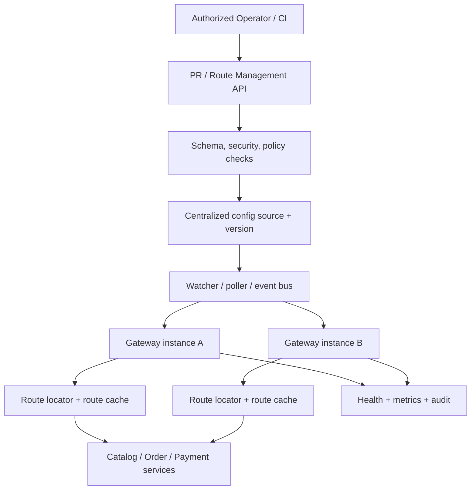
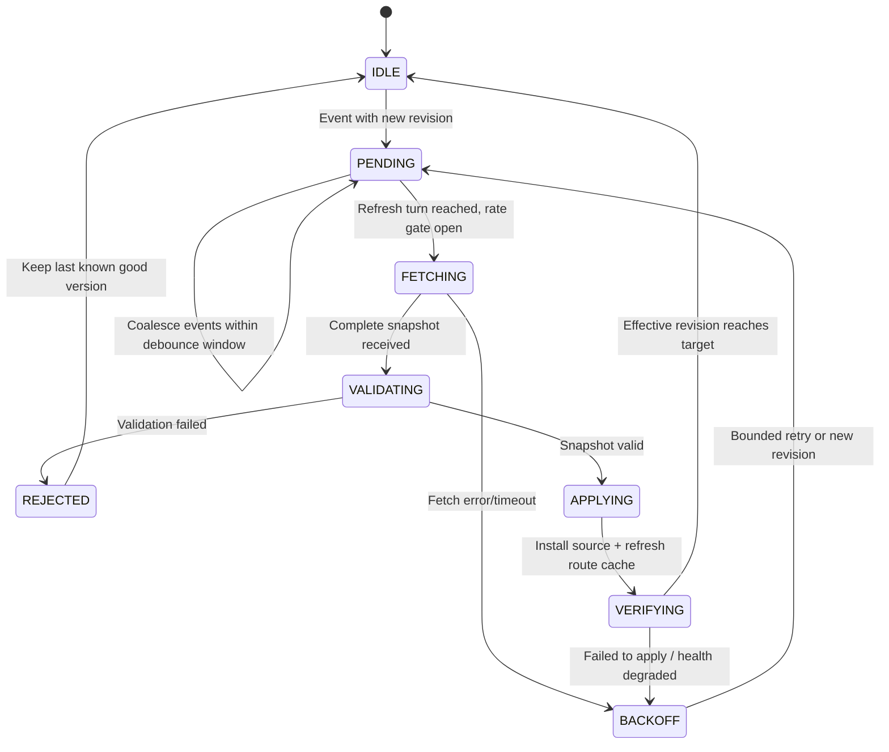
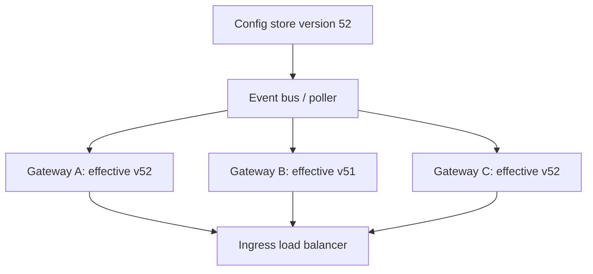

# Integrating Centralized Configuration Sources and Limiting Auto-Refresh in Spring Cloud Gateway

In a microservices system, API routes are not always static. When deploying a new service version, changing hostnames, onboarding partner routes, or temporarily disabling an endpoint, operations teams often want to update routes **without rebuilding and restarting the entire Spring Cloud Gateway**. This drives **dynamic routes**: route definitions are read from a centrally managed source, validated, and reapplied under control.

However, **placing configuration in a central store does not mean every Gateway replica automatically detects and applies changes immediately**. The system must still address change detection, loading new snapshots, refreshing the routing cache, securing the config source, synchronizing multiple instances, and rate-limiting refreshes so a tight loop does not spike CPU, break routes, or destabilize Gateway.

This lesson belongs to the **Dynamic Routes** chapter of the `SPRING_CLOUD_GATEWAY` module, within the context of Gateways using route predicates, filter chains, path/header rewriting, and service discovery. Route refreshes must coordinate with authentication, rate limiting, circuit breakers, retries, TLS, and request observability—never bypass them.

**Learning objectives:**

1. Distinguish a **centralized configuration source** from the **route cache actively serving requests in Gateway**.
2. Understand options across **Spring Cloud Config/Git**, ConfigMaps/Kubernetes, and custom `RouteDefinitionLocator` or `RouteDefinitionRepository` implementations.
3. Know when to use `RefreshRoutesEvent`, actuator `/actuator/gateway/refresh`, and when an external config reload mechanism is needed.
4. Design **bounded auto-refresh**: versioning, debouncing, polling intervals, jitter, validation, canaries, rollback, and safeguards when the source fails.
5. Analyze consistency across multiple Gateway replicas and test both the update workflow and in-flight requests.

> **Scope:** Focused on **Spring Cloud Gateway Server WebFlux**. Namespaces and actuator access controls have changed across Spring Boot and Spring Cloud Gateway generations; YAML and Java examples must be verified against your project's compatible versions. Hostnames, service IDs, tokens, and threshold numbers below are illustrative only, not default production settings. This lesson does not require deploying a full production control plane.

## 1. Why Do Dynamic Routes Differ from Static Declarations?

A static route typically lives in `application.yml`:

```yaml
spring:
  cloud:
    gateway:
      server:
        webflux:
          routes:
            - id: catalog-api
              uri: lb://catalog-service
              predicates:
                - Path=/api/catalog/**
              filters:
                - StripPrefix=1
```

The benefit is easy review and tracking alongside source code. Yet if every route tweak requires a full build and deploy, operations teams can run into:

- Route update lead times longer than a production incident.
- Multiple Gateway replicas rolling out just to alter one mapping.
- Semantically identical configs copied inconsistently across environments.
- Difficulty performing canary routing or shutting down a risky route quickly with an audit trail.
- Difficulty keeping routing rules synchronized across multiple regions and tenants.

**Dynamic routes** let route definitions originate from an external source or refresh at runtime. Still, rapid updates enlarge the **blast radius**: an unchecked `Path=/**` route or unvalidated `uri` can misroute traffic, expose admin endpoints, or open an SSRF path into the internal network.

### 1.1. What Belongs to a Route Definition?

A Spring Cloud Gateway route typically includes:

| Component | Role | Risk When Changed Dynamically |
| --- | --- | --- |
| `id` | Route identifier used in metrics, lookups, and refreshes. | Duplicate IDs or changing IDs hinder rollback and observability. |
| `uri` | Target such as `lb://order-service` or `https://upstream.example`. | Forwards requests to untrusted targets. |
| `predicates` | Conditions like `Path`, `Method`, `Host`, headers, etc. | Overly broad predicates swallow traffic from other routes. |
| `filters` | `StripPrefix`, `RewritePath`, `Retry`, `RequestRateLimiter`, etc. | Filters rewrite paths/headers or drop protections. |
| `order` | Route precedence when multiple routes match. | A catch-all route overrides specific routes. |
| `metadata` | Extra policy/observability information. | Wrong groups, excessive timeouts, or exposed sensitive settings. |

An invalid route does not merely fail at startup; it can impact live requests **immediately after refresh**.

## 2. Conceptual Architecture: Source, Revisions, Gateway, and Cache

A route management architecture can separate the **control plane** from the **data plane**:

- **Control plane:** where operators create, validate, approve, version, and distribute route definitions.
- **Data plane:** Gateway instances receiving requests and using **loaded route definitions** to decide which upstream to call.



This diagram is a **reference design**; it does not imply Spring Cloud Gateway builds every block out of the box.

### 2.1. Two States to Keep Separate

1. **Desired routes** — the intended configuration persisted in Git/Config Server, ConfigMap, Redis, or a database.
2. **Effective routes** — the route list currently active in a Gateway instance to match HTTP requests, after binding, validation, filter instantiation, and cache refresh.

You can have **desired version = 42** while a replica still serves **effective version = 41** because it missed the event, failed to fetch the source, is mid-refresh, or failed validation.

Therefore, "merged the YAML" does not prove "all traffic is now using the new route."

### 2.2. The Route Cache Is a Core Layer

Spring Cloud Gateway Server WebFlux typically includes a composite/caching layer—such as `CachingRouteLocator`—aggregating multiple `RouteDefinitionLocator` sources. Route definitions are compiled into runtime `Route` objects used for matching.

When the data source changes while the cache has not been refreshed through the proper mechanism, Gateway can **keep serving old routes**. Conversely, clearing the cache while the definition source remains outdated simply makes Gateway **reload the same old data**.

## 3. Ways to Supply Route Definitions

There is no single mandatory dynamic source. Common choices include:

| Source | How It Operates | Best Fit When | What Must Be Controlled |
| --- | --- | --- | --- |
| `application.yml` packaged with app | Deploy/restart or dedicated reload mechanism | Routes rarely change; high reproducibility needed | Never expect editing a file on disk to refresh automatically. |
| **Spring Cloud Config Server + Git** | Manages YAML per environment/branch; CI or refresh events | You want audits, pull requests, centralized config | Config Client refresh and Gateway route refresh are two distinct steps. |
| **Kubernetes ConfigMap** | Mounted files/env vars or controller-based API watchers | Already running on Kubernetes | Pod env vars do not update live; mounted file updates do not auto-reload beans/caches. |
| **Database / Redis** | Custom `RouteDefinitionRepository` or locator reading state | You need a dynamic route management UI/API | Validation, consistency, atomic updates, auth, schema migrations. |
| **DiscoveryClient route locator** | Auto-generates routes from service discovery metadata | Service discovery is standardized | Discovery routes differ from manual config; policies/headers need separate control. |
| **Dedicated control plane** | Distributes versioned snapshots or event streams | Multi-cluster, complex approvals and rollouts | Must build auth, delta/snapshot handling, rollback, and metrics. |

### 3.1. Config Server Is Not `RouteDefinitionRepository`

**Spring Cloud Config Server** serves property sets from an external source, typically Git. **`RouteDefinitionRepository`** is an interface Spring Cloud Gateway uses to manage route definitions through save/read/delete APIs. Both can participate in an architecture, but they are **not the same interface**.

Examples:

- Route YAML lives in a Git repo → Config Client fetches properties → Gateway's properties route locator loads routes.
- Routes live in Redis → a custom `RouteDefinitionRepository` reads Redis → Gateway's route locator consumes definitions.
- A custom control plane uses Git for reviews, then publishes approved snapshots into Redis for multiple Gateway replicas.

Most importantly, maintain **a single authoritative source** per route group. If the same route ID comes from YAML, discovery, and a database without clear rules, the merged outcome becomes unpredictable.

## 4. Refresh Mechanisms Often Confused with One Another

This is the central distinction when integrating a centralized source.

| Mechanism | Typical Effect | What It **Does Not Guarantee** |
| --- | --- | --- |
| **Updating Git / Config Server** | Changes desired properties at the source. | Does not force every Gateway to immediately fetch and apply new routes. |
| **Spring Cloud Context refresh** | Refreshes `Environment`/`@RefreshScope` and supported configs. | Does not guarantee custom route caches/beans picked up the new version. |
| **`RefreshRoutesEvent`** | Asks Gateway to refresh its route cache from current sources. | Does not query Git/Config Server or update an upstream database. |
| **`POST /actuator/gateway/refresh`** | Triggers route refresh on **the called instance** (if enabled). | Does not broadcast to all replicas by default; does not pull remote properties. |
| **Spring Cloud Bus / message broker** | Can distribute refresh messages when integrated. | Does not automatically make every event a safe cache refresh across all Gateway versions. |
| **Kubernetes watch/reload controller** | Detects ConfigMap/Secret changes and triggers rollout/refresh. | Does not automatically rebind routes or refresh in-app caches. |

For **routes flowing through Config Server**, a complete pipeline often requires:

```text
Git commit / configuration version 42
  → Config Server serves version 42
  → Gateway Config Client receives new Environment/route properties
  → Gateway route source reflects version 42
  → Route cache is refreshed
  → Gateway actually serves effective routes version 42
```

For a **custom `RouteDefinitionRepository`**:

```text
Admin/CI approves snapshot 42
  → Store persists route definitions version 42
  → Gateway receives signal or polls and sees new version
  → RouteDefinitionLocator reads snapshot 42
  → Gateway refreshes route cache
  → Instance confirms effective version 42
```

Never collapse all those arrows into a vague single word like "refresh."

## 5. Integrating Spring Cloud Config Server and Git

A common pattern manages routes outside the Gateway binary while preserving Git-based reviews and audit trails.

### 5.1. Config Client: Connection Configuration

Example `application.yml` for a Gateway Client:

```yaml
spring:
  application:
    name: edge-gateway
  config:
    import: "configserver:https://config.internal.example"
  cloud:
    config:
      label: main
      fail-fast: true
```

Meaning:

- `spring.application.name` lets Config Server resolve configuration for the application.
- `spring.config.import` imports Config Server config in Spring Boot/Spring Cloud Config generations supporting the Config Data API.
- `label` selects the branch/tag per the source contract—here `main`.
- `fail-fast` enforces a strict startup policy if config cannot be fetched; balance this choice against availability and fallback needs.

**Note:** Profile/label precedence syntax and Config Client activation depend on your version. In environments with tightly governed configuration changes, pin an immutable label/revision instead of blindly tracking a mutable branch head without release gates.

Never embed Config Server usernames, passwords, or tokens directly into URLs committed to public Git repos. Use a secret manager, environment injection, or workload identity, and protect TLS/CAs and config-source identity.

### 5.2. Route File in the Git Source

Example configuration file for the production profile served by Config Server:

```yaml
spring:
  cloud:
    gateway:
      server:
        webflux:
          routes:
            - id: catalog-api
              uri: lb://catalog-service
              predicates:
                - Path=/api/catalog/**
              filters:
                - StripPrefix=1

            - id: orders-api
              uri: lb://order-service
              predicates:
                - Path=/api/orders/**
              filters:
                - StripPrefix=1
                - name: RequestRateLimiter
                  args:
                    key-resolver: "#{@authenticatedUserKeyResolver}"
                    redis-rate-limiter.replenishRate: 5
                    redis-rate-limiter.burstCapacity: 10
```

This is a **route content example**, not a guarantee that every environment already provides `KeyResolver` or Redis. If that filter is used, register the required bean and dependencies.

On older Gateway WebFlux branches, the common route namespace is `spring.cloud.gateway.routes`. **Config Server does not fix a mismatched namespace**: syntactically valid YAML ignored by the property binder leaves Gateway serving old routes or loading none.

### 5.3. A Git Commit Is Not a Runtime Refresh Signal

Pushing a Git commit only changes **the configuration source**. Running Gateways keep serving previously loaded routes. To apply the change, execute one of your designed workflows:

- Trigger a supported config refresh and verify the route cache refreshed.
- Broadcast events via Spring Cloud Bus, then confirm every Gateway instance applied the new route version.
- Perform a rolling rollout/restart of Gateway pinned to an immutable revision when stricter change control is needed.
- Run a custom watcher/poller that fetches the snapshot, validates it, and refreshes the route cache.

Never assume "Config Server serves the new file over HTTP" means every bean automatically rebinds on the next request.

### 5.4. When Is Restarting Still the Better Choice?

For apps with infrequent route edits, strict compliance requirements, or insufficient hot-reload test coverage, a **rolling restart pinned to an approved revision** can be safer and more reproducible than auto-refresh. Dynamic routing is a tool, not a mandatory feature for every Gateway.

## 6. Kubernetes ConfigMaps and Environment Variables: Key Limitations

When running Gateway on Kubernetes, routes can come from ConfigMaps or an in-cluster config source.

Three common patterns:

| How Config Enters the Pod | What Happens When ConfigMap Changes | What Is Needed for Runtime Updates? |
| --- | --- | --- |
| **Environment variables** | Running container env vars do not update automatically. | Pod rollout/restart or a separate config loading mechanism. |
| **Mounted ConfigMap volume** | Kubelet may update mounted files with sync delay; some mount modes (`subPath`) never update. | App needs a file watcher/rebind/refresh or pod rollout. |
| **Controller / reload integration** | Controller detects changes and invokes refresh or rollout. | Must verify permissions, events, compatibility, and refresh limits. |

Never treat `kubectl apply` as proof that Gateway routes changed. Even after a volume file updates, Spring Boot may not re-read it; `@ConfigurationProperties` and route caches can still retain old state.

### 6.1. Watchers Can Emit Multiple Events for One Change

File watchers often emit bursts of events per update—replace, rename, create, or metadata change. Triggering a full Gateway refresh on every raw event causes:

- CPU spikes from repeatedly rebuilding routes.
- Reading incomplete snapshots if read mid-write.
- Refresh storms across all replicas simultaneously.
- Transient error spikes in metrics even though desired config changed only once.

Use **debouncing**, read **complete snapshots**, and deduplicate via **version/content hash**.

### 6.2. Never Treat ConfigMaps as Secret Stores

ConfigMaps are meant for non-sensitive settings. Tokens, private keys, Config Server credentials, and TLS client certificates belong in proper Secret stores with RBAC. Regardless of where they live, route definitions can still carry dangerous URIs or headers, so edit permissions must be restricted like system-admin privileges.

## 7. `RouteDefinitionLocator` and `RouteDefinitionRepository`

Spring Cloud Gateway Server WebFlux provides interfaces to load route definitions from multiple sources.

### 7.1. `RouteDefinitionLocator`

`RouteDefinitionLocator` supplies route definitions via a reactive publisher. Conceptually:

```java
import org.springframework.cloud.gateway.route.RouteDefinition;
import org.springframework.cloud.gateway.route.RouteDefinitionLocator;
import reactor.core.publisher.Flux;

public interface ExampleShape extends RouteDefinitionLocator {
    @Override
    Flux<RouteDefinition> getRouteDefinitions();
}
```

The snippet above only shows **the relevant method signature**, with no implementation. It has no save or delete methods; its purpose is for Gateway to **read** definitions.

A custom locator can read snapshots from memory, Redis, a database, or a config stream. In reactive Gateway, avoid blocking JDBC or blocking network calls directly on the event loop; use reactive clients, validated snapshot caches, or bounded schedulers when the source only offers synchronous APIs.

### 7.2. `RouteDefinitionRepository`

`RouteDefinitionRepository` combines route reading with saving/deleting via the writer contract. Common signatures:

```java
Flux<RouteDefinition> getRouteDefinitions();

Mono<Void> save(Mono<RouteDefinition> route);

Mono<Void> delete(Mono<String> routeId);
```

**Verify exact signatures and bean auto-wiring against your version.** With Redis or database storage, `save()` completing successfully only means state was persisted per the storage contract; it **does not prove** every Gateway instance has refreshed its route cache.

### 7.3. Locator or Repository?

| Requirement | Usually Appropriate Choice |
| --- | --- |
| Read-only consumption of control-plane snapshots | Custom `RouteDefinitionLocator`. |
| Need API to save/delete routes in a state store | Suitable `RouteDefinitionRepository`. |
| Routes live in `spring.cloud.gateway...routes` | Built-in properties-based locator. |
| Auto-generate routes from a service registry | Discovery locator where supported by version. |
| Cluster-wide approvals, audits, and versioning | External control plane paired with locator/repository and refresh orchestration. |

Never misuse actuator `POST /routes/{id}` as a complete production route-management system without RBAC, validation, auditing, and durable storage.

## 8. Example Custom Locator Using an In-Memory Snapshot

This example highlights the boundary between **validated snapshots** and **cache refreshes**, rather than building an entire route management system.

A custom locator can hold an immutable snapshot and expose route definitions:

```java
import java.util.List;
import java.util.concurrent.atomic.AtomicReference;

import org.springframework.cloud.gateway.route.RouteDefinition;
import org.springframework.cloud.gateway.route.RouteDefinitionLocator;
import org.springframework.stereotype.Component;

import reactor.core.publisher.Flux;

@Component
public final class VersionedRouteSnapshotLocator
        implements RouteDefinitionLocator {

    private final AtomicReference<Snapshot> current =
        new AtomicReference<>(
            new Snapshot(0L, List.of())
        );

    @Override
    public Flux<RouteDefinition> getRouteDefinitions() {
        return Flux.defer(() ->
            Flux.fromIterable(current.get().routes())
        );
    }

    public synchronized boolean installValidated(Snapshot incoming) {
        if (incoming.version() <= current.get().version()) {
            return false;
        }

        // Caller must validate all routes beforehand.
        // In a real system, deep-copy potentially mutable RouteDefinitions
        // and attach the trusted source's revision/hash.
        current.set(new Snapshot(
            incoming.version(),
            List.copyOf(incoming.routes())
        ));

        return true;
    }

    public record Snapshot(
        long version,
        List<RouteDefinition> routes
    ) {}
}
```

What this code illustrates:

- `AtomicReference` holds a **reference** to the latest snapshot rather than mutating routes one by one.
- `Flux.defer` reads the current snapshot when the publisher is subscribed.
- `installValidated` accepts only strictly increasing versions and returns `true` when installed.
- `List.copyOf` enforces an immutable list wrapper, though **`RouteDefinition` itself has mutable fields**, so production code must create immutable or defensive deep copies.
- `synchronized` serializes updates **within one JVM only**; it is neither a distributed lock nor cluster-wide versioning.

**Key limitation:** this snippet does **not** publish `RefreshRoutesEvent`, fetch snapshots from Git/DB, validate URIs/predicates/filters, or record audits. Installing the snapshot only updates **the read source**; Gateway's route cache still requires a properly timed refresh.

### 8.1. What Else Is Needed for Production?

- A trusted data source with monotonic versions or revision IDs.
- Complete-snapshot fetching with timeouts, retry budgets, and validation.
- Validation covering syntax, security policies, and route ID/order collisions.
- Rejecting the entire snapshot if any route is invalid.
- Emitting the route cache refresh **after** the snapshot is ready.
- Health checks and metrics for desired vs. effective versions.
- Rollback to a last-known-good snapshot while letting in-flight requests drain safely.
- Coordination across multiple Gateway replicas.

Never query a slow database on every HTTP request just to look up routes; use versioned snapshots/caches and a controlled refresh schedule.

## 9. `RefreshRoutesEvent`: A Local Step After Source Changes

Once a route source installs a new snapshot, the application can signal Gateway to refresh its route cache. One mechanism in Gateway Server WebFlux is **`RefreshRoutesEvent`**.

Minimal example:

```java
import org.springframework.cloud.gateway.event.RefreshRoutesEvent;
import org.springframework.context.ApplicationEventPublisher;
import org.springframework.stereotype.Service;

@Service
public class GatewayRouteRefreshNotifier {

    private final ApplicationEventPublisher events;

    public GatewayRouteRefreshNotifier(
            ApplicationEventPublisher events) {
        this.events = events;
    }

    public void sourceSnapshotReady() {
        // Call ONLY AFTER the local route source has been
        // updated and verified at the target revision.
        events.publishEvent(new RefreshRoutesEvent(this));
    }
}
```

**This is a refresh signal scoped to the current instance's ApplicationContext.** It does not make HTTP calls to Config Server, does not modify Git, does not update storage, and **does not broadcast** to other Gateways.

### 9.1. Proper Operation Ordering

```text
Wrong:
  publish RefreshRoutesEvent
  → then write the new route version afterward
  → cache may reload stale data

Correct ordering:
  fetch new version snapshot
  → validate thoroughly
  → install/commit snapshot into the source Gateway reads
  → publish RefreshRoutesEvent
  → verify effective routes/version
```

Publishing the event before state is ready can cause refreshes to reload stale routes. Updating the source route-by-route and firing an event after each item causes refresh storms and exposes half-baked intermediate states. **Prefer atomic snapshots and coalescing** over asynchronous row-by-row updates.

### 9.2. Refresh Events Do Not Abort In-Flight Requests

When the route cache updates, requests that already passed route matching may finish under the prior route and filter chain. Do not rely on a refresh to **immediately terminate already-accepted connections or requests**.

For emergency security shutdowns, combine layers such as ingress/WAF/Security filters, token revocation, network rules, connection draining, and rollback rather than merely deleting a route.

## 10. What Does Actuator `/actuator/gateway/refresh` Do?

Spring Cloud Gateway provides management endpoints to inspect routes and—when write access is enabled by version and config—**request a route cache refresh**. Example call **in a restricted environment**:

```bash
curl -i -X POST \
  "https://gateway-admin.internal.example/actuator/gateway/refresh" \
  -H "Authorization: Bearer <admin-token>"
```

**Keep these distinctions clear:**

- This request hits **one Gateway instance or management endpoint**; it does not update all replicas by default.
- The endpoint must be **included, exposed, and granted write access** per your Spring Boot Actuator / Gateway version. Newer lines split actuator access into `read-only` and `unrestricted`; never assume POST works simply because the endpoint is exposed.
- This endpoint only **refreshes routes**; it does not make Config Client fetch updated remote properties.
- An HTTP success status does not prove subsequent requests use the new version if cache refresh is asynchronous or the route source errors.

### 10.1. Why Not Expose Management Endpoints Publicly?

An attacker able to trigger route refreshes repeatedly can exhaust Gateway CPU, thrash caches, and degrade service. Actuator endpoints that list, add, delete, or refresh routes carry even higher risk if left public.

**Minimum rules:**

1. Bind management endpoints to a **dedicated private management network/port** wherever possible.
2. Require strong authentication and least-privilege authorization; allow only CI/control planes to update or refresh.
3. Enforce TLS/mTLS, network policies, ingress allowlists, and auditing.
4. Rate-limit refresh requests; never expose actuator write APIs to the public Internet.
5. Never treat `management.endpoints.web.exposure.include=*` as production-safe.
6. Restrict read access to route/config endpoints too, as they can reveal architecture details and sensitive parameters.

### 10.2. `/actuator/refresh` Is Not `/actuator/gateway/refresh`

In Spring Cloud, another refresh endpoint belongs to **Spring Cloud Context / Environment refresh**. Despite similar names, their jobs differ:

- `/actuator/refresh`: refreshes Spring Cloud Context `Environment` and `@RefreshScope` beans when supported dependencies and configs are present.
- `/actuator/gateway/refresh`: refreshes Gateway's routes when the corresponding actuator endpoint is enabled.

Never build automation calling just one and assuming everything updated. Verify **new properties rebound**, **the route cache refreshed**, and **effective routes match the target revision**.

## 11. Auto-Refresh: Why Must You Bound It?

A naive initial implementation is tempting:

```text
onChange(event):
    refreshGatewayRoutes()
```

Yet real config sources emit bursts of events because:

- One commit triggers a webhook, a file watcher, and a message bus simultaneously.
- A Kubernetes ConfigMap updates multiple times during a deployment.
- A config store reconnects and replays a backlog of change events.
- Multiple control-plane replicas emit notifications for the same revision.
- An operator clicks "refresh" repeatedly while changes appear slow.
- A failed refresh immediately retries and emits another refresh event.

Each refresh can make Gateway read the source, rebuild routes/filters/predicates, invalidate caches, update metrics, and perform I/O. Without bounds, **the control plane can overload the data plane**.

### 11.1. Controls You Should Put in Place

| Control | Meaning | Example Policy |
| --- | --- | --- |
| **Version deduplication** | Ignore events for already-applied or older revisions. | Revision 42 is active; drop events 41 and 42. |
| **Debounce** | Merge rapid consecutive events into one refresh after a quiet period. | Wait 2 seconds with no new events. |
| **Minimum interval** | Prevent overly frequent refreshes even under steady event flow. | At least 10 seconds between refreshes. |
| **Rate cap** | Cap total refreshes within a time window. | At most 6 refreshes/minute per instance. |
| **Single-flight** | Allow only one refresh job running at a time per instance. | New events mark a pending flag. |
| **Jitter** | Keep all replicas from refreshing at the exact same millisecond. | Random offset within a small window. |
| **Timeout** | Never let fetch/validation hang indefinitely. | Bounded time budget for snapshot fetches. |
| **Backoff** | Increase wait time between retries when the source errors. | Capped exponential backoff with jitter. |
| **Canary / staged rollout** | Apply new versions to a small subset first. | One replica, then the next replica group. |
| **Kill switch** | Pause auto-refresh during control-plane incidents. | Temporarily switch to manual approval. |

These numbers are illustrative. Real thresholds depend on route count, rebuild duration, Gateway CPU/memory headroom, and update SLA targets.

### 11.2. Debounce vs. Throttle

- **Debounce:** waits for a quiet period after the latest event before acting; ideal when one update fires a burst of events.
- **Throttle / minimum interval:** caps execution frequency; prevents continuous refreshes when events never stop.
- **Version gate:** refreshes only when the new revision genuinely differs from the active revision.

A sound design combines all three. Debouncing alone can **starve indefinitely** under continuous events; throttling alone can miss the final revision unless paired with a pending flag or catch-up schedule.

## 12. Controlled Refresh Orchestration Algorithm

A simple state machine:



### 12.1. Pseudocode

```text
onSourceNotification(revision):
    if revision <= appliedRevision:
        return

    desiredRevision = max(desiredRevision, revision)
    markRefreshPending()

workerLoop():
    waitUntilDebounceWindowAndRateGateOpen()

    if refreshAlreadyRunning:
        leavePendingForNextRound()
        return

    candidate = fetchCompleteSnapshot(desiredRevision, timeout)
    if fetchFails:
        scheduleBoundedBackoffWithJitter()
        return

    if not validateSchemaAndSecurity(candidate):
        recordRejectedRevision(candidate.revision)
        alertOperator()
        keepLastKnownGood()
        return

    if candidate.revision <= appliedRevision:
        return

    installCandidateAsLocalRouteSource(candidate)
    publishRefreshRoutesEvent()
    verifyEffectiveRevisionAndRouteHealth()

    if verificationPasses:
        appliedRevision = candidate.revision
    else:
        rollbackOrKeepLastKnownGoodByPolicy()
        alertOperator()

    if desiredRevision > appliedRevision:
        markRefreshPending()
```

This is **architectural pseudocode**, not a built-in Spring Cloud Gateway API. Specifically:

- Protect `desiredRevision` against concurrent event/worker races.
- `max(...)` only works when the source supplies **monotonically increasing numeric versions**; Git SHAs have no numeric ordering.
- "Verify effective version" requires custom state/metric tracking; Gateway does not expose a built-in desired/effective revision for arbitrary custom sources.
- If refresh fails after installing a snapshot, preserve last-known-good and run **rollback + another refresh**.
- Never run blocking I/O directly on the Netty event loop.

### 12.2. Dropping Intermediate Events Does Not Mean Skipping the Final Version

If revisions 42, 43, and 44 arrive in rapid succession, you rarely need to refresh through all three one by one unless a contract demands observing every state. You can **coalesce directly to validated snapshot 44**.

However, if revision 44 fails validation, the system must decide whether to hold 42 or try validated 43 per policy—never deploy an unvalidated version just to "stay current."

### 12.3. Prefer Complete Snapshots Over Many Small Edits

When a related set of catalog, orders, and payments routes must change together, applying one route at a time and refreshing immediately exposes inconsistent intermediate states.

Publish **a single versioned snapshot**, validate the whole set, and swap the route source to that snapshot before emitting one refresh event. That prevents refresh storms and enables clean rollback to a specific revision.

## 13. Polling, Webhooks, and Event Buses: Which Should You Choose?

| Change Detection Mechanism | Advantages | Disadvantages / Limits |
| --- | --- | --- |
| **Revision polling** | Simple, self-heals after missed events; easy to rate-limit. | Adds latency; queries source even when unchanged unless conditional fetch is used. |
| **Webhook** | Low update latency. | Can arrive duplicated, lost, or spoofed; requires auth and reconciliation. |
| **Message broker / Bus** | Broadcasts events to many instances. | At-least-once delivery, ordering, consumer lag; does not prove nodes applied it. |
| **Watch API** | Near real-time change tracking. | Reconnects, compaction/resume tokens, resource versions, and backpressure. |
| **Rolling deployment** | Config version tightly bound to release. | Slower than hot reload; often safer for high-risk changes. |

A practical architecture often pairs **event notifications for fast reaction** with **periodic polling to heal missed events**.

### 13.1. Conditional Fetch

If Config Server or your control plane supports a revision identifier, `ETag`, or equivalent conditional header, pollers can download full snapshots only when versions change, reducing I/O.

However, **do not assume every Spring Cloud Config Server endpoint implements `ETag` semantics the exact way you expect**. When needed, build a dedicated snapshot endpoint carrying `revision` and test header/cache behavior explicitly.

### 13.2. Webhooks Require Authentication and Replay Protection

An endpoint accepting "route version 44 is ready" notifications can be abused to trigger refresh storms if left public. Require signatures/HMAC or mTLS/workload identity on webhooks, cap payload sizes, rate-limit, enforce replay protection, log events, and authorize versions.

**Events should act only as a signal that "a new version exists,"** never as a channel where clients submit raw route YAML for Gateway to apply blindly without validation.

## 14. Multiple Gateway Replicas: Local Events Are Not Enough

Suppose you run three Gateway instances:



This is a **partial rollout**. A client can get different answers as the load balancer rotates across instances, even for identical requests.

### 14.1. Define the Target Consistency Level

| Consistency Level | Meaning | Appropriate When |
| --- | --- | --- |
| **Eventual consistency** | Replicas may diverge briefly within a bounded window. | Adding low-risk routes where brief divergence is acceptable. |
| **Staged / canary consistency** | A subset of replicas receives the new version first before expanding. | You must validate live behavior before cluster-wide rollout. |
| **Version-gated traffic** | Traffic routes only to instances meeting a minimum revision. | Route changes affect critical API contracts requiring controlled cutover. |
| **Coordinated cutover** | Traffic switches at coordinated milestones. | Sensitive route updates requiring strict downtime and compatibility control. |

Spring Cloud Gateway does not provide **cluster-wide atomic cutover** from `RefreshRoutesEvent` on a single node. Stronger consistency requires control-plane or ingress orchestration.

### 14.2. Every Replica Must Report Its Own State

Observability status per replica should look like:

```json
{
  "instance": "edge-gateway-b",
  "desiredRevision": "cfg-52",
  "loadedRevision": "cfg-52",
  "effectiveRevision": "cfg-51",
  "lastRefreshResult": "PENDING"
}
```

This is a **custom telemetry schema**, not standard JSON built into Spring Cloud Gateway Actuator.

Knowing Config Server holds `cfg-52` tells you nothing about which instances are actually serving the new routes.

### 14.3. Why Not Refresh Every Replica in the Same Millisecond?

When all replicas fetch a large snapshot simultaneously, it can:

- Overload Config Server, databases, Redis, or the Kubernetes API.
- Spike CPU/GC across the whole fleet from route/filter reconstruction.
- Amplify outages simultaneously if the revision is faulty.
- Trigger thundering herds when caches or connections recover.

Use jitter, staged rollouts, and concurrency limits—without breaching route-update SLAs. For urgent security changes, maintain a dedicated priority workflow with per-node verification and edge-level blocking options.

## 15. Validating Route Definitions Before Applying

Dynamic routes carry higher security risk than routes checked into source control because changes take effect rapidly.

**Never allow ordinary clients or unvetted CI jobs to submit:**

```yaml
- id: dangerous
  uri: http://169.254.169.254
  predicates:
    - Path=/**
```

This snippet illustrates **a dangerous internal/metadata target** strictly to show policy checks—never deploy it.

### 15.1. Minimum Validation Suite

| Check Category | Example |
| --- | --- |
| **Schema** | Required ID, URI, predicates; route and filter counts within bounds. |
| **Route ID** | Unique within snapshot and namespace; follows conventions; never collides with admin routes. |
| **URI scheme** | Restrict to schemes like `lb` or `https` per route class; block disallowed schemes. |
| **Upstream destination** | Allowlist service IDs/domains; block internal metadata, loopback, and private IP ranges unless explicitly approved. |
| **Predicates** | Disallow `/**` or overly broad `Host` predicates without special approval. |
| **Order / collisions** | Catch duplicate `Host+Path+Method` rules or catch-all routes shadowing specific routes. |
| **Filter types** | Allowlist reviewed filter factories; reject unapproved filters. |
| **Header mutation** | Block arbitrary edits to `Authorization`, `Host`, `Forwarded`, or internal identity headers. |
| **Redirects** | Disallow open redirects to unapproved external hosts. |
| **Retries** | Block retries on `POST`/`PATCH` lacking idempotency contracts. |
| **Rate limit / security** | Route edits must never silently bypass Spring Security or quotas. |
| **Resource budgets** | Cap route counts, regex lengths, metadata sizes, and refresh rates. |
| **Environment** | Block production routes from pointing to test services or unauthorized tenants. |

URI inputs can abuse hostnames, DNS rebinding, or URL encoding; a naive string allowlist **does not replace** network policies, DNS/TLS validation, and egress restrictions.

### 15.2. Syntax Validation Differs from Behavioral Validation

A route with valid YAML containing `Path=/**` and `order=-100` can still hijack all traffic unexpectedly.

Enforce **policy validation** and route-matching tests rather than checking only that `RouteDefinition` parses cleanly.

### 15.3. Protecting the Filter Chain

Route definitions can alter `StripPrefix`, `RewritePath`, `Retry`, `RequestRateLimiter`, `CircuitBreaker`, or CORS metadata. Someone editing a route might accidentally drop rate-limiting or authorization assumptions. Security architecture should never depend solely on a route retaining a specific filter; `SecurityWebFilterChain` and backend protections must remain robust independently.

## 16. Safe Updates: Staging, Canary, and Rollback

A safe rollout path for a new route revision includes:

1. An authenticated operator opens a pull request or config change request.
2. CI parses route definitions and runs schema and policy checks.
3. Tests verify route matching across representative `Host`/`Path`/`Method` inputs.
4. Checks verify service ID/upstream allowlists and security filter diffs.
5. Pipeline emits a snapshot with revision, checksum, and signature/provenance if required.
6. Canary rollout targets one Gateway instance/group with controlled traffic.
7. Verify effective version, 404/401/403/429/5xx rates, latency, and per-route metrics.
8. Expand rollout across remaining Gateway replica groups.
9. On errors, roll back to the **last-known-good snapshot** and trigger a controlled refresh.
10. Record audit logs: who changed what, when, why, and before/after revisions.

### 16.1. Rollback Is More Than Reverting a Git Commit

Reverting changes **desired config**, yet Gateway instances still must fetch the rollback revision and refresh their route caches. Any instance stuck on the faulty revision will keep misrouting traffic.

After rollback, verify:

```text
Desired revision: rollback-53
Gateway A effective revision: rollback-53
Gateway B effective revision: rollback-53
Gateway C effective revision: rollback-53
Error rate: returned to stable threshold
```

Never declare a rollback complete just because "CI is green" or "Config Server serves the old file."

### 16.2. Last-Known-Good Matters More Than "Applying the New Version at All Costs"

When a snapshot carries invalid URIs or filters, the safe behavior is usually:

- Keep the verified active routes.
- Record the rejected revision and reason.
- Alert operators.
- Never refresh to an empty route list merely because Config Server errored temporarily.
- Resume rollout only after fixing or re-approving the change.

Certain urgent changes may require "fail-closed" behavior at the edge for security reasons. Handle those through a dedicated workflow rather than uncontrolled automatic fail-open behavior.

## 17. When the Config Source or Refresh Encounters Failures

Key failure modes:

| Failure | Symptom | Desired Behavior |
| --- | --- | --- |
| Config Server unreachable at startup | Gateway lacks new config. | Decide fail-fast vs. last-known-good/rollout per policy. |
| Config Server disconnects at runtime | Poller fails to fetch revisions. | Retain last-known-good effective routes, back off, and alert. |
| Duplicate webhooks delivered | Repeated refreshes for the same revision. | Deduplicate by revision/hash and debounce. |
| Lost webhook | A replica misses the update. | Periodic reconciliation polling catches it up. |
| Validation fails | A route has a bad edit or dangerous URI. | Reject the entire snapshot per policy; never apply half-updated state. |
| One replica fails refresh | Effective revisions diverge. | Alert, isolate/canary, bounded retries; never declare rollout complete. |
| Route cache fails to refresh | Source updated yet requests hit old routes. | Inspect `RefreshRoutesEvent`/actuator and effective routes. |
| Route cache refreshes before source updates | Cache reloads stale data. | Fix ordering: commit source first, then refresh. |
| No service instances available | New `lb://...` route returns 503. | Check discovery/readiness; roll back if needed. |
| Missing filter factory | Route fails to load or build filters. | Validate against factory allowlist and run integration tests pre-rollout. |
| New route increases retries | Upstream attempts spike; backend overloaded. | Enforce retry budgets, idempotency, circuit breakers, and SLO guardrails. |
| Network split during refresh | Some requests use old snapshot, some use new. | Account for eventual consistency; use staged rollout/cutover if required. |
| Management endpoint abused | Refresh storms and resource exhaustion. | Private management plane, auth, rate caps, and auditing. |
| Sensitive route change leaks data | Host/path/headers routed to wrong target. | Incident response, kill switch, network restrictions, and revision tracing. |

### 17.1. When the Source Returns an Empty Snapshot

**Empty can be intentional or an error.** If an admin intentionally closes all public routes in an environment, an empty snapshot may be valid; if Config Server returns empty data due to a parse error or lost permissions, wiping all routes causes an outage.

Solve this with a **snapshot status/manifest** carrying revision, expected route count, checksum, environment, signature, or approval—never infer intent from an empty list alone.

### 17.2. DNS/TLS Failures to the Config Source

Connections to Config Server, Redis, or route databases must use secure networks, TLS, and proper trust stores. Never disable certificate verification to get auto-refresh working. On TLS errors, **retain the last-known-good snapshot** and alert—never fall back to fetching routes over untrusted HTTP.

## 18. Observability: Knowing Which Version Runs Where

Operating dynamic routes requires more than tracking HTTP 200/500 counts.

### 18.1. Recommended Metrics

- `gateway_route_refresh_attempts_total`: attempt counts classified by outcome.
- `gateway_route_refresh_success_total` and `gateway_route_refresh_failure_total`.
- `gateway_route_refresh_duration_seconds`: time spent fetching, validating, installing, and rebuilding.
- `gateway_route_snapshot_age_seconds`: age of the effective snapshot.
- `gateway_route_desired_revision` / `effective_revision`: typically exposed via info/status endpoints, **not necessarily numeric metrics**.
- `gateway_route_count` per environment/instance.
- `gateway_route_validation_rejections_total` by failure reason.
- `gateway_route_replica_skew` or count of replicas behind target revision.
- HTTP request counts, latencies, and statuses broken down by **route ID**.
- Unexpected 404, 503, or redirect spikes after each rollout.

These metric names are **custom instrumentation suggestions**, not a guarantee that Spring Cloud Gateway exports all of them by default.

### 18.2. Avoid High Cardinality

Never use raw Git SHAs, user IDs, tenant IDs, unnormalized request paths, or full route URIs as unbounded metric labels. Surface revisions via info endpoints, admin dashboards, or structured audit logs, keeping metric labels limited to low-cardinality dimensions such as `instance`, `environment`, and `outcome`.

### 18.3. Route IDs and 404/503s

- `404` can mean no route matched post-refresh or the backend lacked the resource.
- `503` can mean `lb://service-id` has no instances—not necessarily a broken route source.
- `401/403` can come from Spring Security before Gateway route matching runs.
- `429` can come from `RequestRateLimiter`; a new route or changed key resolver alters quotas.
- TLS, timeouts, or circuit breakers can return errors even when the route itself is right.

Use distributed tracing and structured logs to pinpoint **which layer generated the response** rather than blaming every post-refresh 5xx on a single cause.

## 19. Testing Refreshes from Config Server

Assume a staging environment:

- Config Server at `https://config.staging.example`.
- Two Gateway replicas behind an ingress.
- Route `catalog-api` currently pointing to `lb://catalog-v1` at revision `cfg-10`.
- New version `cfg-11` switches to `lb://catalog-v2`.

**Never use production to simulate these failure scenarios.**

### 19.1. Preconditions

Before making changes:

1. Confirm both replicas report effective revision `cfg-10` in custom telemetry.
2. Confirm the current route and v1 backend are healthy.
3. Confirm Config Client loads remote properties cleanly on your supported version.
4. Verify CORS, auth, and rate limiters on the target route group.
5. Prepare a rollback target and verify control-plane refresh permissions.

### 19.2. Update the Source

In Git / the control plane:

```yaml
- id: catalog-api
  uri: lb://catalog-v2
  predicates:
    - Path=/api/catalog/**
  filters:
    - StripPrefix=1
```

This is a **route definition fragment**, not a complete `application.yml`.

CI validates that `catalog-v2` is in the service allowlist, predicates do not accidentally shadow other APIs, filters preserve critical policies, and the destination has healthy registered service instances.

### 19.3. Receive the New Version and Refresh

Depending on workflow:

```text
1. Config source publishes cfg-11.
2. Clients A and B receive cfg-11 via trigger/polling.
3. A and B rebind/load cfg-11 into their route source.
4. A and B emit local RefreshRoutesEvent or
   use Gateway actuator refresh per policy.
5. Wait for each instance to confirm effective cfg-11.
6. Check canary traffic and route-specific metrics.
```

**Never call `/actuator/gateway/refresh` alone and assume steps 2 and 3 happened automatically.**

### 19.4. Test Live Requests

```bash
curl -i "https://gateway.staging.example/api/catalog/products/42" \
  -H "X-Test-Correlation: refresh-cfg-11"
```

Inspect the response and upstream telemetry. `X-Test-Correlation` is merely a test marker, not proof of the route version. Check upstream mocks or logs to confirm the request reached `catalog-v2`.

If a request returns 503, verify whether `catalog-v2` registered healthy instances before blaming the refresh.

### 19.5. Test Rollback

Reset the desired snapshot to the last known good version, wait for both replicas to report the rollback revision as effective, and confirm traffic returns to the expected upstream. Record actual rollback duration and any window during which replicas diverged.

## 20. Testing Auto-Refresh and Rate Limiting

A strong test plan validates both functional correctness and fault tolerance.

| Scenario | Expected Observation |
| --- | --- |
| One valid new revision | Fetch + validate + refresh; effective revision updates. |
| Five duplicate revision webhooks | Only one meaningful apply; no five unnecessary rebuilds. |
| Multiple revisions arriving close together | Coalesces to the latest valid snapshot per policy. |
| Older revision arrives after newer one | No silent rollback due to out-of-order event. |
| Snapshot contains duplicate route ID | Rejected or handled consistently per policy; never silently picks one. |
| Snapshot contains non-allowlisted URI | Rejected; retains last-known-good; emits audit/alert. |
| Unexpected empty snapshot | Does not wipe all routes when source errors. |
| Config Server outage | Bounded backoff; keeps serving healthy active routes. |
| Watcher event storm | Debounce/rate caps keep CPU and refresh counts bounded. |
| Two replicas; one misses event | Periodic polling restores sync once connectivity returns. |
| One replica fails apply | Rollout reports partial; never marked complete. |
| Rolling refresh under traffic | In-flight requests behave per contract; no crashes from mutable config. |
| New backend has no instances | Distinguishes successful route refresh from discovery 503. |
| Retry / circuit breaker config changed | No retry storms or unintended side effects. |
| Missing security rules/filters | Unauthorized requests still blocked by Spring Security/backend. |
| Public client calls actuator refresh | Rejected by authentication and network policies. |
| Revision rollback | All replicas return to the known-good desired/effective snapshot. |
| Expired Config Server TLS/credentials | Refuses untrusted source; alerts and keeps last good config. |

### 20.1. Verifying Version Per Instance

Behind an ingress load balancer, a single `curl` cannot prove the whole cluster refreshed. Query internal management APIs **directly per instance** or inspect a telemetry aggregator showing each node's version and route count. Never expose management endpoints publicly just to make testing easier.

### 20.2. Fault Injection at Key Stages

Inject failures:

1. Before the source publishes a revision.
2. While the client is fetching a snapshot.
3. After fetching, before validation.
4. After validation, before installing the local snapshot.
5. After installing, before `RefreshRoutesEvent`.
6. Mid-rebuild of the route cache.
7. After refreshing one replica, before others refresh.
8. During a rollback while one node is disconnected.

At every point, verify **last-known-good retention**, **retry budgets**, **auditing**, and **rollout completion criteria**.

## 21. Common Misconceptions and How to Fix Them

| Claim or Symptom | Why It Is Wrong | How to Fix |
| --- | --- | --- |
| "Pushing to Git makes Gateway switch routes automatically." | Config Client does not auto-reload everything. | Design explicit triggers, rebinding, and route refreshes. |
| "Calling `/actuator/gateway/refresh` pulls new config from Git." | Route-cache refresh and Config Server fetch are separate steps. | Refresh the source first, then refresh the cache and verify version. |
| "Emitting `RefreshRoutesEvent` on A updates B too." | Events are local to one ApplicationContext by default. | Use a bus, polling, or multi-replica coordination. |
| "Updating ConfigMap updates pod env vars." | Running container env vars never mutate live. | Roll out pods or use another dynamic config mechanism. |
| "Updating a mounted file updates `@ConfigurationProperties` immediately." | Property binders do not re-run just because a file changed. | Use supported refresh/rebinding or rollout. |
| "`RouteDefinitionRepository.save()` completes the rollout." | Source state changed, but caches/nodes may not have refreshed. | Refresh and confirm effective versions per node. |
| "One webhook = one refresh." | Webhooks can duplicate or arrive in storms. | Deduplicate revisions, debounce, and cap refresh rates. |
| "Debouncing alone is enough." | Continuous events can starve refreshes forever or miss updates. | Combine throttling, pending flags, and reconciliation. |
| "Every node switches simultaneously." | There is no default cluster-wide atomic cutover. | Use canary or version-gated traffic when required. |
| "Wipe all routes if remote config fetch fails." | Turns transient source glitches into total outages. | Maintain last-known-good and explicit failure policies. |
| "If route YAML parses, it is safe." | URIs, filters, and predicates can introduce SSRF or bypasses. | Enforce policy validation and egress network controls. |
| "Changing routes is the right fix for 401 errors." | Security may block requests before Gateway routing. | Inspect JWTs/authorities and pinpoint which layer rejected. |
| "503 after refresh means a stale cache." | `lb://` might simply have zero healthy instances. | Check discovery, readiness, and backend health. |
| "Expose actuator publicly so CI can call it easily." | Creates a massive attack surface. | Use a private management plane and least privilege. |
| "Refresh returning 200 proves every node runs v42." | Ignores async caches and multi-replica divergence. | Measure effective versions, probe upstreams, and monitor rollout health. |
| "Discovery locator removes the need for security reviews." | Auto-generated routes still require auth, rate limits, and trust checks. | Keep security policies independent of route discovery. |

## 22. Practice Exercises with Answers

### Exercise 1 — Git Commit Without Route Changes

You update `uri: lb://catalog-v2` in Git Config Server, yet requests still reach `catalog-v1`. Operations thinks Spring Cloud Gateway is broken. In what order should you investigate?

**Answer:** Confirm Config Server serves the new revision; confirm each Gateway's Config Client fetched/rebound the properties; confirm the route source actually contains v2; confirm the route cache refreshed; and finally inspect effective routes and the load balancer. A Git commit alone is never enough.

### Exercise 2 — Two Different Refresh Endpoints

Developers call `POST /actuator/gateway/refresh` without triggering Config Client to fetch updated remote properties. Will Gateway pick up the new route?

**Answer:** Not by default. Gateway's endpoint refreshes routes from the currently loaded source; if the source still holds old properties, the cache simply reloads old routes. Separate config refresh from route refresh.

### Exercise 3 — Duplicate Webhooks

The control plane sends the same revision `cfg-42` ten times due to retries. Should Gateway refresh ten times?

**Answer:** No. Deduplicate by revision/hash, coalesce bursts, and enforce refresh rate limits while ensuring genuinely newer revisions are never dropped.

### Exercise 4 — Debouncing Under Continuous Events

A watcher receives a new event every 500ms with a 2s debounce window. One full minute passes with zero refreshes. Why?

**Answer:** Debouncing waits for a quiet period after **the last event**, so continuous events can defer execution forever. Add a maximum wait/throttle or an independent reconciliation schedule.

### Exercise 5 — Three Replicas on Divergent Versions

A and B run revision 17 while C remains on 16. Can you declare rollout complete just because Config Server holds 17?

**Answer:** No. Verify the effective revision **on each replica** and enforce explicit completion criteria; if policy demands consistency, drain C from traffic or wait for reconciliation.

### Exercise 6 — `RefreshRoutesEvent`

A service calls `events.publishEvent(new RefreshRoutesEvent(this))`. Does that push config to a database and notify other Gateway replicas?

**Answer:** No. It is a local event telling this Gateway instance to refresh from its current route source; updating sources and notifying other replicas must be handled separately.

### Exercise 7 — Empty Route Snapshot

Config Server glitches and returns an empty snapshot. Auto-refresh runs immediately and 100% of APIs start returning 404. What must be redesigned?

**Answer:** Distinguish an intentionally approved empty snapshot from a fetch/parse failure. Validate manifest/revision/expected route counts, retain last-known-good on source errors, and define fail-safe policies.

### Exercise 8 — SSRF via Dynamic Routes

An authorized route editor sets `uri: http://169.254.169.254` and `Path=/**`. Even though the YAML is syntactically valid, should it be applied?

**Answer:** No under normal policies. Allowlist URI schemes/hosts, block unapproved metadata and private destinations, inspect predicates/order, and enforce network egress protections.

### Exercise 9 — Refreshing Mid-Request

A request already matched an old route and is streaming to the backend when routes update. Can you assume the request immediately switches to the new route?

**Answer:** No. Requests that already selected a route and filter chain continue on the prior snapshot. Emergency blocking requires additional edge/security layers plus draining and rollback procedures.

### Exercise 10 — Why Versioning Matters

A webhook for revision 9 arrives after revision 10 due to out-of-order broker delivery. What happens if Gateway blindly applies every incoming event?

**Answer:** It could silently roll back to an older version. Use monotonic versions or check revisions against the authoritative source to ignore stale events.

### Exercise 11 — ConfigMap Updated Yet Env Unchanged

A Kubernetes pod reads routes from environment variables at startup. The ConfigMap changes, but the running pod sees nothing new. Is this a Spring Gateway bug?

**Answer:** No. Process environment variables do not update dynamically. Perform a pod rollout/restart or adopt a dynamic configuration loading mechanism.

### Exercise 12 — Canary Detects Errors

A new route hits a canary Gateway; 503s spike because `lb://payment-v2` has no instances yet. Should you continue rolling out so all nodes stay in sync?

**Answer:** No. Keep the stable baseline, investigate service discovery and readiness, assess impact, and proceed only when the canary meets health thresholds; syncing a broken config just widens the outage.

### Exercise 13 — Operator-Triggered Refresh Storm

An operator repeatedly calls actuator refresh trying to "force" routes to pick up config. Gateway CPU spikes. What safeguards are missing?

**Answer:** Restrict actuator access, rate-limit admin calls, deduplicate by revision, enforce single-flight refreshes, and expose clear metrics and status rather than unlimited refresh triggers.

### Exercise 14 — DB Snapshot vs. Route Cache

A custom `RouteDefinitionRepository` persisted route version 20 to the database, yet `CachingRouteLocator` still serves old routes. Why?

**Answer:** The source updated, but the cache was never refreshed. After confirming the source commit/version, trigger the proper refresh signal and verify effective routes on each Gateway instance.

## 23. Pre-Production Checklist

- [ ] Identified the exact **Gateway Server WebFlux** version and its configuration namespace.
- [ ] Established a single **authoritative source** per route/group so YAML, DB, and discovery never collide on IDs silently.
- [ ] Separated desired routes from effective routes with auditable revisions/hashes.
- [ ] Avoided confusing Spring Cloud Config refresh with Gateway route-cache refresh.
- [ ] Secured Config Server, Git, Kubernetes, or `RouteDefinitionRepository` with authentication and TLS.
- [ ] Understood Kubernetes ConfigMap distinctions across env vars, mounted files, and controller reloads.
- [ ] Validated all route updates for schema, URI, predicates, filters, ID/order, and security policies.
- [ ] Applied only complete, approved snapshots—never partial updates.
- [ ] Configured auto-refresh with revision deduplication, debouncing, minimum intervals, rate caps, and single-flight locks.
- [ ] Added timeouts, capped exponential backoff with jitter, and periodic reconciliation for missed events.
- [ ] Enabled every Gateway replica to report loaded/effective revisions and refresh outcomes.
- [ ] Defined consistency targets: eventual, staged/canary, or coordinated cutover.
- [ ] Maintained last-known-good snapshots, rollback targets, and tested rollback execution paths.
- [ ] Locked down management actuators by network, write permissions, rate limits, and auditing—never public write endpoints.
- [ ] Prevented arbitrary route URIs/filters from bypassing Spring Security, rate limits, TLS, or egress network policies.
- [ ] Verified service IDs, instances, and health before switching `lb://service` routes.
- [ ] Verified CORS, POST retries, circuit breakers, and header mutations are not altered unintentionally.
- [ ] Instrumented metrics for refresh attempts, duration, rejected revisions, replica skew, and per-route 4xx/5xx.
- [ ] Excluded Config Server credentials, tokens, and filter secrets from logs and actuator responses.
- [ ] Tested duplicate events, lost events, stale revisions, source outages, validation failures, restarts, and concurrent traffic.
- [ ] Verified route refreshes and rollbacks across **every replica**, not just a single 2xx actuator response.
- [ ] Documented an incident response runbook if dynamic routes misroute traffic or leak data.

## 24. Summary

**Integrating centralized configuration sources** enables Spring Cloud Gateway to pull route definitions from Git/Config Server, Kubernetes, or a custom `RouteDefinitionLocator`/`RouteDefinitionRepository`. Yet dynamic route management involves **two independent steps to verify**: updating the **desired configuration source** and refreshing the **active route cache serving requests**. `RefreshRoutesEvent` and `/actuator/gateway/refresh` govern the second step; neither fetches new config from Git nor synchronizes every replica automatically.

Auto-refresh is safe only when backed by **versioning, validation, debouncing, rate caps, backoff, consistent snapshots, canaries, and rollback**. Across a multi-instance Gateway cluster, local events and a 2xx actuator response never prove all traffic uses the new route—measure **each replica's effective revision** and test live routing behavior.

With clear control-plane/data-plane boundaries, locked-down management endpoints, last-known-good fallbacks, and thorough observability, `SPRING_CLOUD_GATEWAY` can update routes flexibly without turning your centralized config source or refresh pipeline into a new single point of failure for your microservices architecture.
