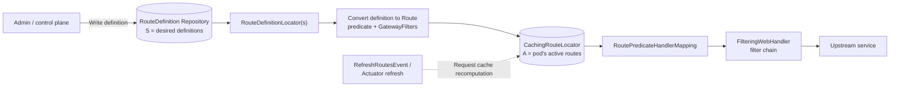
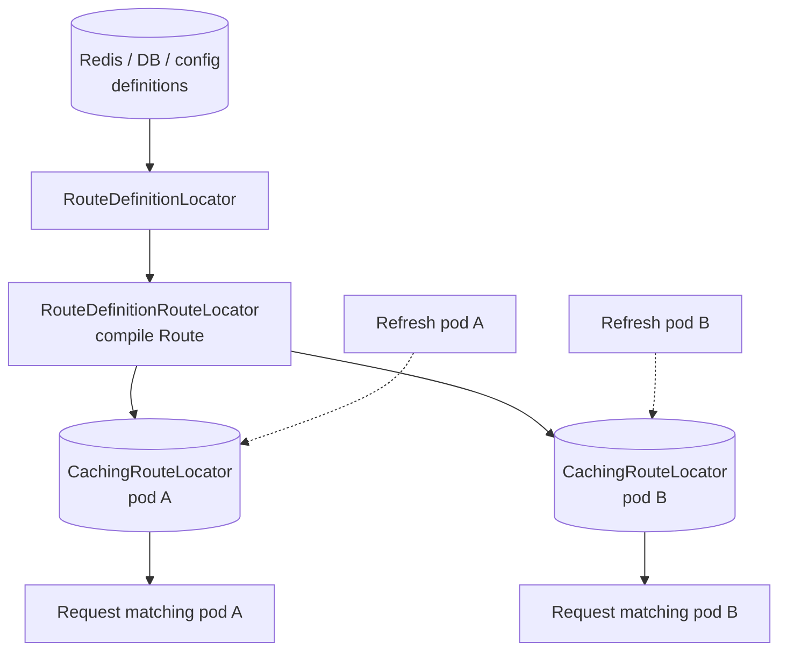
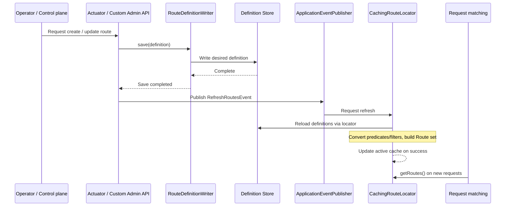
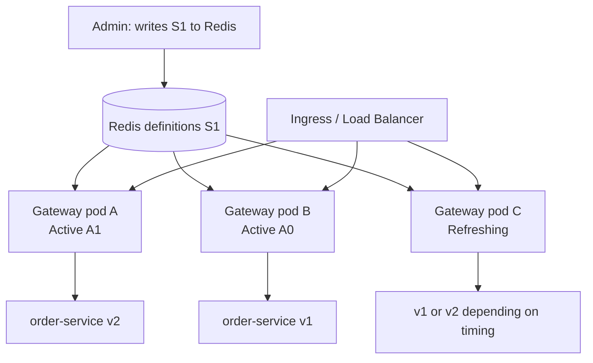
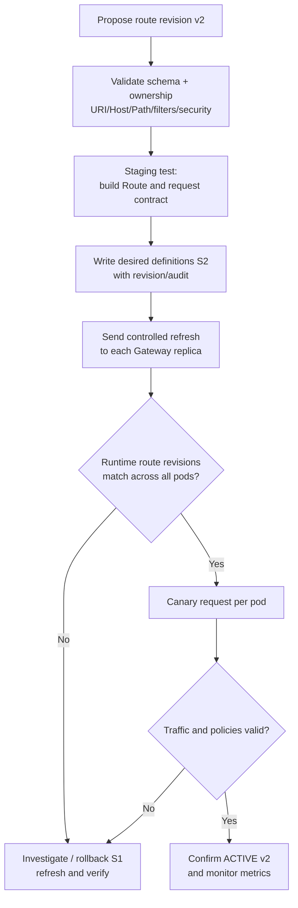

# Distinguishing Definition Store Changes from Effective Active Routes

A microservices system may need to **add a route without restarting the API Gateway**, for example opening `/api/catalog/**` to a new `catalog-service`, shifting part of traffic from v1 to v2, or pulling a broken endpoint from the ingress edge. Spring Cloud Gateway supports multiple **route definition** sources and runtime refresh mechanisms. However, a common operational pitfall is confusing:

- **Definition store changed:** a new `RouteDefinition` has been saved, deleted, or updated in the configuration source.
- **Effective active routes:** Gateway has loaded it, compiled the definition into an executable `Route` with predicates and filters, and is using it to match subsequent HTTP requests.

These two states are **not simultaneous**. A successful `POST` creating a route definition does not guarantee new requests match that route right away; conversely, deleting a definition without refreshing the cache can leave Gateway routing traffic using the old route. Across a multi-replica Gateway cluster, each instance also holds its own cache state even when the definition store is shared.

This lesson belongs to the **Dynamic Routes** chapter in the **SPRING_CLOUD_GATEWAY** module. It connects with route predicates, filter chains, path/header rewriting, service discovery, authentication, rate limiting, circuit breakers, retries, TLS, and observability to operate routing changes safely.

**Learning objectives:**

1. Distinguish `RouteDefinition`, `RouteDefinitionLocator`, `RouteDefinitionRepository`, `RouteDefinitionWriter`, `RouteLocator`, and `CachingRouteLocator`.
2. Explain why **a definition source change** is not necessarily visible to **incoming requests**.
3. Use Actuator to create, inspect, delete, refresh, and **verify effective routes**.
4. Understand refresh events and the impact of caching, asynchronous updates, route conversion errors, and route order.
5. Design controlled updates and rollbacks across multiple Gateway replicas, distinguishing a shared Redis repository from local caches.
6. Protect route management APIs against SSRF, unauthorized route configs, security filter tampering, and traffic disruption.

> **Scope:** This lesson focuses on **Spring Cloud Gateway Server WebFlux**. Primary examples reference **Gateway 5.x** documentation and `/actuator/gateway` management endpoints. In Gateway Server WebFlux 4.3.x, some configuration prefixes differ. This is not Gateway Server MVC; reactive code uses `Mono`/`Flux` and WebFlux routing components. Actuator 5.x docs note that refreshes may run **asynchronously**, so management responses must be corroborated with runtime routes and live requests rather than treated as cluster-wide synchronous guarantees.

## 1. Mental Model: Definition Source vs. Traffic-Serving Route Set

Imagine an admin console saving a change to `catalog-api` from `http://catalog-v1:8080` to `http://catalog-v2:8080`.



In this diagram:

- `S` = **source** state, or **desired configuration**.
- `A` = the route set **loaded by Gateway and used to match requests**.
- Between them lie steps for **reading the source, compiling predicates/filters, sorting, and refreshing the cache**.
- If the refresh has not run, failed, or is still incomplete on a pod, **`S` can differ from `A`**.
- Requests that already matched a route prior to the change may still finish under the previously selected handler chain and URI.

**Key phrasing:** "I saved the route" differs from "the route is applied," which differs further from "all requests across every Gateway replica are hitting the new backend."

### Three Separate Verification Questions

| Question | Layer to Inspect | Insufficient Proof If You Only... |
| --- | --- | --- |
| Does the new route definition exist in the source? | Repository / configuration / `routedefinitions` | Saw a `201` response from the write API |
| Does the current Gateway pod see the new runtime route? | `RouteLocator` cache / `/actuator/gateway/routes` | Only checked Redis or YAML |
| Do live requests hit the new target and policies? | HTTP request with matching Host/Path/Method; upstream logs/traces | Only saw the route ID in a list |

## 2. `RouteDefinition` Is Data; `Route` Is an Executable Object

**`RouteDefinition`** describes a route as configuration data: ID, URI, predicates, filters, order, and metadata. Example:

```yaml
# RouteDefinition fragment declared under routes
- id: catalog-api
  uri: lb://catalog-service
  order: 0
  predicates:
    - Path=/api/catalog/**
  filters:
    - StripPrefix=1
    - AddRequestHeader=X-Edge, gateway
  metadata:
    group: catalog
    revision: v2
```

**`Route`** is the runtime object Gateway uses during route matching, containing predicates built from factories, the list of `GatewayFilter`s, and converted URI/order/metadata info. It is not merely the raw JSON or YAML.

| Property | `RouteDefinition` | Runtime `Route` |
| --- | --- | --- |
| Purpose | Desired declaration | Serves request matching and filter execution |
| Predicates | Declarative strings like `Path=/api/catalog/**` | Compiled/instantiated predicates |
| Filters | `FilterDefinition` with name/args | `GatewayFilter` with config and order |
| Read/write | Saved via repository/writer | Typically exposed via `RouteLocator` |
| Caching | May come from source/definition cache | Typically cached in `CachingRouteLocator` |
| Immediate change? | Updated in the source | Must undergo refresh/reload when needed |
| Possible errors | Invalid data / write failure | Missing factory, bad URI, predicate/filter build failure |

### Why Does the Conversion Process Matter?

A definition might save cleanly in a data store yet fail to build into a valid route, for instance:

- Misspelled predicate `PathX` instead of `Path`.
- `RewritePath` filter missing a valid regular expression.
- Invalid backend URI or unsupported scheme.
- A factory requiring a dependency absent from the application.
- Two routes sharing an ID or having unexpectedly overlapping match conditions.

**Writing successfully does not mean compiling successfully.** Thus, the update workflow needs both definition validation **and** runtime route verification.

## 3. API Layers: Reading Definitions, Writing Definitions, and Reading Runtime Routes

Spring Cloud Gateway Server WebFlux separates these concepts:

| Interface / Class | Methods / Characteristics | Responsibility |
| --- | --- | --- |
| `RouteDefinitionLocator` | `Flux<RouteDefinition> getRouteDefinitions()` | Supplies definitions from a source |
| `PropertiesRouteDefinitionLocator` | Reads Spring Boot bound properties | Routes declared in `application.yml` |
| `DiscoveryClientRouteDefinitionLocator` | Generates definitions from service discovery when enabled | Automatic routes from service instances/names |
| `RouteDefinitionWriter` | `save(Mono<RouteDefinition>)`, `delete(Mono<String>)` | Saves/deletes definitions in a writable source |
| `RouteDefinitionRepository` | Combines definition reading and writing | Runtime-editable definition source |
| `InMemoryRouteDefinitionRepository` | Stores in memory of a single Gateway process | Local/test route mutations; **not shared** across replicas |
| `RedisRouteDefinitionRepository` | Stores shared definitions in Redis | Shared source across multiple Gateway instances |
| `RouteDefinitionRouteLocator` | Converts definitions into `Route`s | Instantiates executable predicates and filters |
| `RouteLocator` | `Flux<Route> getRoutes()` | Supplies runtime routes |
| `CachingRouteLocator` | Caches `Route`s; refreshes on refresh events | Route set Gateway usually reads during matching |
| `RoutePredicateHandlerMapping` | Picks a matching route for an exchange | Matches Host/Path/Method/... on requests |

Other classes or sources may appear depending on starters and versions. Never pick an interface arbitrarily just because its name contains `Route`.

### `RouteDefinitionLocator` and `RouteLocator` Are Not Interchangeable

```java
public interface RouteDefinitionLocator {
    Flux<RouteDefinition> getRouteDefinitions();
}

// Conceptual signature of RouteLocator:
public interface RouteLocator {
    Flux<Route> getRoutes();
}
```

`RouteDefinitionLocator` returns **definition data**; `RouteLocator` returns **ready-to-execute routes**. If you build a custom `RouteDefinitionLocator` reading a database, the database returning new rows **does not guarantee `CachingRouteLocator` has loaded the new `Route` set**.

### Not Every Route Comes from a Repository

Route sources can include:

- `application.yml` / configuration properties.
- `@Bean RouteLocator` Java DSL constructing `Route`s directly.
- Definitions generated by the `DiscoveryClient` locator.
- In-memory or Redis route-definition repositories.
- Custom `RouteDefinitionLocator` implementations reading databases, config services, or Git-backed APIs.

Consequently, Actuator's write/delete definition endpoints **cannot arbitrarily modify** routes declared in `application.yml` or `@Bean RouteLocator`. According to Actuator 5.x documentation, add/delete endpoints apply to routes managed through Actuator; deleting a config-declared route can return `404 Not Found`.

## 4. Two Cache Layers and What Refresh Actually Does

The word **cache** appears at several layers in Gateway. For this lesson, prioritize distinguishing:

1. **Route definition store:** data supplied by `RouteDefinitionRepository` or another source; Redis is one shared-source example.
2. **`CachingRouteLocator`:** the compiled **runtime `Route`** set loaded inside **one Gateway instance**.
3. **Auxiliary source caches:** such as LoadBalancer's `ServiceInstance` cache or caches inside configuration/discovery providers.



**Core point:** Sharing Redis **does not automatically synchronize `CachingRouteLocator` across all JVMs immediately**. Route refresh is a step that must occur in **each instance**.

### Route Cache vs. LoadBalancer Instance Cache

Suppose a runtime route remains:

```text
id = catalog-api
uri = lb://catalog-service
predicate = Path=/api/catalog/**
```

Registering a new instance of `catalog-service` in Eureka/Consul/Kubernetes **does not require changing this route definition**. LoadBalancer picks up new instances through its own service-instance suppliers and caches.

Conversely, changing the route itself from `Path=/api/catalog/**` to `Path=/api/v2/catalog/**` is a **route definition change**; you must get the new runtime route version into the request-matching pipeline.

**Do not confuse** `/actuator/gateway/refresh` with "refreshing all LoadBalancer caches," "clearing business data in Redis," or "re-registering services." It primarily concerns Gateway's route cache.

## 5. State Table: Saved, Refreshed, or Applied?

Let `S0` be the old source, `S1` the new source; `A0` the old active routes, `A1` the new active routes.

| Moment | Definition Source | Pod A Active Route Cache | What Requests May Observe |
| --- | --- | --- | --- |
| Before edit | S0 | A0 | Old route |
| Right after `save` of new definition | **S1** | **A0** | Still old route or missing new route |
| Refresh event emitted | S1 | A0, **refreshing** | May still hit old cache |
| Refresh succeeded | S1 | **A1** | New requests can match the new route |
| Refresh failed building route | S1 | May retain **A0** per version mechanics | Runtime has not applied the faulty definition |
| Definition deleted, not yet refreshed | Removed from source | Still holds old route | New requests may still match old route |
| Pod B not refreshed yet | Shared S1 | B still holds A0 | Clients load-balanced across A/B see inconsistent results |

**Remember:** An HTTP `200` from a refresh command **must not be interpreted as a cluster-wide guarantee that all pods switched to A1**. Actuator docs explain that refresh can run **asynchronously**, and errors during refresh can leave the existing route set untouched.

### Having a Definition in the Store Is Not Proof It Matches Requests

Suppose the repository stored:

```json
{
  "id": "reports-api",
  "uri": "http://reports-v2:8080",
  "predicates": ["Path=/api/reports/**"],
  "filters": ["StripPrefix=1"]
}
```

A client calls `GET /api/reports/weekly` and gets `404` straight from Gateway. Several causes are possible:

- Refresh has not run on the instance handling the request.
- Definition failed to build or has a duplicate ID.
- Request failed another Host/Path/Method predicate.
- A route with higher priority (`order`) matched first.
- Request hit an unrefreshed pod.
- Spring Security / `WebFilter` rejected it before route matching.
- The route matched, yet **upstream** returned `404` due to path rewriting—completely different from Gateway finding no route.

Always check **runtime routes**, the matched route ID, and backend logs rather than relying on status codes alone.

## 6. `RefreshRoutesEvent` and the Route Refresh Process

Gateway uses an internal event such as **`RefreshRoutesEvent`** to trigger route cache refreshes. `CachingRouteLocator` listens directly; other listeners may synchronize route-dependent metadata (such as CORS) depending on version.



**Depending on how you invoke it:** merely calling `RouteDefinitionWriter.save(...)` does not guarantee your code emitted a refresh or changed runtime routes. In custom management code, explicitly publish the event or invoke the supported refresh mechanism **after persistence succeeds**.

### Refresh Can Execute Asynchronously

Gateway Actuator documentation notes `POST /actuator/gateway/refresh` returns `200` with an empty body. The refresh event and cache rebuild may finish after that HTTP response returns. If building routes fails, the docs state asynchronous refresh **does not alter existing routes**.

Therefore, a management workflow should include:

1. Save to source successfully.
2. Request refresh.
3. **Inspect** the updated cache/runtime routes.
4. Probe requests against the API contract.
5. Only after verification, mark **active on the checked pod/cluster**.

Never drop in `Thread.sleep(1000)` assuming the cache definitely swapped. In CI/staging, use **polling with a bounded deadline** verifying the desired state; if the deadline expires, report that it has not yet applied.

## 7. Actuator: Viewing `RouteDefinition`s and Runtime `Route`s

Spring Cloud Gateway Actuator provides particularly helpful endpoints:

| Endpoint | Primary Role | Notes |
| --- | --- | --- |
| `GET /actuator/gateway/routedefinitions` | Inspect definitions known to Gateway | A definition view, not equivalent to request matching |
| `GET /actuator/gateway/routes` | Inspect routes published by Gateway | Useful for verifying runtime/cached routes |
| `GET /actuator/gateway/routes/{id}` | Inspect one active route by ID | Returned format is not a raw JSON body for direct `POST` |
| `GET /actuator/gateway/routes/{id}/combinedfilters` | Inspect combined filter chain, if supported by version | Useful when suspecting filter ordering bugs |
| `POST /actuator/gateway/routes/{id}` | Create a definition via management API | Route must be refreshed to take effect |
| `DELETE /actuator/gateway/routes/{id}` | Delete an endpoint-managed definition | Does not delete YAML-configured routes |
| `POST /actuator/gateway/refresh` | Refresh route cache | Does not automatically refresh the entire cluster |

**Critical security note:** Gateway Actuator endpoints are **disabled by default** in current documentation. Enable read access and expose them over management channels only when needed. POST/DELETE/refresh calls are **sensitive control-plane operations** and must never be exposed to the public Internet.

### Read-Only Configuration (Recommended Baseline)

```properties
management.endpoint.gateway.access=read-only
management.endpoints.web.exposure.include=gateway
```

With `read-only`, you **cannot** create, delete, or refresh routes via Actuator—a great default for observability-only setups. To mutate routes via Actuator, `unrestricted` access is needed per your Spring Boot/Gateway version's access model:

```properties
# ONLY for isolated management environments with strong authentication and authorization.
management.endpoint.gateway.access=unrestricted
management.endpoints.web.exposure.include=gateway
```

Never enable `unrestricted` on a public gateway port without authentication, authorization, network isolation, audit logging, and change controls. Exposing an endpoint does not by itself enforce security.

### Inspecting Definitions and Routes in Tests

```bash
# Internal management channel, read-only enabled.
curl -fsS http://localhost:8080/actuator/gateway/routedefinitions
curl -fsS http://localhost:8080/actuator/gateway/routes
curl -fsS http://localhost:8080/actuator/gateway/routes/catalog-api
```

The `/routes` response typically contains compiled predicate/filter descriptions, URI, order, and route ID. `/routedefinitions` represents the source definitions; they are **not two identical JSON copies with the same meaning**.

## 8. Practice: Creating a New Route via Actuator

**Goal:** add route `demo-dynamic` mapping `/api/demo/**` to test backend `http://127.0.0.1:8082` **without restarting Gateway**.

Prerequisites:

- Test WebFlux Gateway on `localhost:8080`.
- Test HTTP backend on `127.0.0.1:8082` exposing `GET /demo/ping`.
- Gateway Actuator in the test environment set to `unrestricted`, listening only on an authorized management network.
- No other route matching `/api/demo/**` with higher priority.

### Step 1 — Read State Before Creation

```bash
curl -i http://localhost:8080/actuator/gateway/routes/demo-dynamic
curl -i http://localhost:8080/api/demo/ping
```

Before creation, route lookup may return `404`; the public request returns `404` from Gateway if no other handler matches. Record the baseline responses and route IDs for comparison.

### Step 2 — Save the `RouteDefinition`

Per Actuator 5.x documentation, `POST /actuator/gateway/routes/{id}` accepts a body with predicates and filters in **shortcut DSL strings** like `"Path=/api/demo/**"` and `"StripPrefix=1"`.

```bash
curl -i -X POST \
  http://localhost:8080/actuator/gateway/routes/demo-dynamic \
  -H "Content-Type: application/json" \
  -d '{
    "uri": "http://127.0.0.1:8082",
    "predicates": ["Path=/api/demo/**"],
    "filters": ["StripPrefix=1"],
    "order": 0,
    "metadata": {"group": "lab", "revision": "v1"}
  }'
```

Docs specify success normally returns **`201 Created`**. This confirms the **create-definition** request was processed—not that the route is live yet.

> **Do not reuse raw JSON from `GET /actuator/gateway/routes/{id}` as a POST body.** GET returns the runtime `Route` representation; POST expects a **`RouteDefinition`** in the documented DSL format. Fields like `route_id`/`predicate` from GET do not substitute for `predicates`/`filters` in POST.

### Step 3 — Inspect State Before Refresh

```bash
curl -fsS http://localhost:8080/actuator/gateway/routedefinitions
curl -fsS http://localhost:8080/actuator/gateway/routes
```

You may see the new definition in the definitions view while the runtime routes view **still shows the old set**; that contrast is the core lesson. If another workflow in your setup triggers refresh automatically, the two views might converge closely. **Never generalize from a single timing snapshot.**

### Step 4 — Request a Cache Refresh

```bash
curl -i -X POST \
  http://localhost:8080/actuator/gateway/refresh
```

A `200` response only confirms the endpoint accepted/initiated the refresh per its contract; **it does not certify** all pods are using the new route.

### Step 5 — Verify the Effective Route

```bash
# Verify the runtime route appeared.
curl -fsS \
  http://localhost:8080/actuator/gateway/routes/demo-dynamic

# Test real HTTP request through Gateway.
curl -i http://localhost:8080/api/demo/ping
```

The test backend should log `/demo/ping` after `StripPrefix=1`. If the request returns 200 without the expected backend marker, it may have matched a different route or backend; verify the route ID via tracing and check backend access logs.

### Step 6 — Delete the Definition and Refresh

```bash
curl -i -X DELETE \
  http://localhost:8080/actuator/gateway/routes/demo-dynamic

curl -i -X POST \
  http://localhost:8080/actuator/gateway/refresh

curl -i http://localhost:8080/actuator/gateway/routes/demo-dynamic
curl -i http://localhost:8080/api/demo/ping
```

After deleting a definition, refresh and re-verify; **never** assert the route vanished at the exact instant DELETE returned. Requests that matched before deletion may still complete along the old pipeline.

## 9. Updating an Existing Route: Do Not Blindly POST Over an Existing ID

This is an important detail in **Actuator API 5.x**: the documentation warns **against `POST`ing to an existing route ID**. In some code paths it can create duplicate definitions and trigger `500` errors when querying `GET /actuator/gateway/routes`.

For **Actuator-managed** routes, the documented workflow is:

1. `DELETE /actuator/gateway/routes/{id}`.
2. `POST /actuator/gateway/routes/{id}` with the new definition.
3. `POST /actuator/gateway/refresh`.
4. Verify runtime routes and live requests.

### Example: Switching Target from Backend v1 to v2

```bash
# Previously demo-dynamic already existed from Actuator.
curl -i -X DELETE \
  http://localhost:8080/actuator/gateway/routes/demo-dynamic

curl -i -X POST \
  http://localhost:8080/actuator/gateway/routes/demo-dynamic \
  -H "Content-Type: application/json" \
  -d '{
    "uri": "http://127.0.0.1:8083",
    "predicates": ["Path=/api/demo/**"],
    "filters": ["StripPrefix=1"],
    "order": 0
  }'

curl -i -X POST \
  http://localhost:8080/actuator/gateway/refresh
```

**Non-atomic update warning:** DELETE + POST + refresh are **three separate operations**, not an end-to-end transaction. If POST fails after DELETE, the definition disappears from the source; if a refresh runs mid-sequence, requests can see a missing route. Production therefore needs a **control plane with validation, serialization, versioning, and rollback**—or a custom repository writer managing transactional updates—rather than firing these three commands carelessly under heavy traffic.

If a route was declared in `application.yml` or `@Bean`, Actuator's delete endpoint **does not own** that route. Edit the original config source and use an appropriate refresh or redeploy rather than trying to DELETE a read-only definition.

## 10. Programmatically Modifying Definitions with `RouteDefinitionWriter`

For systems with a custom admin UI or route-control service, **`RouteDefinitionWriter`** can save or delete `RouteDefinition`s. Here is Java code for **Gateway WebFlux**:

```java
package example.gateway.dynamic;

import org.springframework.cloud.gateway.event.RefreshRoutesEvent;
import org.springframework.cloud.gateway.route.RouteDefinition;
import org.springframework.cloud.gateway.route.RouteDefinitionWriter;
import org.springframework.context.ApplicationEventPublisher;
import org.springframework.stereotype.Service;

import reactor.core.publisher.Mono;

@Service
public final class ManagedRouteChanges {

    private final RouteDefinitionWriter writer;
    private final ApplicationEventPublisher events;

    public ManagedRouteChanges(
            RouteDefinitionWriter writer,
            ApplicationEventPublisher events) {
        this.writer = writer;
        this.events = events;
    }

    public Mono<Void> save(RouteDefinition definition) {
        // Validate ID, URI, predicates, filters, metadata and permissions
        // at the admin API / control-plane layer BEFORE calling save.
        return writer.save(Mono.just(definition))
            .doOnSuccess(ignored ->
                events.publishEvent(new RefreshRoutesEvent(this)));
    }

    public Mono<Void> delete(String routeId) {
        // Confirm the route is owned by this writable repository.
        return writer.delete(Mono.just(routeId))
            .doOnSuccess(ignored ->
                events.publishEvent(new RefreshRoutesEvent(this)));
    }
}
```

**What this code achieves:**

- Calls the writer inside a **reactive pipeline**, avoiding `.block()` on the WebFlux event loop.
- Publishes `RefreshRoutesEvent` **only after the save/delete completes successfully**.
- Leaves Java DSL routes, YAML files, and other unmanaged repositories untouched.

**What this code does NOT guarantee:**

- Does not prove the new runtime route has finished building.
- Does not propagate the refresh to other Gateway pods.
- Does not prevent lost updates when two admin requests edit the same route concurrently.
- Does not verify whether the route URI targets a metadata service, sensitive internal network, or unauthorized endpoint.
- Does not provide a transaction across database write, event publication, and route cache swap.

In production, add **validation, ownership, route edit permissions, revision/ETag checks, auditing, rate limits on edits, and rollback procedures**. If a management API needs to return `"ACTIVE"`, build an explicit verification step; `Mono<Void>` here represents only **write + publish event**.

### Creating a `RouteDefinition` in Java

```java
import java.net.URI;
import java.util.List;
import java.util.Map;

import org.springframework.cloud.gateway.filter.FilterDefinition;
import org.springframework.cloud.gateway.handler.predicate.PredicateDefinition;
import org.springframework.cloud.gateway.route.RouteDefinition;

// Used inside a management service with separate validation/authorization.
RouteDefinition route = new RouteDefinition();
route.setId("catalog-dynamic");
route.setUri(URI.create("http://127.0.0.1:8082"));
route.setPredicates(List.of(
    new PredicateDefinition("Path=/api/catalog/**")));
route.setFilters(List.of(
    new FilterDefinition("StripPrefix=1")));
route.setOrder(0);
route.setMetadata(Map.of("group", "catalog", "revision", "v2"));

// managedRouteChanges.save(route) returns Mono<Void> and must be
// subscribed to by a managed WebFlux handler/flow.
```

**Never call `.subscribe()` manually** inside a controller and return `200` before knowing the writer succeeded. Let the reactive endpoint return the publisher to the framework so response statuses reflect actual completion.

## 11. Storage Sources: InMemory, Redis, YAML, and Custom Databases

| Source | Mutable at Runtime? | Shared Across Pods? | Survives Restart? | Notes |
| --- | --- | --- | --- | --- |
| `application.yml` / configuration properties | Changed via config source + matching reload flow | If deployed with identical config | Yes while file/config exists | Not writable via Actuator like a mutable repository |
| `InMemoryRouteDefinitionRepository` | Yes, via writer/Actuator when active | **No**, per-JVM state | **Loses** runtime edits on restart | Convenient for local/testing |
| `RedisRouteDefinitionRepository` | Yes, via writer/Actuator when enabled | **Yes, shared source** | Can survive pod restarts if Redis persistence is configured | Each pod still maintains its own `Route` cache |
| Custom DB `RouteDefinitionLocator` | Yes if DB/control plane updates data | Possible, depending on DB and clients | Depends on DB durability | Requires refresh/events and validation |
| `DiscoveryClientRouteDefinitionLocator` | Changes with service registry and locator policy | Registry can be shared | Depends on registry | Definitions generated from discovery; route and instance caches have separate lifecycles |
| `@Bean RouteLocator` | Typically changed via code/config/deploy | Each pod runs its own code | Yes per release | Not definitions owned by the Actuator writer |

**Key point:** The Redis repository shares **the source**, without turning Gateway into a shared-memory distributed route cache. Each pod still owns its own refresh lifecycle.

### `RedisRouteDefinitionRepository`

Spring Cloud Gateway documentation includes **Sharing Routes between multiple Gateway instances**, using `RedisRouteDefinitionRepository` to share definitions instead of `InMemoryRouteDefinitionRepository`.

In **Configuration Properties 5.x**, the property enabling the repository appears under:

```yaml
spring:
  cloud:
    gateway:
      server:
        webflux:
          redis-route-definition-repository:
            enabled: true
  data:
    redis:
      host: localhost
      port: 6379
```

The matching reactive Redis dependency is required:

```xml
<dependency>
  <groupId>org.springframework.boot</groupId>
  <artifactId>spring-boot-starter-data-redis-reactive</artifactId>
</dependency>
```

> **Version/documentation note:** The 5.x *Sharing Routes* prose page still displays the older `spring.cloud.gateway.redis-route-definition-repository.enabled` prefix, whereas the **Configuration Properties 5.x** table lists `spring.cloud.gateway.server.webflux.redis-route-definition-repository.enabled`. Verify against your exact version/starter, effective property binding, and integration tests; do not blindly enable both prefixes assuming both take effect. On WebFlux 4.3.x, the older prefix is typical.

**Redis is critical operational infrastructure:** configure network isolation, auth/TLS where appropriate, backups/persistence/HA, and read/write error monitoring. The Redis route repository is **distinct from** the Redis rate limiter even when sharing a Redis connection; never flush all Redis keys just to reset a route.

## 12. Multiple Gateway Replicas: Shared Definitions, Divergent Active Routes

Suppose three Gateway pods A, B, and C all read Redis route definitions. An admin updates `orders-api`.



During the transition window, clients balanced across pods may observe **inconsistent behavior**. Never announce "rollout complete" just because one pod picked up the new route.

### Why Refreshing One Pod Does Not Update All Pods

- `RefreshRoutesEvent` is scoped to **a single application context / JVM** in the basic model.
- Each pod's `CachingRouteLocator` maintains its own cache.
- Redis stores definitions; it does not by default push a signal forcing every JVM to swap its route cache simultaneously.
- A pod might be experiencing Redis network errors or incompatible dependencies/filter factories.
- Rolling deployments can leave pods running **two Gateway versions** that parse routes differently.

### Safe Cluster Rollout Workflow

1. Persist validated source definitions tagged with revision `v2`.
2. Dispatch controlled refreshes to **each Gateway instance** or broadcast reliably via your control-plane architecture.
3. Poll runtime routes on **each instance**, verifying route ID, URI, metadata, and revision.
4. Send canary requests to **individual instances** where possible rather than relying solely on random ingress routing.
5. Verify latency, 4xx/5xx rates, backend targets, and security filters.
6. Only once all instances pass criteria, mark the rollout active for the cluster.
7. If a pod fails, isolate it from ingress or roll back the source and refresh rather than leaving traffic in prolonged split-brain state.

Never run `curl /actuator/gateway/refresh` against a shared ingress URL assuming the command reached every pod. A load balancer normally forwards **one HTTP request to one pod**.

## 13. Gateway Refresh vs. Spring Cloud Config Refresh and Discovery

Three workflows frequently confused:

| Action / Event | What Changed | What Needs Updating |
| --- | --- | --- |
| `POST /actuator/gateway/refresh` | Route definitions source changed | Route cache of the Gateway instance receiving the call |
| `RefreshRoutesEvent` emitted in code | Custom control plane wrote to source | Rebuilds runtime routes across Gateway listeners |
| `POST /actuator/refresh` (Spring Cloud Context, if enabled) | Configuration properties changed in Config Server/source | Rebinds/reinitializes supported beans; **not an alias** for Gateway refresh |
| Discovery event / locator | Service registered/deregistered in registry | Auto-generated definitions and/or instance lists depending on setup |
| LoadBalancer cache refresh | Registry/health changed | Service instance list; does not rewrite Path/Host predicates |
| Redeploy / restart | New config/app build | Reinitializes full application lifecycle, though InMemory definitions may be lost |

### Case 1: Editing Routes in `application.yml`

Editing a YAML file for a running application does not make Spring Boot **automatically re-read every file and update all route beans**. You need a supported config refresh/rebind mechanism or a controlled redeploy/restart. Calling `/actuator/gateway/refresh` only helps if **`RouteDefinitionLocator` sources actually see new data**.

### Case 2: Service Registry Gains a New Instance

A `lb://catalog-service` route stays unchanged. LoadBalancer refreshes its instance list via its own discovery/caching pipeline; there is no need to create a `catalog-instance-3` route when routing still targets the service ID.

### Case 3: Services Auto-Exposed via Discovery Locator

When `DiscoveryClientRouteDefinitionLocator` auto-generates routes from service IDs, registry changes alter **the definitions returned by the locator**. Still, synchronizing runtime routes requires the version's event/refresh and cache mechanics. Never assume a registry update instantly updates every Gateway pod at the exact same millisecond.

## 14. Changing Predicates, Filters, URIs, and Order: Different Impacts

### Changing Path / Host / Method Predicates

Suppose you change:

```text
Path=/api/v1/orders/**
    to
Path=/api/v2/orders/**
```

Once the active route cache swaps:

- New requests to `/api/v2/orders/**` begin matching.
- `/api/v1/orders/**` stops matching that route unless another route exists.
- Requests admitted under the old cache can finish on the old route.
- If clients still call v1, provide a backward-compatibility plan instead of cutting abruptly.

### Changing Filters

Switching `StripPrefix=1` to `StripPrefix=2` changes the path reaching the backend. Without live request testing, the route still shows up in Actuator while upstream returns `404`. Likewise, altering `RequestRateLimiter`, `CircuitBreaker`, or authorization header filters changes security and availability.

### Changing Upstream URIs

Changing `http://catalog-v1:8080` to `http://catalog-v2:8080` only updates **the runtime route target**; it does not guarantee DNS, TLS, LoadBalancer, service health, or backend paths are valid. With `lb://catalog-service`, the URI remains logical; concrete instances are resolved per request.

### Changing Route `order`

When multiple routes match the same Path/Host, route `order` determines selection precedence. Updating one definition can "shadow" another route even though both remain defined. **Route `order` is not `GatewayFilter` order.**

| Change | What Must Be Tested |
| --- | --- |
| Predicates | Positive/negative matches, Host, Method, Path |
| URI | Real destination, TLS, DNS, service instances |
| Filters | Path/header/body rewrites, auth, rate limits, circuit breakers |
| Route `order` | Overlaps and which route ID wins |
| Metadata | Timeouts, CORS, custom metadata consumers |
| Delete route | 404 or fallback route matches, in-flight requests |

## 15. Asynchronous Refresh, Compilation Errors, and Race Conditions

A refresh can fail while loading definitions or building `Route`s. Actuator docs explicitly state: if an asynchronous refresh throws an error, it **leaves the existing active routes unchanged** under that mechanism.

Consequently:

- The source may hold **a broken definition**.
- Active routes can remain **the previous set**.
- Admins see `POST /refresh` return `200` while runtime does not change.
- Subsequent refreshes will keep failing until the bad source entry is fixed.

### Do Not Fire Unbounded Concurrent Refreshes

When two admins update routes v1 → v2 → v3 concurrently and multiple refreshes overlap, consider serialization and cache-swap behavior for your Gateway version. Past Gateway issues documented **asynchronous refresh race conditions**, especially with reactive sources. Never assume concurrent refreshes always converge to the latest state without testing.

Operational safeguards:

1. **Serialize** route changes per route ID or revision group.
2. Publish refresh **only after the source write commits**.
3. Use revisions/ETags/optimistic locking to prevent lost updates.
4. Throttle continuous refreshes; batch multi-route updates.
5. Monitor refresh successes/rejections and compare source revisions against runtime.
6. Keep a verified **last-known-good configuration** for rollback.
7. Avoid relying on fixed `sleep()` calls to "work around races."

Never retry refreshes in a tight loop when a definition is invalid; that only floods logs and increases load on Redis/DB.

## 16. Selective Refresh by Metadata

Actuator docs allow scoping refreshes by **metadata** via the `metadata` query parameter, e.g.:

```bash
curl -i -X POST \
  "http://localhost:8080/actuator/gateway/refresh?metadata=group:catalog"
```

Suppose:

```yaml
- id: catalog-v1
  uri: http://localhost:8081
  predicates:
    - Path=/api/catalog/v1/**
  metadata:
    group: catalog

- id: orders-v1
  uri: http://localhost:8082
  predicates:
    - Path=/api/orders/v1/**
  metadata:
    group: orders
```

Selective refresh aims to reload only routes matching `group:catalog`, avoiding rebuilding unrelated routes.

**Important caveats:**

- Filtering operates on **metadata**, not arbitrary `route-id` patterns.
- Check exact version behavior: whether metadata is checked on the old route or new definition, and how renames or deletions behave.
- When deleting a route entirely or moving a route to a different metadata group, selective refresh may not reliably remove/relocate it.
- When unsure, prefer a controlled **full route refresh** and compare the runtime route list, especially after deletes or renames.
- Selective refresh remains **local to one instance**; it does not broadcast to other pods.

Never treat metadata refresh as an authorization boundary; only authenticated control-plane admins may invoke this endpoint.

## 17. Building a Practical Rollout and Rollback Workflow

Treat every production route update as **a configuration deployment**, not an isolated CRUD call.

### Recommended Workflow



Always snapshot **last known good** before making changes. On rollback, restore **the source definition**, dispatch refreshes to all pods, and verify runtime routes and live requests—never mark "rollback complete" simply because Redis was reverted.

### Avoiding Route Gaps During Updates

With Actuator APIs requiring DELETE then POST, there is a window where the source lacks the route. For ultra-high availability, consider:

- **Blue/green route IDs** with non-conflicting Path/Host/order rules.
- **Weighted routes** or feature flags with clear contracts for gradual traffic shifting.
- A custom repository with **atomic versioned publishing** and consistent snapshot reads.
- Switching active pointers only after validation, then refreshing pods in stages.
- Running canary routes under dedicated path namespaces or test hosts before shifting production traffic.

None of these safeguards happen automatically just because you enabled `RedisRouteDefinitionRepository`.

## 18. Route Update API Security and SSRF

**The route control plane is a highly sensitive attack surface.** Anyone authorized to create routes can:

- Route `/api/admin/**` to an untrusted backend.
- Point URIs at cloud metadata endpoints, Redis, databases, or internal networks, creating **SSRF / open-proxy** risks.
- Inject filters that strip authorization headers or tamper with identity before backends see requests.
- Remove or weaken per-route rate limiters, circuit breakers, or security filters.
- Register overly broad predicates that hijack traffic from other APIs.
- Rewrite `Host` headers or paths in ways that cross tenant boundaries.
- Force Gateway to call plain HTTP or untrusted TLS endpoints.

### Required Defense Layers

| Control | Purpose |
| --- | --- |
| **Isolated management network** | Never expose POST/DELETE/refresh on public Gateway listeners |
| **Strong authentication + authorization** | Only approved operator roles may alter routes |
| **Audit logs with revision/actor** | Track who changed URIs, predicates, or filters and when |
| **URI validation / allowlists** | Permit only approved schemes, hosts, ports, and service IDs |
| **SSRF defense / egress policies** | Block metadata services, unauthorized private IPs, and DNS rebinding |
| **Restricted filter factories and args** | Prevent admins from stripping security or injecting sensitive headers |
| **Route ownership policies** | Restrict teams/tenants to editing only their own routes |
| **Review and approval** | Mandatory for routes touching auth, payments, admin, or PII |
| **Canary / rollback** | Rapid recovery if new configs cause 404/502/5xx |
| **TLS / mTLS** | Protect control plane and upstream connections per policy |

Never stop at string-matching `http://127.0.0.1`: hostnames can resolve to internal IPs, issue redirects, or rebind via DNS after checks. Pair API validation with **network-level egress controls**.

### Why Can't Route Definitions Be Treated as Harmless Plain Data?

In Gateway, filter and predicate arguments dictate how HTTP traffic is processed. Certain expressions or configurations can access framework capabilities. Even when Gateway restricts expression property accessors in newer versions, that **does not replace** control-plane authorization and configuration allowlists.

**Never expose a public route-CRUD endpoint** as a "tenant self-service reverse proxy" without dedicated sandboxing and security governance.

## 19. Observability: Measuring Desired vs. Active Separately

To diagnose "saved but not running" incidents, instrument both the **control plane** and **data plane**.

| Signal | Where to Collect | Purpose |
| --- | --- | --- |
| Source revision / `updatedAt` | Repository or control-plane DB | Which definition is desired? |
| `RouteDefinition` count | Definition locator / metrics | How many definitions are currently known |
| Active `Route` count | `RouteLocator` / Gateway Actuator | How many `Route`s built successfully |
| Active revision per pod | Active route metadata / admin tooling | Spots pods that have not refreshed |
| Refresh requested / result / latency | Event / Actuator instrumentation | Detects failed or slow refreshes |
| Route conversion errors | Gateway logs/metrics | Invalid factory names, broken predicates/filters |
| Route ID, path template, backend service | Gateway request metrics/traces | Which route actually handled requests |
| HTTP 404/502/503/5xx | Gateway and backend logs | Separates no-route, routing failure, and upstream error |
| Divergence across pods | Per-instance checks | Detects incomplete rollout convergence |
| Redis errors / latency | Redis client and infra | Detects source repository outages |

**Never** use raw paths containing user IDs, tokens, or query parameters as metric labels. In production, stick to bounded-cardinality labels like route ID, environment, namespace/group, and revision. Never log secrets, TLS private keys, or `Authorization` headers while debugging routes.

### `RouteDefinition` Metrics

Gateway Configuration documentation notes the `spring.cloud.gateway.routes.count` metric reporting the number of **`RouteDefinition`s** when Actuator/metrics are enabled. That is a useful indicator, yet **it does not prove each `RouteDefinition` compiled cleanly or matches live traffic**. Monitor the active route set and HTTP traffic separately.

## 20. Troubleshooting: Why Has Traffic Not Switched After Editing a Route?

| Symptom | Possible Cause | Inspection Steps |
| --- | --- | --- |
| POST create returns 201; new GET `/api` still 404 | Cache not refreshed, refresh pending, or predicate mismatch | POST refresh, poll `/routes/{id}`, and send test request |
| Definition in `/routedefinitions` missing from `/routes` | Conversion error, stale cache, or locator not reading source | Check logs and errors during refresh |
| Refresh returns 200 yet runtime routes remain old | Asynchronous refresh, stale source, or build error | Check event/result and compare revisions after deadline |
| YAML edited yet refresh has no effect | Spring Boot hasn't rebound config; locator returns old values | Check effective properties; run config refresh or redeploy |
| DELETE succeeded yet requests hit old backend | Route cache not refreshed or request matched earlier | Refresh target pod and test fresh requests |
| Some requests hit v1, others hit v2 | Replicas hold divergent route caches | Inspect/call each pod and roll refresh to all pods |
| `GET /routes` returns 500 after POST | Possible duplicate ID from POSTing an existing route per docs warning | Halt updates, inspect repository, fix via controlled workflow |
| Deleting YAML route returns 404 | Actuator does not own that definition | Edit YAML/config source; stop trying to DELETE read-only route |
| Route appears yet backend returns 404 | Wrong `StripPrefix`/`RewritePath` or missing backend endpoint | Inspect backend access logs and forwarded path |
| Route appears yet client receives 503 | `lb://` has no instances; discovery failure | Check registry/LoadBalancer; don't blame refresh |
| Route v2 is missing filters | Invalid definition/args or Gateway version mismatch | Compare `combinedfilters` and runtime route |
| Refresh occasionally reverts to old config | Concurrent refresh / source lag / race | Serialize updates, version snapshots, verify library patch |
| Redis holds new definition yet pod stays old | Redis shares source; pod caches remain local | Refresh each pod and verify |
| Metadata group refresh fails to remove route | Metadata group changed / route didn't match filter | Inspect matching metadata; consider full refresh |
| Security fails to block new route as expected | Route/Path matcher gap or auth filter outside route | Check Spring Security `WebFilter` chain and route filters |
| TLS handshake failure after backend switch | Wrong truststore, SNI, or certificate for new target | Fix TLS config rather than retrying blindly |
| InMemory route disappears on restart | Lives only in JVM RAM | Switch to a durable/shared source |
| In-flight requests still hit v1 right after switch | Request matched route prior to refresh | Expected in-flight behavior; use graceful migration |

### Concise Diagnostic Procedure

1. **Confirm ID and ownership:** was the route created via YAML, Java DSL, `DiscoveryClient`, or Actuator/repository?
2. **Inspect source:** does the repository/`routedefinitions` hold the right ID, URI, predicates, filters, and revision?
3. **Inspect runtime cache:** did `/actuator/gateway/routes/{id}` update on **the target pod**?
4. **Inspect refresh results/logs:** are there conversion errors, cache lag, or Redis/DNS/network failures?
5. **Inspect route matching:** do Host, Path, Method, headers, and route `order` align?
6. **Inspect a live request:** which backend received it, what path arrived post-rewrite, and did Gateway or upstream generate the status?
7. **Inspect the cluster:** which pods lag on the old revision, or is ingress routing unevenly?
8. **Roll back if needed:** restore last-known-good source, refresh, and verify every pod.

## 21. Exercises: Analyzing Source vs. Active Divergence

### Exercise 1 — Saving a Definition Only

Initially `/api/inventory/**` has no route. An admin sends `POST /actuator/gateway/routes/inventory-api` and gets `201 Created`, without calling refresh.

**Question:** can clients reliably reach the new API yet?

**Answer:** **No.** The definition was saved, but the active route cache may not have loaded it; refresh and verify runtime routes and live requests.

### Exercise 2 — Refresh With Errors

The repository contains a definition referencing filter `NonExistingGatewayFilter`. An operator calls `POST /actuator/gateway/refresh` and gets `200`.

**Question:** can we report rollout success?

**Answer:** No. Documentation states refresh can be asynchronous and route-build errors can leave existing routes unchanged. Inspect logs/results and the active route list.

### Exercise 3 — One Redis, Three Pods

Pods A, B, and C all use the Redis repository; an operator calls refresh once through the ingress URL.

**Question:** are all three pods guaranteed to update?

**Answer:** No. An ingress call typically lands on a single pod; the remaining pods' local caches and event listeners won't receive the refresh. Implement fan-out and verify every pod.

### Exercise 4 — Route Deleted Yet Traffic Still Arrives

An admin successfully calls DELETE on `payments-api` without refreshing; the backend logs a new request.

**Question:** could this be valid expected behavior?

**Answer:** Yes. The runtime cache may still hold the route, and requests already matched before deletion can continue processing. Refresh and verify requests **initiated after the new cache is active**.

### Exercise 5 — URI Changed While Public URL Stayed Identical

A definition switches URI from `http://catalog-v1:8080` to `http://catalog-v2:8080` while keeping `Path=/api/catalog/**`.

**Question:** is changing the URI and refreshing enough to guarantee clients receive valid responses?

**Answer:** No. You must also verify DNS, TLS, health, backend path compatibility, auth, filters, and a live probe to v2.

### Exercise 6 — Using Actuator POST to Overwrite an Existing ID

An operator sends a POST with `id=orders-api` and a new body without deleting first.

**Question:** what risk does Gateway 5.x documentation warn about?

**Answer:** Duplicate definitions that can cause `GET /actuator/gateway/routes` to return `500`. For Actuator-managed routes, docs prescribe DELETE → POST → refresh; high-availability production should use a versioned/atomic control plane.

### Self-Check Questions

**1. Is `RouteDefinitionRepository` synonymous with `CachingRouteLocator`?**

> No. The repository holds definition sources; `CachingRouteLocator` holds compiled runtime routes serving requests inside each Gateway instance.

**2. Do `GET /actuator/gateway/routes` and `GET /actuator/gateway/routedefinitions` return the same type of object?**

> No. One primarily displays runtime routes; the other displays source definitions.

**3. If you only have a `@Bean RouteLocator`, can you remove it with Actuator DELETE like a runtime repository route?**

> Not by default. The Actuator writer does not own bean-defined routes; update the code/config or use a dedicated runtime mechanism.

**4. Does `/actuator/gateway/refresh` refresh LoadBalancer's `ServiceInstance` cache?**

> Do not assume it does. Route refreshes and service discovery/LoadBalancer caches belong to separate layers.

**5. Does a shared Redis repository mean all Gateway pods share one active route cache?**

> No. The source is shared, while route caches remain process-local and must be refreshed and verified independently.

**6. Does Spring Security automatically authorize a newly created dynamic route?**

> No. Route predicates/filters and the WebFlux Security chain are distinct layers; new routes must comply with designed authentication and authorization policies.

**7. Should `unrestricted` Actuator endpoints be opened to the Internet for convenient route edits?**

> No. That allows modifying URIs, filters, and predicates—creating SSRF, security bypass, and outage risks; protect the control plane strictly.

## 22. Safe Dynamic Route Deployment Checklist

- [ ] Clearly separate **desired definitions** from **active `Route` caches** and in-flight requests.
- [ ] Know whether each route comes from YAML, Java DSL, discovery, a repository, or a custom locator.
- [ ] Distinguish `RouteDefinitionLocator`, `RouteDefinitionWriter`/Repository, and `RouteLocator`/`CachingRouteLocator`.
- [ ] Never treat `201` create or `200` refresh as proof a route is active cluster-wide.
- [ ] Complete source writes before emitting `RefreshRoutesEvent` or calling refresh.
- [ ] After refresh, poll runtime routes on every pod and send live test requests with target Host/Path/Method.
- [ ] On build/refresh failures, keep last known good and trigger alerts/rollback.
- [ ] Never blindly POST over an existing Actuator-managed ID; follow DELETE → POST → refresh where applicable.
- [ ] For YAML/`@Bean` routes, edit the owning source rather than attempting Actuator DELETE on read-only definitions.
- [ ] Use atomic/versioned publishing if production cannot tolerate missing-route windows during updates.
- [ ] Enforce revisions/ETags/optimistic locking to prevent concurrent admins from overwriting each other.
- [ ] Throttle continuous/concurrent refreshes; serialize and batch multi-route updates.
- [ ] Remember Redis repository shares **definitions**, not **active route caches** across pods.
- [ ] With multiple Gateway replicas, fan out refreshes and track convergence rather than calling a shared ingress URL.
- [ ] Separate route refresh from config refresh, LoadBalancer instance caches, and service registries.
- [ ] Verify Path/Host/Method predicates, URIs, filter args, route `order`, and metadata after every change.
- [ ] Never alter security, rate limiting, CORS, or circuit breakers via route edits without impact review.
- [ ] Restrict `management.endpoint.gateway.access`; default to `read-only` for inspection.
- [ ] Isolate control-plane networks and enforce auth/RBAC, auditing, and approvals for create/delete/refresh.
- [ ] Validate URIs, hosts, ports, schemes, and filter args against SSRF and enforce egress network controls.
- [ ] Monitor definition counts, active routes/revisions, refresh failures, HTTP 404/5xx, and backend targets.
- [ ] Test in staging: create, update, delete, refresh errors, concurrent writes, Redis outages, restarts, and rolling deploys.
- [ ] Maintain a tested rollback to last known good and verify every pod before closing incidents.
- [ ] Never pass raw client data directly into dynamic route creation or unapproved proxy destinations.

## Conclusion

In **Spring Cloud Gateway Server WebFlux**, **modifying the definition store** and **changing effective active routes** are two separate stages. `RouteDefinitionRepository`/`RouteDefinitionWriter` saves or deletes source definitions; `RouteDefinitionLocator` supplies those definitions; route locator components compile them into `Route`s; and `CachingRouteLocator` holds the runtime set for request matching. Changing runtime routing requires **refreshing** via a supported mechanism and **verifying** caches and live traffic.

Routes created via Actuator generally require `POST /actuator/gateway/refresh` to take effect without a restart. Yet **a `200` from refresh does not prove cluster-wide convergence**, especially given asynchronous updates and route conversion errors. `RedisRouteDefinitionRepository` lets multiple pods share a definition source without replacing per-pod refreshes or pod-by-pod verification. In production, manage every route update like a configuration deployment—with versioning, validation, canaries, observability, security, and rollback.

Respecting this boundary lets you evolve route predicates, filters, URIs, path/header rewrites, service discovery, authentication, rate limiting, circuit breakers, retries, and TLS cleanly—without ever getting caught in "Redis has the new route, why is traffic still taking the old path?"

## References

- [Spring Cloud Gateway Server WebFlux — Configuration / RouteDefinitionLocator](https://docs.spring.io/spring-cloud-gateway/reference/spring-cloud-gateway-server-webflux/configuration.html)
- [Spring Cloud Gateway Server WebFlux 5.x — Actuator API: refresh, routes, creating/deleting](https://docs.spring.io/spring-cloud-gateway/reference/spring-cloud-gateway-server-webflux/actuator-api.html)
- [Spring Cloud Gateway Server WebFlux 4.3.x — Actuator API](https://docs.spring.io/spring-cloud-gateway/reference/4.3/spring-cloud-gateway-server-webflux/actuator-api.html)
- [Spring Cloud Gateway Server WebFlux — Sharing Routes between Gateway instances](https://docs.spring.io/spring-cloud-gateway/reference/spring-cloud-gateway-server-webflux/sharing-routes.html)
- [Spring Cloud Gateway 5.x — Configuration Properties](https://docs.spring.io/spring-cloud-gateway/reference/configprops.html)
- [Spring Cloud Gateway Server WebFlux — How It Works](https://docs.spring.io/spring-cloud-gateway/reference/spring-cloud-gateway-server-webflux/how-it-works.html)
- [Spring Cloud Gateway Server WebFlux — Route Metadata Configuration](https://docs.spring.io/spring-cloud-gateway/reference/spring-cloud-gateway-server-webflux/route-metadata-configuration.html)
- [Spring Boot — Controlling and Securing Actuator Endpoints](https://docs.spring.io/spring-boot/reference/actuator/endpoints.html)
- [Spring Cloud Gateway Issue #3956 — Race concern in CachingRouteLocator refresh, version-specific](https://github.com/spring-cloud/spring-cloud-gateway/issues/3956)
- [Spring Cloud Gateway Issue #3774 — Historical per-route CORS refresh timing issue](https://github.com/spring-cloud/spring-cloud-gateway/issues/3774)
