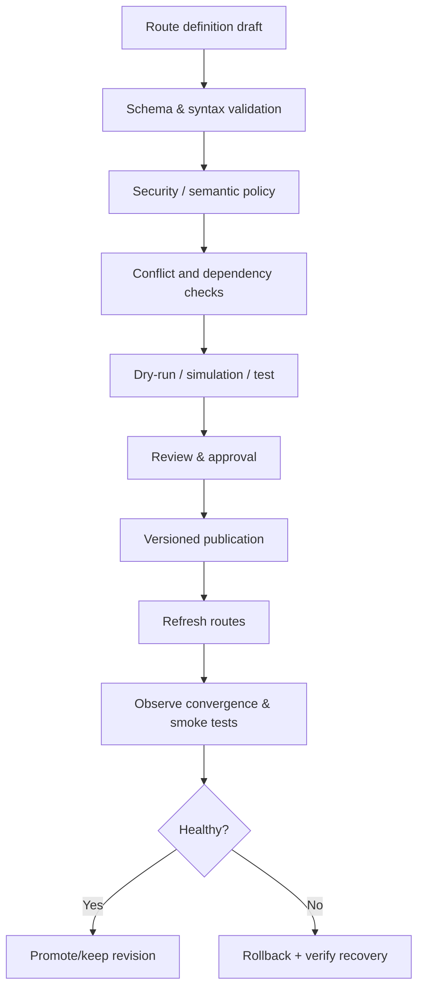
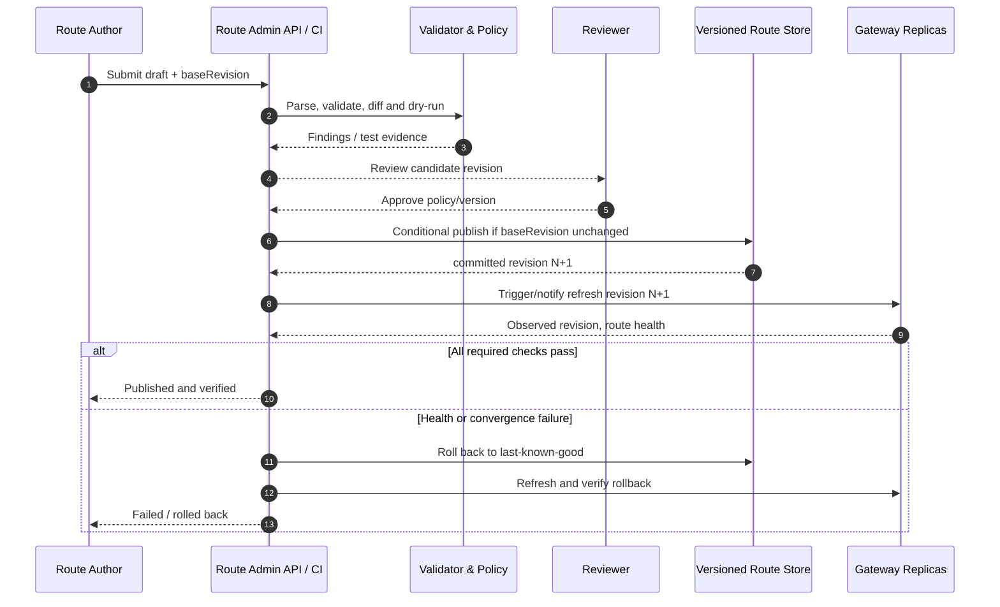
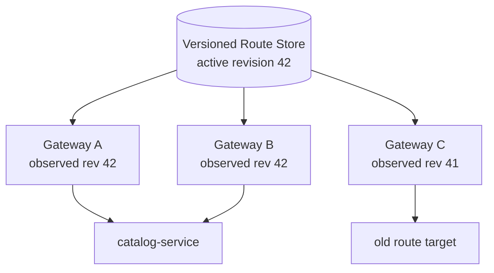
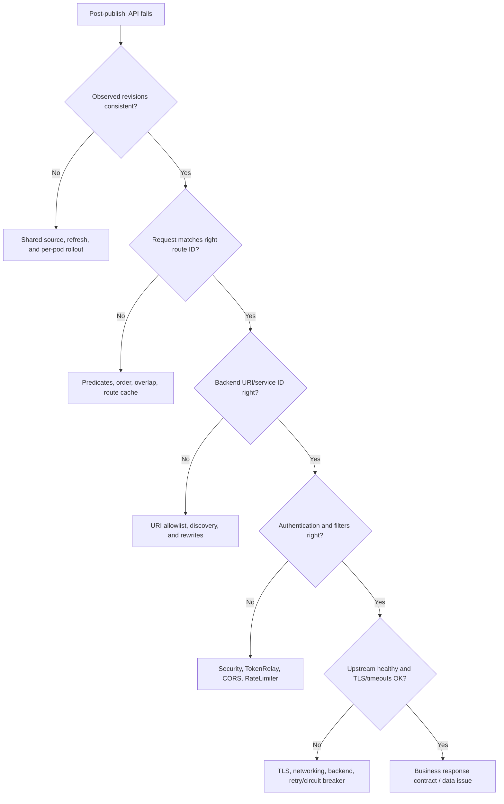

# Validating Route Definitions Before Publishing

In **Spring Cloud Gateway**, dynamic *route* updates let operations teams add backends, modify route predicates, adjust filter chains, or shift traffic to a new service version without editing source code and redeploying the entire Gateway. Yet dynamic routes are also **a high-privilege form of configuration code**: a bad URI can divert traffic to an untrusted host; a wrong `StripPrefix` or `RewritePath` can expose an internal admin endpoint; a filter stripping `Authorization` can alter authentication boundaries; or two overlapping routes can send a critical API to an unintended backend.

Therefore, **validating route definitions before publishing** goes far beyond confirming that YAML or JSON parses cleanly. It is the process of evaluating **structure, policy, risk, expected routing behavior, and rollout/rollback readiness** before admitting a `RouteDefinition` into the active route set.

This lesson belongs to the **Dynamic Routes** chapter of the **SPRING_CLOUD_GATEWAY** module. Its concepts tie into the entire API Gateway lifecycle for microservices: route predicates, `GatewayFilter`/`GlobalFilter`, path/header rewrites, service discovery/load balancing, OAuth2/JWT, rate limiting, circuit breakers, retries, TLS, and observability. We will design a clear **route publication gate** to minimize misconfigurations and security risks, particularly when Gateway runs across multiple replicas.

> **Version scope:** Java APIs and route examples use **Spring Cloud Gateway Server WebFlux**. In several recent releases, properties reside under `spring.cloud.gateway.server.webflux.routes`; in many older releases they reside under `spring.cloud.gateway.routes`. Gateway Server Web MVC uses a Servlet stack, different route configuration, and different extension points. Never copy WebFlux APIs verbatim to MVC without verifying against your running Spring Boot/Spring Cloud Gateway release train.

## 1. Why Do Dynamic Routes Need a Dedicated Validation Step?

A route declaration that is syntactically valid yet semantically dangerous:

```yaml
id: account-service
uri: https://untrusted.example.invalid
predicates:
  - Path=/api/accounts/**
filters:
  - TokenRelay
```

Structurally, it has a route ID, URI, predicate, and filter. However, if the Gateway holds user access tokens, **`TokenRelay` targeting an untrusted endpoint** leaks credentials. This route must never be published merely because `RouteDefinition` binds cleanly.

Another example:

```yaml
id: admin-catchall
uri: lb://admin-service
predicates:
  - Path=/**
order: -100
```

This route can win matching for almost every request ahead of other routes, breaking public API contracts. Even with Spring Security present, it can introduce behavioral bugs, availability loss, error-message leaks, or authorization gaps if security matchers and backends were not designed for it.

### Four Error Categories to Catch

| Category | Examples | Risk |
| --- | --- | --- |
| **Syntax / structural errors** | Missing `id`, malformed `uri`, nonexistent predicate/filter factory, missing args. | Route fails to load or misbehaves. |
| **Semantic errors** | `Method=GET` on a POST-only endpoint; `StripPrefix=3` instead of 2. | HTTP 404/405, mangled paths, broken functionality. |
| **Policy / security errors** | Arbitrary URIs, disallowed filters, overly broad routes, dropped auth, leaked tokens. | SSRF, credential leakage, policy bypass, unauthorized resource access. |
| **Rollout errors** | Duplicate route IDs, `order` collisions, replica config drift, failed refreshes. | Misrouted traffic, downtime, inconsistent behavior. |

**Goal of pre-publish validation:** admit a change into runtime only with concrete evidence that the config is valid, authorized, and recoverable.

## 2. How Does `RouteDefinition` Differ from Runtime `Route`?

In Gateway WebFlux, distinguish:

| Object | Purpose | Role in Validation |
| --- | --- | --- |
| **`RouteDefinition`** | Route config model: ID, URI, predicates, filters, order, metadata. | **Input** for parsing, policy checks, review, and versioning. |
| **`PredicateDefinition`** | Predicate factory name and args. | Validates `Path`/`Method`/`Host`/`Header` and allowed custom predicates. |
| **`FilterDefinition`** | `GatewayFilterFactory` name and args. | Checks impact on paths, headers, auth, retries, and rate limits. |
| **`RouteDefinitionLocator`** | Supplies `RouteDefinition` sets to Gateway. | Source may be files, discovery, or a repository. |
| **`RouteDefinitionWriter`** | Contract to save/delete route definitions. | A *publish* target when governed—**not a validator**. |
| **`RouteDefinitionRepository`** | Both supplies and saves/deletes route definitions. | Can back dynamic route storage, but does not enforce transactions/approvals alone. |
| **`RouteDefinitionRouteLocator`** | Converts `RouteDefinition` into runtime `Route` with predicates/filters. | Build step catches wrong factories/args within the Spring app context. |
| **`RouteLocator` / `CachingRouteLocator`** | Supplies built/cached runtime routes for matching. | Must verify the route cache refreshed and all instances share the revision. |
| **`RefreshRoutesEvent`** | Signal requesting route refresh inside an application context. | Not a guarantee every Gateway replica received/applied the revision. |

When processing an HTTP request, **`RoutePredicateHandlerMapping`** evaluates predicates across runtime routes from `RouteLocator` to pick a match; **`FilteringWebHandler`** then runs `GlobalFilter`s and `GatewayFilter`s. Pre-publish validation must therefore examine both **route selection** and **post-selection filtering/routing behavior**.

### Change Flow Requiring Governance



No single built-in Gateway class enforces this **entire** workflow. Gateway gives you primitives to declare, load, persist, and refresh routes; building reviews, a policy engine, approvals, and revision distribution is the deployment architecture's responsibility.

## 3. Scope of "Before Publishing"

A route definition can transition through explicit states:

```text
DRAFT
  -> VALIDATED
  -> APPROVED
  -> PUBLISHED (source of truth)
  -> OBSERVED_ON_INSTANCES
  -> ACTIVE / ROLLED_BACK
```

This is a **platform-designed state model**, not built-in states supplied by `RouteDefinition` or `RouteDefinitionRepository`.

### Distinguishing Milestones

- **Validated:** syntax and policies verified for a concrete revision.
- **Approved:** authorized person/system signed off on that change.
- **Published:** source of truth updated; not all Gateway instances may have loaded it yet.
- **Observed/active:** required instances reported loading the revision, runtime route tables match, and smoke checks pass.
- **Rolled back:** source reverted to the prior safe revision and instances verified as converged.

Never report "deployment succeeded" merely because a write API returned `200`/`204` or a refresh event fired. Verify **runtime state** and **live request behavior**.

## 4. `RouteDefinition` Structure to Validate

Conceptually valid route example:

```yaml
id: catalog-read-v2
uri: lb://catalog-service
order: -10
predicates:
  - Path=/api/catalog/**
  - Method=GET
filters:
  - StripPrefix=2
metadata:
  owner: catalog-team
  changeTicket: CHG-1042
```

This is a **single route definition fragment**, not a complete `application.yml`. In newer Gateway WebFlux config files, it sits under `spring.cloud.gateway.server.webflux.routes`. With dynamic APIs/repositories, fields are represented by matching Java objects or JSON.

### Minimum and Extended Field Checks

| Field | Mandatory / Recommended Check |
| --- | --- |
| `id` | Non-empty, unique across the entire route set, stable format, never altered accidentally. |
| `uri` | Allowed scheme; destination on allowlist; no userinfo/credentials or arbitrary endpoints. |
| `predicates` | Factory exists, matching scope is narrow enough, args valid, no unintended bypass paths. |
| `filters` | Allowed factories, valid order/effects, no token leaks or dropped security controls. |
| `order` | Matches priority rules; does not hijack traffic from existing routes unexpectedly. |
| `metadata` | Governed values only (owner, release, bounded timeouts, etc.); never store secrets. |

**JSON schema validation alone is never enough.** A string `id`, parseable `uri`, and valid `filters` array can still assemble a dangerous route.

## 5. Layer 1 — Structural Validation and Factory Binding

Checks executable before saving a route to the repository:

1. Parse YAML/JSON or request bodies with strict size and nesting depth limits.
2. Reject missing, null, mistyped values, or fields outside the allowed schema.
3. Normalize route IDs under clear naming rules and enforce uniqueness.
4. Parse URIs and check scheme, host, port, path, and encoding.
5. Check `PredicateDefinition.name` and `FilterDefinition.name` against the platform **allowlist**.
6. Validate `args` count, names, and types; never pass arbitrary raw keys to factories.
7. Constrain `order` within an approved range.
8. Cap maximum route counts, filter/predicate counts, and metadata sizes.

### Does the Factory Actually Exist?

A route using:

```yaml
predicates:
  - name: ClientVersion
    args:
      headerName: X-Api-Version
      requiredValue: v2
```

is valid only if the Gateway runtime **actually registers** a matching custom `ClientVersionRoutePredicateFactory` accepting that config. External validators can maintain a factory-name allowlist, yet a stronger check is **building runtime `Route`s inside a test application context matching production's factories and dependencies**.

Likewise, a route with:

```yaml
filters:
  - name: RequestRateLimiter
    args:
      key-resolver: "#{@customerKeyResolver}"
      redis-rate-limiter.replenishRate: 5
      redis-rate-limiter.burstCapacity: 10
```

requires a real `customerKeyResolver` bean and compatible `RedisRateLimiter`. A JSON schema only sees `"#{@customerKeyResolver}"` as a string—it cannot confirm the bean exists, the classpath matches, or Redis works.

### "Bound Cleanly" Does Not Mean "Behaves Correctly"

`StripPrefix=3` binds cleanly, yet turns `/api/catalog/products/42` into `/42` instead of `/products/42`. That is a **semantic** bug caught only by checking URL/backend contracts or running tests.

## 6. Layer 2 — URI Allowlists and SSRF Prevention

**Dynamic upstream URIs are a critical security boundary.** If a user with route-edit rights can direct Gateway requests to arbitrary hosts, they can leverage Gateway's network reachability to probe internal APIs, cloud metadata endpoints, or untrusted external servers.

### Risky URIs

```yaml
uri: http://127.0.0.1:8080
```

```yaml
uri: http://169.254.169.254
```

```yaml
uri: https://unexpected-partner.example.invalid
```

These examples are strictly for **identifying configurations to reject**—never targets to probe.

### Policy Checks on URIs

| Element | Safe Rule |
| --- | --- |
| **Scheme** | Allow only intended schemes like `lb` and `https`; permit `http` only in network-isolated POCs. |
| **Host / service ID** | Match a **specific** allowlist per product/route owner; never arbitrary wildcard hosts. |
| **Port** | Only approved ports; block admin/control-plane ports. |
| **User info** | Reject URIs containing usernames, passwords, or tokens. |
| **Query / fragment** | Disallow unnecessary components in upstream base URIs. |
| **IP literal hosts** | Avoid literal IPs unless tightly controlled; block loopback, link-local, and metadata IPs. |
| **DNS** | Defend against DNS resolving to disallowed internal IPs (*DNS rebinding*) at the egress/network layer, not just string checks. |
| **TLS** | Verify certificates, hostname/SNI, and CA trust; never disable verification just to make a route work. |

For `lb://catalog-service`, the **service ID** itself must be authorized. Allowing `lb://any-internal-service` can expose internal admin services or non-public APIs.

### Allowlists Alone Are Not Enough Without Locked-Down Networking

A pre-publish route validator only inspects **declared configuration**. Reliable SSRF and credential-exfiltration defense also requires:

- Egress network policies / firewalls.
- Trusted DNS and service discovery.
- Blocking network reachability from Gateway to unnecessary management endpoints.
- TLS trust and certificate verification.
- Re-validation on every route URI/destination edit.
- Independent backend authentication and authorization.

When `TokenRelay` or `AddRequestHeader=Authorization,...` is present, target URIs demand even stricter scrutiny because outbound requests carry credentials.

## 7. Layer 3 — Validating Predicates and Public API Scope

**Route predicates define which incoming requests a route can capture.** A predicate tweak can impact wide swathes of APIs even when the URI stays unchanged.

### Key Predicate Groups

| Predicate | What to Verify |
| --- | --- |
| **`Path`** | Public prefix is authorized; never swallows `/**` or `/actuator/**` against policy. |
| **`Method`** | Only required business methods; `POST`/`DELETE` not exposed accidentally on a `GET` route. |
| **`Host`** | Valid public hostname; never treat an arbitrary `Host` header as proof of tenant identity. |
| **`Header` / `Query`** | Used for routing semantics, never authentication; bound regexes/patterns. |
| **`RemoteAddr`** | When reading forwarded IPs, control proxy chains and spoofing risks. |
| **`Weight`** | Check group/weight values and aggregate traffic split per config. |
| **Custom factory** | Class/bean present, config binds cleanly, logic non-blocking, covered by tests. |

### Overly Broad Paths and Route Ordering

Suppose currently active is:

```yaml
- id: catalog-public
  uri: lb://catalog-service
  order: 0
  predicates:
    - Path=/api/catalog/**
```

Then someone proposes:

```yaml
- id: api-catchall
  uri: lb://legacy-service
  order: -100
  predicates:
    - Path=/api/**
```

The second route can **capture catalog requests first** due to its broader scope and higher-priority `order`. A schema validator sees nothing wrong with types; safety checks must compare **candidate routes against active routes** to detect overlaps and ordering conflicts.

**Note:** you cannot evaluate arbitrary `Path`/`Host`/`Header`/`Method`/regex combinations with naive string prefix comparisons. Use proper parsers, route-scope policies, and a representative **request matrix**. When intentional overlaps exist, document the rationale and set `order` explicitly.

### Cases Requiring Manual Review

- New routes with `Path=/**` or `/api/**`.
- Routes changing `Host` to another tenant or domain.
- Routes expanding `Method=GET` to GET/POST/DELETE.
- Routes with complex regexes, negated/conflicting predicates, or opaque rewrites.
- Routes with `Weight` shifting significant traffic volume.
- Routes setting `order` higher-priority than existing routes.

## 8. Layer 4 — Validating `GatewayFilter`s and Side Effects

**`GatewayFilter`s** do more than select routes: they alter paths, headers, bodies, retries, circuit breakers, responses, and token forwarding. Your route publication gate must know **which filters are permitted** per route tier and **which arguments require review**.

### Risk Classification

| Filter / Group | Risks to Check | Policy Guidance |
| --- | --- | --- |
| **`StripPrefix`, `PrefixPath`, `SetPath`, `RewritePath`** | Routes requests to unintended endpoints, expensive regexes, path-security drift. | Permit with bounds and test public path → backend path mappings. |
| **`AddRequestHeader` / `SetRequestHeader` / `RemoveRequestHeader`** | Alters `Authorization`, `Host`, `Forwarded`, `X-Forwarded-*`, or tenant identity. | Allowlist header names; forbid altering security headers outside special workflows. |
| **`TokenRelay`** | Forwards user tokens to untrusted backends or wrong audiences. | Permit only for approved routes/backends matching the OAuth2 registration/security contract. |
| **`RequestRateLimiter`** | Dropped from route, wrong `KeyResolver`, overly high/low quotas. | Enforce mandatory quota policies on protected public routes. |
| **`CircuitBreaker`** | Fallback forwards to unexpected endpoints or returns wrong response shapes. | Review `fallbackUri`, timeouts, and error behavior. |
| **`Retry`** | Duplicate mutations when retrying POST/PUT/PATCH/DELETE; retry storms. | Restrict to approved methods/statuses, capped retries, and idempotent operations. |
| **`LocalResponseCache`** | Caches per-user data, stale reads, memory pressure. | Permit only on vetted public routes with bounded TTL/size. |
| **`RedirectTo` / `RewriteResponseHeader`** | Open redirects, internal host/path leaks, broken redirect URIs. | Validate target domains and response header semantics. |
| **`ModifyRequestBody` / `ModifyResponseBody`** | Schema drift, data leaks, buffer memory pressure. | Test against API contracts, cap body sizes, verify codecs. |
| **Custom `GatewayFilterFactory`** | Arbitrary logic; potential blocking I/O or policy bypass. | Deploy only tested, allowlisted factories with clear owners. |

Never let a dynamic route system automatically permit **every filter factory present on the classpath**. A bean may exist for internal technical reasons, whereas **allowing it on public routes** is an explicit platform/security decision.

### Checking Order and Interactions

Consider a route with:

```yaml
filters:
  - StripPrefix=2
  - TokenRelay=shop-login
  - name: RequestRateLimiter
    args:
      key-resolver: "#{@customerKeyResolver}"
      redis-rate-limiter.replenishRate: 5
      redis-rate-limiter.burstCapacity: 10
```

A validator should not stop at "all three filters are allowlisted." Ask:

- Is the target route allowed to receive user access tokens from `shop-login`?
- Does `KeyResolver` extract an **authenticated** principal rather than trusting a raw `X-Customer-ID` header?
- Does `StripPrefix=2` match the backend's path contract?
- If `TokenRelay` lacks an authorized client, how does the request fail?
- Has the effective filter execution order been verified across runtime `Ordered`/pre-post semantics?
- Do `401/403/429/503` responses emit expected CORS headers and metrics?

YAML list ordering **does not fully determine** execution ordering across all `GlobalFilter`s and `GatewayFilter`s; run integration tests or inspect runtime filter ordering for your exact Gateway version.

### Expression Injection and Bean References

Certain filter args support Spring Expression Language or bean references, such as:

```yaml
key-resolver: "#{@customerKeyResolver}"
```

That references an **internal platform-managed bean**—never turn it into an arbitrary expression box for route-management users. With **partially trusted** dynamic route inputs, it is safer to:

1. Allow only allowlisted bean names, or **model policy options as enums/IDs** and build args server-side.
2. Reject arbitrary SpEL strings from low-privilege clients or operators.
3. Restrict filters and args by route category.
4. Verify source/version and deploy routes only into environments with confirmed beans.

## 9. Layer 5 — Security Policies Before a Route Goes Public

A route cannot be deemed safe by inspecting `RouteDefinition` in isolation from Spring Security and backend contracts.

### Mandatory Boundaries

| Question | Pre-Publish Verification |
| --- | --- |
| Who may call the endpoint? | Do Spring Security path/method matchers or API auth policies cover the new public route? |
| Where are Bearer JWTs validated? | Issuer, audience, expiry, scopes, and tenant checks are not bypassed by the route change. |
| Does the backend enforce its own authz? | Resource server still validates tokens and resource-level permissions. |
| Are tokens forwarded outbound? | `TokenRelay` targets only services inside the proper trust boundary. |
| Are cookies/sessions involved? | CORS, CSRF, `SameSite`/`Secure`, and session lifecycles remain intact. |
| Are admin endpoints exposed? | `/actuator/**`, `/internal/**`, debug routes, and control-plane endpoints stay closed. |
| Is PII or request body data present? | Avoid logging/caching tokens, cookies, private data, or using weak encryption. |
| Using `lb://` or HTTPS backend? | Host/service ID, discovery trust, TLS/mTLS, and egress policies are valid. |

**Never treat client-supplied `Header=X-Role,admin` or `X-Tenant-ID` as authorization.** Header predicates can route by API version, yet they never prove a user may access that tenant's data.

### Risks from "Valid" Yet Overly Permissive Routes

If Security only defines:

```text
/api/orders/**  -> authenticated
/api/catalog/** -> permitAll
```

then adding `Path=/api/admin/**` demands a security policy review. Never assume "because it goes through Gateway, every request is already checked." A permissive `anyExchange().permitAll()` rule or an unauthenticated backend exposes privileges the moment a public route opens.

The route publication gate should require **backend owner, data classification, authentication policy, and scopes** before approving.

### Caching, CORS, and Error Responses

- `LocalResponseCache` is safe only for eligible routes proven not to leak responses across users or tenants.
- `CORS` must cover preflight and live responses per origin policy; a `Method=GET` route does not automatically match `OPTIONS`.
- `RequestRateLimiter` returns `429` before reaching the backend; ensure CORS headers are present if frontends must read that error.
- Retries, circuit breakers, and fallback responses must never strip security headers or mask auth failures as successes.

**Validation does not replace runtime security.** Pre-publish checks block dangerous configs from entering the system; authentication and authorization must still run on every live request.

## 10. Layer 6 — Verifying Metadata, Timeouts, and Feasibility

`RouteDefinition.metadata` can hold values consumed by Gateway components or application code. Some Gateway WebFlux releases read metadata for per-route **connect timeout**, **response timeout**, and related settings. However, **arbitrary metadata keys** are not automatically understood by the runtime.

### Cases to Distinguish

```yaml
metadata:
  owner: catalog-team
  changeTicket: CHG-1042
  rolloutRevision: "42"
```

These fields only matter operationally if **your platform has consumers** that audit, approve, or observe them.

```yaml
metadata:
  connect-timeout: 1500
  response-timeout: 3000
```

This is a **conceptual example**—verify exact metadata keys and units for your version: `connect-timeout` and `response-timeout` are typically expressed in **milliseconds** on WebFlux route metadata, whereas **global HTTP client `response-timeout`** may be a `Duration`. A unit mix-up can make timeouts far too short or dangerously long.

### Policies to Enforce

| Field / Aspect | Rule |
| --- | --- |
| Timeouts | Reject negative/zero values outside framework-defined meanings; cap per SLOs. |
| Retries | Cap attempts/statuses/methods; forbid retrying non-idempotent writes. |
| Circuit breaker | Enforce threshold and `fallbackUri` policies; never forward fallbacks to admin paths. |
| Rate limiting | Never remove limiters from quota-protected routes; block unauthorized ceiling raises. |
| CORS | Allowlist origins/methods/headers; forbid wildcard origins with credentials. |
| Local response cache | Public GETs only where appropriate; enforce max TTL/size and cache headers. |
| Owner / change ticket | Required for reviews; never assume metadata enforces security by itself. |
| Secrets | **Never store** client secrets, bearer tokens, API keys, or passwords in metadata. |

### Version-Dependent Parameters

If your Gateway version does not recognize a metadata key, it may simply store it as arbitrary data or ignore it. **Existing on a route object does not prove runtime effect.** Use version-matched configuration metadata and integration tests verifying timeouts, quotas, and circuit breakers actually fire.

## 11. Layer 7 — Conflicts with Existing Routes

Suppose the running route set contains:

| Route ID | Predicate | Order | Backend |
| --- | --- | --- | --- |
| `catalog-public` | `Path=/api/catalog/**` + `Method=GET` | `0` | `lb://catalog-service` |
| `orders-api` | `Path=/api/orders/**` | `0` | `lb://order-service` |
| `fallback-public` | `Path=/api/**` | `100` | `lb://legacy-public-service` |

Now someone proposes adding:

```yaml
id: catalog-v2
uri: lb://catalog-v2-service
order: -10
predicates:
  - Path=/api/catalog/**
  - Header=X-Api-Version,v2
filters:
  - StripPrefix=2
```

This can be an **intentional, valid overlap**: requests carrying `X-Api-Version: v2` take the new route while others fall back to the older catalog route. Yet if the new route omitted `Header`, it would swallow 100% of catalog traffic.

### Do Not Compare Route IDs Alone

Pre-publish checks should:

1. Fetch the **currently active versioned route set**.
2. Apply candidate edits onto a **copy** of that route set—never into the live repository.
3. Compare `Path`, `Method`, `Host`, `Header`, `Query`, `Weight`, and `order`.
4. Run a **sample request matrix** representing API contracts.
5. Compare **before vs. after selected routes** and flag requests shifting backends.
6. Require explicit review when route-matching changes exceed expected scope.

### Simulation Matrix

| Sample Request | Old Route | Expected Route | Should It Change? |
| --- | --- | --- | --- |
| GET `/api/catalog/products/42` without header | `catalog-public` | `catalog-public` | No. |
| GET `/api/catalog/products/42`, `X-Api-Version: v2` | `catalog-public` | `catalog-v2` | Yes, per rollout plan. |
| POST `/api/orders` | `orders-api` | `orders-api` | No. |
| GET `/api/internal/admin` | Not part of public contract | Must not become public via new route | No. |
| GET `/actuator/gateway/routes` | Management plane per policy | Unchanged | No. |

A sample matrix **cannot exhaustively prove the entire request space**, especially with regexes, custom predicates, or dynamic tenant routing. Still, it catches common regressions and provides repeatable approval evidence.

### Stable Route IDs and Downstream Impacts

Changing a `routeId` can cause:

- `RedisRateLimiter` quota buckets to split into new keys.
- Metric dimensions and alert rules to break.
- Client tracking and owner metadata links to break.
- Different cache/route refresh behavior.
- Harder rollbacks back to the exact previous route.

**Renaming a route ID is not merely changing a label.** Validators should treat changing an `id` as **deleting the old route + adding a new route** unless the control plane provides explicit identity migration.

## 12. Java Example: A Minimal Policy Validator for Catalog Routes

To illustrate placing a "guardrail" in front of `RouteDefinitionWriter`, let's build `CatalogRoutePolicyValidator`. It enforces a **deliberately narrow contract**:

- Route ID matches an approved format.
- URI uses only `lb://` to known catalog services or `https://` to an approved hostname.
- Exactly one `Path` predicate staying under `/api/catalog/**`.
- `Method`, if present, permits only `GET`.
- Filters in this example allow only `StripPrefix=2`.
- `order` stays within bounds.
- Metadata contains no unexpected keys or secrets.

**Important:** This is an **illustrative validation layer**, not a production library blocking every form of SSRF or route hijacking. Full production validation adds cross-route checks, owner authorization, egress allowlists, complex factory validation, URI/encoding normalization, runtime dry-runs, and security testing. The narrow contract keeps the example readable and demonstrates a *deny-by-default* mindset.

### 12.1. Validator Code

```java
package com.example.gateway.routes;

import java.net.URI;
import java.util.ArrayList;
import java.util.List;
import java.util.Locale;
import java.util.Set;
import java.util.regex.Pattern;

import org.springframework.cloud.gateway.filter.FilterDefinition;
import org.springframework.cloud.gateway.handler.predicate.PredicateDefinition;
import org.springframework.cloud.gateway.route.RouteDefinition;

public final class CatalogRoutePolicyValidator {

    private static final Pattern ID_PATTERN =
        Pattern.compile("[a-z][a-z0-9-]{2,63}");

    // Example policy: simple catalog paths only.
    private static final Pattern PATH_PATTERN =
        Pattern.compile("/api/catalog/[A-Za-z0-9_/*-]*");

    private static final Set<String> SERVICE_IDS =
        Set.of("catalog-service", "catalog-v2-service");

    private static final Set<String> HTTPS_HOSTS =
        Set.of("catalog.internal.example");

    public List<String> validate(RouteDefinition route) {
        if (route == null) {
            return List.of("route definition is missing");
        }

        List<String> errors = new ArrayList<>();
        String id = route.getId();
        if (id == null || !ID_PATTERN.matcher(id).matches()) {
            errors.add("invalid route id");
        }

        if (route.getOrder() < -20 || route.getOrder() > 100) {
            errors.add("order exceeds approved range");
        }

        validateUri(route.getUri(), errors);
        validatePredicates(route.getPredicates(), errors);
        validateFilters(route.getFilters(), errors);

        if (route.getMetadata() != null &&
                route.getMetadata().keySet().stream().anyMatch(
                    k -> !Set.of("owner", "changeTicket").contains(k))) {
            errors.add("unexpected route metadata");
        }

        return List.copyOf(errors);
    }

    private void validateUri(URI uri, List<String> errors) {
        if (uri == null) {
            errors.add("upstream uri is missing");
            return;
        }

        String scheme = uri.getScheme() == null
            ? ""
            : uri.getScheme().toLowerCase(Locale.ROOT);

        String host = uri.getHost() == null
            ? ""
            : uri.getHost().toLowerCase(Locale.ROOT);

        if (uri.getRawUserInfo() != null ||
                uri.getRawQuery() != null ||
                uri.getRawFragment() != null) {
            errors.add("upstream uri contains forbidden components");
        }

        String path = uri.getRawPath() == null
            ? ""
            : uri.getRawPath();

        if ("lb".equals(scheme)) {
            if (!SERVICE_IDS.contains(host) ||
                    uri.getPort() != -1 ||
                    !path.isEmpty()) {
                errors.add("unapproved lb service or uri structure");
            }
        } else if ("https".equals(scheme)) {
            if (!HTTPS_HOSTS.contains(host) ||
                    (uri.getPort() != -1 && uri.getPort() != 443) ||
                    (!path.isEmpty() && !"/".equals(path))) {
                errors.add("unapproved https destination");
            }
        } else {
            errors.add("upstream scheme must be lb or https");
        }
    }

    private void validatePredicates(
            List<PredicateDefinition> predicates,
            List<String> errors) {

        if (predicates == null || predicates.isEmpty()) {
            errors.add("at least one predicate is required");
            return;
        }

        int pathCount = 0;
        for (PredicateDefinition p : predicates) {
            if ("Path".equals(p.getName())) {
                pathCount++;
                if (p.getArgs() == null || p.getArgs().isEmpty()
                        || p.getArgs().values().stream().anyMatch(
                            v -> v == null ||
                                !PATH_PATTERN.matcher(v).matches())) {
                    errors.add("path must stay under /api/catalog/");
                }
            } else if ("Method".equals(p.getName())) {
                if (p.getArgs() == null || p.getArgs().size() != 1
                        || !p.getArgs().containsValue("GET")) {
                    errors.add("this route type permits GET only");
                }
            } else {
                errors.add("unapproved predicate: " + p.getName());
            }
        }

        if (pathCount != 1) {
            errors.add("exactly one Path predicate is required");
        }
    }

    private void validateFilters(
            List<FilterDefinition> filters,
            List<String> errors) {

        if (filters == null || filters.size() != 1) {
            errors.add("exactly one filter is required");
            return;
        }

        FilterDefinition filter = filters.get(0);
        if (!"StripPrefix".equals(filter.getName()) ||
                filter.getArgs() == null ||
                filter.getArgs().size() != 1 ||
                !filter.getArgs().containsValue("2")) {
            errors.add("only StripPrefix=2 is permitted");
        }
    }
}
```

### 12.2. Understanding the Validator

| Block | Effect | Not Yet Addressed |
| --- | --- | --- |
| `ID_PATTERN` | Rejects blank IDs and disallowed characters. | **Whether the ID already exists in the full route set**. |
| `SERVICE_IDS` / `HTTPS_HOSTS` | Fixed target allowlists. | DNS rebinding, IP egress, whether the owner is authorized for that service. |
| `PATH_PATTERN` | Restricts route to simple catalog paths. | Overlaps with other routes, proxy path decoding/normalization, custom regexes. |
| `Method=GET` | Prevents exposing mutating methods under catalog-read policy. | CORS `OPTIONS` preflight and user permissions. |
| `StripPrefix=2` | Preserves expected two-segment prefix stripping for mock backend. | Whether the real backend API contract actually expects it. |
| Bounded `order` | Blocks extreme precedence values per policy. | Collisions with other routes having similar valid `order`s. |
| Metadata allowlist | Rejects arbitrary keys and secrets. | Owner permissions, ticket validity, values, and approval lifecycle. |

In production, a policy engine models distinct **route categories**: public-read catalog, authenticated orders, write payments, internal admin. Each category has its own filter allowlist, URI allowlist, and timeout/quota/body rules. Never stretch this narrow catalog-read sample into a validator for **every** route in the system.

### 12.3. Security Limitations of the Sample Code

Never mistake the `/api/catalog/**` regex check for **a complete `Path` pattern analyzer**. For complex paths, wildcards, URL encoding, host patterns, and custom predicates, use proper parsers, validate semantics inside Gateway runtime, and check proxy normalization.

Similarly, inspecting `URI.getHost()` alone cannot protect egress against DNS rebinding or a registry service ID pointing to untrusted instances. Enforce network policies and govern registry/service discovery too.

The sample also validates **one route in isolation**; your pre-publish gate must add **comparison against all active routes**, uniqueness, approval/ownership, dependencies, and end-to-end tests.

## 13. Testing the Validator with JUnit 5

`RouteDefinition`, `PredicateDefinition`, and `FilterDefinition` can be constructed in unit tests without starting an HTTP server.

```java
package com.example.gateway.routes;

import static org.junit.jupiter.api.Assertions.assertFalse;
import static org.junit.jupiter.api.Assertions.assertTrue;

import java.net.URI;
import java.util.List;

import org.junit.jupiter.api.Test;
import org.springframework.cloud.gateway.filter.FilterDefinition;
import org.springframework.cloud.gateway.handler.predicate.PredicateDefinition;
import org.springframework.cloud.gateway.route.RouteDefinition;

class CatalogRoutePolicyValidatorTest {

    private final CatalogRoutePolicyValidator validator =
        new CatalogRoutePolicyValidator();

    private RouteDefinition validRoute() {
        RouteDefinition route = new RouteDefinition();
        route.setId("catalog-read-v2");
        route.setUri(URI.create("lb://catalog-service"));
        route.setOrder(-10);
        route.setPredicates(List.of(
            new PredicateDefinition("Path=/api/catalog/**"),
            new PredicateDefinition("Method=GET")));
        route.setFilters(List.of(
            new FilterDefinition("StripPrefix=2")));
        return route;
    }

    @Test
    void acceptsApprovedCatalogRoute() {
        assertTrue(validator.validate(validRoute()).isEmpty());
    }

    @Test
    void rejectsUntrustedUri() {
        RouteDefinition route = validRoute();
        route.setUri(URI.create("https://untrusted.example.invalid"));

        assertFalse(validator.validate(route).isEmpty());
    }

    @Test
    void rejectsWidePublicPath() {
        RouteDefinition route = validRoute();
        route.setPredicates(List.of(
            new PredicateDefinition("Path=/**")));

        assertFalse(validator.validate(route).isEmpty());
    }

    @Test
    void rejectsUnauthorizedFilter() {
        RouteDefinition route = validRoute();
        route.setFilters(List.of(
            new FilterDefinition("TokenRelay")));

        assertFalse(validator.validate(route).isEmpty());
    }

    @Test
    void rejectsWriteMethod() {
        RouteDefinition route = validRoute();
        route.setPredicates(List.of(
            new PredicateDefinition("Path=/api/catalog/**"),
            new PredicateDefinition("Method=DELETE")));

        assertFalse(validator.validate(route).isEmpty());
    }
}
```

### What Unit Tests Do Not Prove

- That the Gateway startup context actually registers every referenced `RoutePredicateFactory`/`GatewayFilterFactory`.
- That the dynamic repository saves/reads routes cleanly with no duplicate IDs.
- That `lb://catalog-service` resolves instances and TLS/HTTP clients connect.
- That `StripPrefix=2` matches the real backend API contract.
- That the catalog route is not shadowed by a higher-priority catch-all route.
- That Security, CORS, rate limiters, and fallbacks work across real HTTP responses.
- That all Gateway replicas load the same revision and roll back cleanly on failure.

**Unit tests guard local policy; integration/dry-run tests guard real-world operation.** Use both.

## 14. Dry-Run: Converting Definitions to Runtime `Route`s Before Publishing

A JSON/YAML payload may pass schema and platform validator checks yet fail when real Gateway attempts to bind a custom predicate or filter factory. Before publishing, use a **sandbox environment or dry-run mechanism** equipped with production-equivalent dependencies and factories.

### Three Dry-Run Levels

| Level | Execution | Catches | Misses |
| --- | --- | --- | --- |
| **Static check** | Parse and policy-validate route definitions. | Bad IDs, URIs, args, allowlists, timeout/quota bounds. | Missing runtime factories, runtime filter ordering. |
| **Runtime build** | Load candidate route set into a Gateway test context. | Bean/factory binding, route conversion, many config bugs. | Live backend readiness, multi-replica drift. |
| **Request simulation / integration** | Send a request matrix to test Gateway with mock/isolated backends. | Selected route, rewrites, headers, security, fallback, status codes. | Production load, real DNS/TLS, traffic outside samples. |

Never "dry-run" by **writing the candidate into the live production repository**, refreshing the live route cache, and deleting it if broken. That is not a dry-run—live traffic may already route through an unapproved rule.

### Organizing the Test Environment

1. Take a **snapshot** of the active route set and apply candidate changes to a copy.
2. Start a WebFlux Gateway test app running the same version and extension factories.
3. Use mock URIs or a controlled staging environment without access to production secrets or internal services outside scope.
4. Run route conversion and verify zero binding or instantiation errors.
5. Send representative requests: matching, non-matching, older version, sensitive paths, OPTIONS, GET/POST, valid/invalid tokens.
6. Record selected route ID, rewritten path, backend target, filter effects, and response status.
7. Compare against expected behavior before requesting approval.

### Do Not Probe Arbitrary Backend URIs Inside Validation

A secure validator **must never automatically connect to every submitted URI** to check health: that turns the validator itself into an SSRF proxy. Run connectivity checks only after URIs pass allowlists, from a controlled environment with appropriate network permissions.

Even when a staging backend returns 200, that does not guarantee production service discovery or TLS matches. Require both **static policy** and **runtime connectivity** evidence.

## 15. Versioned Publishing, Access Control, and Approvals

A mature organization separates **proposal rights** from **production activation rights**.

### Recommended Publication Flow



This is a **reference architecture built by your governance platform**. Spring Cloud Gateway does not ship a built-in `submit draft → approve → conditional publish → global convergence` API out of the box.

### Roles to Separate

| Role | Permitted Actions | Disallowed by Default |
| --- | --- | --- |
| **Route author** | Propose routes, inspect validation findings, run staging tests. | Write straight to production store or alter security policies. |
| **Service owner** | Confirm backend contracts, data classification, SLOs. | Open arbitrary URIs or bypass platform checks. |
| **Platform / security reviewer** | Approve sensitive routes and URI/filter/authorization edits. | Does not need client secrets to review routes. |
| **Publisher service** | Persist approved revisions into the source of truth. | Accept raw unvalidated routes from callers. |
| **Gateway runtime** | Read approved route snapshots and serve traffic. | Expose public writable route-management endpoints. |

### Protecting Against Concurrent Edits

Two people can edit the route set starting from the same revision `N`:

```text
Alice: reads revision N -> adds catalog-v2
Bob:   reads revision N -> changes orders timeout

If both overwrite the entire route set without version checks:
   the first writer's change can be lost.
```

Solution: track `baseRevision` and enforce **optimistic concurrency control** or conditional transactions:

```text
publish(candidateRevision, expectedBaseRevision=N)

If activeRevision != N:
    reject publish -> require rebase, re-validation, and re-approval
If activeRevision == N:
    commit snapshot N+1 using the store's atomic mechanism
```

This is **pseudocode** for a route-management app; `RouteDefinitionWriter` does not include a built-in `publish(candidateRevision, expectedBaseRevision)` method.

**Approvals must bind to exact content/revisions.** If an author alters `uri` or adds `TokenRelay` after a reviewer approved, the stale approval must never authorize publishing the modified route.

## 16. `RouteDefinitionWriter`: Writing Successfully Does Not Mean Safe

Gateway WebFlux provides `RouteDefinitionWriter` to save/delete route definitions:

```java
import org.springframework.cloud.gateway.route.RouteDefinition;
import org.springframework.cloud.gateway.route.RouteDefinitionWriter;
import reactor.core.publisher.Mono;

// Example showing the API for saving an approved RouteDefinition.
Mono<Void> write(RouteDefinitionWriter writer, RouteDefinition approved) {
    return writer.save(Mono.just(approved));
}
```

For deletion by ID:

```java
Mono<Void> delete(RouteDefinitionWriter writer, String routeId) {
    return writer.delete(Mono.just(routeId));
}
```

**These wrappers illustrate the contract**, not a production publisher. They lack validation, approvals, transactions, auditing, refreshes, and rollback. Never build a public controller passing Internet request bodies straight to `writer.save(...)`.

### Do Not Rely on the Default Repository for Long-Term Durability

Depending on configuration, an implementation may store route definitions **in process memory**, losing them on pod restart and **never synchronizing** across Gateway replicas.

For production dynamic routes, use:

- A persistent source of truth with clear versioning and auditing.
- A mechanism ensuring **every Gateway replica** loads the exact revision snapshot.
- Appropriate cache refreshes or config subscriptions/watches.
- Governed permissions for write, edit, pause, and purge actions.
- A last-known-good snapshot to recover if a new version fails.

`RouteDefinitionRepository` is a **read/write route-definition interface**, not a built-in guarantee of consistency, distributed transactions, locking, or auditing.

### Single Route Write vs. Batch Updates

Suppose you want to apply simultaneously:

```text
Delete old route A
Add    new route B
Update route C fallback
```

Executing individual `writer.save`/`delete` calls against a live store while refreshes occur mid-way can expose an **unintended intermediate route set** to Gateway. Achieving atomic cutover across **an entire route set** requires snapshots/versioning/transactions at the source of truth—independent `Mono<Void>` operations do not form a transaction automatically.

## 17. `RefreshRoutesEvent` and the Route Cache

A common snippet to trigger local route refreshes:

```java
import org.springframework.cloud.gateway.event.RefreshRoutesEvent;
import org.springframework.context.ApplicationEventPublisher;

public class RouteRefreshCoordinator {

    private final ApplicationEventPublisher events;

    public RouteRefreshCoordinator(ApplicationEventPublisher events) {
        this.events = events;
    }

    public void refreshLocalRoutes() {
        events.publishEvent(new RefreshRoutesEvent(this));
    }
}
```

**Understand precisely:**

1. `RefreshRoutesEvent` is an **application event inside the emitting Gateway process**.
2. It does not persist route definitions, grant permissions, or ensure schema/semantic validity.
3. It does not automatically broadcast across replicas or regions.
4. The event requests a refresh; observe completion/errors and runtime route state per revision.
5. Refreshing the route cache **does not** purge `LocalResponseCache`, refresh JWTs, clear `RedisRateLimiter` buckets, or verify backend readiness.

### Checking Convergence Across Multiple Replicas

Suppose Gateway runs across three pods:



**You cannot declare a cluster-wide publish successful** while Gateway C remains on revision 41 if your contract requires replica uniformity. You need:

- Each instance recording the **revision/hash of its successfully loaded route snapshot**, instrumented by your management app if Gateway does not provide it out of the box.
- Your management system comparing reported revisions across all required replicas.
- Smoke checks run against individual replicas or controlled traffic slices.
- Guardrails preventing a new route set from sitting active on only a single pod.
- Handling for newly joining pods, restarts, rolling updates, and route-store disconnects.

### Canaries and Intentional Route-Set Divergence

During a canary rollout, a subset of Gateway pods intentionally runs the new revision. That differs from **accidental config drift** and requires:

- Deliberate grouping of pods and revisions.
- Bounded traffic exposure.
- Dedicated error, latency, and security metrics for the canary group.
- Clear promotion and rollback rules.
- Checking session consistency when one client hits multiple pods.

If implementing canary traffic via `Weight` predicates or the ingress layer, verify exact behavior and ensure two traffic-splitting layers do not compound unexpectedly.

## 18. Rollback: Returning to a Known-Good State

Even a validated, published route can fail under live traffic:

- LoadBalancer loses connectivity to backend instances.
- Upstream TLS certificates mismatch.
- Filter ordering breaks CORS or `Authorization` headers.
- Retries or circuit breakers amplify load or latency.
- Backend returns HTTP 200 with wrong tenant or schema data.
- Only part of Gateway replicas updated routes.

Therefore, **design rollback alongside publishing**, not mid-incident.

### Safe Rollback Rules

1. Preserve the **last-known-good route snapshot** including route IDs, predicates, filters, URIs, `order`, metadata, and revision.
2. Record a **diff** between the candidate and prior snapshot so you know every added/edited/deleted route.
3. Define **automatic or manual rollback triggers**: 5xx rates, latency spikes, route mismatches, security regressions, or revision divergence.
4. Roll back via the same versioned/transactional mechanism used to publish—never "hot-patch one pod by hand."
5. Refresh all instances in the rollout group and confirm observed revisions.
6. Re-run smoke tests on critical requests.
7. Save audit records, root cause, decision maker, and client impact during the incident window.

### Do Not Confuse Route Rollback with Data Rollback

If a new route sent `POST` order-creation traffic to backend v2 and you roll the route back to v1, **business side effects already committed** do not undo themselves. Plan schema compatibility, versioning, idempotency, and data migrations beforehand.

Similarly, rolling back a route does not revoke relayed tokens, reset Redis quotas, or purge local response caches—those states follow independent lifecycles.

### Deleting a Route

Before **deleting** a public route, verify:

- Will an unexpected fallback route catch requests afterward?
- How do CORS, preflights, and error responses behave once the route stops matching?
- Are clients still calling the old endpoint?
- Are long-lived connections, WebSockets, or in-flight requests active?
- Have all Gateway replicas agreed on the deletion?
- Is a deprecation or redirect phase needed first?

**Validate edits and deletions with the same rigor as additions.**

## 19. Hands-On A — Validating a Route Definition Before Saving

### 19.1. POC Setup

Create an experimental WebFlux Gateway app with:

| Component | Purpose |
| --- | --- |
| Spring Cloud Gateway Server WebFlux | Loads routes and handles routing. |
| `CatalogRoutePolicyValidator` from section 12 | Runs pure policy checks prior to publish. |
| Experimental `RouteDefinitionRepository` | Stores approved candidates in an isolated environment. |
| Mock `catalog-service` | Returns a response identifying the backend. |
| Spring Security test config | Verifies APIs with/without tokens under test policy. |
| Secured logging / Actuator | Inspects runtime routes and request outcomes. |

**Never run POCs in production.** In particular, never expose writable `/actuator/gateway/**` or unauthenticated route-management controllers.

### 19.2. Valid Candidate

```yaml
id: catalog-read-v2
uri: lb://catalog-service
order: -10
predicates:
  - Path=/api/catalog/**
  - Method=GET
filters:
  - StripPrefix=2
metadata:
  owner: catalog-team
  changeTicket: CHG-1042
```

In a unit test, invoke `validator.validate(route)` and expect **zero findings under the sample policy**. To execute the route through Gateway, the environment also needs a `ServiceInstance` source for `catalog-service`—or replace the URI with an entry on a controlled test allowlist.

### 19.3. Candidates That Must Be Rejected

**Case A — Unapproved URI:**

```yaml
uri: https://untrusted.example.invalid
```

Expect the policy validator to flag an unapproved destination.

**Case B — Overly broad path:**

```yaml
predicates:
  - Path=/**
```

Expect rejection rather than capturing all Gateway traffic.

**Case C — Filter exceeding catalog route policy:**

```yaml
filters:
  - TokenRelay
```

Expect rejection per `CatalogRoutePolicyValidator`'s allowlist. That **does not mean `TokenRelay` is always unsafe**; simply that public catalog routes cannot use it under this sample policy.

**Case D — Write method on a read-only route:**

```yaml
predicates:
  - Path=/api/catalog/**
  - Method=DELETE
```

Expect rejection because this route category is *catalog-read*.

**Case E — Metadata containing a secret:**

```yaml
metadata:
  apiPassword: example-only-do-not-use
```

Expect rejection; never place real secrets even in test candidates.

### 19.4. Never Test Candidates in Isolation Alone

Provide the active route set to your checks as well:

```text
catalog-public:
    Path=/api/catalog/**
    order=0

orders-api:
    Path=/api/orders/**
    order=0
```

Suppose the catalog v2 candidate sets `order=-10` and **only `Path=/api/catalog/**`**. It will intercept all catalog GET traffic ahead of the existing route, not just test traffic. If the rollout intends only requests carrying `X-Api-Version: v2` to hit v2, add the version predicate or a proper traffic-splitting rule.

Write an **integration test** proving requests without the version header still route to the old catalog. If that fails, block publication even if the isolated validator passed.

## 20. Hands-On B — Dry-Running a New Route with Mock Backends

Beside the test Gateway process, launch two mock backends:

```text
catalog-v1 mock → http://localhost:8081
catalog-v2 mock → http://localhost:8082
gateway         → http://localhost:8080
```

Sample responses:

```json
{"backend":"catalog-v1","productId":42}
```

and:

```json
{"backend":"catalog-v2","productId":42}
```

These are **custom lab mock responses**, not built-in Gateway behavior.

### Two Staging Routes Simulating Header-Based Canary Routing

```yaml
spring:
  cloud:
    gateway:
      server:
        webflux:
          routes:
            - id: catalog-v2
              order: -10
              uri: http://localhost:8082
              predicates:
                - Path=/api/catalog/**
                - Method=GET
                - Header=X-Api-Version,v2
              filters:
                - StripPrefix=2

            - id: catalog-default
              order: 0
              uri: http://localhost:8081
              predicates:
                - Path=/api/catalog/**
                - Method=GET
              filters:
                - StripPrefix=2
```

This is a **route set for testing matching behavior**, not a valid candidate for the strict `CatalogRoutePolicyValidator` in section 12 because the lab uses `http://localhost` and an extra `Header` predicate. To share a pipeline, create a **dedicated lab policy** or update the test allowlist under control—**never relax production allowlists just to let a lab run**.

### Verifying with `curl`

```bash
curl -i \
  "http://localhost:8080/api/catalog/products/42"

curl -i \
  -H "X-Api-Version: v2" \
  "http://localhost:8080/api/catalog/products/42"

curl -i \
  -H "X-Api-Version: v3" \
  "http://localhost:8080/api/catalog/products/42"
```

With these staging routes:

- Request without version → backend v1.
- Request with `v2` → backend v2.
- Request with `v3` → falls back to v1, **because that is this example's fallback policy**, not a universal rule for API versioning.

### Requests That Must Not Be Misrouted

```bash
curl -i \
  "http://localhost:8080/api/orders/123"

curl -i \
  "http://localhost:8080/actuator/health"

curl -i -X POST \
  "http://localhost:8080/api/catalog/products/42"
```

None of these should unintentionally match the new catalog v2 route. Exact HTTP statuses depend on your test app's routes, handlers, and Security; verify the **selected route ID** and confirm the catalog mock was not called.

### Inspecting the Filter Chain

When a `v2` request matches:

- Gateway rewrites `/api/catalog/products/42` to `/products/42`.
- Verify whether `X-Api-Version` stays intact or is transformed by another filter per contract.
- Verify response status, headers, and body.
- When replacing staging URIs with `lb://catalog-v2-service`, test `ServiceInstance` discovery and TLS connectivity separately.

Never stop at a single `curl` check when routes involve authentication, POST retries, WebSockets, CORS preflights, or body transformations.

## 21. Hands-On C — Verifying Publish/Rollback Across Two Replicas

### Context

Two test Gateway instances:

| Instance | Port | Source of Truth |
| --- | --- | --- |
| Gateway A | `8080` | Shared POC route snapshot store. |
| Gateway B | `8083` | Same shared route snapshot store. |

Prior to publishing, both instances report revision `N`. The test governance system builds candidate `N+1` adding the catalog v2 route.

### Steps

1. Prepare snapshot `N` and verify catalog GETs hit v1 on both A and B.
2. Submit candidate `N+1`, run schema/policy/diff/dry-run checks, and approve.
3. In the **test route store**, commit snapshot `N+1` only if the current revision is still `N`.
4. Trigger refresh on **both Gateway instances** using your POC's distribution mechanism.
5. Verify each instance successfully loaded route set `N+1`.
6. Send `X-Api-Version: v2` requests to both A and B and record the selected route/backend.
7. Simulate a broken v2 route or unavailable backend; inspect metrics and traces.
8. Roll back the source to snapshot `N` under a new revision matching your store semantics.
9. Refresh both instances, verify v2 is gone, and confirm requests return to v1 per policy.

### Calling Each Gateway Port Directly

```bash
curl -i \
  -H "X-Api-Version: v2" \
  "http://localhost:8080/api/catalog/products/42"

curl -i \
  -H "X-Api-Version: v2" \
  "http://localhost:8083/api/catalog/products/42"
```

**Never run separate in-memory repositories per pod pretending you have a shared route store.** Every instance must load the same snapshot from a shared source, or the control plane must explicitly distribute revisions to each pod. Local `RefreshRoutesEvent` does not distribute state.

### Acceptance Criteria

| Phase | Gateway A | Gateway B | Conclusion |
| --- | --- | --- | --- |
| Before publish | Revision `N` | Revision `N` | Consistent baseline. |
| During rollout | Possibly `N+1` | Possibly `N` | Do not report cluster-wide success if uniformity is required. |
| Post-convergence | Revision `N+1`, smoke PASS | Revision `N+1`, smoke PASS | Release can be confirmed. |
| Post-rollback | Rollback revision, smoke PASS | Rollback revision, smoke PASS | Recovery confirmed per plan. |

Revisions here are **governance-designed metadata/telemetry**, not a built-in `RouteDefinition` field that Gateway synchronizes across replicas by default.

## 22. Pre-Approval Verification Matrix

A new route should only be published once **functional, security, resilience, and rollout** criteria have matching evidence.

| ID | Test Case | Acceptance Criterion |
| --- | --- | --- |
| V01 | Empty or malformed route ID | Rejected during validation. |
| V02 | Route ID collides with active route | No silent overwrite; requires explicit update operation and revision. |
| V03 | URI scheme outside allowlist | Rejected; zero outbound connections made to that URI. |
| V04 | URI targets loopback / link-local / metadata | Blocked from publishing; egress policies reinforce block. |
| V05 | `lb://` targets unauthorized service ID | Rejected or requires elevated review before approval. |
| V06 | URI contains userinfo / credentials | Rejected; never saved to store or logs. |
| V07 | Nonexistent predicate / filter factory | Dry-run runtime build fails; blocked from publishing. |
| V08 | Invalid filter args or missing SpEL bean | Config blocked; never fails silently into another route. |
| V09 | `Path=/**` or overly broad route | Blocked by policy / sent for security review; never auto-published. |
| V10 | New route captures traffic from older route | Diff/matrix pinpoints shifted requests and requires approval. |
| V11 | Wrong `order` or fallback catches request first | Integration test detects actual selected route differs from expected. |
| V12 | Wrong `StripPrefix` / `RewritePath` | Backend path mismatches contract; publication blocked. |
| V13 | Filter edits/strips `Authorization` | Sensitive policy blocked or sent to security review. |
| V14 | `TokenRelay` targets unfamiliar host | Blocked; never leaks credentials across trust boundaries. |
| V15 | Drops rate limiter on quota-governed API | Policy flags high-risk change; blocks automated publish. |
| V16 | Retry enabled on non-idempotent POST | Rejected or requires approval and idempotency safeguards. |
| V17 | `LocalResponseCache` on personalized route | Rejected per data classification; user data never cached. |
| V18 | CORS preflight on new route | `OPTIONS` and live responses enforce proper origins/policies. |
| V19 | Invalid JWT audience/scope or unauthorized user | Security/backend rejects; never bypassed by route change. |
| V20 | Backend has no `ServiceInstance` | Classified as routing/discovery failure rather than passing route validation blindly. |
| V21 | Backend TLS/certificate failure | Certificate checks never bypassed; smoke test fails. |
| V22 | Metadata timeout too high or too low | Rejected by route-tier policy bounds. |
| V23 | Two authors publish from stale base revision | One fails/rebases; zero lost updates. |
| V24 | Multi-route write fails halfway | Live active route set never left in dangerous intermediate state. |
| V25 | One replica has not refreshed | Cluster convergence not marked complete. |
| V26 | Gateway replica restarts mid-rollout | Cleanly reloads valid snapshot from shared source. |
| V27 | Rollback of published revision | Restores matching and verifies every replica. |
| V28 | Route ID changed | Impacts on rate-limit buckets, metrics, and audits detected. |
| V29 | Heavy regexes or custom predicates | Performance/security tests confirm no blocking or ReDoS. |
| V30 | Draft edited after approval | Stale approval cannot publish modified content. |

Not every minor TTL tweak requires manually running all 30 cases; classify risk and automate accordingly. However, **URI edits, security filters, public path scope, auth policies, and multi-replica rollouts** must always be treated as high-impact changes.

## 23. Observability: Knowing How the New Route Performs and What It Affects

Post-publish monitoring is the final validation stage, not merely "operations after deployment." A route can validate cleanly yet fail under live traffic where production differs from staging.

### Dimensions to Observe

| Signal | Purpose |
| --- | --- |
| **Route ID / route revision** | Identify which route and config version handled a request. |
| **Gateway replica / pod ID** | Spot unrefreshed pods or divergent configurations. |
| **HTTP status and status class** | Compare error rates across baseline, canary, and promoted traffic. |
| **Downstream service ID** | Confirm traffic lands on the intended backend. |
| **Request/response latency p50/p95/p99** | Catch latency regressions from new retries, filters, or timeouts. |
| **Rate limit allowed / denied** | Spot unintended quota shifts. |
| **Circuit breaker / retry attempts** | See whether the new route overloads backends or triggers fallbacks. |
| **TLS / connect / response errors** | Separate healthy route matches from upstream failures. |
| **CORS / 401 / 403 / 429** | Catch security and frontend regressions. |
| **Convergence lag** | Elapsed time between publishing a revision and each pod confirming load. |

### Illustrative Event Emitted by the Control Plane

```text
changeId:            CHG-1042
routeRevision:       42
baseRevision:        41
changeType:          UPDATE
routeId:             catalog-v2
reviewStatus:        APPROVED
validationStatus:    PASSED
publishedAt:         [timestamp]
gatewayPod:          gateway-b
observedRevision:    42
smokeStatus:         PASSED
rollbackCandidate:   41
```

This is a **custom audit/telemetry record**, not a log format automatically emitted by Spring Cloud Gateway. Populate timestamps, revisions, and statuses from actual measurements—never emit `"PASSED"` without real test outcomes.

### Never Log Sensitive Data

Never log:

- Bearer tokens, refresh tokens, API keys, cookies, or URL credentials.
- Full request bodies containing PII or payment details.
- Raw query strings containing authorization codes or tokens.
- Route definitions containing embedded secrets.
- Customer IDs, IPs, or user emails as high-cardinality metric tags.

You may record route IDs, allowlisted service IDs, Gateway pod names, policy revisions, error classes, and normalized path templates. Restrict retention and access permissions on detailed route-change audit records.

### Inspecting Gateway Actuator Safely

In governed environments, endpoints like:

```http
GET /actuator/gateway/routes
```

let you inspect runtime route definitions per version capabilities. Some Gateway lines add route-refresh/management endpoints when explicitly enabled and authorized.

**Never expose writable Gateway Actuator endpoints to the Internet.** In newer Spring Boot/Gateway lines, endpoint access-control properties differ from older releases; consult your version's configuration reference. Actuator is an auxiliary tool—not a replacement for approvals, a versioned source of truth, or multi-replica verification.

## 24. Runbook: New Route Errors Right After Publish

| Symptom | Likely Cause | How to Distinguish |
| --- | --- | --- |
| `404` even though URI has a backend | Route predicates failed to match or backend returned 404. | Inspect selected route ID, Gateway logs, and backend access logs. |
| Requests hit wrong backend version | `order`/Path/Header overlap or config drift. | Compare before/after route sets, selected route, and per-pod revisions. |
| Gateway fails to load new route | Bad factory/args or route source unreachable by pod. | Check runtime build errors, `RouteDefinitionLocator`, refresh status. |
| `503` on `lb://` | No `ServiceInstance` available or discovery error. | Inspect registry/LoadBalancer and service ID allowlist. |
| `502`/`504` | Upstream TLS/timeout/network failure or slow backend. | Inspect TLS trust, connect/response timeouts, Netty client telemetry. |
| `401`/`403` | Spring Security or backend auth policy rejects new path. | Check JWT issuer/audience/scopes, security matchers, backend authz. |
| Browser reports CORS error | Preflight `OPTIONS` unmatched or error response lacks CORS headers. | Check DevTools, CORS owner, `OPTIONS` vs. actual response. |
| Sudden spike in `429` | New route ID created a separate quota bucket or wrong limiter args/key. | Compare route IDs, `RedisRateLimiter` policies, and `KeyResolver`. |
| `POST` requests processed twice | Retry policy changed or client retried without idempotency. | Trace backend attempts and idempotency keys. |
| Some pods succeed, others fail | Inconsistent route store, refresh, or revision state. | Compare observed revisions and routing matrix per pod. |
| Backend receives unexpected tokens | `TokenRelay`/Authorization filter applied to wrong URI. | Audit outbound policies and trigger security incident response. |
| Old route disappeared mid-publish | Non-atomic batch write or lost update. | Diff route snapshots; audit `expectedRevision` and store transactions. |
| Cache returns inconsistent data | Per-pod `LocalResponseCache` has independent lifecycle. | Inspect TTLs, cache keys, and route revisions; never rely on route refresh to purge. |

### Investigation Order



If there is **any suspicion of credential leakage, authorization bypass, or cross-tenant data exposure**, immediately prioritize **blocking the route / reverting to last-known-good and invoking security incident response** before tuning latency or experimenting on production.

### When to Roll Back Immediately?

Trigger rapid rollback when:

- A route sends requests to a non-allowlisted target.
- Tokens or PII reach an unauthorized backend.
- A route matches broader than intended, exposing sensitive APIs.
- 5xx or timeout rates breach rollout thresholds or critical features break.
- You cannot verify Gateway replicas converged on a safe config.
- CORS, CSRF, or authorization regressions break clients or expose data.

Never "quick-fix" production by disabling TLS verification, deleting Spring Security matchers, dropping rate limiters, or opening wildcard URIs to force requests to pass.

## 25. Production Dynamic Route Release Checklist

### A. Inputs and Edit Permissions

- [ ] Defined **route owner**, change ticket, business objective, and risk tier.
- [ ] Candidate built from an explicit **base revision**, with clear diff and immutable review identifier.
- [ ] Authors cannot write directly to the live route store merely because they can submit drafts.
- [ ] Approvals bind strictly to **exact content/revision**; post-approval edits require re-validation and re-approval.
- [ ] Bounded payload size, predicate/filter counts, metadata size, and total route count.
- [ ] Route IDs checked for format and uniqueness across **the entire route set**.
- [ ] Dynamic route management APIs and Actuator require authentication, authorization, auditing, and network isolation.

### B. Structure and Routing Safety

- [ ] `uri` permits only explicitly allowlisted schemes, hosts/service IDs, and ports.
- [ ] Zero userinfo, credentials, sensitive internal endpoints, or policy-violating egress in URIs.
- [ ] Network/DNS/TLS SSRF controls reinforce string-level URI checks.
- [ ] Predicate factories and args bound and validated on a matching runtime.
- [ ] `Path`/`Method`/`Host`/`Header`/`Query`/`Weight` stay within API contract scope.
- [ ] Route `order`, overlaps, and fallbacks diffed against the active route snapshot.
- [ ] Custom predicates perform zero blocking I/O and never treat client headers as authorization.
- [ ] Path rewrites, query/header mutations, and backend path contracts tested over HTTP.
- [ ] `lb://` URIs have valid `ServiceInstance` sources and trusted service discovery.

### C. Security and Filters

- [ ] Spring Security and backend Resource Servers still enforce authn/authz on the new route.
- [ ] OAuth2 `TokenRelay` targets only authorized backends/registrations without leaking credentials.
- [ ] CORS preflights and 401/403/429/5xx responses tested.
- [ ] Filter args, SpEL, and bean references never come straight from untrusted inputs.
- [ ] Rate-limit policies, `KeyResolver`s, and quota domains do not silently break on route ID edits.
- [ ] Retries and circuit breakers enforce budgets, safe `fallbackUri`s, and idempotency.
- [ ] TLS certificates, hostnames/SNI, trust stores, mTLS, and HTTP client timeouts are configured cleanly.
- [ ] User/session/PII responses never cached; `LocalResponseCache` enforces strict TTL/size/privacy rules.
- [ ] No bearer tokens, cookies, client secrets, API keys, or passwords in route metadata or logs.

### D. Pre-Publish Testing

- [ ] Static schema/policy validation PASSED; critical violations block rather than merely warn.
- [ ] Runtime build in an isolated environment verified factories, args, and dependencies.
- [ ] Request matrix comparing before/after selected route IDs meets expected results.
- [ ] Smoke tests passed for backend, path, headers, authorization, CORS, and status codes.
- [ ] Performance and concurrency evaluated when changing regexes, caches, retries, limiters, or large route sets.
- [ ] Property names verified for **your exact Gateway WebFlux/MVC version and release train**.
- [ ] Unapproved backends are never probed automatically by validators.

### E. Publishing, Convergence, and Rollback

- [ ] Source of truth enforces **snapshots/revisions, auditing, optimistic locking**, or transactions.
- [ ] Multi-route additions/edits/deletes never expose dangerous intermediate states.
- [ ] Publishing accepts only approved candidates, never arbitrary raw `RouteDefinition`s.
- [ ] Refreshes sent/applied across **every required Gateway instance**, never confusing local events with broadcasts.
- [ ] Observed route revisions and live request behavior verified per pod or canary group.
- [ ] Canary error, latency, and security thresholds defined before ramping traffic.
- [ ] Last-known-good snapshot, rollback runbook, and recovery verification criteria ready.
- [ ] Route rollback never confused with rolling back business data, tokens, caches, or quotas.
- [ ] Runbook and on-call owners assigned prior to release.

**Core mindset:** validating **the right config file** is necessary; validating **the right permissions, right backend, right live behavior, and right state across all replicas** is what makes a publish trustworthy.

## 26. Self-Check Questions

1. How does `RouteDefinition` differ from runtime `Route`? What is the role of `RouteDefinitionRouteLocator`?
2. Why is a valid JSON schema insufficient to publish a route containing `TokenRelay`?
3. Compare `RouteDefinitionRepository`, `RouteDefinitionWriter`, and `RouteDefinitionLocator`.
4. When can an HTTPS URI with an allowlisted host still trigger SSRF via DNS or weak egress policies?
5. Why must a route with `Path=/api/**` and `order=-100` be checked for overlaps with active routes?
6. If a new route specifies `Method=GET`, why might `OPTIONS` preflight requests fail to match?
7. In what scenario does `StripPrefix=3` bind cleanly yet constitute a semantic bug?
8. Why does a route adding `RemoveRequestHeader=Authorization` require a security review?
9. Why restrict SpEL or dynamic bean names inside `RequestRateLimiter` args?
10. Does a `RouteDefinition` carrying `response-timeout: 3000` in metadata prove that timeout is actually enforced?
11. If `catalog-v2` is selected yet its backend has zero `ServiceInstance`s, does Gateway automatically fall back to `catalog-default`?
12. Why can changing a route ID affect `RedisRateLimiter` quotas and metrics?
13. What evidence is still missing before publishing even after a validator unit test passes?
14. Why should you never "dry-run" by writing a candidate into the live repository and deleting it afterward?
15. Does `RefreshRoutesEvent` automatically refresh other Gateway replicas?
16. Why do repeated `RouteDefinitionWriter.save()` calls not automatically form an atomic transaction across an entire route set?
17. What publishing bug does optimistic locking with `expectedBaseRevision` prevent?
18. How do you verify that route v2 is uniformly active across three Gateway pods?
19. Distinguish a published route that is "persisted in source," "loaded into runtime," and "verified by smoke tests."
20. Does rolling back a `POST` route to an older backend undo orders already created on the new backend?
21. If backend v2 returns 401/403, which layers must you inspect before blaming the route config?
22. Why avoid logging bearer tokens or full route metadata in publication audit logs?
23. What should the system do if a newly proposed route might relay tokens to an untrusted destination?
24. Which metrics and trace dimensions would you use to detect config drift across Gateway replicas?
25. Which categories of route changes require mandatory security approval even when schema and runtime tests pass?

## 27. Version-Specific References

The official resources below verify Gateway APIs and behavior **for your exact release train**. They do not replace security reviews or testing on your own system:

- [Spring Cloud Gateway Server WebFlux — Route Predicate Factories](https://docs.spring.io/spring-cloud-gateway/reference/spring-cloud-gateway-server-webflux/route-predicate-factories.html)
- [Spring Cloud Gateway Server WebFlux — How It Works](https://docs.spring.io/spring-cloud-gateway/reference/spring-cloud-gateway-server-webflux/how-it-works.html)
- [Spring Cloud Gateway Server WebFlux — GatewayFilter Factories](https://docs.spring.io/spring-cloud-gateway/reference/spring-cloud-gateway-server-webflux/gatewayfilter-factories.html)
- [Spring Cloud Gateway Server WebFlux — Global Filters](https://docs.spring.io/spring-cloud-gateway/reference/spring-cloud-gateway-server-webflux/global-filters.html)
- [Spring Cloud Gateway Server WebFlux — Actuator API](https://docs.spring.io/spring-cloud-gateway/reference/spring-cloud-gateway-server-webflux/actuator-api.html)
- [Spring Cloud Gateway — Configuration Properties](https://docs.spring.io/spring-cloud-gateway/reference/configprops.html)
- [Spring Cloud Gateway Server Web MVC — Reference](https://docs.spring.io/spring-cloud-gateway/reference/spring-cloud-gateway-server-webmvc/index.html)
- [Spring Security Reactive — Authorization](https://docs.spring.io/spring-security/reference/reactive/authorization/authorize-http-requests.html)
- [Spring Boot — Actuator Endpoints](https://docs.spring.io/spring-boot/reference/actuator/endpoints.html)
- [HTTP Semantics — RFC 9110](https://www.rfc-editor.org/rfc/rfc9110)

**Key takeaway:** **Validating route definitions before publishing** means evaluating a `RouteDefinition` as a change carrying real security and operational impact—not merely parsing YAML/JSON. Validate structure and factory binding, enforce URI allowlists against SSRF, bound predicate scope, inspect filter effects, verify authentication/authorization, check overlaps and `order`, validate metadata, dry-run, enforce approvals, and track snapshot revisions. Post-publish, confirm **every Gateway replica loaded the right revision** and maintain a verified rollback to last-known-good. Only when these controls work together with route predicates, filter chains, service discovery, retries, circuit breakers, rate limiting, TLS, and observability can your microservices entry point update routes dynamically in a safe, predictable, and traceable manner.
