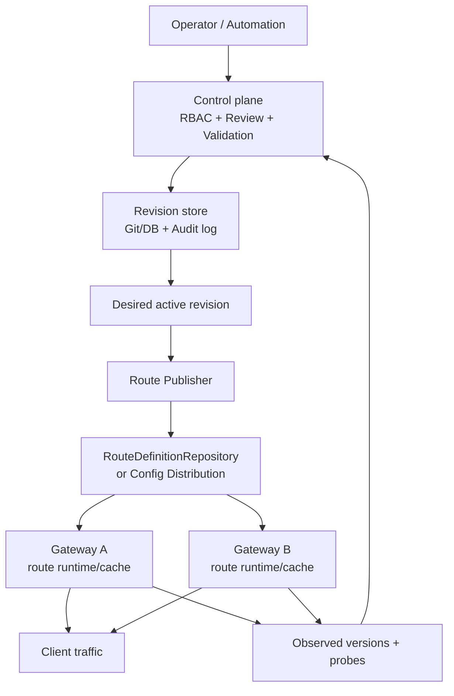
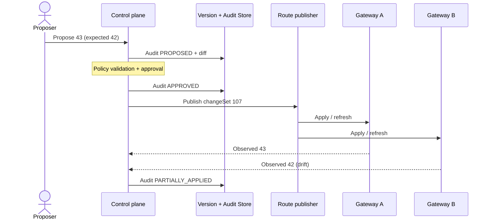
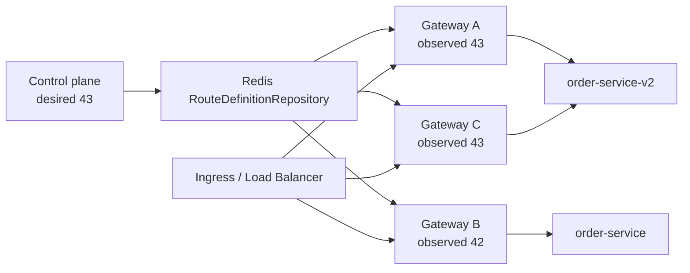
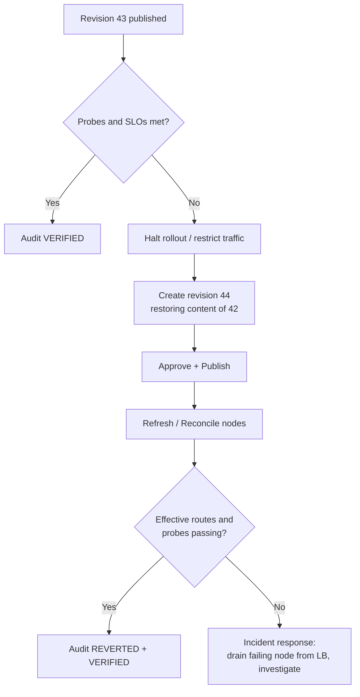

# Configuration Versioning, Change Auditing, and Route Rollback

An API Gateway can update routes without restarting: exposing new APIs, shifting traffic to backend v2, modifying route predicates, or adding filters. While invaluable for microservices, even a tiny misconfiguration can **misroute requests to the wrong service**, bypass rate limits, or trigger widespread `404`/`503` errors. Consequently, the critical question is not just **"how do we update a route?"**, but also:

- **Which configuration revision** was proposed, approved, published, and actually loaded by the Gateway?
- **Who changed it**, when, from which revision to which, and why?
- How do we detect when one Gateway replica still runs an older revision even though the data store holds the new one?
- When a newly published revision causes an outage, how do we **roll back to a known-good route** without erasing audit history?

This belongs to the **Dynamic Routes** chapter of the **SPRING_CLOUD_GATEWAY** module. It connects directly with route predicates, filter chains, path/header rewrites, service discovery, authentication, rate limiting, circuit breakers, retries, TLS, and request observability. A reliable dynamic routing system must govern **desired state** (intended config), **runtime state** (actively served routes), and the **audit trail** (evidence of every change).

> **Scope:** Examples use **Spring Cloud Gateway Server WebFlux**. Recent versions use the route namespace `spring.cloud.gateway.server.webflux.routes`; many 4.x versions use `spring.cloud.gateway.routes`. Actuator APIs and properties depend on your exact Spring Cloud Gateway/Spring Boot version. **Gateway does not automatically provide versioning, approvals, optimistic locking, or immutable auditing simply by enabling management endpoints**: those require a dedicated orchestration layer or deployment workflow.

## 1. What Components Make Up a Route?

| Property | Role | Risk If Changed Unintentionally |
| --- | --- | --- |
| **`id`** | Route identifier, e.g., `orders-api`. | Duplicate IDs or changing IDs break tracing and quotas. |
| **`uri`** | Target backend: `lb://order-service` or HTTPS URI. | Sends data to an unauthorized service. |
| **`predicates`** | Conditions such as `Path`, `Method`, `Host`, `Header`, `Weight`, etc. | A new route hijacks requests unintentionally. |
| **`filters`** | `StripPrefix`, `RewritePath`, `RequestRateLimiter`, `Retry`, etc. | Drops protections, corrupts URLs/headers, or amplifies side effects. |
| **`order`** | Selection priority when multiple routes match. | Catch-all shadows sensitive routes. |
| **`metadata`** | Custom descriptive metadata. | Easily mistaken for an automatic versioning mechanism. |

Example of a simple route:

```yaml
spring:
  cloud:
    gateway:
      server:
        webflux:
          routes:
            - id: orders-api
              uri: lb://order-service
              order: -10
              predicates:
                - Path=/api/orders/**
              filters:
                - StripPrefix=1
              metadata:
                owner: orders-team
                configRevision: "42"
```

If the next revision changes `uri` to `lb://order-service-v2` while preserving `id: orders-api`, that is **a new version of the same logical route**. Never treat the route ID as a version number: `orders-api` is the identity, whereas **revisions 42, 43, ...** are defined by your configuration management system.

`configRevision` in metadata is a **team-defined custom field**—Gateway does not automatically compare, lock, or roll back by it. Never place credentials or tokens in metadata, as route inspection endpoints can expose them.

### 1.1. `RouteDefinition`, Runtime `Route`, and Cache

A **`RouteDefinition`** describes URI, predicates, filters, and order. Factories compile these definitions into **`Route`** objects holding executable predicates and filters. Gateway caches built routes to handle requests efficiently.

Distinguish four stages:

1. **Definition in the data source:** the record persisted in YAML, Redis, or a repository.
2. **Definition read by a node:** has a given Gateway instance seen the new version?
3. **Runtime `Route`:** does the node's active route object match the new definition?
4. **Live traffic:** which route do incoming requests match? Requests started prior to an update may still finish under the prior route's handling.

**Writing a new definition does not prove every Gateway replica loaded and uses it.** That distinction is the foundation of safe dynamic route releases.

## 2. Source of Truth, Published State, and Observed State



The **Control plane** governs changes. The **Data plane** consists of Gateways serving real traffic. In small setups both may run in one process, yet **route-modification privileges** and **ordinary API traffic handling** must remain strictly separated.

| State Type | Question | Appropriate Measurement Source |
| --- | --- | --- |
| **Desired revision** | Which revision is approved to run? | Git commit/tag, revision DB. |
| **Published revision** | Which revision did the publisher write to the route repository? | Storage write result and readback of definitions. |
| **Observed revision** | Which route generation does Gateway A/B/C hold? | Custom internal endpoint/metric, runtime diagnostics. |
| **Effective behavior** | Do real requests hit the right URI and filters? | HTTP probes, integration tests, metrics/tracing. |
| **Audited outcome** | Who proposed/approved/published; did every node succeed? | Append-only audit logs and evidence. |

Suppose the control plane wrote revision 43 to Redis while Gateway B still caches revision 42: **desired=43, published=43, observed(B)=42**. Traffic hitting B still lands on the old backend. Relying solely on a publisher's success response is never enough.

### 2.1. Choose a Single Authoritative Source

Use GitOps, a versioned DB, or a centralized config system as the **source of truth**. Never allow one person to edit Git, another to hit Actuator directly, and a worker to sync from Redis simultaneously—during an incident nobody will know **which version is authoritative**.

| Management Style | Advantages | What Must Be Added |
| --- | --- | --- |
| **GitOps** | Pull-request reviews, clear commit history. | Sync controller, runtime convergence checks, operational execution audits. |
| **Versioned DB control plane** | Optimistic locking, approval states, flexible distribution. | DDL, RBAC, backups, reconciliation, outbox, and durable auditing. |
| **Config Server / ConfigMap** | Reuses existing pipelines and infra. | Explicit refresh orchestration and separation of config vs. runtime revisions. |
| **Direct Actuator** | Easy for testing create/delete/refresh. | Lacks built-in versioning, approval workflows, and transactions of a full control plane. |

If an emergency change bypasses the normal pipeline, log an **emergency change** and reconcile it back into the authoritative source promptly—never let a runtime hotfix remain an "undocumented operational secret."

## 3. Dynamic Route Sources Supported by Spring Cloud Gateway

| Source | Mechanism | Key Limitation |
| --- | --- | --- |
| `application.yml` | Application config loaded into `RouteDefinitionLocator`. | Versioned via config/deploy; not treated as Actuator-created routes. |
| Java `RouteLocator` bean | Routes built via code/Java DSL. | Versioned with code artifact; cannot be arbitrarily overwritten by POSTing the same ID. |
| `RouteDefinitionRepository` | Dynamic read/write/delete via repository. | Storage contract ≠ built-in auditing, CAS, or approvals. |
| `InMemoryRouteDefinitionRepository` | Route definitions held in one node's RAM. | Does not sync across replicas; lost on restart. |
| `RedisRouteDefinitionRepository` | Redis stores shared route definitions. | Shared definitions ≠ converged runtime caches. |
| Discovery Locator | Generates routes from service instance/name lists. | Registry changes can alter routes outside manual approval cycles. |

Server WebFlux docs describe `RedisRouteDefinitionRepository` for sharing definitions across Gateway instances with:

```properties
spring.cloud.gateway.redis-route-definition-repository.enabled=true
```

(or `spring.cloud.gateway.server.webflux.redis-route-definition-repository.enabled=true` in newer lines—verify exact version) alongside a reactive Redis dependency, typically `spring-boot-starter-data-redis-reactive`. Verify against your exact version and starter. **Never assume enabling the Redis repository automatically emits `RefreshRoutesEvent` across all Gateway instances.**

### 3.1. Overlapping Sources or Duplicate Route IDs

If `orders-api` appears in YAML as well as Redis or the Discovery Locator, `RouteDefinitionLocator` sources may emit duplicate IDs or overlapping predicates. Outcome depends on how composite locators merge sources and route ordering—never assume "the newer version cleanly overrides the old one."

Enforce **route ID ownership**, namespaces, or dedicated management domains. Pre-publish checks must validate uniqueness and overlaps across **the entire route set**, not just the edited route.

## 4. Designing Configuration Versioning

**Revisions** should be *immutable snapshots*: once approved, content is never edited in place. Rolling back creates a new revision restoring prior content rather than **erasing the faulty revision from history**.

### 4.1. Governance Envelope (Not an Actuator Payload)

```json
{
  "changeId": "chg-2026-0118",
  "environment": "staging",
  "routeId": "orders-api",
  "revision": 43,
  "parentRevision": 42,
  "state": "APPROVED",
  "requestedBy": "user:operator",
  "approvedBy": "user:reviewer",
  "reason": "Route orders traffic to backend v2",
  "ticket": "OPS-481",
  "createdAt": "2026-11-24T04:00:00Z",
  "definitionSha256": "<canonical-definition-hash>",
  "definition": {
    "id": "orders-api",
    "uri": "lb://order-service-v2",
    "order": -10,
    "predicates": ["Path=/api/orders/**"],
    "filters": ["StripPrefix=1"],
    "metadata": {
      "owner": "orders-team",
      "configRevision": "43"
    }
  }
}
```

This is a **custom control-plane schema**. Fields like `changeId`, `revision`, `state`, `ticket`, and `definitionSha256` are **not built-in versioning mechanisms understood by Spring Cloud Gateway**. A publisher adapter maps `definition` into a `RouteDefinition` or API payload supported by your Gateway version.

### 4.2. Route ID, Revision, and Change-Set Generation

```text
orders-api
  revision 40: lb://order-service     + StripPrefix=1
  revision 41: lb://order-service     + Bounded Retry
  revision 42: lb://order-service     + approved policy
  revision 43: lb://order-service-v2  + policy preserved
  revision 44: ROLLBACK of 43, content restored from 42
```

**Revision 44 is not revision 42 "renumbered."** It records `parentRevision=43` and metadata `restoresContentOf=42`, `revertsRevision=43` to preserve uninterrupted lineage.

When a release changes multiple routes together, track a **`changeSetRevision`** or **`routeSetGeneration`** as well—for instance, `orders-read` rev 12 and `orders-write` rev 8 both belonging to cluster generation 107. That makes "half-old/half-new" states immediately visible.

### 4.3. Comparing Snapshots via Canonical Hashing

To verify content integrity:

1. Select significant fields: `id`, `uri`, `order`, `predicates`, `filters`, and relevant metadata.
2. Serialize to canonical JSON with deterministic key ordering, encoding, and number/string formatting.
3. **Never sort filter/predicate arrays when order carries semantics.**
4. Compute SHA-256 over **UTF-8 bytes of the canonical definition** and record the canonicalization version.
5. Compare hashes across proposed, approved, published, and observed definitions.

Hashes detect drift, yet **do not authenticate actors or approvals**; pair them with audit logs, access controls, and—when high assurance is required—digital signatures or tamper-evident storage. Never embed private keys, tokens, or API credentials inside snapshots just for rollback convenience.

## 5. Diffs Must Inspect Both Routing Behavior and Security

Example diff:

```diff
 id: orders-api
-uri: lb://order-service
+uri: lb://order-service-v2
 order: -10
 predicates:
   - Path=/api/orders/**
 filters:
   - StripPrefix=1
```

Changing a single URI line looks trivial, yet you still must verify whether service v2 expects the same path, token audience, TLS config, throughput capacity, and rate limits as v1.

| Diff Category | What to Review |
| --- | --- |
| **URI** | Domain, protocol, `lb://` vs. `http://`, SSRF, and TLS. |
| **Path / Host / Method predicates** | Do newly matched requests step outside protected API boundaries? |
| **Route `order`** | Does a catch-all shadow admin or specialized routes? |
| **`StripPrefix` / `RewritePath`** | Does the backend receive the expected endpoint, or enter privileged paths? |
| **Header filters** | Does it strip `Authorization`, forge identity headers, or leak sensitive data? |
| **`RequestRateLimiter`** | Are quotas removed or bypassed when adding another route? |
| **Retry / `CircuitBreaker`** | Could POST retries duplicate writes, or fallbacks expose sensitive endpoints? |
| **Metadata** | Do generation/owner updates obey policy without leaking secrets? |

Changing `Path=/api/orders/**` to `Path=/api/**` without adjusting security policies is a **massive access-control expansion** even though the text diff is one line. Review tools must therefore run **route overlap and semantic tests** alongside plain text diffs.

## 6. Change Auditing: Capturing the Complete Trail

Audits should record more than "route updated." Every event should capture:

| Attribute | Example | Purpose |
| --- | --- | --- |
| `eventId` / `changeId` | `evt-9001` / `chg-2026-0118` | Correlates stages of one change. |
| `actor` | Authenticated principal | Identifies the human or automation acting. |
| `action` | `PROPOSE`, `APPROVE`, `PUBLISH`, `ROLLBACK` | Separates intent from execution. |
| `routeId` / `environment` | `orders-api` / staging | Scopes the change accurately. |
| `beforeRevision` / `afterRevision` | 42 → 43 | Pinpoints exact snapshots. |
| `beforeHash` / `afterHash` | SHA-256 | Proves exact content. |
| `reason` / `ticket` | `OPS-481` | Tracks accountability and rationale. |
| `approvedBy` | Independent reviewer | Verifies sign-off. |
| `timestamp` | Server-side UTC | Reconstructs exact timeline. |
| `result` | Verified / Partial / Failed | Records actual outcome. |
| `targetNodes` / `observedNodes` | A/B/C | Links to cluster convergence. |

**Never trust actor info from arbitrary client headers** like `X-Operator: admin`. Derive principals from verified OAuth2/OIDC, workload identity, mTLS, or equivalent authentication.

### 6.1. Intent Differs from Outcome



If only A loaded revision 43, never log `VERIFIED` for the entire cluster. Separate **proposed**, **approved**, **published**, and **observed** in audits; when nodes diverge, record `PARTIAL / NOT_CONVERGED`.

### 6.2. Protecting Audit Integrity

To make audits trustworthy:

- Write **append-only**; restrict or forbid publisher accounts from editing or deleting past records.
- Record before/after hashes referencing durably stored snapshots.
- Enforce separation of duties (*four-eyes principle*) between proposer and reviewer for sensitive production routes.
- Configure backups, retention, and clock synchronization on the audit store.
- Scrub secrets, JWTs, cookies, client secrets, Redis credentials, and unnecessary PII.
- For high assurance, use tamper-evident/WORM storage or cryptographic log integrity checks.

Application logs rotate and lack durability guarantees; never treat a single `INFO` log line as an audit system.

## 7. Preventing Concurrent Overwrites: Optimistic Locking

Two operators read revision 42 simultaneously:

```text
Operator A: wants to switch URI to backend v2
Operator B: wants to adjust StripPrefix

A commits revision 43 successfully.
B still bases on revision 42 and submits an update.
```

Under naive "last write wins," B silently overwrites A's change. The control plane needs an explicit rule:

> Accept a publish only when **`expectedRevision == currentRevision`**, checked inside a **reliable transaction or compare-and-swap**.

If current is already 43 and B sends `expectedRevision=42`, return `409 Conflict` (or `412 Precondition Failed` if using HTTP preconditions) and require B to review the updated diff. **Actuator route CRUD does not natively enforce `expectedRevision`/`If-Match` for custom governance envelopes.**

### 7.1. Custom Control-Plane API

Example (**not a built-in Actuator endpoint**):

```http
POST /management/route-changes HTTP/1.1
Authorization: Bearer <operator-token>
Idempotency-Key: req-9af41
Content-Type: application/json

{
  "environment": "staging",
  "routeId": "orders-api",
  "expectedRevision": 42,
  "newDefinition": {
    "id": "orders-api",
    "uri": "lb://order-service-v2",
    "order": -10,
    "predicates": ["Path=/api/orders/**"],
    "filters": ["StripPrefix=1"]
  },
  "ticket": "OPS-481",
  "reason": "Route orders traffic to backend v2"
}
```

Illustrative response:

```json
{
  "changeId": "chg-2026-0118",
  "state": "PENDING_APPROVAL",
  "basedOnRevision": 42,
  "proposedRevision": 43
}
```

**`Idempotency-Key`** must actually track state scoped by actor, operation, environment, payload hash, and TTL. Merely reading the header and ignoring it will not stop publisher retries from creating duplicate revisions or double DELETE/POST cycles.

### 7.2. Transactions in the Version Store

Sample **team-designed** PostgreSQL DDL (not a built-in Gateway schema):

```sql
CREATE TABLE gateway_route_current (
    environment       varchar(40)  NOT NULL,
    route_id          varchar(160) NOT NULL,
    revision          bigint       NOT NULL,
    definition_sha256 char(64)     NOT NULL,
    PRIMARY KEY (environment, route_id)
);

CREATE TABLE gateway_route_revision (
    environment       varchar(40)  NOT NULL,
    route_id          varchar(160) NOT NULL,
    revision          bigint       NOT NULL,
    parent_revision   bigint,
    definition_json   jsonb        NOT NULL,
    definition_sha256 char(64)     NOT NULL,
    actor_id          varchar(160) NOT NULL,
    reason            text         NOT NULL,
    created_at        timestamptz  NOT NULL DEFAULT now(),
    PRIMARY KEY (environment, route_id, revision)
);

CREATE TABLE gateway_route_audit (
    event_id          bigserial PRIMARY KEY,
    change_id         varchar(160) NOT NULL,
    actor_id          varchar(160) NOT NULL,
    action            varchar(40)  NOT NULL,
    event_json        jsonb        NOT NULL,
    occurred_at       timestamptz  NOT NULL DEFAULT now()
);
```

Optimistic update **inside a DB transaction verifying affected row count**:

```sql
UPDATE gateway_route_current
SET revision = :next_revision,
    definition_sha256 = :new_hash
WHERE environment = :environment
  AND route_id = :route_id
  AND revision = :expected_revision;
```

If **0 rows** are updated, raise conflict or missing-route error, roll back the DB transaction, and halt publication. Inside the same transaction, persist the new revision snapshot, audit event, and an **outbox event** for publishing. Note that this DDL/sketch leaves out initial route creation, atomic multi-route sets, and schema migrations—implement appropriate uniqueness and isolation levels.

### 7.3. How Does a Transactional Outbox Help?

A classic distributed failure:

1. DB commits `revision=43`.
2. Process crashes before dispatching refreshes to Gateways.
3. Control plane thinks publishing finished while data plane stays on 42.

A **transactional outbox** inserts a "publish 43" record in **the same transaction** that updates the active revision. A publisher worker reads the outbox, dispatches idempotently, and logs per-node outcomes. This eliminates lost events between DB commits and network calls, though it **does not turn multiple Gateway replicas into a single atomic distributed transaction**.

A clean state machine:

```text
DRAFT -> VALIDATED -> APPROVED -> PUBLISHING
   -> PARTIALLY_APPLIED -> APPLIED -> VERIFIED
   -> FAILED -> ROLLING_BACK -> REVERTED
```

Avoid collapsing everything into `SUCCESS`/`FAILED` when only a subset of replicas has applied the new version.

## 8. Gateway Actuator: Read, Create, Delete, Refresh

Spring Cloud Gateway Server WebFlux includes an **Actuator API** to inspect and—when appropriately authorized—manage route definitions.

### 8.1. Read-Only Mode and Securing Management Endpoints

Example **read-only** Actuator configuration:

```properties
management.endpoint.gateway.access=read-only
management.endpoints.web.exposure.include=health,gateway
```

In supported releases, creating, deleting, or refreshing via Actuator may require `management.endpoint.gateway.access=unrestricted` (or the equivalent enablement setting in your version's docs). **Never enable `unrestricted` merely to read routes.**

Sandbox example (**localhost-only, never a production template**):

```properties
management.server.port=9091
management.server.address=127.0.0.1
management.endpoint.gateway.access=unrestricted
management.endpoints.web.exposure.include=health,gateway
```

Production requires an isolated management network, TLS/mTLS or OIDC/strong identity, RBAC, auditing, firewalls, and CSRF protection if using cookie auth. Never expose dynamic route-write endpoints to the Internet relying on an obscure URL.

### 8.2. Reading Running Configuration

```bash
# Example only on an authorized local management listener.
curl -fsS http://127.0.0.1:9091/actuator/gateway/routes
curl -fsS http://127.0.0.1:9091/actuator/gateway/routedefinitions
curl -fsS http://127.0.0.1:9091/actuator/gateway/routes/orders-api
```

**Important:** `GET /actuator/gateway/routes/{id}` in recent docs may format predicates and filters in **human-readable form**, unlike the shortcut DSL format required for POST. Never take GET output and POST it back verbatim without converting and validating. Authoritative version stores should persist **canonical `RouteDefinition`s**, not human-rendered strings.

### 8.3. Creating a New Route in a Sandbox

Payload matching the Actuator format described in current Server WebFlux docs:

```json
{
  "uri": "http://127.0.0.1:9090",
  "predicates": ["Path=/api/orders/**"],
  "filters": ["StripPrefix=1"],
  "order": -10
}
```

HTTP example:

```bash
curl -i -X POST \
  'http://127.0.0.1:9091/actuator/gateway/routes/orders-api' \
  -H 'Content-Type: application/json' \
  --data '{
    "uri":"http://127.0.0.1:9090",
    "predicates":["Path=/api/orders/**"],
    "filters":["StripPrefix=1"],
    "order":-10
  }'

curl -i -X POST \
  'http://127.0.0.1:9091/actuator/gateway/refresh'
```

Recent docs specify create returns **`201 Created`**, after which **`POST /actuator/gateway/refresh`** is needed to apply it. **HTTP 200 from refresh does not guarantee all other Gateways converged**, and refresh can run asynchronously—verify outcomes explicitly.

### 8.4. Never POST Over an Existing Route ID

A key detail in current Actuator docs:

- Do not re-`POST` an existing route ID: docs warn it can create duplicate route definitions and trigger errors on `GET` route lists.
- For **Actuator-created routes**, the documented replacement sequence is **DELETE old → POST new with same ID → POST refresh**.
- Routes declared in **`application.yml`** or `@Bean` cannot be edited or deleted via this endpoint the same way as Actuator-created routes; `DELETE` can return `404 Not Found`.

Example:

```bash
curl -i -X DELETE \
  'http://127.0.0.1:9091/actuator/gateway/routes/orders-api'

# Send POST with the NEW APPROVED definition, then:
curl -i -X POST \
  'http://127.0.0.1:9091/actuator/gateway/refresh'
```

**DELETE followed by POST is non-atomic.** If the process crashes or storage fails between calls, the route temporarily vanishes. This is a low-level testing primitive, **not a complete versioned/transactional/rollback deployment mechanism**. Never run it manually in production without strict safety and recovery plans.

## 9. `RouteDefinitionWriter`, Repositories, and `RefreshRoutesEvent`

You do not have to enable writable Actuator endpoints to support dynamic routes. An application can build an internal governance layer using:

- **`RouteDefinitionLocator`:** reads definitions, typically emitting `Flux<RouteDefinition>`.
- **`RouteDefinitionWriter`:** interface for writing and deleting definitions.
- **`RouteDefinitionRepository`:** repository supporting both reading and writing definitions.
- **`RouteLocator` / `CachingRouteLocator`:** runtime route source and cache serving requests.
- **`RefreshRoutesEvent`:** signal refreshing routes inside **the receiving node's application context**.

### 9.1. Java Example: Saving a Definition Then Requesting Local Refresh

```java
package com.example.gateway.dynamic;

import org.springframework.cloud.gateway.event.RefreshRoutesEvent;
import org.springframework.cloud.gateway.route.RouteDefinition;
import org.springframework.cloud.gateway.route.RouteDefinitionWriter;
import org.springframework.context.ApplicationEventPublisher;
import org.springframework.stereotype.Service;
import reactor.core.publisher.Mono;

@Service
public class LocalRoutePublisher {

    private final RouteDefinitionWriter writer;
    private final ApplicationEventPublisher publisher;

    public LocalRoutePublisher(
            RouteDefinitionWriter writer,
            ApplicationEventPublisher publisher) {
        this.writer = writer;
        this.publisher = publisher;
    }

    public Mono<Void> saveAndRefresh(RouteDefinition definition) {
        return writer.save(Mono.just(definition))
            .then(Mono.fromRunnable(
                () -> publisher.publishEvent(new RefreshRoutesEvent(this))));
    }

    public Mono<Void> deleteAndRefresh(String routeId) {
        return writer.delete(Mono.just(routeId))
            .then(Mono.fromRunnable(
                () -> publisher.publishEvent(new RefreshRoutesEvent(this))));
    }
}
```

**This is solely an example of foundational APIs.** It lacks RBAC, URI/filter validation, optimistic locking, approved revisions, audit trails, transactional outboxes, and multi-node error handling. `writer.save(...)` completing **does not guarantee new requests pick the updated route**; verify refreshes, runtime routes, and probes. Never expose this class directly via a public controller.

### 9.2. A Local Event Is Not a Cluster-Wide Event

`ApplicationEventPublisher` dispatches Spring application events **inside the current process**. When Gateway A emits `RefreshRoutesEvent`, Gateway B does not automatically receive it simply because both share a Redis repository. Updating B reliably requires one of:

1. Delivering authenticated events via a message bus to every node and checking ACKs.
2. Calling each instance's management refresh over an authenticated admin network.
3. Running managed periodic polling/reconciliation comparing desired vs. observed revisions.
4. Using a deployment/cutover strategy verifying new nodes are ready before shifting traffic.

Each approach trades off latency, durability, and failure handling. **Never assume exactly-once event delivery**; keep publishing and refreshing idempotent.

### 9.3. Refresh Neither Creates Revisions Nor Rolls Back

`POST /actuator/gateway/refresh` or `RefreshRoutesEvent` tells Gateway to reload and rebuild routes; it **does not revert the source of truth** to a known-good snapshot.

If the repository still holds faulty revision 43, refreshing again simply reloads revision 43. To roll back, **publish the known-good definition first**, then refresh/reconcile and verify—never hammer refresh expecting an automatic "undo."

## 10. Redis Repository and Consistency Across Gateway Replicas



In this state, identical `GET /api/orders/42` requests receive different responses depending on which Gateway the load balancer picks. This is **config drift / runtime convergence lag**, not necessarily a service discovery bug.

### 10.1. Choosing an Appropriate Consistency Target

| Guarantee | Meaning | Trade-Off |
| --- | --- | --- |
| **Best effort** | Publisher writes new version; nodes refresh opportunistically. | Simple, yet zero convergence-time guarantee. |
| **Eventual consistency** | All healthy nodes converge within a bounded SLO window. | Temporary mixed-revision window. |
| **Quorum verified** | Rollout proceeds once a target fraction of nodes reports loading the new version. | Minority of older nodes may still serve traffic. |
| **All-active-verified** | Every traffic-serving node loaded the target version or is drained. | Higher complexity; can impact availability. |
| **Cluster-wide atomic cutover** | Zero requests ever witness two route generations simultaneously. | **Not provided** by Redis + Actuator alone; requires dedicated deployment/cutover orchestration. |

Never advertise "atomic cluster configuration" just because Redis performs atomic single-key writes. Writing a key in Redis and rebuilding runtime routes across multiple JVMs are **two separate operations**.

### 10.2. Revision Observability Endpoint / Metric

You can expose an authenticated internal management endpoint reflecting the actually loaded route set:

```json
{
  "instance": "gateway-b",
  "desiredGeneration": 107,
  "observedGeneration": 106,
  "routeCount": 51,
  "observedHash": "<hash-of-effective-route-set>",
  "state": "OUT_OF_SYNC",
  "lastRefreshAt": "2026-11-24T04:10:00Z"
}
```

**This is a custom proposed payload, not a built-in Spring Cloud Gateway API.** It must reflect **actually loaded runtime state**, rather than parroting the revision announced by the publisher. Pair it with HTTP probes checking route ID, path, method, and host.

Implementing accurate observation requires:

- Hashing canonical definitions consistently after merging all sources.
- Never trusting operator-set metadata alone if compiled routes differ.
- Distinguishing cached definitions, executable routes, and requests matched prior to refresh.
- Excluding sensitive URI/filter/header details from management responses.

### 10.3. Redis Failover, Network Partitions, and Snapshot Restores

When backing route repositories with Redis:

- **Network outage:** publisher may time out, or a node fails to read the new version.
- **Failover:** writes right before primary promotion may not replicate completely depending on setup.
- **Old backup restore:** Redis reverts to definitions older than the approved revision.
- **Mismatched Redis endpoints:** Gateway A and B accidentally point to two independent stores.
- **Surviving stale caches:** some nodes retain last-known routes while the store is unreachable.

Build a **source-of-truth reconciler** and explicit failure policies. Never wipe all routes on a single refresh failure, nor silently keep serving revoked configs when risk policy demands closing access.

### 10.4. Should Lagging Nodes Be Marked Unready?

For ultra-sensitive routes, the control plane may pull **unconverged** nodes out of load balancer rotation. However, if a store outage prevents all nodes from converging, overly strict readiness gates can take down the entire cluster. Ensure:

1. Explicit **drift tolerance thresholds** per route tier.
2. Sufficient capacity among converged nodes to absorb traffic.
3. Policy-compliant draining of in-flight connections/requests.
4. Clear alerts surfacing mixed-configuration states to operators.

For urgent security revocations, denying requests on a sensitive path can take precedence over serving an older, weaker route. Define these rules upfront—never improvise mid-incident.

## 11. Staged Rollouts and Canaries

A safe publication rollout:

1. **Prepare:** draft revision 43, diff, tests, preflight checks.
2. **Approve:** independent reviewer, snapshot rollback revision 42.
3. **Publish candidate:** deploy to staging or a test slice of Gateway nodes.
4. **Canary:** route a controlled slice of traffic through the new config via load balancing or scoping.
5. **Observe:** track route hits, backend markers, 401/403/404/429/5xx, p95/p99 latency, retries, CPU, and error budgets.
6. **Expand:** incrementally widen to remaining nodes or traffic shares.
7. **Converge:** confirm required nodes loaded generation 107.
8. **Verify:** compare hashes/probes, write audit outcomes, and close the change.

**Canaries via `Weight` route predicates and canaries via Gateway config versions are orthogonal.** 5% of requests can route to backend v2 even when 100% of Gateways run the same config; conversely, 5% of Gateway nodes running a new config does not guarantee exactly 5% of traffic hits the new backend.

### 11.1. Rollout Stop Signals

Define metric-backed halt criteria:

- 5xx or 404 rates breach thresholds.
- Unexpected 401/403 spikes on previously valid APIs.
- 429 spikes from unintended rate-limiter/key changes.
- p99 latency exceeds budget.
- New backend exhibits TLS errors, missing instances, or path-rewrite mismatches.
- A node fails to converge within target SLO time.
- Audit/outbox or definition stores show inconsistency.

Never look solely at "backend still returns 200" while ignoring failing endpoints, methods, or user cohorts.

### 11.2. Multiple Routes in One Change Set

Suppose you must update concurrently:

```text
orders-read  revision 12 -> 13
orders-write revision 8  -> 9
security policy bundle       -> version 21
```

Sequential route-by-route updates risk exposing one updated route alongside one stale route. For coupled changes, ship a **route-set snapshot or change set** under a shared generation, validate the full candidate, and cut over via your platform's supported mechanism.

**Actuator DELETE/POST across multiple routes does not create a multi-route or multi-Gateway transaction.** Never mark the bundle `APPLIED` when only one route updated.

## 12. End-to-End Controlled Route Change Workflow

An operational standard across five phases:

### Phase A — Proposal

1. Authorized user creates a proposal with `expectedRevision`, route ID, environment, reason, and ticket.
2. Control plane verifies the proposer belongs to the route's owning group.
3. Canonicalize `RouteDefinition`, compute hash, save diff and proposed snapshot.
4. Run schema validation, uniqueness, and semantic overlap checks.
5. Validate URIs, paths, filter allowlists, TLS, and security-policy compatibility.

### Phase B — Approval

6. Reviewer inspects the diff and blast radius: customers, tenants, APIs, traffic share.
7. Approve under least-privilege / four-eyes rules as required.
8. Re-verify the reviewed proposal still matches the current `expectedRevision`; otherwise require rebase and re-review.

### Phase C — Publish

9. CAS-update the revision in a DB transaction alongside audit and outbox records.
10. Publisher updates the definition store or emits the new snapshot generation.
11. Send authenticated refresh/reconcile triggers to target Gateways.
12. Record per-node audit outcomes instead of collapsing into a single fake success.

### Phase D — Verification

13. Read observed revisions and hashes from every Gateway node.
14. Execute request probes using test tokens with appropriate permissions and paths.
15. Verify HTTP status, route ID, backend markers, TLS, security, and latency.
16. Monitor SLOs across affected user/route segments for the defined verification window.

### Phase E — Completion / Recovery

17. Record `VERIFIED` only once convergence and behavioral criteria pass.
18. On failure, halt rollout, isolate failing nodes, and execute the approved rollback.
19. Preserve timeline, root cause, and post-incident evidence without deleting the faulty revision.

**Avoid changing everything in one revision:** altering URI, Path, `Route.order`, Retry, and RateLimiter simultaneously makes root-cause diagnosis nearly impossible during an outage.

## 13. Rollback: Restoring a Known-Good State via a New Revision

Example:

```text
orders-api
  revision 42: lb://order-service
  revision 43: lb://order-service-v2

After publish:
  Gateway A: observed revision 43
  Gateway B: observed revision 42
  Backend v2: returns 503 for a subset of requests
```

**Never roll back by deleting revision 43 from history and resetting current revision back to 42.** Instead, create a new revision:

```json
{
  "routeId": "orders-api",
  "revision": 44,
  "parentRevision": 43,
  "revertsRevision": 43,
  "restoresContentOf": 42,
  "reason": "Backend v2 failing, restoring known-good route",
  "ticket": "INC-893",
  "definitionSha256": "<hash-of-known-good-definition>"
}
```

### 13.1. Rollback Runbook

1. **Halt the rollout** of 43 and block concurrent edits to this route.
2. **Verify the known-good snapshot** (revision 42) and its stored hash.
3. Confirm backend v1 is healthy, service discovery holds instances, and TLS certs/token audiences remain valid.
4. Create revision 44 with **content restored from 42**, updating metadata so audits clearly flag a rollback.
5. Approve under incident/emergency policy, recording actor and ticket.
6. Publish revision 44 and trigger refresh/reconciliation across Gateways.
7. Confirm required nodes report `observed=44` and matching canonical effective hash.
8. Probe key methods/paths/hosts to verify v1 backend markers, 401/403/429/5xx rates, and normal latency.
9. Record `ROLLBACK_VERIFIED`; if unconverged, keep the incident open and resolve drift.
10. Post-incident, review how revision 43 passed validation and add regression tests.



### 13.2. Rollback Is Not Always Safe

- Backend v1 was already decommissioned with zero instances left.
- Backend v2 wrote new schema records unreadable by v1.
- TLS certificates or token audiences for v1 expired.
- Route v1 contained a critical security flaw just patched.
- `RewritePath` patterns changed in lockstep with the backend.
- In-flight `POST` calls already triggered irreversible side effects.

Therefore, **having an old snapshot does not guarantee a safe rollback**. Sometimes the safer choice is serving a controlled `503`, failing over/throttling traffic, or rolling back the backend deployment alongside the route.

### 13.3. RTO, RPO, and Blast Radius

| Concept | Applied to Route Config | How to Measure |
| --- | --- | --- |
| **RTO** | Target time from rollback decision until traffic returns to healthy state. | Decision timestamp → probes and nodes passing. |
| **Config RPO** | Revisions/updates policy tolerates losing during failover or restore. | Compare source of truth against published/observed state. |
| **Blast radius** | Count of affected routes, users, tenants, nodes, and traffic %. | Route hit metrics, tracing, canary scope. |
| **Verification window** | Observation period after publish or rollback. | 5xx/404, 401/403, 429, and p99. |

An HTTP 200 from a management endpoint **never proves RTO was met**, because other nodes may still need refreshing or the older backend may be unhealthy.

## 14. Separating Route Rollback from App and Security Rollbacks

| Symptom | Layer to Inspect | Is Route Rollback Enough? |
| --- | --- | --- |
| Route points to wrong backend host | `uri` / service discovery | Possibly, if the old backend is healthy. |
| `404` from `StripPrefix`/`RewritePath` | Gateway filters + backend contract | Yes, if only the filter was wrong. |
| `503` because backend v2 has a bug | Backend deployment + route | Route switch can help if schemas stay compatible. |
| `401` because JWT issuer/audience changed | Spring Security / IdP | **Not** necessarily. |
| `403` from backend resource authorization | Business/backend policy | Never alter routes to bypass authorization. |
| `429` spikes from route dropping key quota | `RequestRateLimiter` / key policy | Review both route and quota settings. |
| Retries spike; `POST` duplicated writes | Retry filter + backend idempotency | Rolling back the filter won't undo committed side effects. |
| TLS handshake fails | Truststore / certificates / upstream URI | May require fixing TLS or backend deployment. |

**Never resolve authentication/authorization failures by altering routes to remove security checks.** A quick fix that restores HTTP 200 by widening permissions creates a fresh security incident.

## 15. Securing the Control Plane and Actuator

**Permission to edit `RouteDefinition` equals permission to steer traffic**—carrying risks of SSRF, credential leakage, altered public URLs, and filter bypasses.

### 15.1. Changes Requiring Rejection or Special Review

| Change | Risk |
| --- | --- |
| `uri: http://127.0.0.1:...`, link-local, metadata IP, or non-allowlisted private host | SSRF and internal infrastructure access. |
| Downgrading `https://` to `http://` | Drops TLS protection on outbound hops. |
| `Path=/**` with high-priority `order` | Catch-all hijacks every API. |
| `RemoveRequestHeader=Authorization` | Backend receives missing or wrong identity. |
| `AddRequestHeader=X-Role,ADMIN` | Privilege spoofing if backend trusts the header. |
| Dropping `RequestRateLimiter` | Bypasses quotas and risks overload. |
| Retrying non-idempotent payment `POST`s | Duplicates side effects. |
| `RedirectTo` to unfamiliar domains | Phishing redirects or data leaks. |
| `SetPath`/`StripPrefix` targeting privileged endpoints | Crosses route/backend authorization boundaries. |

**The control plane must validate strictly what APIs allow** rather than accepting arbitrary schemes, URIs, and filters. Enforce controls after DNS/service discovery resolution, egress network policies, and internal proxies, since naive hostname allowlists alone cannot defeat SSRF.

### 15.2. Role-Based Permissions

Sample model:

- **Viewer:** read-only access to revisions, audits, and effective routes.
- **Proposer:** submits changes strictly for owned namespaces/routes.
- **Reviewer:** approves or rejects; independent from proposer where policy requires.
- **Publisher:** service account permitted to publish **approved revisions** only.
- **Emergency operator:** executes prepared rollbacks with mandatory incident/audit records.

Scope permissions by **environment, route namespace, and sensitivity** rather than granting global `ROLE_ADMIN` everywhere. Someone maintaining orders routes has no business creating `/actuator/**` or admin routes.

### 15.3. Isolating Management Networks from Public Traffic

Gateway docs recommend `read-only` Actuator when only monitoring is required; if enabling `unrestricted`, enforce:

1. Management port/listener bound strictly to an internal admin network, firewalled from the Internet.
2. mTLS/OIDC/workload identity plus RBAC.
3. Auditing every write; alerting on writes bypassing the control plane.
4. Management rate limiting/quotas, idempotency, and approvals.
5. CSRF defenses if cookie-based browser auth is used for management actions.
6. Never exposing sensitive Actuator endpoints like `env`, `configprops`, or `heapdump`.
7. Never placing passwords or secrets inside route definitions or raw audit logs.

**Never assume Spring Security protecting public APIs automatically protects the management context**; management servers often use separate ports and security chains. Verify directly in integration and security tests.

## 16. Observability: Measuring Revisions and Convergence Lag

Some metrics require **custom application instrumentation** rather than arriving out of the box from Gateway:

| Proposed Metric / Event | Meaning |
| --- | --- |
| `gateway_config_desired_generation` | Requested route-set revision. |
| `gateway_config_observed_generation` | Actual revision loaded by each Gateway. |
| `gateway_config_refresh_failure_total` | Refresh/reconciliation errors. |
| `gateway_route_definition_count` | Number of routes on the node. |
| `gateway_route_change_total` | Change counts by outcome state. |
| `gateway_config_convergence_seconds` | Elapsed time from publish to observed convergence. |
| Route hit count per route ID | Confirms the new route actually handles traffic. |
| 401/403/404/429/5xx per route | Flags security, matching, quota, or backend anomalies. |
| p95/p99 and retries / circuit opens | Detects performance regressions after route changes. |

`gateway_config_*` names are **custom design suggestions**. Gateway exports other built-in metrics/Actuator details depending on version—do not assume enabling Actuator automatically emits every metric in the table.

### 16.1. Sample Incident Audit Timeline

```text
04:00:00Z  CHANGE_PROPOSED    chg-2026-0118 (42 -> 43)
04:03:10Z  POLICY_VALIDATED   PASS
04:04:00Z  APPROVED           reviewer:gateway
04:05:00Z  PUBLISH_STARTED
04:05:01Z  PUBLISHED_TO_STORE revision=43
04:05:03Z  NODE_APPLIED       gateway-a observed=43
04:05:04Z  NODE_APPLIED       gateway-c observed=43
04:05:06Z  NODE_NOT_CONVERGED gateway-b observed=42
04:06:00Z  PROBE_FAILED       503 on gateway-a
04:06:20Z  ROLLBACK_REQUESTED revision=44 (content 42)
04:07:15Z  ROLLBACK_VERIFIED  A/B/C observed=44
```

**This is illustrative data**, not logs captured from a live system. Real timelines need correlation/change IDs spanning DB, publisher, Gateway nodes, and probes. Never log raw JWTs, cookies, or secrets just to trace actors.

### 16.2. Avoid High-Cardinality Metric Labels

Never put full URIs, long hashes, JWT subjects, credentials, or entire JSON definitions into metric labels—that causes **high cardinality** and data exposure. Limit metrics to bounded dimensions like environment, route group, status, and node/generation, while storing fine-grained details in access-controlled audit logs.

## 17. Testing Versioning, Auditing, and Rollback

Testing requires more than POSTing a route and asserting 200. A thorough suite verifies **schemas, concurrency, revisions, permissions, distribution, rollback, and HTTP behavior**.

### 17.1. Minimum Verification Matrix

| ID | Scenario | What Must Be Verified |
| --- | --- | --- |
| V1 | Create new dynamic route | Revision 1, audit record, and effective route created. |
| V2 | Update route 42 → 43 | No duplicate route ID; new URI/filter takes effect. |
| V3 | Two operators submit `expectedRevision=42` | One succeeds; the other gets conflict. |
| V4 | Client retries publish with same idempotency key | Does not create two revisions or duplicate actions. |
| V5 | URI outside allowlist | Rejected before ever reaching data plane. |
| V6 | Catch-all route takes precedence over admin route | Semantic overlap validator catches the risk. |
| V7 | Removing `RequestRateLimiter` filter | Blocked or routed through security/policy review per API contract. |
| V8 | Actuator DELETE on `application.yml` route | Do not expect deletion; handle 404 per docs. |
| V9 | POST overwriting existing ID | Sandbox tests highlight duplicate risk; banned in production. |
| V10 | Shared Redis, one Gateway unrefreshed | Drift detected; cluster not marked `VERIFIED`. |
| V11 | Refresh returns 200 yet fails async | Observed state and probes still catch the failure. |
| V12 | Node restarts mid-rollout | Restarts into desired state or stays out of traffic. |
| V13 | Config store outage | Does not wipe all routes or fail open against policy. |
| V14 | Redis failover/restore from stale snapshot | Reconciler flags mismatch against approved revision. |
| V15 | Roll back 43 to content of 42 | Creates revision 44 while retaining 43 in audit history. |
| V16 | Backend v1 already shut down | Pre-rollback checks catch incompatibility rather than rolling back blindly. |
| V17 | Update two routes in one change set | Never marks bundle complete if only one route updated. |
| V18 | Unauthorized operator | Cannot write config or publish; audit records denial. |
| V19 | Direct Actuator write bypassing control plane | Out-of-band change detected and alerted. |
| V20 | Metadata revision matches yet URI is wrong | Effective definition hash check and live probe catch mismatch. |
| V21 | Adding a new public path | Security `WebFilter` and backend authz reviewed. |
| V22 | Client request in-flight during rollback | Finishes on prior route; never promises mid-flight abort. |
| V23 | Audit store unavailable | Blocks silent publishing if policy mandates auditing. |
| V24 | Git and Redis hold differing versions | Reconciliation explains drift and restores source of truth. |

### 17.2. Testing Route Order and Path Overlaps

Two routes:

```yaml
- id: orders-api
  order: -100
  uri: lb://order-service
  predicates:
    - Path=/api/orders/**

- id: api-catch-all
  order: 0
  uri: lb://legacy-service
  predicates:
    - Path=/api/**
```

Test:

- `GET /api/orders/42` must reach `orders-api`.
- `POST /api/orders` checks root path, method, and security.
- `GET /api/users/42` routes to catch-all per contract.
- `DELETE /api/orders/42` enforces delete authorization.
- `GET /actuator/gateway/routes` is blocked from the public Internet.
- `/api/orders/`, encoded paths, unexpected `Host` headers, and `OPTIONS` cannot bypass matchers.

Whenever a revision alters `order` or `predicates`, replay **the exact same sample request suite** across old and new route sets. Any unapproved shift in matched routes must halt publication.

### 17.3. Staging Rollback Drill

1. Load revision 42: route targets backend stub v1 returning `X-Backend-Version: v1`.
2. Create and approve revision 43 targeting stub v2.
3. Publish and verify both A and B report `observed=43` with probes reaching v2.
4. In staging, configure stub v2 to return `503` for the drill.
5. Monitor detects error threshold breach and halts rollout.
6. Control plane creates revision 44 containing revision 42's content with full audit metadata.
7. Publish 44 and refresh/reconcile both instances.
8. Probe both A and B: confirm v1 markers, falling 5xx, and intact security/quotas.
9. Export report: timestamps, actor, approval, before/after hashes, node convergence, and RTO.

Run only in **authorized test environments** without disrupting live traffic. Use backend stubs and test tokens—never production payment systems.

## 18. Common Misinterpretations

### Pitfall 1 — "Refresh returning 200 means rollout succeeded"

No. Refresh reflects a single management call, not proof all nodes loaded the new route. Measure observed revisions and live probes.

### Pitfall 2 — "Enabling Redis repository provides cluster-wide transactions"

No. Sharing definitions does not instantaneously sync caches or provide distributed transactions across requests.

### Pitfall 3 — "Rollback is just calling refresh one more time"

No. If the store still holds the faulty revision, refreshing reloads the broken revision. Publish a known-good definition first, then refresh.

### Pitfall 4 — "Deleting a YAML route via Actuator DELETE"

Recent docs separate Actuator-created routes from application-config / `@Bean` routes. Actuator `DELETE` cannot remove every route source.

### Pitfall 5 — "POSTing the same ID replaces atomically"

No. Docs warn re-POSTing an existing ID can create duplicates; DELETE–POST–refresh is three separate non-atomic steps.

### Pitfall 6 — "Matching hashes prove authorization"

Hashes only verify canonical content identity—never actor, approval, or trusted provenance.

### Pitfall 7 — "A metadata revision field proves the node updated"

No. Verify effective routes, URIs, predicates, and filters using canonical hashes and probes rather than trusting an input string.

### Pitfall 8 — "Routes don't need security reviews because `SecurityWebFilterChain` sits outside"

Changing public paths, methods, hosts, or backend endpoints can render old rules insufficient. Always review security matchers and backend authz.

### Pitfall 9 — "Rolling back always clears 503s"

The old backend might have scaled down or have broken dependencies/TLS. Verify old backend readiness and compatibility first.

### Pitfall 10 — "Audits only need user, action, and timestamp"

Without before/after revisions and hashes, approvals, change IDs, and observed outcomes, incident investigation and recovery break down.

## 19. Self-Check Scenarios

### Scenario A — Two People Edit Revision 42

Operator A already published revision 43. Operator B still holds `expectedRevision=42` and submits another edit.

**Answer:** Return conflict via optimistic concurrency and require B to review against 43. Never overwrite silently.

### Scenario B — Shared Redis, Divergent Caches

Gateway A and B share `RedisRouteDefinitionRepository`, yet A routes to v2 while B routes to v1.

**Answer:** Shared storage does not guarantee cache convergence. Trigger per-node refresh/reconciliation, inspect effective routes, and resolve drift.

### Scenario C — Reverting Back to Revision 42

Revision 43 fails. An operator plans to delete 43 and reset `currentRevision` to 42.

**Answer:** Create revision 44 containing known-good content from 42, recording parent 43 and revert reason. Keep 43 in audit history.

### Scenario D — Actuator POST Overwriting Routes

A script retries POST with the same route ID several times after a timeout.

**Answer:** Risks creating duplicate definitions; never treat Actuator as an atomic CAS upsert API. Build control-plane idempotency, state readbacks, and version-compliant workflows.

### Scenario E — Route from `application.yml`

An operator tries deleting a YAML route via Actuator `DELETE`.

**Answer:** Per recent docs, Actuator does not edit/delete config-defined routes like Actuator-created routes. Update the config source, deploy/refresh, and verify.

### Scenario F — High-Priority `/api/**` Route Added

A proposal changes Path from `/api/orders/**` to `/api/**` with `order=-1000`.

**Answer:** Semantic diff/overlap validation must catch the hijack risk against non-order routes. Require policy review—never approve solely because YAML parses.

### Scenario G — Metadata Shows 43, Runtime Still Runs v1

A node reports `configRevision=43` in metadata while its actual URI differs from the approved revision.

**Answer:** Metadata is insufficient. Verify canonical hashes, effective routes, and run live probes.

### Scenario H — Audit Shows Approved, Node B Lagging

Audit records `APPROVED`/`PUBLISHED`, A runs 43, and B failed to load.

**Answer:** Record `PARTIALLY_APPLIED` (or equivalent); never mark `VERIFIED` if policy requires both A and B to converge.

### Scenario I — Rollback When Old Backend Is Down

Route 42 targets backend v1, which is no longer serving.

**Answer:** Having an old route snapshot does not mean the old backend is healthy today; check rollback readiness or choose an alternate incident mitigation.

### Scenario J — Control Plane Allows Arbitrary URLs

Someone holding an operator token sets `uri: http://169.254.169.254/...`.

**Answer:** Creates SSRF and internal metadata exposure risks. Enforce allowlists, egress network policies, and environment/route-scoped RBAC—never permit arbitrary URIs.

## 20. Operations Checklist

1. **Single source of truth:** Git, versioned DB, or config center; one authoritative publishing path.
2. **Immutable snapshots:** stable route IDs, revisions/generations, and canonical hashes.
3. **Semantic diffs:** inspect URI, order, predicates, filters, security, TLS, quotas, and retries.
4. **Complete audits:** actor, ticket, reason, before/after hashes, approvals, and runtime outcomes.
5. **Lost-update protection:** `expectedRevision`/CAS and idempotency keys.
6. **Pre-publish validation:** route overlaps, destination allowlists, path/method/host, filters, and auth.
7. **Management security:** read-only Actuator unless writes are required; admin network + RBAC/mTLS.
8. **Topology-appropriate store:** InMemory for local tests; shared repository plus reconciliation for multi-node Gateways.
9. **Observable refreshes:** never treat HTTP 200 as convergence; measure observed version per node.
10. **Canaries + stop criteria:** thresholds for p99, 5xx, 401/403, 429, and downstream errors.
11. **Rollback as a new revision:** known-good snapshots, never erase history.
12. **Drill rollbacks:** ensure old backends stay compatible and verify in-flight traffic handling.
13. **Separate failure layers:** route config, backend deployment, discovery, security, and Redis are distinct layers.
14. **Protect secrets and audits:** append-only, backed up, proper retention, zero logged tokens or credentials.
15. **Regular testing:** concurrent publishes, Redis failovers, node restarts, route refreshes, stale caches, and rollbacks.

## 21. Key Takeaways

1. **Dynamic routes allow changing `RouteDefinition`s without restarts**, while versioning, reviews, auditing, and rollback must be designed explicitly.
2. **Desired, published, observed, and effective are four distinct states.** A successful write does not prove all Gateway replicas use the new version.
3. **Route IDs differ from revisions.** Persist immutable snapshots, hash canonical content, and guard against overwrites using `expectedRevision`.
4. **Audits must capture both intent and outcome:** proposer, approver, before/after snapshots, and converged nodes.
5. **Actuator is a low-level primitive:** it is not an atomic upsert API, cannot edit every route source, and warns against re-POSTing existing route IDs.
6. **Redis repositories share definitions**, without auto-syncing route caches or creating cluster-wide transactions.
7. **Rollback creates a new revision carrying known-good content**; verify backend, TLS, security, and route behavior compatibility.
8. **Measure changes via tests, probes, and SLOs**, not just HTTP 200 responses from management endpoints.

**Practical conclusion:** Treat Spring Cloud Gateway route config as **a product with a full release lifecycle**: proposal, review, immutable versioning, auditing, publishing, convergence verification, and rollback. Dynamic routing agility stays safe only when every edit has clear ownership, verifiable diffs, and tested recovery. Governed properly, Gateway continues protecting microservices across route predicates, filter chains, service discovery, authentication, rate limiting, retries, and TLS with full traceability and operational control.

### References

- [Spring Cloud Gateway Server WebFlux — Actuator API](https://docs.spring.io/spring-cloud-gateway/reference/spring-cloud-gateway-server-webflux/actuator-api.html): read/create/delete/refresh endpoints, access controls, POST formats, and duplicate route ID warnings.
- [Spring Cloud Gateway Server WebFlux — Sharing Routes between multiple Gateway instances](https://docs.spring.io/spring-cloud-gateway/reference/spring-cloud-gateway-server-webflux/sharing-routes.html): `InMemoryRouteDefinitionRepository` and `RedisRouteDefinitionRepository`.
- [Spring Cloud Gateway 4.2 — Actuator API](https://docs.spring.io/spring-cloud-gateway/reference/4.2/spring-cloud-gateway/actuator-api.html): comparing 4.x management behaviors and namespaces.
- [Spring Cloud Gateway Server WebFlux — GatewayFilter Factories](https://docs.spring.io/spring-cloud-gateway/reference/spring-cloud-gateway-server-webflux/gatewayfilter-factories.html): filters subject to change across route revisions.
- [Spring Boot — Actuator Endpoints](https://docs.spring.io/spring-boot/reference/actuator/endpoints.html): controlling access and exposure of management endpoints.
- [Spring Security Reactive — Authorize ServerHttpRequest](https://docs.spring.io/spring-security/reference/reactive/authorization/authorize-http-requests.html): authorizing public paths/methods and securing Gateway management.
