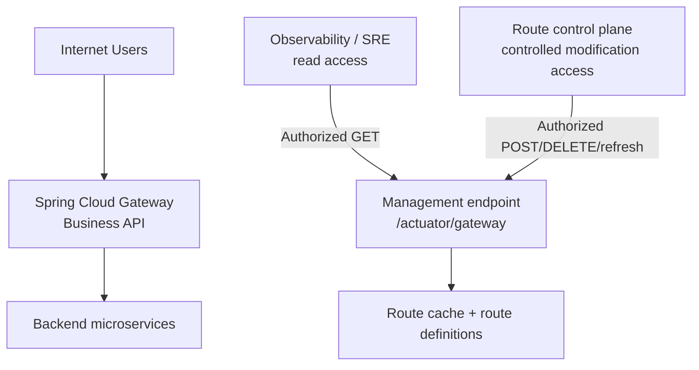
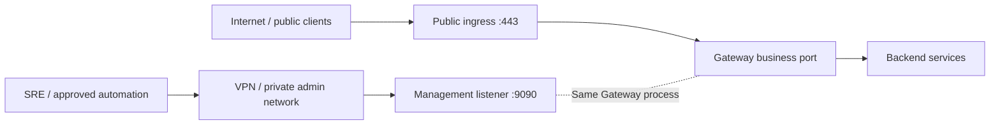
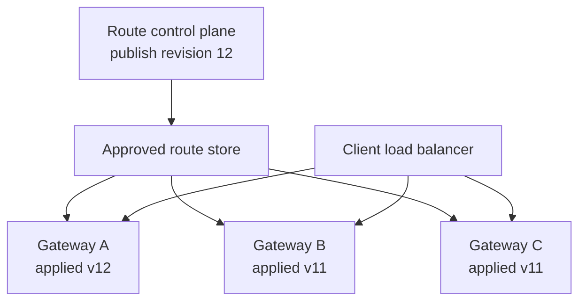
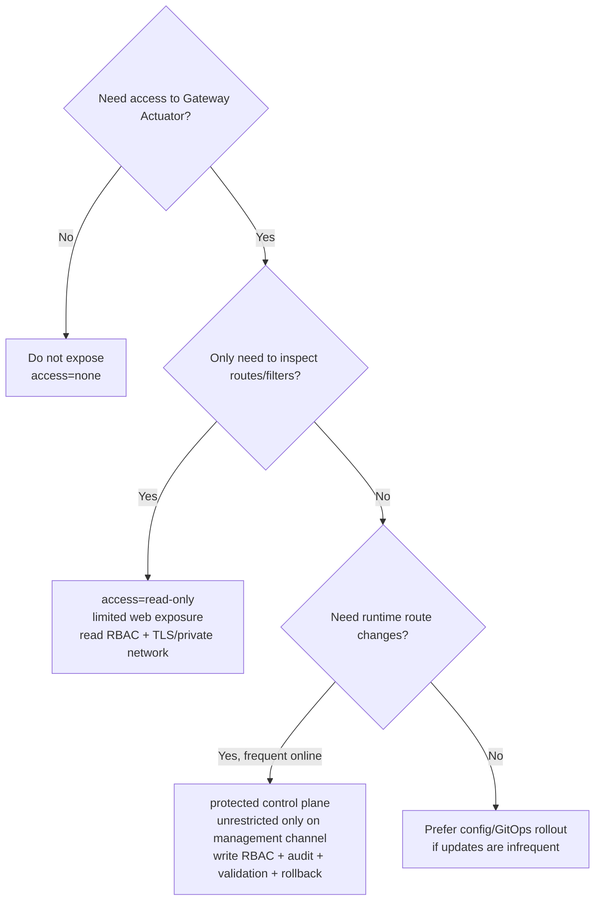

# Distinguishing Exposure, Read Access, and Route Modification Permissions

## Lesson Objectives

In the **Actuator Management** chapter, this lesson focuses on a dangerous misconception when operating **Spring Cloud Gateway Server WebFlux**: **exposing an endpoint**, **allowing read operations**, and **granting route modification permissions** are **three different decisions**. Enabling `/actuator/gateway` should never mean every client can inspect all internal routes, let alone create, delete, or refresh routes.

After this lesson, you will be able to:

- Explain the differences among **endpoint availability/access**, **web exposure**, **authentication**, **authorization**, and **HTTP method**.
- Configure the Gateway Actuator in **`read-only`** mode to observe routes without allowing route modification operations.
- Recognize the impact of **`unrestricted`** and legacy `enabled` configuration; understand why they must never be used on public management APIs.
- Use read endpoints such as `GET /actuator/gateway/routes`, `routedefinitions`, `globalfilters`, `routefilters`, and `routes/{id}`.
- Understand write endpoints such as `POST /actuator/gateway/routes/{id}`, `DELETE /actuator/gateway/routes/{id}`, and `POST /actuator/gateway/refresh`.
- Design a dedicated management network, TLS, Spring Security WebFlux, RBAC/scopes, CSRF policy, and auditing following the **least privilege** principle.
- Distinguish cache refresh from updating route sources and synchronizing **multiple Gateway replicas**.
- Test unauthorized users, read-only accounts, and route-modifying administrators without expanding privileges beyond intent.

> **Scope:** Spring Cloud Gateway **Server WebFlux**, Spring Boot Actuator, and **reactive** Spring Security (`SecurityWebFilterChain`, `ServerHttpSecurity`). Do not treat Servlet/MVC `HttpSecurity` as an equivalent API. Property names and availability may change across Spring Boot/Spring Cloud Gateway lines; always cross-check the actual dependency versions. This content is STEP 4 technical guidance, not STEP 6 Content QA output.

## 1. Why Must `/actuator/gateway` Be Treated as a Sensitive Asset?

An API Gateway is the entry point for multiple microservices, responsible for:

```text
Client → TLS → Authentication → Route predicate
       → GatewayFilter chain (header/path, rate, retry, circuit breaker)
       → Service discovery/load balancing → Backend
```

A route contains far more than a target address:

```yaml
id: orders-api
uri: lb://order-service
predicates:
  - Path=/api/orders/**
filters:
  - StripPrefix=1
order: -10
```

If an administrator can view route definitions, they learn parts of the internal architecture: service IDs, paths, routing priority, and active filters. If they can also **modify routes**, they can change `uri`, alter `Path`, remove a filter, or override priority order—directly affecting API traffic and security boundaries.



The business-user access path and the management path in the diagram **should never share the same security policy**. Even inside the same JVM, they may require separate network segmentation, accounts, scopes, and monitoring.

**Typical risks:**

- Exposing internal service names or URIs through route listings.
- Creating a wildcard `Path=/**` route to hijack traffic from valid routes.
- Pointing `uri` to an untrusted destination, causing **SSRF** or exfiltrating data through another server.
- Removing or replacing security, CORS, rate-limiting, and header filters.
- Calling `refresh` during peak traffic to activate unapproved changes.
- Applying a change on one replica, leaving the Gateway cluster with divergent route versions.

Even so, **exposing GET for observation** and **granting runtime control privileges** are two distinct needs. The default principle should be: **do not expose if unnecessary; if needed, prefer read-only; if writes are needed, build a much stronger protected management surface**.

## 2. Three Independent Decision Layers

To understand Actuator, separate three questions:

1. **Is the endpoint provided and exposed over HTTP/JMX?** This is the **availability/access + exposure** configuration group.
2. **Which operations does the framework allow?** Read operations only, or also create/delete/refresh operations.
3. **Who is authorized to invoke each operation?** This is **authentication/authorization** enforced by the security layer and management infrastructure.

| Layer | Question | Illustrative Mechanism |
| --- | --- | --- |
| Availability/access | Are Gateway actuator operations available? | `management.endpoint.gateway.access` |
| Web exposure | Is the endpoint published over HTTP? | `management.endpoints.web.exposure.include` |
| Web path/network | Where is the HTTP listener, and who can connect? | `management.server.port`, firewall, ingress, Kubernetes NetworkPolicy |
| Authentication | Has the caller proved their identity? | mTLS, OAuth2/JWT, identity-aware proxy |
| Authorization | Is that identity allowed GET or POST/DELETE? | `SecurityWebFilterChain`, roles/scopes, control-plane policy |
| Audit/approval | Who requested the route change, who approved it, and which revision? | Configuration management, GitOps, or control plane |

**`management.endpoints.web.exposure.include=gateway` grants neither identity nor write permissions to any user.** It merely makes the endpoint reachable via web **when other availability conditions permit**. If Spring Security/web policy blocks it, the request is still rejected.

Conversely, simply configuring Spring Security `hasRole("OPS")` **does not make an endpoint appear** if Actuator has not exposed it or permitted access.

### 2.1. A Mental Check

Evaluate this request:

```http
POST /actuator/gateway/refresh HTTP/1.1
Host: management.internal.example
Authorization: Bearer <operator-token>
```

For this operation to succeed, all of the following must hold simultaneously:

- Gateway actuator and its corresponding **write operation** are provided by the framework.
- The endpoint is exposed over the appropriate HTTP path.
- The client can connect to the management listener through TLS/network policy.
- The token is authenticated and carries an authority suitable for the refresh action.
- CSRF (if enabled in the security chain) and any additional policies are satisfied.

If any layer fails, the operation can fail. Never diagnose the cause from a single HTTP status code without checking the effective configuration.

## 3. `management.endpoint.gateway.access` Differs from `web.exposure.include`

In Spring Boot/Cloud Gateway lines supporting **Actuator access levels**, the property:

```properties
management.endpoint.gateway.access=read-only
```

restricts Gateway actuator operations to read level. Meanwhile:

```properties
management.endpoints.web.exposure.include=gateway
```

allows the `gateway` endpoint to appear over HTTP.

The two properties address **two separate axes**.

### 3.1. `access` Levels

| Value | General Spring Boot Actuator Meaning | With Gateway Actuator |
| --- | --- | --- |
| `none` | Disallows operations on the endpoint | Gateway actuator is unavailable through this mechanism |
| `read-only` | Allows read operations only | Inspect routes/filters; forbids route create/delete/refresh via actuator |
| `unrestricted` | Allows both read and write operations provided by the endpoint | Allows route creation, deletion, and refresh when access/security conditions are also met |

Even `unrestricted` **does not mean** “anyone on the Internet is permitted”. Authorization and network access must still be implemented. Yet a publicly exposed `unrestricted` endpoint lacking security is a **severe administrative vulnerability**.

### 3.2. HTTP Exposure, JMX Exposure, and Access Level

Spring Boot Actuator separates exposure over web and JMX:

```properties
management.endpoints.web.exposure.include=health,info,gateway
management.endpoints.jmx.exposure.include=health
```

If operations only need Gateway actuator over HTTP, there is no reason to expose it over JMX. Conversely, disabling HTTP exposure does not automatically prove another JMX management channel is disabled.

Spring Boot also provides **application-wide** access settings such as:

```properties
management.endpoints.access.default=none
management.endpoints.access.max-permitted=read-only
```

In supported versions, `max-permitted` can enforce a **global access ceiling**. If `max-permitted` is `read-only`, even an endpoint individually configured as `unrestricted` cannot exceed that cap. These properties affect **multiple endpoints**, so verify that `health`, `info`, `prometheus`, or other needed endpoints remain available as intended.

### 3.3. Confusion with `enabled` in Legacy Documentation

Many older Spring Cloud Gateway examples use:

```properties
management.endpoint.gateway.enabled=true
management.endpoints.web.exposure.include=gateway
```

Actuator API documentation for newer lines recommends **`management.endpoint.gateway.access=read-only`**, while noting that `enabled=true` may open create/delete/refresh capabilities akin to `unrestricted` depending on version.

Therefore:

- **Do not copy `enabled=true` from old documentation** and assume it means “allow GET but forbid POST”.
- Do not mix `enabled=true`, `access=read-only`, and external environment overrides without verifying the effective resolved value.
- On older Spring Boot/Gateway versions lacking the access-level API, study **network/security protections** and actual actuator behavior; do not assume support for the new property.

**Mandatory verification test:** when configured as `read-only`, an authenticated read-only account must succeed with GET routes **yet fail to execute POST refresh/POST route/DELETE route**.

## 4. Preferred Safe Configuration: Read-Only Gateway Actuator

Illustrative `application.yml` example on a Spring Boot/Cloud Gateway line **supporting access-level**:

```yaml
management:
  server:
    port: 9090
  endpoints:
    web:
      exposure:
        include: "health,info,gateway"
    jmx:
      exposure:
        include: "health"
  endpoint:
    gateway:
      access: read-only
```

Meaning:

- The management HTTP listener uses port `9090` when the framework and deployment model support a separate port.
- Only selected Actuator endpoints are exposed over web.
- Gateway actuator is permitted to **read**, not to perform route modifications.
- JMX is not configured to expose `gateway` in this example.

This is **not yet a complete production configuration**: network policy, TLS on the management hop, authentication, authorization, and auditing are still missing. A separate management port **does not automatically make it a private network**; if a Kubernetes Service/Ingress or firewall still exposes `9090` publicly, the endpoint remains unexpectedly reachable.

### 4.1. Expose Only Health When Route Inspection Is Unneeded

If operational tools do not need to view runtime routes:

```yaml
management:
  endpoints:
    web:
      exposure:
        include: "health"
  endpoint:
    gateway:
      access: none
```

This shrinks the attack surface. If health/readiness status is needed, use a health endpoint with sensitive details restricted rather than opening `/actuator/gateway` just to see if the process is alive.

### 4.2. Never Use `"*"` Out of Habit

A configuration prone to over-exposing information:

```yaml
management:
  endpoints:
    web:
      exposure:
        include: "*"
```

`"*"` tells Actuator to consider exposing a broad set of endpoints over HTTP; in YAML `*` must be quoted. Endpoints like `env`, `beans`, `configprops`, `loggers`, `heapdump`, or route management carry distinct risks. Never turn them on just to test `gateway/routes`.

**Minimal principle:** expose via an exact allowlist, check `exclude` if present, and verify effective endpoint availability/access.

## 5. Read Access: Observe Routes, Do Not Control Routes

With `read-only` and appropriate network/security conditions, Gateway actuator permits **observation** operations:

| Path Relative to `/actuator/gateway` | Method | Purpose |
| --- | --- | --- |
| `/` | GET | Lists features/subpaths published by the actuator |
| `/routes` | GET | Views routes currently recognized by the Gateway |
| `/routes/{id}` | GET | Views a route by ID |
| `/routedefinitions` | GET | Views route definition data per supported interface |
| `/globalfilters` | GET | Views global filters and their corresponding order values |
| `/routefilters` | GET | Views registered GatewayFilter factories |
| `/routepredicates` | GET | Views route predicate factories |
| `/routes/{id}/combinedfilters` | GET | Views combined filters for a route in supported versions |

**Note:** exact subpaths and response formats can vary across versions. Enable/read only what is needed; do not treat this illustrative list as a guarantee that every release supports every subpath.

### 5.1. Viewing Routes

An illustrative request in an **authenticated management environment**:

```bash
curl -i \
  "https://management.internal.example/actuator/gateway/routes" \
  -H "Authorization: Bearer <read-only-management-token>"
```

Illustrative response:

```json
[
  {
    "route_id": "orders-read",
    "predicate": "Paths: [/api/orders/**]",
    "filters": [
      "[[StripPrefix parts = 1], order = 1]"
    ],
    "uri": "lb://order-service",
    "order": -10
  }
]
```

This is **example JSON to illustrate structure**, not an immutable serialization format. Spring Cloud Gateway has a **verbose** display mode rendering predicates/filters as descriptive strings. Class names, order numbers, JSON formatting, and the verbose toggle property can differ across releases.

### 5.2. Viewing a Single Route

```bash
curl -i \
  "https://management.internal.example/actuator/gateway/routes/orders-read" \
  -H "Authorization: Bearer <read-only-management-token>"
```

Verify:

1. `route_id` matches policy.
2. `predicate` has `Path`, `Method`, and `Host` per contract.
3. The URI is a logical `lb://` service name or an approved backend.
4. The filter chain includes expected components (`StripPrefix`, rate limiter, `CircuitBreaker`, etc.).
5. `order` does not let another wildcard route match earlier.

**Being able to read a route does not prove the route works properly.** You still need HTTP integration tests, traces, backend verification, service discovery status, and load balancing checks.

### 5.3. `GET /routefilters` Does Not Tell Which Filters Run on Every Request

`routefilters` generally lists **available GatewayFilter factories** in the context. It does not by itself answer which factories are applied to a given request; inspect the route and combined filters when needed. Do not interpret a factory appearing in the catalog as meaning every route uses it.

Similarly, `globalfilters` shows a set of global filters with orders, whereas Spring Security WebFlux `WebFilter` instances sit in a **different** processing layer, outside the usual Gateway `GlobalFilter` list. Inspect access policies/security chains separately.

### 5.4. Read Format Is Not the Write Payload

`GET /actuator/gateway/routes/{id}` may return:

```json
{
  "route_id": "orders-read",
  "predicate": "Paths: [/api/orders/**]",
  "filters": ["[[StripPrefix parts = 1], order = 1]"],
  "uri": "lb://order-service",
  "order": -10
}
```

Meanwhile, the **create route** endpoint usually expects **shortcut DSL strings** such as `Path=/api/orders/**` and `StripPrefix=1`, not the descriptive strings rendered by GET. Never copy-paste a GET body directly into POST to update a route.

### 5.5. `read-only` Still Requires Information Security

A read-only caller can see:

- Internal service names and URIs.
- Product-relevant or administrative route paths.
- Filter names and execution order.
- Route configurations that may reveal how the system handles authentication/rate limits/headers.

Restrict read permissions to the right SRE/observability group, enforce TLS, limit actuator response logging, audit query activity when appropriate, and never paste full route JSON into unapproved tickets/chat tools.

## 6. Route Modification Permissions: Create, Delete, and Refresh

If runtime route changes through Actuator are truly required, the access configuration might look like:

```yaml
management:
  endpoint:
    gateway:
      access: unrestricted
  endpoints:
    web:
      exposure:
        include: "gateway"
```

**This configuration is illustrative to explain functionality, not a complete secure production configuration.** Consider it only on a **tightly restricted management interface**, with RBAC, auditing, reviews, route-content validation, and rollback procedures. Never leave an `unrestricted` endpoint freely reachable over the Internet.

### 6.1. Common Mutation Operations

| Endpoint | Method | Behavior |
| --- | --- | --- |
| `/actuator/gateway/routes/{id}` | POST | Creates a new route definition from the accepted JSON |
| `/actuator/gateway/routes/{id}` | DELETE | Deletes an actuator-managed route definition, per version support |
| `/actuator/gateway/refresh` | POST | Requests refreshing/clearing the route cache to apply the current route source |
| `/actuator/gateway/routes` | POST | Some versions support creating multiple definitions in a single request |

**Do not confuse `POST /refresh` with `POST /routes/{id}`:** one triggers reloading the runtime route set; the other modifies the actuator-managed route definition store.

### 6.2. Creating a Route in an Isolated Test Environment

Example **not to be run on a production Gateway**. Once the control plane validates the URI, path, filters, and caller write authority, the body may look like:

```json
{
  "uri": "lb://docs-service",
  "predicates": [
    "Path=/api/docs/**",
    "Method=GET"
  ],
  "filters": [
    "StripPrefix=1"
  ],
  "order": 0
}
```

Current Actuator API documentation notes that `POST /actuator/gateway/routes/{id}` uses **shortcut DSL strings** for predicates/filters. The route ID goes in `{id}` in the URL. Match the exact version's JSON schema; verbose GET output **differs** from the POST payload.

Illustrative command, strictly on a protected **management test listener**:

```bash
curl -i -X POST \
  "https://management.test.internal/actuator/gateway/routes/docs-read" \
  -H "Authorization: Bearer <authorized-write-token>" \
  -H "Content-Type: application/json" \
  --data '{
    "uri": "lb://docs-service",
    "predicates": ["Path=/api/docs/**", "Method=GET"],
    "filters": ["StripPrefix=1"],
    "order": 0
  }'
```

In supported Gateway versions, a successful call may return **201 Created**. However, **201 only confirms definition creation**—it does not sufficiently prove requests to `/api/docs/**` are properly routed at Gateway runtime.

> Placeholder tokens are used in examples; in real operations never paste bearer tokens into tickets, shell history, logs, or screen shares. Use organization-approved secret injection or CLI credential stores.

### 6.3. Refreshing the Route Cache Is a Mutating Operation

After creating/deleting a definition, a commonly required call is:

```bash
curl -i -X POST \
  "https://management.test.internal/actuator/gateway/refresh" \
  -H "Authorization: Bearer <authorized-write-token>"
```

In Gateway Server WebFlux documentation, refresh may return **200 with an empty body**, yet route/cache reloading has asynchronous aspects. **An HTTP 200 from refresh does not prove every route is valid or every Gateway replica has updated.**

You must:

1. Read back runtime routes on the refreshed replica itself.
2. Send an HTTP test request through the Gateway to the route.
3. Compare route/filter/predicate/URI against the expected revision.
4. Check all other replicas when multiple instances exist.
5. Monitor 404/502/503 rates, route matching, security, and latency after the change.

### 6.4. Refreshing by Metadata Where Supported

Some Gateway lines support scoped route cache refresh via metadata:

```http
POST /actuator/gateway/refresh?metadata=group:group-1
```

This helps when refreshing only a group of routes carrying matching metadata, though you must verify exact version semantics and never assume a local refresh synchronized other Gateway replicas. Never feed unverified client-supplied metadata into refresh targeting.

### 6.5. Do Not Confuse Actuator Write Access with Permission to Edit Every Route

In modern Gateway Actuator API documentation, route management operations via the endpoint only edit/delete routes **created via the corresponding actuator mechanism**; routes defined in `application.yml` or Java `@Bean` definitions are typically **read-only from the actuator writer's perspective**.

For example:

```text
Route orders-read declared in application.yml
    → GET /actuator/gateway/routes/orders-read: viewable
    → DELETE /actuator/gateway/routes/orders-read:
      does not automatically delete the config route; may return 404
```

Thus **`unrestricted` grants permission to call the operation**, not a guarantee that every route source supports mutation. To update static routes, the proper workflow is typically GitOps/config rollout or a control plane designed for that source.

### 6.6. Beware of POSTing the Same Route ID

Modern Gateway Actuator API documentation warns that **re-POSTing an existing route ID** can create duplicate definitions and cause certain GET route operations to return 500 errors on affected versions. The documented procedure for editing an actuator-managed route is:

```text
DELETE old route
→ POST new route definition
→ POST refresh
```

However, this is **not an atomic transaction** and can create a brief window with a missing route or drift across replicas. For critical systems, maintain a **versioned control plane with approval, validation, and rollback** rather than running unguarded manual commands.

## 7. Matrix Distinguishing Exposure, Access, and Authorization

Suppose:

- **Observer** holds scope `gateway.routes.read`.
- **Operator** additionally holds scope `gateway.routes.write`.
- **Anonymous** is unauthenticated.
- The management endpoint has TLS, network restrictions, and Spring Security.

| Endpoint Exposed? | Access Level | Caller | GET routes | POST refresh / DELETE |
| --- | --- | --- | --- | --- |
| No | Any | Any | Unavailable via web | Unavailable via web |
| Yes | `none` | Any | Unavailable | Unavailable |
| Yes | `read-only` | Anonymous | Denied by security | No write operation |
| Yes | `read-only` | Observer | **Read allowed** if authorized | **No write operation**, even if observer tries |
| Yes | `read-only` | Operator | Readable if granted | No actuator writes, even with admin role |
| Yes | `unrestricted` | Anonymous | Security must deny | Security must deny |
| Yes | `unrestricted` | Observer | Readable | **Security must deny writes** |
| Yes | `unrestricted` | Operator | Readable | Writes allowed only when RBAC and validation both pass |

Specific responses may be 401, 403, 404, or 405 depending on the handling layer and version. Verify **final behavior** (cannot create/delete/refresh) instead of forcing every case to return one identical status code.

### 7.1. Endpoint Access Is Not Application Authorization

`management.endpoint.gateway.access=read-only` operates at **operation availability**. It has no awareness of organizational roles such as:

```text
SRE_VIEWER
ROUTE_EDITOR
SECURITY_APPROVER
```

Roles/scopes belong to Spring Security, the identity provider, or the control plane. Likewise, `unrestricted` does not authenticate callers by itself. Enabling `unrestricted` without security is akin to **publishing route control operations with no authorization boundary**.

### 7.2. Separating by HTTP Method Is Only One Layer

An operations team may define rules:

```text
GET  /actuator/gateway/**     → read scope
POST /actuator/gateway/**     → write scope
DELETE /actuator/gateway/**   → write scope
```

This illustrates **RBAC**, not a substitute for `management.endpoint.gateway.access`. A secure read-only configuration can **avoid registering POST operations at all**; that is stronger defense in depth than registering the operation and relying solely on a security rule to block it.

## 8. Spring Security WebFlux: Locking Down the Management Endpoint

In Spring Cloud Gateway **Server WebFlux**, use `SecurityWebFilterChain`, not Servlet `SecurityFilterChain`/`HttpSecurity`. A route-level `GatewayFilter` normally runs **after** the WebFlux security layer and is not the right way to protect Actuator endpoints, because `/actuator/gateway` is served by an actuator handler rather than necessarily passing through the Gateway route filtering chain.

### 8.1. Example: Protecting Gateway Actuator with a Read JWT Scope

**Spring Boot 3.x WebFlux API** example (adjust imports if using Boot 4.x):

```java
import org.springframework.boot.actuate.autoconfigure.security.reactive.EndpointRequest;
import org.springframework.context.annotation.Bean;
import org.springframework.context.annotation.Configuration;
import org.springframework.core.annotation.Order;
import org.springframework.security.config.Customizer;
import org.springframework.security.config.web.server.ServerHttpSecurity;
import org.springframework.security.web.server.SecurityWebFilterChain;

@Configuration
class GatewayActuatorSecurityConfiguration {

    @Bean
    @Order(0)
    SecurityWebFilterChain actuatorReadSecurity(ServerHttpSecurity http) {
        return http
            .securityMatcher(EndpointRequest.to("gateway"))
            .authorizeExchange(exchanges -> exchanges
                .anyExchange()
                .hasAuthority("SCOPE_gateway.routes.read")
            )
            .oauth2ResourceServer(oauth2 -> oauth2
                .jwt(Customizer.withDefaults())
            )
            .build();
    }

    @Bean
    @Order(1)
    SecurityWebFilterChain businessApiSecurity(ServerHttpSecurity http) {
        return http
            .authorizeExchange(exchanges -> exchanges
                .pathMatchers("/actuator/health").permitAll()
                .anyExchange().authenticated()
            )
            .oauth2ResourceServer(oauth2 -> oauth2
                .jwt(Customizer.withDefaults())
            )
            .build();
    }
}
```

Explanation:

- `EndpointRequest.to("gateway")` lets the matcher recognize the Gateway actuator endpoint according to the configured management base path in supported versions.
- `@Order(0)` ensures the dedicated security chain is evaluated ahead of broader chains.
- `.hasAuthority("SCOPE_gateway.routes.read")` assumes the JWT converter builds an authority from the `gateway.routes.read` scope. Verify how your identity provider and JWT converter map claims.
- The second chain is a **fallback example for the business API**, preventing a situation where defining an Actuator-only chain leaves other paths unprotected.
- JWT issuer, JWK trust, audience/scope validation, TLS, and routing to the management port must be configured separately.

This snippet is **not a complete production configuration on its own**. If Actuator runs in a separate management web context/port, verify that security chains actually apply to that listener. Never assume the management port is secured simply because the class exists in the project; test requests directly against the management port.

In newer Boot releases, packages for `EndpointRequest` or security auto-configurations may change. Consult docs/javadoc for your **exact project version** and verify compilation; never mix WebFlux and Servlet imports.

### 8.2. Why the Code Above Is Not “Write RBAC”

The code in Section 8.1 was written for **read-only management access**. If you change:

```yaml
management:
  endpoint:
    gateway:
      access: unrestricted
```

while keeping `.anyExchange().hasAuthority("SCOPE_gateway.routes.read")`, then **a holder of the read scope could be permitted by Security to send POST/DELETE**, unless another method rule blocks them. That is a severe privilege-escalation misconfiguration.

**Never use a single blanket read rule across all HTTP methods when write operations are enabled.**

### 8.3. Authorizing GET Differently from POST/DELETE

An illustrative approach if write operations must be enabled:

```java
import org.springframework.http.HttpMethod;

@Bean
@Order(0)
SecurityWebFilterChain actuatorWriteSecurity(ServerHttpSecurity http) {
    return http
        .securityMatcher(EndpointRequest.to("gateway"))
        .authorizeExchange(exchanges -> exchanges
            .pathMatchers(HttpMethod.GET, "/actuator/gateway/**")
                .hasAuthority("SCOPE_gateway.routes.read")
            .pathMatchers(HttpMethod.POST, "/actuator/gateway/**")
                .hasAuthority("SCOPE_gateway.routes.write")
            .pathMatchers(HttpMethod.DELETE, "/actuator/gateway/**")
                .hasAuthority("SCOPE_gateway.routes.write")
            .anyExchange().denyAll()
        )
        .oauth2ResourceServer(oauth2 -> oauth2
            .jwt(Customizer.withDefaults())
        )
        .build();
}
```

This is an **alternative variant** to the `actuatorReadSecurity` bean—do not declare both chains at `@Order(0)` with overlapping matchers. This pattern:

- Assumes the Actuator base path `/actuator` and Gateway endpoint `/gateway`.
- Uses separate scopes for **read** and **write**; a write-authorized operator may need **both scopes**.
- Disallows `PUT`, `PATCH`, or other methods by default.
- Still requires `management.endpoint.gateway.access=unrestricted` on supported releases.
- Still requires TLS, identity management, network segmentation, and policy validation.

**Do not blindly modify this template to disable CSRF across the entire Gateway.** If the management writer only accepts bearer tokens in the `Authorization` header with no browser-managed cookies/credentials, disabling CSRF **only on the management security chain** may be considered after threat modeling. If browser-based management uses session cookies, **keep/design proper CSRF protection** for POST/DELETE operations. CORS does not replace CSRF.

### 8.4. Never Trust Client-Supplied `X-User` or `X-Admin` Headers

A reverse proxy or API Gateway may inject identity headers for backends, but Actuator management **must never** treat Internet client-supplied headers such as:

```http
X-Admin: true
X-Operator-Role: ROUTE_EDITOR
```

as proof of route modification authority. Management identity must come from mTLS, verified JWT/OAuth2, or a **trusted** identity-aware proxy with clear network boundaries and header sanitization.

## 9. Network Isolation Is Just as Important as RBAC

A recommended architecture:



Common safeguards:

1. **Never route `/actuator/gateway/**` through public ingress**.
2. Use a dedicated **management port** and internal Service/Ingress where needed.
3. Use firewalls, VPCs, Kubernetes NetworkPolicy, or service mesh policies so only authorized admin hosts/processes can connect.
4. Enforce **TLS with certificate verification**, considering mTLS for sensitive control channels.
5. Use **identity-based authorization** and dedicated service accounts for automation.
6. Apply rate/connection limits on the management listener and monitor anomalous requests.
7. Never publish management URLs/credentials into client bundles, static JavaScript, or public logs.

### 9.1. `management.server.port` Does Not Automatically Mean Network Isolation

For example:

```yaml
management:
  server:
    port: 9090
```

only separates the HTTP listener in runtime configuration. If a Kubernetes Service exposes both 8080 and 9090, or a firewall opens 9090 everywhere, the management endpoint **remains externally reachable**.

Consider binding a private management address via `management.server.address` when appropriate, but verify container/pod networking: binding `127.0.0.1` can block sidecars, Prometheus, or management from other pods, while binding `0.0.0.0` requires strict network policies.

### 9.2. Blocking at Ingress Is Not Enough If Bypass Paths Exist

If public ingress blocks `/actuator/**` while a NodePort, `hostNetwork`, public pod IP, unprotected private load balancer, or another proxy routes directly to the management port, security can be bypassed. Test **every real network path**.

Conversely, strong in-app security configuration does not replace network isolation; a future vulnerability in Actuator/Gateway could undermine the intended authentication layer. Defense in depth limits blast radius.

## 10. Why Must Write Access Be Treated Like Deployment Privilege?

Allowing runtime route edits is nearly equivalent to granting control over the **application traffic map**.

### 10.1. Route Hijacking via Path and Order

Example of a dangerous route:

```json
{
  "uri": "http://unapproved.example",
  "predicates": ["Path=/**"],
  "filters": ["StripPrefix=0"],
  "order": -100
}
```

If published unchecked, a route with a broad predicate and high-priority order can match requests ahead of valid routes, diverting traffic to the wrong destination. **This example illustrates risk identification—never execute it as a real operational action.**

A control plane must validate route ID, path ownership, host predicate, method, priority, and potential **route shadowing** before publishing.

### 10.2. SSRF and Backend Identity

URIs such as:

```text
http://127.0.0.1:...
http://169.254.169.254/...
http://an-internal-control-service/...
```

must never be accepted merely because URI parsing succeeds. The Gateway sits inside the internal network and can reach destinations inaccessible to Internet clients.

Enforce:

- Allowlists of schemes, logical service IDs, hosts/ports, or service registry IDs.
- Policies mitigating DNS rebinding, redirects, and internal/metadata address ranges across trust boundaries.
- Destination HTTPS verification, hostname/SNI/certificate checks, and outbound authorization.
- Checks preventing route loops back into the Gateway or management listener.

Never treat every route sharing the **`lb://` prefix** as implicitly permitted: an internal service ID might never be meant for public exposure.

### 10.3. Filters Can Alter Security Posture

Anyone able to create routes can also pick filters:

```text
RemoveRequestHeader
SetRequestHeader
RewritePath
ModifyRequestBody
RequestRateLimiter
Retry
CircuitBreaker
```

A new route can strip authentication headers, overwrite identity headers, rewrite paths, open CORS, or omit a rate limiter protecting a service. Therefore, validate not just `uri`; allowlist **filter factories and arguments**, block disallowed combinations, and test actual effective permissions.

### 10.4. Historical Vulnerabilities Justify Patching and Limiting Exposure

Spring has published security advisories concerning the **Spring Cloud Gateway Server WebFlux Actuator endpoint** when exposed/unprotected in affected versions, including issues where routes could be abused to access data or alter state unexpectedly.

You do not need to memorize a specific CVE ID to make sound architectural choices: **if actuator write permissions are unnecessary, do not enable them; if needed, restrict the network, enforce strong auth, validate privileges, apply patches, and maintain audit/rollback**. Check advisories and fixes against your exact running dependencies.

## 11. Refresh Is Not Cluster-Wide Route Synchronization

Suppose:

```text
Gateway A: route revision 12
Gateway B: route revision 11
Gateway C: route revision 11
```

An operator sends:

```http
POST /actuator/gateway/refresh
```

to **Gateway A** via a load balancer. This does not automatically trigger refresh events on B and C. With in-memory/local state or per-JVM route caches, replicas can continue serving different revisions.



**The refresh endpoint is not a distributed transaction.** You need a control plane, broadcast/reconciliation mechanism, or config rollout ensuring every replica reaches the right revision, paired with telemetry and readback.

### 11.1. Route Source Determines Mutability

| Route Source | Observable via Actuator | Directly Editable via Actuator Writer? |
| --- | --- | --- |
| `application.yml` | Usually readable via GET runtime routes | Usually cannot be edited/deleted directly via Actuator |
| Java `@Bean` RouteLocator | Usually readable via GET runtime routes | Does not automatically become a mutable definition |
| In-memory actuator-managed definitions | Readable via GET after create/refresh | Can be POSTed/DELETEd per implementation and access |
| Custom `RouteDefinitionRepository` | Appears once the locator loads | Depends on writer/repository, security, and API |
| Externalized config (Git/Config Server) | Readable via GET once applied by Gateway | Refreshing Gateway cache does not edit Git/environment |
| Discovery locator | Can generate routes from the registry | Registry updates are not Actuator CRUD |

If the goal is merely changing **backend instances** for `lb://order-service`, normally rely on **service discovery/load balancing**. Do not grant Actuator write access just to swap pod IPs.

### 11.2. Confirming Applied Version

For systems requiring dynamic route sources, track:

```text
desiredRevision = 43
appliedRevision.gateway-a = 43
appliedRevision.gateway-b = 43
appliedRevision.gateway-c = 43
```

This is **application/control-plane metadata you design**, not a built-in field on every Actuator Gateway response. You can use a canonicalized RouteSet hash, version number, or custom ETag contract to detect drift.

Declare a change successful only when HTTP probes and metrics verify route behavior—not merely when the management API returns 200.

## 12. Safe Route Change Release Workflow

Instead of letting operators type raw POST routes into production, prefer a workflow:

```text
Draft route change
  ↓
Schema validation
  ↓
Security/policy validation
  ↓
Peer review / approval
  ↓
Persist immutable revision
  ↓
Publish to approved route store
  ↓
Refresh/reconcile Gateway replicas
  ↓
Verify routes + HTTP behavior
  ↓
Promote / Rollback
```

### 12.1. Pre-Publish Checks

1. Requester holds permission to **modify that route namespace**, not just general management login.
2. URI belongs to an approved list of services/hosts/ports and creates no SSRF/loop.
3. Path, Host, Method, and `order` do not shadow critical routes.
4. Filters do not strip or weaken authentication, authorization, CORS, rate limiting, or CSRF.
5. `Retry` is not applied to non-idempotent POSTs; `CircuitBreaker` fallbacks do not fake business success.
6. Inbound/outbound TLS and certificates remain compatible with the new endpoint.
7. Integration tests/smoke tests/rollback procedures exist for the new route.

### 12.2. Post-Refresh Verification

- `GET /actuator/gateway/routes` and `GET /routes/{id}` return the expected route.
- Real requests match expected `Path`/`Method`/`Host`.
- Backend stubs or traces verify rewritten paths/headers/URIs.
- Spring Security still rejects requests lacking JWT/role/scope.
- Rate limiter, CircuitBreaker, Retry, and CORS behave properly.
- All Gateway replicas converge on the target revision.
- 404, 401/403, 429, 5xx rates, and p95/p99 latency show no unexpected spikes.

### 12.3. Rollback

If a new route is unsafe or breaks traffic:

1. Halt publishing subsequent revisions.
2. Republish the last verified revision or roll back the deploy/config.
3. Refresh/reconcile the affected replicas.
4. Verify runtime routes and HTTP behavior on every replica.
5. Record an audit entry detailing root cause, blast radius, and rollback approver.

Never assume a single successful `DELETE` completes rollback, especially with in-flight requests and multiple replicas holding distinct route caches.

## 13. Diagnosing Exposure, Read, and Write Errors

| Symptom | Possible Causes | Diagnostic Steps |
| --- | --- | --- |
| `GET /actuator/gateway/routes` → 404 | Gateway endpoint not available/exposed, wrong base path/port, or missing handler | Check dependencies, `access`, web exposure, management port/base path |
| GET → 401 | Unauthenticated or invalid bearer token | Check JWT issuer/audience, authentication entry point, proxy/mTLS |
| GET → 403 | Authenticated but missing scope/role or blocked by another policy | Check `SecurityWebFilterChain`, authority mapping, RBAC |
| GET works, POST refresh fails | `read-only` mode or security denies writes | Check access level, HTTP method, scopes, CSRF, JMX/web exposure |
| POST route → 401/403 | Caller lacks write permission, CSRF policy, wrong security match | Check read/write scopes, cookie vs bearer, WebFilterChain |
| POST route → 201 but route does not match | Not refreshed yet, stale route cache, or wrong target/predicate | Call POST refresh, readback runtime state, run HTTP probe |
| DELETE static route → 404 | Route defined in YAML/Java DSL, outside actuator-managed writer | Distinguish route source/writer; use config rollout |
| GET routes → 500 after writing duplicate ID | Duplicate route definitions or build/serialization error | Inspect IDs and Gateway version, roll back new route |
| Only pod A sees the new route | Local-only refresh / missing reconciliation | Readback per pod, check desired vs applied version |
| Browser reports CORS when calling management | CORS disallowed or security preflight blocked | Never open public CORS; manage over private network/CLI |
| Operator sees 200 change yet traffic fails | Route order/shadowing, filter rewrite, unhealthy backend | End-to-end tests, traces, metrics, rollback |

### 13.1. 404 Does Not Always Mean Missing Route

If the actuator is unexposed, requests to `/actuator/gateway/routes` can return 404 directly from the server. If the actuator exists but the caller lacks permission, it may return 401/403. If the requested route ID is absent, `GET /routes/{id}` may return a different error depending on implementation.

Therefore:

```text
HTTP 404 from Actuator management path
    ≠ HTTP 404 from route/business API
    ≠ definitive proof that user lacks permission
```

Pinpoint errors by **host + port + path + method + security chain + handler**.

### 13.2. 405 May Stem from Access Mode or Method

When a write operation is unavailable in `read-only` mode, the result is not necessarily `403`: depending on actuator/framework and actual mappings, the operation may be unregistered or the method rejected, producing 404/405. The key test is that the request **causes no route changes**, rather than expecting one rigid status code.

### 13.3. CSRF Causing 403 on POST

In Spring Security WebFlux, if the management chain uses **session cookies** and CSRF protection is enabled, a POST/DELETE request missing a token can return 403 even for an admin. This protection is essential for browser cookies.

For automation relying solely on a **bearer header**, the threat model differs; CSRF may be configured specifically for a non-browser management chain if appropriate. Never “fix” it by disabling CSRF across the entire Gateway without knowing which endpoints still use cookies.

## 14. Automated Authorization Testing

A solid integration test must verify **both status codes and whether runtime route definitions were modified**.

### 14.1. Role-Based Tests

Assume management access is `read-only`:

| Caller | GET routes | POST refresh | POST route | DELETE route |
| --- | --- | --- | --- | --- |
| Anonymous | Disallowed | Disallowed | Disallowed | Disallowed |
| Invalid/expired JWT | Disallowed | Disallowed | Disallowed | Disallowed |
| Valid Reader | Allowed | **No effect** | **No effect** | **No effect** |
| Valid Operator | Allowed if holding read scope | **No effect** even with write scope | **No effect** | **No effect** |

Switch to `unrestricted` **in a separate controlled test/deployment**:

| Caller | GET routes | POST refresh | POST route | DELETE route |
| --- | --- | --- | --- | --- |
| Anonymous | Denied | Denied | Denied | Denied |
| Reader | Allowed | Denied | Denied | Denied |
| Operator with read + write scopes | Allowed | Allowed per policy | Allowed after validation | Allowed per ownership |

Using two separate environments/test profiles avoids opening write access on a production Gateway merely to test security.

### 14.2. WebTestClient with Mock Identities

For Spring Boot WebFlux tests with security and actuator enabled in the proper profile, `WebTestClient` can be used with appropriate test support to simulate users. Example **assertion skeleton**:

```java
// Test setup: WebTestClient bound to Spring application context,
// test JWT/user carries authority SCOPE_gateway.routes.read.
webTestClient.get()
    .uri("/actuator/gateway/routes")
    .exchange()
    .expectStatus().isOk();

// Only on the read-only profile:
webTestClient.post()
    .uri("/actuator/gateway/refresh")
    .exchange()
    .expectStatus().value(status -> {
        if (status >= 200 && status < 300) {
            throw new AssertionError(
                "Read-only mode must not permit refresh"
            );
        }
    });
```

This snippet only illustrates assertions and **cannot run standalone** because test security identity, application setup, web binding, and port configuration are omitted. If Actuator runs on a separate port, `WebTestClient` must connect to the actual **management listener**, not just the application port.

Additional tests should confirm no routes changed after a rejected POST. In `unrestricted` mode, test that a read-only user **cannot write** even when sending syntactically valid HTTP POST/DELETE payloads.

### 14.3. Comprehensive Operational Matrix

| Case | What to Verify |
| --- | --- |
| Unexposed endpoint | Unreachable via web |
| Gateway access `none` | No operations available |
| `read-only` and Reader | GET succeeds |
| `read-only` and Operator | POST/DELETE produce no side effects |
| `unrestricted` and Reader | POST/DELETE rejected by RBAC |
| `unrestricted` and Operator | Mutation only on approved routes |
| Wrong base path/port | Clients cannot confuse application API with management |
| Public ingress | Never routes traffic to management endpoints |
| JMX | Does not accidentally expose permissions on a separate channel |
| CSRF cookie session | POST with missing/invalid token is blocked |
| Bearer automation | Valid JWT/sufficient scope, no cookie fallback accepted |
| Static route | Cannot be deleted unexpectedly by actuator writer |
| Duplicate ID | Does not break runtime routes |
| Invalid URI/filter | Validated/rejected before publish |
| Multi-replica | Refresh/reconciliation and convergence verified |
| Rollback | Restores known-good route revision and HTTP behavior |
| Audit | Logs actor, action, route ID, revision, outcome; never logs secrets |

## 15. Observability and Auditing of Management Actions

Do not log merely:

```text
POST /actuator/gateway/routes/orders-read 201
```

For security-sensitive route modifications, you must know **who did what, in which environment, and at which revision**.

An audit event might contain:

```json
{
  "actor": "route-operator-service",
  "action": "route.publish",
  "routeId": "docs-read",
  "revision": 43,
  "result": "approved-and-applied",
  "environment": "staging",
  "changeRequest": "CHANGE-123"
}
```

This is an **organization-designed audit schema**, not mandatory JSON automatically emitted by Spring Cloud Gateway Actuator. Audit records should be separated from regular logs to manage retention, access control, and integrity.

Signals to observe:

- Total **GET introspection** calls to Gateway actuator and valid caller scopes.
- Number of **mutation** requests accepted, rejected by RBAC, or failed in validation.
- Desired route revision vs applied revision per replica.
- Convergence time after refresh, cache/repository errors.
- HTTP 404/502/503 rates and p95/p99 latency after route changes.
- Route cardinality, applied filters, and SSRF/policy violations.
- Rollback count and shadowed/conflicting route predicates.

**Never log raw `Authorization` headers, cookies, token payloads, URLs with secret query strings, sensitive headers, or unfiltered route payloads** into logs/metrics. If diffs must be stored, scrub or encrypt sensitive fields per policy.

### 15.1. Avoid Unbounded Metrics Labels

Route IDs and revisions can be useful dimensions when the value set is bounded. Yet if each tenant creates tens of thousands of route IDs, time-series cardinality can explode. Never use raw URLs, queries, or unbounded user-supplied route IDs as per-request metric labels.

### 15.2. Practical Alerts

Alerts worth considering:

- An anonymous request reaches a management endpoint.
- Actuator POST/DELETE occurs outside a maintenance window or outside the control plane.
- A new operator account is granted write privileges.
- Route count shifts beyond expected thresholds.
- Applied revisions across replicas diverge longer than the allowed window.
- A new route targets a host/service outside the allowlist.
- CORS/auth/rate policies change unexpectedly after refresh.

Do not alert on every routine SRE GET if that is normal operations; distinguish **read observation** from **traffic-altering commands**.

## 16. Workflow for Selecting Permission Levels

Make decisions in order:



### 16.1. Case A: System with Few Routes, Changed Monthly

The SRE team only wants to confirm runtime routes loaded properly after deployment. **Choose** `gateway.access=read-only` and expose web over a private management listener with a read JWT scope. Change routes via GitOps/CI/CD; no need to enable the Actuator writer.

### 16.2. Case B: Onboarding Thousands of Partners

Route definitions change frequently, requiring multi-party approvals and per-tenant isolation. **Choose** a control plane with route validation, approvals, revisions, auditing, and applied-version tracking; if `unrestricted` must be used, only the control plane calls it over a private network with restricted credentials. Never let partners call the Actuator writer directly.

### 16.3. Case C: Scaling Only Pod Count of Order Service

The route still specifies:

```yaml
uri: lb://order-service
```

Adjust backend instances through service discovery/LoadBalancer; **no** route write actuator operations are needed. Never escalate Gateway management permissions to solve a service discovery problem.

### 16.4. Case D: Incident Response Requiring Temporary Traffic Shift

Rerouting can be urgent, yet still needs a **break-glass** process:

- Short-lived management credentials issued under emergency procedure.
- Approval/recorded incident ID.
- Validation of the replacement route's URI, path, and filters.
- Monitored refresh/reconciliation.
- Post-incident rollback, credential revocation, and full audit.

Never leave a long-lived `unrestricted` credential inside a public script just to save a few minutes during incidents.

## 17. Practice Questions and Answers

Suppose a Gateway has:

```yaml
management:
  endpoints:
    web:
      exposure:
        include: "health,info,gateway"
  endpoint:
    gateway:
      access: read-only
```

Spring Security grants Reader `gateway.routes.read` and Operator additionally `gateway.routes.write`.

**Questions:**

1. Can a Reader succeed calling `GET /actuator/gateway/routes`?
2. Can an Operator call `POST /actuator/gateway/refresh` merely because they hold the write scope?
3. Does `web.exposure.include=gateway` authenticate callers automatically?
4. Does disabling HTTP exposure automatically disable all JMX access?
5. `GET /routes/{id}` returns JSON describing predicates/filters; can you copy it verbatim as a POST create body?
6. Can a route in `application.yml` be directly `DELETE`d via the actuator writer?
7. Does `POST /refresh` returning 200 prove three Gateway pods now run the same revision?
8. What is dangerous about setting `management.endpoint.gateway.access=unrestricted` while Security only checks `read` scope across all methods?
9. Why does `management.server.port=9090` not isolate from the Internet by itself?
10. Should partners be allowed to declare arbitrary `Path=/**` and `uri` values?
11. Why is 403 on POST not always a missing role?
12. When is `lb://order-service` with discovery sufficient instead of enabling actuator create/delete routes?

**Suggested Answers:**

1. **Yes, potentially**, when the endpoint is available, exposed, the Reader holds authorization, and network policy permits it.
2. **No.** `read-only` disables write operations; a scope cannot exceed endpoint access limits.
3. **No.** Exposure only makes the endpoint appear over web; authentication must be configured separately.
4. **No.** HTTP and JMX have independent exposures; inspect each channel.
5. **No.** Verbose GET responses generally differ from the shortcut DSL format required by POST.
6. **Not under the usual Actuator route writer contract.** Modify static routes through your managed config/deployment source.
7. **No.** Local refresh does not automatically synchronize multiple replicas; reconciliation and HTTP verification are required.
8. Read-only users could be allowed by Security to invoke POST/DELETE once write operations become available; separate HTTP methods/scopes or use a control plane.
9. Because the listener can still be exposed via Service/Ingress/firewall without proper segmentation.
10. **No.** Risks include SSRF, route shadowing, auth bypass, and traffic hijacking; require allowlists and approval.
11. Because CSRF with cookie sessions, CORS/security policies, or authority mapping can also produce 403.
12. Whenever routing logic is unchanged and only backend instances scale or change via the registry.

## 18. Implementation Checklist

- [ ] Verified exact Spring Boot/Gateway versions and whether `access` or legacy `enabled` applies?
- [ ] Distinguished **availability/access**, **HTTP/JMX exposure**, **authentication**, and **authorization**?
- [ ] Exposed Gateway actuator only if a concrete operational need exists?
- [ ] If observation-only, set `access: read-only` and tested that POST/DELETE fail?
- [ ] Avoided copying `management.endpoint.gateway.enabled=true` from legacy examples without checking write behavior?
- [ ] Listed only required endpoints in web exposure, avoiding `"*"` by habit?
- [ ] Confirmed management port, Service, Ingress, and network policy are not inadvertently public?
- [ ] Configured TLS/mTLS and an identity provider for management traffic?
- [ ] Configured Spring Security WebFlux chains protecting `/actuator/gateway` and covering business APIs?
- [ ] If `unrestricted`, separated GET vs POST/DELETE roles/scopes and tested for bypasses?
- [ ] Aligned CSRF policy with cookie-based browser usage or bearer-only automation?
- [ ] Restricted route write endpoints to an approved control plane/Operators, never open to tenants?
- [ ] Validated route payloads (URI, Path, Host, Method, order, filters, CORS) before publishing?
- [ ] Avoided assuming the actuator writer can delete YAML/@Bean routes?
- [ ] Avoided duplicate-ID POSTs; established a safe revision/rollback workflow?
- [ ] Distinguished `POST /routes/{id}` from `POST /refresh`?
- [ ] Verified runtime route/HTTP behavior after refresh instead of trusting HTTP 200 alone?
- [ ] Verified per-replica applied revisions when running multiple Gateway replicas?
- [ ] Audited actor/route ID/revision/outcome without logging tokens or secrets?
- [ ] Tested anonymous, Reader, and Operator across GET/POST/DELETE and verified **zero mutation** when denied?
- [ ] Planned patching for Actuator advisories and rehearsed rollback/break-glass drills?

## Official References

- [Spring Cloud Gateway Server WebFlux — Actuator API](https://docs.spring.io/spring-cloud-gateway/reference/spring-cloud-gateway-server-webflux/actuator-api.html): `read-only`/`unrestricted` access, read/write endpoint lists, refresh, and route creation payloads.
- [Spring Boot — Actuator Endpoints](https://docs.spring.io/spring-boot/reference/actuator/endpoints.html): access levels, HTTP/JMX exposure, access caps, and securing endpoints.
- [Spring Cloud Gateway Server WebFlux — Spring Security Integration](https://docs.spring.io/spring-cloud-gateway/reference/spring-cloud-gateway-server-webflux/spring-security.html): `SecurityWebFilterChain`, authentication, and integration.
- [Spring Security Advisories](https://spring.io/security): check patches matching your dependencies before enabling write management endpoints.

## Summary

**Exposure**, **read access**, and **route modification permissions** are separate layers. `management.endpoints.web.exposure.include=gateway` makes the endpoint reachable over web when other conditions allow; `management.endpoint.gateway.access=read-only` restricts operations to reading; `unrestricted` also allows route-modifying operations supported by the endpoint. Yet **even read endpoints require TLS/network isolation and authorization**, because route information can be sensitive.

On Spring Cloud Gateway Server WebFlux, prefer **no exposure** when unneeded, or **`read-only` + read RBAC** for diagnostics. Enable write access only when runtime mutation is genuinely necessary and backed by a **control plane, validation, auditing, revisioning, rollback**, distinct GET vs POST/DELETE authorization, and multi-replica refresh/reconciliation. Finally, always test real routes and live traffic—a successful GET, POST, or refresh response **does not by itself prove** that your microservices are routed accurately and securely.
