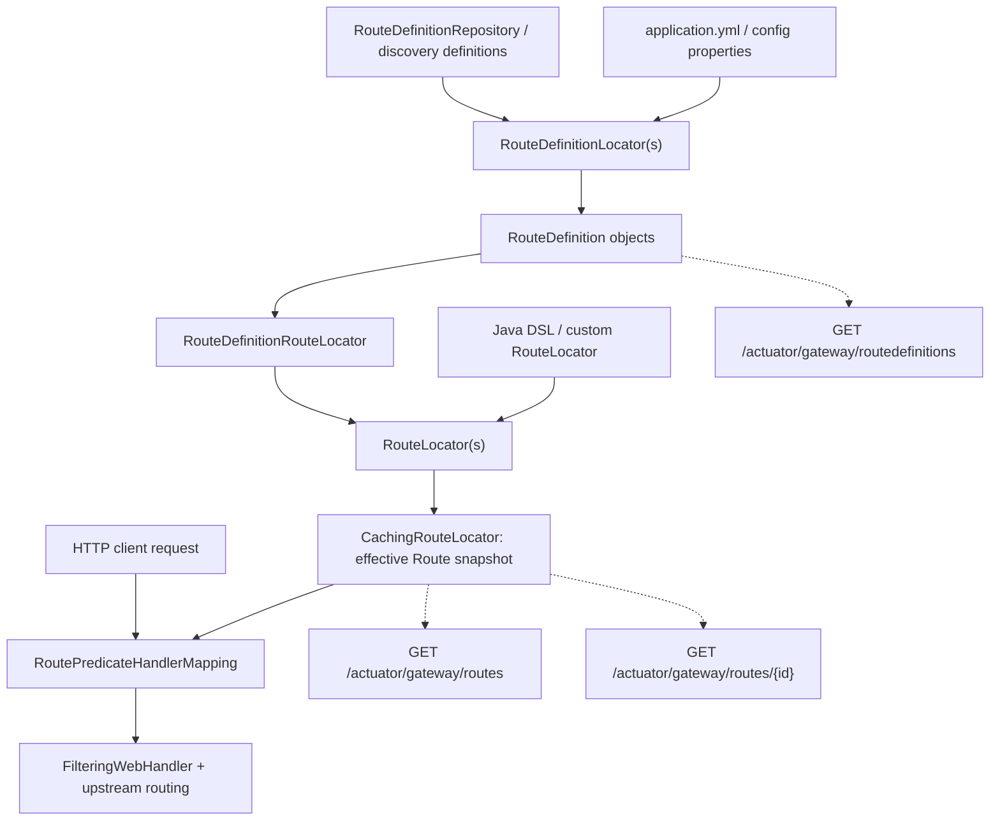
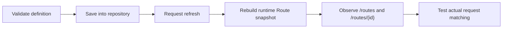
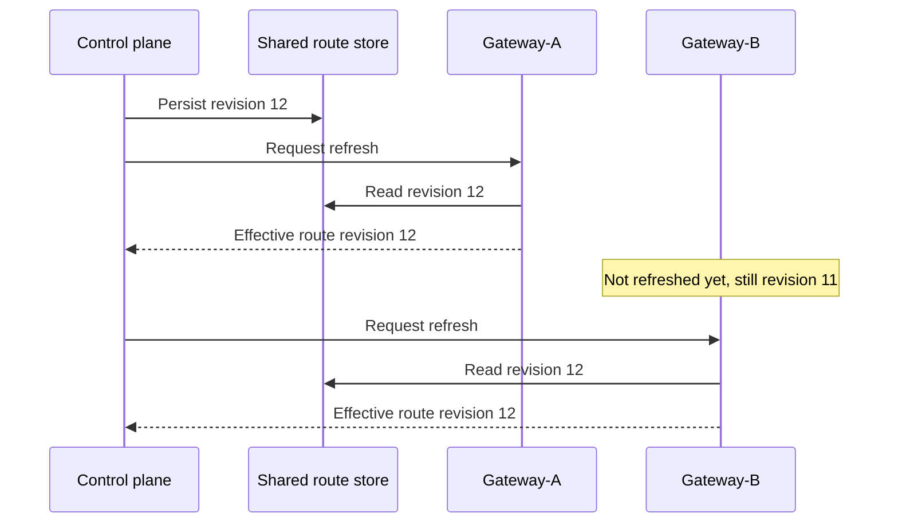
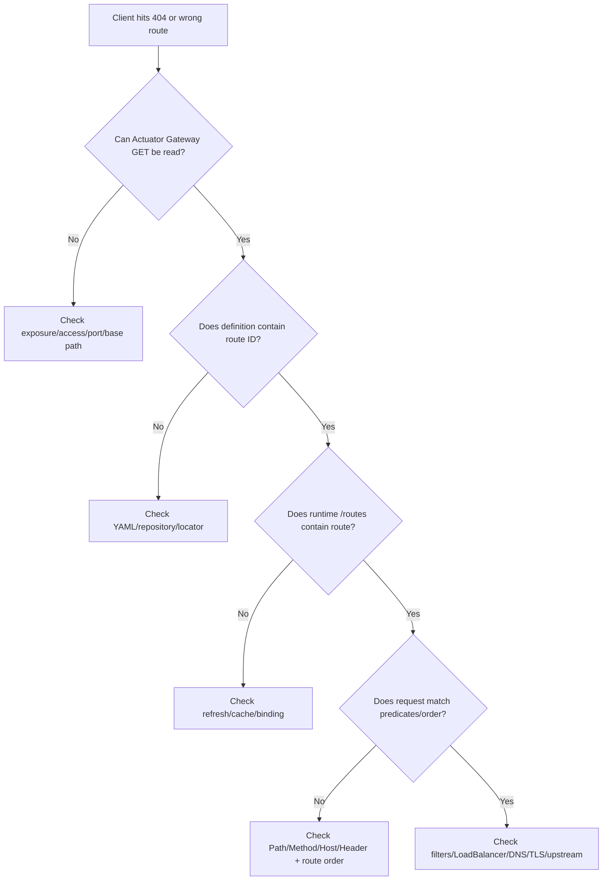

# Inspecting Route Lists, Route Definitions, and Single-Route Details

A **Spring Cloud Gateway** receives requests, evaluates route predicates, executes the filter chain, selects a service instance, and proxies HTTP/TLS traffic to a microservice. When an API unexpectedly returns `404`, `503`, hits the wrong backend, or fails to apply `StripPrefix` as expected, operators need to know **which routes the Gateway is actually using**. Reading `application.yml` alone is rarely enough: routes can be created by Java DSL, a dynamic repository, or a discovery locator, and then cached in the runtime of each Gateway replica.

In the **Actuator Management** chapter, this lesson teaches how to use **Spring Boot Actuator and the Gateway Actuator endpoint** to **inspect route lists, route definitions, and details of a single route by ID**. The content applies to **Spring Cloud Gateway Server WebFlux**, covering `Path`/`Method`/`Host` predicates, path/header transformations, `lb://` service discovery, Spring Security, rate limiting, circuit breakers, retries, TLS, and observability.

> **Version Scope:** Paths like `/actuator/gateway/...` are standard APIs across many Gateway Server WebFlux versions, though enable/exposure mechanisms, read/write access properties, and JSON shapes can vary across Spring Boot and Spring Cloud Gateway releases. Sample responses below are **illustrative shapes** to help you learn how to read them, not immutable schemas. Gateway Server MVC may use different components/endpoints; always verify against the actual running version.

## 1. Three Distinct Questions in a Routing Incident

Suppose the platform team intends to declare:

```yaml
spring:
  cloud:
    gateway:
      routes:
        - id: orders-read
          uri: lb://order-service
          order: 10
          predicates:
            - Path=/api/orders/**
            - Method=GET
          filters:
            - StripPrefix=1
```

The intent is:

```text
GET /api/orders/42
  -> Gateway route "orders-read"
  -> Path=/api/orders/** and Method=GET match
  -> StripPrefix=1
  -> GET /orders/42 at an instance of order-service
```

If a client receives `404`, distinguish:

1. **Is the route declared?** Does a `RouteDefinition` containing `orders-read` exist?
2. **Is the route loaded into runtime?** Does the active matching route set include `orders-read`?
3. **Is the request selecting that route?** Do method, path, host, headers, query params, and order all satisfy it?

Actuator helps strongly with the first two questions and surfaces data to investigate the third. **It does not simulate every request by itself**; proving which route a real request matched and which backend it reached still requires logs/traces or integration tests.

## 2. Three Essential GET Endpoints

| Endpoint | Purpose | Perspective |
| --- | --- | --- |
| `GET /actuator/gateway/routes` | Lists runtime/effective routes exposed by the Gateway | The route set available for matching |
| `GET /actuator/gateway/routedefinitions` | Lists `RouteDefinition` entries provided by definition sources | Configuration definition data |
| `GET /actuator/gateway/routes/{id}` | Inspects a single runtime route by ID | URI, predicates, filters, and order of a specific route |

These three endpoints serve distinct roles. **`/routedefinitions` is not simply a longer name for `/routes`**.



The diagram shows the **conceptual** flow, not a guarantee that every Gateway release uses the exact same single locator/cache instance. Besides definition sources, the Gateway can also receive runtime routes constructed directly.

### Definition, Effective, Matched

- **Definition:** Configuration elements describing a route.
- **Effective runtime route:** The converted/bound route object provided by runtime locators.
- **Matched request:** A concrete request that satisfied predicates and was routed to a route.

These stages are not strictly simultaneous: after a dynamic route update, the repository may be newer than the runtime cache. Once a route is active, a request can still fail to match because of `Method` or `Host`.

## 3. How Should Actuator Be Enabled?

### Dependencies

The application needs:

- Spring Cloud Gateway Server WebFlux compatible with Spring Boot.
- `spring-boot-starter-actuator`.
- Spring Security and governance controls per organizational policy to protect the HTTP management API.
- For `lb://` URIs, Spring Cloud LoadBalancer and a corresponding discovery source for proxying; **no registry is required merely to list routes**.

### Three Distinct Layers of Protection

When Actuator returns nothing, check:

1. **Availability:** Is the endpoint registered and enabled in the running version?
2. **Exposure/access:** Is the endpoint exposed over HTTP and granted read access?
3. **Authentication/authorization/network:** Is the caller permitted to reach the management interface?

**Merely adding `gateway` to `management.endpoints.web.exposure.include` does not create authentication.** If the management interface is public, outsiders can read service IDs/URIs, route matching rules, or filter arguments, even without write permissions.

### Example Configuration on Versions Supporting Read-Only Access

```yaml
management:
  server:
    port: 9090
  endpoints:
    web:
      exposure:
        include: "health,info,gateway"
  endpoint:
    gateway:
      access: read-only
```

This is an **illustrative configuration** for lines supporting `management.endpoint.gateway.access`. The goal is to use a separate management port and restrict the endpoint to **read** mode. It still must be protected with internal networking, operator role/authentication, and appropriate TLS.

**Compatibility note:** Some older Spring Boot/Gateway lines use `management.endpoint.gateway.enabled` or different enable/exposure mechanisms, while newer lines provide `access=read-only`/`unrestricted`. Do not copy both old and new properties assuming they are equivalent. Cross-check documentation, configuration metadata, and actual endpoint behavior for the **exact deployed version**.

### Public Port and Management Port

If `server.port=8080` and `management.server.port=9090`:

```text
Application API:
    http://localhost:8080/api/orders/42

Actuator Management:
    http://localhost:9090/actuator/gateway/routes
```

Changing `management.endpoints.web.base-path`, applying reverse-proxy path rewrites, context paths, or a different management port can alter the actual URLs. Management endpoints are **not** Gateway routes forwarding clients to `lb://order-service`.

If the management server runs in a separate context, do not assume the Security filter chain protecting the public API automatically protects all management endpoints. Verify access rules directly against the management listener.

## 4. Inspecting the Runtime Route List: `/actuator/gateway/routes`

This is the first endpoint to check when asking “Which routes does the Gateway currently have?”

### Calling with curl

In a lab environment with the management port on loopback:

```bash
curl -i http://127.0.0.1:9090/actuator/gateway/routes
```

If the environment requires administrative credentials, supply them per approved procedure. A shell example using a securely loaded environment variable:

```bash
curl -sS \
  -H "Authorization: Bearer $ACTUATOR_READ_TOKEN" \
  http://127.0.0.1:9090/actuator/gateway/routes
```

**Never store real tokens** in documentation, shared shell history, debug logs, or public output. Over untrusted networks, use HTTPS/mTLS/VPN or a secured management connection.

### Illustrative JSON Response

```json
[
  {
    "route_id": "orders-read",
    "predicate": "(Paths: [/api/orders/**] && Methods: [GET])",
    "filters": ["StripPrefix=1"],
    "uri": "lb://order-service",
    "order": 10
  },
  {
    "route_id": "catalog-public",
    "predicate": "(Paths: [/api/public/catalog/**])",
    "filters": [],
    "uri": "lb://catalog-service",
    "order": 20
  }
]
```

**JSON structure can vary:** In some Gateway versions, `predicate` and `filters` are verbose strings describing runtime objects with class names and orders; some releases show compact or verbose representations with different fields. Avoid writing brittle production parsers relying on illustrative strings like `"StripPrefix=1"`.

### Interpreting Each Field

| Field | Operational Meaning | Must Not Be Inferred |
| --- | --- | --- |
| `route_id` | ID of the listed route | That the client request actually matched this route |
| `predicate` | Route selection condition described at runtime | That matching Path means all methods match |
| `filters` | Filters currently displayed by the endpoint | That you are seeing the entire Spring Security/`WebFilter` pipeline |
| `uri` | Configured logical/physical target address | IP and port of the selected backend instance |
| `order` | Route evaluation priority | That it acts as an authorization mechanism |

With `uri: lb://order-service`, Actuator only reports the **service ID**, not which physical instance receives requests. You need LoadBalancer/HTTP client telemetry to identify the upstream address.

### Filtering with jq

If the response matches the illustrative JSON:

```bash
curl -sS http://127.0.0.1:9090/actuator/gateway/routes |
  jq '.[] | {route_id, uri, order}'
```

Inspect only routes containing `orders`:

```bash
curl -sS http://127.0.0.1:9090/actuator/gateway/routes |
  jq -r '.[] | select(.route_id | contains("orders")) | .route_id'
```

Always **inspect the raw response first** before writing JSONPath/jq filters, since field names and serialization do not always match examples.

### A Route Appearing Does Not Mean Every Request Matches

Given a route with:

```yaml
predicates:
  - Path=/api/orders/**
  - Method=GET
```

a `POST /api/orders` request cannot match simply because the path fits. Likewise, `Host`, `Header`, `Query`, and `Cookie` predicates alter matching outcomes. Use the route list to identify candidates, then compare against the **actual request**.

## 5. Inspecting Route Definitions: `/actuator/gateway/routedefinitions`

This gives the **`RouteDefinition`** view rather than runtime `Route` objects.

### Calling the API

```bash
curl -i http://127.0.0.1:9090/actuator/gateway/routedefinitions
```

### Illustrative Definition JSON

```json
[
  {
    "id": "orders-read",
    "predicates": [
      {
        "name": "Path",
        "args": { "_genkey_0": "/api/orders/**" }
      },
      {
        "name": "Method",
        "args": { "_genkey_0": "GET" }
      }
    ],
    "filters": [
      {
        "name": "StripPrefix",
        "args": { "_genkey_0": "1" }
      }
    ],
    "uri": "lb://order-service",
    "order": 10,
    "metadata": {
      "owner": "platform"
    }
  }
]
```

The `name`/`args`/`_genkey_0` layout illustrates `PredicateDefinition`/`FilterDefinition` structures after binding shortcut arguments. Key names, field ordering, and serialization format depend on version and declaration style (shortcut vs named arguments).

### Questions Definitions Help Answer

- Does route ID `orders-read` exist in current definition sources?
- Is the URI declared as `lb://order-service` or `http://localhost:8081`?
- What are the predicate factory names and arguments?
- Is `StripPrefix` set to 1 or 2?
- Do `order` and `metadata` match what was approved?
- After a dynamic save, does the definition source return the new version?
- Are there duplicate route IDs or overlapping path prefixes?

For routes with many filters, `/routedefinitions` is often easier to read for **factory names and arguments** than `/routes`, since it avoids stringified runtime filter descriptions.

### Not Every Runtime Route Has a Corresponding RouteDefinition

The Gateway can obtain routes from several sources:

| Route Source | May Appear in `/routedefinitions`? | May Appear in `/routes`? |
| --- | --- | --- |
| YAML/properties route definitions | Yes | Yes if conversion succeeds and runtime loaded it |
| `RouteDefinitionRepository` | Yes via the corresponding locator | Yes after appropriate refresh/conversion |
| Discovery `RouteDefinitionLocator` | Possibly | Yes once route is created/bound |
| Custom `RouteDefinitionLocator` | Possibly | Yes once aggregated |
| Java DSL `RouteLocatorBuilder` building `Route` directly | **Not necessarily** | Yes if the locator participates at runtime |

Thus, “a route exists in `/routes` but is missing from `/routedefinitions`” can be completely normal for Java DSL or custom `RouteLocator`s—not proof that Actuator is broken.

**Conversely:** If the definition is present but runtime lacks it, the cause may be an incomplete refresh, a factory/argument binding error, or mismatched sources/locators. Inspect logs and runtime state rather than concluding from a single GET.

## 6. Inspecting Single-Route Details: `/actuator/gateway/routes/{id}`

Once you know the route ID, the detail endpoint lets you inspect a specific route instead of scanning hundreds of routes.

```bash
curl -i http://127.0.0.1:9090/actuator/gateway/routes/orders-read
```

Illustrative JSON:

```json
{
  "route_id": "orders-read",
  "predicate": "(Paths: [/api/orders/**] && Methods: [GET])",
  "filters": ["StripPrefix=1"],
  "uri": "lb://order-service",
  "order": 10
}
```

If a route ID contains special characters, URL-encode it properly as a path segment. Never concatenate untrusted raw input into management URLs.

### Looking Up by ID Differs from Calling the API URL

`orders-read` is the **route ID**, not the `/api/orders/**` path. Calling:

```text
GET /actuator/gateway/routes/orders-read
```

is completely different from:

```text
GET /api/orders/42
```

The first queries **runtime configuration metadata**; the second enters **Gateway route mapping and backend proxying**.

### Notable Scenarios

| Observation | Possible Cause |
| --- | --- |
| Route exists in detail, client API returns 404 | Predicate mismatch, wrong route order, or upstream returned 404 |
| Route exists in definition, missing from detail | Snapshot not refreshed, conversion/binding error, or different replica |
| Detail URI differs from definition URI | Stale runtime cache, overlapping config sources, or ongoing rollout |
| Detail shows right URI, client gets 503 | Discovery/LoadBalancer, TLS, backend, or CircuitBreaker |
| Detail filters differ from expectation | Default filters, `GlobalFilter`s, runtime ordering, or un-synced update |
| Detail returns 404 for one specific ID | Wrong ID or route inactive on that replica |
| All Gateway Actuator URLs return 404 | Endpoint disabled/unexposed, wrong port/base path/version |

Never use management endpoint errors to directly infer upstream status. For example, `GET /actuator/gateway/routes/missing` returning 404 says nothing about `GET /api/orders/42`.

## 7. Comparing Route List, Definitions, and Detail in One Diagnosis

A straightforward workflow:

```text
GET /actuator/gateway/routedefinitions
   -> check latest definition data

GET /actuator/gateway/routes
   -> check runtime route set

GET /actuator/gateway/routes/orders-read
   -> check URI/predicate/filter/order of that route

Send GET /api/orders/42
   -> check real request matching and upstream
```

### Interpretation Table

| Definition | Runtime List | Detail | Likely Situation |
| --- | --- | --- | --- |
| Present | Present | Present | Route is defined and loaded at runtime |
| Present | Absent | Absent | Missing refresh or conversion error |
| Absent | Present | Present | Likely a route from Java DSL or custom `RouteLocator` |
| New | Old | Old | Cached route snapshot has not converged yet |
| Absent | Absent | Absent | Undeclared or querying wrong context/source |
| Present | Present with different URI | Different URI | Source conflict or stale snapshot |

**Consistency note:** Three sequential GET requests do not form an atomic snapshot transaction. Another operator might update routes or refresh between calls; if requests go through a load balancer, you might even be hitting **three different Gateway replicas**.

## 8. Route ID, Predicate, Order: Reading Them Correctly

### Route ID

The Route ID ties together logs, metrics, Actuator, and configuration changes. Avoid uncontrolled duplicate IDs across YAML, repositories, discovery locators, and Java DSL.

```text
Route ID: orders-read
URI:      lb://order-service
Path:     /api/orders/**
Method:   GET
Order:    10
```

Do not confuse route ID with service ID: `orders-read` identifies the **route**, whereas `order-service` identifies the **logical upstream service** for LoadBalancer instance resolution.

### Predicates Are Matching Conditions

Example:

```yaml
id: partner-orders
uri: lb://partner-service
predicates:
  - Path=/api/partner/orders/**
  - Method=GET
  - Host=api.partner.example.test
  - Header=X-Partner-Mode,enabled
```

A request with matching path and method yet `Host=api.example.test` will not match. Multiple predicates on a route normally combine as logical AND—all must hold, not just any single predicate.

For CORS preflight requests, the actual HTTP method is `OPTIONS`; if a route has `Method=POST`, preflight **will not automatically match** via `Access-Control-Request-Method: POST`. This is typically handled in the WebFlux/Security CORS layer before route mapping.

### Order and Overlapping Routes

```yaml
- id: generic-api
  uri: lb://generic-service
  order: 100
  predicates:
    - Path=/api/**

- id: orders-read
  uri: lb://order-service
  order: 10
  predicates:
    - Path=/api/orders/**
    - Method=GET
```

In standard Spring ordering, **lower numeric values** have higher priority. Actuator lets you inspect the `order` of both routes to catch cases where a catch-all route steals traffic.

**Route order is not authorization.** Regardless of which route matches, Spring Security and backends must still enforce access control. Never treat `Path=/api/admin/**` as an authorization boundary.

## 9. FilterDefinitions Are Not Identical to the Execution Chain

`/routedefinitions` might show:

```yaml
filters:
  - StripPrefix=1
  - AddRequestHeader=X-Gateway,edge
  - name: CircuitBreaker
    args:
      name: ordersReadBreaker
      fallbackUri: forward:/fallback/orders
```

`/routes/{id}` may show runtime filters as ordered strings with adapter classes. In addition, there are:

- `GlobalFilter`s applied across routes.
- Default filters from Gateway configuration.
- HTTP headers filters handling forwarded headers.
- Spring Security `WebFilter`s, which can process requests before any route is selected.

**Do not treat a JSON `filters` array as the complete security/network execution pipeline.** When suspecting filter ordering issues, inspect global filter diagnostics if supported, controlled logs, and real integration tests.

### Diagnosing StripPrefix with Actuator

Public request:

```text
GET /api/orders/42
```

- `StripPrefix=1` → upstream normally receives `/orders/42`.
- `StripPrefix=2` → upstream may receive `/42`.

If the route matches yet the backend returns `404`, inspect the filter definition/runtime view and verify via logs or a mock upstream. **Actuator does not report the “final rewritten path” of individual requests.**

### Other Filters

If a route includes `Retry`, `CircuitBreaker`, `RequestRateLimiter`, `TokenRelay`, or `LocalResponseCache`, Actuator can confirm they are declared/loaded. However:

- Retry count for a request is not shown simply because the filter exists.
- Circuit breaker OPEN/CLOSED is separate runtime state.
- Quota limiters require dedicated metrics/Redis state.
- Whether `TokenRelay` has an authorized client/valid token requires dedicated Security/OAuth2 diagnostics.
- Whether response caching is hitting/missing or leaking user data requires cache telemetry and security tests.

A route definition only describes **policy**, not the execution outcome of an individual request.

## 10. Dynamic Routes: Saved Does Not Mean Active

Spring Cloud Gateway can pull routes from a `RouteDefinitionRepository` or dynamic sources. Ideal lifecycle:



Suppose:

```text
T0: Repository: orders-read -> lb://order-service-v1
    Runtime:    orders-read -> lb://order-service-v1

T1: Repository save:
    orders-read -> lb://order-service-v2

    Runtime not yet refreshed:
    orders-read -> lb://order-service-v1

T2: After successful refresh:
    Runtime: orders-read -> lb://order-service-v2
```

During phase T1, `/routedefinitions` may already show v2 while `/routes/{id}` still shows v1. That reflects the **gap between definition data and the cached runtime route**, not proof of an Actuator bug.

Some versions support a separate management operation to refresh routes, typically `POST /actuator/gateway/refresh`. **This lesson only requires the three observational GET operations.** Refreshing is a runtime-mutating action requiring dedicated write/admin authority. Never grant unrestricted/write access merely to inspect data.

**Refreshing routes does not refresh** DNS resolvers, service discovery instance caches, response caches, or close existing HTTP connections. Those layers have independent lifecycles.

## 11. Multiple Gateway Replicas: Which Replica Are You Reading?

In a multi-process cluster:

```text
Shared RouteDefinition store:
    orders-read -> lb://order-service-v2

Gateway-A runtime cache:
    orders-read -> lb://order-service-v2

Gateway-B runtime cache:
    orders-read -> lb://order-service-v1

Gateway-C runtime cache:
    orders-read -> lb://order-service-v2
```

If requests to `/actuator/gateway/routes` pass through a shared load balancer, two consecutive GETs can return different URIs because they hit **two different replicas**.

### Correct Comparison Procedure

1. Identify the specific Gateway replica/pod ID and management port.
2. Read `/routedefinitions` and `/routes` on **that same replica**.
3. Check `/routes/{id}` on that replica.
4. Record timestamps and route revision/deployment version (if tracked).
5. Compare across replicas.
6. If any replica drifts, check refresh fan-out, route conversion exceptions, rollout status, or store availability.
7. Declare cluster convergence only with evidence from **every traffic-serving replica** or a reliable reconciliation system.



A `RefreshRoutesEvent` published inside one application does not automatically **broadcast across the network** to every Gateway process. A shared repository is essential for persistence, yet refresh/reconciliation is still needed.

### Port-Forward Pattern to Target a Specific Pod

If granted Kubernetes RBAC, you can connect directly to a single Gateway Pod's management port:

```bash
# Terminal 1: replace namespace, pod, and management port for your cluster.
kubectl -n demo port-forward pod/gateway-a 9090:9090

# Terminal 2:
curl -i http://127.0.0.1:9090/actuator/gateway/routes
```

This works only when the Pod's management server listens on that port and network/permissions allow it. Never use port-forward as a workaround to bypass system governance rules.

## 12. Distinguishing Management Endpoint Error Statuses

| HTTP Result | Likely Meaning | Investigation |
| --- | --- | --- |
| `200` with JSON | Read endpoint working | Verify actual contents and route IDs |
| `200` with `[]` | Route/definition source is empty or not active | Check config, locators, target replica |
| `401` | Missing valid authentication | Check management authentication |
| `403` | Caller lacks authority or denied by access policy | Check management authorization/read-only policy |
| `404` on all `/actuator/gateway/...` | Unexposed/disabled, wrong base path/port, or unsupported | Check Boot Actuator/Gateway version/config |
| `404` only on `/routes/missing-id` | ID absent from effective routes read by the endpoint | Check exact route ID, cache, replica |
| `5xx` reading routes | Locator, repository, conversion, or serialization failure | Check endpoint/route-source logs |
| Timeout/connection refused | Management listener/network/TLS issue | Check port, bind address, proxy, firewall |

**Never disable Spring Security to “fix 401/403”.** These are administrative endpoints that must be accessed with proper credentials over the designated management network.

### Configuration Checklist

- Is the Spring Boot Actuator dependency present?
- Are the Gateway Server WebFlux starter and version correct?
- Is the `gateway` endpoint supported and enabled?
- Is it included in HTTP web exposure?
- Is access mode set to `read-only` or equivalent read permission?
- Are the management base path and port accurate?
- Does the security filter/role apply to the management context?
- Do network policies, ingress, or reverse proxies block or rewrite paths?
- Is the request hitting the intended Gateway replica?
- Are there error logs from route locators or repositories?

## 13. Route Exists Yet Client API Still Fails

A valid route in Actuator does not guarantee a healthy backend.

| Public API Issue | What Actuator Reveals | What Else Is Needed |
| --- | --- | --- |
| `404` | Does the route exist? What predicates/order? | Matched route logs and upstream HTTP status |
| `503` on `lb://service` | Service ID of the URI | Discovery/instance list, readiness, LB cache |
| `502/504` | Route/filter policy | DNS, TLS, connect/response timeouts |
| Wrong rewritten path | `StripPrefix/RewritePath` FilterDefinition | Backend access logs or test stub |
| Missing or duplicate headers | Add/Set/Remove header filters | `GlobalFilter`s, upstream headers, CORS |
| CircuitBreaker fallback | Route has breaker/filter | Breaker state, failure rate, fallback handler |
| Excessive retries | `Retry` filter/args present | Attempt counts, exceptions/statuses, idempotency |
| JWT `401` | Route might not even be selected | Spring Security/OAuth2 logs |
| Stale response cache | Is a cache filter present? | Cache eligibility, TTL, tenant isolation, CDN |

**Do not confuse service ID with IP:** `lb://order-service` is a logical URI. Adding or removing a pod normally updates discovery instances without requiring route definition changes.

Similarly, an invalid SSL certificate cannot be fixed by refreshing routes if URI, DNS/SNI, or trust configuration is wrong.

## 14. Do Not Expose Management Data Publicly

Even when the API is GET-only, responses can contain:

- Internal service IDs/hostnames.
- Route patterns meant for admins or partners.
- Filter arguments revealing rate limiter settings, internal header names, or metadata.
- In misconfigured systems, secrets/tokens embedded in URIs/queries/header filters.
- Information enabling attackers to map internal networks and trust boundaries.

Defensive controls:

1. Separate the management network/port from the public API.
2. Permit only the small group of roles with genuine operational need.
3. Grant read-only access; never enable write operations unnecessarily.
4. Enforce TLS/mTLS, VPN, and appropriate authentication.
5. Restrict exposure—never expose all of Actuator just to inspect routes.
6. Monitor anomalous read activity on management endpoints.
7. Redact sensitive details before sharing snapshot logs.
8. Never place raw tokens/cookies or secret-bearing route args into metric labels.
9. Test `401/403` enforcement for unauthorized callers.

### Controlled Snapshots

In a **test environment** with proper authorization:

```bash
curl -sS http://127.0.0.1:9090/actuator/gateway/routes \
  > gateway-routes-snapshot.json

curl -sS http://127.0.0.1:9090/actuator/gateway/routedefinitions \
  > gateway-definitions-snapshot.json
```

Snapshot files can be sensitive; store them in access-controlled locations, never commit them to public Git repositories, and enforce appropriate retention/deletion policies. In automation, check HTTP response status before saving/parsing, since a `401` or HTML error page will not be the JSON you expect.

## 15. Scenario: Migrating a Route from Service v1 to v2

An operator wants to update:

```text
Route ID: orders-read

Before:
    lb://order-service-v1

After:
    lb://order-service-v2
```

A verification workflow:

1. Capture pre-change route detail and route list.
2. Save the new definition through the validated control-plane workflow.
3. Read `/routedefinitions`: verify the new ID/URI (when the definition source is surfaced by the endpoint).
4. Trigger refresh through the approved mechanism.
5. Read `/routes/orders-read`: verify **runtime** uses the new URI.
6. Repeat on **every relevant Gateway replica**.
7. Send a real GET request with matching Path/Method/Host and verify backend v2 receives it.
8. Inspect upstream status/latency, circuit breaker, retry, and TLS metrics.
9. If rollback is needed, restore the old definition, refresh, and **readback/verify** again.

| Layer | Required Evidence | Do Not Conclude Solely From |
| --- | --- | --- |
| Repository | Definition saved with new revision | Save API returning `200` |
| Definition locator | `/routedefinitions` shows new URI | Local YAML file on a laptop |
| Runtime | `/routes/{id}` shows new URI | Repository having been updated |
| Matching | Request enters the expected route ID | Route appearing in list |
| Proxy | Backend v2 receives right path/headers | Client getting `200` from fallback/cache |
| Cluster | Every Gateway replica converged | A single GET through an ingress load balancer |

**In-flight requests** that already selected a route/instance before refresh may finish along the old path. Cutovers therefore require drain planning, request timeouts, and instance availability checks.

## 16. Testing Together with Real HTTP Requests

An integration test suite should include:

- Spring Cloud Gateway Server WebFlux with route `orders-read`.
- Gateway Actuator read endpoints enabled in test config.
- Management authentication/authorization fixtures.
- Upstream mock (WireMock or HTTP test server).
- `WebTestClient` for management and client APIs.
- Discovery/LoadBalancer test fixtures when using `lb://`.

### Testing the Route List

```java
@Test
void actuatorListsOrdersRoute() {
    // actuatorClient targets the management endpoint
    // with authentication for a read-authorized operator.
    actuatorClient.get()
        .uri("/actuator/gateway/routes")
        .exchange()
        .expectStatus().isOk()
        .expectBody()
        .jsonPath("$[?(@.route_id == 'orders-read')]").exists();
}
```

This is an **illustrative test snippet**. JSONPath filter expressions and serialization may vary by library/version; if the response schema differs, adapt assertions to the actual contract. It will not run standalone without `actuatorClient` and a configured test context.

### Testing Route Detail

```java
@Test
void actuatorShowsOrdersRouteDetail() {
    actuatorClient.get()
        .uri("/actuator/gateway/routes/orders-read")
        .exchange()
        .expectStatus().isOk()
        .expectBody()
        .jsonPath("$.route_id").isEqualTo("orders-read")
        .jsonPath("$.uri").isEqualTo("lb://order-service");
}
```

This test only proves the read endpoint returns the expected route. Add tests confirming unauthorized users are blocked and that the runtime route actually proxies requests.

### End-to-End Test

```java
@Test
void ordersRouteProxiesCorrectPath() {
    publicApiClient.get()
        .uri("/api/orders/42")
        .exchange()
        .expectStatus().isOk()
        .expectBody()
        .jsonPath("$.id").isEqualTo("42");

    wireMockServer.verify(
        1, getRequestedFor(urlEqualTo("/orders/42")));
}
```

The test requires `StripPrefix=1`, an upstream stub, and valid Security fixtures. If `Retry` is configured, backend call count may exceed 1 during transient faults; this test assumes a happy path without retries.

### Do Not Forget Negative Tests

- `/routes` returns `401/403` when management authorization is missing.
- `/routes/missing-id` does not appear as a valid route.
- `POST /api/orders` does not match a `Method=GET` route.
- A `Path=/api/orders/**` route does not match `/api/payments/**`.
- A saved dynamic route not yet refreshed is not treated as active.
- An `lb://...` route with no instances fails with its own distinct error.
- An unrefreshed Gateway replica may still return an older snapshot.

## 17. Actuator and Runtime Route Test Matrix

| Test | Condition | What Must Be Proved |
| --- | --- | --- |
| T1 | Gateway Actuator unexposed | HTTP endpoint is hidden from unintended callers |
| T2 | Unauthenticated | Management request is rejected |
| T3 | Authenticated without role | Cannot view route metadata |
| T4 | Read-authorized operator | `GET /routes` succeeds |
| T5 | `GET /routedefinitions` | Reads `RouteDefinition` data |
| T6 | `GET /routes/orders-read` | Correct ID/URI/predicate/filter/order |
| T7 | Nonexistent route ID | Management result is not confused with upstream status |
| T8 | `Path` and `Method` predicates | Tests matching and non-matching HTTP methods |
| T9 | Route with `Host` predicate | Wrong host fails to match |
| T10 | Two overlapping routes | Verifies priority order |
| T11 | Custom Java `RouteLocator` | Runtime route may lack a definition from the same source |
| T12 | Dynamic definition saved without refresh | Detects definition vs runtime mismatch |
| T13 | Successful refresh | Runtime route reflects the update |
| T14 | Failed refresh / binding error | Logs error, does not falsely report active |
| T15 | Two Gateway replicas out of sync | Detects differing URI/route snapshots |
| T16 | Route with `StripPrefix` | Upstream receives expected path |
| T17 | `lb://` route with zero instances | Does not confuse no-instance with route-not-found |
| T18 | Security `401` before routing | Route filters do not process blocked requests |
| T19 | CORS preflight OPTIONS | Check CORS layer rather than inferring from GET routes |
| T20 | Retry/CircuitBreaker filters | Actuator confirms config; metrics confirm runtime behavior |
| T21 | Management configured read-only | Write/refresh methods are blocked |
| T22 | Sensitive filter args | Not exposed through public ingress |
| T23 | Spring/Gateway upgrade | JSON schema/parser compatibility verified |
| T24 | Deleted route | Runtime no longer holds route after refresh/reconcile |
| T25 | Cache/fallback still returns `200` | Do not treat client `200` as proof upstream received traffic |

Prioritize both **accuracy of inspected routes** and **safety of read access**.

## 18. Incident Runbook: “Route Exists in YAML, Yet API Still Returns 404”

Procedure:

1. **Separate management from public API:** is `404` coming from `/actuator/gateway/...` or `/api/...`?
2. **Verify management endpoint:** dependencies, exposure/access, base path, port, Security.
3. **Target a specific Gateway replica:** record pod/instance ID and timestamp.
4. **Read `/routedefinitions`:** do ID, URI, predicates, filters, and order appear?
5. **Read `/routes`:** is the runtime route loaded?
6. **Read `/routes/{id}`:** what are runtime URI/order/filters?
7. **If definition is new but runtime is old:** check refresh, route cache, and factory/arg conversion errors.
8. **If runtime looks right yet does not match:** inspect `Path`/`Method`/`Host`/`Header`/`Query` predicates, route order, and pre-mapping Security.
9. **If it matches yet errors out:** check path rewrites, LB instances/discovery, DNS/TLS, timeouts, and backend HTTP status.
10. **If only a subset of requests fail:** compare individual Gateway replicas and ingress routing.
11. **After remediation:** re-read runtime routes and send an end-to-end test request; never stop at a successful save API response.



## 19. Hands-On Exercise: Wrong Routing Across Three Gateway Replicas

A system runs three Gateway replicas with one generic route and two specific routes:

```yaml
spring:
  cloud:
    gateway:
      routes:
        - id: public-catalog
          uri: lb://catalog-service
          order: 20
          predicates:
            - Path=/api/public/catalog/**
            - Method=GET
          filters:
            - StripPrefix=2

        - id: orders-read
          uri: lb://order-service
          order: 10
          predicates:
            - Path=/api/orders/**
            - Method=GET
          filters:
            - StripPrefix=1

        - id: generic-api
          uri: lb://fallback-service
          order: 100
          predicates:
            - Path=/api/**
```

Situation:

- Gateway-A: `GET /api/orders/42` reaches `order-service` as expected.
- Gateway-B: the same request lands on `fallback-service`.
- Gateway-C: `GET /api/public/catalog/items` receives `404` from the backend.

### Task 1 — Compare Route Lists per Replica

Tabulate results from `GET /actuator/gateway/routes`:

| Replica | `orders-read`? | URI | Order | `generic-api`? |
| --- | --- | --- | --- | --- |
| Gateway-A | Read actual | Read actual | Read actual | Read actual |
| Gateway-B | Read actual | Read actual | Read actual | Read actual |
| Gateway-C | Read actual | Read actual | Read actual | Read actual |

If Gateway-B lacks `orders-read`, the catch-all route can capture `/api/orders/42`. If B has the route yet does not select it, inspect Method/Path/order and Security instead of stopping at the missing-route hypothesis.

### Task 2 — Inspect Definitions and Detail

```bash
# Call Gateway-B's exact management address,
# not a random frontend load balancer.
curl -sS http://127.0.0.1:9090/actuator/gateway/routedefinitions
curl -sS http://127.0.0.1:9090/actuator/gateway/routes
curl -sS http://127.0.0.1:9090/actuator/gateway/routes/orders-read
```

If the definition exists while runtime lacks it, look for route refresh/binding errors. If everything looks right yet another route captures traffic, inspect route order/predicates and trace the matched route ID.

### Task 3 — Inspect Rewritten Path After Filters

`public-catalog` has `StripPrefix=2`. For `GET /api/public/catalog/items`, the path becomes `/catalog/items`. If the backend actually expects `/public/catalog/items`, upstream can return `404` even though the Gateway route matched. Use Actuator to check filter args, then verify the upstream path with a test stub or controlled logs.

### Task 4 — Verify Rollout Convergence

After fixing the route source/refresh, verify across all three replicas:

- Runtime route ID, URI, and order.
- Predicates and filters.
- Real requests reaching the expected backend and path.
- No catch-all route encroaching on protected APIs.
- Security, CORS, rate limiting, and TLS remain intact.
- HTTP error/latency metrics show no abnormal spikes.

## 20. Self-Check Questions

1. What are the three most important GET endpoints for inspecting route lists, definitions, and a single route by ID?
2. How does `RouteDefinition` differ from `Route` in the Gateway lifecycle?
3. Why might a route in `/routedefinitions` not yet appear in `/routes`?
4. Can a route created directly with Java `RouteLocatorBuilder` appear at runtime without the same `RouteDefinition` representation?
5. How does `route_id` differ from the service ID in `lb://service-id`?
6. When multiple predicates are declared, is matching `Path` alone enough?
7. Does `Method=POST` automatically match CORS preflight `OPTIONS` requests?
8. Given `order=10` and `order=100` routes both matching, which normally takes precedence?
9. Why is `filters` in Actuator not the entire Spring Security `WebFilter` chain?
10. Can you deduce the chosen backend IP from `uri: lb://order-service`?
11. Does Actuator exposure provide authentication/authorization by itself?
12. Why does a dedicated management port still require network controls and Security?
13. Why is GET route metadata still sensitive?
14. After an operator saves a new `RouteDefinition`, what step is still missing before runtime adopts the route?
15. Does `RefreshRoutesEvent` automatically broadcast to all Gateway replicas or refresh DNS/response caches?
16. If two GETs through a load balancer return different URIs, what must you check before concluding the data changed?
17. How does `404` on `/actuator/gateway/routes/missing` differ from `404` from an upstream API?
18. When a route is active yet clients get `503`, which layers beyond the route definition must be checked?
19. Why does a test checking “Actuator returns 200” not prove upstream receives the right path?
20. When upgrading a route from v1 to v2, what observations prove **persisted, active, and matched** states?

**Key takeaway:** **`GET /actuator/gateway/routedefinitions`** shows **route definitions**; **`GET /actuator/gateway/routes`** shows the **runtime route set**; and **`GET /actuator/gateway/routes/{id}`** shows **details of one route**. Always distinguish **saved → loaded → matched**, and always record the **Gateway replica and version** when comparing. Expose Actuator with **least privilege**, and combine configuration inspection with request tests/tracing to operate Spring Cloud Gateway safely and accurately.
