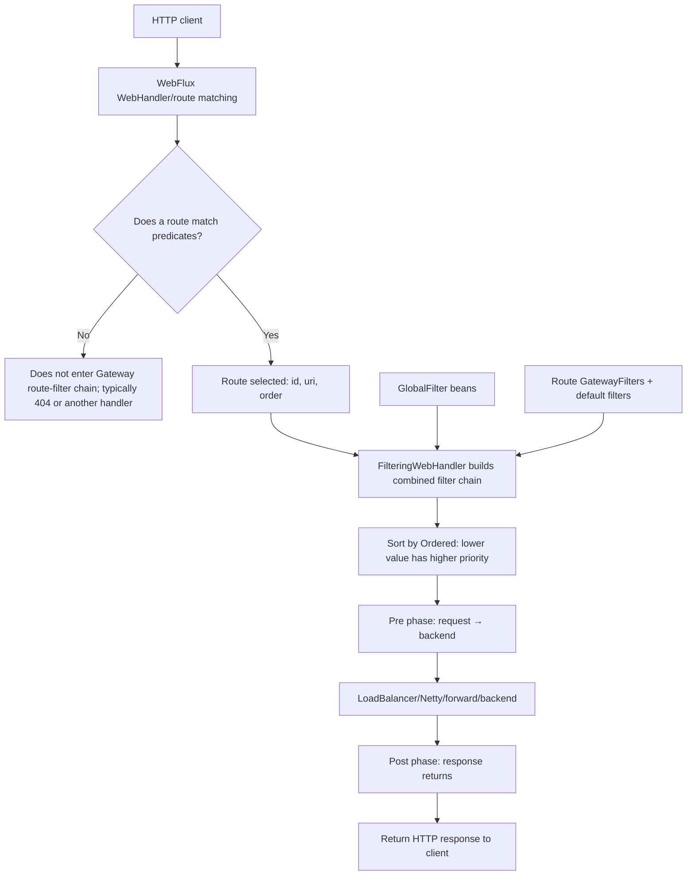
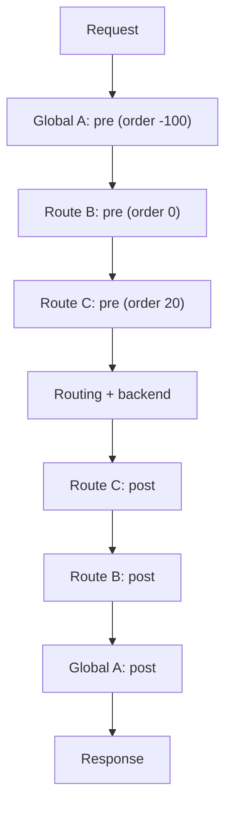
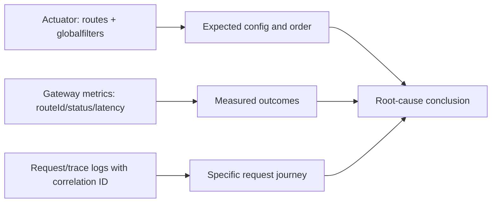

# Inspecting Predicates, Route Filters, Global Filters, and Filter Order with Spring Cloud Gateway Actuator

## 1. Why Do We Need to See the Actual Filter Chain?

**Spring Cloud Gateway** acts as an API Gateway for a microservices architecture: receiving requests, selecting routes using **predicates**, executing the **GatewayFilter/GlobalFilter chain**, transforming paths/headers, performing service discovery, and forwarding to backends. Authentication, rate limiting, circuit breakers, retries, TLS, and request observability can all affect a request before it reaches the downstream service.

Suppose `GET /api/orders/42` returns HTTP 404 even though `orders-service` is up. There are at least four possibilities:

- **No route matched** because the `Path`, `Host`, or `Method` predicate did not match.
- **The right route matched, yet the URI/path was wrong** due to `StripPrefix`, `RewritePath`, or service discovery.
- **A filter rejected the request**: Spring Security returned 401/403, `RequestRateLimiter` returned 429, `CircuitBreaker` returned a fallback, or a custom filter terminated the chain.
- **Global filters and route filters ran in an unexpected order**, causing headers to be overwritten or paths to change at the wrong time.

To investigate with evidence instead of guessing from `application.yml`, Spring Cloud Gateway Server WebFlux provides the **Actuator API** under `/actuator/gateway`. This lesson shows how to inspect **predicates**, **route-specific filters**, **global filters**, and especially **pre/post execution ordering**.

After this lesson, you will be able to:

1. Configure `read-only` access for Gateway Actuator using minimal settings.
2. Use `GET /actuator/gateway/routes` and `routes/{id}` to inspect routes, predicates, filters, and route order.
3. Distinguish `/routefilters` (factory catalog) from `/globalfilters` (ordered global beans).
4. Read `order` values and explain the **pre-phase/post-phase** ordering of the combined filter chain.
5. Cross-check Actuator with live requests and logs/metrics when diagnosing wrong routes, headers, or fallbacks.
6. Secure management endpoints so observation permissions never turn into Internet-accessible route modification privileges.

> **Scope:** primary examples target **Spring Cloud Gateway Server WebFlux 4.3+/5.x**, using `spring.cloud.gateway.server.webflux.*`. For older WebFlux lines, the prefix is typically `spring.cloud.gateway.*`. Gateway Server **Web MVC** has a different runtime/filter API; do not copy WebFlux `GlobalFilter`/`RouteLocatorBuilder` examples to MVC.

## 2. Request Flow Diagram: Predicates Select the Route Before the Filter Chain



**Distinguishing three meanings of “order”:**

| Component | Purpose | Scope |
|---|---|---|
**Route `order`** | Determines **which route is evaluated with higher priority** when multiple routes have overlapping predicates | Across routes |
| **GatewayFilter `order`** | Determines filter order **for the selected route** when combined with global filters | Within a combined filter chain |
| **GlobalFilter `getOrder()`** | Sets the order of a GlobalFilter relative to other GatewayFilters | Within a combined filter chain |

**Two common misconceptions:** a route with `order: -10` **does not make its filters run at order -10**. And `@Order(-1)` on a `GlobalFilter` **does not make that GlobalFilter run before route selection**: Gateway global filters are added to the chain once a request matches a route.

## 3. Enabling Read-Only Actuator on a Controlled Management Port

### 3.1. Maven/Gradle Dependencies

Gateway WebFlux gains Actuator support by adding `spring-boot-starter-actuator`:

```xml
<!-- Starter versions are managed by Spring Boot parent and Spring Cloud BOM. -->
<dependency>
    <groupId>org.springframework.cloud</groupId>
    <artifactId>spring-cloud-starter-gateway-server-webflux</artifactId>
</dependency>
<dependency>
    <groupId>org.springframework.boot</groupId>
    <artifactId>spring-boot-starter-actuator</artifactId>
</dependency>
```

```groovy
dependencies {
    implementation 'org.springframework.cloud:spring-cloud-starter-gateway-server-webflux'
    implementation 'org.springframework.boot:spring-boot-starter-actuator'
}
```

Redis, Eureka, or Resilience4j are not needed **just to read route/filter metadata**. Those dependencies are only needed when your routes actually use those features, such as `lb://`, rate limiting, or circuit breakers.

### 3.2. `read-only` Configuration

Gateway 5.1 documentation states the `gateway` endpoint has **access disabled by default**. To enable HTTP observation:

```yaml
server:
  port: 8080

management:
  server:
    port: 9090
    address: 127.0.0.1   # Local example only; never expose management API publicly.
  endpoint:
    gateway:
      access: read-only
  endpoints:
    web:
      exposure:
        include: health,info,gateway

spring:
  cloud:
    gateway:
      server:
        webflux:
          actuator:
            verbose:
              enabled: true
```

**Exact meaning:**

- `spring-boot-starter-actuator` registers the management infrastructure.
- `management.endpoint.gateway.access: read-only` allows **reading only**, granting no route create/delete/refresh permissions.
- `management.endpoints.web.exposure.include` specifies which endpoints are **exposed** over the web. Setting `access` without exposure can leave the endpoint with no HTTP mapping.
- `management.server.port: 9090` separates the management port from the client API port 8080; `management.server.address: 127.0.0.1` is meaningful when the management server uses a dedicated port. Inside containers, container loopback **differs** from the operator host's loopback; connect from inside the container or via an authorized port-forward.
- `verbose.enabled: true` prints predicates/filters in an easier-to-read descriptive form. Gateway 5.1 docs state verbose mode is **enabled by default**; declaring it here makes the intent explicit.

**Important:** port separation or binding localhost **does not replace authentication/authorization**. In production, use a dedicated management network, ingress/firewall/NetworkPolicy, TLS, authorized user/service identities, audit logging, and least privilege.

### 3.3. Reading Locally

Once granted access to the management listener:

```bash
# Access from the host/namespace allowed by the management listener.
curl -i http://127.0.0.1:9090/actuator/health

# List resources in Gateway Actuator.
curl -i http://127.0.0.1:9090/actuator/gateway

# List active loaded routes.
curl -i http://127.0.0.1:9090/actuator/gateway/routes
```

In environments with Spring Security, read requests require **authenticated management credentials**, such as a Bearer token with the appropriate management audience and scope. Never disable authentication just to get `curl` returning 200; see security details in Section 11.

### 3.4. Which Endpoints Serve This Lesson's Topic?

| Endpoint (GET) | What Do You See? | Notes |
|---|---|---|
`/actuator/gateway` | Link index of published Gateway Actuator operations | Verify which HTTP methods are actually permitted |
`/actuator/gateway/routes` | Active routes: predicates, filters, URI, **route order** | Primary source for inspecting route-specific filters |
`/actuator/gateway/routes/{id}` | Details for one route with a specific ID | Not necessarily the same JSON shape as POST route creation |
`/actuator/gateway/globalfilters` | GlobalFilter beans and **order** | Shows object string representation |
`/actuator/gateway/routefilters` | Registered `GatewayFilterFactory` beans | **Not** a list of filters executed on a specific route |
`/actuator/gateway/routedefinitions` | Route definitions from supported sources | Definitions may differ from built runtime routes |
`/actuator/gateway/routepredicates` | Registered predicate factories in supported versions | **Not** predicates that matched a specific request |
`/actuator/gateway/routes/{id}/combinedfilters` | May appear in the endpoint index of some versions | Verify runtime/format; do not rely on it as stable across all releases |

Paths above assume the default `management.endpoints.web.base-path=/actuator`. With a custom context path or reverse proxy/management path mapping, actual URLs differ. **`read-only`** means **read** permission—it never enables `POST /refresh` or `POST/DELETE /routes`.

## 4. Inspecting Predicates and Explaining Route Selection

### 4.1. Example of Two Potentially Overlapping Routes

Consider this Gateway configuration:

```yaml
spring:
  cloud:
    gateway:
      server:
        webflux:
          routes:
            - id: catalog-partner
              order: -10
              uri: http://localhost:8081
              predicates:
                - Host=partner.example.test
                - Path=/api/catalog/**
                - Method=GET
              filters:
                - StripPrefix=1
                - SetRequestHeader=X-Route-Class, partner

            - id: catalog-public
              order: 10
              uri: http://localhost:8082
              predicates:
                - Path=/api/catalog/**
                - Method=GET
              filters:
                - StripPrefix=1
                - SetRequestHeader=X-Route-Class, public
```

When a route defines multiple predicates, all conditions must hold according to that route's logic. Route `catalog-partner` requires matching **Host**, **Path**, and **Method**. Route `catalog-public` only requires **Path** and **Method**. For `GET /api/catalog/products/42` with `Host: partner.example.test`, both routes could match, yet `order: -10` takes precedence over `order: 10`.

**Common mistake:** route `order: -10` only prioritizes **route selection**; it does **not** mean `StripPrefix` gets filter order `-10`. Inside each route, filters receive their own orders when constructed into `GatewayFilter`s.

### 4.2. Using `GET /routes` to Inspect All Routes

```bash
curl -sS http://127.0.0.1:9090/actuator/gateway/routes
```

An **illustrative example** of verbose format (exact names and descriptions vary by version):

```json
[
  {
    "route_id": "catalog-partner",
    "predicate": "(Hosts: [partner.example.test] && Paths: [/api/catalog/**] && Methods: [GET])",
    "filters": [
      "[[StripPrefix parts = 1], order = 1]",
      "[[SetRequestHeader X-Route-Class = 'partner'], order = 2]"
    ],
    "uri": "http://localhost:8081",
    "order": -10
  },
  {
    "route_id": "catalog-public",
    "predicate": "(Paths: [/api/catalog/**] && Methods: [GET])",
    "filters": [
      "[[StripPrefix parts = 1], order = 1]",
      "[[SetRequestHeader X-Route-Class = 'public'], order = 2]"
    ],
    "uri": "http://localhost:8082",
    "order": 10
  }
]
```

This JSON **illustrates field meanings**, not a byte-for-byte guaranteed output for these two routes. The `predicate` and `filters` fields are string representations that can vary by Spring Cloud Gateway version and factory implementation. Do not build monitoring tools coupled tightly to a filter's `toString()`.

### 4.3. Reading Each Field

| Field | How to Interpret It | Verification Question |
|---|---|---|
`route_id` | Route ID used to correlate config, metrics, and logs | Is this the exact route under investigation? |
`predicate` | Request matching expression | Do Host/Path/Method/Header/Query match? |
`filters` | Built route-specific/default `GatewayFilter`s | Are `StripPrefix`, `Retry`, `CircuitBreaker`, `SetRequestHeader` aligned with policy? |
`uri` | Logical/physical target URI for the route | Is it `lb://service-id` or a fixed backend address? |
`order` | **Route priority order**, not filter order | Could a broader route “steal” the request? |

If `predicate` joins multiple conditions with `&&`, **you cannot look only at `Path` and conclude a request will match**. `Host` is evaluated against the received Host header (potentially forwarded via ingress/trusted proxy). `Method` can also exclude POST requests even when Path matches.

### 4.4. Inspecting a Single Route by ID

```bash
curl -sS \
  http://127.0.0.1:9090/actuator/gateway/routes/catalog-partner
```

`routes/{id}` helps verify **a single route** before tracing further. Readable example:

```json
{
  "route_id": "catalog-partner",
  "predicate": "(Hosts: [partner.example.test] && Paths: [/api/catalog/**] && Methods: [GET])",
  "filters": [
    "[[StripPrefix parts = 1], order = 1]",
    "[[SetRequestHeader X-Route-Class = 'partner'], order = 2]"
  ],
  "uri": "http://localhost:8081",
  "order": -10
}
```

Gateway 5.1 documentation notes that `predicate` here is a human-readable description, **unlike** the shortcut DSL used when creating dynamic routes. Do not feed `GET /routes/{id}` output directly as the body for `POST /routes/{id}`.

### 4.5. Filtering JSON with `jq`

When `jq` is available on the management workstation:

```bash
# Show only route ID, route order, URI, and predicate.
curl -sS http://127.0.0.1:9090/actuator/gateway/routes \
  | jq '.[] | {id: .route_id, order: .order, uri: .uri, predicate: .predicate}'

# Only routes related to Catalog.
curl -sS http://127.0.0.1:9090/actuator/gateway/routes \
  | jq '.[] | select(.route_id | contains("catalog"))'

# Only filters for the route under investigation.
curl -sS http://127.0.0.1:9090/actuator/gateway/routes/catalog-partner \
  | jq '.filters'
```

The example uses a local management listener and **omits management credentials**. On endpoints using Bearer auth, add `Authorization` using an operator-issued token; avoid leaving tokens in shell history or log output. If `jq` is unavailable, use an approved internal JSON viewer.

### 4.6. Actuator Shows the Route, Yet the Request Still Fails to Match?

Possible causes:

- Received `Host` header differs from what you see in the browser due to an ingress/reverse proxy.
- Request is `POST` while the route only allows `Method=GET`.
- `Path` was modified by an ingress/base-path before reaching the Gateway.
- The route you inspected is on **pod A**, while the live request landed on **pod B** with stale route cache/config.
- Another higher-priority route also matches predicates.
- Spring Security blocked the request before the Gateway route chain; Actuator does not replace auth testing.

Cross-check the **actual request**, **config revision/pod**, and `routes` output rather than assuming “route in Actuator = request definitely took that route”.

## 5. Inspecting `routefilters`: Factory Catalog, Not Execution Order

### 5.1. What Is `/routefilters` Used For?

```bash
curl -sS \
  http://127.0.0.1:9090/actuator/gateway/routefilters
```

A sample response matching the documented shape:

```json
{
  "[AddRequestHeaderGatewayFilterFactory@a18f configClass = AbstractNameValueGatewayFilterFactory.NameValueConfig]": null,
  "[SecureHeadersGatewayFilterFactory@bd2e configClass = Object]": null,
  "[SaveSessionGatewayFilterFactory@21b4 configClass = Object]": null
}
```

**Correct interpretation:**

- This is the list of **`GatewayFilterFactory` beans** registered by the Gateway—**not** “which filters ran for request `/api/orders/42`”.
- A factory like `AddRequestHeaderGatewayFilterFactory` can appear even if a given route **never uses** `AddRequestHeader`.
- `null` as the value **does not mean `order=0`**, does not mean the filter is broken, and does not prove it won't run. Official docs explain `null` occurs because the endpoint tries to read the order of the **factory object**, whereas order applies to **GatewayFilter instances**, not factories.
- `@a18f` is simply part of the Java object `toString()`, not a version, order, or route ID.

**To inspect the filters actually attached to route `catalog-partner`, check `GET /actuator/gateway/routes/catalog-partner`** or `GET /actuator/gateway/routes`, not just the factory list.

### 5.2. `routepredicates`: Also a Factory Catalog

```bash
curl -sS \
  http://127.0.0.1:9090/actuator/gateway/routepredicates
```

This endpoint can list available **`RoutePredicateFactory`** beans such as `Path`, `Host`, `Method`, `Header`, and `Query` per config/version. It **does not return True/False evaluation results** for a specific request. To verify whether a predicate matched, reproduce the request, enable controlled logging/metrics, and compare against route conditions.

### 5.3. `routedefinitions` vs `routes`

| Endpoint | Perspective |
|---|---|
`/actuator/gateway/routedefinitions` | Route definitions from supplied sources, usually showing factory names and args |
`/actuator/gateway/routes` | Runtime routes after building predicate/filter instances, used for routing |
`/actuator/gateway/routes/{id}` | One runtime route by ID |
`/actuator/gateway/routefilters` | Catalog of factories available for creating route filters |
`/actuator/gateway/routepredicates` | Catalog of predicate factories |

This is particularly useful with **Discovery Locator** or dynamic routes. A service registry may advertise many instances while the runtime route remains `lb://orders-service`. Changing route definitions and changing LoadBalancer instance selection are **two separate actions**.

## 6. Inspecting `globalfilters`: List of GlobalFilters and Order

### 6.1. Global Filters List Endpoint

```bash
curl -sS \
  http://127.0.0.1:9090/actuator/gateway/globalfilters
```

Compact illustrative JSON showing **a WebFlux configuration with common GlobalFilters**:

```json
{
  "org.springframework.cloud.gateway.filter.NettyWriteResponseFilter@ab7": -1,
  "org.springframework.cloud.gateway.filter.ForwardPathFilter@c11": 0,
  "org.springframework.cloud.gateway.filter.RouteToRequestUrlFilter@e20": 10000,
  "org.springframework.cloud.gateway.filter.ReactiveLoadBalancerClientFilter@b63": 10100,
  "org.springframework.cloud.gateway.filter.WebsocketRoutingFilter@8f2": 2147483646,
  "org.springframework.cloud.gateway.filter.NettyRoutingFilter@9ac": 2147483647
}
```

These bean/class names and orders **are not guaranteed to appear identically in every deployment**, because several GlobalFilters are conditional on dependencies, properties, protocols, and version. These order numbers mirror Gateway documentation examples and should never be hardcoded as a stable API contract.

### 6.2. Reading Common GlobalFilters

| GlobalFilter | Conceptual Role | Notes |
|---|---|---|
`NettyWriteResponseFilter` | Writes the Netty client response back to the caller after routing | Has a very early order yet its main body-writing work happens in the **post phase** |
`RouteToRequestUrlFilter` | Builds the target URL into an exchange attribute from the route URI | Usually precedes load balancing |
`ReactiveLoadBalancerClientFilter` | Resolves `lb://service-id` into an instance host/port | Applies when LB is used |
`NettyRoutingFilter` | Uses Netty HTTP client to call HTTP/HTTPS backends | Not all `forward:/...` or WebSocket routes take this path |
`ForwardRoutingFilter` | Performs internal dispatch for `forward:` URIs | Distinct from HTTP 3xx redirects |
`WebsocketRoutingFilter` | Routes `ws/wss` WebSockets | Distinct from `NettyRoutingFilter` for normal HTTP requests |
Custom `GlobalFilter` | Logging, correlation, cross-route policy | Should implement `Ordered` and use non-blocking reactive callbacks |

**Why does `NettyWriteResponseFilter` have `order=-1` yet “write afterward”?** Because a filter can **enter early in the pre phase** to wrap the rest of the chain, and then perform its response-writing logic **once the downstream reactive publisher completes** in the post phase. A low order number **does not mean every action inside that filter runs first**.

### 6.3. `GlobalFilter` Is Not Identical to Spring WebFlux `WebFilter`

Gateway's `GlobalFilter` participates in the **Gateway filtering chain after a route matches**. Spring WebFlux/Spring Security's `WebFilter` participates in the **outer web security/filtering chain**, even for requests matching no Gateway route.

| Filter Type | Where It Applies | Visible in `/gateway/globalfilters`? |
|---|---|---|
`GlobalFilter` | Combined Gateway filter chain for matched routes | Usually yes if registered as a bean |
`GatewayFilter` | Specific route (and default filters for routes) | View details in `/gateway/routes`; **not** a GlobalFilter |
`WebFilter` | Spring WebFlux web chain outside the Gateway router | **Not covered by this endpoint** |
Spring Security `SecurityWebFilterChain` | WebFlux authentication/authorization | Cannot be inferred from the GlobalFilter list |
Reactor Netty `HttpClientCustomizer` | Configures the outbound HTTP client | Not a per-request GatewayFilter |

Accordingly, a request receiving 401 for an invalid JWT **may be rejected before the Gateway selects a route**; do not expect a custom `GlobalFilter` to log a post-phase message in that scenario.

## 7. Filter Order: Smaller Number Runs Earlier Pre, Reverse Order Post

Gateway documentation explains that once a route matches, `FilteringWebHandler` gathers **all `GlobalFilter`s** and **route-specific `GatewayFilter`s** (including applicable default filters) and **sorts the combined chain by `org.springframework.core.Ordered`**.

In the **pre** phase, higher-priority filters (smaller order values) run first. In the **post** phase, because filters wrap each other via `chain.filter(exchange)`, downstream-completion logic of higher-priority filters typically runs **last**.

### 7.1. Order Values and Bidirectional Flow

Suppose we have three illustrative filters:

| Filter | Order | Pre Phase | Post Phase |
|---|---:|---:|---:|
GlobalFilter A | `-100` | 1st | 3rd |
RouteFilter B | `0` | 2nd | 2nd |
RouteFilter C | `20` | 3rd | 1st |



**This is just a simplified three-filter chain.** A real Gateway includes many built-in GlobalFilters with orders like `NettyWriteResponseFilter(-1)`, `RouteToRequestUrlFilter(10000)`, `ReactiveLoadBalancerClientFilter(10100)`, and filters near `Integer.MAX_VALUE`. Do not extrapolate from a three-filter diagram as if those were the Gateway's entire chain.

### 7.2. Why `order` Alone Does Not Determine Behavior

A filter may:

- Perform **pre** work and call `chain.filter(exchange)`.
- Attach a `then(...)`, `doFinally(...)`, or similar callback for **post** work.
- **Short-circuit** without calling `chain.filter(exchange)`, e.g., rejecting the request or producing a fallback response.
- Activate only when the exchange carries a certain attribute, the URI uses a matching scheme, or the response is not yet committed.

Thus, “filter order -1” specifies **wrapper position in the chain**, not a guarantee that its response callback runs ahead of every other callback. Read the filter's source/API or observe execution traces when in doubt.

## 8. `default-filters` and Route Filters: Interleaved Ordering

Gateway Server WebFlux provides **default filters** to attach filters to routes built through route definitions. These filters are **not `GlobalFilter` Java beans**, so they do not show up in `/actuator/gateway/globalfilters` just by being declared under `default-filters`.

### 8.1. Illustrative Configuration

```yaml
spring:
  cloud:
    gateway:
      server:
        webflux:
          default-filters:
            - AddResponseHeader=X-Default-A, A
            - AddResponseHeader=X-Default-B, B
            - AddResponseHeader=X-Default-C, C
          routes:
            - id: api-one
              uri: http://localhost:8081
              predicates:
                - Path=/api/one/**
              filters:
                - StripPrefix=1
                - AddRequestHeader=X-Route-Y, Y
```

Under Gateway's default-filters rule, for filters that do not implement `Ordered` themselves, **the two lists are numbered independently starting at 1** and then **stable-sorted**. A default filter sharing the same order as a route filter is added first within that order group.

Illustration:

```text
Default filters: A(order 1), B(order 2), C(order 3)
Route filters:   X(order 1), Y(order 2)

After stable sort:
  A(order 1) -> X(order 1) -> B(order 2) -> Y(order 2) -> C(order 3)
```

Therefore, never assert that “all default filters always run before all route filters”. Filters sharing the same order depend on **insertion order and stable sorting**. Meanwhile, a filter that implements `Ordered` or is wrapped in `OrderedGatewayFilter` carries its own explicit order rather than positional numbering.

**Scope:** default filters from `spring.cloud.gateway.server.webflux.default-filters` are applied when building routes from route definitions in the standard mechanism. Do not assume routes built directly via Java `RouteLocatorBuilder` go through identical default-filter assembly as YAML routes; inspect runtime routes and test on your running version.

### 8.2. Why Can `filters` in Actuator Look Different from YAML?

- In YAML you declare a factory like `StripPrefix=1`; when building the route, Gateway wraps it into an ordered `GatewayFilter`.
- Default filters can be merged into the list before sorting and appear inside the route's `filters`.
- A custom `GatewayFilter` may carry a negative or positive order independent of its YAML line position.
- Some filters have `toString()` output showing only class/lambda names rather than readable args.
- `/routes` typically displays **route filters**, without repeating every `GlobalFilter` bean; also inspect `/globalfilters` and `combinedfilters` if supported in your version.

**How to investigate:** compare YAML, Actuator `routes/{id}`, `globalfilters`, and specific request logs/traces. Never rely **solely** on YAML line order to explain combined-chain execution order.

## 9. Writing a Non-Blocking GlobalFilter to Observe Pre/Post

### 9.1. Illustrative Java Bean

The snippet below logs at DEBUG level on entry and upon chain completion/cancellation. It **does not** modify requests/responses, make blocking I/O calls, or log tokens:

```java
package com.example.gateway.observation;

import org.slf4j.Logger;
import org.slf4j.LoggerFactory;
import org.springframework.cloud.gateway.filter.GatewayFilterChain;
import org.springframework.cloud.gateway.filter.GlobalFilter;
import org.springframework.cloud.gateway.route.Route;
import org.springframework.cloud.gateway.support.ServerWebExchangeUtils;
import org.springframework.core.Ordered;
import org.springframework.stereotype.Component;
import org.springframework.web.server.ServerWebExchange;
import reactor.core.publisher.Mono;

@Component
public final class FilterOrderProbe implements GlobalFilter, Ordered {

    private static final Logger log =
        LoggerFactory.getLogger(FilterOrderProbe.class);

    @Override
    public int getOrder() {
        return -10;
    }

    @Override
    public Mono<Void> filter(ServerWebExchange exchange,
                             GatewayFilterChain chain) {
        Route route = exchange.getAttribute(
            ServerWebExchangeUtils.GATEWAY_ROUTE_ATTR);
        String routeId = route == null ? "unknown" : route.getId();

        log.debug("probe pre route={} order={}", routeId, getOrder());

        return chain.filter(exchange)
            .doFinally(signal -> log.debug(
                "probe final route={} signal={} status={}",
                routeId, signal, exchange.getResponse().getStatusCode()));
    }
}
```

**Key points:**

1. `GlobalFilter` is invoked for requests that already matched a Gateway route; `GATEWAY_ROUTE_ATTR` normally holds the route ID at this stage.
2. `getOrder()=-10` places the filter at that position in the **combined chain**.
3. `chain.filter(exchange)` must be **returned**. Never call `subscribe()` yourself and never call `block()` on the Reactor Netty event loop.
4. `doFinally` runs when the publisher completes, errors, or is canceled; it is suitable for **observation**, not for modifying response headers since the response may already be committed.
5. Do not conclude “the filter logged pre, so the backend was definitely called”: later filters may reject or trigger fallbacks.
6. Log only route ID, status/signal, and controlled metadata. Never log `Authorization`, cookies, raw queries, private headers, or bodies.

Once Spring scans this bean and Actuator is open read-only, `/actuator/gateway/globalfilters` will typically list an entry for `FilterOrderProbe` with order `-10`. **That confirms the bean exists and its order is registered**, though it does not prove every request passes through or completes.

### 9.2. Adding a Route-Specific Filter with Explicit Order

To demonstrate route-filter ordering in Java DSL, you can use `OrderedGatewayFilter`:

```java
package com.example.gateway.observation;

import org.springframework.cloud.gateway.filter.OrderedGatewayFilter;
import org.springframework.cloud.gateway.route.RouteLocator;
import org.springframework.cloud.gateway.route.builder.RouteLocatorBuilder;
import org.springframework.context.annotation.Bean;
import org.springframework.context.annotation.Configuration;
import reactor.core.publisher.Mono;

@Configuration(proxyBeanMethods = false)
public class DebugRouteConfiguration {

    @Bean
    RouteLocator debugRoute(RouteLocatorBuilder builder) {
        return builder.routes()
            .route("debug-route", r -> r
                .path("/debug/**")
                .filters(f -> f.filter(new OrderedGatewayFilter(
                    (exchange, chain) -> {
                        exchange.getResponse().getHeaders()
                            .set("X-Debug-Route-Filter", "executed");
                        return chain.filter(exchange);
                    },
                    -20)))
                .uri("http://localhost:8081"))
            .build();
    }
}
```

Here, the route filter has `order=-20`, placing it **before** the custom GlobalFilter (`order=-10`) in the pre phase (while still interleaved with built-in GlobalFilters according to their orders). The response header is set **before the response commits**; do not use this pattern to emit internal metadata in production.

**Avoid duplicate route IDs** between Java beans and YAML routes. Also do not assume routes created directly in Java receive `default-filters` identically to YAML routes; verify in `/actuator/gateway/routes/debug-route`.

### 9.3. Verifying via Logs Instead of Guessing from Order

In a sandbox profile, you can enable:

```yaml
logging:
  level:
    com.example.gateway.observation: DEBUG
```

Then call `/debug/hello` from a test client:

```bash
curl -i http://127.0.0.1:8080/debug/hello
```

If a backend is running, the `X-Debug-Route-Filter` header shows the route filter executed. `probe pre` and `probe final` logs trace the GlobalFilter lifecycle. If no backend is running, you can still see the pre log and an error final signal; hence **backend connectivity status and filter execution are two separate questions**.

### 9.4. Measuring Exact Pre/Post Order Across Multiple Filters

With 2–3 custom filters that you own, log pre/post in each filter with the same **correlation ID**, then compare the sequence for a single request:

```text
probe A (order -100): pre
probe B (order 0):    pre
probe C (order 20):   pre
... backend response ...
probe C (order 20):   post
probe B (order 0):    post
probe A (order -100): post
```

This is the **expected trace for illustrative filters when all invoke the chain and run post callbacks via nested composition**. Logs from async components can interleave under concurrent requests; always group by trace/request ID rather than reading mixed logs and assuming filter ordering is wrong.

## 10. End-to-End Lab: Finding Routes, Matching Requests, and Tracing Filters

### 10.1. Prerequisites

In a **test environment**:

1. Gateway Server WebFlux running on `http://127.0.0.1:8080`, with management listener on `http://127.0.0.1:9090` with appropriate read access.
2. Routes `catalog-partner` and `catalog-public` from Section 4.1 configured.
3. Test backends on `localhost:8081` and `localhost:8082`, both serving `GET /catalog/ping` or returning a deterministic HTTP response.
4. Tester has read permission on Gateway Actuator, **without create/delete/refresh permissions**.
5. When Spring Security/management auth is enabled, use **valid test credentials**—never disable security just to get 200.

To make the backend echo the header set by the Gateway, in a **separate WebFlux backend app** you can use a test controller:

```java
package com.example.catalogdemo;

import java.util.Map;
import org.springframework.http.ResponseEntity;
import org.springframework.web.bind.annotation.GetMapping;
import org.springframework.web.bind.annotation.RequestHeader;
import org.springframework.web.bind.annotation.RestController;
import reactor.core.publisher.Mono;

@RestController
public class EchoCatalogController {

    @GetMapping("/catalog/ping")
    Mono<ResponseEntity<Map<String, String>>> ping(
            @RequestHeader(value = "X-Route-Class", required = false)
            String routeClass) {
        String value = routeClass == null ? "missing" : routeClass;
        return Mono.just(ResponseEntity.ok(Map.of(
            "source", "catalog-test-backend",
            "routeClass", value)));
    }
}
```

This controller belongs in the **backend**, not in the Gateway. The test JSON reflects the `SetRequestHeader` route filter; **never use a request header as authorization proof** in real APIs.

### 10.2. Step 1 — Verify Route Existence and Priority

```bash
curl -i http://127.0.0.1:9090/actuator/gateway/routes
curl -i http://127.0.0.1:9090/actuator/gateway/routes/catalog-partner
curl -i http://127.0.0.1:9090/actuator/gateway/routes/catalog-public
```

Expected: both routes share `Path=/api/catalog/**`, while:

- `catalog-partner` additionally requires `Host=partner.example.test` with `order=-10`.
- `catalog-public` requires only path and GET with `order=10`.
- Each route's `filters` include `StripPrefix` and `SetRequestHeader`.
- `uri` targets differ (`8081` vs `8082`).

You will only receive the Catalog response body when both backends and routing work properly. The Actuator list only proves routes are built, not that backends are alive.

### 10.3. Step 2 — Send Two Requests with the Same Path but Different Hosts

```bash
# Matches both partner and public routes; partner wins with order -10.
curl -i \
  -H 'Host: partner.example.test' \
  http://127.0.0.1:8080/api/catalog/ping

# Does not match partner's Host predicate, so public route matches.
curl -i \
  -H 'Host: public.example.test' \
  http://127.0.0.1:8080/api/catalog/ping
```

In this demo setup with no competing routes:

| Sent Host Header | Expected Route | Backend URI | Header Received by Backend |
|---|---|---|---|
`partner.example.test` | `catalog-partner` | `http://localhost:8081` | `X-Route-Class: partner` |
`public.example.test` | `catalog-public` | `http://localhost:8082` | `X-Route-Class: public` |

These commands use local HTTP for learning routing. In production, require HTTPS/TLS with valid Host/SNI and trust only configured proxy/forwarded headers. **Never rely on a Host predicate as the sole authentication layer** for private APIs: clients can forge `Host` over plain HTTP connections.

### 10.4. Step 3 — Verify a Non-Matching HTTP Method

```bash
curl -i \
  -X POST \
  -H 'Host: partner.example.test' \
  http://127.0.0.1:8080/api/catalog/ping
```

Since both illustrative routes only allow `Method=GET`, POST matches neither route. Without another handler/route, the response is typically `404`; with Spring Security or other handlers, the status may differ. **Never assume a 404 came from the backend** if the request was never routed downstream.

### 10.5. Step 4 — Read Route Filters and Global Filters

```bash
curl -sS http://127.0.0.1:9090/actuator/gateway/routes/catalog-partner
curl -sS http://127.0.0.1:9090/actuator/gateway/globalfilters
curl -sS http://127.0.0.1:9090/actuator/gateway/routefilters
```

Compare **three distinct views**:

1. `routes/catalog-partner`: which `GatewayFilter`s are actually configured on the route, e.g., `StripPrefix`/`SetRequestHeader`.
2. `globalfilters`: which `GlobalFilter` beans are registered and their order values.
3. `routefilters`: which **factories** the Gateway can instantiate; `null` values are not filter orders.

**Diagnostic conclusion:** a factory appearing in `/routefilters` but absent from `routes/catalog-partner.filters` merely means the factory exists, not that the filter is attached to that route. A `GlobalFilter` present in `/globalfilters` may also **skip its main logic** if its URI/exchange condition does not apply.

### 10.6. Step 5 — Observe Filter Order via Traces

Register `FilterOrderProbe` from Section 9.1 in the test Gateway and enable DEBUG logging for its package. Send another GET request and inspect:

```text
probe pre route=catalog-partner order=-10
... Netty routing/backend processing ...
probe final route=catalog-partner signal=onComplete status=200
```

This is an **illustrative expected log**, not default Gateway output. If the backend fails, the status/signal differs, or the response remains uncommitted, values will differ. With multiple custom filters, include route ID and correlation ID in pre/post logs to verify relative order.

### 10.7. Step 6 — Check Route Selection via `actuator/gateway/combinedfilters` Where Supported

Some versions list `GET /actuator/gateway/routes/{id}/combinedfilters` in the index. Check your deployment's endpoint index first:

```bash
curl -i http://127.0.0.1:9090/actuator/gateway

# Only try if confirmed supported by the endpoint index/runtime:
curl -i \
  http://127.0.0.1:9090/actuator/gateway/routes/catalog-partner/combinedfilters
```

If the response is `404` or a different format, **never switch access to `unrestricted` trying to “open” the endpoint**. It may reflect version/implementation differences or a nonexistent route ID. The well-documented `routes/{id}` and `globalfilters` endpoints, combined with execution logs, suffice for most investigations.

## 11. Securing the Control Plane: Even Read-Only Requires Authorization

### 11.1. Three Independent Control Layers

| Layer | Example | If Missing |
|---|---|---|
**Endpoint access level** | `management.endpoint.gateway.access: read-only` | May inadvertently allow route mutations |
**Web/JMX exposure** | `management.endpoints.web.exposure.include: health,info,gateway` | Endpoint may be unreachable or over-exposed |
**Network + authentication/authorization** | Private management port, TLS/mTLS, OAuth2/JWT operator scope, firewall | Unauthorized callers can read topology/URIs or invoke endpoints |

Never confuse `read-only` with `permitAll`. **Read-only only blocks write operations**, while internal service names, target URIs, route predicates, and filters can help attackers map the architecture or find bypasses.

### 11.2. Why Avoid `unrestricted` and `enabled=true`?

Per Gateway docs, `read-only` blocks route creation, deletion, and cache refresh. When `unrestricted` or the legacy `management.endpoint.gateway.enabled=true` flag is set on certain release trains, the endpoint may allow:

- `POST /actuator/gateway/routes/{id}`: create routes.
- `DELETE /actuator/gateway/routes/{id}`: delete Actuator-managed routes.
- `POST /actuator/gateway/refresh`: refresh the route cache.

**Risk:** anyone with route write permissions can redirect where the Gateway proxies traffic, cause outages, expose internal services, or create exfiltration paths to external hosts. In systems handling Authorization/JWT/mTLS, this is **traffic-control authority** requiring governance nearly on par with production deployment access.

If learners only need to inspect predicates/filters, **never enable write access**. If an organization genuinely needs Actuator route management, enforce approval flows, auditing, backups, validation, change windows, rollback, and separate permissions; never demonstrate create/delete on production.

### 11.3. Spring Security WebFlux Policy Example (Shared Port)

If the API and Actuator share **the same WebFlux server/port**, configure a prioritized `SecurityWebFilterChain` **for management paths**, followed by another chain protecting APIs. The example below illustrates **authorization structure**—it does not provision an IdP/JWT or constitute complete production security:

```java
package com.example.gateway.security;

import org.springframework.context.annotation.Bean;
import org.springframework.context.annotation.Configuration;
import org.springframework.core.annotation.Order;
import org.springframework.security.config.Customizer;
import org.springframework.security.config.web.server.ServerHttpSecurity;
import org.springframework.security.web.server.SecurityWebFilterChain;
import org.springframework.security.web.server.util.matcher.PathPatternParserServerWebExchangeMatcher;

@Configuration(proxyBeanMethods = false)
public class GatewayManagementSecurity {

    @Bean
    @Order(0)
    SecurityWebFilterChain managementChain(ServerHttpSecurity http) {
        return http
            .securityMatcher(
                new PathPatternParserServerWebExchangeMatcher("/actuator/**"))
            .authorizeExchange(ex -> ex
                .pathMatchers("/actuator/health").permitAll()
                .anyExchange().hasAuthority("SCOPE_gateway.observe"))
            .oauth2ResourceServer(oauth2 ->
                oauth2.jwt(Customizer.withDefaults()))
            .build();
    }

    @Bean
    @Order(1)
    SecurityWebFilterChain apiChain(ServerHttpSecurity http) {
        return http
            .authorizeExchange(ex -> ex.anyExchange().authenticated())
            .oauth2ResourceServer(oauth2 ->
                oauth2.jwt(Customizer.withDefaults()))
            .build();
    }
}
```

**Verify further before use:**

- This pattern assumes a **shared web security context/port**. If the management server uses a **separate port/context** as in Section 3.2, verify how Spring Boot creates and secures the **management context** rather than assuming this chain applies identically.
- JWTs must carry the issuer, audience, and `SCOPE_gateway.observe` issued specifically to operators by the IdP; never accept ordinary user API tokens as management credentials.
- Even in a stateless Bearer-only API model, configure CSRF and CORS intentionally. Never disable CSRF globally across an app using browser sessions/cookies without risk analysis.
- `@Order(0)`/`@Order(1)` here denote **Spring Security filter-chain priority**, **not** Gateway `GlobalFilter` or route order.
- Whether `/actuator/health` is public depends on operational needs; you may restrict readiness/health to a private network.
- Never let `anyExchange().permitAll()` in another chain inadvertently expose Actuator. Test with tokens with/without scopes, both inside and outside the management network.

If you use a different JWT audience for management than for gateway APIs, you may need a separate decoder/security configuration for the management chain. **Never assume a single shared `spring.security.oauth2.resourceserver.jwt.*` setup handles all multi-audience scenarios.**

### 11.4. Managing Actuator Connectivity in Kubernetes

In Kubernetes, it is best **not to expose the management port on public ingress**. If the listener binds `127.0.0.1` inside the pod, controlled inspection can run from inside the container via an authorized session, or via `port-forward` compliant with security policy/namespace while verifying the actual listener.

**Never treat `kubectl port-forward` as sufficient application identity control**: cluster RBAC governs session creation, yet Actuator still needs proper network controls, auditing, and authentication. Never leak management Bearer tokens into CI/CD logs or shared outputs.

## 12. When Must You Inspect Metrics, Logs, and Runtime Exchanges Too?

Actuator route endpoints return **configuration and object metadata**, not per-HTTP-request execution logs. Proving which route a request actually matched and which filter determined its status usually requires **combining three sources**:



### 12.1. Gateway Metrics

With Spring Boot Actuator and an appropriate Micrometer registry, Gateway typically emits **`spring.cloud.gateway.requests`** with tags like `routeId`, `routeUri`, `status`, `outcome`, and HTTP method:

```bash
# From a management listener authorized to read metrics.
curl -i \
  http://127.0.0.1:9090/actuator/metrics/spring.cloud.gateway.requests
```

To reach it, `management.endpoints.web.exposure.include` must allow `metrics` in addition to `gateway`. Controlled local example:

```yaml
management:
  endpoints:
    web:
      exposure:
        include: health,info,gateway,metrics
```

Keep `metrics` in the management zone; avoid high-cardinality tags like raw paths, queries, or user IDs unless truly justified. Requests blocked by Security **before route selection** may lack a Gateway route ID in this metric because they never entered the Gateway filtering chain.

### 12.2. Why Status Codes Alone Never Tell the Whole Story

| Status Seen by Client | Where It Can Happen | Data to Cross-Check |
|---|---|---|
`404` | No matching route, backend returned 404, or route fallback | `routes`, request Host/Path/Method, backend logs |
`401` | Spring Security rejected missing/expired bearer token | JWT/security logs, not just `globalfilters` |
`403` | Authorization/CSRF/CORS or backend policy | Security chains, browser headers, backend audit |
`429` | Route `RequestRateLimiter`, upstream, or WAF | Route filters, KeyResolver, Redis/backend/ingress metrics |
`500` | Custom filter error, exception handler, or backend failure | Redacted stack/exception type, trace ID |
`502/503` | Backend connection failure, `lb://` with zero instances, circuit breaker/fallback, gateway policy | Route URI, Netty/LB metrics, resilience metrics |
`200` with wrong header | `SetRequestHeader`/`AddRequestHeader` order, post-phase filter, backend overwrite | Actuator filters and safe HTTP echo/logs |

**Never assume `404` always comes from a `Path` predicate**: the backend can also return 404 after proper Gateway routing. Likewise, `429` can come from an upstream WAF or backend quota rather than the route's `RedisRateLimiter`.

### 12.3. Observing a Route Across Multiple Replicas

When the Gateway runs multiple pods:

- `GET /actuator/gateway/routes` reads **the state of the queried instance**, not a transactionally consistent cluster snapshot.
- One pod may have refreshed its route cache while another still runs stale config.
- Route IDs and filter orders can differ if replicas run different versions/release trains during a rolling deployment.
- A custom `GlobalFilter` bean might only exist on one pod due to component scanning or feature flags.
- Health/metrics must also be correlated with **instance/pod** and **release revision**.

Collect a comparison capturing deployment version, instance ID, route ID, route order, predicates, filters, and global filter list from each replica within management security boundaries. **Never call a single load-balanced management URL and declare the whole cluster synchronized.**

## 13. Common Misconceptions About `order` That Cause Bugs

### 13.1. “Route has `order=-5`, so `StripPrefix` also runs before all GlobalFilters”

**False.** Route order only governs **route selection**. `StripPrefix` receives its own filter order when built, then gets sorted in the combined chain alongside `GlobalFilter` beans.

### 13.2. “A GlobalFilter with `order=-1` always modifies the response before other filters”

**False.** Low order enters **pre** first, while **post** logic typically runs last due to the nested reactive chain. Inspect logic placement before vs after `chain.filter(exchange)`.

### 13.3. “`/routefilters` returning `null` means the filter has broken ordering”

**False.** The `null` value in this endpoint belongs to the **factory**, not to a `GatewayFilter` instance's order. Official docs note this is a limitation of how the endpoint represents order for factory objects.

### 13.4. “`/globalfilters` shows every filter that executed on a specific request”

**False.** The endpoint lists registered `GlobalFilter` beans and their orders in the Gateway instance. A filter may check scheme/route/exchange conditions and skip its core logic for a given request. Spring Security `WebFilter`s are also not necessarily in this list.

### 13.5. “YAML declaration order is always execution order”

**Partially false.** A `GatewayFilterFactory` can produce an `OrderedGatewayFilter`; default filters and route filters are numbered independently and sorted, or custom Java filters can specify explicit orders. Moreover, the **post phase runs in reverse nesting order**. Inspect route output, global filters, and traces.

### 13.6. “`management.endpoint.gateway.access=read-only` makes the endpoint safe on the Internet”

**False.** Read-only restricts **operation types**, not who can read. Route URIs, predicates/headers/filters, and internal topology remain valuable intelligence to attackers. Network isolation, TLS, authz, and auditing are still required.

### 13.7. “Route appears in Actuator, so requests reach the backend”

**False.** A request may miss predicates, get blocked earlier by Security, hit 429 from `RequestRateLimiter`, hit a `CircuitBreaker` fallback, or get short-circuited by another filter. Additionally, an `lb://` backend may have zero healthy service instances.

## 14. Actuator Troubleshooting Matrix and Fixes

| Symptom | Possible Cause | Fix |
|---|---|---|
`GET /actuator/gateway/routes` returns 404 | Missing Actuator starter, endpoint access/exposure disabled, wrong path/port | Check starter, `management.endpoint.gateway.access`, exposure, base path, and listener |
`GET /actuator/gateway/routes` returns 401 | Protected by Spring Security, missing/invalid credentials | Provide valid management credentials; never disable auth |
`GET /actuator/gateway/routes` returns 403 | Token lacks scope, management network policy, or wrong security matcher | Check operator roles, `SecurityWebFilterChain`, ACLs, and audit logs |
Endpoint only exposes `/health` | Default web exposure is restricted | Expose `gateway` selectively; avoid public wildcards |
`POST /actuator/gateway/refresh` fails | Configured as `read-only` | Intentional behavior; only change-management operators may enable `unrestricted` in proper environments |
`/routefilters` shows `null` | Endpoint lists factories, lacking instance filter order | Inspect `/routes/{id}.filters` and `/globalfilters` |
`/globalfilters` missing custom filter | Bean unregistered, outside component scan, profile/conditional mismatch | Check bean definitions and config on the target pod |
`/routes/{id}` missing an expected default filter | Different route source or wrong property namespace | Check `server.webflux.default-filters` and how the route is constructed |
`predicate` displays unreadable class/lambda strings | Verbose mode disabled or version difference | Check `spring.cloud.gateway.server.webflux.actuator.verbose.enabled` |
`routes` shows right path, yet request gets 404 | Host/Method mismatch, Security, context path, or competing route | Reproduce request, verify predicates and route order |
Unexpected GET route selected | Broader route has higher-priority `order` | Tighten predicates, adjust route order, and test overlapping routes |
Filter order differs from YAML declaration | Sorted by `Ordered`; default filters interleaved | Inspect orders in route output and trace pre/post |
Response header wrong despite filter existing | Post-phase timing, committed response, backend/ingress overwrite | Check pre/post timing, filter behavior, and full HTTP path |
`/combinedfilters` returns 404 | Endpoint absent in runtime/version, wrong route ID, or policy | Check `/actuator/gateway` index; use `routes/{id}` + `globalfilters` |
Two pods return different route lists | Route cache/config revision/rollout drift | Compare each replica, route source, and refresh/rollout workflow |
Metrics missing route ID | Security blocked request pre-route, no traffic, or missing registry | Check auth flow, Actuator/Micrometer setup, test route |

**Do not reflexively “fix” Actuator read errors by changing `read-only` to `unrestricted`.** First separate endpoint access, web exposure, port/path, and Spring Security before investigating missing routes or filters.

## 15. Operational Checklist Before Using Gateway Actuator

1. **Verify stack:** confirm Spring Cloud Gateway **Server WebFlux** and compatible Spring Boot/Spring Cloud BOM dependencies.
2. **Enable least-privilege access:** `management.endpoint.gateway.access: read-only`.
3. **Restrict web exposure:** only `health/info/gateway` and `metrics` if needed; never `include: "*"` in public environments.
4. **Isolate management:** separate port/network, no public ingress, network policies, TLS/mTLS, and auditing.
5. **Authorize operators:** management-specific JWT/SSO/service identity; never accept regular user tokens on the control plane.
6. **Read `routes` first:** identify route IDs, predicates, URIs, route order, and filters.
7. **Interpret `routefilters` properly:** confirms factory availability; never infer filter order from `null`.
8. **Inspect `globalfilters`:** inspect global beans and orders; distinguish from WebFilter/Security chains.
9. **Separate both orders:** route selection order and combined filter execution order are completely independent.
10. **Account for pre/post phases:** smaller order runs pre earlier, post callbacks usually unwind in reverse; log `doFinally` for cancellations/short-circuits.
11. **Check default filters:** account for how default/route filters interleave; do not rely solely on YAML order.
12. **Use controlled live requests:** test Path/Host/Method, backend echo, and correlation IDs rather than reading config alone.
13. **Verify across replicas:** pods can hold differing route caches, GlobalFilter beans, and versions during rollouts.
14. **Never use Actuator to bypass security:** never create routes exposing internal services or arbitrarily disable Spring Security/CSRF.
15. **Maintain an incident runbook:** know how to diagnose 404/401/403/429/5xx using routes, filters, networking, Security, and backend metrics.

## 16. Practice Questions and Answers

**Exercise 1 — Route order.** Route A has `order=-20`, route B has `order=5`, and both match the same request. Which route takes priority?

**Answer:** Route A, because its order number is smaller. This does **not** determine the order of individual `GatewayFilter`s inside A.

**Exercise 2 — Filter order.** GlobalFilter X has `getOrder()=-10` and RouteFilter Y has `order=10`. Assuming both join the chain and invoke `chain.filter`, which runs pre first and post last?

**Answer:** X runs pre before Y. When downstream finishes normally and both have nested post callbacks, Y runs post first and X runs post last.

**Exercise 3 — `null`.** `GET /actuator/gateway/routefilters` returns `"[AddRequestHeaderGatewayFilterFactory@...]" : null`. Does that mean AddRequestHeader has no order or is broken?

**Answer:** No. The endpoint shows the **factory object**, which does not hold the order of a `GatewayFilter` instance. Inspect the route's filters at `routes/{id}`.

**Exercise 4 — Route-specific filters.** You want to check whether route `orders` has `Retry` and `CircuitBreaker` attached. Should you call `/routefilters` or `/routes/orders`?

**Answer:** `GET /actuator/gateway/routes/orders`. `/routefilters` only lists available filter factories.

**Exercise 5 — GlobalFilter.** `NettyWriteResponseFilter` has order `-1`, yet its main job is writing the response after routing. Is that a contradiction?

**Answer:** No. Order determines position in the pre wrapper; the filter can execute its response-writing logic when the downstream chain completes in the **post phase**.

**Exercise 6 — Route predicate.** `GET /api/catalog/42` has Host `public.example.test`. The partner route requires Host `partner.example.test`, while the public route only requires Path/Method. Which route matches?

**Answer:** The partner route fails to match Host; the public route matches if no other condition blocks it, even though the partner route has higher priority order.

**Exercise 7 — Default filters.** Default filters A/B have default orders 1/2, and route filters X/Y also have orders 1/2. Is the pre order A, B, X, Y?

**Answer:** No. Under stable sort with default filters added before route filters of equal order, the sequence is: **A, X, B, Y**.

**Exercise 8 — Spring Security.** A request without a JWT gets 401 and a custom `GlobalFilter` logs nothing. Does that prove the `GlobalFilter` is unregistered?

**Answer:** No. A Spring Security `WebFilter` can reject the request before Gateway route matching; global filters only join the combined Gateway chain after route selection.

**Exercise 9 — Read-only.** Does `management.endpoint.gateway.access: read-only` allow `POST /actuator/gateway/refresh`?

**Answer:** No. Read-only allows observation only—not managing, refreshing, creating, or deleting routes. Changes must follow a separately secured, authorized operator workflow.

**Exercise 10 — Endpoints.** Does `/actuator/gateway/globalfilters` display the entire Spring Security `SecurityWebFilterChain`?

**Answer:** No. It targets Gateway `GlobalFilter` beans. Spring Security `WebFilter`s belong to the separate WebFlux security layer.

**Exercise 11 — Multiple replicas.** Gateway A refreshed its routes, while B has not. Calling the management URL once through a load balancer and seeing the new route—does that prove the whole cluster synchronized?

**Answer:** No. The endpoint reflects whichever instance handled the request; verify each replica individually or via a verified sync/rollout mechanism.

**Exercise 12 — Pre/post logs.** You see your custom filter's pre log but not the expected post log. Does Gateway sometimes skip the post phase?

**Answer:** No. A canceled request, short-circuiting filter, reactive error, log level/async interleaving, or operator placement can keep a callback from running as assumed. Use `doFinally` and correlation IDs to identify terminal signals.

**Exercise 13 — 404.** A client receives 404; Actuator shows a route with the right path. Can you conclude the backend returned 404?

**Answer:** No. Host/Method mismatches or route priority may prevent the route from matching, or another filter/handler may produce the response. Use trace IDs, request headers, and backend logs to tell them apart.

**Exercise 14 — Security.** Why should `/actuator/gateway/routes` never be exposed publicly even for GET-only access?

**Answer:** Route IDs, URIs, predicates, and filters reveal internal topology and security policies. Read-only does not replace network isolation, authentication, and operator authorization.

**Exercise 15 — Java Order.** A custom route filter is wrapped in `OrderedGatewayFilter(..., -20)` and a `GlobalFilter` has `order=-10`. Does that mean the route filter runs before predicates?

**Answer:** No. Both execute inside the **combined chain after route matching**; the route filter at order -20 runs pre before the GlobalFilter at -10, never before predicate/route selection.

## 17. Official References

- [Spring Cloud Gateway 5.1 – Actuator API](https://docs.spring.io/spring-cloud-gateway/reference/spring-cloud-gateway-server-webflux/actuator-api.html): `read-only`, `routes`, `routefilters`, `globalfilters` endpoints, verbose format, refresh, and route management.
- [Spring Cloud Gateway 5.1 – Global Filters](https://docs.spring.io/spring-cloud-gateway/reference/spring-cloud-gateway-server-webflux/global-filters.html): combined filter chain, `Ordered`, pre/post phases, NettyWriteResponse, NettyRouting, and LoadBalancer.
- [Spring Cloud Gateway – Default Filters](https://docs.spring.io/spring-cloud-gateway/reference/spring-cloud-gateway-server-webflux/gatewayfilter-factories/default-filters.html): independent numbering and stable sorting rules between default filters and route filters.
- [Spring Cloud Gateway 5.1 – Configuration Properties](https://docs.spring.io/spring-cloud-gateway/reference/5.1/configprops.html): `spring.cloud.gateway.server.webflux.routes`, `default-filters`, `actuator.verbose.enabled`, and filter flags.
- [Spring Cloud Gateway – Route Predicate Factories](https://docs.spring.io/spring-cloud-gateway/reference/spring-cloud-gateway-server-webflux/route-predicate-factories.html): `Path`, `Host`, `Method`, `Header`, `Query` conditions and predicate composition.
- [Spring Cloud Gateway – Developer Guide](https://docs.spring.io/spring-cloud-gateway/reference/spring-cloud-gateway-server-webflux/developer-guide.html): writing `GlobalFilter`/`GatewayFilterFactory` and extension points.
- [Spring Boot – Actuator Endpoints](https://docs.spring.io/spring-boot/reference/actuator/endpoints.html): access levels, exposure, endpoint security, and management server.
- [Spring Security – Reactive Security](https://docs.spring.io/spring-security/reference/reactive/configuration/webflux.html): `SecurityWebFilterChain`, ordering multiple security chains.

**Key takeaway:** to understand how a request is processed by the Gateway, inspect `/actuator/gateway/routes` for **predicates, route-specific filters, and route order**, inspect `/actuator/gateway/globalfilters` for **GlobalFilter beans and filter order**, and remember `/actuator/gateway/routefilters` only lists **factories** rather than execution order. Once a route matches, filters are merged and sorted by `Ordered`: **smaller order runs pre earlier, while post generally unwinds in reverse**. Always verify against live requests, logs, and metrics, and keep Actuator configured as **read-only** behind authentication and a protected management network.
