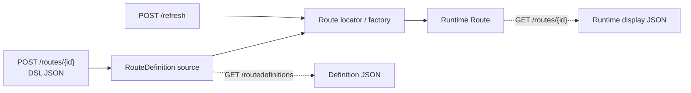
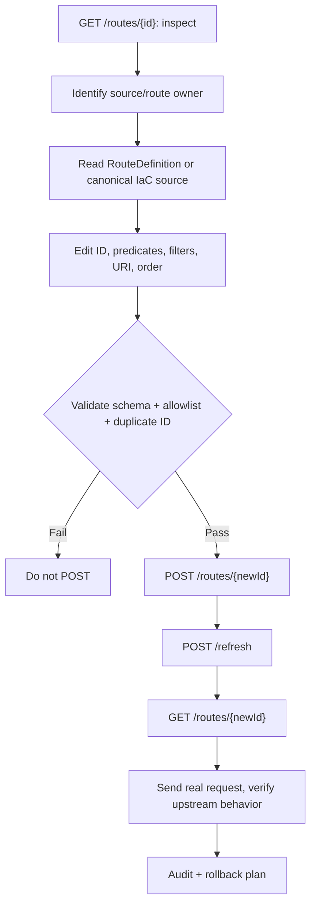

# Comparing Read Output Format vs. Route Creation Request Format

## 1. Why Being Able to Read Route JSON Does Not Mean You Can POST That Same JSON

In a microservices architecture, **Spring Cloud Gateway** serves as the entry point applying route predicates, filter chains, path/header transformations, service discovery, authentication, rate limiting, circuit breakers, retries, TLS, and request observability. When operating the system, teams often need to **inspect active routes** and sometimes **create a test route** via Spring Boot Actuator.

A confusing failure pattern is:

1. Call `GET /actuator/gateway/routes/catalog-demo`, receiving JSON with `route_id`, `predicate`, `filters`, `uri`, and `order`.
2. Copy that exact response JSON.
3. Submit it via `POST /actuator/gateway/routes/catalog-demo-copy`.
4. The route fails to be created properly or the server returns an error.

**The reason:** the endpoint **reading routes already compiled into executable objects** does not share the same data contract as the endpoint **accepting a `RouteDefinition` to create a route**. In Spring Cloud Gateway Server WebFlux 5.0.x, `GET /actuator/gateway/routes/{id}` is an **operator display format**, whereas `POST /actuator/gateway/routes/{id}` uses **predicate/filter shortcut DSL strings**, such as `"Path=/api/catalog/**"` and `"StripPrefix=2"`.

After this lesson in the **Actuator Management** chapter, you will be able to:

- Recognize the `routes`, `routes/{id}`, `routedefinitions`, and `refresh` endpoints.
- Distinguish **runtime `Route`**, **`RouteDefinition`**, and **POST creation JSON**, without treating them as byte-for-byte interchangeable data.
- Convert an inspected route into a route creation payload with valid DSL `predicates` and `filters`.
- Create, read back, verify live traffic, and delete a test route using curl along with the **refresh** step.
- Understand the limitations of routes defined in `application.yml` or Java `@Bean`s compared to routes **created via Actuator**.
- Protect Actuator with `read-only` mode, enabling `unrestricted` only within authenticated management boundaries.
- Diagnose duplicate route ID errors, bad predicates/filters, route order issues, refresh issues, and version differences.

> **Version Scope:** This lesson uses **Spring Cloud Gateway Server WebFlux 5.0.x**, cross-checked against current 5.0.5 documentation, Spring Boot 4.x, and a compatible Spring Cloud BOM. Some Gateway 4.x/older docs illustrate `GET /routes/{id}` as an object `{"id","predicates":[...]}`, whereas **5.0.x explicitly documents `route_id` and string-formatted `predicate`**. Do not mix schemas from two versions or assume Server Web MVC shares identical management endpoints.

## 2. Three Layers of a Route to Distinguish

### 2.1. Source Configuration (`RouteDefinition`)

A route can come from `application.yml`, a route definition repository, discovery, or Actuator creation. At the configuration layer, predicates and filters still retain **factory name + arguments**:

```yaml
# Snippet inside spring.cloud.gateway.server.webflux.routes:
- id: catalog-static
  uri: http://localhost:8081
  predicates:
    - Path=/api/static/**
    - Method=GET
  filters:
    - StripPrefix=2
    - AddRequestHeader=X-Training-Route,static
  order: 0
```

Here `Path`, `Method`, `StripPrefix`, and `AddRequestHeader` are **factory names**, and the parts after `=` are **shortcut arguments**. These are the inputs the Gateway needs to **construct a route**.

### 2.2. Executable Route (`Route`)

The Gateway uses `RouteDefinitionRouteLocator` (and other locators) to build the live executable route. Predicates become **executable predicate functions**; filters become ordered **`GatewayFilter` objects** in the filter chain.

```text
application.yml / actuator route definition / custom locator
               |
               v
      RouteDefinition (id, predicates, filters, uri, order)
               |
               v
   RouteDefinitionRouteLocator / predicate & filter factories
               |
               v
       Runtime Route (predicate function + filter chain)
               |
               +--> GET /actuator/gateway/routes/{id}: readable description
               +--> Live request: selects route and proxies
```

**You cannot reliably reverse-engineer** all original parameters from the runtime `predicate` string: predicates may have been combined with AND operators, formatted per factory, or omit verbatim values. Similarly, `filters` typically contains human-readable strings like `[[StripPrefix parts = 2], order = 1]`, **not a new DSL declaration**.

### 2.3. Route Creation Payload (Actuator POST)

The route creation endpoint is documented in Spring Cloud Gateway 5.0.x with JSON like:

```json
{
  "predicates": [
    "Path=/api/dynamic/**",
    "Method=GET"
  ],
  "filters": [
    "StripPrefix=2",
    "AddRequestHeader=X-Training-Route,dynamic"
  ],
  "uri": "http://localhost:8081",
  "order": 10
}
```

For `POST /actuator/gateway/routes/catalog-dynamic`, **the route ID lives in the URL path `catalog-dynamic`**. This minimal payload does not need a `route_id` field matching GET output. If using a bulk creation API, IDs must be supplied per that endpoint's specific contract.

## 3. Which Actuator Endpoints Are Involved?

All paths below belong to **Spring Cloud Gateway Server WebFlux** and default to base path `/actuator/gateway` unless `management.endpoints.web.base-path` is customized.

| HTTP | Endpoint | Purpose | Format / Effect |
|---|---|---|---|
| GET | `/actuator/gateway/` | Inspect reported child endpoints | List of links/methods |
| GET | `/actuator/gateway/routes` | Inspect **running** route list | Array of descriptive runtime routes, verbose by default |
| GET | `/actuator/gateway/routes/{id}` | Inspect **one** executable route | JSON `route_id`, string `predicate`, string-array `filters`, `uri`, `order` |
| GET | `/actuator/gateway/routedefinitions` | Inspect **`RouteDefinition`** entries from definition sources | Definition format with `id`/predicate/filter configs, helpful for comparison |
| GET | `/actuator/gateway/globalfilters` | Inspect GlobalFilters and orders | Object descriptions, not a POST payload |
| GET | `/actuator/gateway/routefilters` | Inspect filter factories | Factory/metadata descriptions, not route definitions |
| GET | `/actuator/gateway/routes/{id}/combinedfilters` | Inspect combined filters for a route | Filter ordering for the runtime route |
| POST | `/actuator/gateway/routes/{id}` | **Create** a route definition with a new ID | `RouteDefinition` JSON, succeeds with **201 Created** |
| DELETE | `/actuator/gateway/routes/{id}` | Delete an Actuator-managed route | Succeeds with **200 OK**; does not delete YAML/Java routes |
| POST | `/actuator/gateway/refresh` | Clear/refresh route cache after changes | Succeeds with **200**, usually empty body |

**Note:** both read and create use `/routes/{id}`, yet **a different HTTP method does not make the GET response body valid as the POST request body**. That is the central point of this lesson.

### 3.1. Three Distinct Meanings of “Seeing a Route”



This diagram is simplified to highlight **data contracts** and cache refreshing—it does not imply every source in the system is managed by one single repository. With a Java `@Bean RouteLocator`, a runtime route can exist without an Actuator-editable route definition.

### 3.2. Verbose Is a Display Mode, Not Route Creation Syntax

WebFlux documentation includes the property:

```yaml
spring:
  cloud:
    gateway:
      server:
        webflux:
          actuator:
            verbose:
              enabled: true
```

In 5.0.x, verbose display is **enabled by default**. Setting `false` can cause predicates/filters to render as Java object/lambda `toString()` output instead of readable descriptions. Whether enabled or disabled, **never copy GET output as a POST payload**; the two formats remain distinct contracts.

## 4. Enabling Actuator in the Right Mode and Securing the Endpoint

### 4.1. Dependencies

In a **Gateway WebFlux** project, include a compatible Spring Cloud BOM and Spring Boot BOM along with these dependencies:

```xml
<dependencies>
    <dependency>
        <groupId>org.springframework.cloud</groupId>
        <artifactId>spring-cloud-starter-gateway-server-webflux</artifactId>
    </dependency>
    <dependency>
        <groupId>org.springframework.boot</groupId>
        <artifactId>spring-boot-starter-actuator</artifactId>
    </dependency>
</dependencies>
```

Merely adding the Actuator starter **does not** automatically mean the `gateway` management endpoint permits create/delete. Gateway Actuator is restricted by default; appropriate access and exposure settings are required.

### 4.2. Safe Observation Configuration: `read-only`

This is the configuration to use in operational environments when you only need to **inspect routes**:

```yaml
management:
  endpoint:
    gateway:
      access: read-only
  endpoints:
    web:
      exposure:
        include: health,info,gateway
```

- `management.endpoint.gateway.access: read-only` permits necessary **GET** requests while **blocking create, delete, and refresh operations**.
- `management.endpoints.web.exposure.include` exposes the Gateway Actuator endpoint over HTTP, yet **exposure does not replace authentication/authorization**.
- Spring Boot also provides `management.endpoints.access.default` and other access caps; organizational policies may override/cap access levels.

**Default to `read-only`.** A monitoring tool does not need permission to edit routes; granting `unrestricted` system-wide just to read JSON is far too permissive.

### 4.3. Write-Enabled Lab Listening Only on the Loopback Management Port

To practice creating/deleting routes, run a **dedicated lab Gateway**, managed on port `9090` and reachable only from **local loopback**:

```yaml
# LOCAL LAB CONFIGURATION; DO NOT COPY VERBATIM TO PRODUCTION.
management:
  server:
    port: 9090
    address: 127.0.0.1
  endpoint:
    gateway:
      access: unrestricted
  endpoints:
    web:
      exposure:
        include: health,info,gateway
```

`unrestricted` is required to demonstrate `POST`/`DELETE`/`refresh`; it is **not a production security policy**. Never expose this port through an ingress, public Kubernetes Service, LoadBalancer, or external firewall. With multiple Gateway instances, management endpoints run on **each individual instance** and route changes do not automatically sync across the cluster.

If the project includes Spring Security, endpoints may require authentication depending on `SecurityWebFilterChain`. In production, enforce **dedicated RBAC**, mTLS/VPN/private networks, actor auditing, CSRF aligned with the auth model, and validation of permitted upstreams/routes. Never run “unrestricted, anonymous actuator” on the Internet.

### 4.4. Two Ports, Not One

```text
Browser / API client  ---> Gateway :8080  ---> backend :8081
Operator (localhost)  ---> Actuator :9090  ---> route management
```

With a separate management port configured, call `/actuator/gateway/routes` **on `9090`**, while business requests go to `8080`. Using the wrong port can return 404 even when Actuator is enabled.

> **Lab boundary:** The POST steps below perform real changes to the route registry in a test environment. Run them only against a Gateway you control. Never run route create/delete commands on production without approval and a rollback procedure.

## 5. Preparing Two Applications to Compare Live Results

### 5.1. Small JSON Backend on Port 8081

Create a standalone Spring Boot **Web MVC** application named `catalog-demo` on port `8081`. With Spring Boot 4.x, use `spring-boot-starter-webmvc`. File `CatalogApplication.java`:

```java
package com.example.catalog;

import java.util.Map;
import org.springframework.boot.SpringApplication;
import org.springframework.boot.autoconfigure.SpringBootApplication;
import org.springframework.web.bind.annotation.GetMapping;
import org.springframework.web.bind.annotation.PathVariable;
import org.springframework.web.bind.annotation.RequestHeader;
import org.springframework.web.bind.annotation.RestController;

@SpringBootApplication
@RestController
public class CatalogApplication {

    public static void main(String[] args) {
        SpringApplication.run(CatalogApplication.class, args);
    }

    @GetMapping("/items/{id}")
    public Map<String, String> getItem(
            @PathVariable String id,
            @RequestHeader(
                name = "X-Training-Route",
                defaultValue = "none") String routeName) {
        return Map.of(
            "id", id,
            "service", "catalog-demo",
            "routedBy", routeName);
    }
}
```

The **backend**'s `application.yml`, not placed inside the Gateway:

```yaml
server:
  port: 8081
spring:
  application:
    name: catalog-demo
```

Verify before testing the Gateway:

```bash
curl --noproxy '*' -i \
  'http://127.0.0.1:8081/items/42'
```

Expected response is `200` with JSON containing `"id":"42"`, `"service":"catalog-demo"`, and `"routedBy":"none"`. Actuator and route caching are not involved yet.

### 5.2. Configuring the Gateway Application

Create a standalone **Gateway Server WebFlux** application with the dependencies from Section 4. In `application.yml`:

```yaml
server:
  port: 8080

spring:
  application:
    name: gateway-actuator-lab
  cloud:
    gateway:
      server:
        webflux:
          actuator:
            verbose:
              enabled: true
          routes:
            - id: catalog-static
              uri: http://127.0.0.1:8081
              predicates:
                - Path=/api/static/**
                - Method=GET
              filters:
                - StripPrefix=2
                - AddRequestHeader=X-Training-Route,static
              order: 0

management:
  server:
    port: 9090
    address: 127.0.0.1
  endpoint:
    gateway:
      access: unrestricted
  endpoints:
    web:
      exposure:
        include: health,info,gateway
```

**Two route types in this lesson:**

- `catalog-static` is declared in **`application.yml`** and loaded at startup. It can be **read** but is not Actuator-managed for deletion like a POST-created route.
- `catalog-dynamic` will be created via **`POST /actuator/gateway/routes/catalog-dynamic`** using a brand-new ID, then refreshed so it can proxy requests.

All lab examples use `127.0.0.1` on the **same machine**. If running the Gateway and backend in separate containers, use a **DNS/service name reachable from the Gateway container**—do not assume `localhost` is the learner's host.

### 5.3. Verifying the Static Route with a Business Request

```bash
curl --noproxy '*' -i \
  'http://127.0.0.1:8080/api/static/items/42'
```

`StripPrefix=2` strips `api` and `static`; the backend receives `/items/42`. Illustrative response:

```json
{
  "id": "42",
  "service": "catalog-demo",
  "routedBy": "static"
}
```

This is **proof that routing executed**, not proof that an operator has Actuator route-modification privileges.

## 6. Reading a Route: GET Returns a Runtime Representation, Not DSL

### 6.1. `GET /actuator/gateway/routes`

On management port `9090`:

```bash
curl --noproxy '*' -sS \
  'http://127.0.0.1:9090/actuator/gateway/routes'
```

With verbose format, **illustrative** output when only `catalog-static` exists:

```json
[
  {
    "route_id": "catalog-static",
    "predicate": "(Paths: [/api/static/**], match trailing slash: true && Methods: [GET])",
    "filters": [
      "[[StripPrefix parts = 2], order = 1]",
      "[[AddRequestHeader X-Training-Route = 'static'], order = 2]"
    ],
    "uri": "http://127.0.0.1:8081",
    "order": 0
  }
]
```

**Do not depend byte-for-byte** on the `predicate`/`filters` strings in this illustrative JSON: exact formatting and order numbers are produced by the Gateway version and factories. In real deployments, the app may also contain routes generated by discovery, Java `@Bean`s, or other configs.

Structure breakdown:

- `route_id` is the **route ID**, different from the `id` property used in YAML/`RouteDefinition`.
- `predicate` is **a single composite display string** of conditions, not a `predicates` array.
- `filters` is **an array of runtime filter description strings**, not an array of `Filter=arg` declarations.
- `uri` is the route destination scheme/host/port.
- `order` is the Gateway's route selection priority, **distinct from** individual filter orders.

### 6.2. `GET /actuator/gateway/routes/{id}`

Inspecting a single route:

```bash
curl --noproxy '*' -sS \
  'http://127.0.0.1:9090/actuator/gateway/routes/catalog-static'
```

**Similar** response:

```json
{
  "route_id": "catalog-static",
  "predicate": "(Paths: [/api/static/**], match trailing slash: true && Methods: [GET])",
  "filters": [
    "[[StripPrefix parts = 2], order = 1]",
    "[[AddRequestHeader X-Training-Route = 'static'], order = 2]"
  ],
  "uri": "http://127.0.0.1:8081",
  "order": 0
}
```

This is the format documented by **Spring Cloud Gateway 5.0.5** for `GET /routes/{id}`: singular string `route_id` and `predicate`, not `id` with a `predicates` array. A tool that takes this JSON and immediately POSTs it to the route creation endpoint **submits the wrong schema**.

### 6.3. Does Disabling Verbose Make the Output Usable for Route Creation?

If you set:

```properties
spring.cloud.gateway.server.webflux.actuator.verbose.enabled=false
```

the GET response may contain Java object/lambda strings like `org.springframework.cloud.gateway.handler.predicate.*`. That is **even less usable for creating routes**; never parse object/lambda `toString()` to recover original parameters. Keep verbose enabled for **observation**, and retrieve route definitions for **restoration** from `RouteDefinition`, YAML, or IaC.

### 6.4. Why Cannot GET Faithfully Preserve an Entire Source Route?

Suppose a route was written as:

```yaml
predicates:
  - Host=**.example.test
  - Path=/api/catalog/**
  - Method=GET
filters:
  - StripPrefix=2
  - AddRequestHeader=X-Env,staging
```

When building the runtime route, the Gateway constructs predicate functions and filter objects. The `predicate` string in GET may show a **combined condition**, while `filters` shows interpreted details, orders, and class/factory names. It is **not a reliable reverse-serialization** of YAML:

1. Delimiters, regex escapes, and templates may be formatted differently for display.
2. Default values may have been applied, making defaults indistinguishable from user-entered values.
3. A custom Java `GatewayFilter`/predicate may have no shortcut DSL equivalent.
4. Some runtime filters come from `default-filters` or `GlobalFilter`, not from the route definition itself.

Therefore, **never build a “GET then POST verbatim” tool** against the runtime endpoint.

## 7. `GET /routedefinitions`: Closer to Config Schema, Still Source-Dependent

Gateway documentation provides `GET /actuator/gateway/routedefinitions` to read **route definitions**. In an environment with route `catalog-static`, a response typically resembles:

```json
[
  {
    "id": "catalog-static",
    "predicates": [
      {
        "name": "Path",
        "args": {"_genkey_0": "/api/static/**"}
      },
      {
        "name": "Method",
        "args": {"_genkey_0": "GET"}
      }
    ],
    "filters": [
      {
        "name": "StripPrefix",
        "args": {"_genkey_0": "2"}
      },
      {
        "name": "AddRequestHeader",
        "args": {
          "_genkey_0": "X-Training-Route",
          "_genkey_1": "static"
        }
      }
    ],
    "uri": "http://127.0.0.1:8081",
    "order": 0
  }
]
```

This is an **illustrative `RouteDefinition` example explaining the model**, not a guarantee that every factory/version returns identical `_genkey_0` keys or optional fields. Always **inspect the actual response** from your running version; metadata or named arguments may also appear.

### 7.1. What Fields Does `RouteDefinition` Have?

| Field | Meaning in Configuration | Notes |
|---|---|---|
| `id` | Route identifier | For single-route POST, the ID is specified in URI `/routes/{id}` |
| `predicates` | List of `PredicateDefinition` entries | Factory name + arguments, or shortcut form depending on endpoint |
| `filters` | List of `FilterDefinition` entries | Filter factory name + arguments |
| `uri` | Destination URI | `http://`, `https://`, `lb://`, etc., per config |
| `order` | Route priority order | Smaller values are normally evaluated first |
| `metadata` (if present) | Custom route metadata | May affect timeouts, management, or other features |

**Do not equate `_genkey_0` with a route notation used in URLs.** It is a positional argument key emitted by the serializer in certain definition forms, not a field you must supply in every create request. For multi-argument factories, check indexed list or named argument syntax in each factory's documentation.

### 7.2. Reading a Definition Does Not Mean Permission to Modify It

Routes from `application.yml` or `@Bean` can be **viewed** via Actuator, yet 5.0.x docs clearly state: **only routes created through the Actuator endpoint can be edited/deleted through the Actuator endpoint**. `GET /routedefinitions` is not a “writable admin table” for all configuration sources.

If `GET /routes/catalog-static` returns 200 and `DELETE /routes/catalog-static` returns **404**, that can be completely valid because the route comes from YAML and is **read-only from Actuator management's perspective**.

### 7.3. Which Endpoint/Source for Which Purpose?

| Need | Appropriate Source |
|---|---|
| Find which routes the Gateway is actively running | `GET /actuator/gateway/routes` |
| Inspect details and runtime filters of a specific route ID | `GET /actuator/gateway/routes/{id}`, `/combinedfilters` |
| Inspect `RouteDefinition` entries provided by locators | `GET /actuator/gateway/routedefinitions` |
| Store long-lived config with review/versioning | `application.yml`, Git/IaC, or a designed route repository |
| Create a lab route | `POST /actuator/gateway/routes/{id}` with DSL body |
| Activate a newly created route | `POST /actuator/gateway/refresh` |

These are **complementary tools**, not interchangeable clones for automation.

## 8. Comparing Both JSON Shapes Side by Side

Suppose you want to clone the **semantics** of `catalog-static` into a new route `catalog-dynamic`, using prefix `/api/dynamic/**`.

**GET response: representation for reading**

```json
{
  "route_id": "catalog-static",
  "predicate": "Paths: [/api/static/**]",
  "filters": [
    "[[StripPrefix parts = 2], order = 1]"
  ],
  "uri": "http://127.0.0.1:8081",
  "order": 0
}
```

**POST request: definition for creating a route**

```json
{
  "predicates": [
    "Path=/api/dynamic/**",
    "Method=GET"
  ],
  "filters": [
    "StripPrefix=2"
  ],
  "uri": "http://127.0.0.1:8081",
  "order": 10
}
```

The two JSON blocks are **not copies**: GET reflects runtime state, while POST describes a definition usable to create a new route.

### 8.1. Focused Mapping Table

| Field | GET `/routes/{id}` | POST `/routes/{id}` | How to Convert? |
|---|---|---|---|
| ID | `route_id: "catalog-static"` | `{id}` in the endpoint URL, e.g. `catalog-dynamic` | Pick a new ID; never copy `route_id` as a body field expecting the API to infer it |
| Predicate | `predicate`: **a single display string** | `predicates`: **array of DSL strings** | Rebuild `Path=/...`, `Method=GET` from definition sources; never auto-parse display strings |
| Filter | `filters` has strings like `[[StripPrefix ...], order = 1]` | `filters` has strings like `StripPrefix=2` | Strip runtime display/order formatting; use valid factory shortcut syntax |
| Destination | `uri` string | `uri` string | Keep/update only after upstream allowlist approval |
| Route order | `order` number | `order` number | Choose deliberately to avoid shadowing other routes |
| Metadata | May or may not appear depending on endpoint/format | `metadata` only when truly needed | Never infer metadata from predicate display text |
| Combined filters | Visible on a separate endpoint | Never send combined filters array back | Global/default filters are distinct from route-specific filters |

**Quick rule of thumb:** Runtime GET has singular **`predicate`**, whereas definition POST has plural **`predicates`**. In GET, `filters` looks like an array yet **its elements are runtime descriptive text**; in POST, each element is a **filter declaration**.

### 8.2. Wrong: Sending the GET Response Directly as the POST Body

Example **not to use**:

```json
{
  "route_id": "catalog-static",
  "predicate": "(Paths: [/api/static/**], match trailing slash: true)",
  "filters": [
    "[[StripPrefix parts = 2], order = 1]"
  ],
  "uri": "http://127.0.0.1:8081",
  "order": 0
}
```

**What is wrong?**

- `route_id` is not the `id` field of `RouteDefinition`; the create ID is passed via path `/routes/{id}`.
- `predicate` is a human-readable string, not the `predicates` array expected by the binder.
- `"[[StripPrefix parts = 2], order = 1]"` is observation/log text, not the factory shortcut `"StripPrefix=2"`.
- If the route ID already exists, the error goes beyond schema: **re-POSTing an existing ID risks creating a duplicate route definition** (Section 11).

Do not assume the server always returns a single fixed 400 code for every bad payload. Failures can happen during JSON parsing, definition binding, predicate/filter factory conversion, or route cache refresh; inspect logs and actual version responses to diagnose.

### 8.3. Right: Intentionally Constructing a New Definition

Valid POST example keeping a clean structure:

```json
{
  "predicates": [
    "Path=/api/dynamic/**",
    "Method=GET"
  ],
  "filters": [
    "StripPrefix=2",
    "AddRequestHeader=X-Training-Route,dynamic"
  ],
  "uri": "http://127.0.0.1:8081",
  "order": 10
}
```

You do not include `route_id`, `predicate`, or copied `filters` description strings in this JSON. For `/api/dynamic/items/42`, the route matches and `StripPrefix=2` makes the backend see `/items/42`.

## 9. Practice: Creating a Route via Actuator POST, Refresh, GET, and Delete

**Prerequisites:** Gateway on `8080`, management on `9090` bound to loopback only, backend running on `8081`. `management.endpoint.gateway.access: unrestricted` is enabled **only in the lab**. If custom Spring Security is active, the lab account must hold management permission; never bypass security.

### 9.1. Check That the Route ID Does Not Already Exist

Before creating `catalog-dynamic`, query:

```bash
curl --noproxy '*' -i \
  'http://127.0.0.1:9090/actuator/gateway/routes/catalog-dynamic'
```

If absent, the endpoint typically returns **404**. However, 404 alone does not prove the ID is absent across **every repository/instance**; in distributed setups check actual route sources and management instances.

**Do not use `catalog-static` as the ID for the new POST route**, because it is declared in YAML and does not belong to the Actuator-managed store.

### 9.2. Create the Route Using a Lab Payload JSON File

Create `catalog-dynamic.json` **outside the lesson documentation directory**, in your own lab workspace:

```json
{
  "predicates": [
    "Path=/api/dynamic/**",
    "Method=GET"
  ],
  "filters": [
    "StripPrefix=2",
    "AddRequestHeader=X-Training-Route,dynamic"
  ],
  "uri": "http://127.0.0.1:8081",
  "order": 10
}
```

Then run curl:

```bash
curl --noproxy '*' -i -X POST \
  'http://127.0.0.1:9090/actuator/gateway/routes/catalog-dynamic' \
  -H 'Content-Type: application/json' \
  --data-binary @catalog-dynamic.json
```

Per Gateway 5.0.5 docs, a successful create returns **`201 Created`**. Never conclude the route is live for all traffic from status 201 alone: proceed to **refresh** and verify runtime state.

### 9.3. Refresh the Route Cache

```bash
curl --noproxy '*' -i -X POST \
  'http://127.0.0.1:9090/actuator/gateway/refresh'
```

A successful response is typically **`200 OK` with no response body**. Refresh tells the Gateway to reload/update routes from modified sources—it does not restart the JVM or deploy new configuration.

**Never call refresh to “fix” invalid JSON syntax**: route data must be valid first. If refresh encounters an async error, per Gateway docs the existing route configuration may remain intact; inspect logs, runtime state, and actual behavior.

### 9.4. Read Back the Route After Refresh

```bash
curl --noproxy '*' -sS \
  'http://127.0.0.1:9090/actuator/gateway/routes/catalog-dynamic'
```

The post-refresh response uses the **GET schema**, not the POST JSON:

```json
{
  "route_id": "catalog-dynamic",
  "predicate": "(Paths: [/api/dynamic/**], match trailing slash: true && Methods: [GET])",
  "filters": [
    "[[StripPrefix parts = 2], order = 1]",
    "[[AddRequestHeader X-Training-Route = 'dynamic'], order = 2]"
  ],
  "uri": "http://127.0.0.1:8081",
  "order": 10
}
```

This is **illustrative output**; filter/predicate descriptions may differ. What matters is that the **semantic components** match the payload you created: ID, path, method, filter arguments, URI, and route order. **Never compare GET JSON against POST JSON with strict equality**, since their schemas differ.

### 9.5. Verify with a Real Business Request

```bash
curl --noproxy '*' -i \
  'http://127.0.0.1:8080/api/dynamic/items/42'
```

The demo backend receives `GET /items/42` and header `X-Training-Route: dynamic`. **Expected** body:

```json
{
  "id": "42",
  "service": "catalog-demo",
  "routedBy": "dynamic"
}
```

**Reading a route ≠ proving the route handles traffic.** If the backend URI is wrong or the backend is down, Actuator still shows the route while live requests return 5xx. If another higher-priority route has overlapping predicates, requests can hit the wrong route. Always verify **both Actuator and live requests**.

### 9.6. Delete the Lab Route and Refresh

```bash
curl --noproxy '*' -i -X DELETE \
  'http://127.0.0.1:9090/actuator/gateway/routes/catalog-dynamic'

curl --noproxy '*' -i -X POST \
  'http://127.0.0.1:9090/actuator/gateway/refresh'
```

Per docs, a successful DELETE returns **`200 OK`**. After refresh, `GET /routes/catalog-dynamic` normally no longer finds the route, and `GET /api/dynamic/items/42` no longer matches the test route (typically `404` if no other route matches). **Verify both**, rather than trusting DELETE's response while a duplicate route remains from elsewhere.

### 9.7. Do Not Use DELETE to Remove a Route Declared in YAML

Test in the **lab** with `catalog-static`:

```bash
curl --noproxy '*' -i -X DELETE \
  'http://127.0.0.1:9090/actuator/gateway/routes/catalog-static'
```

Per 5.0.x docs, routes coming from `application.yml` or `@Bean` **cannot be deleted via this endpoint**; DELETE may return **404 Not Found**. This is not necessarily a permissions error or a missing route: **the route source is read-only to Actuator management**.

To alter a static route configuration, edit the **authoritative config source** (Git/IaC/config repository) and deploy or reload through a supported mechanism, rather than treating Actuator DELETE as a generic database CRUD endpoint.

## 10. Checking “Semantic Equivalence”, Not Copying Two JSONs Literally

### 10.1. Verification Criteria After POST

A sound verification pipeline should compare:

| From POST Payload | From Runtime GET | Additional Evidence |
|---|---|---|
| ID in `/routes/catalog-dynamic` | `route_id == "catalog-dynamic"` | GET by ID must locate the route |
| `Path=/api/dynamic/**` | `predicate` string includes `/api/dynamic/**` | Request `/api/dynamic/items/42` matches |
| `Method=GET` | Displayed `predicate` includes GET | Business POST/DELETE does not match unintentionally |
| `StripPrefix=2` | Filter description shows `StripPrefix` with arg 2 | Backend observes `/items/42` |
| `AddRequestHeader=X-Training-Route,dynamic` | Filter description shows header/value | Backend returns `"routedBy":"dynamic"` |
| `uri=http://127.0.0.1:8081` | Route `uri` | Connects to expected backend; do not rely solely on text |
| `order=10` | `order == 10` | Verified when multiple routes could match |

**Do not assert**:

- `GET.response == POST.request` by JSON deep equality.
- That a runtime predicate string equals `"Path=/..."` verbatim.
- That runtime `filters[0]` equals `"StripPrefix=2"` verbatim.
- That filter display order stays immutable across versions.
- That `201 Created` proves the upstream is reachable or all Gateway pods received the route.

### 10.2. Designing Admin Tooling Models

If building a route administration UI, separate two models:

```text
RouteInspectionDTO  (read-only)
  routeId          <- GET /routes/{id}.route_id
  displayPredicate <- GET .predicate
  displayFilters   <- GET .filters
  destinationUri   <- GET .uri
  routeOrder       <- GET .order

RouteCreateCommand  (sent only after validation)
  id               -> URL /routes/{id}
  predicates       -> ["Path=...", "Method=..."]
  filters          -> ["StripPrefix=...", "AddRequestHeader=..."]
  uri              -> destination allowlist
  order            -> route priority
  metadata         -> optional, validated
```

**Important:** if the UI wants to clone an existing route, pull from a **trusted `RouteDefinition` source** (Git/IaC/repository), provide a form where operators confirm each predicate/filter, or use an explicitly engineered mapping. Never regex-parse `[[Filter..., order=...]]` to auto-generate routes.

### 10.3. Safe “Round-Trip” Strategy



If POST/refresh/testing fails, delete the Actuator-created route and refresh again to revert. In multi-instance systems, the rollback plan must cover both the **route store and every instance cache**; deleting a route on one pod does not mean the whole cluster has recovered.

## 11. Constraints When Updating Routes and Easy-to-Confuse Errors

### 11.1. Never POST to an Already-Existing Route ID

Spring Cloud Gateway 5.0.x documentation specifically warns: **do not send POST to an existing route ID before deleting it**. In some versions, doing so creates duplicate route definitions in memory, causing subsequent `GET /actuator/gateway/routes` calls to return **500 Internal Server Error**.

This does not follow “PUT resource replacement” or upsert semantics:

```text
WRONG:
POST /actuator/gateway/routes/catalog-dynamic    # first: creates
POST /actuator/gateway/routes/catalog-dynamic    # again: NOT a safe update
POST /actuator/gateway/refresh

RIGHT for an Actuator-owned route:
DELETE /actuator/gateway/routes/catalog-dynamic
POST   /actuator/gateway/routes/catalog-dynamic    # new payload
POST   /actuator/gateway/refresh
```

**Recommended update workflow** for the lab:

1. Identify route ID and **ownership source** (Actuator-managed, YAML, Java, or another repository).
2. Back up the prior definition in your controlled config/rollback store.
3. If **Actuator-managed**, DELETE first, verify the result, POST the new definition, then refresh.
4. Verify runtime state after refresh, send an end-to-end request, and check route ID/order/filters/URI.
5. If wrong, roll back to the old version, refresh, and re-verify.

In production, the gap between DELETE and POST can briefly leave the route missing; use a **versioned/atomic route deployment pipeline** when high availability is required. Actuator docs describe DELETE → POST → refresh, yet **do not guarantee cluster-wide atomic updates**.

### 11.2. “Route Exists” Yet DELETE Returns 404

Seeing `GET /routes/catalog-static` return JSON while `DELETE /routes/catalog-static` returns 404 is **not a contradiction**. The read endpoint aggregates across multiple route locators including static routes, whereas the delete endpoint operates only on the **Actuator-managed route definition store**.

Never solve this by “forcing a POST with the same ID” to overwrite it. That risks duplicate route IDs, unpredictable route selection, and Actuator listing failures.

### 11.3. POST Returns 201 Yet GET Does Not Show the New Route

Check in order:

1. Did you hit the right **management port** and the right Gateway **instance**?
2. Was the JSON payload accepted cleanly with the right `Content-Type`?
3. Did you call `POST /actuator/gateway/refresh`?
4. Was there a route build failure due to an unknown `predicate`/`filter` factory or invalid args?
5. Are you querying a different route source or instance cache than the one you POSTed to?
6. Is there a duplicate ID, custom locator, or repository config behaving differently than expected?

**Status 201** only confirms definition creation—it does not guarantee traffic is using that definition.

### 11.4. Route Appears in GET, Yet Live Requests Return 404 or 5xx

Possible causes:

- `Path`/`Method`/`Host`/`Header` predicates do not match the real request, producing **404** from the Gateway.
- Another route with higher-priority `order` matched first.
- `StripPrefix`/`RewritePath` produces a path the backend does not map, yielding **404** from the backend.
- Destination `uri` fails DNS resolution, backend is down, or TLS trust fails, yielding **5xx**.
- With `lb://service-name`, LoadBalancer and a matching `ServiceInstance` source are required; route JSON alone is insufficient.
- Spring Security, rate limiter, circuit breaker, CORS, or a `GlobalFilter` responded early without calling the backend.

Inspect the **matched route ID** and backend access logs to see where requests went, rather than looking only at `GET /routes`.

### 11.5. When a Route Shows an Unexpected Order

Route-level `order` governs route evaluation priority, **not** individual filter positions. Inside `GET /routes/{id}`, filters can display their own `order = ...`. If two routes match the same path/method, verify precedence via **route `order`** and other predicates—never infer route priority from JSON array ordering.

## 12. Argument Formats: Shortcut DSL vs. Structured Definitions

### 12.1. For Standard Routes: Use Shortcut DSL

Actuator 5.0.5 documentation uses **shortcut strings** for `POST /routes/{id}`:

```json
{
  "predicates": [
    "Path=/api/items/**",
    "Method=GET"
  ],
  "filters": [
    "StripPrefix=2",
    "AddRequestHeader=X-Lab,yes"
  ],
  "uri": "http://127.0.0.1:8081",
  "order": 1
}
```

In this style:

- `Path=/api/items/**`: factory name `Path`, argument is the pattern.
- `Method=GET`: matches GET only.
- `StripPrefix=2`: strips the first two path segments.
- `AddRequestHeader=X-Lab,yes`: two positional arguments, name and value.
- `uri` must be a valid destination URI approved by operators.

**Do not append `GatewayFilterFactory` to filter names** in shortcuts; DSL names follow Gateway conventions like `StripPrefix`, `AddRequestHeader`, `RewritePath`, etc.

### 12.2. Why Does the `name + args` Structure Sometimes Appear in Definitions?

A `RouteDefinition` can also be represented using **objects** with `name` and `args`, for instance:

```json
{
  "id": "items-structured-example",
  "uri": "http://127.0.0.1:8081",
  "predicates": [
    {
      "name": "Path",
      "args": {
        "patterns.0": "/api/items/{id}",
        "patterns.1": "/api/legacy/{id}",
        "matchTrailingSlash": "false"
      }
    }
  ],
  "filters": [
    {
      "name": "StripPrefix",
      "args": {"_genkey_0": "2"}
    }
  ],
  "order": 1
}
```

The **Path Route Predicate Factory** docs in the 5.0.x branch show a POST example where `predicates` is a `{"name":"Path","args":{...}}` object, notably for `patterns.0`, `patterns.1`, and `matchTrailingSlash`. Still, the **Actuator API** docs present shortcut strings as **the simplest and preferred route creation syntax for this lesson**.

**When using the advanced structured form, verify your exact version** and how the binder parses each factory/config; never assume arbitrary JSON object shapes are accepted. The same route appearing in `GET /routedefinitions` as `name/args` does not mean every `args` key transfers identically across all filters or versions.

### 12.3. Why Are Path `args` Not an Arbitrary JSON Array?

In the 5.0.x Path predicate example, the `args` map takes **String key-value pairs**. Pattern lists are represented with indexed keys:

```json
{
  "name": "Path",
  "args": {
    "patterns.0": "/red/{segment}",
    "patterns.1": "/blue/{segment}",
    "matchTrailingSlash": "false"
  }
}
```

Do not replace it with:

```json
{
  "name": "Path",
  "args": {
    "patterns": [
      "/red/{segment}",
      "/blue/{segment}"
    ]
  }
}
```

The second form looks like “natural JSON” yet violates the **String→String arguments map** documented by Path Predicate for route definitions. When multiple patterns are needed, use the factory's indexed notation/parameter names and verify runtime GET after refresh.

### 12.4. Regexes and Commas Make Shortcuts Trickier

Some filters use regexes or values containing commas (`RewritePath`, `AddRequestHeader`), so the shortcut parser has specific splitting/escaping rules. Strings with `$`, `\`, YAML escaping, and JSON string escaping must be checked across **multiple syntax layers**:

```text
YAML application.yml:   must escape YAML values properly
JSON Actuator POST:     must escape JSON strings properly
Gateway factory:        also parses positional args / regex / templates
```

Do not convert regexes from YAML to JSON with naive string replacement ignoring escaping. For complex multi-arg/regex filters, prefer `name`/`args` syntax **confirmed supported by the factory and version**, or manage routes via a version-controlled config source rather than ad-hoc Actuator POSTs.

### 12.5. Metadata and Source of Truth

A `RouteDefinition` can carry metadata:

```json
{
  "predicates": ["Path=/api/dynamic/**"],
  "filters": ["StripPrefix=2"],
  "uri": "http://127.0.0.1:8081",
  "order": 10,
  "metadata": {
    "owner": "gateway-training",
    "environment": "lab"
  }
}
```

Metadata does not make a route safe on its own; special properties like timeouts or custom route-groups may be interpreted by the application/filters. Document the **owner, lifecycle, persistent storage**, allowed metadata keys, and ID collision prevention. Metadata containing secrets **must never** be returned via Actuator or logs.

## 13. Actuator Security: Route Creation Is Data-Flow Control

### 13.1. Risks of Exposing Unrestricted Route Management

Permission to create new routes can be abused to:

- Redirect sensitive API traffic to an **attacker-controlled upstream**, leaking tokens, cookies, or personal data.
- Create routes targeting **internal services** or metadata endpoints unreachable externally (**SSRF and lateral movement**).
- Attach filters that modify or strip `Authorization`, `Cookie`, `Host`, or security headers.
- Add a high-priority `Path=/**` route intercepting existing routes.
- Create proxy loops, trigger uncontrolled backend calls, or cause downtime.
- Repeatedly delete/refresh routes, altering system behavior without review.

**Never treat the route creation endpoint as ordinary CRUD.** It equates to editing routing rules and parts of the microservices security flow.

### 13.2. Defense Layers to Combine

| Layer | Measure | Goal |
|---|---|---|
| Access mode | `read-only` by default | Prevent unintended mutations |
| Network | Dedicated management port/private subnet/firewall/VPN | Keep Actuator off the Internet |
| Authentication | OIDC/mTLS/basic auth strictly over TLS per policy | Verify operator identity |
| Authorization | Dedicated role: `GATEWAY_ROUTE_ADMIN`, separate GET/POST/DELETE | Principle of least privilege |
| Input validation | Allowlist URI scheme/host/port, predicates/filters, route IDs | Prevent SSRF and dangerous filters |
| Change management | IaC/Git review, approvals, audit logs | Recoverability and accountability |
| Observability | Log request ID, route ID, actor, result, timestamp | Detect anomalous changes |
| Deployment | Canaries, route collision checks, rollback | Minimize downtime |

If Spring Boot Actuator runs on a **separate management context** `9090`, verify that Spring Security policy actually protects **that context**. A `SecurityWebFilterChain` in the main application context does not guarantee every management endpoint is protected as intended. **Test an unauthenticated POST and prove it is rejected** before deploying to production.

### 13.3. Even Viewing Routes Carries Risk

GET can reveal:

- Internal hostnames/ports in `uri`, such as `lb://payment-service` or `https://internal-node:9443`.
- Route names, protected paths, and internal headers/filters.
- Route/filter ordering and network topology.
- Environment or infrastructure metadata.

Therefore **read-only does not mean safe to expose on the Internet**. Network ACLs and proper authentication are still required; expose only minimal `health` publicly if truly required under a dedicated policy.

### 13.4. Avoid Putting Secrets Inside Route Definitions

Never write:

```json
{
  "filters": [
    "AddRequestHeader=Authorization,Bearer REAL_USER_TOKEN"
  ],
  "uri": "http://backend-internal:8080"
}
```

Raw tokens/secrets inside routes can leak via **Actuator GET, config dumps, logs, heap dumps, or audit trails**. To propagate access tokens, use **Spring Security OAuth2 `TokenRelay`** with backend verification; manage client secrets via a secret manager; use non-sensitive values and clear trust boundaries for internal headers.

### 13.5. Do Not Substitute a Syntactically Valid Route for HTTPS/mTLS

A payload with `uri: https://...` does not prove the Gateway trusts the right certificate or completes outbound mTLS. Conversely, `uri: http://...` can still transmit tokens in cleartext over internal networks without another protective channel. Verify **TLS on every hop**, trust stores, SNI/hostname validation, timeouts, and service identity before approving production routes.

## 14. Route Management and Multiple Gateway Instances

### 14.1. What Happens with Two Pods?

```text
             Load Balancer
               /     \\
              v       v
         Gateway A  Gateway B
           :8080      :8080
          mgmt A     mgmt B
           :9090      :9090
```

When route definitions live in an **instance's in-memory store**, POSTing to pod A's management endpoint **does not automatically sync** the route to pod B. Refreshing A does not automatically refresh B. A user request via the LB can hit A and match the new route, while the next request hits B and gets 404.

**Do not infer cluster-wide consistency simply because GET on one pod shows the new route.** If cluster-wide dynamic routes are needed, implement:

1. A **shared**/persistent route definition source (e.g., an approved distributed repository).
2. A **refresh/notification** mechanism reaching all relevant Gateway instances.
3. Versioning and verification that **every instance** runs the same definition set.
4. Rollback plans and protection against concurrent edits.

Even with a shared store, per-instance route caches, in-flight requests, and refresh mechanisms **do not guarantee an atomic cluster-wide cutover**. Operators must plan for the transition window.

### 14.2. Dynamic Sources Do Not Replace Git/IaC

| Route Source | Advantages | Limitations |
|---|---|---|
| `application.yml` in Git | Reviews, history, reproducible deploys | Changes usually require config rollout/restart/reload |
| Java `@Bean RouteLocator` | Conditional logic in code | Not directly CRUD-managed via Actuator |
| Actuator POST routes | Flexible in labs/canaries | Sensitive permissions; requires separate persistence/lifecycle/scale-out |
| Custom `RouteDefinitionRepository` | Can be shared, persisted, versioned | Must secure, manage consistency, and trigger refresh |
| Discovery-generated routes | Convenient for service discovery | Can auto-generate many routes; naming/predicates need control |

Production governance should establish **one primary source of truth** for route configuration, deployment, and rollback. Mixing YAML routes with ad-hoc POST dynamic routes without clear ownership/lifecycle leaves operators unsure which system owns a route or why deleted routes reappear after restarts.

### 14.3. Refresh Is Neither a Restart Nor a Deployment

`POST /actuator/gateway/refresh` clears/refreshes cached route definitions. It does **not**:

- Edit `application.yml` on the filesystem.
- Load new versions of Java code or `GatewayFilterFactory` classes.
- Provision missing OAuth2 client registrations, Redis connections, or service discovery dependencies.
- Push changes automatically to other instances.
- Guarantee backend connectivity is ready.

If you wrote a new custom Java filter without deploying its class/bean, refresh cannot turn that filter into a running factory.

### 14.4. Refreshing by Metadata

Gateway 5.0.x docs describe a `metadata` query parameter to refresh routes with matching metadata:

```bash
# Metadata-filtered management refresh example:
curl --noproxy '*' -i -X POST \
  'http://127.0.0.1:9090/actuator/gateway/refresh?metadata=group:catalog'
```

This is useful when route definitions carry `group=catalog` metadata and runtime supports group-scoped refresh. **Do not send this query and assume routes outside that group were refreshed.** For basic labs and single new routes, use a global refresh and follow up with GET verification.

## 15. Common Error Table When Comparing GET and POST

| Symptom | Common Cause | Verification / Fix |
|---|---|---|
| GET `/routes` returns 404 | Endpoint unexposed, wrong port/base path, or access disabled | Check Actuator starter, management port, `access`, web exposure |
| GET returns 401/403 | Denied by Spring Security/mTLS or network policy | Check read permissions; never disable auth for convenience |
| GET works, POST gets 403/405 | `access: read-only` or read-only authorization | Enable `unrestricted` only in isolated labs; verify admin role |
| POST body copied from GET fails | Wrong `predicate`/`route_id` schema and runtime filter strings | Use `predicates`/`filters` shortcut DSL strings |
| Second POST to same ID makes GET `/routes` return 500 | Duplicate definition per Actuator advisory | Never overwrite via POST; DELETE → POST → refresh for Actuator-managed routes |
| DELETE YAML route returns 404 despite GET showing it | Route not in Actuator-managed repository | Edit YAML/source of truth; do not use Actuator to delete |
| POST returns 201 yet route is missing | Missing refresh, route conversion error, wrong instance | Call POST refresh; inspect logs/GET and each instance's cache |
| `Path`/`Method` fails to match | Bad DSL pattern/method or route order | Inspect runtime predicate; send matching live request |
| POST fails on unknown filter name | Missing filter factory dependency/bean, or typo | Check starter, `StripPrefix`/custom factory name, startup logs |
| POST structured args list fails to bind | Used JSON array for `args.patterns` instead of `patterns.0` | Use indexed String keys per Path predicate docs |
| Valid URI yet client gets 5xx | Upstream DNS/TCP/TLS/LoadBalancer failure | Call backend from Gateway environment; verify `lb://` dependency |
| Runtime GET returns 200 yet backend gets wrong path | Wrong `StripPrefix` or `RewritePath` | Compare path/headers before and after filter |
| GET route order looks right yet traffic hits another route | Overlapping predicates, higher-priority route, Security/GlobalFilter | Inspect matched route ID/trace and full routes list |
| GET JSON `filters` strings differ from example | Verbose display varies by version/order | Never compare byte-for-byte or reuse output as DSL |
| `/routedefinitions` shows route, `/routes` does not | Definition failed to build or route cache unrefreshed | Check conversion errors, refresh, and route locators |
| New route exists on pod A, missing on pod B | Local-only route repository/cache | Use a shared store and refresh every pod |
| Dynamic route vanishes after restart | Actuator store is non-persistent | Use a persistent repository/IaC if durability is needed |
| Internal hosts/metadata leaked via public GET | Actuator management mis-exposed publicly | Lock down network, auth, auditing, and shrink exposure |

### 15.1. Investigate in Order Instead of Repeating POSTs

1. **Check versions** of Gateway/WebFlux and matching docs.
2. **Confirm exact endpoint**: `/actuator/gateway/routes/{id}`, HTTP GET vs POST, and management port.
3. **Verify access**: `read-only` vs `unrestricted`, authz, firewall, proxy.
4. **Identify route source**: YAML, Java, Actuator-managed repository, discovery.
5. **Inspect sent payload**: `Content-Type`, `predicates`, `filters` DSL, `uri`, `order`, unused new ID.
6. **Check refresh** and route conversion logs.
7. **Inspect GET runtime** and `/routedefinitions` if needed; verify semantics rather than raw JSON equality.
8. **Send a live business HTTP request** and measure path, backend headers, and response.
9. **Check multiple Gateway instances** when load-balanced.
10. **Clean up lab routes / roll back**, record audit logs, and restore safe access settings.

### 15.2. Do Not Hardcode One HTTP Code for Every Failure

Only statuses explicitly documented in this context should serve as **strict expectations**: `POST` success `201`, `DELETE` success `200`, `refresh` success `200`, and `DELETE` on a non-Actuator-managed YAML/Java route potentially returning `404`. Parse, validation, authorization, and route conversion errors depend on exception handlers and Gateway version; if you see `400`, `403`, or `500`, inspect redacted bodies/logs to trace the failing layer.

## 16. End-to-End Test Matrix for the Route Management API

To prove both read and write formats work properly, test **both REST management endpoints and live HTTP traffic**. Never test against production; use a lab Gateway with an echo backend where route IDs and paths are isolated from business routes.

| Test | Action | Expected Outcome |
|---|---|---|
| T1 | GET `/actuator/gateway/routes` on `9090` | Runtime route list with `route_id`, text `predicate`, text `filters` |
| T2 | GET `/actuator/gateway/routes/catalog-static` | Reads loaded YAML route; no write privilege needed |
| T3 | GET `/actuator/gateway/routedefinitions` | Shows definitions from locators, closer to config schema |
| T4 | POST while `gateway.access=read-only` | Denied; no create/delete/refresh occurs |
| T5 | POST new ID `catalog-dynamic` with DSL strings | `201 Created` when valid and authorized |
| T6 | GET dynamic route after POST but **before refresh** | Observe actual state; **do not assume it is active yet** |
| T7 | POST `/actuator/gateway/refresh` | `200 OK`, usually empty body |
| T8 | GET dynamic route after refresh | Runtime predicate/filters match payload semantics |
| T9 | Business GET `/api/dynamic/items/42` | Backend returns JSON `"routedBy":"dynamic"` |
| T10 | Send POST to a `Method=GET`-only route | Does not match that route; verify no upstream side effects |
| T11 | DELETE Actuator-managed dynamic route | `200 OK`; refresh and confirm route disappears |
| T12 | DELETE static YAML route | May return `404` since not Actuator-managed |
| T13 | POST body containing `route_id` + `predicate` text from GET | Wrong contract payload; must never be used to clone routes |
| T14 | POST to an already-existing ID | **Must not be executed in automation**; require duplicate-ID preflight |
| T15 | POST JSON with `uri` pointing outside allowlist | Rejected by approval/validation before any effect |
| T16 | Read across two Gateway pods | If identically configured, verify route sets; never assume sync by default |
| T17 | Unauthorized GET route details | Leaks no topology when policy requires auth |
| T18 | Unauthorized POST route | Creates no route even if network reaches management port |
| T19 | POST route with wrong `StripPrefix` | Runtime GET shows filter yet backend returns 404; requires end-to-end test |
| T20 | Refresh/route conversion failure | Do not treat earlier `200`/`201` as proof deployment completed |

### 16.1. Side-by-Side Output Comparison Lab

Learners fill out a table with:

```text
expected route ID:     catalog-dynamic
expected path:         /api/dynamic/**
expected method:       GET
expected filter 1:     StripPrefix, parts=2
expected filter 2:     AddRequestHeader, name=X-Training-Route, value=dynamic
expected upstream:     http://127.0.0.1:8081
expected order:        10

actual GET runtime:    record route_id/predicate/filters/uri/order
actual HTTP response:  record status, id, and routedBy
```

Then grade:

- **Pass** when runtime GET and a live HTTP request **both prove** the route took effect accurately.
- **Fail** if POST returned `201` without refreshing or the route fails to proxy requests.
- **Fail** if comparing GET/POST JSON by literal text equality as if they shared one data contract.

### 16.2. Regression Testing When Upgrading Gateway Versions

Actuator display fields can change between 4.x/5.x and with the `verbose` property. When upgrading:

1. Re-run runtime GET tests with **both `verbose` settings** in staging if tooling interacts with them.
2. Test `RouteDefinition` serialization and POST payloads for the predicates/filters actually in use.
3. Test refresh, create/delete, and duplicate-ID handling in an isolated environment.
4. Ensure management pipelines **never parse predicate/filter display strings**.
5. Confirm `read-only` still blocks writes after upgrading and authz remains unchanged.
6. Test rollback and multi-instance/multi-pod behavior.

This is **contract and behavior testing**, not brittle exact JSON snapshot matching.

## 17. Exercises and Self-Check Questions

**Exercise 1 — Find the Schema Error.** Given GET response:

```json
{
  "route_id": "demo",
  "predicate": "Paths: [/api/demo/**]",
  "filters": ["[[StripPrefix parts = 2], order = 1]"],
  "uri": "http://127.0.0.1:8081",
  "order": 0
}
```

Why can you **not** POST this exact JSON to `/actuator/gateway/routes/demo-copy`? Write a valid payload using `Path=/api/demo-copy/**` and `StripPrefix=2`.

**Exercise 2 — Singular vs. Plural.** Distinguish `predicate` in runtime GET from `predicates` in definition POST. Do the `filters` arrays in GET and POST hold the same element format?

**Exercise 3 — Three GET Calls.** When is each endpoint used: `/routes`, `/routes/{id}`, and `/routedefinitions`? Which is closest to the `RouteDefinition` concept?

**Exercise 4 — Access Control.** You have `management.endpoint.gateway.access: read-only` and `web.exposure.include: gateway`. GET works while POST returns an error. Explain why; should you enable `unrestricted` on the public Internet to fix it?

**Exercise 5 — Updating a Route.** A test system has Actuator-created route `catalog-dynamic`. You want to change `order` from 10 to 3. Why shouldn't you POST over the same ID? Write the proper sequence of steps.

**Exercise 6 — Static Route.** Route `catalog-static` comes from YAML. GET by ID returns JSON, while DELETE returns 404. Is this necessarily a bug?

**Exercise 7 — Live Routing.** POST returns 201, refresh returns 200, GET route shows the right JSON, yet `/api/dynamic/items/42` returns 404. Name at least four distinct causes.

**Exercise 8 — Path Rewrite.** Route `Path=/api/dynamic/**` has `StripPrefix=2`. Which path does the backend receive when the client calls `/api/dynamic/items/42`? Why test with an echo backend?

**Exercise 9 — Global Filters.** `GET /routes/catalog-dynamic` lists two route-level filters. Why might `GET /globalfilters` or `/combinedfilters` show additional filters?

**Exercise 10 — Structured Arguments.** A Path predicate has two patterns. Why is `args: {"patterns": ["/a", "/b"]}` invalid JSON per the 5.0.x `Path Route Predicate Factory` guide? Provide the indexed notation.

**Exercise 11 — Multi-Pod Dynamic Routes.** You POST a route on pod A and refresh, yet user requests hitting pod B get 404. Describe what architecture is needed before using dynamic routes in production.

**Exercise 12 — Security.** An unauthorized caller can invoke `POST /actuator/gateway/routes/steal` and set `uri` to a host they control. Why is this far higher risk than an ordinary CRUD API? Propose at least three layers of protection.

**Exercise 13 — Verbose.** Why does disabling `spring.cloud.gateway.server.webflux.actuator.verbose.enabled` not turn GET output into a valid definition for POST?

**Exercise 14 — Refresh.** Does refresh automatically load a newly written `GatewayFilterFactory` class that has not been deployed yet? Does it automatically update all Gateway pods?

**Exercise 15 — CI Validation.** A config management pipeline checks `GET.response == POST.request`. Rewrite the check criteria into at least five semantic assertions.

### Suggested Answers

1. GET uses `route_id`, singular text `predicate`, and display-string `filters`. POST uses `{"predicates":["Path=/api/demo-copy/**"],"filters":["StripPrefix=2"],"uri":"http://127.0.0.1:8081","order":0}` with ID `demo-copy` in the URL.
2. `predicate` describes compiled execution logic, while `predicates` is a list of definition conditions; both `filters` fields are JSON arrays, yet **their element semantics differ** (runtime description vs DSL).
3. `/routes` lists runtime routes; `/routes/{id}` reads one runtime route; `/routedefinitions` reads locator definitions, closer to config schema.
4. `read-only` intentionally forbids create/delete/refresh. Never enable public `unrestricted`; if writes are required, open them only **inside isolated management**, with authz/RBAC and auditing.
5. For an Actuator-managed route: back up the old definition → DELETE by ID → POST new payload by ID → POST refresh → GET runtime / test traffic. Avoid overwriting POSTs due to duplicate-route risk.
6. No; YAML/Java routes are readable yet **outside the Actuator-managed repository** for deletion. Edit the authoritative config source instead.
7. Request fails path/method/host/header predicates; another higher-priority route matched; wrong `StripPrefix`; backend lacks a handler for that path; DNS/TLS/backend unhealthy; instances out of sync.
8. Backend receives `/items/42`, stripping the `api` and `dynamic` segments. An echo backend verifies the filter actually transformed the path rather than relying on descriptive JSON.
9. `GlobalFilter`s/`default-filters` belong to the execution filter chain without necessarily being declared inside the `RouteDefinition` itself; `combinedfilters` shows the combined view.
10. `args` in this form uses `String→String` keyed entries: `{"patterns.0":"/a","patterns.1":"/b"}`, not a nested array under key `patterns`.
11. You need a shared/persistent `RouteDefinition` source, refresh/notification to every instance, versioning, health checks, and rollback; each instance's route cache has an independent lifecycle.
12. It can hijack traffic, enable SSRF, steal tokens, bypass filters, and cause outages. Enforce a private management network, authentication/RBAC, upstream/factory allowlists, auditing, and `read-only` by default.
13. `verbose=false` only changes the **runtime description format** (even falling back to Java `toString()`); it does not serialize a `RouteDefinition`.
14. No; refresh neither deploys new code nor automatically updates all pods.
15. Verify `route_id`, displayed path/method semantics, semantic filter names/args, `uri`/`order`, live proxy requests hitting the backend with the right path/headers, and absence of duplicate route IDs.

## Official References

- [Spring Cloud Gateway Server WebFlux 5.0 — Actuator API](https://docs.spring.io/spring-cloud-gateway/reference/5.0/spring-cloud-gateway-server-webflux/actuator-api.html) — verbose GET format, POST shortcut DSL, 201/200, refresh, YAML/Java route limits, and duplicate-ID POST warning.
- [Spring Cloud Gateway Server WebFlux 5.0 — Configuration](https://docs.spring.io/spring-cloud-gateway/reference/5.0/spring-cloud-gateway-server-webflux/configuration.html) — `RouteDefinitionLocator`, `RouteDefinition`, and shortcut/named arguments.
- [Spring Cloud Gateway Server WebFlux 5.0 — Route Predicate Factories](https://docs.spring.io/spring-cloud-gateway/reference/5.0/spring-cloud-gateway-server-webflux/request-predicates-factories.html) — `Path`, `Method`, structured `name/args`, and indexed list arguments in Actuator POST.
- [Spring Cloud Gateway Server WebFlux 5.0 — GatewayFilter Factories](https://docs.spring.io/spring-cloud-gateway/reference/5.0/spring-cloud-gateway-server-webflux/gatewayfilter-factories.html) — shortcut syntax and filter names.
- [Spring Cloud Gateway Server WebFlux 5.0 — Global Filters](https://docs.spring.io/spring-cloud-gateway/reference/5.0/spring-cloud-gateway-server-webflux/global-filters.html) — `GlobalFilter` and filter chain ordering.
- [Spring Cloud Gateway Server WebFlux 5.0 — Route Metadata](https://docs.spring.io/spring-cloud-gateway/reference/5.0/spring-cloud-gateway-server-webflux/route-metadata-configuration.html) — purpose and usage of metadata in routes.
- [Spring Cloud Gateway Server WebFlux 5.0 — Sharing Routes between Multiple Gateway Instances](https://docs.spring.io/spring-cloud-gateway/reference/5.0/spring-cloud-gateway-server-webflux/sharing-routes.html) — options for sharing routes across instances.
- [Spring Boot 4.0 — Actuator Endpoints](https://docs.spring.io/spring-boot/4.0/reference/actuator/endpoints.html) — `none`/`read-only`/`unrestricted` access, exposure, and securing endpoints.
- [Spring Boot 4.0 — Monitoring and Management over HTTP](https://docs.spring.io/spring-boot/4.0/reference/actuator/monitoring.html) — management port, base path, and endpoint exposure.
