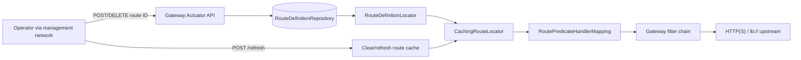
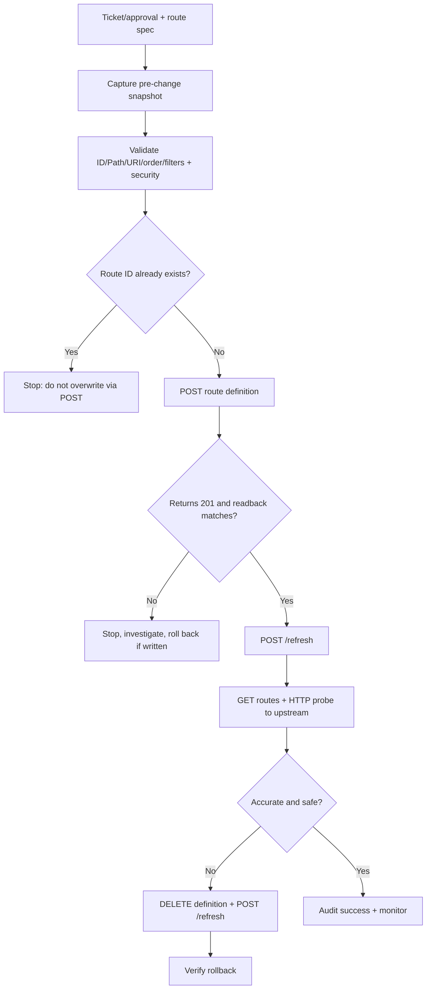
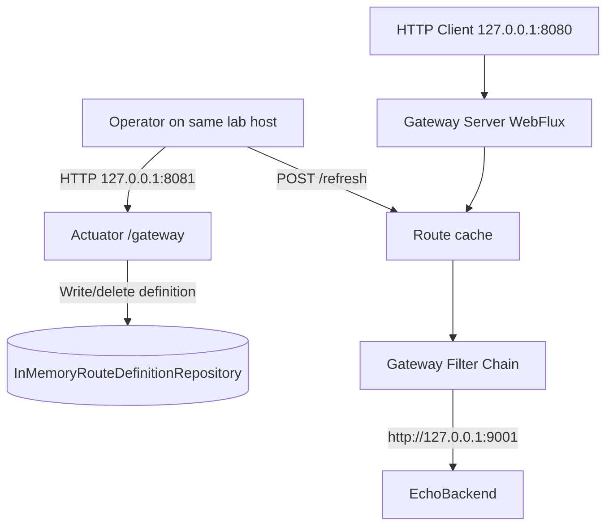
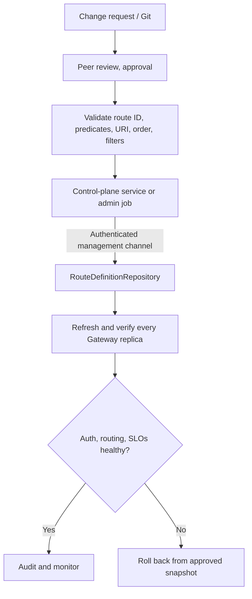

# Creating, Deleting, and Refreshing Dynamic Routes in a Controlled Environment

## 1. Why Change Routes Without Restarting the Gateway?

**SPRING_CLOUD_GATEWAY** typically serves as the entry point for many microservices. Requests flow through **route predicates** to select upstreams, the **filter chain** to manipulate paths/headers, authentication, rate limiting, circuit breakers, retries, TLS, and traffic observability. When splitting a service, shifting traffic to another upstream, or adding a temporary API, operations sometimes need to change routes **while the Gateway keeps running**.

For example, the Catalog team currently has:

```text
Client -> Gateway :8080 -> /catalog/** -> catalog-service
```

During a migration, the ops team wants to add a `/dynamic/**` route strictly in a test environment, verify connectivity, and then delete it without restarting the Gateway. **Spring Boot Actuator + Gateway Actuator API** provides route definition management operations, including creating, inspecting, deleting, and refreshing the **route cache**.

However, these operations carry substantial power: anyone allowed to create routes can alter proxy paths, pick internal upstreams, change headers/filters, or shadow a route protected by another policy. Accordingly, this lesson belongs to the **Actuator Management** chapter and emphasizes working inside a **controlled environment**, never treating management APIs as public endpoints.

### Learning Objectives

After this lesson, you will be able to:

1. Distinguish **route definition**, **built route**, **route cache**, **backing store**, and **refresh**.
2. Configure Gateway Actuator in `read-only` or `unrestricted` mode depending on the task; never confuse **exposure** with **authentication/authorization**.
3. Use `GET`, `POST`, `DELETE`, and `POST /refresh` in the right sequence for an Actuator-managed route.
4. Read and submit a route definition with `id`, `predicates`, `filters`, `uri`, and `order` without mixing up **GET** JSON and **POST** payloads.
5. Verify changes using both Actuator and real HTTP requests to the backend; understand why a `200` from refresh alone is not enough.
6. Perform rollbacks and distinguish Actuator-created routes from routes declared in `application.yml`.
7. Understand the limits of `InMemoryRouteDefinitionRepository`, Redis options, multiple Gateway replicas, and audit/approval workflows.
8. Identify exposure risks on management APIs: route injection, SSRF, proxying to internal networks, and bypassing security filters.

> **Technical Scope:** examples use **Spring Cloud Gateway Server WebFlux 4.3.x**, Spring Cloud 2025.0.x, Spring Boot 3.5.x, JDK 17+. The starter is `spring-cloud-starter-gateway-server-webflux`; static route config lives under `spring.cloud.gateway.server.webflux.routes`. **Gateway Server MVC** has a different pipeline. The `*.0` versions merely illustrate compatible release-train pairs; real environments require supported patch releases.

## 2. Route Definition, Backing Store, and Route Cache Are Not the Same Thing

To understand refresh, distinguish at least four concepts:

| Component | Holds / Represents | Effect During Operations |
| --- | --- | --- |
| `RouteDefinition` | Declarative data: `id`, `uri`, `predicates`, `filters`, `order`, optionally `metadata`. | `POST`/`DELETE` through the repository alters stored definitions. |
| `RouteDefinitionLocator` | Source reading definition lists, e.g., from `application.yml` or a repository. | Can aggregate definitions from multiple sources. |
| `RouteDefinitionRepository` | **Writable** source for adding/removing definitions. | Actuator writes normally target this source, never writing back to `application.yml`. |
| `RouteLocator` / built routes | Routes whose predicate/filter factories have been compiled into executable structures. | Used to match and handle requests. |
| `CachingRouteLocator` / route cache | Snapshot/cache of active routes used for matching. | `POST /refresh` refreshes the cache so new routes become visible. |

**Two actions must be kept distinct:** *modifying the stored definition* and *refreshing the runtime route structure serving requests*. A `201 Created` response from Actuator saving a route definition **does not mean** subsequent requests already take the new route. Per Gateway docs, **`POST /actuator/gateway/refresh`** must be called to apply changes without restarting.



### 2.1. What Route Sources Exist?

A single Gateway can simultaneously hold:

- **Static routes in `application.yml`**: managed by `PropertiesRouteDefinitionLocator`; versioned alongside source code/config deployments.
- **Routes from Java `RouteLocator` beans**: constructed via Java DSL; not an Actuator repository record you can delete via Actuator.
- **Routes in `InMemoryRouteDefinitionRepository`**: used for per-process dynamic create/delete operations; lost on process restart.
- **Routes in `RedisRouteDefinitionRepository`** or custom implementations: meant for persisting/sharing definitions across multiple Gateway instances.
- **Routes created by discovery locator**: generated dynamically from service discovery per configuration; not equivalent to manually managed Actuator routes.

**Do not treat Actuator as a YAML file editor.** To change static routes under GitOps, edit the config source and redeploy/refresh via the proper configuration workflow; never expect `DELETE /actuator/gateway/routes/<static-id>` to modify files.

### 2.2. What Does Refresh Not Do?

`POST /actuator/gateway/refresh` does **not** automatically:

- Reissue OAuth2/JWT tokens or change a user's access rights.
- Clear session data, Redis rate-limit buckets, or Caffeine response caches in general.
- Reload DNS, TLS certificates, Git route configs, or `application.yml` from a newer release.
- Immediately synchronize all Gateway replicas unless an appropriate storage/notification mechanism exists.
- Guarantee the downstream is ready or backend requests return 200.

It acts on the **route cache**, not as an “HTTP restart of the entire application”. Always **verify routes and live traffic** after every refresh.

## 3. Actuator Gateway API and the Access Model

Per Spring Cloud Gateway Server WebFlux 4.3 docs, the `/actuator/gateway` endpoint **has access disabled by default**. Remote administration requires two conditions: the endpoint is **granted access at the Actuator level** and **exposed over HTTP/JMX**.

| Configuration / State | Meaning |
| --- | --- |
| `management.endpoint.gateway.access=none` | Denies access to the Gateway Actuator endpoint. |
| `management.endpoint.gateway.access=read-only` | Allows reading info; **forbids** creating, deleting, or refreshing routes. |
| `management.endpoint.gateway.access=unrestricted` | Allows management operations, including `POST`/`DELETE`/refresh when exposed and permitted by HTTP security. |
| `management.endpoints.web.exposure.include=gateway` | Adds the Gateway endpoint to the HTTP exposure list; **does not secure the endpoint by itself**. |
| `management.server.port` | Picks a dedicated management port, e.g., `8081`. |
| `management.server.address` | Picks the management server bind address, e.g., `127.0.0.1` when the management port differs from the app port. |

**Operational principle:** default to **`read-only`** or **not exposing** Gateway Actuator. Elevate temporarily to `unrestricted` only in an approved environment/workflow with network controls and strong identity. Once done, revert to `read-only` or disable writes.

> **Pitfall to avoid:** Gateway docs also mention the legacy `management.endpoint.gateway.enabled=true` property; never use it as a safe shorthand for `access=read-only`, as it can enable write operations. With Spring Boot 3.5, use `management.endpoint.gateway.access` to state the policy explicitly.

### 3.1. Essential API Table

The paths below assume the default `/actuator` base path:

| HTTP | URI | Purpose |
| --- | --- | --- |
| `GET` | `/actuator/gateway` | Inspect operations published by the endpoint. |
| `GET` | `/actuator/gateway/routes` | List routes currently seen by the Gateway. |
| `GET` | `/actuator/gateway/routes/{id}` | Inspect a specific route. |
| `GET` | `/actuator/gateway/routedefinitions` | Inspect route definitions from available sources. |
| `GET` | `/actuator/gateway/globalfilters` | Inspect `GlobalFilter`s and orders where supported. |
| `GET` | `/actuator/gateway/routefilters` | Inspect registered `GatewayFilterFactory` beans. |
| `POST` | `/actuator/gateway/routes/{id}` | **Create** a route definition with the given ID. |
| `DELETE` | `/actuator/gateway/routes/{id}` | **Delete** a definition from a writable repository. |
| `POST` | `/actuator/gateway/refresh` | Refresh the route cache (optionally filtered by metadata). |

**Note:** the full control URL is **`/actuator/gateway/routes/{id}`**, not `/gateway/routes/{id}` unless the base path was changed. If `management.endpoints.web.base-path` differs from `/actuator`, the URI changes accordingly.

### 3.2. `read-only` Mode Must Be Tested

```yaml
management:
  endpoint:
    gateway:
      access: read-only
  endpoints:
    web:
      exposure:
        include: health,gateway
```

With this configuration, `GET /actuator/gateway/routes` can be read per HTTP security policy, while **`POST /actuator/gateway/refresh`** is disallowed by Actuator. The HTTP status of a blocked call varies by layer (404/405/401/403) and patch level: **verify that the route state did not change**, rather than asserting only one status code.

If the app sets `management.endpoints.access.max-permitted=read-only`, that global ceiling can also **block writes** even if the Gateway endpoint itself sets `access=unrestricted`. Conversely, HTTP exposure does not authenticate callers; **Actuator access control and Spring Security/network access are separate layers**.

## 4. Why Must Route Management Operations Be Protected Separately?

Dynamic route creation/deletion can have consequences equal to altering the system's security configuration:

```text
Unauthorized client
    |
    +--> /actuator/gateway/routes/<id> (if endpoint is exposed)
             |
             +--> point upstream to an attacker-controlled host
             +--> omit authentication/rate-limiting filters
             +--> open proxy paths to sensitive internal services
             +--> create a higher-priority route shadowing another route
             +--> cause clients to receive unexpected data/headers
```

Risks to assess include **server-side request forgery (SSRF)**, proxying to internal networks/metadata, bypassing auth/tenant boundaries, leaking sensitive data via `AddRequestHeader`/`TokenRelay`, breaking quotas, and route hijacking. **A route ID is not an ACL.** Never rely on “hard-to-guess naming” instead of authentication/authorization.

### 4.1. Minimum Protection Layers

1. **Dedicated management network:** separate `management.server.port`, bind to a management interface or loopback; block Internet and unapproved workloads via firewall/NetworkPolicy.
2. **Strong authentication:** management-specific OAuth2/JWT, mTLS workload identity, or equivalent; never expose public endpoints relying solely on URL paths.
3. **Granular authorization:** separate **route viewer** from **route operator**; create/delete/refresh require approved roles/policies.
4. **TLS/mTLS:** secure the management channel over the network, even behind an ingress/bastion; validate peer certificates/SANs, never use trust-all.
5. **Route definition allowlist:** validate route IDs, `uri` schemes/hosts/ports, path patterns, allowed predicates/filters, and order. Never let arbitrary callers target cloud metadata, loopback services, or arbitrary domains.
6. **Immutable audit trail:** log requester, ticket/change ID, before/after diffs, timestamps, HTTP results, verification, and rollback—**never log secrets/tokens**.
7. **Rate limiting and approvals on control-plane APIs:** prevent bulk/accidental writes and enforce two-person review when warranted.
8. **Never use CORS or a static self-asserted header as authorization.** CORS only governs browser policy and never stops `curl`/scripts from sending requests.

### 4.2. Management Port Listening Only on Localhost in the Lab

The lesson example **omits authentication on the management port** to keep the number of moving parts small. In exchange, the writable endpoint **binds strictly to `127.0.0.1:8081`** and runs solely on the learner's isolated lab machine—never in shared environments or production.

When remote management is necessary, use approved controlled channels (bastion, VPN, TLS/mTLS, identity-aware proxy, and RBAC). **Never replace `127.0.0.1` with `0.0.0.0` just to make `curl` convenient**, and never expose the management port on public ingress. Any port-forward or SSH tunnel still requires auth/approval and control over who may establish it.

## 5. Safe Route Change Workflow

Dynamic management should never be ad-hoc `curl` commands. Every change needs a plan and stop conditions:



Standard sequence:

1. Record the **before-state** (ID, URI, predicates, filters, order) in a secure change record.
2. Verify the new ID is unused; do not touch routes declared in YAML/Java.
3. Validate the spec: endpoint allowed, target upstream ready, auth/authorization intact, no dangerous predicate overlaps.
4. Write the route definition with `POST /routes/{id}`.
5. Read back the definition. **Never copy GET JSON verbatim to POST back** when versions render verbose/compiled views.
6. Call `POST /refresh`; verify the new route matches and requests reach the intended backend.
7. Record results and watch latency, 4xx/5xx rates, rate limits, TLS, and circuit breakers.
8. If anything is wrong, execute the prepared rollback: `DELETE` the newly created route → `POST /refresh` → verify it is gone.

**Especially important:** modern Gateway docs warn **never to POST to an already-existing route ID**: some versions retain duplicate definitions, causing `GET /routes` to fail with 500. Update Actuator-managed routes via **DELETE → POST new definition → POST refresh**. This is not an atomic update; in production plan a maintenance window or versioned route/canary strategy to avoid a routing gap.

## 6. `RouteDefinition` Structure and JSON for POST

A route definition holds declarative configuration, for example:

```json
{
  "predicates": [
    "Path=/dynamic/**"
  ],
  "filters": [
    "StripPrefix=1",
    "AddRequestHeader=X-Dynamic-Route, v1"
  ],
  "uri": "http://127.0.0.1:9001",
  "order": 0
}
```

The path `POST /actuator/gateway/routes/dynamic_catalog_lab` specifies the **route ID**; the body supplies predicates/filters, URI, and order.

In current Actuator docs, `predicates` and `filters` elements use **shortcut DSL strings**, such as `"Path=/dynamic/**"` and `"StripPrefix=1"`. **Never pass** descriptive strings from `GET /routes` (like `"Paths: [...]"` or `"OrderedGatewayFilter{...}"`) as a POST definition.

### 6.1. Compatibility Note on 4.3.x and JSON Formats

Gateway 4.3 docs also include a page illustrating `GET /routes/{id}` in structured form:

```json
{
  "id": "first_route",
  "predicates": [
    {
      "name": "Path",
      "args": {
        "_genkey_0": "/first"
      }
    }
  ],
  "filters": [],
  "uri": "https://example.org",
  "order": 0
}
```

Depending on patch level and how Jackson binds `RouteDefinition`, route definitions can also appear as `{"name":"Path","args":{"_genkey_0":"/dynamic/**"}}`. Complex predicates may require an `args` map with explicit keys (e.g. `patterns.0`), **not arbitrary JSON arrays inside `args`**. Because Gateway docs vary in representation across releases, check docs for your **exact application artifact/release train**, test one lab route first, and use the format that release accepts.

**Never assume a GET response can be POSTed verbatim.** Distinguish display management data (*descriptive view*) from route specification (*declarative input*). The hands-on example below uses shortcut form for simple routes and requires immediate status/readback checks.

### 6.2. Fields to Verify Before Saving

| Field | Example | Safety Rule |
| --- | --- | --- |
| `id` | `dynamic_catalog_lab` | Unique, owned, no collision with YAML/Java/Redis routes. |
| `predicates` | `Path=/dynamic/**` | Narrow scope; avoid `/**` that shadows every route. |
| `filters` | `StripPrefix=1` | Allowlisted filters only; never drop default auth/rate limiting. |
| `uri` | `http://127.0.0.1:9001` | **Same-host lab only.** Prod requires upstream allowlists, TLS/hostname checks, or controlled `lb://`. |
| `order` | `0` | Lower route order takes higher precedence; check route overlap. |
| `metadata` | `{"group":"lab"}` | Use for organization/scoped refresh where supported; never replaces authorization. |

Pointing a dynamic route to `lb://catalog-service` only selects instances via Discovery/LoadBalancer—it does not make the route secure by itself. Services still must verify JWTs/permissions, and the Gateway still needs TLS, rate limiting, and proper filters.

## 7. Setting Up a Lab with a Localhost Management Port

The hands-on lab includes:

- Gateway HTTP data plane: `127.0.0.1:8080`.
- Gateway Actuator management plane: `127.0.0.1:8081`, **listening only on loopback**.
- HTTP EchoBackend: `127.0.0.1:9001`, counting requests and showing proxied routes/headers.
- Static route `fixed_status`: `GET /fixed/status` to backend `/status`.
- Dynamic route `dynamic_catalog_lab`: absent initially; later created, refreshed, replaced, and deleted.



> **WARNING:** `unrestricted` below is **enabled solely for an isolated local lab controlled by one person**. Never copy `management.endpoint.gateway.access: unrestricted` to shared environments, Kubernetes, or production without strong authentication, authorization, TLS, network policies, and auditing.

### 7.1. Create the Maven Project

Requirements: JDK 17+, Maven, `curl`, and two terminals. Create `pom.xml` in a **learner-created project**, separate from this lesson content repository:

```xml
<?xml version="1.0" encoding="UTF-8"?>
<project xmlns="http://maven.apache.org/POM/4.0.0"
         xmlns:xsi="http://www.w3.org/2001/XMLSchema-instance"
         xsi:schemaLocation="http://maven.apache.org/POM/4.0.0
                             https://maven.apache.org/xsd/maven-4.0.0.xsd">
    <modelVersion>4.0.0</modelVersion>

    <parent>
        <groupId>org.springframework.boot</groupId>
        <artifactId>spring-boot-starter-parent</artifactId>
        <version>3.5.0</version>
        <relativePath/>
    </parent>

    <groupId>com.example</groupId>
    <artifactId>gateway-actuator-lab</artifactId>
    <version>0.0.1-SNAPSHOT</version>

    <properties>
        <java.version>17</java.version>
    </properties>

    <dependencyManagement>
        <dependencies>
            <dependency>
                <groupId>org.springframework.cloud</groupId>
                <artifactId>spring-cloud-dependencies</artifactId>
                <version>2025.0.0</version>
                <type>pom</type>
                <scope>import</scope>
            </dependency>
        </dependencies>
    </dependencyManagement>

    <dependencies>
        <dependency>
            <groupId>org.springframework.cloud</groupId>
            <artifactId>spring-cloud-starter-gateway-server-webflux</artifactId>
        </dependency>
        <dependency>
            <groupId>org.springframework.boot</groupId>
            <artifactId>spring-boot-starter-actuator</artifactId>
        </dependency>
    </dependencies>

    <build>
        <plugins>
            <plugin>
                <groupId>org.springframework.boot</groupId>
                <artifactId>spring-boot-maven-plugin</artifactId>
            </plugin>
        </plugins>
    </build>
</project>
```

- `spring-cloud-starter-gateway-server-webflux` provides Gateway WebFlux.
- `spring-boot-starter-actuator` provides management infrastructure and the Gateway Actuator endpoint once configured.
- Do not add Servlet `spring-boot-starter-web`; we use Reactor Netty.
- Boot parent and Cloud BOM manage starter versions. **This is not a build command executed by the worker**; learners run it in their own demo project.

### 7.2. Entry Point

Create `src/main/java/com/example/gateway/GatewayApplication.java`:

```java
package com.example.gateway;

import org.springframework.boot.SpringApplication;
import org.springframework.boot.autoconfigure.SpringBootApplication;

@SpringBootApplication
public class GatewayApplication {
    public static void main(String[] args) {
        SpringApplication.run(GatewayApplication.class, args);
    }
}
```

### 7.3. `application.yml`: Dedicated Management Port, Only Static Route Initially

```yaml
server:
  port: 8080

management:
  server:
    port: 8081
    address: "127.0.0.1"
  endpoint:
    gateway:
      # Use only while learning on an isolated local machine:
      access: unrestricted
  endpoints:
    web:
      exposure:
        include: health,gateway

spring:
  application:
    name: gateway-actuator-lab
  cloud:
    gateway:
      server:
        webflux:
          routes:
            - id: fixed_status
              uri: http://127.0.0.1:9001
              predicates:
                - Path=/fixed/**
              filters:
                - StripPrefix=1
```

Key points:

1. **`server.port: 8080`** serves client requests routed by the Gateway.
2. **`management.server.port: 8081`** is dedicated to Actuator.
3. **`management.server.address: 127.0.0.1`** is only valid to bind separately when the management port differs from the app port. It restricts external network access for the lab; it does not replace authentication in production.
4. **`access: unrestricted`** enables writes. For view-only mode, switch to `read-only`; for unneeded endpoints, stop exposing them.
5. **`exposure.include: health,gateway`** exposes only these two endpoints over HTTP. Never use `include: "*"` for convenience.
6. `fixed_status` is a **static route** from app config; used to verify it cannot be deleted like an Actuator-managed route.
7. Initially **do not** declare `dynamic_catalog_lab` in YAML; it will only be created via the API.

If container networking puts `127.0.0.1:9001` in a different network namespace from the backend, substitute an appropriate host/service name in a **controlled test environment**; never use this localhost target in a real cluster.

### 7.4. EchoBackend: Observing Actual Paths and Headers

Create `EchoBackend.java` in a **separate practice folder outside the Gateway source**:

```java
import com.sun.net.httpserver.HttpServer;
import java.net.InetSocketAddress;
import java.nio.charset.StandardCharsets;
import java.util.concurrent.atomic.AtomicInteger;

public class EchoBackend {

    public static void main(String[] args) throws Exception {
        AtomicInteger calls = new AtomicInteger();

        HttpServer server = HttpServer.create(
                new InetSocketAddress("127.0.0.1", 9001), 0);

        server.createContext("/", exchange -> {
            int n = calls.incrementAndGet();
            String path = exchange.getRequestURI().getRawPath();
            String revision = exchange.getRequestHeaders()
                    .getFirst("X-Dynamic-Route");

            String body = "backend-request=" + n + "\n"
                    + "path=" + path + "\n"
                    + "route-revision="
                    + (revision == null ? "none" : revision) + "\n";

            System.out.printf(
                    "UPSTREAM #%d path=%s revision=%s%n",
                    n, path, revision);

            byte[] bytes = body.getBytes(StandardCharsets.UTF_8);
            exchange.getResponseHeaders().set(
                    "Content-Type", "text/plain; charset=UTF-8");
            exchange.sendResponseHeaders(200, bytes.length);

            try (var response = exchange.getResponseBody()) {
                response.write(bytes);
            }
        });

        server.start();
        System.out.println("EchoBackend ready on 127.0.0.1:9001");
    }
}
```

In this demo, `X-Dynamic-Route` is a **non-sensitive** version marker. If a real filter forwards `Authorization`, API keys, cookies, or identity headers upstream, never print them to logs as in this practice snippet.

Start both processes:

```bash
# Terminal A, directory containing EchoBackend.java:
java EchoBackend.java

# Terminal B, directory containing pom.xml and application.yml:
mvn spring-boot:run
```

If using Maven Wrapper, run `./mvnw spring-boot:run` (Linux/macOS) or `mvnw.cmd spring-boot:run` (Windows). The `curl` examples below use **Bash** syntax; in PowerShell use `curl.exe` and adjust JSON quoting.

## 8. Checking Initial State and the Management Port

### 8.1. Static Route Must Work

```bash
curl -i "http://127.0.0.1:8080/fixed/status"
```

Expected response when the backend is ready:

```http
HTTP/1.1 200 OK
Content-Type: text/plain; charset=UTF-8

backend-request=1
path=/status
route-revision=none
```

`backend-request` increments with each real request reaching EchoBackend; do not assert it is always 1 if called earlier. `StripPrefix=1` turns `/fixed/status` into `/status` at the backend.

### 8.2. Dynamic Route Does Not Exist Yet

```bash
curl -i "http://127.0.0.1:8080/dynamic/check"
```

With no other handler/route, expect **404 Not Found**. The backend counter **does not increment** because the Gateway has no `/dynamic/**` route yet.

### 8.3. Inspect Route List via Management

```bash
curl -i "http://127.0.0.1:8081/actuator/gateway"
curl -i "http://127.0.0.1:8081/actuator/gateway/routes"
curl -i "http://127.0.0.1:8081/actuator/gateway/routedefinitions"
curl -i "http://127.0.0.1:8081/actuator/gateway/routes/fixed_status"
```

Expect to see `fixed_status`, and not yet `dynamic_catalog_lab`. The two URIs **should not** be used interchangeably to draw conclusions: `/routedefinitions` inspects declarations, whereas `/routes` reflects routes presented by the Gateway from locators/caches.

**GET response formats may differ between 4.3 and 5.x**, especially with verbose format enabled. Verify route ID, predicate, URI, filters, order, and HTTP response; never write scripts assuming a nested `route_object` field exists across every version.

### 8.4. Read-Only Mode (Negative Test)

If you change the lab YAML to:

```yaml
management:
  endpoint:
    gateway:
      access: read-only
```

and restart, `GET` still works while `POST /actuator/gateway/refresh` is restricted. Test (strictly in the lab):

```bash
curl -i -X POST \
  "http://127.0.0.1:8081/actuator/gateway/refresh"
```

Do not assert strictly 403: the app may return 404/405 depending on Actuator access and HTTP security. What is **mandatory** is that the write/refresh **is rejected or leaves route state unchanged**. To continue the create/delete steps, restore `unrestricted` and restart the lab Gateway. In production, keep `read-only` except during an approved change.

## 9. Creating a Dynamic Route via `POST /routes/{id}`

Before POSTing, verify the new ID **does not already exist**:

```bash
curl -i \
  "http://127.0.0.1:8081/actuator/gateway/routes/dynamic_catalog_lab"
```

If the route already exists, **STOP** and check ownership rather than POSTing over it. In a clean lab, the endpoint typically returns 404.

### 9.1. Send the JSON Payload

```bash
curl -i -X POST \
  "http://127.0.0.1:8081/actuator/gateway/routes/dynamic_catalog_lab" \
  -H "Content-Type: application/json" \
  --data-binary '{
    "predicates": ["Path=/dynamic/**"],
    "filters": [
      "StripPrefix=1",
      "AddRequestHeader=X-Dynamic-Route, v1"
    ],
    "uri": "http://127.0.0.1:9001",
    "order": 0
  }'
```

On Gateway versions supporting the shortcut POST format shown in current Actuator docs, success returns **`201 Created`**. This only means the **route definition was accepted**—not yet that incoming requests use the route.

If a running 4.3 release returns **400** binding shortcut JSON, check the docs for your exact patch and test the structured `PredicateDefinition`/`FilterDefinition` form in the **lab environment**, for instance:

```json
{
  "predicates": [
    {"name": "Path", "args": {"_genkey_0": "/dynamic/**"}}
  ],
  "filters": [
    {"name": "StripPrefix", "args": {"_genkey_0": "1"}},
    {"name": "AddRequestHeader",
     "args": {"_genkey_0": "X-Dynamic-Route", "_genkey_1": "v1"}}
  ],
  "uri": "http://127.0.0.1:9001",
  "order": 0
}
```

**This is a structural compatibility alternative, not a second POST to fire immediately if the first succeeded.** Pick only *one* creation syntax supported by your actual artifact, because duplicate-ID POSTs can break route listing.

### 9.2. Read Back Definitions, Then Refresh

```bash
curl -i \
  "http://127.0.0.1:8081/actuator/gateway/routedefinitions"

curl -i -X POST \
  "http://127.0.0.1:8081/actuator/gateway/refresh"
```

Per docs, `POST /refresh` normally returns **`200 OK`** with **no response body**. It triggers refreshing the route cache without restarting the Gateway. Refreshing can involve asynchronous work, so **do not treat 200 as complete end-to-end proof**.

Immediately afterward, inspect:

```bash
curl -i \
  "http://127.0.0.1:8081/actuator/gateway/routes"

curl -i \
  "http://127.0.0.1:8081/actuator/gateway/routes/dynamic_catalog_lab"
```

You should see route ID `dynamic_catalog_lab`, predicate `Path=/dynamic/**`, the loopback URI, and the expected filters. If it does not appear immediately, check logs/errors and re-read after a short pause with **bounded retries**; never blindly re-POST the definition.

### 9.3. Verify with a Live Request

```bash
curl -i "http://127.0.0.1:8080/dynamic/check"
```

Once the new route is active and EchoBackend is up:

```http
HTTP/1.1 200 OK
Content-Type: text/plain; charset=UTF-8

backend-request=2
path=/check
route-revision=v1
```

`backend-request=2` simply illustrates sequential calls after earlier requests; the actual number depends on your call order. Two assertions matter:

- **Backend path `/check`** — proves `StripPrefix=1` took effect.
- **`route-revision=v1`** — proves `AddRequestHeader` on the dynamic route ran.

If the client receives HTTP 200 yet the body lacks `route-revision=v1`, another route may have matched, the filter failed to bind, or the request reached a different backend. Check EchoBackend counters/logs and `/actuator/gateway/routes`.

## 10. Updating a Dynamic Route: Never Overwrite the ID via POST

Modern Actuator docs specifically warn: **POSTing again to an existing route ID can create duplicate definitions**, causing `GET /actuator/gateway/routes` to fail with 500. Therefore, when updating `dynamic_catalog_lab`, do not submit a new payload to the same ID as a PUT/upsert.

**Documented update sequence:** `DELETE` old dynamic route → `POST` new definition with same ID → `POST /refresh` → verify.

### 10.1. Create Version v2 in the Lab

Run this only on the local Gateway with no live users. First back up v1 JSON in your own change record, then delete the old definition:

```bash
curl -i -X DELETE \
  "http://127.0.0.1:8081/actuator/gateway/routes/dynamic_catalog_lab"
```

On success, Actuator normally returns `200 OK`. **Do not refresh yet** in this lab replacement step; in production account for the inconsistency window if a refresh occurs between DELETE and POST.

Submit route v2:

```bash
curl -i -X POST \
  "http://127.0.0.1:8081/actuator/gateway/routes/dynamic_catalog_lab" \
  -H "Content-Type: application/json" \
  --data-binary '{
    "predicates": ["Path=/dynamic/**"],
    "filters": [
      "StripPrefix=1",
      "AddRequestHeader=X-Dynamic-Route, v2"
    ],
    "uri": "http://127.0.0.1:9001",
    "order": 0
  }'
```

Do not proceed if POST fails or if v2 was not saved properly. On a Gateway 4.3 release requiring structured input, reuse the verified structure from Section 9.1 and change `v1` to `v2`.

Once the new definition is confirmed:

```bash
curl -i -X POST \
  "http://127.0.0.1:8081/actuator/gateway/refresh"

curl -i \
  "http://127.0.0.1:8080/dynamic/check"
```

The backend should report `route-revision=v2`. Route `fixed_status` must continue working:

```bash
curl -i "http://127.0.0.1:8080/fixed/status"
```

**Not an atomic operation:** `DELETE` and `POST` are two independent requests. If the Gateway crashes, an operator refreshes at the wrong instant, or another replica reads a shared store mid-way, gaps or divergent states can occur. In production, route updates through a control-plane pipeline with validation and rollback/canary, or use versioned route IDs with controlled traffic shifting.

### 10.2. Rolling Back v2 If It Fails

If v2 is wrong, apply the exact same sequence: **DELETE v2 → POST saved v1 → POST refresh → verify**. Never do:

```text
POST /routes/dynamic_catalog_lab with v1 while v2 still exists
```

That would again be a duplicate-ID POST. **Rollbacks must follow a scripted procedure with stop conditions**, not “try POSTing one more time”. After rolling back, re-check route definitions, backend paths/headers, and logs.

## 11. Deleting the Dynamic Route and Verifying Proxying Stops

When finishing the lab, delete the dynamic route:

```bash
curl -i -X DELETE \
  "http://127.0.0.1:8081/actuator/gateway/routes/dynamic_catalog_lab"

curl -i -X POST \
  "http://127.0.0.1:8081/actuator/gateway/refresh"
```

Successful deletion normally returns `200 OK`, and refresh returns `200 OK` with no body. Verify:

```bash
curl -i \
  "http://127.0.0.1:8081/actuator/gateway/routes"

curl -i \
  "http://127.0.0.1:8080/dynamic/check"
```

Expected:

- `dynamic_catalog_lab` is absent from the routes list.
- `GET /dynamic/check` returns **404** assuming no other route/handler matches.
- Backend counter **does not increment** because `/dynamic/check` misses routing.
- `GET /fixed/status` still returns 200 and reaches the backend.

This **deletes the dynamic route definition and refreshes the route cache**—it does not delete downstream apps or Catalog Service data.

### 11.1. Cannot Use This API to Delete Static Routes

Try **strictly in the lab**:

```bash
curl -i -X DELETE \
  "http://127.0.0.1:8081/actuator/gateway/routes/fixed_status"
```

Per current Actuator docs, routes from `application.yml` or `@Bean` **are not editable/deletable through this write endpoint**; deleting a config-defined route may return `404 Not Found`. Check exact status on your patch level; the core takeaway is that the YAML file **is untouched** and the static route keeps serving:

```bash
curl -i "http://127.0.0.1:8080/fixed/status"
```

To remove `fixed_status` for real, edit the **declarative source** through your config/GitOps deployment workflow. Actuator does not replace static configuration management.

### 11.2. Restoring Management to Safe Mode

When finished with the lab, revert to:

```yaml
management:
  endpoint:
    gateway:
      access: read-only
```

Or remove `gateway` from `management.endpoints.web.exposure.include` if reading is unneeded. Restart the lab with the updated config and run **negative tests** proving POST/DELETE/refresh are blocked while GET behaves as designed.

Note: an endpoint exposed with `unrestricted` in production cannot be “secured” merely by **not running more `curl` commands**; update the configuration/access controls and verify the post-rollout state.

## 12. Full Refresh vs. Metadata-Scoped Refresh

The usual command after creating, updating, or deleting a route definition is:

```bash
curl -i -X POST "http://127.0.0.1:8081/actuator/gateway/refresh"
```

Per Gateway docs, this endpoint typically returns **200 with no response body**. It refreshes the route cache—it does **not** edit YAML files, guarantee upstream health, or automatically broadcast to every Gateway replica.

Some Gateway releases support selective refresh via the `metadata` query parameter:

```bash
curl -i -X POST \
  "http://127.0.0.1:8081/actuator/gateway/refresh?metadata=group:lab"
```

This requires route definitions to carry matching metadata:

```json
{
  "id": "dynamic_catalog_lab",
  "metadata": {
    "group": "lab"
  },
  "predicates": ["Path=/dynamic/**"],
  "filters": ["StripPrefix=1"],
  "uri": "http://127.0.0.1:9001",
  "order": 0
}
```

**Never replace the full delete/refresh sequence with scoped refresh without testing first.** Once a definition is deleted, metadata used to target cache regions may no longer behave as you expect. In this lab, after `DELETE` and `POST`, always run a **full refresh**.

### 12.1. A 200 Response Does Not Mean Every Route Was Applied

Refresh can involve asynchronous event handling and cache rebuilding. Gateway docs note that errors during refresh can leave the previous route cache intact. Therefore:

1. Call `POST /refresh` and check status.
2. Query `GET /actuator/gateway/routes` or `GET /routes/{id}`.
3. Send an HTTP canary request to the new route.
4. Check **backend path/headers** and upstream counters.
5. Declare “rollout successful” only when both control plane and data plane match expectations.

A refresh command is not `SpringApplication.restart()`, nor does it clear sessions/OAuth2 authorized clients, Redis rate-limit buckets, circuit breaker states, or response caches.

### 12.2. In-Flight Requests During Refresh

A request that already matched a route and entered the filter chain before the cache refreshed **may continue executing** along the previously chosen route. Refresh does not guarantee immediate cancellation of all in-flight HTTP calls.

To **block a dangerous API immediately**, deleting the route on one Gateway pod is not enough: other replicas, in-flight requests, and alternate backend paths remain. Enforce a reliable block at security/ingress/backend layers and verify all entry points.

## 13. Multiple Gateway Instances: Shared Repository Differs from Shared Route Cache

### 13.1. `InMemoryRouteDefinitionRepository`

`InMemoryRouteDefinitionRepository` stores route definitions **in-process**. It is convenient for labs yet non-durable for multi-replica systems:

```text
           Load Balancer
             /     \
      Gateway A     Gateway B
      routes A      routes B
      heap A        heap B

POST route to A:
  A knows the new definition
  B does not automatically get it

POST /refresh on A:
  A refreshes A's cache
  Does not broadcast to B
```

| Situation | Possible Consequence |
| --- | --- |
| Gateway A restarts | A's in-memory dynamic route definitions are lost. |
| Rolling deploy replaces A with A2 | A2 does not inherit definitions from A's heap. |
| Client shifts from A to B | B may lack the new route and return 404. |
| Management call hits A | Does not guarantee routes changed on B. |
| Sticky sessions | Does not restore route definitions if a pod dies. |

### 13.2. `RedisRouteDefinitionRepository`

Spring Cloud Gateway provides `RedisRouteDefinitionRepository` for a shared store. The **4.3 Configuration Properties** reference lists the Server WebFlux namespace:

```properties
spring.cloud.gateway.server.webflux.redis-route-definition-repository.enabled=true
```

**Illustrative** configuration (do not copy verbatim to production):

```yaml
spring:
  data:
    redis:
      host: redis.internal.example
      port: 6379
  cloud:
    gateway:
      server:
        webflux:
          redis-route-definition-repository:
            enabled: true
```

Plus the reactive Redis starter:

```xml
<dependency>
    <groupId>org.springframework.boot</groupId>
    <artifactId>spring-boot-starter-data-redis-reactive</artifactId>
</dependency>
```

That alone is not production-ready: you also need Redis TLS, AUTH/ACLs, secrets management, backups, HA, network isolation, migrations, timeouts, and version/binding verification. Older Gateway docs mention `spring.cloud.gateway.redis-route-definition-repository.enabled`; on Gateway Server WebFlux 4.3, prefer the `spring.cloud.gateway.server.webflux` prefix verified in the properties table.

**Sharing definitions does not mean synchronizing every route cache:**

```text
                    Redis shared definitions
                       /            \
               Gateway A         Gateway B
               local cache A     local cache B
```

After writing definitions to Redis, each Gateway still needs an appropriate **refresh trigger**. A `POST /refresh` sent to A does not guarantee an event reached B. You can use a control plane orchestrating refresh across replicas or an appropriate pub/sub/event mechanism, while **testing behavior directly on every process**.

### 13.3. Safe Cluster Workflow

1. Use change tickets and peer-reviewed, versioned route specs.
2. Verify the new ID is unique in the shared store, with concurrency safeguards.
3. Authorize only a dedicated control-plane service/bot to mutate the repository.
4. Dispatch refresh signals per design to **all Gateway replicas**.
5. Probe `GET /routes/{id}` and HTTP canaries against each pod individually, not solely via the load balancer.
6. Monitor 404/5xx rates, per-route request rates, JWT auth, limiters, breakers, and TLS.
7. If any pod fails, pause rollout, roll back the definition, and re-trigger refresh.
8. Audit the final revision confirmed uniform across all instances.

When Redis is unreachable or a replica fails to refresh, never fall back to `/**` or bypass authentication “to preserve availability”. Enforce fail-closed policies for new routes with clear recovery procedures.

## 14. Operating the Control Plane Safely Beyond the Lab

In the lab, we ran `curl` on localhost. In production, never let everyone on the internal network call route create/delete APIs directly.

### 14.1. Approval-Gated Workflow



Essential controls:

- **RBAC:** separate `route viewer` and `route operator`; `read-only` is the default state.
- **Network:** management interface/port only inside approved internal networks; firewalls/NetworkPolicy; no public ingress.
- **Identity:** operator-dedicated OAuth2/JWT, mTLS workload identity, or equivalent security model. Never accept end-user access tokens on management APIs.
- **TLS:** verify CA/SAN/hostname for both control plane and upstreams. Never disable certificate/TLS checks on errors.
- **URI allowlist:** restrict schemes/hosts/ports/CIDRs. Prevent arbitrary proxying to internal addresses, cloud instance metadata, or attacker-controlled hosts.
- **Filter allowlist:** restrict usable filters; exercise special care with `TokenRelay`, `AddRequestHeader`, `RewritePath`, `RequestRateLimiter`, `LocalResponseCache`, and `CircuitBreaker`.
- **Route overlap:** check `Host`, `Path`, `Method`, and `order` so new routes never shadow security-enforcing routes.
- **Audit:** record management principal, change ID, before/after diffs, timestamps, verified replicas, and outcome/rollback; never log raw bearer tokens, secrets, or cookies.

### 14.2. Three Protection Layers Do Not Substitute for Each Other

| Layer | Example | Why Insufficient Alone? |
| --- | --- | --- |
| **Actuator access** | `management.endpoint.gateway.access=read-only/unrestricted` | Governs operation types only, without authenticating individual operators. |
| **HTTP security/RBAC** | Spring Security WebFlux, JWT/mTLS, role checks | Must be paired with network isolation and target URI allowlists. |
| **Network restriction** | `management.server.address`, firewall/NetworkPolicy | Untrusted internal callers or leaked credentials remain a risk. |

Note on **CSRF**: if a management UI uses browser cookies/sessions, never disable CSRF just to make POST/DELETE easy. If using stateless service-to-service bearer tokens, design the security chain and CSRF around that credential model and test it. When defining a custom `SecurityWebFilterChain`, Boot auto-security may back off; never assume Actuator remains protected as before. Separate management ports also require verifying the proper security context/chains.

## 15. Regression Test Matrix

| ID | Condition and Action | Outcome to Verify |
| --- | --- | --- |
| M01 | Gateway access `read-only`, GET routes | Readable per network/HTTP policy. |
| M02 | `read-only`, POST refresh | Blocked; route state unchanged. |
| M03 | `unrestricted` on localhost, POST new ID | Definition created, typically 201. |
| M04 | Existing route ID | Preflight rejects overwriting POST; no duplicate definitions created. |
| M05 | GET routedefinitions after POST | Matches route ID, URI, Path, filters, order. |
| M06 | POST refresh after create | Route cache updates; HTTP canary reaches backend. |
| M07 | GET `/dynamic/check` on v1 | Path `/check`, marker `v1`. |
| M08 | DELETE then POST v2, refresh | Path remains accurate, marker becomes `v2`. |
| M09 | DELETE dynamic + refresh | Route vanishes, typically 404, backend counter does not increment. |
| M10 | DELETE `fixed_status` | Does not delete static route; endpoint typically 404. |
| M11 | Operator lacks role/auth | POST/DELETE denied, state unchanged. |
| M12 | Route pointing to URI outside allowlist | Blocked by control-plane validation. |
| M13 | Two Gateway replicas | Definitions/caches/route state verified on each pod. |
| M14 | Backend HTTPS with bad CA/SAN | Never bypass TLS; reports error properly and rolls back. |
| M15 | Route requiring JWT/tenant | Returns no data when principal lacks privilege. |
| M16 | Rate limiter / CircuitBreaker | Quotas or fallback policies are not bypassed after route changes. |
| M17 | Refresh error | Do not declare success from one HTTP status alone. |
| M18 | Rollback | Definitions, route caches, and live requests all return to the approved version. |

**A single HTTP 200 is not enough to accept a route.** Verify at least two data planes: *control-plane readback* (`/actuator/gateway/routes`) and *data-plane probe* (backend receives expected path/headers/HTTP method). For secured APIs, add negative tests for under-privileged users/tenants and overlap-bypass checks.

### 15.1. Simple Lab Verification Script

```bash
curl -s -o /dev/null -w "static=%{http_code}\n" \
  "http://127.0.0.1:8080/fixed/status"

curl -s -o /dev/null -w "dynamic=%{http_code}\n" \
  "http://127.0.0.1:8080/dynamic/check"

curl -i "http://127.0.0.1:8080/dynamic/check"

curl -i "http://127.0.0.1:8081/actuator/gateway/routes"
```

In real deployments, scripts must **assert expectations and halt deployment on failure**, with bounded timeouts/retries to avoid infinite polling during async refresh.

## 16. Troubleshooting

| Symptom | Cause | Resolution |
| --- | --- | --- |
| `/actuator/gateway` returns 404 | Endpoint disabled/unexposed, wrong port/base path, or `access=none`. | Check Actuator starter, access/exposure, and management address. |
| GET works, POST gets 404/405 | `access=read-only` or `max-permitted` capped at `read-only`. | Keep `read-only` unless authorized to change; enable `unrestricted` only in lab. |
| POST returns 400 | Invalid JSON, format mismatch for Gateway version, bad predicate/filter args. | Check 4.3 artifact/Jackson binding; do not re-POST if already created. |
| POST returns 201 yet new route still 404 | Missing refresh, cache not applied, bad predicate, or wrong pod. | Refresh, GET routes, probe backend, and check target instance. |
| POST refresh returns 200 yet route missing | Async route build failure or wrong repository. | Check logs, definition vs cached route, stop blind retries. |
| GET routes throws 500 after update | Likely duplicate-ID POST or invalid definition. | Halt changes, inspect repository and snapshots; clean up per procedure. |
| DELETE static route returns 404 | Route from YAML/`@Bean` is outside writable repository. | Edit config source/GitOps; do not use Actuator writes. |
| Deleted yet route still matches | Missing refresh, another overlapping route, or replica keeping cache. | GET routes, check ID/order, refresh all replicas. |
| Route exists yet upstream returns 502/503 | Bad URI, DNS/TCP/TLS failure, missing service. | Test backend directly from lab environment; keep TLS verification on. |
| 403 despite `access=unrestricted` | Spring Security RBAC/CSRF or network policy. | Identify blocking layer; never disable security blindly. |
| Operator pointed target to internal network | Missing allowlist policy, SSRF risk. | Close write surface, investigate/audit, block disallowed targets. |
| Pods A and B see different routes | Separate in-memory repositories or undistributed refresh. | Use shared store and refresh each instance. |
| Restart loses dynamic route | In-memory store is non-persistent. | Move to shared/durable store or GitOps as appropriate. |
| 404 after delete yet backend counter increments | Another route proxies the same URL or backend itself returns 404. | Correlate Gateway route IDs with EchoBackend logs. |

**Do not lump all 404s together:** `GET /actuator/gateway/routes/id` can 404 because the route is absent; `GET /dynamic/check` can 404 because no route matched **or** the backend returned 404; `DELETE /routes/fixed_status` 404 can occur because static routes are not in the writable repository. The backend request counter is a decisive differentiator.

## 17. Operational Checklist

### Before the Operation

- [ ] Identified lab/staging/prod environment and change approval.
- [ ] Management endpoint off the Internet; actor authenticated with proper role.
- [ ] Backed up old route spec and verified route ID has no collision.
- [ ] Target URI is allowlisted; TLS/mTLS, DNS, and service discovery evaluated.
- [ ] Predicates/filters/order do not shadow or weaken protections of other routes.
- [ ] Tested JWT/tenant, rate limiting, circuit breaker, retry, cache, and fallback per policy.
- [ ] Snapshot, canary, rollback commands, and stop conditions prepared.

### After the Operation

- [ ] POST/DELETE returned appropriate status; definition readback matches.
- [ ] Refresh applied to every relevant Gateway instance.
- [ ] Route cache on every pod matches the approved definition.
- [ ] HTTP canary confirms right path, method, headers, and response; backend counter behaves reasonably.
- [ ] No anomalies in 401/403/404/429/5xx, latency, TLS, or retries.
- [ ] Audit records actor/change ID, diff, and per-pod results without secret credentials.
- [ ] If rolled back, re-verified both control plane and data plane.
- [ ] Returned Gateway Actuator to `read-only`/`none` per policy.

## 18. Self-Check Questions

**1. How do `POST /actuator/gateway/routes/{id}` and `POST /actuator/gateway/refresh` differ?**

The first **writes the route definition** into the repository; the second **refreshes the route cache** so the Gateway adopts the new state. Both are needed for dynamic create/delete.

**2. Why does refresh returning 200 not prove the route works?**

Because route cache operations can be asynchronous or fail; additionally, the upstream may be down, predicates/filters wrong, or other pods unrefreshed. You need GET routes and an HTTP canary to the backend.

**3. Can a route from `application.yml` be deleted via Actuator DELETE?**

Not under the writable-repository model described in current docs. Static routes must be changed in the declarative source or deployment workflow.

**4. Should you overwrite an existing route ID via POST to update it?**

No. That can create duplicate definitions and make GET routes fail with 500; for Actuator-managed routes use DELETE → POST new → refresh, with a rollback ready.

**5. Why does `access=unrestricted` not automatically mean only admins can edit routes?**

Because it enables operation types at the Actuator level without **authenticating/authorizing HTTP operators**. You still need Spring Security/RBAC, TLS, a management network, and auditing.

**6. Why does `management.server.address=127.0.0.1` in the lab use a different port from the app?**

Spring Boot permits binding a separate management address when the management port differs from the server port. This restricts the endpoint locally in the lab, without replacing production authentication.

**7. Does `RedisRouteDefinitionRepository` make two Gateway pods share their route caches immediately?**

Not automatically. Shared definitions differ from per-process route caches; refresh/sync and per-pod verification are still needed.

**8. To stop a dangerous API immediately, is DELETEing the route on one pod enough?**

No. In-flight requests, other routes, or other pods can still serve traffic. Enforce blocks at security/ingress/backend layers and verify system-wide.

**9. Why should operators never be allowed to enter arbitrary `uri` values?**

Because it allows proxying to internal hosts, metadata endpoints, or attacker-controlled servers, causing SSRF and data leaks. Require allowlists and approvals.

**10. Does a route using `lb://catalog-service` automatically add authentication/TLS/rate limits?**

No. `lb://` resolves instances; authentication/authorization, TLS, and traffic-limiting policies must be designed and verified separately.

## Conclusion

**Creating, deleting, and refreshing dynamic routes** are **control-plane** actions with direct impact on the **data plane** of Spring Cloud Gateway Server WebFlux. `POST /actuator/gateway/routes/{id}` and `DELETE` modify stored definitions; `POST /actuator/gateway/refresh` refreshes the route cache. Distinguish static from dynamic routes, avoid duplicate-ID POSTs, verify against real backend requests, and prepare rollbacks before making changes.

In the lab, the writable endpoint listens only on localhost. In real systems, keep Actuator **`read-only`/`none` by default**, enforce authentication/RBAC/TLS/mTLS/network isolation, validate route IDs/URIs/filters against SSRF, audit every action, and ensure refresh/verification across all Gateway replicas. Dynamic routing speeds up operations **only when it does not trade away the security boundaries** the API Gateway enforces.

### Official References

- [Spring Cloud Gateway Server WebFlux 4.3 — Actuator API](https://docs.spring.io/spring-cloud-gateway/reference/4.3/spring-cloud-gateway-server-webflux/actuator-api.html)
- [Spring Cloud Gateway — Current Actuator API](https://docs.spring.io/spring-cloud-gateway/reference/spring-cloud-gateway-server-webflux/actuator-api.html)
- [Spring Cloud Gateway Server WebFlux 4.3 — Sharing Routes between Instances](https://docs.spring.io/spring-cloud-gateway/reference/4.3/spring-cloud-gateway-server-webflux/sharing-routes.html)
- [Spring Cloud Gateway 4.3 — Configuration Properties](https://docs.spring.io/spring-cloud-gateway/reference/4.3/configprops.html)
- [Spring Cloud Gateway — Route Predicate Factories](https://docs.spring.io/spring-cloud-gateway/reference/spring-cloud-gateway-server-webflux/request-predicates-factories.html)
- [Spring Boot 3.5 — Actuator Endpoint Access and Security](https://docs.spring.io/spring-boot/3.5/reference/actuator/endpoints.html)
- [Spring Boot — Management over HTTP](https://docs.spring.io/spring-boot/reference/actuator/monitoring.html)
- [Spring Cloud Gateway WebFlux 4.3 — How It Works](https://docs.spring.io/spring-cloud-gateway/reference/4.3/spring-cloud-gateway-server-webflux/how-it-works.html)
- [Spring Cloud — Release Train Compatibility](https://spring.io/projects/spring-cloud/)
