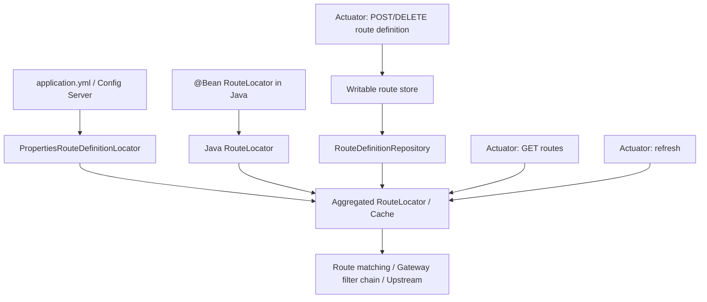
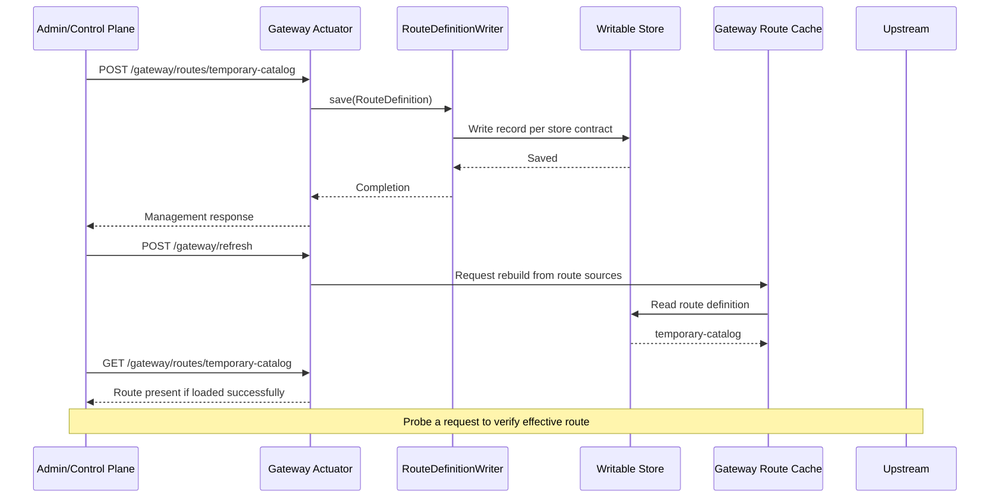
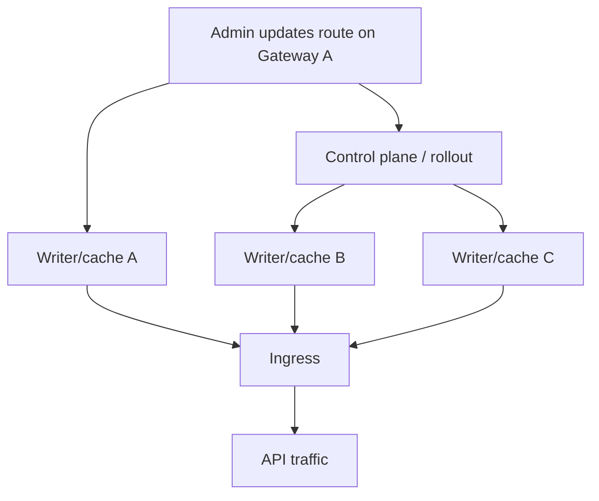
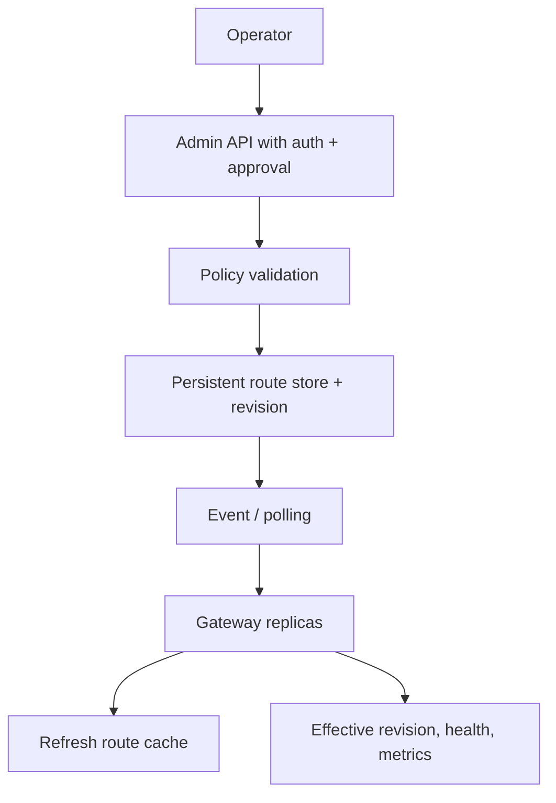

# Operation Limits on Routes Managed by YAML or Java Beans in Spring Cloud Gateway

In a microservices system, Spring Cloud Gateway can load routes from `application.yml`, from centralized configuration such as Spring Cloud Config, from Java code creating a `RouteLocator`, or from a writable route definition repository. When **Spring Boot Actuator** is enabled, operators can inspect effective routes and, in versions/configurations granting write access, request adding, deleting, or refreshing certain routes.

A common point of confusion is: **seeing a route through Actuator does not mean Actuator can modify the source that created it**. A route declared in YAML remains governed by the YAML/config source. A route created by a `@Bean RouteLocator` remains governed by Java code and bean lifecycles. Gateway Actuator `POST` or `DELETE` commands typically work through a **`RouteDefinitionWriter`**, rather than editing YAML files, altering Java source code, or releasing a new application version.

This lesson belongs to the **Actuator Management** chapter of the `SPRING_CLOUD_GATEWAY` module, in the context of an API Gateway built with route predicates, filter chains, path/header transformations, service discovery, authentication, rate limiting, circuit breakers, retries, TLS, and observability. The goal is not merely remembering which endpoints are callable, but **choosing the right management path according to route ownership** and preventing a temporary administrative call from leaving multiple replicas routing inconsistently.

**After this lesson, you will be able to:**

1. Distinguish **observable routes** from **durably modifiable routes** via Actuator.
2. Explain the roles of `RouteLocator`, `RouteDefinitionLocator`, `RouteDefinitionWriter`, and `RouteDefinitionRepository`.
3. Understand the limitations of `POST /actuator/gateway/routes/{id}`, `DELETE /actuator/gateway/routes/{id}`, and `POST /actuator/gateway/refresh` for routes originating from **YAML** or **Java beans**.
4. Design proper workflows for centralized configuration, canaries, cache refresh, rollback, and multiple Gateway replicas.
5. Protect management endpoints and verify real outcomes on the data plane rather than trusting management HTTP 2xx responses alone.

> **Scope:** Examples target **Spring Cloud Gateway Server WebFlux**. Starter names, `spring.cloud.gateway...` namespaces, Gateway Actuator access toggles, and available operations may change across Spring Boot/Spring Cloud Gateway versions. Config snippets illustrate one API branch, not universal configurations across all versions. In particular, **Server MVC** has a different pipeline/management model and must not be inferred from WebFlux examples.

## 1. Opening Scenario: Deleting a Route via Actuator Yet the Route Remains

Suppose a Gateway has two routes:

- `catalog-yaml` configured from YAML, matching `GET /api/catalog/**`.
- `orders-java` created inside a Java `@Bean RouteLocator` method, matching `/api/orders/**`.

An operator opens the Actuator list and sees both routes. They then attempt to temporarily remove `catalog-yaml` using the management API, only to wonder why catalog requests still match or why the route reappears upon refresh/restart.

The issue lies in **route source ownership**:



This diagram is a **logical model**: exact wiring of locators and repositories depends on version beans/auto-configuration. The arrow from Actuator write to the writable store is **not** an arrow to YAML or Java source code.

**Principle:** When a route is managed by a declarative source outside the write API, modify **that source** through the proper workflow and then refresh/roll out. Never use Actuator calls as a permanent “override” over the source of truth.

## 2. Three Layers to Distinguish: Definition, Effective Route, Management API

| Layer | What Does It Hold? | Who Manages It? |
| --- | --- | --- |
| **Definition source** | YAML, Git/Config Server, Java DSL, or database records. | Repository, CI/CD, config controller, or authorized administrators. |
| **Effective route** | Bound, ordered `Route` loaded with predicates/filters and potentially cached. | Gateway route locators, filter/route pipeline. |
| **Management API** | Endpoints to read routes, add/delete via writer, and trigger refresh. | Spring Boot Actuator + Spring Cloud Gateway actuator integration. |

An operation touching only one layer does not automatically synchronize all layers.

For example:

```text
Git: catalog URI changed to lb://catalog-v2
Config Client has not pulled the new revision yet
Gateway route cache still holds lb://catalog-v1

POST /actuator/gateway/refresh
    → May merely rebuild routes from sources still holding v1
    → Does not automatically fetch new Git commits
```

Likewise, POSTing a route into an in-memory `RouteDefinitionRepository` **does not alter** the packaged YAML file or compiled Java classes.

### 2.1. Observation Access Differs from Edit Access

A management endpoint can read routes across multiple locators, whereas write endpoints only mutate wherever `RouteDefinitionWriter` persists data.

| Action | Can See YAML/Java Routes? | Directly Modifies YAML/Java Source? |
| --- | --- | --- |
| List effective routes | Usually yes, once loaded and supported by endpoint. | No. |
| Inspect one route by ID | Usually yes, if present in effective locators. | No. |
| Create route definition via writer | Only if write access and a writer are supported/configured. | No. |
| Delete route definition via writer | Only definitions owned by the writer/backend per its semantics. | No. |
| Refresh Gateway route cache | Triggers re-reading currently supplied definitions/locators. | No. |
| Restart/rollout | Reloads app/config per lifecycle. | Does not edit source itself, though changed sources take effect. |

The word “usually” reflects differences across versions and route sources. **Being readable is not proof of being deletable.**

## 3. Core Interfaces in Gateway Server WebFlux

### 3.1. `RouteLocator`: Provides Runtime Routes

`RouteLocator` supplies the `Route` objects used to match requests. A `@Bean RouteLocator` can construct routes using Java DSL. Gateway Actuator can surface those effective routes via its read APIs.

It is not a generic API for editing Java source code.

### 3.2. `RouteDefinitionLocator`: Provides Declarative Data

A route definition locator is reactive:

```java
import org.springframework.cloud.gateway.route.RouteDefinition;
import org.springframework.cloud.gateway.route.RouteDefinitionLocator;
import reactor.core.publisher.Flux;

public interface ConceptualLocator extends RouteDefinitionLocator {
    @Override
    Flux<RouteDefinition> getRouteDefinitions();
}
```

This snippet illustrates the **read contract** only; it does not create real routes. Implementations can read definitions from properties, discovery services, or custom stores.

### 3.3. `RouteDefinitionWriter`: Definition Write/Delete Path

A writer handles definition management operations against its backing store, typically with signatures like:

```java
Mono<Void> save(Mono<RouteDefinition> route);

Mono<Void> delete(Mono<String> routeId);
```

Check exact method names, parameters, and package imports against your Gateway version. **A writer holds no magical authority over other locators.** If the writer's backend is an in-memory repository, `save` writes only to that backend; if a route exists solely inside a `@Bean RouteLocator`, the writer cannot rewrite that bean.

### 3.4. `RouteDefinitionRepository`: Combines Read and Write

`RouteDefinitionRepository` combines read and write capabilities for a definition source. Implementations can store data in memory, Redis, a database, or a matching control plane.

Architectural flow example:

```text
Actuator POST/DELETE
  → RouteDefinitionWriter
  → Writable Repository
  → Store
  → Gateway route-cache refresh
  → New effective routes
```

**Important:** This is the operational flow **when components are configured properly**—not a guarantee that every Gateway includes a persistent repository or auto-refreshes after every save/delete. For persistence across restarts, choose and test a durable implementation.

### 3.5. `CachingRouteLocator`

The Gateway may cache routes to optimize HTTP request matching. When source definitions change, the cache can hold stale routes until refreshed.

Still, refreshing the cache **does not modify sources**, so reloading only rebuilds whatever locators supply at that moment.

## 4. Two Sources Not Writable via a Simple Actuator Command

This lesson focuses on two sources commonly found in Gateway applications.

### 4.1. YAML Properties as a Declarative Source

A route bound from properties:

```yaml
spring:
  cloud:
    gateway:
      server:
        webflux:
          routes:
            - id: catalog-yaml
              uri: lb://catalog-service
              predicates:
                - Path=/api/catalog/**
              filters:
                - StripPrefix=1
```

In some older Gateway Server WebFlux versions, the namespace is `spring.cloud.gateway.routes`. Choose the form matching your actual version.

If `catalog-yaml` originates from `PropertiesRouteDefinitionLocator` or a similar properties source, **Actuator does not open the file and delete those YAML lines**. Therefore:

- A DELETE call through the writer **may fail to find** the definition in the storage managed by the writer.
- A POST with a duplicate ID can create **conflicting definitions** across sources rather than updating YAML.
- When the route cache reloads, the YAML definition may still be supplied again.
- Restarting the application loads YAML from the deployed artifact/config.

Do not assume one fixed HTTP status across all DELETE cases: exception/status mappings and writer implementations vary by version. What matters is checking **whether the source route still exists** and **what the effective route is after refresh**.

### 4.2. Java Beans as a Programmatic Source

Example:

```java
import org.springframework.cloud.gateway.route.RouteLocator;
import org.springframework.cloud.gateway.route.builder.RouteLocatorBuilder;
import org.springframework.context.annotation.Bean;
import org.springframework.context.annotation.Configuration;

@Configuration
public class GatewayRoutes {

    @Bean
    RouteLocator ordersJavaRoute(RouteLocatorBuilder builder) {
        return builder.routes()
            .route("orders-java", r -> r
                .path("/api/orders/**")
                .filters(f -> f.stripPrefix(1))
                .uri("lb://order-service"))
            .build();
    }
}
```

The `orders-java` route is constructed by **Java code and Spring bean lifecycles**. Even though Actuator displays this ID, calling `DELETE /actuator/gateway/routes/orders-java` cannot rewrite `ordersJavaRoute(...)`, remove bytecode, or stop the bean from emitting that route.

To change a Java route:

- Edit the code/Java DSL or the external data source that the code reads.
- Test and deploy a new build; or
- Design a custom bean/locator capable of swapping controlled runtime snapshots.

**Actuator refresh does not recompile Java classes.** For a static Java `RouteLocator` bean, refreshing the cache generally reads the exact same runtime definitions emitted by the bean.

## 5. Comparing Operation Limits by Route Source

| Route Source | Visible via Gateway Actuator | Add/Edit/Delete Directly via Default Writer | Survives Restart | Reliable Change Path |
| --- | --- | --- | --- | --- |
| Packaged `application.yml` | Visible once loaded. | **Does not edit YAML directly**. | Tied to deployed config file. | Edit YAML, CI/CD, appropriate rollout/rebind. |
| YAML from Spring Cloud Config | Visible once bound. | **Does not edit Git/Config Server**. | Tied to reloaded source config. | PR/commit, Config Client refresh, Gateway route refresh. |
| Static Java DSL `@Bean RouteLocator` | Visible once loaded. | **Does not edit code/bean source**. | Tied to binary/deployment. | Edit code, deploy, or build custom dynamic source. |
| In-memory `RouteDefinitionRepository` | Visible after effective routes refresh. | Can write/delete **within the writer-owned store**. | Generally **no**, if JVM-memory only. | Protected Actuator or internal API + refresh. |
| Custom persistent `RouteDefinitionRepository` | Visible if locator is integrated. | Can write/delete per repository writer/transactions. | Yes, if backed by durable store. | Control-plane API with auth/validation/commit/refresh. |
| Discovery-based routes | Visible if discovery locator generates routes. | Does not alter service registry or discovery policy. | Depends on registry/locator. | Update registry/service metadata/locator config. |

**There is no universal CRUD call that durably edits every route source.** If the system truly needs API-driven route management, deliberately place managed routes into a **writable source** instead of trying to force Actuator to replace Git and Java code.

## 6. Essential Gateway Actuator Endpoints

In Gateway Server WebFlux versions supporting Gateway Actuator, common endpoints include:

| HTTP Method / Path | Common Usage | Key Limitation |
| --- | --- | --- |
| `GET /actuator/gateway/routes` | List effective routes, potentially with predicates/filters/URIs/metadata. | Does not indicate whether the route's source is writable. |
| `GET /actuator/gateway/routes/{id}` | Inspect one route by ID. | Grants neither ownership nor write permissions. |
| `GET /actuator/gateway/globalfilters` | Inspect global filters. | Read-only observation; does not modify bean logic. |
| `GET /actuator/gateway/routefilters` | Inspect route filter factories per endpoint capabilities. | Not an API to edit Java classes. |
| `POST /actuator/gateway/routes/{id}` | Save a `RouteDefinition` via a supported writer. | Does not write YAML or edit Java code; duplicate-ID risk. |
| `DELETE /actuator/gateway/routes/{id}` | Delete a definition from the writer backend per its semantics. | Does not remove YAML/Java routes from other locators. |
| `POST /actuator/gateway/refresh` | Request refreshing the Gateway route cache. | Does not fetch Config Server or restart the app; normally instance-local. |

**Not every version or configuration enables all of these methods.** Spring Boot Actuator may require both **exposure** and **write/unrestricted** access; some versions permit read-only access only.

### 6.1. Seeing a Route ≠ Being Able to Edit It

For example, these two reads:

```http
GET /actuator/gateway/routes/catalog-yaml
GET /actuator/gateway/routes/orders-java
```

can return route details because the Gateway **is using** them. Yet:

```http
DELETE /actuator/gateway/routes/catalog-yaml
DELETE /actuator/gateway/routes/orders-java
```

are not APIs to edit YAML or Beans. Even if callable, the exact outcome depends on the writer backend; never infer from a DELETE status that the underlying source was removed.

### 6.2. Actuator Access Settings Vary by Version

A **read-only-first** config in Spring Boot/Gateway lines supporting the `access` model may look like:

```yaml
management:
  endpoints:
    web:
      exposure:
        include: health,info,gateway
  endpoint:
    gateway:
      access: read-only
```

For write management, some versions allow `management.endpoint.gateway.access: unrestricted`, which is a highly sensitive privilege and **should never be enabled just to try CRUD outside controlled non-production**.

Older versions may use `management.endpoint.gateway.enabled` or other mechanisms; newer ones may enforce global Actuator access caps. **Configure according to the reference docs of your exact version**, never mixing `enabled`, `access`, and `exposure` assuming uniform behavior.

> **Exposure is not authentication.** Listing an endpoint in `exposure.include` does not restrict which clients may view or mutate it. You still need Spring Security, management networking, TLS/mTLS, and separate write authorization.

## 7. Scenario A — YAML Route: Change the Source First

Suppose you have:

```yaml
- id: catalog-yaml
  uri: lb://catalog-service-v1
  predicates:
    - Path=/api/catalog/**
  filters:
    - StripPrefix=1
```

Operators want to switch `catalog-service-v1` to `catalog-service-v2`.

### 7.1. What Not to Use as a Permanent Solution

Do not simply POST a new route with the **same ID** into the Actuator writer and treat that as “updating YAML”:

```text
YAML locator:
    id=catalog-yaml, uri=lb://catalog-service-v1

Actuator writable repository:
    id=catalog-yaml, uri=lb://catalog-service-v2

Combined route sources:
    Risk of duplicate definition IDs
    or behavior depending on locator/priority/version
```

Duplicate IDs across sources can cause unpredictable behavior and muddy observability. Never rely on aggregation order as a formal config-override mechanism without explicit design and testing.

### 7.2. Proper Workflow for Git-Managed YAML

1. Edit the route definition in Git/the config repository.
2. Run reviews, checking URI/service IDs and policies.
3. Merge/publish an explicit revision.
4. Ensure Config Client or the Gateway's config mechanism **receives and binds** the new revision.
5. Refresh the Gateway route cache via the version-supported method, or perform a controlled rollout/restart.
6. Verify **effective routes** on every replica and send live requests to v2.
7. Roll back in the **YAML source** if SLOs fail, then refresh/roll out again.

### 7.3. What If YAML Is Packaged Inside the Binary?

When YAML is bundled inside the built artifact, the clean, reproducible approach is usually **deploying a new binary/config** via rolling restart. Never edit files inside a running container and call refresh expecting every instance to pick up the change.

### 7.4. Why Might a Gateway Refresh Change Nothing?

`POST /actuator/gateway/refresh` generally triggers rebuilding the route cache from **currently supplied route sources**. If `@ConfigurationProperties` or Config Client has not updated yet, the cache may keep loading v1.

Distinguish:

```text
Config source refresh / rebind
        vs.
Gateway route-cache refresh
```

Verify both when using centralized YAML sources.

## 8. Scenario B — Java Bean Route: Actuator Cannot Edit Bean Definitions

Consider Java DSL:

```java
@Bean
RouteLocator promotionsRoutes(RouteLocatorBuilder builder) {
    return builder.routes()
        .route("promotions-java", r -> r
            .path("/api/promotions/**")
            .filters(f -> f.stripPrefix(1))
            .uri("lb://promotions-service-v1"))
        .build();
}
```

If you want to change the target to `lb://promotions-service-v2`, Actuator cannot rewrite literals inside compiled Java code.

### 8.1. Three Practical Options

| Option | Approach | Pros / Cons |
| --- | --- | --- |
| **Deploy updated code** | Change `uri` in Java, build/test, rolling deploy. | Clear, audited in Git, not instantaneous at runtime. |
| **Read URI from config source** | Java bean or custom locator designed to read refreshable properties. | Must verify rebind/route rebuild actually runs; not automatic. |
| **Move to a writable route repository** | Store route definitions in a validated, versioned store. | Flexible, but requires building a control plane and rollback. |

In practice, if a route changes frequently, hardcoding it in static Java DSL may no longer be the right ownership model. **Deliberately changing route ownership** beats temporary “overrides” via Actuator.

### 8.2. Is `@RefreshScope` a Universal Answer?

No. `@RefreshScope` pertains to Spring Cloud Context bean/property refreshing, whereas `@Bean RouteLocator`, route caches, and bean recreation depend on actual wiring and version behavior. Never slap an annotation on and assume Java routes rebuild properly.

If dynamic behavior is required, build a versioned **`RouteDefinitionLocator`/snapshot source** with validation and explicit refresh events—or use deployments to preserve reproducibility.

### 8.3. Do Not Confuse Service Discovery with Changing Route URIs

`lb://promotions-service` lets LoadBalancer select instances from service discovery. When instance counts change, the Gateway routes to different instances while the **route definition stays unchanged**.

Changing `lb://promotions-service-v1` to `lb://promotions-service-v2` changes the **service ID inside the route**—different from updating the instance list of the same service ID.

## 9. Scenario C — Routes Actually Managed by a Writer/Repository

When routes live in a writable `RouteDefinitionRepository`, Gateway Actuator can manage them per the repository's API and configured permissions.

Illustrative flow in an **isolated staging environment** with admin-only management endpoints:



This diagram does not guarantee synchronous refresh or fixed status codes after save. Some implementations integrate refresh differently; verify against your actual running version.

### 9.1. Example: Creating a Route via the Writer

Illustrative request:

```bash
curl -i -X POST \
  "https://gateway-admin.internal.example/actuator/gateway/routes/temporary-catalog" \
  -H "Authorization: Bearer <admin-token>" \
  -H "Content-Type: application/json" \
  --data '{
    "id": "temporary-catalog",
    "uri": "lb://catalog-service",
    "predicates": [
      {
        "name": "Path",
        "args": {
          "_genkey_0": "/sandbox/catalog/**"
        }
      }
    ],
    "filters": [],
    "order": 100
  }'
```

**Example limitations:** `RouteDefinition` JSON shapes and predicate argument binding can vary by API/version. `_genkey_0` is a common positional argument representation in Gateway examples, not a schema users must blindly apply to every predicate.

This is a **high-privilege administrative action**; run it only in staging against controlled internal endpoints. Never expose this endpoint directly to the Internet.

### 9.2. Refresh and Inspect

Where the version/config requires explicit refresh:

```bash
curl -i -X POST \
  "https://gateway-admin.internal.example/actuator/gateway/refresh" \
  -H "Authorization: Bearer <admin-token>"
```

Then inspect:

```bash
curl -i \
  "https://gateway-admin.internal.example/actuator/gateway/routes/temporary-catalog" \
  -H "Authorization: Bearer <admin-token>"
```

To verify the data plane, send a request through the **normal API port** to `/sandbox/catalog/products/42` and inspect backend/mock/trace logs. **`GET` route** only verifies one management view; it proves neither backend readiness nor that all replicas loaded the route.

### 9.3. Deleting a Dynamic Route

For a writer-owned route:

```bash
curl -i -X DELETE \
  "https://gateway-admin.internal.example/actuator/gateway/routes/temporary-catalog" \
  -H "Authorization: Bearer <admin-token>"
```

Refresh if needed and confirm the route is no longer emitted by **any source**. If the route still appears, another locator may emit the same ID, the cache was not refreshed, or another node has not updated.

### 9.4. Durability Depends on Storage

If the writer uses an **in-memory store**, restarting the Gateway wipes dynamic routes. To survive restarts and span multiple replicas, use a shared persistent repository or a control plane distributing persisted revisions.

**Actuator POST success does not mean data is durable** if backing storage is purely in-memory.

## 10. Why Can Deleting YAML/Java Routes Return Errors or Lack Effect?

A common diagnostic mistake: seeing a route in `GET /gateway/routes`, calling DELETE on that ID, and getting a “not found” error or seeing the route remain.

Two different execution paths are involved:

```text
GET:
  Effective RouteLocator
    → aggregates multiple route sources

DELETE:
  RouteDefinitionWriter
    → operates only on the configured writer backend
```

If the ID exists only in `PropertiesRouteDefinitionLocator` or a Java `RouteLocator`, the writer may hold no such record. Depending on handler/version, the outcome may be a backend exception or an error response.

**Never try to “fix” this by adding a duplicate-ID record to the writable repository and then deleting it.** That only mutates the writer's backend while YAML/Java routes stay intact.

### 10.1. Refresh After DELETE Does Not Delete the Source Either

If the YAML route remains in config files, refresh can reload it. If the Java route is still emitted by the bean, refresh can keep using it.

To **disable** a route durably, you must:

- Remove/edit the predicate or route at the owning source.
- Or deploy a temporary block at edge/Security during emergencies.
- Then verify all Gateway instances and in-flight requests per your threat model.

### 10.2. Why Must Duplicate Route IDs Be Avoided?

Two sources emitting the same `catalog-yaml` ID can cause:

- Actuator displaying multiple entries or ambiguous state.
- Route matching affected by ordering/priority.
- Deleting from one store leaving the other store's copy intact.
- Route-ID-based observability failing to distinguish sources.
- Rollbacks unable to tell which entry was authoritative.

Enforce unique ID validation across all active route sources and clear ownership policies per route group.

## 11. `/actuator/gateway/refresh` Is Only a Cache Refresh Step

A safe sequence generally requires:

```text
1. Edit the authoritative source.
2. Confirm source commit/update completed.
3. If needed, refresh Environment/Bean/locator sources.
4. Request route cache refresh.
5. Verify the effective route on that instance.
6. Probe live requests and upstream.
7. Repeat/orchestrate across all Gateway instances.
```

**Never swap steps 3 and 4**: refreshing too early can reload stale data.

### 11.1. `RefreshRoutesEvent` and Actuator Refresh

In WebFlux code, you can publish the event locally:

```java
import org.springframework.cloud.gateway.event.RefreshRoutesEvent;
import org.springframework.context.ApplicationEventPublisher;
import org.springframework.stereotype.Service;

@Service
public class RouteRefreshService {

    private final ApplicationEventPublisher publisher;

    public RouteRefreshService(ApplicationEventPublisher publisher) {
        this.publisher = publisher;
    }

    public void refreshAfterSourceCommit() {
        publisher.publishEvent(new RefreshRoutesEvent(this));
    }
}
```

`RefreshRoutesEvent` triggers rebuilding the route cache from existing sources—it is **not** an API to edit YAML/source code and does not broadcast across a cluster by default.

### 11.2. Spring Cloud Context Refresh Differs from Gateway Route Refresh

In the Spring Cloud ecosystem, `/actuator/refresh` (when enabled) pertains to refreshing properties/`@RefreshScope`. Meanwhile, `/actuator/gateway/refresh` targets the Gateway's route cache.

These mean two different things. When using Config Server, verify both **config source revision** and **effective routes**. Calling one endpoint does not guarantee the other completed its work.

### 11.3. Refresh Is Not Request Draining

A request that already matched an older route can keep using the old filter chain/URI while refresh runs. Never rely on route cache refresh as a guarantee to immediately abort all in-flight requests.

For urgent security changes, consider firewalls/ingress, security policies, token revocation, connection draining, and controlled rollouts.

## 12. Managing Multiple Gateway Replicas

Production environments typically run multiple Gateway instances behind an ingress/load balancer. Calls to the same management path may reach **just one** specific instance.



If you only call Actuator POST and refresh on A:

- B and C may continue serving old routes.
- If A uses an in-memory repository, B/C never learn about the new record.
- Even with a shared database, B/C may see the updated source **yet still require cache refresh** via their own mechanism.
- If a load balancer routes management requests randomly, you may mistake B's response for A's state.

### 12.1. A Shared Repository Is Necessary, Not Sufficient

Reading the same Redis/database does not yield a cluster-wide atomic cutover. Nodes may hold:

```text
Gateway A: effective revision 12
Gateway B: effective revision 11
Gateway C: effective revision 12
```

You need a workflow:

1. Publish a validated snapshot revision 12.
2. Distribute signals or polling across every node.
3. Each node refreshes its cache and reports its applied version.
4. Run canary/health checks.
5. Declare rollout complete only when desired consistency conditions pass.

### 12.2. Admin Endpoint HTTP 2xx Does Not Confirm the Whole Cluster

When an admin POSTs to one Gateway and gets 2xx, that only proves **that endpoint processed the request per its contract**. Do not conclude the entire Gateway cluster updated or that the data plane can serve the new destination.

For critical routes, track telemetry such as:

```json
{
  "instance": "edge-02",
  "desiredRevision": "routes-12",
  "effectiveRevision": "routes-11",
  "lastRefreshResult": "PENDING"
}
```

This is a **custom observability schema**, not built-in JSON guaranteed by Gateway Actuator.

## 13. Securing Gateway Actuator: Read Access Differs from Write Access

Route lists can reveal sensitive details:

- Service IDs like `payment-service` or `identity-service`.
- Internal hosts/paths.
- Filter names, metadata, timeouts, or network topology.
- Unpublicized administrative routes.

Route create/delete capability is even more sensitive: anyone with write permission can divert traffic to untrusted upstreams or open routes into private infrastructure.

### 13.1. Recommended Permission Model

| Role | Privileges |
| --- | --- |
| Regular API client | **No** access to Gateway Actuator management. |
| Read-only Observer/SRE | Read-only access to permitted health/metrics/route details. |
| Rollout-authorized Operator | Can trigger refresh via authenticated, audited workflows. |
| Route-modifying Control Plane | Can write/delete routes strictly per approved policy; enforces schema, URI, and quota checks. |
| Break-glass Admin | Temporary privilege, fully audited, multi-layer protected. |

**Never grant `unrestricted` to everyone** simply because someone needs to view a route list.

### 13.2. Defense in Depth

- Expose management on a **private port/network** whenever possible.
- Permit only internal ingress, firewalls, and appropriate network policies.
- Use HTTPS/mTLS or strongly authenticated identities for admin clients.
- Enforce granular authorization: separate GET from POST/DELETE.
- Protect credentials and restrict lifetimes/scopes of admin tokens.
- Audit user/service account, timestamp, route ID, desired revision, and outcome.
- Rate-limit writes/refreshes to prevent refresh storms.
- Never enable wildcard management exposure outside isolated test environments.
- Never log raw tokens, secrets, or sensitive full route metadata.

### 13.3. Spring Security WebFlux and Actuator

Conceptual policy:

```text
GET    /actuator/gateway/**   -> SCOPE_gateway.read
POST   /actuator/gateway/**   -> SCOPE_gateway.admin
DELETE /actuator/gateway/**   -> SCOPE_gateway.admin

All Internet traffic to management -> blocked at network/ingress.
Write operations -> routed through approved/audited admin workflow.
```

This is a **design policy**, not Spring Boot's default configuration. When defining `SecurityWebFilterChain`, verify chain/matcher ordering and actual endpoints. When management runs on a separate port/application context, protections may differ from the main WebFlux API.

If management uses cookies/sessions, evaluate CSRF; if using stateless Bearer/mTLS only, CSRF policy differs. Never copy `csrf(disable)` system-wide just to make POST refresh work.

### 13.4. Route Writes Can Become SSRF

A route created via an admin API:

```yaml
id: unsafe-example
uri: http://169.254.169.254
predicates:
  - Path=/**
```

could open unintended access to metadata/internal addresses. This example is strictly for risk illustration—**never deploy it**.

Enforce URI scheme/host/service-ID allowlists, block metadata/loopback/private networks outside policy, verify DNS/TLS, and enforce egress restrictions. Even for authenticated admins, route changes require **policy validation** because operator mistakes can expose data.

### 13.5. Route CRUD Must Not Silently Bypass JWT, CORS, or Rate Limits

A new route created via a writer does not automatically inherit every policy of the YAML/Java route it replaces. Before approval, verify:

- **JWT and Spring Security:** `SecurityWebFilterChain` protects the corresponding public paths, while backends continue verifying business permissions; never trust client-supplied identity headers.
- **CORS:** if serving browsers, preflight and origin policies must not widen unintentionally when changing `Path`/`Host` or CORS metadata.
- **`RequestRateLimiter`:** avoid accidentally dropping quota filters or changing `KeyResolver` to an untrusted header.
- **`CircuitBreaker` and `Retry`:** swapping filters can multiply upstream calls; never enable retries on side-effecting POSTs without idempotency guarantees.
- **TLS and upstream trust:** changing `uri` must not weaken certificate checks, service identity verification, or egress policies.

Having route write permission **is not permission to disable these defenses**. Enforce mandatory security invariants at layers resistant to route CRUD changes and verify them with tests.

## 14. Why Actuator CRUD Should Not Be Your Full Production Control Plane

Actuator is useful for **observability and runtime administrative actions**, yet a production route management system usually needs much more:

1. Strict schema/API contracts and validation.
2. Authentication/authorization by operator, service account, and environment.
3. Change approvals, auditing, and version history.
4. Route ownership and duplicate-ID detection.
5. Compatibility checks across predicates, filters, and security policies.
6. Atomic snapshots, rollout/canary/rollback.
7. State persistence across restarts and multiple replicas.
8. Change rate limits, debouncing, and circuit breakers on the control plane.
9. Per-replica health/status and effective-route verification.
10. Integration with GitOps/Config Server or standardized repositories.

Merely exposing Actuator POST/DELETE to the Internet creates a **high-risk config write door**, not a governed control plane.

### 14.1. Can You Build a Dedicated Management API?

Yes. A dedicated **control plane** can:



The control plane decides **who can change what**, validates entire snapshots, and publishes revisions. Gateways pull definitions only from trusted sources; the Actuator write endpoint can stay **disabled** when unnecessary.

### 14.2. Should Routes Belong to YAML or a Database?

Avoid making both the “source of truth” for the same routes. Common patterns:

- **GitOps:** all routes managed as YAML in Git; Actuator is strictly for controlled observation/refresh.
- **DB-managed:** dynamic routes live in a persistent repository; the control plane owns CRUD.
- **Partitioned hybrid:** static routes use one ID prefix, dynamic routes use another; validation prevents overlaps.
- **Java-managed:** routes with specialized programmatic logic stay in code and change via deploys; remaining routes are managed centrally.

In hybrid setups, detect both **duplicate IDs** and **predicate overlaps** so a dynamic route never accidentally steals traffic from a static route.

## 15. Refresh and Rollback Capability: The Authoritative Source Decides

Suppose an operator accidentally points `/api/orders/**` to a test upstream. Rollback depends on the source:

| Source | Rollback Method |
| --- | --- |
| YAML in Git | Revert to prior revision, Config Client pulls it, refresh/roll out. |
| Static Java DSL | Redeploy known-good Java artifact/revision. |
| Writable persistent repository | Restore prior snapshot version in store and refresh replicas. |
| In-memory Actuator route | Delete/fix record in affected instances; verify no other source emits it. |
| Discovery route | Fix registry/metadata or discovery policy generating the route. |

**Never confuse rolling back a DELETE in the writer with rolling back a YAML commit.** They are completely different sources.

### 15.1. Last-Known-Good

During Config Server/DB outages or corrupt snapshots, Gateways should typically preserve a verified route set instead of wiping all routes when a source temporarily returns empty. Distinguish an “approved empty snapshot” from a data-load failure.

### 15.2. Emergency Actions

If a route accidentally exposes an internal API, fixing YAML/Java may take deploy time. A temporary block at **ingress/firewall/Spring Security** can be more effective than trying to DELETE a non-writer definition.

Follow up by fixing the **source of truth** so temporary blocks do not become hard-to-audit “shadow configs”.

## 16. Versioning and Concurrent Edits

Two operators might update route `orders-api` simultaneously. Relying solely on ID-based writer POSTs without versioning/ETags or CAS risks:

```text
Operator A reads route v10
Operator B reads route v10
A writes edit v11
B writes edit based on v10
A's changes can be overwritten if the store lacks concurrency control
```

To stay safe:

- Enforce revisions/ETags or optimistic locking in the control plane/store.
- Accept updates only when the expected version matches.
- Check route owner/namespace permissions.
- Audit patches/diffs and approvers.
- Apply atomic snapshots rather than half-updated route sets.
- After commit, trigger bounded refresh and verify effective revisions.

**Actuator route CRUD does not provide full version-conflict protection across repositories by default.** Build those guarantees into your data management layer.

### 16.1. Concurrent Delete and Refresh

If you DELETE a dynamic route while another refresh is loading an older snapshot, a window may appear where effective state diverges from desired state. Test races between save/delete, cache rebuilds, and concurrent HTTP traffic.

Never treat an HTTP 204/200 from DELETE (where returned) as proof that **no request after that millisecond can ever match the old route**.

## 17. Observability: Separating Source, Desired, and Effective Routes

A good operations dashboard should answer:

- Which route IDs come from YAML, Java, discovery, in-memory, or persistent repositories?
- What is the current desired config revision?
- What is the effective route revision on **each Gateway instance**?
- Are there duplicate route IDs or predicate overlaps?
- Are Actuator writes/refreshes failing due to policy or backend errors?
- After a rollout, how did 404/429/503/circuit breaker counts change?
- How many requests still hit old routes during the transition?

### 17.1. Metrics to Consider

| Metric / Event | Purpose |
| --- | --- |
| `gateway_route_inventory_count` by source | Track routes across sources. |
| `gateway_route_duplicate_id_total` | Detect ID collisions. |
| `gateway_admin_write_attempts_total` by action/outcome | Audit create/delete frequency. |
| `gateway_refresh_attempts_total` and duration | Spot refresh storms or slowness. |
| `gateway_route_revision_skew` | Measure replicas lagging target revision. |
| `gateway_route_update_rejected_total` | Classify schema/allowlist/auth rejections. |
| HTTP requests by route ID/status | Measure live traffic impact. |
| Upstream attempts/latency/5xx | Separate routing failures from backend failures. |

These are **suggested metric names to design yourself**, not an assertion that Spring Cloud Gateway emits all of them out of the box.

### 17.2. Avoid Overly Granular Labels

Avoid high-cardinality labels like raw access tokens, emails, arbitrary route URIs, full request paths, idempotency keys, or raw operator IDs. Use normalized route IDs, source categories, and action outcomes; store detailed audit logs separately with strict protection.

### 17.3. Distinguishing Statuses

| HTTP Status | What Might It Involve? |
| --- | --- |
| `401` | Client lacks valid credentials, potentially from Spring Security before Gateway routes. |
| `403` | Missing management read/write permission or missing API authorization. |
| `404` | No matching route, or missing backend/management path. |
| `405` | Write method unsupported by endpoint in current mode/version. |
| `429` | API client rate-limited; management may have separate rate limits. |
| `503` | `lb://` has no service instances or upstream unavailable. |
| `5xx` | Storage/refresh/filter/backend error; classify the failing source. |

Never alter Actuator config merely because a route returns 503: the fault may lie entirely in discovery/backends.

## 18. Test Scenario: YAML, Java Bean, and Writable Route

Assume staging has:

- Route `catalog-yaml` in `application.yml`.
- Route `orders-java` in `@Bean RouteLocator`.
- A writable repository configured for route `temporary-catalog`.
- Two Gateway replicas: A and B.
- Actuator management with read/write enabled **strictly on the staging network**.

### 18.1. Step 1 — List and Classify Sources

Fetch the effective routes list:

```bash
curl -i \
  "https://gateway-admin.internal.example/actuator/gateway/routes" \
  -H "Authorization: Bearer <observer-token>"
```

Cross-check external ownership records: `catalog-yaml` belongs to YAML, `orders-java` to Java code, and `temporary-catalog` to the writer repository.

**Never infer ownership solely from a route appearing in Actuator JSON**; Gateway route displays do not necessarily publish an “owner/source” field under a standard schema. Maintain a separate registry/metadata inventory when needed.

### 18.2. Step 2 — Verify YAML Routes Are Not Deleted at the Source

In **isolated staging**, test writer capabilities safely with approval. If you attempt DELETE on a YAML route, status codes vary by version/store; the critical invariants are:

- The file/config source still contains `catalog-yaml`.
- Refreshing the cache from YAML sources can still recreate the route.
- Editing the YAML source is the only durable deletion path.

Never run destructive tests like this in production, and **never write automation that blindly DELETEs static routes based on GET inventory**.

### 18.3. Step 3 — Verify Java Routes Similarly

Inspect `orders-java` in the route list. Cross-check source code/bean definitions: the writer cannot alter Java DSL. Update the route via a new staging build/deploy and confirm ID/path/upstream match the new revision.

### 18.4. Step 4 — Create and Delete a Writable Route

POST a new test route with an ID distinct from static routes, refresh if required, verify the upstream, then DELETE that exact ID and refresh. Confirm the store/writer obeys expected semantics.

### 18.5. Step 5 — Restart an Instance

Restart a staging Gateway using an in-memory writer repository. The test route may disappear. With a persistent repository, the route may survive yet still need cache loading. Document durability according to the actual implementation.

### 18.6. Step 6 — Multi-Replica

Call the admin endpoint directly on A, verifying B does not automatically sync without a shared source/cache mechanism; then run the distribution workflow and check effective routes per instance.

### 18.7. Step 7 — Security Controls

Test these cases:

- Missing or expired token → rejected.
- Read-only observer calls GET → allowed per policy.
- Read-only observer calls POST/DELETE/refresh → rejected.
- Admin permitted for the namespace cannot create a route pointing outside the URI allowlist.
- Rate cap stops an admin refresh storm.
- Audit logs record actor/action/revision without leaking credentials.

## 19. Detailed Test Matrix

| Test Case | Route Source | Action | Invariant to Verify |
| --- | --- | --- | --- |
| GET inventory | YAML | `GET /gateway/routes` | Effective route visible; do not infer write rights. |
| DELETE YAML route | YAML | DELETE via writer | Does not edit/delete YAML source; status depends on store. |
| Duplicate YAML ID POST | YAML + writer | Create duplicate ID | Policy should block; never treat as reliable YAML override. |
| Refresh after Git edit | Config Server YAML | Gateway refresh before Config Client reload | May still load stale route; enforce right sequence. |
| GET Java route | Java `@Bean RouteLocator` | `GET /gateway/routes/{id}` | Effective route visible; do not infer writer ownership. |
| DELETE Java route | Java Bean | DELETE via writer | Does not alter code/bean; never rely on DELETE for durable removal. |
| Change Java URI | Java Bean | Recompile/deploy or custom source | Route updates per managed version. |
| POST new route | Writable store | Save via Actuator | Record saved per store semantics; verify effective route. |
| Refresh | Writable store | `POST /gateway/refresh` | Cache loads from committed source. |
| DELETE writable | Writable store | Delete + refresh | Writer-owned record gone; no duplicates remain. |
| Restart | In-memory store | Restart Gateway | In-memory route may vanish; no persistence promise. |
| Restart | Persistent store | Restart Gateway | Record persists if durable store loads properly. |
| Multi-replica | Shared store | Refresh A only | B may retain stale cache; requires version reconciliation. |
| Concurrent writes | Persistent store | A and B update same ID | CAS/revisions prevent lost updates per policy. |
| Unsafe route URI | Writable store | POST metadata/internal URI | Validation/egress policy rejects it. |
| Regular client | Actuator | GET/POST/DELETE | Rejected by network/auth policy. |
| Observer token | Actuator | POST/DELETE/refresh | Denied write access. |
| Refresh storm | Actuator | Burst of POST refreshes | Rate cap/single-flight/backoff holds. |
| No-instance route | `lb://` | HTTP API request | 503 stems from discovery, not Actuator CRUD. |
| Retry/RateLimiter | YAML/Java/dynamic | Edit route config | Security/quotas/idempotency not bypassed. |

## 20. Common Issues and Diagnostics

| Symptom | Common Cause | Diagnostic Direction |
| --- | --- | --- |
| DELETE route returns not found though GET shows it | GET reads aggregated effective locator; writer knows only its backend records | Check route source and writer repository; don't force-delete static routes |
| DELETE succeeds yet route reappears | YAML/Java/discovery still emits route or another cache/replica holds it | Inspect source of truth and refresh every node |
| Duplicate-ID POST yields erratic behavior | Multiple locators emit the same ID | Block duplicate IDs; partition route ownership |
| POST new route returns 2xx yet HTTP API still 404 | Cache unrefreshed, predicate mismatch, or wrong node | Check effective route/predicates and backend path |
| Refresh leaves YAML route unchanged | Config Client has not pulled/rebound new revision | Separate config reload from route-cache refresh |
| Java route unchanged after refresh | Bean still uses old Java literal/config | Deploy new version or build dynamic locator |
| New route vanishes after restart | Writable repository is in-memory | Use a persistent store if durability is needed |
| A has new route, B lacks it | Actuator called only on A, or B unrefreshed | Distribute revisions; verify per replica |
| Actuator GET works, POST returns 403/405 | Writes disabled, denied by Security/RBAC, or method absent | Check access/exposure/version and security matchers |
| Actuator endpoint returns 404 | `gateway` unexposed, wrong URL/management port, or component disabled | Check dependencies/config/management base path |
| Gateway returns 503 after route update | New service ID lacks healthy/ready instances | Check discovery/LoadBalancer/TLS; don't blame Actuator |
| Frequent refreshes spike CPU | Automation lacks dedupe/rate-limit | Add single-flight, debounce, minimum intervals, auditing |
| No 401/403 seen in GlobalFilter | Spring Security rejected request prior to Gateway chain | Instrument the authentication layer |
| User edits route to bypass security | Control plane lacks policy/egress checks | Allowlist filters/URIs; keep security/backend defenses independent |
| Dynamic route adds filter overwriting Authorization | Unreviewed header mutation | Block sensitive headers; enforce filter allowlists and TLS |
| Multiple identical route IDs after deploy | Hybrid YAML + Java + repository without ID partitioning | Track inventory/ownership; enforce unique-ID policies |
| Git rolled back yet traffic still hits v2 | Replicas haven't pulled or refreshed rollback revision | Check effective revisions and probe every node |
| Ingress LB makes admin tests flicker | Admin requests hit different instances | Use instance/revision-aware management plane; never expose public debug ports |

## 21. Practice Exercises with Answers

### Exercise 1 — GET Works Yet DELETE Fails to Delete

`GET /actuator/gateway/routes/catalog-yaml` displays the route. `DELETE` on the same ID errors because the writer cannot find it. Is this a contradiction?

**Answer:** No. GET reads from the aggregated effective `RouteLocator`, whereas DELETE operates only on the store managed by `RouteDefinitionWriter`. YAML routes may not live in that writer.

### Exercise 2 — Refreshing a Java Bean Route

A `@Bean RouteLocator` has literal URI `lb://orders-v1`. An operator calls `POST /actuator/gateway/refresh` expecting it to switch to v2 without deploying new code. Is that right?

**Answer:** No. Cache refresh cannot modify compiled Java literals. You must deploy updated bean/code or design a dynamic locator backed by a separate config source.

### Exercise 3 — Duplicate Route IDs

Both YAML and the writable repository emit `id=orders-api` with different URIs. Should you assume “later route overwrites earlier route” like map merging?

**Answer:** Never assume stable override semantics. Multiple sources can contribute definitions; behavior depends on locator/order. Block duplicate IDs and partition route ownership.

### Exercise 4 — POST Succeeds Yet GET Doesn't Show the Route

An admin successfully POSTs a new route; an immediate GET on effective routes doesn't show it. Can this happen?

**Answer:** Yes. Save may only persist the definition; the route cache hasn't refreshed yet or refresh is asynchronous. Refresh properly and verify effective routes on the right instance.

### Exercise 5 — In-Memory Store

An Actuator-created route appears on Gateway A yet disappears after a restart. Is this a Gateway bug?

**Answer:** Not necessarily. If the writer uses an in-memory store, durability is not provided. Use a persistent repository or GitOps if routes must survive restarts.

### Exercise 6 — Multiple Replicas

A route is added to a shared Redis repository. Gateway A refreshed, B has not. Will requests to the same path across A and B behave consistently?

**Answer:** Not guaranteed. A shared store does not automatically invalidate route caches on every node. You need events/polling/refresh, revision tracking, and rollout checks.

### Exercise 7 — Manage via Git or Actuator?

A production route is managed via YAML in Git with audits/approvals. A team wants to use Actuator POST to change the URI directly for speed while leaving Git untouched. Should they?

**Answer:** Not as a durable practice. It introduces configuration drift, duplicate source/ID risks, and painful rollbacks. Edit Git and run your controlled config refresh/rollout pipeline.

### Exercise 8 — Management Exposure

An app enables `management.endpoints.web.exposure.include=gateway` and assumes only admins can call it. Is that accurate?

**Answer:** No. Exposure does not replace authentication/authorization. You need network policies, TLS/mTLS, Spring Security, and separate read/write permissions.

### Exercise 9 — Status 405

An observer calls `POST /actuator/gateway/refresh` and gets 405. Can you conclude their token is invalid?

**Answer:** Insufficient evidence. The endpoint/write method may be unsupported or unexposed under the current access mode/version; Security may also play a role. Check config/version and endpoint mappings first.

### Exercise 10 — SSRF Route

An actor permitted to POST to Actuator creates a `Path=/**` route pointing to `http://169.254.169.254`. Since the actor is authenticated, should this be allowed?

**Answer:** Not under normal security policies. Enforce route validation, destination allowlists, network egress restrictions, and change reviews; admin authentication does not replace config safety checks.

### Exercise 11 — Source Changed Yet Cache Unchanged

The control plane commits a new route to the persistent repository, yet the Gateway still matches the old route. What needs to happen?

**Answer:** Confirm the repository serves the new revision, then refresh the Gateway route cache and verify effective routes. Never equate a source commit with a cache update.

### Exercise 12 — Service Discovery

A Java route uses `lb://catalog-service`. The registry adds a new instance of that service. Do you need to edit the Java bean or POST a new Actuator route?

**Answer:** Not necessarily. The route still targets the same service ID; LoadBalancer picks up new instances via service discovery. That is an instance-list change, not a route-definition edit.

### Exercise 13 — Emergency Rollback

A YAML route accidentally exposes an internal API, and Actuator DELETE cannot remove it. Should you keep calling DELETE repeatedly?

**Answer:** No. Block temporarily at ingress/Security/network if needed, fix the YAML/Config Server source, deploy/refresh per workflow, and verify all replicas stop matching the unsafe route.

### Exercise 14 — Status Consistency

An admin receives 2xx from `POST /actuator/gateway/refresh`, yet Gateway B still serves an older route revision. Can you declare the whole cluster updated?

**Answer:** No. One HTTP management response reflects only the queried node/handler. Verify effective revisions and probe requests on every replica, or use a rollout-aware control plane.

## 22. Implementation and Operations Checklist

- [ ] Identified exact **Gateway Server WebFlux** and Spring Boot/Spring Cloud Gateway versions.
- [ ] Every route has a clear owner/source: YAML, Config Server, Java Bean, discovery, or writable repository.
- [ ] Distinguished **readable** effective routes from routes **writable/deletable** via the writer.
- [ ] Never treated `GET /actuator/gateway/routes` as proof Actuator can edit every listed route.
- [ ] Never attempted deleting YAML/Java routes via the writer API as a permanent solution.
- [ ] Prevented duplicate route IDs across YAML, Java, and writable sources.
- [ ] YAML routes updated at Git/config source, then reloaded/refreshed/rolled out in sequence.
- [ ] Static Java Bean routes updated via code/deploy or migrated to a controlled dynamic source.
- [ ] API-managed routes placed in a repository with clear save/delete semantics.
- [ ] Verified whether the writer uses in-memory or persistent storage and tested restarts.
- [ ] Called `POST /actuator/gateway/refresh` only after sources are ready, never assuming remote config auto-fetches.
- [ ] Distinguished `/actuator/refresh` from `/actuator/gateway/refresh` per version.
- [ ] Multi-replica clusters use events/polling/rollouts and track per-instance effective revisions.
- [ ] Restricted Actuator GET/POST/DELETE/refresh by network and RBAC.
- [ ] Kept write management endpoints non-public with HTTPS/mTLS, auditing, rate caps, and rollback.
- [ ] Validated route URIs/predicates/filters/order against SSRF, catch-all routes, and security bypasses.
- [ ] Prevented Actuator writes from altering authn/authz policies without approval.
- [ ] Implemented snapshots/revisions/CAS for concurrent writes to prevent lost updates.
- [ ] Maintained last-known-good state and rollback procedures targeting the authoritative source.
- [ ] Tested GET inventory, static DELETE, dynamic POST/delete, refresh, restarts, config drift, and multi-replica behavior.
- [ ] Verified live requests/upstreams after changes rather than management HTTP statuses alone.
- [ ] Observability separates 401/403/404/405/429/503, route ownership, and refresh failures.
- [ ] Avoided logging admin bearer tokens, sensitive private URIs, or unnecessary Actuator dumps.
- [ ] Refrained from using Actuator CRUD as a production control plane without validation/approvals/versioning/auditing.

## 23. Summary

In **Spring Cloud Gateway Server WebFlux**, Gateway Actuator helps **observe effective routes** and can permit **writing/deleting route definitions through `RouteDefinitionWriter`** when supported by the version, access level, and backing store. However, **the route source determines which operations make sense**:

- **YAML/Config Server:** Actuator does not edit files or Git; update the source, reload properties if needed, then refresh/roll out.
- **Java `@Bean RouteLocator`:** Actuator cannot modify compiled code or static beans; deploy updates or build a dynamic locator.
- **Writable `RouteDefinitionRepository`:** Supports management CRUD per storage semantics, while durability, refresh, concurrency, and cluster consistency must be engineered explicitly.

**`GET /actuator/gateway/routes` is not a write-permission contract. `POST /actuator/gateway/refresh` is not a way to edit routing sources.** By clearly separating ownership sources, route caches, Actuator access levels, and individual Gateway replica states, operations teams can govern `SPRING_CLOUD_GATEWAY` safely—avoiding accidental deletions, configuration drift, and management-plane security bypasses across microservices.
