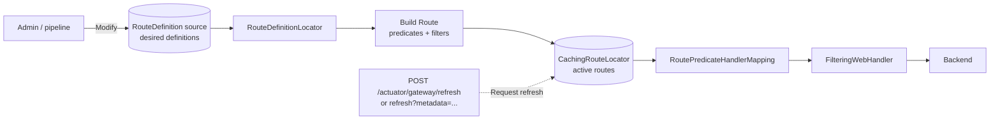
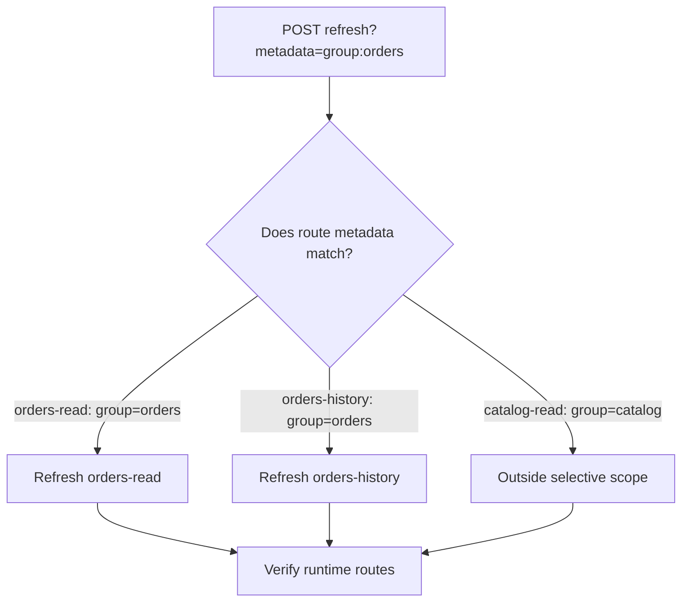
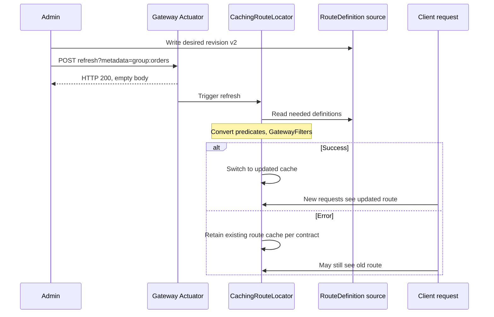
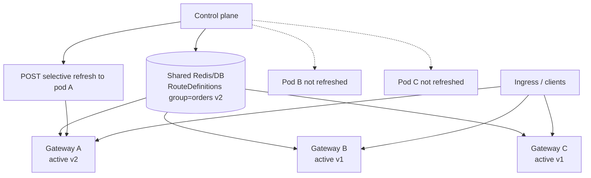

# Selective Refresh by Metadata When Supported

When operating **Spring Cloud Gateway**, sometimes only one group of routes needs to change: `orders` routes switch to a new backend while `catalog` routes remain untouched. `POST /actuator/gateway/refresh` can request the Gateway to refresh its route cache. In **Spring Cloud Gateway Server WebFlux versions supporting this feature**, you can also request a **selective refresh by route metadata**:

```http
POST /actuator/gateway/refresh?metadata=group:orders
```

This syntax requests refreshing routes carrying metadata `group` equal to `orders` per the documented Actuator contract. It does **not** mean “refresh the route whose ID is orders”, “re-register a service instance”, “reload all of `application.yml`”, or “immediately synchronize every Gateway pod”.

This lesson belongs to the **Actuator Management** chapter of the `SPRING_CLOUD_GATEWAY` module. When building an API Gateway with route predicates, `GatewayFilter`/`GlobalFilter`, path/header transformations, service discovery, and policies for authentication, rate limiting, circuit breakers, retries, and TLS, route refresh is a **control-plane** action that directly affects live request flows. Selective refresh must therefore be paired with **active-state verification, endpoint protection, observability, and rollback**.

**Objectives:**

1. Understand the differences among **route metadata**, `RouteDefinition`, runtime `Route`, config sources, and the route cache.
2. Use the exact syntax `POST /actuator/gateway/refresh?metadata=key:value` where supported by the version.
3. Distinguish **full refresh** from **metadata-filtered refresh**; choose the safe option for updates, deletions, renames, or metadata changes.
4. Set up an example with two route groups, send management requests, read back runtime routes, and test live HTTP traffic.
5. Avoid assuming a `200` refresh response means routes are active on all instances, especially with asynchronous refreshing.
6. Implement security and monitoring workflows covering Actuator, Redis repositories, and multi-replica Gateway clusters.

> **Scope and Limits:** Spring Cloud Gateway **Server WebFlux 5.1.x** and **4.3.x** documentation describe the `metadata` query parameter on the refresh endpoint. Exact endpoints, property namespaces, refresh handlers, and edge-case behaviors can vary by version/implementation; verify against your deployed build. WebFlux 5.x examples use `spring.cloud.gateway.server.webflux.routes`, while WebFlux 4.3.x typically uses `spring.cloud.gateway.routes`. This lesson does not apply verbatim to **Gateway Server MVC**.

## 1. Updating a Definition Does Not Mean the Route Is Active

A route has at least two states to distinguish:

- **Desired definition:** URI, predicate, filter, order, and metadata stored in a `RouteDefinitionLocator`/repository/source.
- **Active route:** the `Route` object constructed by the Gateway from the definition and served by `RouteLocator`/`CachingRouteLocator` for request matching.



A route definition may already be saved yet **not yet reloaded by the runtime route cache**. Conversely, after deleting a definition from the source, an unrefreshed Gateway pod can still match the old route.

Refresh reconciles that gap—it is **not an operation that writes a new definition**.

| Action | Modifies Definition Source? | Impact on Route Cache? |
| --- | --- | --- |
| Save `RouteDefinition` via writer/repository | Yes | Must not assume automatic application |
| Delete definition via writer or Actuator | Yes | Must verify refresh |
| `POST /actuator/gateway/refresh` | Does not directly write routes | Requests refreshing the route cache |
| `POST /actuator/gateway/refresh?metadata=group:orders` | Does not directly write routes | Requests selectively refreshing routes matching metadata |
| Register a new instance for `lb://order-service` | Updates service discovery | Does not equate to changing route definitions |
| Edit `application.yml` on disk | Changes file | Does not guarantee Spring Boot rebound it and Gateway sees the update |

**Three separate acceptance steps:** (1) definition source is right, (2) runtime route changed, (3) real HTTP requests match the expected route, backend, and policies.

## 2. What Is Route Metadata?

Each route can carry a `metadata` map of key-value pairs used by the Gateway or application. Some metadata keys have special meaning (such as per-route HTTP timeouts), whereas keys like `group`, `owner`, and `revision` in this lesson are **conventions defined by the operations team**.

WebFlux 5.x example:

```yaml
spring:
  cloud:
    gateway:
      server:
        webflux:
          routes:
            - id: orders-read
              uri: lb://order-service
              predicates:
                - Path=/api/orders/**
                - Method=GET
              filters:
                - StripPrefix=1
              metadata:
                group: orders
                owner: commerce
                revision: v1
```

Here:

- `id: orders-read` is the route identifier.
- `uri: lb://order-service` is the logical target for LoadBalancer instance resolution.
- `Path` and `Method` are **route predicates** used to match requests.
- `StripPrefix=1` is a `GatewayFilter` rewriting the path before proxying.
- `metadata.group: orders` is an operational label used to group routes.
- `metadata.owner` and `metadata.revision` are auxiliary labels—they do not create RBAC or rollout enforcement on their own.

At runtime, `Route#getMetadata()` exposes these values once a route is selected. However, **metadata is not a route predicate** unless you explicitly write logic reading it. A request to `/api/orders/42` does not match because the route has `group=orders`; it matches when Path/Method/Host predicates hold.

### Metadata vs. Easily Confused Identifiers

| Value | Example | What Is It Used For? |
| --- | --- | --- |
| Route ID | `orders-read` | Identifies the runtime route |
| Service ID | `order-service` | LoadBalancer instance selection |
| Metadata group | `orders` | Grouping routes for management / selective refresh |
| Revision | `v2` | App-defined rollout tracking label |
| Route order | `0` or `-10` | Precedence among matching routes |
| GatewayFilter order | Filter's order | Pre/post execution order inside filter chain |
| HTTP path | `/api/orders/**` | Request matching condition |
| Tenant ID in JWT | `tenant-42` | Auth identity/context; never use to authorize refresh arbitrarily |

**Never treat metadata as proof of access permission.** An `owner: commerce` field in a definition is just data; permission to edit routes must be enforced by the control plane and Spring Security.

## 3. When Is Refresh by Metadata Supported?

**Spring Cloud Gateway Server WebFlux 5.1** and **4.3** Actuator docs describe:

- `POST /actuator/gateway/refresh` to refresh the route cache.
- `POST /actuator/gateway/refresh?metadata=group:group-1` to refresh only routes carrying metadata `group=group-1`.
- A typical refresh response is **HTTP `200` with an empty body**.
- If an error occurs during **asynchronous refresh**, docs state the existing route cache remains unaltered by that failed refresh.

Still, never assume from **one version's** documentation that any arbitrary app supports the `metadata` query. Verify:

1. The starter is truly **Gateway Server WebFlux**, not a plain Actuator app or Gateway MVC.
2. Your Gateway version includes metadata-filtered refresh.
3. `/actuator/gateway/refresh` is enabled/exposed and the caller holds **write permission**.
4. The `RouteDefinitionLocator` source returns metadata in the right format/location for routes.
5. Any custom `RouteLocator`, discovery routes, or special repositories work properly with selective refresh.
6. An integration test validates the exact JAR/artifact promoted to staging/production.

**Compatibility rule:** If you cannot verify the feature on your running build, **do not simulate** selective refresh by clearing internal caches via reflection or private APIs. Use **full refresh** via the supported endpoint and test behavior.

## 4. Exact Syntax of Full Refresh vs. Metadata Refresh

Two core commands:

```bash
# Entire route cache of the targeted instance
curl -i -X POST \
  "http://localhost:9090/actuator/gateway/refresh"

# Only routes matching metadata group=orders, when supported by the version
curl -i -X POST \
  "http://localhost:9090/actuator/gateway/refresh?metadata=group:orders"
```

The exact syntax shown in official docs is:

```text
POST /actuator/gateway/refresh?metadata=group:group-1
```

`metadata` carries a `key:value` pair, not a JSON body. For `group=orders`, the query parameter is `metadata=group:orders`.

### Mind Colons and URL Encoding

When building URLs in tools/scripts, follow query encoding rules. An equivalent form is:

```bash
curl -i -X POST \
  "http://localhost:9090/actuator/gateway/refresh?metadata=group%3Aorders"
```

Watch out with `curl --get --data-urlencode`, as `--get` turns the request into GET by default—**never** copy a GET snippet assuming you are calling POST. When encoding complex values, construct the URL with a proper HTTP client while keeping method POST.

**Do not assume multi-pair metadata formats** such as `metadata=group:orders,revision:v2` behave uniformly across versions without checking your version's docs/API. This lesson uses **a single `group:orders` pair**, which has clear official examples.

### Key Names and Values Must Be Consistent

`metadata=group:orders` differs from:

- `metadata=routeId:orders-read`: only meaningful if metadata actually defines key `routeId`.
- `metadata=serviceId:order-service`: not a special syntax recognizing `lb://`.
- `metadata=group:Orders`: may not match `"orders"` under case-sensitive comparisons.
- `metadata=group:orders-v2`: will not match group `"orders"` unless that exact value is in metadata.

To avoid mistakes, use **standardized, stable metadata values** such as `orders`, `catalog`, `reports`, without mixing strings/numbers/booleans under the same `group` key.

## 5. Selective Refresh Operates by Route Group, Not by HTTP Request

Suppose the Gateway holds three routes:

| Route ID | Predicate | URI | Metadata |
| --- | --- | --- | --- |
| `orders-read` | `Path=/api/orders/**` | `http://localhost:8081` | `group: orders` |
| `orders-history` | `Path=/api/history/**` | `http://localhost:8081` | `group: orders` |
| `catalog-read` | `Path=/api/catalog/**` | `http://localhost:8083` | `group: catalog` |

The command:

```http
POST /actuator/gateway/refresh?metadata=group:orders
```

per documented behavior refreshes routes belonging to group **orders**; **catalog-read** sits outside the target group.



**Note:** This diagram illustrates the documented intent, not a promise that every custom repository updates entries atomically or that all runtime routes flip at the exact same instant.

### What It Does Not Mean

- It does not mean **only refresh requests from orders users/tenants**.
- It does not mean **only refresh route ID `orders`**.
- It does not mean Redis clears service discovery entries.
- It does not guarantee requests already inside the Gateway before refresh switch to the new route.
- It does not guarantee the app hits zero errors compiling filters/predicates in that group.
- It does not synchronize route caches across all pods in the cluster.

## 6. Configuring Three Routes with Group Metadata

Static config example for **Gateway Server WebFlux 5.x** to observe metadata. You only need test backends listening on the listed ports.

```yaml
spring:
  cloud:
    gateway:
      server:
        webflux:
          routes:
            - id: orders-read
              uri: http://localhost:8081
              predicates:
                - Path=/api/orders/**
                - Method=GET
              filters:
                - StripPrefix=1
              metadata:
                group: orders
                owner: commerce
                revision: v1

            - id: orders-history
              uri: http://localhost:8081
              predicates:
                - Path=/api/history/**
                - Method=GET
              filters:
                - StripPrefix=1
              metadata:
                group: orders
                owner: commerce
                revision: v1

            - id: catalog-read
              uri: http://localhost:8083
              predicates:
                - Path=/api/catalog/**
                - Method=GET
              filters:
                - StripPrefix=1
              metadata:
                group: catalog
                owner: search
                revision: v1
```

**Important note:** These are **routes from `application.yml`**. Actuator can **read** them, yet does not by default **edit/delete these static config routes directly** via `POST/DELETE /actuator/gateway/routes/{id}`. To change definitions dynamically at runtime, use an **updatable route definition source** (such as an Actuator-managed repository or `RouteDefinitionWriter`) or an appropriate config-rebind/deploy workflow.

### With Gateway WebFlux 4.3.x

The routes configuration prefix changes:

```yaml
spring:
  cloud:
    gateway:
      routes:
        - id: orders-read
          uri: http://localhost:8081
          predicates:
            - Path=/api/orders/**
          metadata:
            group: orders
            revision: v1
```

Route names and `group` metadata mean the same conceptually. Never apply both prefixes simultaneously to one route list and cause duplicate registrations. Always check the exact configuration properties and starter in use.

## 7. Enabling Read-Only Actuator for Observation Environments

To inspect routes without **granting modification privileges**, add the matching Spring Boot Actuator starter:

```xml
<dependency>
  <groupId>org.springframework.boot</groupId>
  <artifactId>spring-boot-starter-actuator</artifactId>
</dependency>
```

Example `application.properties`:

```properties
management.endpoint.gateway.access=read-only
management.endpoints.web.exposure.include=gateway,health
management.server.port=9090
```

With `access=read-only`, you can call GET endpoints to observe, while **refresh/create/delete route operations are disallowed** per the Gateway Actuator contract. This is a sound production setting if the organization **does not use Actuator as a write control plane**.

### Essential GET Endpoints

| Endpoint | Used to Observe |
| --- | --- |
| `GET /actuator/gateway/routedefinitions` | Route definitions known to the Gateway |
| `GET /actuator/gateway/routes` | Runtime routes published by the Gateway |
| `GET /actuator/gateway/routes/{id}` | Details of a single runtime route |
| `GET /actuator/gateway/globalfilters` | GlobalFilters and their orders |
| `GET /actuator/gateway/routes/{id}/combinedfilters` | Combined filter chain when supported by version |

`GET /actuator/gateway/routes` typically renders predicates/filters in descriptive (“verbose”) form in Gateway 5.x. Exact JSON shapes **can vary across releases**; never parse responses assuming every version uses identical `route_id`, `id`, or nested `route_object` keys.

**You do not need write access to inspect routes.** If you only want to check whether a metadata group appears in active routes, use read-only, metrics, and request probes before enabling `unrestricted`.

## 8. Enable Refresh Permissions Only in a Secured Management Environment

To let Actuator accept `POST /actuator/gateway/refresh` in a **lab or secured admin plane**, Gateway docs specify:

```properties
# Use ONLY when authentication, authorization, and network isolation are in place.
management.endpoint.gateway.access=unrestricted
management.endpoints.web.exposure.include=gateway
management.server.port=9090
```

Distinguish:

- `access=read-only` → no refresh permission.
- `access=unrestricted` → enables refresh/create/delete at the endpoint, **yet does not protect the endpoint from unauthorized callers**.
- `management.server.port=9090` → separates the management port in Spring Boot config, **without automatically isolating the network**.
- `management.endpoints.web.exposure.include=gateway` → exposes the endpoint over HTTP, **without creating RBAC**.

If both the public gateway and management port are reachable from the Internet, separating ports is not a security boundary. You need dedicated authn/authz, firewall/Kubernetes NetworkPolicy, internal ingress or service mesh, appropriate TLS/mTLS, and auditing.

### Why Is Refresh Permission Sensitive?

Anyone allowed to trigger refresh (especially if the same system allows writing route definitions) can trigger routing changes on the data plane. If they can also add routes, they can divert requests to unauthorized internal backends (**SSRF**), strip security filters, alter paths/Hosts, and affect CORS or rate limiting.

**Never** expose `unrestricted` publicly just to test selective refresh with curl. When production only needs observation, keep `read-only` and perform changes through a tighter control plane.

## 9. Safe Hands-On Lab: Creating Three Routes via Actuator

The exercise below uses an **isolated test Gateway**, never production routes.

Assumptions:

- Gateway public listener on `localhost:8080`.
- Gateway Actuator (admin) on `localhost:9090`.
- Orders backend v1 on `localhost:8081`.
- Orders backend v2 on `localhost:8082`.
- Catalog backend on `localhost:8083`.
- All three backends expose a suitable GET endpoint returning a version marker such as `"instance":"orders-v1"`.
- No other route overlaps `/api/orders/**` or `/api/history/**`.

Instead of editing `application.yml` while running, this example uses **Actuator-managed route definitions** so there is an actual runtime-updatable source.

### Step A — Register Two Routes in the `orders` Group

```bash
# Actuator write endpoint opened strictly in a secured test/admin plane.
curl -i -X POST \
  "http://localhost:9090/actuator/gateway/routes/orders-read" \
  -H "Content-Type: application/json" \
  -d '{
    "uri": "http://localhost:8081",
    "predicates": ["Path=/api/orders/**", "Method=GET"],
    "filters": ["StripPrefix=1"],
    "order": 0,
    "metadata": {
      "group": "orders",
      "owner": "commerce",
      "revision": "v1"
    }
  }'

curl -i -X POST \
  "http://localhost:9090/actuator/gateway/routes/orders-history" \
  -H "Content-Type: application/json" \
  -d '{
    "uri": "http://localhost:8081",
    "predicates": ["Path=/api/history/**", "Method=GET"],
    "filters": ["StripPrefix=1"],
    "order": 0,
    "metadata": {
      "group": "orders",
      "owner": "commerce",
      "revision": "v1"
    }
  }'
```

This is `RouteDefinition` JSON using **shortcut DSL strings** for `predicates` and `filters`. It differs from the human-readable output format of `GET /actuator/gateway/routes/{id}`.

Each create call may return **`201 Created`** per Actuator 5.x docs. `201` only confirms definition creation succeeded—**not** yet that the route sits in the active cache.

### Step B — Register the `catalog` Group Route

```bash
curl -i -X POST \
  "http://localhost:9090/actuator/gateway/routes/catalog-read" \
  -H "Content-Type: application/json" \
  -d '{
    "uri": "http://localhost:8083",
    "predicates": ["Path=/api/catalog/**", "Method=GET"],
    "filters": ["StripPrefix=1"],
    "order": 0,
    "metadata": {
      "group": "catalog",
      "owner": "search",
      "revision": "v1"
    }
  }'
```

These three routes form two metadata groups:

```text
group=orders
  ├── orders-read
  └── orders-history

group=catalog
  └── catalog-read
```

**Never** treat the string `orders` as a URI or service ID; it is strictly a metadata label on the created definitions.

### Step C — Full Refresh to Establish a Baseline

```bash
curl -i -X POST \
  "http://localhost:9090/actuator/gateway/refresh"

curl -fsS \
  "http://localhost:9090/actuator/gateway/routes"

curl -i \
  "http://localhost:8080/api/orders/42"

curl -i \
  "http://localhost:8080/api/catalog/items/7"
```

Before testing selective refresh, establish a reliable **active baseline**: all three routes exist and the v1/catalog backends are genuinely reached. If any route fails at this stage, do not proceed; inspect predicates, filters, backends, and application security first.

## 10. Updating One Route in Group `orders` and Selectively Refreshing

In this experiment, we want to switch only `orders-read` from backend 8081 to 8082 while keeping metadata `group=orders`. This is an **Actuator-managed route**.

### Note Before Updating

Actuator 5.x docs warn **never to POST over an existing route ID**. It can create duplicate definitions and `500` errors when listing routes. For Actuator-managed routes, docs prescribe **DELETE → POST → refresh**.

This sequence is **not atomic**, leaving a brief gap without the route between DELETE and POST. It is therefore suited to an **isolated lab**, not a zero-downtime production update transaction.

### Steps in the Lab

```bash
# 1. Delete the old Actuator-managed definition.
curl -i -X DELETE \
  "http://localhost:9090/actuator/gateway/routes/orders-read"

# 2. Recreate with same ID, switch URI to v2, keep group=orders.
curl -i -X POST \
  "http://localhost:9090/actuator/gateway/routes/orders-read" \
  -H "Content-Type: application/json" \
  -d '{
    "uri": "http://localhost:8082",
    "predicates": ["Path=/api/orders/**", "Method=GET"],
    "filters": ["StripPrefix=1"],
    "order": 0,
    "metadata": {
      "group": "orders",
      "owner": "commerce",
      "revision": "v2"
    }
  }'

# 3. Request refreshing only group orders, where supported by version.
curl -i -X POST \
  "http://localhost:9090/actuator/gateway/refresh?metadata=group:orders"
```

**Expected outcome:**

- `orders-read` begins routing to `http://localhost:8082`.
- `orders-history` remains in group `orders` and falls within the selective refresh scope.
- `catalog-read` belongs to group `catalog`, outside the refresh scope.
- A new request to `/api/orders/42` reaches backend v2 **once the active route updates**.

**Do not** rely solely on `HTTP 200` from the refresh call. That only reflects the endpoint accepting the request per contract, while refresh itself can be **asynchronous**. Read back runtime routes and verify live traffic.

## 11. Verifying Runtime Routes and Traffic After Selective Refresh

Inspect from two perspectives:

### Perspective 1 — `RouteDefinition` and Runtime `Route`

```bash
# Definitions known to the Gateway
curl -fsS \
  "http://localhost:9090/actuator/gateway/routedefinitions"

# Runtime route with ID orders-read
curl -fsS \
  "http://localhost:9090/actuator/gateway/routes/orders-read"

# Catalog route, to compare against the untouched group
curl -fsS \
  "http://localhost:9090/actuator/gateway/routes/catalog-read"
```

Verify:

1. Definition `orders-read` shows URI v2 and metadata `revision=v2`.
2. Runtime route `orders-read` reflects the v2 target.
3. `catalog-read` still points to the catalog backend and works properly.
4. `StripPrefix`, `Path`, and `Method` predicates remain intact.
5. No overlapping route is chosen instead of `orders-read`.

If the runtime route has not changed immediately after `POST /refresh`, **poll with a deadline** in the test environment before concluding refresh failed. If the deadline expires, inspect refresh/route-build errors and consider a controlled full refresh.

### Perspective 2 — Real Requests

```bash
curl -i \
  "http://localhost:8080/api/orders/42"

curl -i \
  "http://localhost:8080/api/history/recent"

curl -i \
  "http://localhost:8080/api/catalog/items/7"
```

The demo backend should report a marker/received path, such as:

```json
{
  "backend": "orders-v2",
  "pathReceived": "/orders/42"
}
```

Because `StripPrefix=1` strips `api`, the orders backend receives `/orders/42` and catalog receives `/catalog/items/7`. A bare `200` response is insufficient proof if v1 and v2 return identical bodies; require a **backend marker or tracing**.

### Poll with a Deadline, Never a Fixed Sleep

An illustrative script using `jq` and HTTP GET on the runtime route. **It only runs if your version's JSON actually contains the matching fields**:

```bash
# Shell pseudocode: adjust jq path to match real runtime JSON.
for attempt in 1 2 3 4 5 6 7 8 9 10; do
  current_uri="$(curl -fsS \
    http://localhost:9090/actuator/gateway/routes/orders-read \
    | jq -r '.uri // empty')" || current_uri=""

  if [ "$current_uri" = "http://localhost:8082" ]; then
    echo "orders-read active on v2"
    break
  fi

  sleep 1
done
```

Never treat `echo` output as cluster-wide completion proof. In multi-pod setups, check **each instance** and define a clear error path if the deadline expires.

## 12. Decision Table: Selective Refresh vs. Full Refresh

| Situation | Consider Selective? | Why |
| --- | --- | --- |
| Change URI/filter of a route, **keeping old group** | **Yes**, if verified on your version | Target group stays stable |
| Change multiple routes in the same `orders` group | **Yes** | Avoids refreshing unrelated groups |
| Only changing backend instances under `lb://service` | **Usually no route refresh needed** | Handled by discovery/LoadBalancer |
| Permanently deleting a route in a group | **Cautious; usually prefer full** | Deleted route may lack definition metadata in source to match |
| Moving metadata `group=orders` to `group=payments` | **Prefer full** | Old and new groups may not match the same set |
| Renaming route ID or splitting/merging routes | **Prefer full** | Cache identifiers and route sets changed |
| Changing metadata key/value used as filter | **Prefer full** unless match behavior is proved | Selective predicate may depend on unexpected state |
| Adding a brand-new route | **Test first; full is the safe baseline** | New route is absent from old active cache |
| Refresh for a group fails | **Never retry infinitely** | Fix source/factory/Redis first |
| Unsure if version supports metadata query | **Full refresh or upgrade to tested version** | Avoid unverified behavior |
| Updated YAML file yet Spring hasn't rebound | **Neither selective nor full suffices** | Locator source may still return old definitions |

These are **operational recommendations**, not claims that every delete/rename fails under selective refresh. Selective matching can depend on **cached route metadata, new definition metadata, and the exact version's merge/invalidation algorithm**. Lacking test evidence, choose a monitored full refresh with rollback.

### Why Is Full Refresh Safer for Structural Changes?

If `orders-read` was removed from the source, a `group:orders` selector may need to know **which group the old route belonged to** in order to evict it from the cache. Whether a given version handles this cleanly must be verified by test. Full refresh rebuilds the route set from sources, making it more predictable for **adds, deletes, ID renames, and group moves**.

Even with a full refresh, verify runtime state and real requests; it **cannot** fix an invalid definition.

## 13. Changing Metadata Groups: An Easy-to-Miss Edge Case

Suppose initially:

```yaml
- id: invoice-api
  uri: http://localhost:8084
  predicates:
    - Path=/api/invoices/**
  metadata:
    group: orders
```

Later, the new definition becomes:

```yaml
- id: invoice-api
  uri: http://localhost:8084
  predicates:
    - Path=/api/invoices/**
  metadata:
    group: finance
```

If you only call:

```http
POST /actuator/gateway/refresh?metadata=group:finance
```

you may run into edge cases depending on the filtering algorithm: the currently active route belongs to `orders`, while the new desired definition belongs to `finance`. Refreshing by the new group **should not be assumed** to evict/update the old group's entry.

Similarly, refreshing only `group:orders` does not guarantee the route cleanly transitions into `finance` across every instance.

**Runbook for changing groups:**

1. Write the definition with the new metadata and revision.
2. Trigger a **full refresh** on the target Gateway instance(s).
3. Verify `invoice-api` appears **exactly once** in the active route view.
4. Confirm runtime group/revision shows `finance`.
5. Send real requests verifying predicates/filters and security policies.
6. Confirm no stale route or route shadowing remains after the update.

**Group metadata should remain stable** if used as a control-plane selector. If groups change often, tooling needs stronger refresh distribution and convergence checks.

## 14. Deleting or Adding Routes: Selective Refresh May Not Suffice

### Case A — Deleting a Route

Initial source:

```text
orders-read: group=orders
orders-history: group=orders
catalog-read: group=catalog
```

Updated source:

```text
orders-read: group=orders
catalog-read: group=catalog
# orders-history has been deleted
```

If the runtime cache still holds `orders-history`, refreshing only one group can be affected by how the implementation determines which cached entries to invalidate. **Never declare deletion done** simply because DELETE returned success.

For a critical route deletion:

```bash
# Only after source deletion succeeds and with write authorization.
curl -i -X POST \
  "http://localhost:9090/actuator/gateway/refresh"

# Verify runtime route disappeared.
curl -i \
  "http://localhost:9090/actuator/gateway/routes/orders-history"
```

Once GET route returns `404`, still send a request to the public path to confirm it does not match **another route**. A trailing 404 alone does not prove no other handler catches it.

### Case B — Adding a New Route

A brand-new `orders-tracking` route with `metadata.group=orders` did not exist in the old cache. Some implementations pick up new routes in selective refresh; some custom workflows may not. When adding important routes, run a **full refresh first**, verify active state, then use selective refresh for subsequent stable updates.

### Case C — Changing Selector Metadata Simultaneously

If `metadata.group` and filters change together, account for **multiple inconsistent intermediate states**: selectors matching old vs new, routes running stale filters, and requests hitting unrefreshed pods.

**Never treat selective refresh as a transactional sync protocol** between repository and route cache. It is a cache-refresh trigger, not an atomic revisioned cutover engine.

## 15. Failed Refresh and Asynchrony

Per Gateway Actuator docs, `POST /actuator/gateway/refresh` returns **`200` with no body**. If asynchronous refresh hits an error, the existing route cache **remains unchanged by that failed refresh** under the documented behavior.

This implies:

- `200` **does not prove** new routes were built.
- Invalid predicates/filters/URIs can prevent the refresh from taking effect.
- On error, previously active routes may keep serving requests.
- Separate logs/metrics may be needed to confirm refresh actually finished.
- Retrying refresh does not fix a broken definition.



This logical diagram does not promise every request switches at one single timestamp. Requests matched prior to cutover may continue using the already-selected route/URI.

### How to Confirm the Outcome?

**Completion criteria should include all three:**

1. **Source revision** was saved successfully.
2. **Active route view** on each Gateway replica reflects the expected URI/predicate/filter/metadata.
3. **Canary requests** traverse the right route and backend without violating security/SLOs.

If unachieved within the deadline, report “refresh pending/failed” per workflow and trigger a controlled rollback—never declare “rollout complete” merely because Actuator returned 200.

## 16. Multiple Gateway Replicas: Selective Refresh Remains Instance-Local

In Kubernetes or a VM cluster, multiple Gateway instances usually sit behind an ingress. Each JVM maintains its own **`CachingRouteLocator`**.



**Even when all three pods read the same Redis route repository**, a refresh call sent to one pod does not refresh the other pods. `RefreshRoutesEvent` is by default an application-context event, not a cluster-wide broadcast.

### Multi-Pod Runbook

1. Update source definitions **once**, with a new revision.
2. Identify the list of Gateway replicas actively serving traffic.
3. Send metadata-scoped refresh to **each instance via its own management address**, not solely through a load-balanced ingress.
4. Poll active runtime routes for the target group **on every instance**.
5. Send canary requests to each instance with matching Host/Path/Method in staging or via an approved test-routing mechanism.
6. Confirm zero pods retain v1 routes before declaring rollout complete.
7. If one pod fails, isolate traffic or roll back cluster-wide per policy rather than leaving “split-brain routing” active.
8. Audit who triggered refresh, target pods, revision, outcome, and timestamps.

### Why Not Just Call Through the Load Balancer?

An HTTP request to `https://admin-gateway.example/actuator/gateway/refresh?metadata=group:orders` is typically routed by ingress to **one instance**. There is no fan-out guarantee. Sending three calls through the same ingress **could hit the same pod all three times**.

You need a control plane able to target **per-pod identities** or a tested event-distribution mechanism paired with per-pod verification.

## 17. Redis Repository and Metadata Refresh

A route definition source can use `RedisRouteDefinitionRepository` to share definitions across Gateway instances. However, Redis here is the **definition source**, not a shared runtime route cache across JVMs.

```text
Redis RouteDefinitionRepository:
  stores saved definitions

Gateway pod A:
  RouteDefinitionLocator -> CachingRouteLocator A

Gateway pod B:
  RouteDefinitionLocator -> CachingRouteLocator B

POST refresh pod A:
  refreshes active cache A for the requested scope
  DOES NOT automatically update cache B
```

For Gateway Server WebFlux, the property enabling `RedisRouteDefinitionRepository` **must match your actual version**. The 5.x Configuration Properties reference uses a prefix like:

```yaml
spring:
  cloud:
    gateway:
      server:
        webflux:
          redis-route-definition-repository:
            enabled: true
  data:
    redis:
      host: localhost
      port: 6379
```

*Sharing Routes* docs for some versions still show the older `spring.cloud.gateway.redis-route-definition-repository.enabled` prefix. Always **check effective configuration**, starters, and versions rather than mixing old and new prefixes hoping one works.

### Notes When Using Redis

- Redis timeouts/errors can prevent reading desired definitions, causing refresh to fail.
- Redis being updated does not prove every pod refreshed its active cache.
- Protect Redis with network isolation, auth/TLS, backups/persistence, and write concurrency controls.
- Redis for the route repository and Redis for `RedisRateLimiter` serve **two distinct purposes**; never flush all Redis keys just to refresh routes.
- If multiple writers update the same route, use serialization/optimistic locking and revisions to prevent lost updates.
- Never build a “refresh failed → fire thousands of refreshes” loop, which only hammers Redis and logs.

## 18. Impact on Route Predicates, Filters, and Security Policies

Selective refresh **does not mean** “update URI only”; it can apply an entire updated route definition, including Path/Host/Method predicates, filters, order, and metadata depending on the source.

| Type of Change | Risk to Verify |
| --- | --- |
| `Path` / `Host` / `Method` | Requests may match a different route or stop matching |
| `StripPrefix` / `RewritePath` | Backend receives a different path and may return 404 |
| `AddRequestHeader` / `RemoveRequestHeader` | Stripped/spoofed identity headers altering downstream behavior |
| `RequestRateLimiter` | Altered quotas, key resolvers, or rate-limit bypasses |
| `CircuitBreaker` / `Retry` | Attempt counts, fallbacks, and duplicate-write risks |
| `SetRequestHostHeader` | Trust-boundary, routing, and virtual-host risks |
| `URI lb://service` | LoadBalancer/discovery may pick different instances |
| `URI https://host` | TLS certificates/SNI/truststores and egress policies |
| `order` | Route overlap/shadowing causing another route to match unexpectedly |
| `metadata.group` | Affects selective refresh scope |

**Never treat `metadata.group` as a security policy.** A new or re-grouped route can expose sensitive endpoints if Spring Security path matchers or route security filters are not tested against public URLs. Business authorization must be enforced by backends, never inferred from a route carrying label `orders`.

### CORS, Timeouts, and Technical Metadata

Gateway recognizes built-in route metadata keys such as `response-timeout` and `connect-timeout` per HTTP Timeouts docs. A `group` key is custom organizational metadata, whereas timeout keys govern HTTP client behavior.

Never set `metadata: group:orders` thinking it **toggles CORS, authentication, or retries**. Those policies have separate configurations/filters and sometimes caches/listeners with independent lifecycles. After a selective refresh touching CORS-related routes, test browser **preflight `OPTIONS`** as well as actual requests rather than only checking GET route output.

## 19. Securing Actuator Endpoints and Mitigating SSRF Risks

Gateway Actuator is a **control plane** because it can add/delete/refresh routes—privileges that directly steer external Internet requests.

### Protection Principles

- Use `read-only` wherever mutation is unnecessary.
- Enable `unrestricted` only in an isolated admin context with **strong authentication and RBAC**.
- Segment management networking and restrict egress; use TLS/mTLS where appropriate.
- Never store credentials in shell history, public scripts, or curl logs.
- Audit route ID, metadata group, revision, actor, and source/active outcome; never log Bearer tokens or API secrets.
- Rate-limit refresh calls, throttle admin APIs, and enforce change windows.
- With definition write access, **allowlist URI schemes/hosts/ports** and filter factories to prevent **SSRF/open proxies**.
- Never let tenants/clients supply `group`, URIs, or refresh scopes from untrusted public input.
- Never expose `/actuator/gateway/routes`/`routedefinitions` publicly if they reveal upstream hosts, route topology, or header policies.
- Never trust group labels to decide caller permissions; authorization must rely on verified operator identity/permissions.

### Separated Production Roles

| Role | Appropriate Permission |
| --- | --- |
| Observer / On-call | GET routes/metrics over read-only management plane |
| Authenticated control-plane service | Writes allowlisted definitions and triggers monitored refreshes |
| Reviewer / Approver | Approves changesets without necessarily calling Actuator directly |
| Application client | Calls public APIs only; **no refresh permissions** |
| Backend service | Processes business requests; never grants itself Gateway route-change authority |

In particular, never run unbounded retries on the refresh endpoint. If Redis/the source is failing, **fix the underlying fault first**, then re-trigger refresh within a bounded workflow instead of amplifying an incident with admin request floods.

## 20. Observability: Proving Selective Refresh Took Effect

Measure both the **control plane** and the **data plane**.

| Signal | Where Collected | Purpose |
| --- | --- | --- |
| `refreshRequested` | Admin service / Actuator caller | Track which group was refreshed and when |
| `refreshResult` / error logs | Gateway application | Detect async refresh/route-build failures |
| Desired revision | Repository / control-plane DB | Identify current target definition version |
| Active revision per pod | Active routes/metadata, management tooling | Spot pods that have not converged |
| Route ID and selected URI | Gateway Actuator/tracing | Confirm whether runtime routes changed |
| HTTP 404/502/503/5xx by route | Micrometer/Gateway metrics | Spot Path/upstream mismatches post-refresh |
| Upstream marker/version | Backend logs/traces | Prove requests hit intended v1/v2 |
| CORS preflight/errors | Browser/staging metrics | Verify policy updated properly |
| Redis latency/errors | Redis client/infra | Distinguish source outages from route-cache faults |
| Security/429/fallback rates | Security, `RequestRateLimiter`, Resilience4j | Verify policies did not weaken after refresh |

**Do not assume the framework exports all metrics above out of the box.** Several are **signals added by the operations team**. Use bounded-cardinality labels like route ID, group, and revision; never put raw user IDs, full URLs with queries, tokens, cookies, or PII-bearing paths into metric labels.

### Why Inspect Groups Outside Scope Too?

When refreshing `group:orders`, do not check only orders. Measure:

1. Do the updated orders routes behave correctly?
2. Do catalog routes **stay functional** without unintended configuration changes?
3. Were any duplicate IDs or order-shadowing routes introduced?
4. Does the active route count still match the expected baseline?
5. Did SLOs, latency, or 5xx rates spike anywhere across the Gateway?

The purpose of selective refresh is narrowing the refresh scope, yet **correctness must be proved by outcomes**.

## 21. Troubleshooting: Common Errors

| Symptom | Possible Cause | Investigation |
| --- | --- | --- |
| `POST /refresh?metadata=...` returns `404` | Actuator unexposed, wrong base path/port, or unsupported endpoint | Check Boot/Gateway version and management path |
| `POST /refresh` returns `405` / rejected | `access=read-only` or wrong HTTP method | Check Actuator access and RBAC |
| `POST /refresh` returns `401/403` | Caller lacks permission | Fix authentication/authorization; never open publicly |
| `POST /refresh` returns `200` yet route stays old | Async refresh still running or errored; source unchanged | Poll runtime, inspect logs and source |
| `GET /routedefinitions` is new yet `/routes` is old | Unrefreshed or route build failed | Check errors, verify version |
| `group:orders` refreshes no routes | Wrong metadata key/value/type, or route lacks group | Read definitions and runtime metadata |
| Group matches yet new route does not appear | Added new route missing from active selection | Controlled full refresh, verify |
| Deleted route remains active | Group invalidation did not evict deleted entry | Full refresh and verify route vanishes |
| Old route persists after group change | Selector matches old vs new metadata differently | Full refresh, verify uniqueness |
| Catalog changed despite refreshing orders only | Different route sources, custom locator, filter/route overlap | Compare effective runtime and canaries |
| Some requests hit v1, others v2 | Gateway pods refreshed unevenly | Inspect each instance and fan-out |
| Active route looks right yet backend returns 404 | Wrong `StripPrefix`/`RewritePath` | Inspect backend path and Gateway filters |
| Active route looks right yet backend returns 503 | Zero instances for `lb://` or upstream failure | Check LoadBalancer/discovery; do not blame refresh |
| HTTPS fails after changing URI | Mismatched TLS trust/SNI/hostname cert | Fix TLS config; never disable verification |
| Continuous refreshes overload Redis | Control plane retrying/bursting excessively | Reduce frequency, serialize updates |
| Actuator cannot delete YAML route | Route not in writable repository | Edit config source / redeploy; do not force DELETE |
| Duplicate route after POSTing existing ID | Actuator 5.x warns about duplicate definitions | Use DELETE+POST in lab; versioned control plane in prod |
| Edited YAML yet refresh has no effect | Spring Boot process hasn't reloaded source | Rebind/redeploy/config-refresh per supported mechanism |
| Metrics cannot tell route versions apart | Missing standardized revision/instance labels | Add cardinality-bounded observability |
| CORS behaves wrong after change | Stale CORS cache/handler or browser preflight | Test `OPTIONS` + live request and check CORS config |

### Priority Diagnostic Workflow

1. **Right version?** Does Gateway WebFlux support metadata-filtered refresh?
2. **Right endpoint/access?** POST, management port, `unrestricted`, authentication?
3. **Right metadata?** Does key `group` with value `orders` exist in active definitions?
4. **Source updated?** Are URI/filters/metadata in the repository at the right revision?
5. **Refresh finished?** Any async errors or pending refresh?
6. **Runtime updated?** Does `/actuator/gateway/routes/{id}` reflect it on the exact pod?
7. **Live request works?** Host/Path/Method, backend marker, security, CORS?
8. **Multiple pods?** Any unrefreshed instances or overlapping route orders?
9. **Deletion/group change?** Switch to full refresh if uncertain.
10. **Rollback?** Restore last-known-good definition and refresh/verify across the full blast radius.

## 22. Reinforcement Exercises

### Exercise 1 — Selecting the Right Group

Given three routes:

```yaml
- id: a
  metadata:
    group: orders

- id: b
  metadata:
    group: catalog

- id: c
  metadata:
    group: orders
```

**Question:** Which routes does `POST /actuator/gateway/refresh?metadata=group:orders` target?

**Answer:** Per the metadata selection contract, routes **a** and **c**. Route **b** has `group=catalog`, so it falls outside the request scope.

### Exercise 2 — Different from Route ID

A route has ID `orders-read` yet metadata `group: commerce`.

**Question:** Does `metadata=group:orders` automatically match that route from its ID name?

**Answer:** No. The selector checks **`group` metadata**, without inferring route IDs or service IDs from substrings.

### Exercise 3 — Deleting a Route

The `orders-history` definition was removed from the source. An operator runs only selective refresh `group:orders` and sees the active route still present.

**How to handle:** Do not repeat the old command indefinitely. Check version behavior and errors, trigger a controlled **full refresh**, confirm the runtime route disappears, and verify public requests do not match another route by mistake.

### Exercise 4 — Changing Group

Route `invoice-api` changes metadata from `group=orders` to `group=finance`.

**Question:** Does refreshing only `group=finance` guarantee the route is cleanly updated from the old group?

**Answer:** Do not assume so. Run a full refresh and verify revision/uniqueness on every pod.

### Exercise 5 — Three Pods and Shared Redis

The Redis source was updated to revision v2. An operator POSTs selective refresh once through a shared ingress.

**Question:** Can you declare the whole cluster is on v2?

**Answer:** No. That request may have reached just one pod. Fan out refresh and verify active routes on **every instance**.

### Exercise 6 — Actuator Permissions

An application has:

```properties
management.endpoint.gateway.access=read-only
management.endpoints.web.exposure.include=gateway
```

**Question:** Why does POST refresh fail to run even though GET routes succeeds?

**Answer:** **`read-only`** mode intentionally disables mutating operations. To refresh, use a secured admin plane with `unrestricted`/the appropriate mechanism—never open an anonymous public endpoint.

### Exercise 7 — Refresh Returns 200 Yet Traffic Fails

An admin received `200` from refresh, yet GET active routes still points to v1 and canary calls to v2 get no hits.

**Question:** What is the accurate conclusion?

**Answer:** v2 is not confirmed active. Inspect async refresh logs, desired source, conversion errors, runtime routes, and backends; trigger rollback or full refresh depending on root cause.

### Exercise 8 — Technical Metadata on a Route

A route has `metadata.response-timeout: 500` and `metadata.group: catalog`.

**Question:** Does `metadata=group:catalog` change the response timeout to 500 seconds?

**Answer:** No. The `metadata` query param is a **refresh selector**; `response-timeout` is per-route HTTP timeout metadata using units defined in its docs (per-route `response-timeout` metadata is normally in **milliseconds**).

### Quick Self-Check Questions

**1. Does selective refresh modify `RouteDefinitionRepository`?**

> No. It refreshes cache/runtime state from existing sources; changing definitions is a separate operation.

**2. Does selective refresh synchronize `RedisRateLimiter`?**

> No. `RedisRateLimiter` tracks quota state, not the Route cache.

**3. Must the `group` value match the service name in `lb://`?**

> No. `group` is a metadata label you choose.

**4. Should you use selective refresh when renaming a route ID?**

> Without tests guaranteeing it, prefer full refresh and verify the old route disappears while the new route appears.

**5. How do you prove requests are taking the new route?**

> Read runtime routes per pod, observe matched route ID/selected upstream, and send canary requests to the expected backend.

**6. Does Actuator returning `200` mean refresh finished across all pods?**

> No. Refresh runs asynchronously and each Gateway instance maintains its own cache.

## 23. Safe Selective Refresh Operations Checklist

- [ ] Verified your **Gateway Server WebFlux** version supports the `metadata` query on the refresh endpoint.
- [ ] Used `POST /actuator/gateway/refresh?metadata=group:value` with the right HTTP method and query syntax.
- [ ] Distinguished `group` metadata from route ID, service ID, and Path predicates.
- [ ] Chosen stable group metadata with consistent values and simple, easily comparable types.
- [ ] Avoided assuming multi-pair metadata syntax works uniformly without verifying your API/version.
- [ ] Updated source definitions **before** sending refresh; sources are genuinely readable by locators.
- [ ] Captured a runtime route and live traffic baseline prior to changes.
- [ ] After POST refresh, polled active routes with a deadline instead of trusting `200` alone.
- [ ] Sent canary requests verifying backend/version/path/filters/predicates, not just checking route lists.
- [ ] Also checked routes in **non-refreshed** groups to catch unintended side effects.
- [ ] Preferred **full refresh** for deletes, adds, renames, or group changes unless selective behavior is proved safe.
- [ ] Never POSTed over an existing Actuator-managed route ID in Gateway 5.x; followed documented procedures recognizing non-atomic risk.
- [ ] Avoided using Actuator to edit YAML/`@Bean` routes that are read-only to that writer.
- [ ] In multi-pod clusters, dispatched refresh to each instance and verified active revisions per pod.
- [ ] Avoided confusing Gateway route refresh with config rebind, LoadBalancer instance caches, DNS refresh, or Redis rate limiters.
- [ ] Tracked refresh errors/latency, desired revisions, active revisions, and HTTP 4xx/5xx impact.
- [ ] Protected Actuator with auth/RBAC, network isolation, TLS/mTLS, and auditing.
- [ ] Maintained `read-only` wherever endpoint write/refresh is unnecessary.
- [ ] Validated `RouteDefinition` URIs/predicates/filters against SSRF and security bypasses.
- [ ] Prevented leaking backend topology or access tokens in public Actuator/traces/logs.
- [ ] Put change serialization, last-known-good snapshots, and rollback in place.
- [ ] Tested refresh failures, bad metadata, Redis outages, route overlaps, security, CORS, and rolling deploys.
- [ ] Marked rollout **ACTIVE** only when source, runtime routes, and live requests all pass.

## Conclusion

**Selective refresh by metadata** is a useful operational capability in **Spring Cloud Gateway Server WebFlux** versions that support it. `POST /actuator/gateway/refresh?metadata=group:orders` requests refreshing only routes carrying metadata group `orders` rather than rebuilding the instance's entire route cache. It fits best when route groups already exist, group metadata is stable, and you want to narrow refresh blast radius.

Nevertheless, selective refresh is **not** a route-write operation, does not rebind configuration sources, does not distribute automatically to all Gateway replicas, and does not guarantee atomicity across metadata edits, deletions, or renames. For structural changes, route deletions, or group transitions, a **controlled, verified full refresh** is generally more predictable unless explicitly tested otherwise.

Treat refresh as **one step in a rollout pipeline**: update source → request refresh → verify active routes per pod → test live requests → monitor metrics or roll back. Combined with Actuator security, standardized route metadata, TLS, authorization, rate limiting, circuit breakers, retries, and observability, you can operate your API Gateway safely even as routes evolve at runtime.

## References

- [Spring Cloud Gateway Server WebFlux 5.1 — Actuator API: Selective Refreshing the Route Cache](https://docs.spring.io/spring-cloud-gateway/reference/spring-cloud-gateway-server-webflux/actuator-api.html)
- [Spring Cloud Gateway Server WebFlux 4.3 — Actuator API](https://docs.spring.io/spring-cloud-gateway/reference/4.3/spring-cloud-gateway-server-webflux/actuator-api.html)
- [Spring Cloud Gateway Server WebFlux — Route Metadata Configuration](https://docs.spring.io/spring-cloud-gateway/reference/spring-cloud-gateway-server-webflux/route-metadata-configuration.html)
- [Spring Cloud Gateway Server WebFlux — Configuration and RouteDefinitionLocator](https://docs.spring.io/spring-cloud-gateway/reference/spring-cloud-gateway-server-webflux/configuration.html)
- [Spring Cloud Gateway Server WebFlux — Sharing Routes Between Gateway Instances](https://docs.spring.io/spring-cloud-gateway/reference/spring-cloud-gateway-server-webflux/sharing-routes.html)
- [Spring Cloud Gateway Server WebFlux — GlobalFilters and Route Cache](https://docs.spring.io/spring-cloud-gateway/reference/spring-cloud-gateway-server-webflux/global-filters.html)
- [Spring Cloud Gateway Server WebFlux — HTTP Timeouts Configuration](https://docs.spring.io/spring-cloud-gateway/reference/spring-cloud-gateway-server-webflux/http-timeouts-configuration.html)
- [Spring Cloud Gateway — Configuration Properties](https://docs.spring.io/spring-cloud-gateway/reference/configprops.html)
- [Spring Boot — Actuator Endpoint Access and Security](https://docs.spring.io/spring-boot/reference/actuator/endpoints.html)
