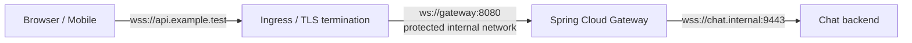
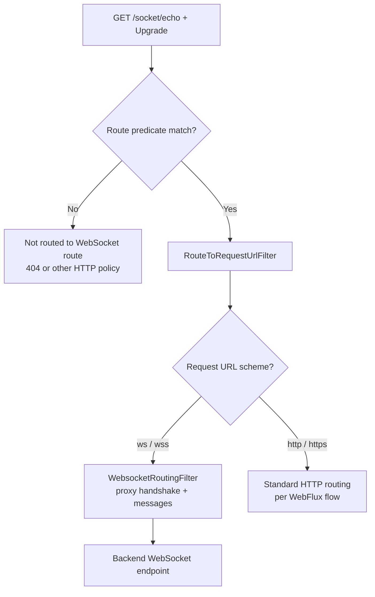
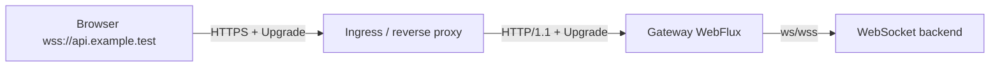

# WebSocket Routing with `ws:` and `wss:` in Spring Cloud Gateway

In a microservices architecture, Spring Cloud Gateway is the common entry point for HTTP APIs and connections that require **bidirectional, continuous** data exchange. In addition to selecting routes with *route predicates*, running the *filter chain*, transforming paths/headers, service discovery, and layers for authentication, rate limiting, circuit breaking, retry, TLS, and request observability, Gateway can also **proxy WebSocket** connections from a client to a backend.

With standard HTTP, each request has a response and then ends. With WebSocket, an initial HTTP/1.1 request asks for a **connection upgrade (`Upgrade`)**; once the handshake succeeds, the client and server exchange **WebSocket frames/messages** over the same open connection. That directly affects scheme selection, load balancer operation, security, timeouts, and observability.

In **Spring Cloud Gateway Server WebFlux**, a route can use:

- `ws://` — a WebSocket connection **without TLS encryption** on the Gateway → upstream hop.
- `wss://` — a WebSocket connection **with TLS** on the Gateway → upstream hop.
- `lb:ws://service-id` — a WebSocket route with **service discovery/load balancing** via the corresponding mechanism, if LoadBalancer is configured.

**Most common point of confusion:** `uri: wss://backend...` describes the **Gateway → backend hop**. It **does not automatically configure TLS for client → Gateway**. A client can call `wss://api.example.test/...` when ingress/Gateway terminates TLS, even if the internal route uses `ws://...`. Conversely, a client calling `ws://...` to Gateway is not encrypted just because the upstream URI is `wss://...`.

This article belongs to the **WebSocket and Streaming** chapter of the `SPRING_CLOUD_GATEWAY` module and focuses on **configuring WebSocket routing with `ws:`/`wss:`**, the handshake mechanism, applying route predicates/filters, authentication, TLS handling, testing, and operating multiple instances. Related terms such as SockJS, SSE, and gRPC are explained to distinguish them, not to treat them as WebSocket equivalents.

> **Version scope:** Examples use **Spring Cloud Gateway Server WebFlux 5.0.x**, Spring Cloud 2025.1.x, and compatible Spring Boot 4.x. The YAML route prefix uses `spring.cloud.gateway.server.webflux.routes`. Gateway 4.x docs often use `spring.cloud.gateway.routes`; Server Web MVC has a different WebSocket proxy path, so do not copy Java/WebFlux configuration mechanically to MVC.

## 1. Learning Objectives

After this lesson, you will be able to:

1. Explain the difference between HTTP request-response and a WebSocket session after the `101 Switching Protocols` handshake.
2. Distinguish the roles of `ws://` and `wss://` in client URLs, route URIs, and backends; understand TLS termination.
3. Write a Gateway WebFlux route with `Path`, `Method=GET`, `uri: ws://...`, and `StripPrefix` matching the backend endpoint.
4. Explain how `WebsocketRoutingFilter` selects the connection based on the scheme of `GATEWAY_REQUEST_URL_ATTR`.
5. Combine `lb:ws://service-id` with service discovery without confusing **connection-level** load balancing with per-message balancing.
6. Handle `Origin`, authentication, authorization, proxy headers, and resource limits for long-lived connections.
7. Run a lab with a WebFlux echo backend, Gateway proxy, and `wscat` client; inspect HTTP 101, message echo, connection closure, and common errors.
8. Design outbound `wss` TLS, ingress `wss`, health checks, observability, and scaling for Gateway replicas.

## 2. WebSocket Starts with HTTP, but Does Not End Like HTTP

A WebSocket client connects using an HTTP/1.1 handshake:

```http
GET /socket/echo HTTP/1.1
Host: api.example.test
Upgrade: websocket
Connection: Upgrade
Sec-WebSocket-Key: dGhlIHNhbXBsZSBub25jZQ==
Sec-WebSocket-Version: 13
Origin: https://app.example.test
```

If the server agrees to upgrade, the response is:

```http
HTTP/1.1 101 Switching Protocols
Upgrade: websocket
Connection: Upgrade
Sec-WebSocket-Accept: s3pPLMBiTxaQ9kYGzzhZRbK+xOo=
```

The `Sec-WebSocket-Accept` value above is the standard RFC 6455 example for the given `Sec-WebSocket-Key`. It is computed according to the handshake rules, **not** an arbitrary copied string or access token.

After the `101` response, the exchange flow looks like:

```text
Client                           Gateway                           Backend
  | HTTP GET + Upgrade              |                                 |
  |-------------------------------->| WebSocket outbound handshake    |
  |                                 |-------------------------------->|
  |                                 |<--------------------------------|
  |<--------------------------------| 101 if handshake succeeds       |
  |  Text frame: "ping-app"         |                                 |
  |-------------------------------->| Forward message/frame           |
  |                                 |-------------------------------->|
  |                                 |<--------------------------------|
  |<--------------------------------| Text: "echo:ping-app"           |
  | ... connection stays open ...   | ...                             |
  | Close                           |                                 |
```

**On the outside** is an HTTP handshake; **on the inside** is the WebSocket protocol. That leads to these constraints:

- You cannot use HTTP status `200 OK` and a JSON body instead of a `101` handshake and consider WebSocket working.
- A Gateway filter that modifies an HTTP response body is not a tool that automatically transforms **each WebSocket message** after Upgrade.
- HTTP retry/circuit breaker, response caching, or rate limiters on the initial request **do not automatically limit** messages per minute in an already open session.
- The client/WebSocket backend must implement **connection closing, heartbeats, payload validation**, and reconnect handling.

### 2.1. Comparing `http`, `https`, `ws`, and `wss`

| URI or scheme | Application protocol | TLS? | In Gateway WebFlux |
|---|---|---|---|
| `http://backend:8080` | HTTP request/response | No | Selects standard Netty HTTP routing |
| `https://backend:8443` | HTTP request/response | Yes | HTTP routing over TLS |
| `ws://backend:9001` | WebSocket | No | Activates Websocket Routing Filter |
| `wss://backend:9443` | WebSocket | Yes | Activates Websocket Routing Filter with outbound TLS connection |
| `lb:ws://chat-service` | WebSocket + service name | Depends on resolved target; example is `ws` | LoadBalancer resolves service instance, then WebSocket routing |
| `wss://api.example.test/socket/echo` | Public WebSocket from browser | Yes | This is the **URL the client calls**, not necessarily the backend route URI |

The `ws`/`wss` pair is analogous to `http`/`https` regarding **TLS encryption**, but differs in the handshake mechanism and subsequent data exchange. Default ports are usually 80 for `ws` and 443 for `wss` if the URI omits a port; in the lab we use dedicated ports to clearly observe each hop.

### 2.2. Two TLS Hops Must Be Considered Independently



Other valid topologies exist:

| Hop client → Gateway | Hop Gateway → backend | What to know |
|---|---|---|
| `ws` | `ws` | No TLS on either hop; suitable only for labs or trusted networks with dedicated policies |
| `wss` | `ws` | TLS up to Gateway/ingress, then internal cleartext; requires evaluating network trust |
| `wss` | `wss` | TLS on both hops; **two separate TLS sessions** |
| `ws` | `wss` | Outbound has TLS but client inbound does not; **does not protect the first hop** |

If ingress receives public `wss` and forwards the HTTP Upgrade to Gateway over internal `ws`, make sure the ingress genuinely supports WebSocket proxying, preserves the handshake, and does not terminate long-lived connections prematurely. Do not describe this topology as end-to-end TLS if ingress decrypts traffic and forwards cleartext.

## 3. Websocket Routing Filter in Gateway Server WebFlux

Spring Cloud Gateway documentation describes `WebsocketRoutingFilter`:

1. `RoutePredicateHandlerMapping` finds the matching route and attaches it to the exchange.
2. `RouteToRequestUrlFilter` builds the target URL and stores it in the exchange attribute `ServerWebExchangeUtils.GATEWAY_REQUEST_URL_ATTR`.
3. When the target URL has scheme `ws` or `wss`, `WebsocketRoutingFilter` forwards the WebSocket session upstream using Spring WebSocket infrastructure.
4. Once the connection is upgraded, Gateway relays data bidirectionally between the two WebSocket sessions.



**Core point:** A `ws://` or `wss://` URI is the signal for the WebSocket routing filter to run. Merely adding an `Upgrade: websocket` header to an HTTP route `uri: http://...` is not the WebSocket configuration documented for Gateway WebFlux; do not take **Gateway Server Web MVC** behavior and assume Server WebFlux works identically.

### 3.1. Route Predicates Are Still Evaluated at Handshake

For example:

```yaml
predicates:
  - Path=/socket/**
  - Method=GET
```

An HTTP/1.1 WebSocket handshake is normally `GET` and carries a path. `Path`/`Method` can be used to constrain the route, but they **do not** inspect frame contents after the connection opens. `Header`/`Host` predicates can apply to the handshake if genuinely needed; do not treat them as per-message authorization logic.

### 3.2. GatewayFilter Modifies the Request Before Reaching the Backend

For example:

```yaml
filters:
  - StripPrefix=1
```

When a client calls `ws://localhost:8080/socket/echo`, the backend at `ws://localhost:9001` receives path `/echo`. Keep the path supported by the backend and the path-rewriting filter consistent; otherwise the handshake can fail with `404` even though the service is running.

Filters like `AddRequestHeader` or `RemoveRequestHeader` can affect the **HTTP handshake**; they are not a pipeline that automatically modifies individual WebSocket messages. Do not overwrite `Upgrade`, `Connection`, `Sec-WebSocket-Key`, or `Sec-WebSocket-Accept` with static strings: these are part of the handshake managed by the WebSocket client/server infrastructure.

### 3.3. Frames Are Not Routed per Route Predicate

After a successful upgrade, **one WebSocket connection** has been established to the selected backend. When the client sends 1,000 messages, Gateway **does not re-evaluate the `Path` predicate 1,000 times**, nor does it ask LoadBalancer to pick a new backend for each frame.

That is a key difference from REST: load balancing typically happens at **session creation time**. When a backend instance holds session state, the load balancer cannot move an open session to another backend without protocol support. If the backend loses connection, the client must reconnect; the new session can be routed to a different instance.

## 4. Basic `ws://` Route Configuration in YAML

### 4.1. A Complete WebSocket Route

Use `src/main/resources/application.yml` in a Gateway Server WebFlux project:

```yaml
server:
  address: 127.0.0.1
  port: 8080

spring:
  application:
    name: gateway-websocket-lab

  cloud:
    gateway:
      server:
        webflux:
          routes:
            - id: echo-websocket
              uri: ws://127.0.0.1:9001
              predicates:
                - Path=/socket/**
                - Method=GET
              filters:
                - StripPrefix=1
```

**Part-by-part breakdown:**

| Component | Value | Behavior |
|---|---|---|
| `server.port` | `8080` | Gateway receives the client's handshake |
| `uri` | `ws://127.0.0.1:9001` | Gateway opens an outbound WebSocket to the backend without TLS |
| `Path` | `/socket/**` | Selects only requests with a matching path |
| `Method` | `GET` | WebSocket HTTP/1.1 handshake uses GET |
| `StripPrefix=1` | Drops the first segment | Client `/socket/echo` → backend `/echo` |
| `id` | `echo-websocket` | ID used to observe route configuration |

This is a **WebSocket route**; there is no echo logic inside Gateway. Gateway forwards the WebSocket connection to the backend on port 9001; if the backend has no `/echo` endpoint supporting upgrade, the handshake will fail.

### 4.2. Common Misconfigurations

**Mistake 1 — using an HTTP URI expecting automatic WebSocket upgrade in WebFlux:**

```yaml
# Not the documented WebFlux WebSocket configuration:
uri: http://127.0.0.1:9001
```

With Gateway Server WebFlux, use `ws://` or `wss://` to send the exchange into `WebsocketRoutingFilter`. Do not assume Server Web MVC behavior — which can upgrade from an `http://`/`https://` route — applies to WebFlux.

**Mistake 2 — using `StripPrefix=2` when only one prefix segment needs stripping:**

```yaml
predicates:
  - Path=/socket/**
filters:
  - StripPrefix=2
```

For request `/socket/echo`, stripping two segments can leave the backend receiving `/` instead of `/echo`, so the WebSocket backend fails to match a handler. Map out before/after paths clearly and verify against the echo backend.

**Mistake 3 — merely adding an Upgrade header to an HTTP request:**

```yaml
filters:
  - AddRequestHeader=Upgrade, websocket
```

Do not use this filter to simulate a WebSocket handshake. Client and server must satisfy RFC 6455 (key, version, upgrade headers, subprotocol if any); Spring's WebSocket infrastructure handles the proper handshake.

### 4.3. With Multiple WebSocket Upstreams

One Gateway can expose multiple APIs:

```yaml
spring:
  cloud:
    gateway:
      server:
        webflux:
          routes:
            - id: chat-socket
              uri: ws://chat-internal:9011
              predicates:
                - Path=/socket/chat/**
              filters:
                - StripPrefix=1

            - id: notifications-socket
              uri: ws://notification-internal:9012
              predicates:
                - Path=/socket/notifications/**
              filters:
                - StripPrefix=1
```

The names `chat-internal` and `notification-internal` are **illustrative DNS names**; in real deployments, you need DNS resolution/service discovery/network policy. If two routes overlap on `Path`, set `order` explicitly. Do not enable an overly broad `Path=/**` route with `ws://`, as it can intercept non-Upgrade HTTP requests and cause unexpected errors.

### 4.4. Distinguishing Inbound Server and Upstream URLs

With the lab configuration:

```text
Client:  ws://127.0.0.1:8080/socket/echo
Gateway: uri: ws://127.0.0.1:9001
Backend: handler path /echo
```

These are three distinct things: **client URL**, **target route URI**, and **backend handler path**. The route `uri` is not the address the browser should connect to; clients always connect to Gateway's public endpoint.

## 5. From `ws:` to `wss:`: Which Hop Has TLS?

`wss://` uses WebSocket over TLS. There are two separate TLS circuits that must be configured independently:

- **Inbound:** browser/app → ingress or Gateway.
- **Outbound:** Gateway → backend.

### 5.1. Inbound TLS When Gateway Terminates Directly

For example, Gateway listening on TLS `8443` with PKCS#12:

```yaml
server:
  port: 8443
  ssl:
    enabled: true
    key-store: classpath:gateway-tls.p12
    key-store-type: PKCS12
    key-store-password: ${GATEWAY_KEYSTORE_PASSWORD}
    key-alias: gateway

spring:
  cloud:
    gateway:
      server:
        webflux:
          routes:
            - id: echo-over-inbound-tls
              uri: ws://127.0.0.1:9001
              predicates:
                - Path=/socket/**
              filters:
                - StripPrefix=1
```

The client will call `wss://api.example.test:8443/socket/echo` once DNS/certificate match reality. **Upstream remains non-TLS `ws://`** per the route URI, even though the client uses WSS to Gateway. There is no real `gateway-tls.p12` certificate file included in these docs; you must generate one with an appropriate CA/test PKI, protect the password with a secret, verify the host SAN, and never commit private keys to Git.

When ingress terminates TLS instead of Gateway, `server.ssl` may be disabled on Gateway; the client still calls WSS to the **ingress**, and the ingress proxies the handshake to Gateway. Remember to evaluate the trust level of the internal cleartext segment.

### 5.2. Outbound TLS with `wss://`

If the WebSocket backend exposes TLS at `chat.internal.example:9443`:

```yaml
spring:
  cloud:
    gateway:
      server:
        webflux:
          routes:
            - id: chat-secure-upstream
              uri: wss://chat.internal.example:9443
              predicates:
                - Path=/socket/chat/**
              filters:
                - StripPrefix=2
```

When a client calls `/socket/chat/room/42`, the backend sees path `/room/42`. Gateway must connect to a WebSocket endpoint with a **valid certificate**, matching SAN/hostname, and trusted CA chain. `wss` does not mean "skip certificate verification."

**Important technical note:** `server.ssl.*` configures the **inbound server** certificate; it does not automatically supply a truststore or client certificate for all outbound WebSocket connections. For a private CA or mTLS to the backend, you must configure TLS/trust/client identity **for the Gateway-side WebSocket client** using the mechanism supported on your exact release; do not assume every `httpclient.ssl.*` property is used identically by both the HTTP proxy and `WebsocketRoutingFilter` without checking the actual wiring.

If the outbound TLS handshake fails, fix the CA, hostname, trust manager, cipher/protocol, and mTLS credentials — **do not enable insecure trust-all** in production to bypass `PKIX path building failed`.

### 5.3. TLS Deployment Matrix

| Client → ingress/Gateway | Gateway → backend | Usable? | Risks/notes |
|---|---|---|---|
| `ws://` | `ws://` | Local lab | No transport security on data hops |
| `wss://` | `ws://` | Yes, when internal network is acceptable | TLS terminates early, cleartext behind ingress |
| `wss://` | `wss://` | Yes | Two TLS handshakes, trust/CA/SAN per hop |
| `ws://` | `wss://` | Technically yes | Client hop lacks TLS, unsafe for the Internet |
| `wss://` + inbound mTLS | `wss://` + outbound mTLS | Yes with proper PKI design | Two independent identity/trust domains; test each hop |

### 5.4. Do Not Confuse 101, TLS Handshake, and WebSocket Close

A TLS certificate error happens **before** HTTP 101; the client may see a TLS error instead of an HTTP status. Once WebSocket has upgraded and the backend drops the connection, the client receives a **close/error event or close frame**, not a new HTTP `500` over the already upgraded connection.

Therefore, when investigating, always distinguish:

1. TLS handshake failure.
2. HTTP WebSocket Upgrade failure (401/403/404/400/502... depending on which layer failed).
3. WebSocket upgraded, then session closed/reset.
4. Business error message sent by the backend **inside the WebSocket protocol**.

## 6. Load-Balanced Route: `lb:ws://service-id`

Spring Cloud Gateway allows placing the `lb` prefix on a WebSocket route:

```yaml
spring:
  cloud:
    gateway:
      server:
        webflux:
          routes:
            - id: chat-load-balanced
              uri: lb:ws://chat-service
              predicates:
                - Path=/socket/chat/**
              filters:
                - StripPrefix=2
```

From `lb:ws://chat-service`, Gateway uses **Spring Cloud LoadBalancer**/appropriate service discovery to resolve a `chat-service` instance and route the WebSocket there. This example only makes sense when:

- The project includes the Spring Cloud LoadBalancer starter (if the dependency isn't already pulled in by the current stack).
- A DiscoveryClient or a `ServiceInstanceListSupplier` declares concrete instances.
- All backend instances support WebSocket on the path forwarded by the filters.
- Scheme/port and TLS settings are verified against real service instances.

`lb:ws://chat-service` **does not auto-launch** a service named `chat-service`, and does not guarantee backends listen on ports 80/443 when the registry advertises a different port.

### 6.1. Long-Lived Connections Are Not Balanced per Frame

When clients open sessions:

```text
Client #1 ── WebSocket session A ── Gateway ── chat-service instance 1
Client #2 ── WebSocket session B ── Gateway ── chat-service instance 2
Client #1 ── Message 2,3,... ──────────────────> instance 1
```

**LoadBalancer typically picks an instance when starting the WebSocket connection**. An already open session does not automatically jump to another instance when new instances appear or instance 1 goes down. Once the connection closes, the client reconnects and starts a new connection, which may land on another instance.

If the chat backend stores chat rooms/session state in a single instance's RAM, you must design **shared session state, pub/sub, a broker, or message routing** across the cluster. Sticky sessions may help some models, but do not solve failover/rebalancing or cluster-wide message synchronization.

### 6.2. When Do You Need `lb:wss://...`?

Gateway WebFlux documentation clearly describes `lb:ws://serviceid` and `lb` scheme prefix logic. For secure backends in service discovery, you may encounter TLS-enabled scheme configs such as `lb:wss://chat-service`; **do not assume it works automatically for every registry/release**. Check how LoadBalancer resolves the scheme/secure flag and test outbound TLS against real certificates/service instances. Until verified, `wss://` pointing to an explicit host/port is easier to control.

### 6.3. Discovery and Health Checks Differ from Session Health

An HTTP health endpoint `GET /actuator/health` can return 200 while the WebSocket handler is backlogged with messages, sessions are closing from idle timeouts, or the upstream broker is dead. If WebSocket is critical functionality, health/readiness must check relevant dependencies and application-level session/timeout/close-code health, not just overall HTTP health.

## 7. End-to-End Lab: WebSocket Echo Backend and Gateway `ws://`

Lab goal: the client sends the string `hello` to Gateway, the backend receives `hello` and replies `echo:hello` over the same WebSocket session. We use **two independent Spring Boot applications**:

1. **Echo Backend** — Spring Boot WebFlux, port `9001`, handling WebSocket at `/echo`.
2. **Echo Gateway** — Spring Cloud Gateway Server WebFlux, port `8080`, routing `/socket/**` to `ws://127.0.0.1:9001`.

This is a **non-TLS** lab on loopback. Do not expose `server.address: 127.0.0.1` as a public configuration without designing ingress, identity, and transport security.

### 7.1. Backend Project: Maven Dependency

Create a separate Spring Boot WebFlux project (e.g., `echo-backend`) with the dependency:

```xml
<dependency>
    <groupId>org.springframework.boot</groupId>
    <artifactId>spring-boot-starter-webflux</artifactId>
</dependency>
```

This is only the **relevant dependency snippet**, not a complete `pom.xml`: you need a compatible Spring Boot parent or dependency management/plugin. **Do not add the Spring MVC starter** to this demo backend, as it can cause Boot to choose Servlet/MVC instead of WebFlux. Spring Boot's `spring-boot-starter-websocket` is mainly for WebSocket on Spring MVC, not a required dependency for this WebFlux example.

Backend configuration `src/main/resources/application.yml`:

```yaml
server:
  address: 127.0.0.1
  port: 9001

spring:
  application:
    name: echo-websocket-backend
```

### 7.2. Backend Java with `WebSocketHandler`

Create `EchoBackendApplication.java` under your application's package:

```java
import java.util.Map;

import org.springframework.boot.SpringApplication;
import org.springframework.boot.autoconfigure.SpringBootApplication;
import org.springframework.context.annotation.Bean;
import org.springframework.web.reactive.HandlerMapping;
import org.springframework.web.reactive.handler.SimpleUrlHandlerMapping;
import org.springframework.web.reactive.socket.WebSocketHandler;
import org.springframework.web.reactive.socket.WebSocketMessage;

@SpringBootApplication
public class EchoBackendApplication {

    public static void main(String[] args) {
        SpringApplication.run(EchoBackendApplication.class, args);
    }

    @Bean
    HandlerMapping websocketMapping() {
        WebSocketHandler echo = session -> session.send(
            session.receive()
                .filter(message ->
                    message.getType() == WebSocketMessage.Type.TEXT)
                .map(message -> session.textMessage(
                    "echo:" + message.getPayloadAsText()))
        );

        Map<String, WebSocketHandler> handlers =
                Map.of("/echo", echo);

        // -1 gives this handler mapping priority ahead of
        // standard annotated controller mappings.
        return new SimpleUrlHandlerMapping(handlers, -1);
    }
}
```

Spring WebFlux's `WebSocketHandler` receives a `WebSocketSession` with:

- `session.receive()`: stream of incoming messages.
- `session.textMessage(...)`: creates an outgoing text message.
- `session.send(publisher)`: writes reply messages and completes when the publisher completes.

This sample echoes **text messages only**; binary messages are ignored by the filter. It **does not** parse JSON, store user state, enforce payload size limits, or check room authorization. Those are separate requirements for production backends.

Spring WebFlux Java configuration provides `WebSocketHandlerAdapter` to support handshakes; with standard Spring Boot WebFlux auto-configuration you do not need to create a second adapter manually. If a project completely customizes WebFlux configuration and removes the handler adapter, check Spring Framework docs to register it while avoiding unintended duplicate beans.

### 7.3. Gateway Project: Maven Dependency

Create **another** project (e.g., `gateway-ws-demo`) using Spring Cloud Gateway Server WebFlux:

```xml
<dependency>
    <groupId>org.springframework.cloud</groupId>
    <artifactId>spring-cloud-starter-gateway-server-webflux</artifactId>
</dependency>
```

Use a Spring Cloud BOM compatible with Spring Boot 4.x. Do not pick an arbitrary Cloud train, and do not mix the Gateway Web MVC starter into a WebFlux application.

Startup class:

```java
import org.springframework.boot.SpringApplication;
import org.springframework.boot.autoconfigure.SpringBootApplication;

@SpringBootApplication
public class WebSocketGatewayApplication {
    public static void main(String[] args) {
        SpringApplication.run(WebSocketGatewayApplication.class, args);
    }
}
```

Use the exact `application.yml` from section **4.1**, with Gateway port `8080` and `uri: ws://127.0.0.1:9001`. In the lab you do not need `ssl`, Redis, discovery, or a custom WebSocket handler on Gateway — Gateway acts as a **proxy**, not a business message processor.

### 7.4. Start the Backend, Then Gateway

In the backend project:

```bash
# Linux/macOS
./mvnw spring-boot:run

# PowerShell
.\mvnw.cmd spring-boot:run
```

Keep this terminal running. In the Gateway project (another terminal):

```bash
# Linux/macOS
./mvnw spring-boot:run

# PowerShell
.\mvnw.cmd spring-boot:run
```

Check the logs: backend listening on `127.0.0.1:9001`, Gateway listening on `127.0.0.1:8080`. If either starts on the wrong port, do not rush to edit route filters before verifying the actual addresses of both processes.

### 7.5. Connect Directly to the Backend with `wscat`

`wscat` is a CLI tool for sending/receiving WebSocket messages. If Node.js/npm is installed and package installation is permitted, you can run it via `npx`:

```bash
npx wscat -c ws://127.0.0.1:9001/echo
```

Once connected, enter:

```text
> hello
< echo:hello
> testing
< echo:testing
```

This is an **illustrative interactive output**; the `>`/`<` symbols are displayed by the terminal client, not protocol data you must type. To exit, use the CLI's close command or Ctrl+C, then verify the session is cleaned up.

If you cannot connect **directly** to the backend, troubleshoot the backend first: is `/echo` exact, is the server running, and are the WebFlux dependency and WebSocket handler mapping registered? A valid Gateway route cannot fix a broken backend handshake.

### 7.6. Connect Through Gateway

Once the backend works, run:

```bash
npx wscat -c ws://127.0.0.1:8080/socket/echo
```

Enter:

```text
> hello gateway
< echo:hello gateway
> good morning
< echo:good morning
```

When successful:

- `/socket/echo` matches `Path=/socket/**` and `Method=GET`.
- `StripPrefix=1` rewrites the path to `/echo`.
- Gateway creates an outbound WebSocket to backend `127.0.0.1:9001`.
- The backend receives the text and generates a reply.
- The reply flows back through Gateway to the client over the **already open session**, not a new HTTP request.

**Do not look for a JSON body or `Content-Length` to prove connectivity:** the `echo:...` response is a WebSocket message after HTTP `101`. Use a WebSocket client, not just a plain `curl -i`.

## 8. Verifying Handshake, Route, and Frames

### 8.1. Checking HTTP `101` with `curl`

A WebSocket handshake must include the proper headers. You can use `curl` for the **handshake** part:

```bash
curl --http1.1 -i -N --max-time 3 \
  -H "Connection: Upgrade" \
  -H "Upgrade: websocket" \
  -H "Sec-WebSocket-Version: 13" \
  -H "Sec-WebSocket-Key: dGhlIHNhbXBsZSBub25jZQ==" \
  http://127.0.0.1:8080/socket/echo
```

When the handshake succeeds, the start of the response is typically:

```http
HTTP/1.1 101 Switching Protocols
Upgrade: websocket
Connection: Upgrade
Sec-WebSocket-Accept: s3pPLMBiTxaQ9kYGzzhZRbK+xOo=
```

`curl` **is not an ideal tool for interactive WebSocket frame exchange** in this lab. With `--max-time 3`, `curl` may exit with a timeout after already showing 101 — **that does not mean the handshake failed**. Use `wscat`/`websocat` or a WebSocket test client to verify text, binary, ping/pong, and close frames.

In particular, the command above does not send `Origin`; CLI WebSocket clients may omit `Origin`, unlike browsers. Therefore, a 101 handshake with `curl` **does not prove** a cross-origin browser app can connect, nor that the Origin policy is secure.

### 8.2. Testing Wrong Path and Wrong Method

```bash
# /not-socket/** does not match route /socket/**
curl -i http://127.0.0.1:8080/not-socket/echo

# POST does not match Method=GET of the WebSocket route
curl -i -X POST http://127.0.0.1:8080/socket/echo
```

Neither request is a valid WebSocket handshake; normally, if no other route/handler matches, you get `404`, though once Spring Security or other filters are added you may get `401`/`403` before that.

If you call `GET /socket/echo` **without an Upgrade header** and it still matches the WebSocket route, Gateway may reject the handshake/upgrade or emit an appropriate error; do not expect HTTP `200` with an echo body.

### 8.3. Testing When the Backend Stops

1. Keep Gateway running.
2. Stop the backend on port 9001.
3. Use `wscat` to open a **new connection** through Gateway.
4. Record the handshake error, Gateway logs, and outbound connect error.
5. Restart the backend and try a new session.

When upstream is unavailable, the client may see an HTTP handshake error or connection closure; **do not assume** every error returns `502` identically to Server Web MVC, because Gateway WebFlux mechanisms/versions and underlying layers can differ.

If the backend dies **after** the WebSocket has already upgraded successfully, the client sees a close/error event or TCP reset, not a new HTTP 502 on that connection.

### 8.4. Simple Browser JavaScript

In a frontend environment permitted by the Origin policy:

```javascript
const socket = new WebSocket("wss://api.example.test/socket/echo");

socket.addEventListener("open", () => {
  socket.send("hello");
});

socket.addEventListener("message", (event) => {
  console.log("Reply:", event.data);
});

socket.addEventListener("close", (event) => {
  console.log("Closed", event.code, event.reason);
});

socket.addEventListener("error", () => {
  console.error("WebSocket connection error");
});
```

This is a **production-style frontend URL example**; it will not run directly against the `ws://127.0.0.1:8080` lab without ingress/TLS and `api.example.test` DNS. HTTPS pages normally must connect with `wss://` to avoid mixed-content security restrictions.

The browser WebSocket constructor **does not allow setting an arbitrary `Authorization` header**. Do not write JavaScript like `new WebSocket(url, { headers: { Authorization: ... } })` and assume browsers support it. Design proper WebSocket authentication using protected session cookies, short-lived tickets, or another application-controlled mechanism, detailed in the next section.

## 9. WebSocket Security: `Origin`, CVE-2026-59428, and Authentication

Browser WebSockets do not enforce the same CORS preflight mechanism for the handshake as `fetch()`. Browsers still send `Origin` so the server can decide whether to accept a connection from that web page. If the server ignores `Origin`, a malicious page can cause a user's browser to open a WebSocket to an API carrying their session cookies — commonly called **Cross-Site WebSocket Hijacking (CSWSH)**.

### 9.1. Security Advisory for Spring Cloud Gateway 5.0.x

**Updated November 19, 2026:** Spring disclosed **CVE-2026-59428 — Spring Cloud Gateway WebSocket Routing Filter Does Not Enforce Same-Origin by Default**.

Details from the official advisory:

| Item | Conclusion |
|---|---|
| Affected versions in 5.0 branch | **5.0.0 through 5.0.4** |
| Issue | `WebsocketRoutingFilter` does not enforce `Origin` validation by default on affected versions |
| Risk | Cross-origin browser handshakes may be accepted, especially dangerous when cookies are attached automatically |
| Announced OSS fix version | **5.0.5** |
| Patched version behavior | By default allows only **same-origin** or requests without `Origin`; other cross-origin requests receive `403` |
| Customization on patched version | `spring.cloud.gateway.server.webflux.websocket.allowed-origins` or `allowed-origin-patterns` |

**Do not state that "all Gateway 5.0.x releases block cross-origin by default."** On affected versions, do not rely on default `Origin` behavior to prevent CSWSH; **upgrade to the patched 5.0.5 release or a newer release with the fix**. For the 4.x branch, check the advisory for the exact branch fix version. Configuring the new allowlist properties does not substitute for upgrading a vulnerable release.

Source: [Spring Official Security Advisory — CVE-2026-59428](https://spring.io/security/cve-2026-59428/).

### 9.2. Allowing Specific Origins on a Patched Gateway

On Gateway Server WebFlux **5.0.5+**, if the frontend lives at `https://app.example.test` and dev runs at `http://localhost:5173`, add only genuinely allowed origins:

```yaml
spring:
  cloud:
    gateway:
      server:
        webflux:
          websocket:
            allowed-origins:
              - https://app.example.test
              - http://localhost:5173
```

This is a **configuration snippet to merge under `spring.cloud.gateway.server.webflux`** in your application, not a standalone YAML file for the entire stack. Keep localhost origins only in **development profiles**, and never copy them blindly into production.

If you need to allow multiple subdomains, patched releases also provide `allowed-origin-patterns`:

```yaml
spring:
  cloud:
    gateway:
      server:
        webflux:
          websocket:
            allowed-origin-patterns:
              - "https://*.example.test"
```

**Risk:** A wildcard across all subdomains can accept a hijacked subdomain or untrusted host. Only use patterns when genuinely required and you control the entire namespace. Never set `*` for all origins on APIs using cookies or sensitive data.

### 9.3. Origin Is a Supplemental Check, Not User Identity

Independent verification layers:

| Check | Question | Implementation |
|---|---|---|
| TLS / `wss` | Is the channel to Gateway/backend encrypted and verified? | TLS with proper cert/CA/SAN |
| `Origin` | Which web page requested opening the socket from a browser? | Same-origin or strict allowlist |
| Authentication | Who is the client/user/workload? | Verified session/JWT/ticket |
| Handshake authorization | Is this identity allowed to open `/socket/chat`? | Spring Security/policy before upgrade |
| Message authorization | Is the user allowed to send content into chat room X? | Checked at the backend per operation |
| Resource limits | How many sessions/messages per user/tenant? | Rate/concurrency/quota and validation |

**`Origin` is not a credential.** Non-browser clients can spoof `Origin` or omit `Origin` entirely. Thus the server must still authenticate and authorize, never treating a "valid Origin" as proof that a user is logged in.

### 9.4. Browser WebSocket and `Authorization`

The browser API:

```javascript
new WebSocket("wss://api.example.test/socket/chat");
```

**Does not allow attaching an arbitrary `Authorization: Bearer ...` header** like `fetch()` or CLI WebSocket clients. Viable strategies include:

1. **Protected session cookie**: Gateway validates the cookie/session during the handshake; combine SameSite, Secure, HttpOnly, CSRF/CSWSH protection, and a strict Origin allowlist.
2. **Short-lived WebSocket ticket**: the frontend calls an authenticated HTTPS API to exchange for a one-time or short-lived ticket, then opens the WebSocket using that ticket per a designed protocol; Gateway/backend must validate the ticket, prevent replay, and never log raw tickets.
3. **Subprotocol or initial authentication message**: requires a strictly defined protocol that blocks business messages before verification and keeps credentials out of logs; do not casually stuff a JWT into `Sec-WebSocket-Protocol` and treat it as a standard security practice.
4. **Non-browser clients**: may support `Authorization` in the HTTP handshake depending on client library and Security configuration, but must be tested explicitly.

**Do not pass long-lived access tokens in query strings** like `?token=eyJ...` just so "the browser can send it." URLs can be recorded in access logs, proxy logs, tracing, analytics, and monitoring history. If a URL ticket is unavoidable, make it extremely short-lived, single-use, bound to user/route, sanitized from all logs, and used strictly over WSS.

### 9.5. Spring Security Applies to the Handshake, Not Yet Message Policy

If Gateway uses Spring Security WebFlux, protect the handshake path `/socket/**` similarly to HTTP APIs:

```java
import org.springframework.context.annotation.Bean;
import org.springframework.context.annotation.Configuration;
import org.springframework.security.config.web.server.ServerHttpSecurity;
import org.springframework.security.web.server.SecurityWebFilterChain;

@Configuration
public class GatewayWebSocketSecurity {
    @Bean
    SecurityWebFilterChain socketSecurity(ServerHttpSecurity http) {
        return http
            // Policy sketch only: choose an auth scheme
            // and CSRF handling matching real session/JWT usage.
            .authorizeExchange(ex -> ex
                .pathMatchers("/socket/**").authenticated()
                .anyExchange().denyAll())
            .build();
    }
}
```

The example above **does not configure** login, a JWT decoder, or a session identity provider, so it is not a production auth template you can copy verbatim. When using a JWT Resource Server, add the corresponding security dependency and `oauth2ResourceServer(...).jwt(...)`; when using session cookies, configure CSRF, SameSite, and origin checks. Do not blindly disable `csrf` or `formLogin` if the application relies on browser sessions.

And **after the handshake**, each message such as `JOIN_ROOM`/`SEND_MESSAGE` must be checked:

- Which rooms/tenants does the user currently have access to?
- Were permissions revoked mid-session?
- Are message type, size, JSON schema, and sensitive contents valid?
- Is the user allowed to send messages to that room right now?
- Are message rate limits and anti-spam controls enforced?

A `101` handshake does not grant unlimited authority for the entire session. In particular, dynamic routes or Gateway path/header rewrites must never bypass backend authorization.

### 9.6. Gateway Origin Config Does Not Replace Every Backend Policy

A patched Gateway WebFlux can reject a bad Origin **before the outbound handshake**. However, the WebSocket backend can also validate Origin independently. If the backend only allows same-origin against its internal host, while the browser sends Origin `https://app.example.test`, the outbound handshake may be rejected by the backend even when Gateway's allowlist permits it.

To support valid cross-origin browsers:

1. Allowlist the Origin on **Gateway**.
2. Inspect and configure the Origin policy on the **backend WebSocket handler** if the backend also checks it.
3. Forward/normalize forwarded host/scheme only from trusted proxies.
4. Test with real browsers and non-browser clients, as well as invalid Origins.

Do not disable all backend Origin checks as the sole fix when seeing 403; identify which layer returned the error and design a trustworthy policy across the full connection path.

## 10. Ingress, Reverse Proxy, and HTTP Upgrade

In real deployments, there is usually an ingress/reverse proxy in front of Gateway:



Ingress requirements:

- Support HTTP/1.1 WebSocket Upgrade (or a compatible mechanism documented by the proxy/framework); do not proxy only short HTTP requests.
- Forward the proper handshake headers such as `Upgrade` and `Connection` when acting as a reverse proxy.
- Keep upstream connections open for the session lifetime, with an **idle timeout** long enough for heartbeats.
- Protect `X-Forwarded-*`/`Forwarded` sources: ingress must sanitize client-supplied headers from the Internet before writing trusted values.
- Ensure the public listener uses TLS/WSS; do not expose public `ws://` outside allowed policy.
- Enforce limits on concurrent connections, new handshakes/second, and draining during rolling updates.

### 10.1. Nginx HTTP/1.1 Reverse Proxy Example

This is an **illustrative** snippet, not a complete `nginx.conf`:

```nginx
# Declare in the http context:
map $http_upgrade $connection_upgrade {
    default upgrade;
    ''      close;
}

upstream gateway_ws {
    server 127.0.0.1:8080;
}

server {
    listen 443 ssl;
    server_name api.example.test;

    ssl_certificate     /etc/nginx/tls/fullchain.pem;
    ssl_certificate_key /etc/nginx/tls/privkey.pem;

    location /socket/ {
        proxy_pass http://gateway_ws;
        proxy_http_version 1.1;
        proxy_set_header Upgrade $http_upgrade;
        proxy_set_header Connection $connection_upgrade;
        proxy_set_header Host $host;
        proxy_set_header X-Forwarded-Proto $scheme;
        proxy_set_header X-Forwarded-Host $host;
        proxy_read_timeout 120s;
        proxy_send_timeout 120s;
    }
}
```

**Limits of the Nginx snippet:** You must add real certificates, TLS hardening, network/firewall rules, access logs/PII handling, proxy buffering policies, health/readiness endpoints, other API locations, and deployment topology. `proxy_read_timeout 120s` is an example rather than a universal recommended default; applications should use heartbeats and choose timeouts based on SLOs.

Do not hardcode `proxy_set_header Connection "upgrade"` for all HTTP endpoints when no Upgrade is present; using a map based on the request header is one way to avoid breaking normal HTTP requests.

### 10.2. Forwarded Host/Scheme When Ingress Terminates TLS

After TLS termination:

- The browser sees public `wss://api.example.test`, and Origin may be `https://app.example.test`.
- Gateway receives HTTP from ingress and may see internal scheme `http` and an internal host if forwarded headers are not processed.
- Same-origin WebSocket policy and public URL reconstruction can be affected.

Gateway docs suggest using `server.forward-headers-strategy` to apply host/scheme from forwarded headers in proxy environments. However, enable that mechanism **only when trusted ingress strips/rewrites client-sent forwarded headers**; otherwise clients can spoof host/scheme/origin context.

### 10.3. Idle Timeout and Heartbeat

A WebSocket can stay open for many minutes or hours. Without data exchange, an ingress/proxy may close the connection due to an idle timeout; the client sees a close/error even though the backend is healthy.

Design heartbeats:

- WebSocket **Ping/Pong control frames** per client/server APIs and library limits;
- or **application-level heartbeats** (e.g., `{"type":"ping"}` and `{"type":"pong"}` messages) to verify the backend business handler too;
- a deadline for missed heartbeats, and reconnect with **exponential backoff and jitter**;
- a reconnects/second cap to avoid a reconnect storm when rolling thousands of connections.

Do not copy ping/pong characteristics from **Gateway Server Web MVC** to WebFlux without testing: different containers/codecs can handle control frames differently. Observe **actual messages processed by the backend** when proving upstream health, not just an open TCP socket.

## 11. Resource Management for Long-Lived WebSocket Sessions

A REST API may serve thousands of short-lived requests/second. WebSocket can hold thousands of **concurrent connections**, each consuming sockets/file descriptors, buffers, authentication state, timers, and resources on **both Gateway and backend**.

### 11.1. Do Not Equate Handshake Rate Limiting with Message Rate Limiting

Gateway's `RequestRateLimiter` applies to the HTTP request/handshake (depending on filter position and Security). Once a connection is upgraded, the client can send many WebSocket messages without creating new HTTP requests.

Therefore:

| Policy | Control point |
|---|---|
| New connections/second | Ingress/Gateway handshake rate limit |
| Concurrent WebSocket sessions/user | Gateway/ingress or backend session quota (needs shared state across replicas) |
| Messages/second/user | Backend WebSocket protocol handler or message broker |
| Message size | WebSocket server/client codec limits + backend validation |
| Operation cost | Business message handler, not relying solely on route filters |
| Timeout/heartbeat | Ingress, Gateway, and backend session management |
| Anti-spam and amplification | Application and broker policies |

A route limited to **10 handshakes/second** does not automatically limit **10 messages/second**. Separate quotas are needed for message traffic and active connections.

### 11.2. Backpressure and Payload

Spring WebFlux uses Reactor, but **does not automatically guarantee** every downstream system (browser, broker, database) can sustain an unbounded stream. When a client sends faster than the backend can process:

- Buffers can grow, increasing memory/GC pressure and latency.
- Timeouts, close codes for oversized messages, or protocol errors can occur.
- The backend should cap message size, validate JSON, bound buffers, and limit concurrency.
- Brokers/broadcasts need fan-out quotas and drop/throttle policies.
- Avoid buffering an entire message stream via `collectList()` or `block()` on the event loop.

**The echo backend example in section 7** only handles text frames in a lab and has no rate/size limiter. Do not use that handler as-is in production without validation/backpressure/authorization.

### 11.3. Close Codes Differ from HTTP Statuses

| Close code | Common meaning | Note |
|---|---|---|
| `1000` | Normal closure | Client/server intentionally closed normally |
| `1001` | Going away | Server shutting down or client navigating away |
| `1002` | Protocol error | Invalid frame/protocol |
| `1006` | Abnormal closure | **Locally observed code**, must not be sent as a valid close frame |
| `1008` | Policy violation | Backend closed intentionally due to policy |
| `1009` | Message too big | Message exceeded limit |
| `1011` | Internal server error | Backend encountered an error handling the connection |

A close code **is not an HTTP status**. If the handshake is rejected before 101, the client may see HTTP 401/403/404. Once upgraded, the backend should use a valid close code or an application-level error message instead of trying to "return HTTP 500" again.

### 11.4. Rolling Deployments and Reconnect Storms

When a Gateway instance holding 20,000 WebSocket sessions restarts or drains, many clients may reconnect simultaneously:

1. Ingress stops sending **new handshakes** to the draining instance.
2. Give existing sessions time to close gracefully and send a `server-shutdown` notice if the protocol supports it.
3. Clients reconnect using backoff + jitter; do not reconnect all at once immediately.
4. Backend/broker supports resume/replay from a sequence ID if zero message loss is required.
5. Monitor active sessions, handshake success/error, reconnect count, and p95 reconnect time.
6. Ensure rolling updates do not corrupt session state or cause duplicate delivery on message retries.

Gateway cannot **automatically migrate** an open WebSocket TCP connection from pod A to pod B when pod A is deleted. Critical data requires application-layer session recovery protocols.

## 12. SockJS, SSE, and gRPC Are Not a WebSocket Route

### 12.1. SockJS Also Has HTTP Endpoints

Spring Cloud Gateway docs explicitly state: if a system uses **SockJS fallback over normal HTTP**, you need both a **normal HTTP route** and a **WebSocket route**.

Example following the official pattern:

```yaml
spring:
  cloud:
    gateway:
      server:
        webflux:
          routes:
            # HTTP route for SockJS info endpoint.
            - id: sockjs-info
              uri: http://127.0.0.1:9001
              order: -10
              predicates:
                - Path=/websocket/info/**

            # WebSocket transport.
            - id: sockjs-websocket
              uri: ws://127.0.0.1:9001
              order: 0
              predicates:
                - Path=/websocket/**
```

Why `order: -10`? The path `/websocket/info/**` also matches `/websocket/**`; the more specific HTTP route needs higher priority so a `ws://` route does not handle it as a WebSocket handshake.

**Important:** SockJS can have **multiple HTTP polling/streaming transport endpoints** besides `/info`. The example above only illustrates one HTTP endpoint per the docs; if your application actually needs XHR streaming/polling, list **all** required HTTP transport paths, route them via HTTP, and test in browsers where WebSocket is blocked. Do not treat a single `/info` route as a complete SockJS solution for every setup.

If the backend uses `/websocket/**` as-is, do not arbitrarily add `StripPrefix`. This example assumes client and backend paths are identical, unlike the `/socket/echo → /echo` lab.

### 12.2. SSE Is Unidirectional HTTP Streaming

`Server-Sent Events` typically uses:

```http
GET /events HTTP/1.1
Accept: text/event-stream
```

And a response:

```http
HTTP/1.1 200 OK
Content-Type: text/event-stream

event: notification
data: {"message":"hello"}

```

This **is not WebSocket**: SSE does not require `101 Switching Protocols`, uses HTTP response streaming (typically server → client), and has EventSource's own retry semantics. SSE routes normally use `uri: http://...` or `https://...`, go through HTTP routing, and need appropriate buffering/timeout configuration.

**Do not use `uri: ws://...` for a `text/event-stream` endpoint** just because documentation calls it "streaming." Also do not assume Gateway HTTP caching/`ModifyResponseBody` is safe for infinite SSE streams: filters that read/buffer the full body can break streaming.

### 12.3. gRPC Streaming Uses HTTP/2

gRPC streaming relies on HTTP/2 and gRPC framing, which is different from WebSocket. h2/h2c/TLS configuration, routing, and gRPC proxying must be designed separately; `wss:` is not a substitute for a gRPC proxy.

### 12.4. HTTP/2 WebSocket Cannot Be Inferred from HTTP/1.1 Upgrade

RFC 6455 describes the classic handshake over HTTP/1.1, while RFC 8441 describes WebSocket over HTTP/2 extended CONNECT. **Do not assume** an ingress/Gateway supporting HTTP/2 for REST also supports end-to-end HTTP/2 WebSocket identically. If you want WebSocket over HTTP/2 on a hop, check the proxy/controller/runtime separately and test the actual protocol. This lab uses HTTP/1.1 Upgrade.

## 13. Observing WebSocket by Session, Not Only by HTTP Status

### 13.1. Actuator Can Confirm the Route URI

Add Spring Boot Actuator to the Gateway project if you want observability:

```xml
<dependency>
    <groupId>org.springframework.boot</groupId>
    <artifactId>spring-boot-starter-actuator</artifactId>
</dependency>
```

In the loopback lab:

```yaml
management:
  endpoint:
    gateway:
      access: read-only
  endpoints:
    web:
      exposure:
        include: health,info,gateway,metrics
```

Place the `management` block at the YAML root and call:

```bash
curl -i http://127.0.0.1:8080/actuator/gateway/routes
curl -i http://127.0.0.1:8080/actuator/gateway/routes/echo-websocket
```

Actuator confirms route `echo-websocket` has URI `ws://127.0.0.1:9001` and the expected path and filters. **It does not prove a WebSocket session upgraded successfully**, does not measure message delivery, and does not guarantee the backend is healthy at call time.

**Do not expose Actuator to the Internet**: routes/metadata can leak upstream hosts, TLS details, filters, and policies.

### 13.2. Important Metrics for WebSocket

| Metric group | What to monitor |
|---|---|
| `websocket_handshake_attempts` | Number of client connection attempts |
| `websocket_handshake_successes` | Number of successful upgrade handshakes |
| `websocket_handshake_failures{reason=...}` | 401/403 Origin/auth, 404 route, 5xx upstream/network |
| `websocket_active_sessions` | Currently open connections per replica/route |
| `websocket_session_duration` | How long sessions stay open |
| `websocket_messages_in/out` | Text/binary message counts by direction |
| `websocket_bytes_in/out` | Bandwidth by direction |
| `websocket_close_code` | 1000, 1001, 1006, 1008, 1009, 1011 |
| `websocket_backend_connect_latency` | Speed of establishing outbound WebSockets |
| `websocket_heartbeat_timeout` | Connections staying open but unhealthy/idle |
| `websocket_reconnect_rate` | Reconnect storms during deploys or outages |
| `gateway_cpu_memory_fd` | Memory/CPU/file descriptors under many sessions |

The names above are a **proposed metric schema**, not metrics all automatically provided by Gateway/Boot starters. Instrument the WebSocket backend, Gateway/WebSocket client, or ingress/metrics registry according to what your actual release supports. Do not attach `userId`, access tokens, session IDs, or `requestId` as high-cardinality metric labels; use bounded tags like route ID, direction, close reason/category, and instance.

### 13.3. Sample Structured Logging

A standardized event:

```json
{
  "event": "websocket.session.closed",
  "routeId": "echo-websocket",
  "gatewayInstance": "gateway-a",
  "sessionDurationMs": 38210,
  "clientCloseCode": 1000,
  "backendCloseCategory": "NORMAL",
  "messagesFromClient": 18,
  "messagesFromBackend": 18,
  "traceId": "trace-opaque-test-id"
}
```

This is **not Gateway's default output**; it is an observability schema for the engineering team to implement. Never log raw message bodies, `Authorization`, `Cookie`, query tickets, or `Sec-WebSocket-Protocol` headers containing sensitive data.

To support users reporting "chat disconnected," include a safe **public correlation ID** that links the Gateway session to the backend without exposing internal IPs or tokens.

### 13.4. Dashboards Must Separate Handshake and Session Outcomes

A dashboard showing only HTTP 101/401/403 can look green while every WebSocket session closes after 5 seconds. Conversely, a healthy session open for 2 hours generates **one handshake**, yet can exchange millions of messages.

Track separately:

1. **Handshake acceptance rate** — whether connections can open.
2. **Active session capacity** — open session count and resource usage.
3. **Session reliability** — lifetime distribution, abnormal closes/reconnects.
4. **Message latency/delivery** — whether the application exchanges data accurately and promptly.
5. **Security enforcement** — invalid Origin, auth denials, message policy violations.

`http.server.requests` or Gateway route metrics can capture the HTTP handshake but do not automatically cover the entire message lifecycle. If an SLO is "notifications delivered within 2 seconds," you need protocol/backend metrics, not just HTTP 101 counts.

## 14. Common Errors and How to Isolate Them

| Symptom | Possible cause | Check / remediation |
|---|---|---|
| `wscat` reports 404 | Wrong Gateway/backend path, route mismatch, wrong `StripPrefix` | Check `/actuator/gateway/routes` and `/echo` mapping |
| `wscat` reports 400 | Missing/invalid WebSocket headers or backend rejected handshake | Use a standard WebSocket client, check logs/HTTP version |
| Sees 200 JSON instead of 101 | Request handled as regular HTTP, no Upgrade | Check client, `uri: ws://`, proxy headers |
| WebFlux `uri: http://...` fails to proxy WebSocket as expected | `WebsocketRoutingFilter` relies on `ws/wss` scheme | Change WebFlux URI to `ws://` or `wss://` |
| Gateway reports 502/503 on connect | Backend down, wrong port/scheme, DNS/LoadBalancer/TLS error | Test backend directly and verify outbound network |
| Handshake 101 but client gets no reply | Backend handler doesn't echo, wrong message type, connection closed, routing bug | Test echo backend directly, inspect logs/message metrics |
| `/socket/echo` gets 404 while backend `/echo` is healthy | `StripPrefix=1` missing or another route matched | Check route YAML, filter order, Actuator |
| Browser gets `403`, CLI works | Origin policy blocking cross-origin browser | Check patched Gateway version, allowlists on Gateway and backend |
| Browser cannot read HTTP 401/403 handshake | Browser WebSocket API restricts access to handshake status/body | Check DevTools Network tab and server logs; don't require JS to parse handshake JSON |
| Browser mixed-content error | HTTPS page calling insecure `ws://` | Use `wss://` on the public endpoint |
| `wss://` gets cert error | Invalid CA/SAN/hostname/expiry or missing mTLS credentials | Fix TLS trust/identity, never disable verification |
| Client uses WSS but backend is still cleartext | Route URI is `ws://` | Review topology; for outbound TLS use `wss://` |
| Backend uses WSS but client only uses WS | Inbound lacks TLS | Enable TLS at ingress/Gateway; outbound TLS doesn't replace inbound |
| `lb:ws://chat-service` does not route | Missing service discovery/LoadBalancer or wrong instance port | Check registry and instance supplier |
| After scale-out, messages on another instance don't reach room | Backend keeps local state without broker/pub-sub | Use shared session/message infrastructure |
| Active session closes after 60s | Proxy idle timeout or missing heartbeat | Tune idle/heartbeat; inspect every hop |
| Rolling update causes reconnect storm | Too many sessions drained at once | Backoff/jitter, graceful shutdown, and capacity planning |
| `RequestRateLimiter` enabled yet messages still flood | Limiter only applies to handshake request | Add backend message rate/size/concurrency limits |
| WebSocket has Authorization header yet still gets 401 | Bad/expired token, wrong Security chain, header not forwarded as assumed | Check auth source and policy, never log raw tokens |
| Browser cannot add Authorization header | WebSocket API doesn't support arbitrary request headers | Use session cookies/tickets or suitable handshake protocol |
| Valid `Origin` yet blocked by backend | Backend also enforces same-origin policy | Align backend and Gateway allowlists |
| Failures after 101 while metrics show HTTP success | Session lifecycle/close codes not instrumented | Add session/message metrics |
| `curl --max-time 3` times out after 101 response | `curl` keeps the open connection waiting | Use `wscat` to test messages; 101 already proved handshake |
| SSE routed with `ws` and fails | SSE is HTTP streaming, not WebSocket | Use `http/https` route and proper `text/event-stream` |
| Web MVC config copied to WebFlux doesn't work | Different prefixes/APIs between the two server variants | Reference docs for Server WebFlux specifically |
| WebSocket Origin policy not blocking on Gateway 5.0.0–5.0.4 | Version affected by CVE-2026-59428 | **Upgrade to 5.0.5+** and test origin/CSWSH |

### 14.1. Seven-Step Diagnostic Workflow

1. **Verify a real WebSocket client:** `wscat` or browser, `ws/wss` URL, path, Origin header; don't run `curl -i` without Upgrade and conclude Gateway is broken.
2. **Verify the route:** ID, `uri: ws://`/`wss://`, `Path/Method` predicates, `StripPrefix`, and whether `WebsocketRoutingFilter` is active.
3. **Test the backend directly:** does `ws://backend/echo` or `wss://backend/...` handshake and echo normally?
4. **Check TLS per hop:** inbound certificate, ingress termination, outbound CA/SAN/mTLS.
5. **Check Origin and auth:** is Gateway patched, client Origin allowlist, Security chain, backend Origin/authorization.
6. **Check session runtime:** close codes, idle timeout, message size, heartbeats, and backpressure.
7. **Check distributed behavior:** LB instances, pod rollouts, Redis/broker state, and reconnect counts; avoid looking only at HTTP 101.

An HTTP 403 on WebSocket **is not always a JWT authorization failure**. It can come from a patched Gateway's Origin check, a backend Origin check, ingress/WAF, or Spring Security. Identify **which layer emitted the status** before changing config.

## 15. WebSocket Gateway Test Matrix

Do not test only one happy-path connection. Thorough testing must cover **handshake**, **post-upgrade messages**, **TLS paths**, **Origin**, **authorization**, and **session lifecycle**.

| Test case | Condition | Expected result to verify |
|---|---|---|
| W01 | `wscat` connects directly to `ws://127.0.0.1:9001/echo` | Backend returns `echo:hello` |
| W02 | `wscat` connects via `ws://127.0.0.1:8080/socket/echo` | Gateway proxies messages properly |
| W03 | `curl` handshake with RFC 6455 headers | Shows `101 Switching Protocols` when valid |
| W04 | Call `/not-socket/echo` | WebSocket route does not match |
| W05 | Call POST `/socket/echo` | Does not match `Method=GET` |
| W06 | Remove `StripPrefix=1` in lab | Backend doesn't match `/socket/echo`; reveals path mismatch |
| W07 | Stop backend before handshake | Client receives connect/handshake failure, no echo |
| W08 | Stop backend while session is open | Client receives close/error, no new HTTP 502 |
| W09 | Gateway 5.0.5+, disallowed Origin | Cross-origin handshake rejected per policy |
| W10 | Gateway 5.0.5+, Origin in allowlist | Gateway accepts per Origin policy; backend may enforce its own |
| W11 | CLI omits Origin | Not blocked **solely for missing Origin**, still subject to auth if configured |
| W12 | Missing credentials on protected route | Authentication policy rejects before upgrade |
| W13 | Valid user lacking access to another room | Backend message/room policy rejects |
| W14 | Browser on HTTPS page calls `ws://` | Mixed-content/security restriction; use WSS |
| W15 | Valid inbound WSS cert, outbound `ws` | Client hop uses TLS, internal hop is cleartext |
| W16 | Outbound WSS with invalid CA/SAN | Outbound handshake fails; do not disable TLS verification |
| W17 | `lb:ws://` across multiple instances | New sessions pick a backend; existing sessions don't migrate |
| W18 | Ingress idle timeout lower than heartbeat | Session closes early; align timeout/heartbeat |
| W19 | Send binary to text-only echo backend | No binary `echo` returned; demo handler intentionally skips it |
| W20 | Message exceeds backend limit | Session/error per policy without unbounded memory growth |
| W21 | Rate limiter applied at handshake | Does not automatically rate-limit per message after 101 |
| W22 | Gateway pod drain/restart | Client reconnects; old session does not auto-migrate |
| W23 | SockJS `/websocket/info/**` | Hits HTTP route, not swallowed by broad WS route |
| W24 | SSE `text/event-stream` API | Hits HTTP route, does not use `ws/wss` |
| W25 | HTTP 101 followed by immediate session close | Track close code/duration; do not treat 101 as SLO success |

### 15.1. Testing Origin with `wscat`

After upgrading to a Gateway release patched for CVE-2026-59428, test a disallowed origin:

```bash
npx wscat -c ws://127.0.0.1:8080/socket/echo \
  --origin https://evil.example.test
```

With the patched default policy or an allowlist omitting this origin, Gateway must reject the cross-origin handshake (typically `403`) rather than establishing a session.

After configuring `allowed-origins` to include `http://localhost:5173` as in section 9.2, test:

```bash
npx wscat -c ws://127.0.0.1:8080/socket/echo \
  --origin http://localhost:5173
```

Gateway may accept the `Origin`; **the backend may still reject it** if the backend applies its own same-origin check against the internal host. Check responses/logs at each layer. Do not treat an allowed request as proof of **authentication**; Security is not configured in the lab.

**Never set `allowed-origins: ["*"]` just to make a test pass** and leave it in production. Even without cookies today, a globally open Origin endpoint becomes a vulnerability if session authentication is added later.

### 15.2. Testing Subprotocols

Some applications use `Sec-WebSocket-Protocol` to negotiate a session protocol, such as `chat.v1` or `graphql-transport-ws`. `wscat` has the `-s` option:

```bash
npx wscat -c ws://127.0.0.1:8080/socket/echo \
  -s chat.v1
```

The echo backend lab does not actively select a subprotocol. Therefore, a client requesting a specific protocol **may fail or end up with no negotiated subprotocol**, depending on the client/handshake implementation. This is expected in the lab, not evidence of a broken route filter.

In production, the backend must negotiate a valid client-supported subprotocol, Gateway must proxy the handshake accordingly, and the client should check `socket.protocol` before sending protocol-dependent messages. Do not fabricate a `Sec-WebSocket-Protocol` response with an arbitrary value.

### 15.3. Testing TLS Separately with OpenSSL

To verify the **TLS certificate** on a public endpoint before testing WebSocket:

```bash
openssl s_client \
  -connect api.example.test:443 \
  -servername api.example.test \
  -verify_return_error
```

This command only verifies the TLS handshake/certificate chain; **it does not perform a WebSocket Upgrade**. For a private CA, provide the trusted CA chain per OpenSSL instructions; never run `curl -k` or `wscat --no-check` as a production "fix."

Once TLS is valid, use a WebSocket client with `wss://api.example.test/socket/echo` to verify HTTP 101 and messages. A successful TLS handshake **does not prove** the WebSocket route, Origin, subprotocol, or auth are configured properly.

### 15.4. What Automated Tests Should Cover

- Gateway integration tests starting against a running mock/echo WebSocket backend.
- Assert public URLs pass through `StripPrefix` to the exact backend path.
- Assert handshake success/failure for allowed and rejected Origins.
- Assert post-upgrade message round trips, both text and binary per contract.
- Assert authentication/authorization before handshake and per-message permissions.
- Assert close behavior, timeouts, backend unavailability, and bounded reconnects.
- Assert Gateway restarts/scale-outs never leak another user's session.
- Assert HTTP/REST JSON responses are never mistakenly caught by an overly broad `ws://` route.
- For WSS, test with real test-environment CA/SANs rather than disabling certificate validation.
- Run Origin check tests on the corresponding **patched** release.

For timing/heartbeat tests, use deadlines and tolerances; never hardcode that a handshake/close finishes within an exact few milliseconds in CI.

## 16. Pre-Production Checklist for WebSocket Routes

- [ ] Confirm **Gateway Server WebFlux** stack; do not mix Server Web MVC configuration.
- [ ] Use `uri: ws://`/`wss://` and verify `WebsocketRoutingFilter` is enabled in the release.
- [ ] Use the correct `spring.cloud.gateway.server.webflux.routes` prefix for the version.
- [ ] Verify `Path/Method` predicates and `StripPrefix/RewritePath` reach the real backend WebSocket handler.
- [ ] Test both the `101` handshake and actual message exchange, not just HTTP `200`/`404`.
- [ ] **Upgrade Gateway to a release patched for CVE-2026-59428**, such as OSS 5.0.5+ in the 5.0 branch, and verify Origin config.
- [ ] Do not use wildcard Origin when cookies/sessions are present; allow only approved frontend origins.
- [ ] Do not treat Origin as authentication; enforce auth/authorization for both handshake and sensitive messages.
- [ ] Ensure browsers do not require unsupported custom Authorization headers; use session/ticket auth protocols.
- [ ] Never log access/refresh tokens in URL logs, WebSocket metadata, or query tickets.
- [ ] Public traffic uses **WSS**; certificates/SANs/CAs are verified, never trust-all.
- [ ] Verify **inbound TLS** and **outbound WSS TLS/mTLS** separately, including truststore/client identity where needed.
- [ ] Ingress/reverse proxy preserves WebSocket Upgrade, trusted forwarded host/scheme, and appropriate timeouts.
- [ ] Prevent client-spoofed `X-Forwarded-*` headers from being treated as trusted origin/scheme.
- [ ] Configure heartbeats, idle timeouts, close protocols, reconnect backoff/jitter, and session limits.
- [ ] Enforce message size, message rate, concurrent sessions, and fan-out limits at the backend/broker.
- [ ] Use shared state/pubsub when running `lb:ws://` across multiple backend replicas.
- [ ] Keep SockJS HTTP routes separate from WebSocket routes; ensure SSE and gRPC are not caught by WS routes.
- [ ] Collect metrics for handshake success/failure, active sessions, session duration, close codes, messages, and reconnect storms.
- [ ] Plan graceful draining and capacity for rolling deployments/HPA.
- [ ] Keep Actuator/diagnostics read-only and restricted to trusted management networks.
- [ ] Never cache WebSocket frames with `LocalResponseCache`, and never treat handshake rate limiting as message rate limiting.
- [ ] Run real-browser integration tests for Origin, cookies, WSS, auth, and reconnects.

## 17. Self-Check Questions

**Q1.** How does `ws://` differ from `wss://`?

**Answer:** `wss://` encrypts and authenticates the channel with TLS; `ws://` does not. Both speak the WebSocket protocol after the handshake.

**Q2.** With `uri: wss://backend:9443`, is a client calling `ws://gateway:8080` automatically protected by TLS?

**Answer:** No. Outbound Gateway → backend TLS does not protect the inbound client → Gateway hop.

**Q3.** Which HTTP status proves a WebSocket handshake succeeded in HTTP/1.1?

**Answer:** `101 Switching Protocols` with valid handshake headers. HTTP 200 does not replace WebSocket Upgrade.

**Q4.** Why is `WebsocketRoutingFilter` used when the route URI is `ws://`/`wss://`?

**Answer:** The filter inspects `GATEWAY_REQUEST_URL_ATTR` after route URL construction. When the scheme is `ws`/`wss`, it uses Spring WebSocket infrastructure to forward the handshake and connection.

**Q5.** The client calls `/socket/echo` and the backend handler is at `/echo`. Which filter fits?

**Answer:** `StripPrefix=1` when the route predicate is `Path=/socket/**`.

**Q6.** Does `lb:ws://chat-service` distribute each individual message to a different service instance?

**Answer:** No. Load balancing typically selects an instance at session creation, and the session stays connected to that backend.

**Q7.** Why can't a normal `curl -i` request fully test WebSocket?

**Answer:** It neither sends an Upgrade handshake nor handles interactive WebSocket frames in normal usage; use `wscat` or a WebSocket client, and use `curl` with Upgrade headers only to observe HTTP 101.

**Q8.** Do Spring Gateway 5.0.0–5.0.4 block cross-origin WebSocket handshakes by default?

**Answer:** No. They are among the versions affected by CVE-2026-59428; upgrade to patched 5.0.5+ or the corresponding branch fix.

**Q9.** If `wscat` omits Origin and connects successfully, does that prove arbitrary websites are allowed too?

**Answer:** No. Patched Gateway may allow requests without Origin while rejecting cross-site Origins; and Origin does not replace authentication either.

**Q10.** Can browser JavaScript call `new WebSocket(url, {headers:{Authorization:token}})`?

**Answer:** No. The browser WebSocket constructor does not support custom HTTP headers like that; use an appropriate auth pattern.

**Q11.** Why isn't a high HTTP 101 rate enough to prove a chat backend is healthy?

**Answer:** 101 only proves the handshake succeeded. Sessions may close prematurely, messages may be dropped, or latency may spike; message/session metrics are required.

**Q12.** Does `RequestRateLimiter` set to 10 requests/second automatically cap WebSocket traffic at 10 messages/second?

**Answer:** No. It governs HTTP requests/handshakes; one open session can send many messages without re-running route filters.

**Q13.** When browsers get `403` while the CLI works, what should you inspect?

**Answer:** Origin policy on Gateway (patched release), Origin policy on the backend, Security/authorization, and proxy forwarded scheme/host.

**Q14.** If a WebSocket is open and the backend crashes, does the client receive a new HTTP `503` on that session?

**Answer:** No. Post-upgrade failures surface as WebSocket close/error frames or TCP resets. HTTP statuses belong to the handshake phase.

**Q15.** Does `SSE` need a `ws://` route because it streams?

**Answer:** No. SSE uses HTTP `text/event-stream` (typically unidirectional), matching an `http://`/`https://` route.

**Q16.** What configuration does `SockJS` HTTP fallback need?

**Answer:** One or more HTTP routes for SockJS HTTP transport/info endpoints and a separate WebSocket route; check path overlap and route order.

**Q17.** In a topology where ingress terminates WSS and Gateway uses internal WS, is that end-to-end TLS?

**Answer:** No. Client TLS terminates at ingress, followed by an internal cleartext hop.

**Q18.** When a Gateway pod is deleted, do its WebSocket sessions automatically migrate to another pod?

**Answer:** No. Clients must reconnect; backend/application layers need protocol resume/shared state to avoid data loss.

### Further Exercises

1. Run the echo backend and Gateway on ports `9001`/`8080`. Send three messages with `wscat` and record the results.
2. Temporarily remove `StripPrefix=1`, observe the handshake failure, then restore it. Explain what path the backend received.
3. Run Gateway 5.0.5+ with `wscat --origin`, test both disallowed and allowlisted Origins, and observe the difference.
4. Host a real frontend at `http://localhost:5173`, configure allowlists on Gateway and backend, and test the browser WebSocket API. Do not disable Origin checks to make tests pass.
5. Set up a separate test ingress/TLS and switch the client from `ws://` to `wss://`; distinguish inbound certificates from upstream certificates.
6. Run two WebSocket backend replicas behind `lb:ws://` and observe which instance each session hits; add a broker/pubsub if broadcast is needed.
7. Simulate a backend disconnect mid-session, inspect the close code, and implement client reconnect with exponential backoff + jitter.
8. Add per-user concurrent session and message rate limits, proving that a single session flooding messages gets blocked by the backend.
9. Configure a SockJS info HTTP route and WebSocket route under the same prefix, and verify proper routing with `curl` and `wscat`.
10. Draft an SLO table covering handshake success, 95th percentile message latency, session disconnect rate, and reconnect storms; identify instrumentation points.

## 18. References

1. [Spring Cloud Gateway Server WebFlux — Global Filters, Websocket Routing Filter](https://docs.spring.io/spring-cloud-gateway/reference/spring-cloud-gateway-server-webflux/global-filters.html). Official source on `GATEWAY_REQUEST_URL_ATTR`, `ws`/`wss`, `lb:ws://serviceid`, SockJS HTTP routes, and allowed origins.
2. [Spring Cloud Gateway 5.0 — Configuration Properties](https://docs.spring.io/spring-cloud-gateway/reference/5.0/configprops.html). Reference for the `spring.cloud.gateway.server.webflux.*` prefix, Websocket Routing Filter toggle properties, and HTTP client settings.
3. [Spring Cloud Gateway Server WebFlux — How It Works](https://docs.spring.io/spring-cloud-gateway/reference/5.0/spring-cloud-gateway-server-webflux/how-it-works.html). Route predicates, filter chain, global filters, and routing behavior.
4. [Spring Cloud Gateway Server WebFlux — Actuator API](https://docs.spring.io/spring-cloud-gateway/reference/5.0/spring-cloud-gateway-server-webflux/actuator-api.html). Inspecting route configuration via read-only endpoints.
5. [Spring Security Advisory — CVE-2026-59428, WebSocket Origin Validation](https://spring.io/security/cve-2026-59428/). Disclosed November 19, 2026, affected versions, and the 5.0.5 OSS patch.
6. [Spring Framework — WebSockets on WebFlux](https://docs.spring.io/spring-framework/reference/web/webflux-websocket.html). `WebSocketHandler`, `WebSocketSession.receive/send`, `SimpleUrlHandlerMapping`, and handshake handling.
7. [Spring Boot 4.0 — Reactive Web Applications](https://docs.spring.io/spring-boot/4.0/reference/web/reactive.html). WebFlux starter and auto-configuration.
8. [Spring Boot 4.0 — Build Systems and Starter Dependencies](https://docs.spring.io/spring-boot/4.0/reference/using/build-systems.html). Dependency coordinates for the Spring Boot reactive stack.
9. [RFC 6455 — The WebSocket Protocol](https://www.rfc-editor.org/rfc/rfc6455). HTTP/1.1 handshake, frames, masking, close codes, and `Sec-WebSocket-Key/Accept`.
10. [RFC 8441 — Bootstrapping WebSockets with HTTP/2](https://www.rfc-editor.org/rfc/rfc8441). Extended CONNECT mechanism, distinct from HTTP/1.1 Upgrade.
11. [MDN — WebSocket API](https://developer.mozilla.org/en-US/docs/Web/API/WebSocket). Browser constructor, lifecycle events, `readyState`, and browser API restrictions.
12. [wscat — WebSocket cat](https://github.com/websockets/wscat). CLI for connecting, testing messages, `--origin`, and subprotocols.
13. [NGINX — WebSocket proxying](https://nginx.org/en/docs/http/websocket.html). Upgrade/Connection headers and proxying long-lived connections.
14. [OWASP — WebSocket Security Cheat Sheet](https://cheatsheetseries.owasp.org/cheatsheets/WebSocket_Security_Cheat_Sheet.html). Guidance on authentication, Origin checks, CSWSH, and message limits.

**Takeaway:** In **Spring Cloud Gateway Server WebFlux**, a route with `uri: ws://...` or `uri: wss://...` activates the WebSocket proxy. `ws` and `wss` differ on **outbound TLS to the backend**; public `ws://`/`wss://` connections are secured on **client → ingress/Gateway** with separate configuration. After `101 Switching Protocols`, Gateway relays messages over the open session without re-routing each frame. Verify path/predicates, per-hop certificates/trust, Origin policy on a **Gateway release patched for CVE-2026-59428**, handshake authentication and per-message authorization, along with connection limits/heartbeats/reconnect handling to operate WebSocket microservices safely.
