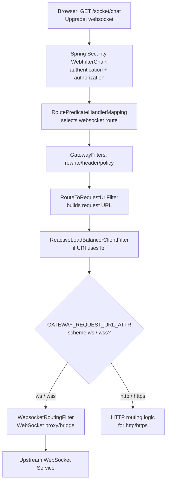

# WebsocketRoutingFilter and the Connection Upgrade Process

## Lesson Objectives

In the **WebSocket and Streaming** chapter, this lesson explains how **Spring Cloud Gateway Server WebFlux** handles a WebSocket request, from the moment the client sends an HTTP handshake until both sides exchange messages over the upgraded connection. The focus is on **`WebsocketRoutingFilter`**, `ws://`, `wss://`, and `lb:ws://` URIs, filter ordering, **HTTP Upgrade**, and operational differences compared to a standard HTTP request.

After this lesson, you will be able to:

- Describe the WebSocket handshake over **HTTP/1.1 GET** and the meaning of **`101 Switching Protocols`**.
- Distinguish **route matching** from **protocol upgrading**; know that `WebsocketRoutingFilter` runs when the target request URL has scheme `ws` or `wss`.
- Configure WebSocket routes directly, over TLS, and through **Spring Cloud LoadBalancer**.
- Understand Gateway as a **WebSocket proxy/bridge**, managing client–Gateway and Gateway–upstream connections rather than forwarding a single HTTP request with a body.
- Identify the roles of `RouteToRequestUrlFilter`, `ReactiveLoadBalancerClientFilter`, `GatewayFilter`, and `WebsocketRoutingFilter`.
- Secure the handshake with **authentication, authorization, Origin validation, and TLS**, and design connection/message limits.
- Understand the limits of `Retry`, `CircuitBreaker`, `RequestRateLimiter`, and response filters **after HTTP has upgraded**.
- Test handshakes, path rewrites, subprotocols, two-way message delivery, proxy timeouts, reconnects, and connection cleanup.

> **Scope:** Spring Cloud Gateway **Server WebFlux**, Project Reactor, and Reactor Netty; not identical to Gateway Server MVC or HTTP/2 extended CONNECT. Examples below primarily use **WebSocket over HTTP/1.1**. The YAML namespace `spring.cloud.gateway.routes` appears in many Gateway Server WebFlux releases; newer releases moved to `spring.cloud.gateway.server.webflux.routes`. Verify against your project's Spring Boot/Spring Cloud Gateway release train before deploying.

## 1. Why Is WebSocket Different from HTTP Request–Response?

A typical HTTP API follows this model:

```text
Client → GET /api/orders/42 → Gateway → Backend
Client ← 200 JSON          ← Gateway ← Backend

The request completes; the HTTP connection can be reused.
```

WebSocket starts with an **HTTP handshake**, but after upgrading, client and server have a **bidirectional messaging channel** that can stay open for minutes or hours:

```text
Client ── HTTP Upgrade GET ──▶ Gateway ── WebSocket handshake ──▶ Chat Service
Client ◀── 101 Switching Protocols ── Gateway ◀── Upstream handshake

Client ═══ WebSocket frames ══ Gateway ═══ WebSocket frames ══ Chat Service
         continuous bidirectional             continuous bidirectional
```

Business examples:

- Chat, real-time notifications, dashboard synchronization.
- Tracking asynchronous processing progress.
- Interactive data updates pushed proactively by both client and server.
- Games or long-lived interactive sessions.

WebSocket reduces the need for clients to poll constantly, but **does not automatically guarantee** exactly-once delivery, ordering across multiple backend instances, durable event storage, or session resumption after network drops. Those guarantees must be designed at the **application layer**.

### 1.1. Comparing HTTP, SSE, and WebSocket

| Aspect | HTTP request–response | SSE (`text/event-stream`) | WebSocket |
| --- | --- | --- | --- |
| Start | HTTP request | HTTP GET | HTTP upgrade handshake |
| Primary data direction | Request then response | Server → client over response stream | **Bidirectional** |
| Connection | Short-lived or reused keep-alive | One long-lived HTTP response | Long-lived WebSocket channel |
| Primary Gateway routing mechanism | HTTP routing filter | HTTP routing/streaming | **`WebsocketRoutingFilter`** with `ws`/`wss` |
| Recovery after disconnect | Send a new request | Reconnect; can use `Last-Event-ID` | Reconnect + resume via application protocol |
| Load control | RPS, response size | Stream count, bytes/s | Session count, messages/s, bytes/s |

**Do not apply `WebsocketRoutingFilter` to every streaming workload.** SSE still runs over HTTP, while WebSocket uses its own frame protocol after the handshake. gRPC streaming/HTTP/2 does not automatically become WebSocket either.

## 2. WebSocket Handshake over HTTP/1.1

In a browser, the client typically starts with:

```javascript
const socket = new WebSocket("wss://api.example.com/socket/chat");
```

The browser constructs an HTTP/1.1 request with handshake headers. Abbreviated example:

```http
GET /socket/chat HTTP/1.1
Host: api.example.com
Connection: Upgrade
Upgrade: websocket
Sec-WebSocket-Version: 13
Sec-WebSocket-Key: dGhlIHNhbXBsZSBub25jZQ==
Origin: https://app.example.com
```

`Sec-WebSocket-Key` here only illustrates the handshake payload. Real clients generate a valid random nonce; never hardcode a sample key into a real WebSocket client.

If the handshake is valid and the application accepts the connection, the HTTP/1.1 response looks like:

```http
HTTP/1.1 101 Switching Protocols
Upgrade: websocket
Connection: Upgrade
Sec-WebSocket-Accept: <derived-accept-value>
```

After **`101 Switching Protocols`**, the connection does not continue as "one new HTTP request per message." Client and server exchange **WebSocket frames** according to the protocol.

### 2.1. Role of Each Header

| Header | Sender | Meaning |
| --- | --- | --- |
| `Connection: Upgrade` | Client/server per HTTP/1.1 | Signals a protocol switch on the connection |
| `Upgrade: websocket` | Client/server per HTTP/1.1 | Indicates the protocol to switch to |
| `Sec-WebSocket-Version: 13` | Client | Standard WebSocket version per RFC 6455 |
| `Sec-WebSocket-Key` | Client | Handshake nonce; **not an authentication token** |
| `Sec-WebSocket-Accept` | Server | Proves the server understands the handshake, derived from the key |
| `Origin` | Browser | Origin initiating the connection; useful for cross-origin checks |
| `Sec-WebSocket-Protocol` | Client proposes, server picks | Negotiates an application subprotocol, e.g., `chat.v1` |
| `Sec-WebSocket-Extensions` | Both sides negotiate | E.g., compression; use only when both actually support it |
| `Cookie` / `Authorization` | Per client mechanism | Credentials, must be verified by dedicated security policy |

**`Sec-WebSocket-Key` and `Sec-WebSocket-Accept` are not authentication or anti-CSRF mechanisms.** An RFC-compliant handshake can still be initiated by an unauthorized user or a malicious website.

### 2.2. Two Different Types of Checks

A WebSocket connection should be established only when both sets of conditions hold:

1. **Protocol conditions:** valid handshake, proper method/version/headers, no protocol violations.
2. **Application conditions:** caller is authenticated, authorized for the room/channel/tenant, Origin is allowed, and resources have capacity.

A server can reply with **401 Unauthorized**, **403 Forbidden**, or another HTTP error **before sending 101**. Once upgraded, errors are conveyed via close frames or application-protocol messages; you do not send `401` as a new HTTP response over the same WebSocket session.

### 2.3. HTTP/2 Does Not Use `Connection: Upgrade` Directly

The diagram above describes the standard handshake on **HTTP/1.1**. WebSocket over HTTP/2 uses an **extended CONNECT** mechanism in supporting infrastructure, rather than copying `Connection: Upgrade` onto HTTP/2.

**Do not assume** every Spring Cloud Gateway version, proxy, ingress, or client supports WebSocket over HTTP/2 identically. When deploying behind an HTTP/2 front-end, test the entire path; HTTP/1.1 WebSocket upgrade remains the baseline model to master.

## 3. Where Does `WebsocketRoutingFilter` Sit in Gateway?

Gateway Server WebFlux runs multiple steps before forwarding a request upstream:



This is a **logical flow model**, not an exact immutable list of classes/orders across every version. Some Gateway filters/global filters run before or after one another according to `Ordered`; `lb:` is handled via the corresponding URI prefix. Even so, three foundational points apply:

1. **Route matching** decides which route handles the initial HTTP handshake.
2. A **route URL resolution** step builds the target URI, potentially including load balancing.
3. When the target route URL has scheme **`ws` or `wss`**, `WebsocketRoutingFilter` takes over **WebSocket proxying**, rather than standard `NettyRoutingFilter` for HTTP response bodies.

### 3.1. `GATEWAY_REQUEST_URL_ATTR` and Scheme

In Spring Cloud Gateway, routing filters read the target request URL from `ServerWebExchange`, typically via the attribute:

```java
ServerWebExchangeUtils.GATEWAY_REQUEST_URL_ATTR
```

Route:

```yaml
uri: ws://localhost:9001
```

points to a non-TLS WebSocket upstream. Route:

```yaml
uri: wss://socket.internal.example
```

points to a WebSocket upstream over TLS. Route:

```yaml
uri: lb:ws://chat-service
```

combines **service discovery/load balancing** with the WebSocket scheme. Once the load balancer picks a service instance, Gateway handles the resolved WebSocket URI.

**Do not overwrite `GATEWAY_REQUEST_URL_ATTR` from a custom filter** without understanding the routing path, load balancer, and scheme prefixes. An incorrect change can send the request into HTTP routing or an unintended upstream.

### 3.2. Does WebsocketRoutingFilter Automatically "Accept Every GET Upgrade"?

**No.** It is not a default wildcard WebSocket listener endpoint. A request must be **matched to a route by Gateway** and its route URL resolved to a **`ws`/`wss` target**.

For example:

```yaml
uri: http://localhost:9001
```

with `Path=/socket/**` is not equivalent to a `ws://localhost:9001` WebSocket route just because the client sends `Upgrade: websocket`. Use the proper WebSocket scheme when you want Gateway to handle WebSocket.

### 3.3. Why Does Gateway Create Two WebSocket Sessions?

A WebSocket gateway proxy typically consists of **two hops**:

```text
Browser ── WS session A ──▶ Gateway ── WS session B ──▶ Backend
```

Gateway acts as a **WebSocket server** toward the browser and a **WebSocket client** toward the backend. It bridges the bidirectional message streams between the two sessions.

Consequences:

- The two hops have separate **handshakes, timeouts, TLS trust, and subprotocol negotiation**.
- The backend does not need to receive the exact `Sec-WebSocket-Key` the browser sent to Gateway.
- If one hop closes or errors, Gateway must release resources and close/clean up the other hop per its lifecycle.
- Intermediaries such as an ingress/service mesh can add another hop or timeout policy.

Do not treat a WebSocket proxy as blind TCP passthrough or as an ordinary HTTP filter that finishes as soon as status 101 appears.

## 4. Simple WebSocket Routes

### 4.1. Direct Upstream via `ws://`

Suppose a WebSocket echo backend accepts the path:

```text
ws://localhost:9001/chat
```

And the browser connects to Gateway at:

```text
ws://localhost:8080/socket/chat
```

Route:

```yaml
spring:
  cloud:
    gateway:
      routes:
        - id: chat-websocket
          uri: ws://localhost:9001
          predicates:
            - Path=/socket/**
          filters:
            - StripPrefix=1
```

Path flow:

```text
Client  → GET /socket/chat
Gateway → route chat-websocket matched
Filter  → StripPrefix=1
Upstream → WS /chat
```

`StripPrefix=1` removes the leading `/socket` segment; it **does not** alter the HTTP method, Origin, or WebSocket protocol. If the backend already listens at `/socket/chat`, **omit `StripPrefix=1`** so you do not trigger a 404 during handshake.

### 4.2. Direct via `wss://`

When the backend supports TLS:

```yaml
spring:
  cloud:
    gateway:
      routes:
        - id: secure-chat
          uri: wss://chat.internal.example:9443
          predicates:
            - Path=/socket/**
          filters:
            - StripPrefix=1
```

Here, Gateway acts as the **TLS client** of the upstream. You must verify the certificate chain, hostname/SNI, and trust policy. **Never disable certificate verification** just to make WSS connect in production.

### 4.3. `lb:ws://` with Service Discovery

When `chat-service` has multiple instances:

```yaml
spring:
  cloud:
    gateway:
      routes:
        - id: chat-cluster
          uri: lb:ws://chat-service
          predicates:
            - Path=/socket/**
          filters:
            - StripPrefix=1
```

This is the WebSocket URI form with the **`lb:`** prefix commonly supported by Gateway Server WebFlux. The system needs the **Spring Cloud LoadBalancer** dependency and a service instance source (`DiscoveryClient`, configured list, or suitable mechanism).

**Note:** defining the route does not spawn instances, nor does it redistribute an **already established** WebSocket. Load balancing primarily decides the upstream instance when establishing a new connection.

### 4.4. Choosing the Version-Appropriate YAML Namespace

The examples above use:

```text
spring.cloud.gateway.routes
```

In newer release lines, route properties live under:

```text
spring.cloud.gateway.server.webflux.routes
```

Do not mix namespaces without checking your release train. If a route fails to load, the WebSocket handshake may return 404 before `WebsocketRoutingFilter` is ever invoked. Always verify **runtime routes** and integration tests rather than only reading YAML.

## 5. Testing Against a Real WebSocket Backend

To understand the mechanics clearly, spin up a **separate WebFlux application** acting as an echo backend. Deploy or run it on `localhost:9001`, a **different port from Gateway**.

### 5.1. WebFlux Backend Echo Handler

Example for **text messages**:

```java
package com.example.chat;

import java.util.Map;

import org.springframework.context.annotation.Bean;
import org.springframework.context.annotation.Configuration;
import org.springframework.web.reactive.HandlerMapping;
import org.springframework.web.reactive.handler.SimpleUrlHandlerMapping;
import org.springframework.web.reactive.socket.WebSocketHandler;
import org.springframework.web.reactive.socket.WebSocketMessage;
import org.springframework.web.reactive.socket.server.support.WebSocketHandlerAdapter;

@Configuration
public class EchoWebSocketConfiguration {

    @Bean
    WebSocketHandler echoHandler() {
        return session -> session.send(
            session.receive()
                .map(WebSocketMessage::getPayloadAsText)
                .map(session::textMessage)
        );
    }

    @Bean
    HandlerMapping webSocketMapping(WebSocketHandler echoHandler) {
        var mapping = new SimpleUrlHandlerMapping();
        mapping.setOrder(-1);
        mapping.setUrlMap(Map.of("/chat", echoHandler));
        return mapping;
    }

    @Bean
    WebSocketHandlerAdapter webSocketHandlerAdapter() {
        return new WebSocketHandlerAdapter();
    }
}
```

The backend application needs appropriate WebFlux dependencies. This is a **text echo demo**, not a multi-user chat server with authorization, history storage, binary handling, heartbeats, or backpressure controls.

`getPayloadAsText()` intentionally reads text. **Do not use this example as-is for binary frames/file uploads** without branching on message types and managing buffer lifecycles. In a real backend, authenticating users/channels and enforcing payload lengths are always the application's responsibility.

### 5.2. Browser Client

When public ingress terminates TLS and Gateway is exposed at `api.example.com`, the frontend can use:

```javascript
const socket = new WebSocket("wss://api.example.com/socket/chat");

socket.addEventListener("open", () => {
  console.log("WebSocket connected");
  socket.send("hello");
});

socket.addEventListener("message", (event) => {
  console.log("Received:", event.data);
});

socket.addEventListener("close", (event) => {
  console.log("Closed:", event.code);
});

socket.addEventListener("error", () => {
  console.error("Connection failed or closed");
});
```

If Gateway routes accurately and the echo backend works, the browser receives `"hello"` from upstream across both WebSocket hops.

**Note:** the browser's `new WebSocket(...)` JavaScript API **does not allow setting an arbitrary `Authorization` header** like `fetch`. Design handshake authentication using a browser-supported model rather than assuming a bearer header can be passed directly in the constructor.

### 5.3. This Code Is Not Production Chat Yet

In a real chat service, the backend needs to:

- Determine who is allowed to join a room.
- Cap message sizes and frequencies.
- Reject invalid payloads and validate frame types.
- Fan out messages to the right subscribers/instances.
- Implement heartbeats, idle policies, and disconnect cleanup.
- Design resume/offline replay if the product requires it.

**Gateway does not provide** these business guarantees automatically just because a WebSocket route works.

## 6. Path, Query String, and Route Predicates During Handshake

The WebSocket route is chosen from the **initial request**, so `Path`, `Host`, `Header`, `Method`, and other route predicates still apply while the handshake is an HTTP request.

For example:

```yaml
spring:
  cloud:
    gateway:
      routes:
        - id: chat-room
          uri: lb:ws://chat-service
          predicates:
            - Host=api.example.com
            - Path=/socket/rooms/**
          filters:
            - RewritePath=/socket/rooms/(?<room>.*), /rooms/$\{room}
```

**YAML note:** the `RewritePath` example contains `${room}`; in Gateway YAML/properties, Spring property placeholder expansion may require escaping `$` per version syntax (commonly written `$\{room}` in the appropriate format). To avoid confusion between regex captures and Spring placeholders, **inspect runtime routes and actual backend URLs**. If an exercise doesn't need regex, `StripPrefix=1` is less error-prone.

If the public path is:

```text
/socket/rooms/42
```

the upstream needs to receive:

```text
/rooms/42
```

so the route rewrite must produce that path **before WebSocket routing**.

### 6.1. Do Not Confuse Handshake Path with Message Payload

Once the connection upgrades, a WebSocket message may contain:

```json
{"type":"JOIN","roomId":"42"}
```

`RewritePath` only rewrites the **HTTP request URI during handshake/routing**; it does not modify `roomId` inside individual WebSocket messages after connecting. Message processing must live in the WebSocket handler/application protocol, not in standard HTTP request body filters.

### 6.2. Query Strings Are Not a Safe Place for Bearer Tokens

Pattern to avoid:

```text
wss://api.example.com/socket/chat?access_token=<long-lived-jwt>
```

Query strings easily leak into:

- Reverse proxy access logs.
- Browser history/monitoring and error reporting.
- Traces and URI analytics dashboards.
- Copied or shared URLs.

When a browser needs auth without custom Authorization headers, consider a **same-origin session cookie with an Origin/CSRF threat model**, or a **short-lived, single-use connection ticket** issued via an authenticated HTTPS endpoint with nonce/audience/expiry verification. Never put long-lived access tokens in query strings; if using one-time tickets, still redact logs and restrict TTL.

## 7. `Sec-WebSocket-Protocol` and Extensions

WebSocket can negotiate an **application subprotocol**. Browser:

```javascript
const socket = new WebSocket(
  "wss://api.example.com/socket/chat",
  ["chat.v1"]
);
```

Handshake:

```http
Sec-WebSocket-Protocol: chat.v1
```

The server may select only a subprotocol from the client's proposed list that matches its policy. On success, the response can contain:

```http
Sec-WebSocket-Protocol: chat.v1
```

### 7.1. Gateway Must Preserve Negotiation Semantics

Because there are **two WebSocket sessions**, Gateway and upstream may participate in two separate handshakes. Verify:

- Which subprotocol list did the client send?
- Does Gateway's `WebsocketRoutingFilter`/WebSocket client forward the list properly upstream?
- Which subprotocol does upstream support and accept?
- Does the client receive the expected `socket.protocol`?
- Does any proxy alter or strip `Sec-WebSocket-Protocol`?

Do not hardcode an arbitrary `Sec-WebSocket-Protocol` value via `SetRequestHeader` to fake negotiation. A value the browser did not propose or the backend does not understand can break the handshake.

**Never use the subprotocol header as storage for long-lived secrets.** Some clients/browsers allow arbitrary strings there, but it is not a safe substitute for an authentication protocol; it can leak into logs, has strict grammar rules, and is meant for negotiation.

### 7.2. Compression Extensions Are Not Automatically "Pass-Through"

`permessage-deflate` and other WebSocket extensions alter framing/compression. Because Gateway is a two-hop proxy/bridge, **do not assume** every extension is negotiated identically end-to-end or that raw frame bytes pass untouched.

For large payloads/compression, verify:

- Compatibility across browser, Gateway WebSocket client/server, and backend.
- Memory/CPU usage and decompressed payload limits.
- `Sec-WebSocket-Extensions` on each hop.
- Compression security when sensitive data and attacker-controlled data share the same context.

## 8. WebSocket Security: Origin Differs from CORS

An important misconception: **browser WebSocket handshakes do not use the same CORS preflight mechanism as a cross-origin `fetch`**. A browser can attempt to open a WebSocket to a cross-origin host; the request carries `Origin` for the server to evaluate.

If an app authenticates via **automatically sent cookies** without checking Origin, a malicious website can open a WebSocket under the victim's session whenever cookie/browser rules permit. This risk is commonly called **Cross-Site WebSocket Hijacking (CSWSH)**.

### 8.1. A CSWSH Scenario

```text
1. User logs in to app.example.com with a session cookie.
2. User visits attacker.example.
3. The malicious page tries new WebSocket("wss://api.example.com/socket/chat").
4. The browser may attach valid cookies depending on cookie policy.
5. If Gateway/backend only checks the cookie without checking Origin/permissions,
   the connection may read data or trigger unintended actions.
```

Do not assume `SameSite` blocks every case: same-site but cross-origin (such as two subdomains), cookie attributes, browser policies, and Domain settings all affect the outcome.

**CORS headers are not a complete WebSocket security policy.** Adding `Access-Control-Allow-Origin` for HTTP routes does not prove browser WebSocket handshakes are Origin-checked.

### 8.2. Explicit Origin Allowlist

For example, for a valid browser client:

```text
https://app.example.com
```

A policy can require handshakes to `/socket/**` to accept only that exact Origin. Comparisons must cover **scheme, hostname, and port** per contract, avoiding logic like:

```text
origin.contains("example.com")
```

since `attacker-example.com` is not an allowed origin. If multiple origins are needed, maintain a reviewed allowlist and never blindly reflect any incoming Origin.

### 8.3. Sample Origin-Check WebFilter

Example for a **browser-only WebSocket endpoint**:

```java
import org.springframework.core.annotation.Order;
import org.springframework.http.HttpStatus;
import org.springframework.stereotype.Component;
import org.springframework.web.server.ServerWebExchange;
import org.springframework.web.server.WebFilter;
import org.springframework.web.server.WebFilterChain;
import reactor.core.publisher.Mono;

@Component
@Order(-100)
public final class BrowserSocketOriginFilter implements WebFilter {

    private static final String TRUSTED_ORIGIN =
        "https://app.example.com";

    @Override
    public Mono<Void> filter(
            ServerWebExchange exchange,
            WebFilterChain chain) {

        String path = exchange.getRequest()
            .getPath().pathWithinApplication().value();

        if (!path.startsWith("/socket/")) {
            return chain.filter(exchange);
        }

        String origin = exchange.getRequest().getHeaders().getOrigin();
        if (!TRUSTED_ORIGIN.equals(origin)) {
            exchange.getResponse().setStatusCode(HttpStatus.FORBIDDEN);
            return exchange.getResponse().setComplete();
        }

        return chain.filter(exchange);
    }
}
```

This example illustrates **Origin control before Gateway routing**, not an entire security policy:

- Suitable only when `/socket/**` is designed for **browsers** that always send Origin.
- Non-browser clients may omit Origin; if you need to support them, create a separate client policy/authentication mechanism, **never** treating a missing Origin as trustworthy.
- `@Order` only expresses relative priority; test ordering with security and other WebFilters on your actual version.
- You still must verify the **authenticated principal** and **room/channel permissions** at the proper layer.
- With multiple virtual hosts, combine Host/Origin allowlists with trusted proxy configuration.

Do not rely on a late custom `GatewayFilter` on a single route as the sole defense for every WebSocket entry point.

## 9. Authentication: Cookies, JWT, and Browser Limitations

Because a WebSocket handshake starts as HTTP, it integrates with **Spring Security WebFlux**. However, how clients carry credentials shapes the design.

| Client type | How credentials are typically sent | Risks/what to check |
| --- | --- | --- |
| Browser with session cookie | Browser sends `Cookie` per Domain/Path/SameSite/Secure | **Origin check**, CSWSH, session validity, room authorization |
| Browser SPA using bearer token in JS | Browser WebSocket API **cannot set arbitrary Authorization headers** | One-time ticket or protected BFF/cookie session |
| Native/mobile WebSocket client | Can set `Authorization: Bearer` depending on library | JWT validation, TLS, token rotation, connection lifecycle |
| Service-to-service WebSocket client | mTLS / OAuth2 client credentials / header policy | Service-level authorization and anti-replay |
| Gateway connecting upstream via `wss://` | Gateway acts as TLS client | Upstream trust chain, SNI, backend auth, header relay |

### 9.1. Spring Security Protecting the Handshake

Example **authorization rule** in WebFlux:

```java
import org.springframework.context.annotation.Bean;
import org.springframework.http.HttpMethod;
import org.springframework.security.config.web.server.ServerHttpSecurity;
import org.springframework.security.web.server.SecurityWebFilterChain;

@Bean
SecurityWebFilterChain gatewaySecurity(ServerHttpSecurity http) {
    return http
        .authorizeExchange(exchanges -> exchanges
            .pathMatchers(HttpMethod.GET, "/socket/**")
                .authenticated()
            .anyExchange().authenticated()
        )
        .build();
}
```

This is a **policy skeleton**, not a complete authentication configuration. You must configure login/sessions, an OAuth2 Resource Server, or an identity provider; without one, `.authenticated()` alone cannot produce an identity.

If browser endpoints use cookies, keep enforcing **Origin**, cookie flags, and resource permissions. If native endpoints use bearer headers, verify issuer/audience/expiry/scope. An authenticated connection still needs **per-room/per-message authorization**; a user might try sending `JOIN room-of-another-tenant` after the handshake.

### 9.2. Default CSRF and GET Handshakes

In many Spring Security setups, CSRF tokens are required for **state-changing** HTTP methods like POST/PUT/DELETE, whereas **HTTP/1.1 WebSocket handshakes use GET**. Therefore, **simply enabling the default CSRF filter does not prove a WebSocket handshake is safe from CSWSH**.

With cookie authentication:

- Enforce Origin allowlists and authentication.
- Optionally use an unpredictable, short-lived connection ticket when the threat model demands it.
- Bind sessions/tenants and enforce permissions on channel subscriptions.
- Do not mistake CORS preflight assumptions for an Origin policy.

### 9.3. Never Put Long-Lived JWTs in URLs or Subprotocols

A short-lived ticket issued over HTTPS:

```text
POST /api/socket-ticket
Authorization: Bearer <access-token>
→ one-time ticket with a very short TTL
```

then used for the handshake per a designed protocol can be a viable option. However:

- The ticket must be **single-use**, bound to the appropriate audience, subject, and scope/room.
- It must not be cached/shared, must be issued over TLS, and must be scrubbed from logs.
- Gateway/backend must validate the ticket **before accepting the connection**.
- If the handshake fails, handle expiry/retries without issuing endlessly replayable tickets.

A system using same-origin session cookies with proper Origin/CSRF protections may also be simpler. No single credential transport mechanism fits every client best.

## 10. `ws://`, `wss://`, and TLS Across Two Hops

When a browser opens:

```text
wss://api.example.com/socket/chat
```

and Gateway routes to:

```text
wss://chat.internal.example/chat
```

there are at least two TLS sessions:

```text
Browser ── WSS/TLS ──▶ Gateway ── WSS/TLS ──▶ Chat Service
```

If an ingress terminates TLS:

```text
Browser ── WSS ──▶ Ingress ── WS or WSS ──▶ Gateway
                                           └─ WSS ──▶ Backend
```

Choose WS or WSS for the **internal hop** according to trust boundaries, network policy, and security requirements. **A client connecting over WSS does not automatically ensure Gateway–backend also uses TLS.**

### 10.1. What to Check

- Is the inbound certificate for `api.example.com` valid, with matching SAN/SNI and not expired?
- Does ingress support HTTP/1.1 Upgrade/WebSocket bridging?
- Is Gateway configured with the **right `ws`/`wss` scheme** on the route?
- When Gateway connects to a WSS upstream, are truststore/CA and hostname verification configured properly?
- Do intermediate proxies enforce an idle timeout shorter than the expected session duration?
- If `Forwarded`/`X-Forwarded-Proto` are used, does Gateway trust metadata only from **trusted proxies**?
- Is there a network path bypassing ingress directly to Gateway or management ports?

**Never disable TLS verification** or trust client-supplied `X-Forwarded-*` headers to work around handshake errors.

### 10.2. Ingress/Proxy Must Support Upgrade

A misconfigured reverse proxy can strip `Upgrade` or `Connection` headers, breaking the HTTP/1.1 WebSocket handshake. However, do not copy another product's proxy settings blindly onto Gateway:

- NGINX has dedicated directives for WebSocket proxy/Upgrade handling.
- Cloud L7 load balancers typically have idle timeout and health check settings for WebSocket.
- Ingress controllers/service meshes may vary in WebSocket support by version and inter-hop protocol.

Verify the request reaching **each hop** and the response on every segment. Never assume a successful HTTP GET 200 proves a WebSocket Upgrade 101 will succeed too.

## 11. Load Balancing: Pick Instance at Connect Time, Never Migrate Open Connections

A route:

```yaml
uri: lb:ws://chat-service
```

can pick one of three instances:

```text
chat-service instance A
chat-service instance B
chat-service instance C
```

Once the handshake succeeds to instance B, the client holds a session pinned to B until the connection closes. **Scaling in or restarting B can drop that connection.** Gateway/LoadBalancer does not "live-migrate" an open WebSocket session over to A with its old state intact.

### 11.1. Are Sticky Sessions Needed?

Stickiness needs depend on application architecture:

- If room/session state lives only in a single instance's RAM, reconnecting to another instance loses state.
- If state uses a shared cache/broker and message routing is distributed, clients can reconnect to another instance and **resubscribe**.
- Sticky routing can reduce instance hopping, but skews load and does not solve node failures completely.

To build multi-pod chat/notifications, design **message brokers, pub/sub, distributed state, presence, event IDs, and replay policies**, not just `lb:` on a Gateway route.

### 11.2. Route Changes While Sessions Exist

If the control plane changes `uri`/route definitions while 10,000 WebSocket connections are open:

- **New** handshakes can pick up the updated route after refresh.
- Already upgraded connections typically stay on their current upstream until close/error/timeout.
- Rolling restarts of Gateway can actively sever long-lived connections.
- Removing/refreshing a route does not guarantee all existing connections close immediately.

Plan **connection draining**, graceful shutdown, maximum session lifetimes, and client reconnect/resume strategies. Exact behavior during deploys/restarts must be tested on your running Gateway/ingress versions.

## 12. Why Do Other GatewayFilters Behave Differently with WebSocket?

The handshake is an HTTP request, whereas post-upgrade traffic consists of WebSocket messages. That boundary matters.

| Component | Useful at handshake? | Processes each WebSocket message by default? |
| --- | --- | --- |
| `Path`/`Host` predicates | Yes: selects initial route | **No** |
| `StripPrefix`/`RewritePath` | Yes: rewrites upstream URI | **No** |
| `AddRequestHeader`/`SetRequestHeader` | Yes: adds/modifies handshake headers per contract | **No** |
| Spring Security WebFilterChain | Yes: auth/authorization before upgrade | **Does not auto-check each message** |
| `RequestRateLimiter` | Can rate-limit handshake/connection attempts | **Does not auto-limit message rate** |
| `CircuitBreaker` | Can affect initial connection per publisher/filter order | **Does not provide per-frame circuit breaking** |
| `Retry` | Can affect some errors before connection completes per policy | **Does not reconnect an upgraded session** |
| `ModifyRequestBody`/`ModifyResponseBody` | Meant for HTTP bodies; use caution around handshakes | **Not a WebSocket frame transformer** |
| HTTP `NettyRoutingFilter` | For HTTP/HTTPS routing | Does not replace `WebsocketRoutingFilter` |

### 12.1. Handshake Limits Do Not Equal Message Limits

`RequestRateLimiter` might allow:

```text
Max 5 handshake requests/minute per user
```

Yet an established connection can send:

```text
10,000 WebSocket messages/second
```

unless the application enforces dedicated **per-message/per-connection limits**. You therefore need:

- Max WebSocket sessions per user/tenant and service-wide.
- Messages/s and bytes/s caps.
- Max frame size and max assembled message size.
- Queue bounds, backpressure, and slow-consumer policies.
- Room subscription limits and message authorization.

Gateway's rate limiter can act as a handshake defense layer, **not a WebSocket message firewall**.

### 12.2. Retry Does Not Recover an Upgraded Session

After a client receives `101 Switching Protocols` and begins sending frames, retrying an HTTP GET inside Gateway will **not automatically rebuild application state**, room subscriptions, sent/received messages, or sequence numbers.

When a connection drops:

1. Client detects `close`/network error.
2. Client waits with jittered backoff and respects a retry budget.
3. Client performs a new handshake and re-authenticates.
4. Client re-subscribes/joins with needed state.
5. If exactly-once-like business semantics are required, use message IDs, acknowledgements, and deduplication in the application.

Never retry failed connections infinitely at high speed; reconnect storms can overwhelm ingress, Gateway, and upstreams.

### 12.3. CircuitBreaker Does Not Replace Per-Connection Timeouts

Circuit breakers evaluate signals from the reactive call they wrap. With long-lived WebSocket connections, success/failure/timeout semantics differ from short HTTP requests:

- Handshakes can succeed while the socket drops 30 minutes later.
- TimeLimiters sized for HTTP requests rarely fit a WebSocket's **entire lifetime**.
- Route-level circuits cannot detect health per room or frame.
- An HTTP fallback response after `101` cannot substitute for an in-flight message frame.

You typically need separate **handshake error policies**, **connection health metrics**, application heartbeats, and reconnect policies. Do not copy a `CircuitBreaker` config meant for REST GETs onto a WebSocket route without testing its semantics.

## 13. Bidirectionality, Backpressure, and Memory

In Gateway WebFlux, a WebSocket proxy must handle traffic in both directions:

```text
Browser → Gateway → Backend
Backend → Gateway → Browser
```

Both directions can run **simultaneously**. Unlike an HTTP request body with a clear end, a WebSocket session can stay open indefinitely with bursty message rates.

### 13.1. Do Not Block the Event Loop

A custom WebSocket handler or filter **must never** execute:

```java
Thread.sleep(5000);
```

on a Netty event-loop thread to "wait for messages," nor call `Mono.block()` per frame. Doing so stalls all other connections sharing that event loop.

Use non-blocking reactive operators/clients, set timeouts, and bound heavy work. If blocking code is unavoidable, isolate it on a controlled scheduler/bounded worker pool without unbounded queues.

### 13.2. Do Not Collect All Messages into an Unbounded List

Dangerous pattern:

```java
session.receive()
    .map(WebSocketMessage::getPayloadAsText)
    .collectList();
```

A WebSocket connection can stay open for hours, so `collectList()` waits for connection closure while retaining every message in memory. For long-lived streams, process messages incrementally, limit throughput, and avoid retaining arbitrary data.

### 13.3. Slowness in One Direction Builds Backlogs

If the backend pushes 1,000 messages/s while the browser can only read/decode 100 messages/s, queues can grow rapidly. You need:

- Bounded buffers/queues or a policy to drop non-critical events.
- Reactive pipeline backpressure without spawning uncoordinated `subscribe()` calls.
- Per-connection bytes/message caps.
- Disconnecting slow consumers once thresholds are breached per contract.
- Metrics for queue length, send latency, bytes, and cancellations.

Never claim that "using Reactor automatically prevents OOM." Backpressure only works when every stage of the pipeline, buffering, and network producer honors it.

### 13.4. Frame and JSON Payload Limits

A malicious client can send oversized frames or logical messages. Enforce limits on:

```text
max frame payload
max assembled message
max JSON nesting
max decompressed payload
max messages / second
max concurrent sessions
```

Limits can exist at the browser/client, ingress, Gateway WebSocket stack, and backend. Do not rely solely on `spring.codec.max-in-memory-size` for HTTP JSON decoding and assume WebSocket frames are fully bounded; WebSocket codecs/frame options have their own runtime settings.

## 14. Heartbeat, Idle Timeout, and Connection Close

WebSocket supports control frames such as **PING**, **PONG**, and **CLOSE**. Applications can also send **message-level** heartbeats, for example:

```json
{"type":"heartbeat","ts":"..."}
```

These two mechanisms are not identical. The browser JavaScript WebSocket API does not expose arbitrary PING frame sending, so browser apps often use message-level heartbeats checked by the server.

### 14.1. Idle Timeouts Usually Exist at Multiple Hops

```text
Browser
  ↓
Public load balancer (idle timeout)
  ↓
Ingress controller (read/idle timeout)
  ↓
Gateway WebSocket client/server
  ↓
Backend WebSocket server (session idle timeout)
```

A single hop with a 60-second idle timeout will close the connection even if every other hop allows 30 minutes. Even when an app "wants to keep connections open forever," operations must align real timeouts and heartbeats.

### 14.2. Close Codes Are Not HTTP Statuses

| WebSocket close code | Common meaning | Notes |
| --- | --- | --- |
| `1000` | Normal closure | Client/server closed intentionally under normal conditions |
| `1001` | Going away | Service shutting down or client leaving session |
| `1002` | Protocol error | WebSocket protocol violation |
| `1008` | Policy violation | E.g., application rejected payload/permissions |
| `1009` | Message too big | Payload exceeded limit |
| `1011` | Server unexpected condition | Server application hit an error |

**Never return `HTTP 503` over an already upgraded WebSocket session** to indicate the backend is busy. After `101`, the application should send a protocol-defined error message or close with an appropriate close code, letting the client reconnect.

Not every close event reaches the browser with a helpful close code/description. On sudden network drops, the client may see an abnormal closure with no clear HTTP error handshake.

### 14.3. Reconnect Logic Must Protect the Server

A simple client:

```javascript
let attempt = 0;
let socket;

function connect() {
  socket = new WebSocket("wss://api.example.com/socket/chat");

  socket.addEventListener("open", () => {
    attempt = 0;
  });

  socket.addEventListener("close", () => {
    attempt = Math.min(attempt + 1, 6);
    const capMs = Math.min(30000, 500 * (2 ** attempt));
    const delayMs = Math.random() * capMs;
    setTimeout(connect, delayMs);
  });
}

connect();
```

This **illustrates backoff with jitter** only; it omits stopping on user logout, checking network connectivity, application state, max total attempts, refreshing tickets, or resending/resubscribing messages. In production, prevent opening duplicate `WebSocket` instances, stop reconnecting when the app no longer needs the socket, and handle `1008`/auth failures differently from transient network drops.

## 15. Observability for WebSocket Gateway

For an HTTP API, "request finished in 200ms" is meaningful. For WebSocket, the handshake may take tens of milliseconds while **the connection stays open for 30 minutes**.

Separate at least:

1. **Handshake attempts:** connection-initiation requests, statuses `101`, `401`, `403`, `404`, `502`, timeouts.
2. **Active sessions:** open connections per route and Gateway replica.
3. **Message/traffic metrics:** messages/s, bytes/s per direction, frame sizes, and slow consumers.
4. **Lifecycle:** connection duration, close codes, idle timeouts, cancellations, reconnect rate.
5. **Upstream health:** connections per backend instance, connect failures, and load balancing.

| Metric/signal | Helps answer |
| --- | --- |
| Handshake success ratio | How many clients receive 101 properly? |
| Handshake latency p95/p99 | Is Gateway/WS upstream upgrade slow? |
| Active WS sessions | How many open connections are on each pod? |
| WS sessions per tenant/route | Is anyone abusing connections? |
| Upstream connect failures | DNS/LB/TLS/port issues or dead service? |
| Frame/message rates | Is a connection flooding data? |
| Bytes inbound/outbound | Network and payload pressure |
| Close reasons/codes | Normal disconnects or policy/errors? |
| Reconnect attempts | Is there a reconnect storm after a rollout? |
| JVM heap/direct memory/FDs | Are socket buffers and file descriptors under pressure? |

### 15.1. Avoid High Cardinality and Data Leaks

Safe logs can look like:

```text
route=chat-websocket outcome=upgrade-success status=101
upstreamService=chat-service traceId=<trusted-trace-id>
```

or:

```text
route=chat-websocket phase=close closeCode=1001
durationSeconds=1800
```

Never log:

```text
Cookie: SESSION=...
Authorization: Bearer ...
?ticket=<secret>
messageBody={"privateChat":"..."}
```

Never place raw user IDs, room IDs, full WebSocket URIs, or tokens into **metric labels**. Use normalized route IDs, upstream service names, status categories, and outcomes.

### 15.2. Do Not Treat Status 101 as "Business Success"

`101` only means the HTTP handshake completed. The backend can close the socket immediately after 101, reject a JOIN command, or fail to deliver messages. Dashboards should therefore distinguish:

```text
handshake-success
authenticated-application-session
subscribed-to-room
message-delivered/acknowledged
connection-closed
```

If the product has a notification delivery SLA, measure **end-to-end message delivery/ack**, not just handshake counts.

## 16. Testing Handshake and Message Forwarding

### 16.1. Test Outside Gateway and Through Gateway

First test the echo backend directly:

```text
ws://localhost:9001/chat
```

Then test the public route:

```text
ws://localhost:8080/socket/chat
```

If upstream does not work directly, do not start by modifying `WebsocketRoutingFilter`. Isolate the layer:

- Backend handshake handler.
- Gateway route matching/path rewrite.
- LoadBalancer/DNS.
- TLS/proxy/ingress.
- Authentication/Origin/CORS confusion.

### 16.2. Use a Real WebSocket Client

A WebSocket CLI tool such as `wscat` or `websocat` (if installed and approved in your organization) can open a connection:

```bash
# Development environment, TLS not yet required.
wscat -c "ws://localhost:8080/socket/chat"
```

Once connected:

```text
> hello
< hello
```

For upstreams requiring a valid browser Origin, CLI tools may need to send a matching Origin per client flags; **do not treat manually passing an Origin via CLI as proof of CSWSH protection**. That only verifies the allowlist policy takes effect; authentication/authorization remains a separate layer.

### 16.3. `curl` Does Not Replace a WebSocket Client

You can use `curl` manually to observe handshake headers/HTTP status on some HTTP/1.1 servers, but it **does not replace a WebSocket client that handles frames, ping/pong, subprotocols, and close lifecycles**. Never run `curl -I` or a plain HTTP GET and conclude the WebSocket route works.

If you must test an RFC 6455 handshake with raw HTTP, you have to construct `Sec-WebSocket-Key`, headers, and proper upgrade; after 101 you also need framing/masking logic. Using a WebSocket client library is far more reliable for integration tests.

### 16.4. End-to-End Test with Reactor WebSocketClient

This is a **test scaffold** using the Reactor Netty WebSocket client; it assumes Gateway and the echo backend are running:

```java
import java.net.URI;

import org.junit.jupiter.api.Test;
import org.springframework.web.reactive.socket.WebSocketMessage;
import org.springframework.web.reactive.socket.client.ReactorNettyWebSocketClient;
import reactor.core.publisher.Mono;
import reactor.test.StepVerifier;

import static org.junit.jupiter.api.Assertions.assertEquals;

class GatewayWebSocketIntegrationTest {

    @Test
    void echoesMessageThroughGateway() {
        var client = new ReactorNettyWebSocketClient();

        Mono<Void> session = client.execute(
            URI.create("ws://localhost:8080/socket/chat"),
            socket -> {
                Mono<Void> send = socket.send(
                    Mono.just(socket.textMessage("hello"))
                );

                Mono<Void> receive = socket.receive()
                    .next()
                    .map(WebSocketMessage::getPayloadAsText)
                    .doOnNext(text -> assertEquals("hello", text))
                    .then();

                return Mono.when(send, receive);
            }
        );

        StepVerifier.create(session)
            .expectComplete()
            .verify(java.time.Duration.ofSeconds(10));
    }
}
```

This snippet is not yet **a standalone runnable suite**: it needs Spring Boot test runtime, Reactor Test on the classpath, a backend stub/WebSocket handler, service discovery or a static URI, security/Origin config, and real test ports. Running it against a simple text echo backend confirms **messages flow in both directions**.

If the test times out or closes abnormally, check both client and server close lifecycles. For multi-message/binary tests, add assertions for ordering, payload integrity, backpressure, and buffer handling.

### 16.5. Required Test Matrix

| Scenario | Expectation |
| --- | --- |
| Valid browser WS handshake | HTTP/1.1 101, WebSocket session opens |
| Backend text echo | Message reaches backend and returns |
| Wrong route path | Does not match; does not forward upstream |
| Wrong `StripPrefix` | Upstream handshake returns proper error, not silently ignored |
| Route URI `http://` instead of `ws://` | Fails to use WebSocket routing properly; fix scheme |
| Upstream not running | Handshake fails cleanly without leaking internal URIs/secrets |
| Inbound WSS, outbound WSS | TLS hostname/certificate verification succeeds |
| Disallowed Origin | Handshake rejected per policy |
| Expired cookie/session | Does not upgrade as a valid user |
| User lacks room permission | Cannot subscribe/receive room data |
| Client proposes unsupported subprotocol | Negotiates per contract or handshake fails |
| Oversized frame | Bounded/closed per policy |
| Client floods messages | Per-message rate/buffer controls take effect |
| Slow browser consumer | No unbounded queue growth |
| Proxy idle timeout | Heartbeat/close/reconnect behave properly |
| Gateway restart | Client reconnects with backoff, without losing auth constraints |
| Backend scale-in | Old session closes; reconnect picks a healthy instance |
| Multiple Gateway replicas | Active sessions and routing work across pods |
| Retry/CircuitBreaker | Does not retry an established session like an HTTP request |
| Tracing/logging | Never records cookies, tokens, chat payloads, or secret queries |

## 17. Troubleshooting Common Issues

### 17.1. Receiving `404 Not Found` When Opening WebSocket

Possible causes:

- `Path`/`Host` predicate did not match.
- Route failed to load due to wrong YAML namespace.
- `StripPrefix` or `RewritePath` produced a URL not matched by the upstream WebSocket handler.
- Backend WebSocket handler only registered `/chat`, while Gateway sent `/socket/chat`.

**Resolution:** inspect runtime routes, pre/post-rewrite paths, and requests hitting the backend stub. Never start by changing TLS/timeouts when the real bug is path routing.

### 17.2. HTTP `400` or Handshake Fails to Upgrade

Possible causes:

- Reverse proxy stripped `Upgrade`, `Connection`, or protocol headers.
- Client sent a plain GET instead of a WebSocket handshake.
- Upstream does not support WebSocket on that port/path.
- Invalid subprotocol/version/handshake.

**Resolution:** use a real WebSocket client, inspect redacted network traces, and test hop by hop. For HTTP/1.1 WebSocket, look for **101** on success, not just 200.

### 17.3. `401` or `403` Before Handshake

Possible causes:

- Session cookie not sent due to Domain/Path/SameSite/Secure.
- JWT rejected or no authentication mechanism configured.
- `Origin` not in allowlist.
- Security chain matched `/socket/**` but lacks permissions.

**Resolution:** inspect the Security WebFilterChain and identify the rejecting source, **without logging tokens/cookies**. If the browser WebSocket API cannot set Authorization, change the auth design instead of loosening rules to `.permitAll()`.

### 17.4. `502/503` or Handshake Timeout

Possible causes:

- `lb:ws://chat-service` has no healthy instances or lacks the LoadBalancer dependency.
- Network/DNS/TLS failure reaching upstream.
- Backend did not respond to the handshake in time, or proxy timed out.
- Route uses `ws` while upstream only serves `wss`, or vice versa.

**Resolution:** test upstream directly, check the selected instance, verify trust chains, inspect exception-categorized logs, and review discovery/health checks.

### 17.5. 101 Succeeds Then Connection Closes Immediately

Possible causes:

- Backend handler threw an error after starting to receive messages.
- Browser sent a protocol/payload unsupported by the backend.
- Origin/auth passed at handshake, but application-level JOIN was rejected.
- Proxy/server idle policy or message size limit.
- One side of the bridge hit an error/cancellation.

**Resolution:** separate handshake success from session close reason; inspect close codes, duration, payload type (without logging sensitive content), and backend error category.

### 17.6. WebSocket Stays Alive for One Minute Then Drops

This often indicates an **idle timeout** at the load balancer, ingress, gateway, or backend, though you should not jump to conclusions from the one-minute mark alone. Check config at every hop, heartbeat traffic, error logs, and client networking. Never raise every timeout to infinity; define a clear session lifetime and reconnect contract.

### 17.7. Only Some Clients Receive Messages

When `lb:ws://` spreads WebSocket connections across multiple chat instances, each client may pin to a different instance. If the backend only broadcasts within a single instance's RAM, users on other instances miss events.

**Resolution:** design a broker/pub-sub/shared state and cross-instance room authorization; never expect Gateway load balancing to handle message fan-out or cross-session stickiness.

### 17.8. Rate Limit Set to 10 RPS Yet Message Floods Still Happen

Gateway's `RequestRateLimiter` may only count **handshake requests**. Once open, a single connection can still send huge message volumes. Enforce rate and payload controls inside the WebSocket application handler or a WebSocket-aware policy layer.

### 17.9. HTTP Retry Configured Yet Connections Do Not Auto-Reconnect

The `Retry` filter does not restore an established WebSocket session after frames have been exchanged. Implement client reconnects, ticket/session handling, resubscribe/replay with message IDs, and backoff. Never use GET retries to fake exactly-once delivery.

## 18. Production Deployment Checklist

| Item | Verification question |
| --- | --- |
| **Gateway edition** | Are we running Server WebFlux with the right config namespace? |
| **Route** | Are `Path`/`Host` predicates, `StripPrefix`/rewrites, and URIs accurate? |
| **Scheme** | `ws://` or `wss://`, and `lb:ws://` when load balancing is needed? |
| **LoadBalancer** | Are service instances and health checks working; tested reconnect across nodes? |
| **Handshake** | Do HTTP/1.1 101 and valid headers pass cleanly through all proxy hops? |
| **Subprotocol** | Is `Sec-WebSocket-Protocol` negotiated properly across browser/Gateway/backend? |
| **Extensions** | Are compression/frame compatibility verified? |
| **Authentication** | Does the handshake have a valid principal with cookie/bearer/ticket matching the trust model? |
| **Origin** | Browser Origin allowlist enforced against CSWSH, without relying on CORS preflight? |
| **Authorization** | Are room/tenant/message permissions checked even after handshake? |
| **TLS** | Inbound/outbound WSS trust/SNI/certificates verified, verification never disabled? |
| **Ingress** | Upgrade supported with proper idle timeouts and connection limits? |
| **Capacity** | Max sessions, message/byte rates, frame size, memory/file descriptors sized? |
| **Backpressure** | Bounded buffers and slow-consumer policy, never blocking Netty? |
| **Heartbeat** | Protocol PING/PONG or app heartbeats tuned for idle policies? |
| **Lifecycle** | Close frames, cancellation, cleanup, draining/restarts, and reconnects handled? |
| **Retry/CircuitBreaker** | Handshake policy distinct from established sessions; no infinite retries? |
| **Observability** | Handshakes, 101/4xx/5xx, active sessions, close codes, reconnects, bytes tracked? |
| **Privacy** | Never logging `Cookie`, `Authorization`, tickets, or message contents? |
| **Tests** | End-to-end tests for text/binary, auth/Origin, LB, idle, multi-pod, and reconnect? |

## 19. Practice Exercises with Answers

### Scenario

A Gateway has the route:

```yaml
spring:
  cloud:
    gateway:
      routes:
        - id: notifications-ws
          uri: lb:ws://notification-service
          predicates:
            - Path=/socket/**
          filters:
            - StripPrefix=1
```

Browser:

```javascript
const ws = new WebSocket(
  "wss://api.example.com/socket/notifications"
);
```

Backend accepts WebSocket at:

```text
ws://<selected-notification-instance>/notifications
```

**Questions:**

1. Which HTTP method does the browser use for the HTTP/1.1 handshake?
2. Which status indicates the HTTP/1.1 Upgrade succeeded?
3. Is `WebsocketRoutingFilter` triggered by the `Path` predicate or by the target URL scheme?
4. Does `uri: lb:ws://notification-service` automatically move an already open connection to another instance if a node dies?
5. What path does `StripPrefix=1` turn `/socket/notifications` into?
6. Can the browser `new WebSocket()` set `Authorization: Bearer` directly like `fetch`?
7. Does a CORS `allowedOrigins` configuration for REST GETs automatically prevent CSWSH?
8. Why isn't an `HttpOnly` cookie enough to stop a malicious website from opening a socket?
9. If Gateway `RequestRateLimiter` allows 5 handshakes/minute, does it automatically stop a user from sending 1,000 messages/second?
10. If the backend returns HTTP 200 instead of 101 for the handshake, can the WebSocket session be considered open?
11. Once 101 succeeds and the stream later breaks, can an HTTP 503 be sent over that same session?
12. With three notification-service pods, what does the backend need in order to broadcast messages across instances?
13. Why must you test ingress idle timeouts even if the backend has heartbeats?
14. Does the `Retry` GatewayFilter automatically restore subscribed rooms after a disconnect?
15. Is a dashboard counting successful 101 responses enough to prove messages reached recipients?

**Answers:**

1. **GET** with valid `Upgrade` and `Connection` headers over HTTP/1.1.
2. **`101 Switching Protocols`**.
3. `Path` selects the **route**; the **`ws`/`wss` scheme on the target request URL** triggers WebSocket routing execution.
4. **No.** Load balancing chooses an upstream for a new session; an already open session does not migrate with state.
5. **`/notifications`**.
6. **No.** The browser WebSocket API provides no way to attach arbitrary Authorization headers.
7. **No.** WebSocket does not use fetch-style CORS preflight; explicit Origin validation is required.
8. `HttpOnly` prevents JS from reading the cookie, but the browser can still **send the cookie automatically** per policy; Origin validation and auth/authorization are required.
9. **No.** Handshake rate and per-message rate are two different quantities.
10. **No.** A valid HTTP/1.1 WebSocket handshake requires 101 and matching handshake headers.
11. **No.** After upgrade, errors use WebSocket message/close semantics rather than starting a new HTTP response.
12. **A broker/pub-sub/shared state** and appropriate subscribe/delivery protocol; Gateway LB does not broadcast.
13. Because an intermediate hop may close idle sockets under its own policy; heartbeats must match both the network and session lifecycle.
14. **No.** Client/application logic must reconnect, re-authenticate, and resubscribe/replay as needed.
15. **No.** You must observe authenticated sessions, message delivery/acks, and close/reconnect metrics.

## Summary

**`WebsocketRoutingFilter`** is the piece that enables **Spring Cloud Gateway Server WebFlux** to route a WebSocket connection to a `ws://` or `wss://` upstream, including `lb:ws://` cases resolved via service discovery/LoadBalancer. The HTTP/1.1 handshake starts with a GET carrying `Upgrade: websocket` and returns **`101 Switching Protocols`** upon success; from that point onward, traffic consists of bidirectional WebSocket frames rather than standard HTTP request–response exchanges.

A working route needs more than `Path` and a URI: you must verify **path rewrites, protocol headers/subprotocols, per-hop TLS, Origin validation, authentication, authorization, idle timeouts, capacity, backpressure, and reconnect lifecycles**. HTTP-centric mechanisms like `Retry`, `CircuitBreaker`, and `RequestRateLimiter` must be evaluated against the **handshake**, never assumed to guard or recover individual messages on an established session. Combining these controls with monitoring of active connections, close reasons, messages/bytes, and backend health enables Gateway to serve WebSockets reliably and securely in microservices architectures.
