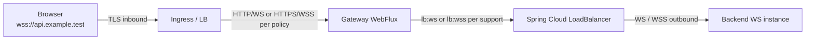
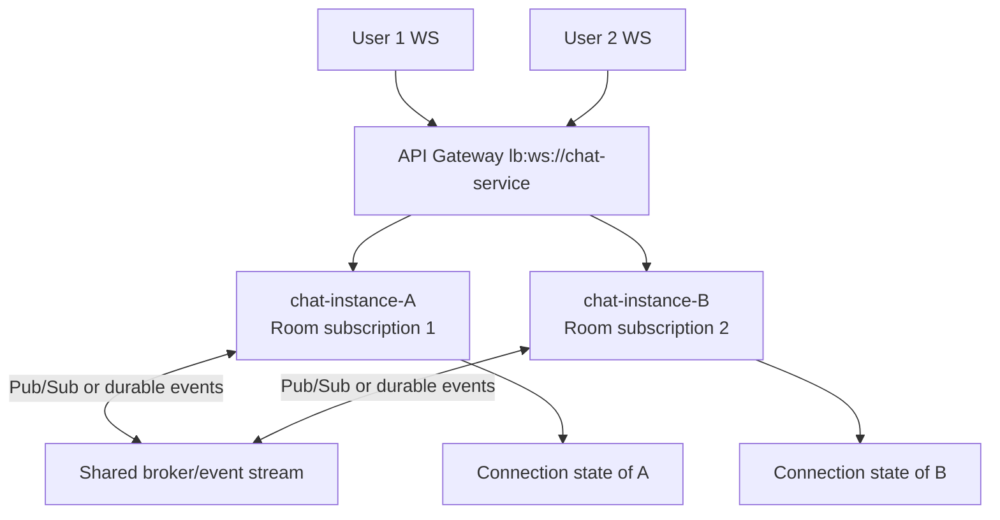

# Combining `lb:ws:` with Service Discovery Where Supported

**Chapter:** WebSocket and Streaming  
**Module:** `SPRING_CLOUD_GATEWAY` — Spring Cloud Gateway

A chat system, real-time dashboard, multiplayer game, or notification service can use **WebSocket** to maintain a bidirectional connection between client and backend. When a WebSocket microservice is scaled into multiple instances, the API Gateway should not require manually editing `ws://host:port` after every scale event. **Spring Cloud Gateway Server WebFlux** supports routes with the **`lb:ws://service-id`** prefix to combine **Spring Cloud LoadBalancer / service discovery** with **WebSocket Routing Filter**.

However, "WebSocket load balancing" is **not like** load balancing individual HTTP requests. WebSocket starts with an **HTTP handshake**, then switches protocols to a long-lived channel carrying many text/binary frames over the same connection. Gateway picks a backend when establishing the connection; subsequent frames stay pinned to that connection and **are not re-distributed per instance**. When an instance dies, the WebSocket session may close; reconnecting, re-authenticating, restoring subscriptions, and avoiding lost/duplicate messages are the responsibility of the client and application architecture.

This lesson clarifies `lb:ws:` syntax, the roles of `RouteToRequestUrlFilter`, `ReactiveLoadBalancerClientFilter`, and `WebsocketRoutingFilter`, how instances are supplied via `SimpleDiscoveryClient` or a service registry, along with a two-backend WebSocket lab. Subsequent sections cover `wss`/TLS, handshake headers, Origin, OAuth2/session/JWT, route predicates, the filter chain, retry/circuit breakers, rate limiting, streaming, SockJS, observability, and troubleshooting.

> **Version scope:** The main lab uses **Spring Cloud Gateway Server WebFlux** and Spring Cloud LoadBalancer. Current WebFlux docs directly document `lb:ws://serviceid`. For `lb:wss://serviceid`, Gateway Server Web MVC, or older release trains, check support and TLS/Upgrade mechanics for your exact version before deploying. Route prefix examples using `spring.cloud.gateway.server.webflux.routes` target modern releases; older projects may use `spring.cloud.gateway.routes`. Do not mix the two config systems arbitrarily.

## 1. Learning Objectives

After this lesson, you will be able to:

1. Distinguish HTTP request-response, Server-Sent Events, WebSocket handshakes, and post-upgrade frames.
2. Read `ws://`, `wss://`, `lb://`, `lb:ws://`, and conditions for `lb:wss://` properly; understand why `lb:ws:` is not a standalone HTTP scheme.
3. Explain the chain **route predicate → route URL → LoadBalancer picks `ServiceInstance` → WebSocket proxy → backend**.
4. Configure Gateway Server WebFlux with the Spring Cloud LoadBalancer dependency and `SimpleDiscoveryClient` supplying two WebSocket instances.
5. Build a WebSocket echo backend with Spring WebFlux, connect via a single Gateway URL, and observe which instance receives the connection.
6. Design reconnects when an instance dies and distinguish **handshake-time load balancing** from **shared session/message state**.
7. Verify HTTP 101, `Upgrade`/`Connection`/`Sec-WebSocket-*` headers, Origin, and TLS/forwarded headers.
8. Apply authentication, authorization, origin allowlists, limits, and observability without leaking tokens or breaking WebSocket upgrades.
9. Diagnose 403/404/502/503, wrong service IDs, missing discovery/LoadBalancer, handshake failures, sticky-session misconceptions, and proxy timeouts.

## 2. How Does WebSocket Differ from HTTP and SSE?

| Aspect | Standard HTTP REST | Server-Sent Events (SSE) | WebSocket |
|---|---|---|---|
| Setup | HTTP request/response | HTTP GET keeping response open | HTTP handshake, typically returning **101 Switching Protocols** over HTTP/1.1 |
| Data direction | Per request, optionally streaming | Server → client continuously | Bidirectional client ↔ server |
| Exchange unit | Requests and responses | Event stream in response body | WebSocket messages/frames |
| Route LoadBalancer | Usually picks backend per request | Picks at start of HTTP stream | Picks at **handshake/new connection time** |
| Lifetime | Usually short, HTTP keep-alive can reuse TCP | Can be long-lived | Can stay open for minutes/hours |
| Backend failure | Request/stream errors or times out | Client must open a new stream | Socket closes/errors; client must reconnect |
| Data recovery | Client can retry HTTP per policy | `Last-Event-ID` if supported by app | Requires application-specific resume/sequence protocol |

**SSE does not use `ws://`.** If a backend serves `text/event-stream` and Gateway proxies it over HTTP/HTTPS, that is HTTP streaming; `WebsocketRoutingFilter` does not handle SSE as WebSocket frames. Likewise, HTTP chunked transfer does not mean WebSocket. This lesson focuses on WebSocket and does not turn every streaming endpoint into `lb:ws://`.

### 2.1. WebSocket Handshake

For WebSocket over HTTP/1.1, the client requests an upgrade:

```http
GET /ws/echo HTTP/1.1
Host: localhost:8080
Connection: Upgrade
Upgrade: websocket
Sec-WebSocket-Version: 13
Sec-WebSocket-Key: <random-base64-key>
Origin: http://localhost:3000
```

If route, security, Origin policy, and backend all accept, the server/proxy returns **101** with matching handshake headers such as `Sec-WebSocket-Accept`. From then on, there is no sequence of REST GET 200 requests per message; data travels in frames over the established connection.

`Sec-WebSocket-Key` is a random handshake challenge, **not** an access token or proof of user login. `Origin` is a browser-supplied signal, **not authentication**: non-browser clients can spoof it. `Connection` and `Upgrade` are hop-by-hop headers; proxies must handle them specifically per the protocol rather than forwarding them blindly through an ordinary HTTP client.

### 2.2. WebSocket Text, Binary, Ping/Pong, and Close

| Type | Purpose | Notes through Gateway |
|---|---|---|
| Text message | Chat, JSON events | Validate schema, size, and per-message send permissions |
| Binary message | Binary/media/control data | Bound size and memory; never auto-deserialize untrusted client data |
| Ping/Pong control frames | Connection-level liveness check | May be handled by client/container; does not mean backend business logic is healthy |
| Close frame/code | Terminate connection | Distinguish graceful close, network loss, backend restart, and policy violation |

An open TCP/WebSocket connection **does not guarantee** the user still has permissions or the backend is still processing business logic. For sensitive applications, check permissions at handshake **and** per message/subscribe/action as appropriate.

## 3. URI Syntax: `ws`, `wss`, and `lb:ws`

In a Gateway route, different URIs carry different meanings:

| URI | Meaning | Requirements |
|---|---|---|
| `ws://localhost:8081` | WebSocket proxy to fixed host/port, no outbound TLS | Backend supports WS |
| `wss://chat.example.test` | TLS-secured WebSocket to fixed host | Valid certificate/trust/hostname |
| `lb://chat-service` | Logical service name for standard HTTP/load balancing | Spring Cloud LoadBalancer + instance source |
| **`lb:ws://chat-service`** | **Load-balanced WebSocket** via service ID `chat-service` | Gateway **Server WebFlux** with WebSocket Routing Filter + LoadBalancer |
| `lb:wss://chat-service` | Combined load balancing and WSS representation usable in supporting versions/configs | Must verify handshake and outbound TLS in practice; do not infer from `ws` |
| `http://localhost:8081` | HTTP proxy route | Not an explicit outbound `ws` WebSocket expression in a WebFlux route |
| `forward:/fallback` | Forward to an internal Gateway handler | Not service discovery or a normal WebSocket tunnel |

**Write it right:** `lb:ws://chat-service` has two colons separating `lb` and `ws`. Do not mistype `lb://ws://chat-service`, `lb:ws:chat-service`, `ws:lb://chat-service`, or `lb://chat-service/ws` expecting Gateway WebFlux to start a WebSocket proxy. Those forms can be parsed differently and miss `WebsocketRoutingFilter`.

### 3.1. Client URL Differs from Route URI

A browser client opens:

```javascript
const socket = new WebSocket("ws://localhost:8080/ws/echo");
```

Gateway configures:

```yaml
uri: lb:ws://echo-service
predicates:
  - Path=/ws/**
filters:
  - StripPrefix=1
```

LoadBalancer finds an instance of service ID `echo-service`, e.g., `localhost:8081`; the backend receives path `/echo` after `StripPrefix=1`. The browser **does not** need to know service discovery DNS or backend ports. In production, frontends on HTTPS pages should normally use `wss://api.example.test/ws/echo` to avoid mixed content and protect cookies/tokens in transit.

### 3.2. `lb:ws://` Does Not Turn an HTTP Endpoint into a WebSocket

If LoadBalancer returns instance `host:8081` whose app only has a `GET /echo` REST controller, the backend has no WebSocket handshake handler. Gateway cannot turn REST 200 into WebSocket 101 by scheme alone. The backend must expose a genuine WebSocket endpoint supporting the required protocol/headers.

### 3.3. `lb://service` and Gateway Web MVC WebSocket Differ

According to current **Gateway Server Web MVC** reference docs, its WebSocket proxy accepts `ws`/`wss` URIs or `http`/`https`/`lb` URIs with an `Upgrade: websocket` request; Web MVC requires `spring-boot-starter-websocket`. That is **documentation for the MVC flavor** and does not mean WebFlux features/syntax behave identically.

When your project uses **Gateway Server WebFlux**, this lesson uses the form directly documented by WebFlux docs: **`lb:ws://serviceid`**. When using **Gateway Server Web MVC**, follow the *WebSockets* reference page for that MVC release train and test handshakes, message forwarding, ping/pong, path filters, and load balancing separately.

## 4. Inside Gateway WebFlux: Which Filters Participate?

```mermaid
sequenceDiagram
    autonumber
    actor C as Browser / WS client
    participant G as Gateway (Path/filters)
    participant LB as ReactiveLoadBalancer
    participant D as DiscoveryClient
    participant S as WS backend instance
    C->>G: GET /ws/echo; Upgrade: websocket
    G->>G: Match Path=/ws/**, StripPrefix
    G->>G: RouteToRequestUrlFilter: lb:ws://echo-service
    G->>G: Remove lb prefix, preserve ws scheme
    G->>LB: Choose ServiceInstance(echo-service)
    LB->>D: List instances / health metadata
    D-->>LB: host:port candidates
    LB-->>G: Selected instance
    G->>S: WebSocket handshake to selected host:port
    S-->>G: 101 Switching Protocols
    G-->>C: 101 Switching Protocols
    loop Open connection
        C->>G: WebSocket message
        G->>S: Forward on established connection
        S->>G: WebSocket response
        G->>C: Forward to same client
    end
```

In Spring Cloud Gateway Server WebFlux's model:

1. **`RoutePredicateHandlerMapping`** finds a route matching Path/Method/Host/Header predicates.
2. **Route filters** can modify paths/headers during the HTTP handshake phase, e.g., `StripPrefix`, `RewritePath`, `AddRequestHeader`.
3. **`RouteToRequestUrlFilter`** resolves the route URI into a request URI stored in `GATEWAY_REQUEST_URL_ATTR`. When the route has an `lb` prefix like `lb:ws://echo-service`, it extracts the prefix into `GATEWAY_SCHEME_PREFIX_ATTR` so downstream filters know to resolve the service.
4. **`ReactiveLoadBalancerClientFilter`** uses `ReactorLoadBalancer` to pick a `ServiceInstance` for ID `echo-service`, then replaces the host/port of the request URI.
5. **`WebsocketRoutingFilter`** receives the resulting URI with scheme `ws`/`wss` and uses Spring WebSocket infrastructure to open the downstream connection.
6. Gateway proxies messages between both ends until the connection closes; **it does not re-select an instance per frame**.

Official documentation describes `lb:ws://` route URLs and this attribute/filter mechanism. Exact execution order also depends on the release train's implementation and config; if a route gets rewritten or returns 404, inspect runtime routes and actual filter ordering rather than just YAML declaration order.

### 4.1. Where Does `GATEWAY_REQUEST_URL_ATTR` Point?

An illustration:

```text
Client request URL:        ws://localhost:8080/ws/echo
Selected route URI:        lb:ws://echo-service
After StripPrefix:         /echo
Scheme prefix attribute:   lb
LB service ID:             echo-service
Selected instance:         localhost:8082
Downstream WS target:      ws://localhost:8082/echo
```

`GATEWAY_REQUEST_URL_ATTR` is internal per-routing state, not a header clients are permitted to set. `ServiceInstance` carries host/port/secure metadata from the discovery source; trust only managed registries and never let clients dictate service IDs outside policy.

### 4.2. When No Instance Is Available

If LoadBalancer cannot obtain a `ServiceInstance` for `echo-service`, Gateway may return **503 Service Unavailable** instead of establishing a WebSocket. This happens **before 101**, completely distinct from an already connected WebSocket session losing its backend.

Do not assume every 503 comes from discovery: it could be the upstream route, a proxy, an overloaded Gateway, or another security/filter rule. Use route ID/service ID logs and discovery health queries to pinpoint the failing layer.

## 5. Lab: Two WebSocket Echo Backends

To observe LoadBalancer picking **a backend per new connection**, run two instances of the same WebFlux application:

| Component | Address | Role |
|---|---|---|
| WebSocket backend A | `ws://localhost:8081/echo` | Receives text and replies `instance-A: ...` |
| WebSocket backend B | `ws://localhost:8082/echo` | Receives text and replies `instance-B: ...` |
| Spring Cloud Gateway WebFlux | `ws://localhost:8080/ws/echo` | Route `lb:ws://echo-service`, selects A or B |

This example **does not need Eureka/Consul**: `SimpleDiscoveryClient` reads the two instances from Gateway properties. This is a quick way to learn discovery/load-balancing behavior; in real systems, instance data normally comes from a service registry/Kubernetes and health/readiness lifecycles.

### 5.1. Create the Spring Boot WebFlux Backend

Create a separate project on Spring Initializr with the **Spring Reactive Web (WebFlux)** dependency. On Spring Boot 3.x, use Java 17+ and the `spring-boot-starter-webflux` module. On another Boot/release train, select the matching supported starter.

Sample Maven dependencies:

```xml
<dependencies>
    <dependency>
        <groupId>org.springframework.boot</groupId>
        <artifactId>spring-boot-starter-webflux</artifactId>
    </dependency>
</dependencies>
```

You **do not need** the Gateway starter or Spring Cloud LoadBalancer inside the **echo backend**; instance selection happens in Gateway. The backend only needs to complete the WebSocket handshake and echo messages.

### 5.2. Backend `application.yml`

```yaml
server:
  port: ${PORT:8081}

spring:
  application:
    name: echo-websocket-backend

demo:
  instance-id: ${INSTANCE_ID:instance-A}
```

The two environment variables `PORT`/`INSTANCE_ID` let you run the same JAR on two ports with distinct markers. In production, you can use a trusted pod name/instance ID, though avoid leaking internal node names or sensitive metadata to clients; here the marker is strictly for the lab.

### 5.3. Startup Class

`WebSocketBackendApplication.java`:

```java
package com.example.wsbackend;

import org.springframework.boot.SpringApplication;
import org.springframework.boot.autoconfigure.SpringBootApplication;

@SpringBootApplication
public class WebSocketBackendApplication {
    public static void main(String[] args) {
        SpringApplication.run(WebSocketBackendApplication.class, args);
    }
}
```

### 5.4. WebSocketHandler and Mapping

`WebSocketConfiguration.java`:

```java
package com.example.wsbackend;

import java.util.Map;
import org.springframework.beans.factory.annotation.Value;
import org.springframework.context.annotation.Bean;
import org.springframework.context.annotation.Configuration;
import org.springframework.web.reactive.HandlerMapping;
import org.springframework.web.reactive.handler.SimpleUrlHandlerMapping;
import org.springframework.web.reactive.socket.WebSocketHandler;
import org.springframework.web.reactive.socket.WebSocketMessage;
import org.springframework.web.reactive.socket.server.support.WebSocketHandlerAdapter;

@Configuration
public class WebSocketConfiguration {

    @Bean
    WebSocketHandler echoHandler(
            @Value("${demo.instance-id}") String instanceId) {
        return session -> session.send(
            session.receive()
                .filter(message ->
                    message.getType() == WebSocketMessage.Type.TEXT)
                .map(message -> session.textMessage(
                    instanceId + ": " + message.getPayloadAsText()))
        );
    }

    @Bean
    HandlerMapping webSocketMapping(WebSocketHandler echoHandler) {
        SimpleUrlHandlerMapping mapping = new SimpleUrlHandlerMapping();
        mapping.setUrlMap(Map.of("/echo", echoHandler));
        mapping.setOrder(-1);
        return mapping;
    }

    @Bean
    WebSocketHandlerAdapter webSocketHandlerAdapter() {
        return new WebSocketHandlerAdapter();
    }
}
```

Explanation:

- `WebSocketHandler` works with `WebSocketSession` and Reactor `Flux`/`Mono`, not Servlet `HttpSession`.
- `session.receive()` emits incoming messages. The filter **accepts text only** and replies with text prefixed by the instance ID.
- `session.send(...)` sends outgoing text over **the same connection**; never call `block()` on the reactive event loop.
- `SimpleUrlHandlerMapping` maps the `/echo` endpoint. This is not an HTTP REST controller `@GetMapping("/echo")`.
- `WebSocketHandlerAdapter` enables WebFlux to execute the handshake/handler properly.
- This code is for lab purposes only: it lacks authentication, quotas, frame-size limits, JSON validation, idle timeouts, a broker, and binary message handling. Do not use it as a production chat service.

**Backpressure note:** Reactor coordinates reactive data streams on the backend, yet WebSocket clients, outbound buffers, and networks still have limits. If a peer is slow while a producer is fast, design flow control, bounded buffering, and session termination; never use unbounded memory to buffer messages.

### 5.5. Run Two Backend Instances

Build once using the Maven Wrapper:

```bash
./mvnw -DskipTests package
```

Then, on macOS/Linux in two separate terminals (substitute the actual JAR filename from your project):

```bash
# Terminal A
PORT=8081 INSTANCE_ID=instance-A \
  java -jar target/echo-websocket-backend.jar

# Terminal B
PORT=8082 INSTANCE_ID=instance-B \
  java -jar target/echo-websocket-backend.jar
```

The command `target/echo-websocket-backend.jar` is an **illustrative name**: Maven typically includes the version, such as `target/echo-websocket-backend-0.0.1-SNAPSHOT.jar`. Use the exact JAR name produced by your build; never guess paths in production scripts.

On Windows PowerShell, use two terminal windows:

```powershell
# Terminal A
$env:PORT = "8081"
$env:INSTANCE_ID = "instance-A"
java -jar .\target\echo-websocket-backend-0.0.1-SNAPSHOT.jar

# Terminal B
$env:PORT = "8082"
$env:INSTANCE_ID = "instance-B"
java -jar .\target\echo-websocket-backend-0.0.1-SNAPSHOT.jar
```

If using IntelliJ IDEA or a process manager, create two run configurations with different `PORT` and `INSTANCE_ID` values; the rule remains **two separate JVMs/processes**, never running `spring-boot:run` twice competing for the same port.

### 5.6. Verify Each Backend Before Gateway

Use a WebSocket client such as `wscat` (Node.js) or an equivalent tool:

```bash
# If wscat is installed:
wscat -c ws://localhost:8081/echo

# Open another session:
wscat -c ws://localhost:8082/echo
```

In session A, type `hello` and send; for example:

```text
> hello
< instance-A: hello
```

In session B:

```text
> hello
< instance-B: hello
```

If no tool is installed, you can run `npx wscat -c ws://localhost:8081/echo` when package downloads are allowed, or use an existing WebSocket client; avoid installing global packages on production servers. If direct backend connections fail, fix the handler mapping, ports, or backend logs before debugging LoadBalancer.

**Do not use a plain cURL GET to simulate a full WebSocket session.** Sending a GET without a proper handshake only checks HTTP reachability inadequately; some cURL builds support different protocol/header options, but cannot substitute for sending/receiving frames with a WebSocket client.

### 5.7. Auxiliary HTTP Endpoint to Isolate Discovery Errors

Add `BackendProbeController.java` to the **backend project**:

```java
package com.example.wsbackend;

import java.util.Map;
import org.springframework.beans.factory.annotation.Value;
import org.springframework.web.bind.annotation.GetMapping;
import org.springframework.web.bind.annotation.RestController;

@RestController
public class BackendProbeController {

    private final String instanceId;

    public BackendProbeController(
            @Value("${demo.instance-id}") String instanceId) {
        this.instanceId = instanceId;
    }

    @GetMapping("/probe")
    public Map<String, String> probe() {
        return Map.of(
            "service", "echo-websocket-backend",
            "instance", instanceId,
            "status", "UP");
    }
}
```

After restarting both backends (if already running), test:

```bash
curl -i http://localhost:8081/probe
curl -i http://localhost:8082/probe
```

This is a **separate HTTP endpoint**; it does not prove the WebSocket handshake will succeed. However, it confirms the right ports/processes are up, and can pair with Gateway's `lb://echo-service` route to distinguish basic discovery from Upgrade/WebSocket issues.

## 6. Configuring Spring Cloud Gateway Server WebFlux and LoadBalancer

Create **a separate Gateway project**; do not embed Spring Cloud Gateway inside the backend just for WebSocket. With Maven and a Spring Cloud BOM compatible with Spring Boot:

```xml
<dependencies>
    <dependency>
        <groupId>org.springframework.cloud</groupId>
        <artifactId>spring-cloud-starter-gateway-server-webflux</artifactId>
    </dependency>
    <dependency>
        <groupId>org.springframework.cloud</groupId>
        <artifactId>spring-cloud-starter-loadbalancer</artifactId>
    </dependency>
    <dependency>
        <groupId>org.springframework.boot</groupId>
        <artifactId>spring-boot-starter-actuator</artifactId>
    </dependency>
</dependencies>
```

**Key point:** `spring-cloud-starter-loadbalancer` provides `ReactorLoadBalancer` for `lb:ws://` routes. A route using a service ID **is insufficient** without LoadBalancer and a `ServiceInstance` source; Gateway cannot turn the name `echo-service` into addresses unless instances are supplied.

### 6.1. Gateway `application.yml` Configuration

```yaml
server:
  port: 8080

spring:
  application:
    name: websocket-lb-gateway-lab

  cloud:
    discovery:
      client:
        simple:
          instances:
            echo-service:
              - uri: http://localhost:8081
              - uri: http://localhost:8082

    gateway:
      server:
        webflux:
          routes:
            - id: websocket-echo-lb
              uri: lb:ws://echo-service
              predicates:
                - Path=/ws/**
                - Method=GET
              filters:
                - StripPrefix=1
                - AddRequestHeader=X-Lab-Gateway, websocket-echo-lb

            - id: echo-probe-http
              uri: lb://echo-service
              predicates:
                - Path=/probe
                - Method=GET

management:
  endpoints:
    web:
      exposure:
        include: health,info
```

Explanation:

- `spring.cloud.discovery.client.simple.instances.echo-service` provides two `ServiceInstance` entries for the same service ID. This is a **static instance list for learning the discovery abstraction**, not dynamic registration/automatic health checks like Eureka/Consul/Kubernetes.
- `uri: lb:ws://echo-service` instructs Gateway to proxy WebSocket through an instance picked by LoadBalancer.
- `Path=/ws/**` is the public path on Gateway; `StripPrefix=1` makes the backend see `/echo` from `/ws/echo`.
- `Method=GET` fits WebSocket handshakes on HTTP/1.1; if using RFC 8441 extended CONNECT over HTTP/2, check support separately rather than assuming this GET route covers all WebSocket-over-HTTP/2 modes.
- `AddRequestHeader=X-Lab-Gateway` helps inspect the HTTP handshake; it has no effect on individual WebSocket frames and is not authentication proof.
- Route `echo-probe-http` uses `lb://echo-service` to call HTTP `/probe`. It is a **separate HTTP route**; getting 200 here only proves service discovery/HTTP LB works.
- You do not need to declare `websocket-routing.enabled: true` when using Gateway Server WebFlux defaults with auto-configured filters; when customizing, check `spring.cloud.gateway.server.webflux.global-filter.websocket-routing.enabled` in your version's configprops table.

**DNS and container warning:** `localhost:8081`/`localhost:8082` only work when Gateway and both backends run **on the same machine**. In Docker Compose/Kubernetes, instance URIs must use hostnames/service addresses reachable by **the Gateway process**. If port `8081` is mapped to the host while the backend lives in another container, `localhost:8081` inside the Gateway container is usually wrong.

### 6.2. Flattened Property Representation

Sometimes Helm, environment variables, or `application.properties` use:

```properties
spring.cloud.discovery.client.simple.instances.echo-service[0].uri=http://localhost:8081
spring.cloud.discovery.client.simple.instances.echo-service[1].uri=http://localhost:8082
```

This expresses the same list as YAML. In production with Kubernetes/Eureka/Consul, never hardcode endpoints in `simple.instances`; the registry/discovery adapter must supply hosts, ports, health/readiness, and metadata. When multiple `DiscoveryClient` sources exist, check composition order and results on your release train.

### 6.3. Run Gateway

Start backends A and B first, then start Gateway:

```bash
./mvnw spring-boot:run
```

On Windows PowerShell:

```powershell
.\mvnw.cmd spring-boot:run
```

If Gateway fails to start, check:

1. Compatible Spring Boot/Spring Cloud BOM and right version of `spring-cloud-starter-gateway-server-webflux`.
2. `spring-cloud-starter-loadbalancer` is present and `spring-boot-starter-web` was not accidentally pulled into Gateway WebFlux.
3. Route property namespace is `spring.cloud.gateway.server.webflux.routes` for modern versions, or the older prefix matching your release train.
4. Correct YAML indentation, and that `lb:ws://echo-service` wasn't mangled by an editor.
5. Gateway port `8080` does not collide with backend ports `8081`/`8082`.

### 6.4. Test HTTP LoadBalancer Before WebSocket

```bash
curl -i http://localhost:8080/probe
curl -i http://localhost:8080/probe
curl -i http://localhost:8080/probe
```

The response body will indicate `instance-A` or `instance-B`. With the default LoadBalancer in some configs, consecutive GETs may alternate near round-robin, though **you must not insist on strict A/B/A alternation**: selection strategies, caching, health, concurrency, and versions can vary. What matters is verifying **both instances can be selected** and the service ID resolves.

**A successful HTTP probe does not guarantee WebSocket works.** HTTP requests use Netty HTTP routing, whereas WebSocket handshakes require `WebsocketRoutingFilter`, backend WS handlers, and ingress Upgrade support.

## 7. Testing `lb:ws://` Through One Gateway URL

### 7.1. Open a New WebSocket Session

```bash
wscat -c ws://localhost:8080/ws/echo
```

Once connected, enter:

```text
> hello
< instance-A: hello
> world
< instance-A: world
> another-message
< instance-A: another-message
```

`instance-A` here is only an **example**: if LoadBalancer chose B, you will see `instance-B`. The key point is that **every message within one WebSocket session stays on the same backend instance**. Gateway does not trigger a new LoadBalancer lookup for each `hello` or `world`.

### 7.2. Open Multiple Independent Sessions

In another terminal:

```bash
wscat -c ws://localhost:8080/ws/echo
```

The new session may be routed to B:

```text
> hello
< instance-B: hello
```

Try closing and opening multiple times, recording whether `instance-A` or `instance-B` is picked. If you only see A in a tiny sample, do not declare LoadBalancer broken: inspect registered service instances, selection strategy, connection count, and health/sticky filters while increasing your test sample size cleanly.

### 7.3. Observe HTTP 101

In a browser, open DevTools → Network → WS, connect the WebSocket, and inspect the handshake:

```http
HTTP/1.1 101 Switching Protocols
Upgrade: websocket
Connection: Upgrade
Sec-WebSocket-Accept: ...
```

Client libraries may display the handshake differently or abstract away the status; the best criteria are **the socket opens, sends/receives frames, and raises no errors**. If you see HTTP 200 instead of 101 for a valid HTTP/1.1 handshake, the request likely hit a REST endpoint/HTTP route or an ingress that does not support upgrades.

### 7.4. Test New Connections When One Backend Stops

In **a lab environment**:

1. Open a connection through Gateway and note which backend instance was selected.
2. Stop **backend B**.
3. Close the old connection (if still open) and open several new connections.
4. Observe that new sessions may land on A or fail when `SimpleDiscoveryClient` still lists instance B.
5. Restart B and repeat.

**Core lesson:** `SimpleDiscoveryClient` holds a static config list; stopping process B **does not automatically remove B from the list**. LoadBalancer can still pick B and fail the handshake. In a real service registry, health/readiness/TTL and discovery refresh reduce the chance of picking an unhealthy instance, though a race window always exists between instance selection and actual connection establishment.

### 7.5. Distinguish "Backend Already Down" from "Backend Died Right After Handshake"

| Scenario | When it happens | What the client observes |
|---|---|---|
| Instance B does not exist in discovery | Before instance selection | LoadBalancer may return 503, no HTTP 101 |
| B is still in registry but port is closed | When Gateway opens outbound connection | Possible 5xx/handshake failure, no successful session |
| B dies **after** HTTP 101 | During an active session | WebSocket close/error, session lost; reconnect picks another instance |
| A is healthy while session is on B | During long-lived connection | Gateway does not migrate B's session frames over to A |
| Registry updates and removes B | After a few seconds/discovery lag | **New connections** avoid B once LoadBalancer sees fresh data |

Never use simple HTTP `retry` to promise recovery of messages already sent in a WebSocket session. Once 101 is received, client and backend need application-level session recovery/replay or sequence/acks if zero event loss is required.

### 7.6. A Path Rewrite Test

Temporarily remove `StripPrefix=1` from the `websocket-echo-lb` route, then connect:

```bash
wscat -c ws://localhost:8080/ws/echo
```

The lab backend only maps `/echo`, so the handshake fails with 404/no upgrade. Restore the filter and retry. This is a **path-to-WebSocket-handler mismatch**, not a LoadBalancer bug. If `Path=/ws/**` matches yet the backend lacks `/ws/echo`, do not add Redis or discovery to fix a bad path.

## 8. Replacing SimpleDiscoveryClient with a Real Service Registry

`SimpleDiscoveryClient` supplies a **static** instance list via config. In production, backends scale and restart dynamically, requiring discovery/registries or platform networking that reflects live state.

### 8.1. Common Instance Sources

| Source | How instances are supplied | Things to watch |
|---|---|---|
| `SimpleDiscoveryClient` | `simple.instances.*` properties | Easy to test; does not track dead instances automatically |
| Eureka | Backends register service ID/host/port + heartbeats; Gateway queries registry | TTL/caching/lease expiration are not instant; valid host/port & networking |
| Consul | Service registration + health checks | Health check status, ACLs, and discovery latency |
| Kubernetes DiscoveryClient | Reads Kubernetes Services/Endpoints/EndpointSlices via adapter | RBAC permissions, namespace, readiness, refresh/watch |
| Custom `DiscoveryClient`/`ServiceInstanceListSupplier` | Supplies instances/metadata from a custom store | Handle concurrency, stale endpoints, and reactive API properly |

To move from the lab to a registry:

1. Add the **matching discovery client** dependency for your Spring Boot/Spring Cloud BOM.
2. Configure backends to register under `echo-service` with hosts/ports **reachable by Gateway**.
3. Configure Gateway to connect to the registry and verify the `ServiceInstance` list.
4. Keep `uri: lb:ws://echo-service` if your flavor/version supports it and the service ID stays unchanged.
5. Remove `simple.instances.echo-service` in real environments to prevent unintended mixed instance sources.
6. Test readiness/draining, connection counts, LoadBalancer ordering, and failover during rolling deployments.

**`@EnableDiscoveryClient` is unnecessary in many modern Spring Cloud configs** just to enable client registration; having the implementation on the classpath usually activates auto-configuration. Still, discovery config and registration must actually work; adding a starter when no service exists in the registry is not enough.

### 8.2. Service IDs Must Match

If the backend registers as `notification-ws` while Gateway's route still declares:

```yaml
uri: lb:ws://echo-service
```

LoadBalancer looks up **`echo-service`**, never inferring `notification-ws` from the URL path. Some registries apply casing/normalization rules to service IDs; verify the exact name returned by discovery instead of guessing from `spring.application.name`.

### 8.3. Kubernetes Service DNS vs. Spring Cloud LoadBalancer

On Kubernetes there are two distinct models:

**Model A — K8s Service balances at the network layer:**

```yaml
uri: ws://echo-service.apps.svc.cluster.local:8081
```

Gateway connects to the **Kubernetes Service DNS name**. Kubernetes/kube-proxy distributes connections across Pods, and the route doesn't necessarily invoke Spring Cloud's `ReactiveLoadBalancerClientFilter`.

**Model B — Spring Cloud LoadBalancer selects a Pod/instance:**

```yaml
uri: lb:ws://echo-service
```

Gateway needs a `DiscoveryClient`/`ServiceInstanceListSupplier` providing the corresponding endpoints. This is **Spring Cloud-layer load balancing**, distinct from K8s Service LB.

**Do not treat reachable service DNS as proof that `lb:ws://` is configured.** If the goal is merely proxying an existing K8s Service, `ws://service-dns` may be sufficient and simpler; if you want Spring Cloud LoadBalancer policies/metadata/zone affinity, add a compatible instance source.

### 8.4. Rolling Deployments Do Not Migrate Connections Automatically

When a backend Pod holding thousands of WebSocket connections needs replacement:

1. Mark the instance **not-ready/draining** so new connections skip it.
2. Ensure discovery/LoadBalancer observes the change before terminating the process when possible.
3. Give existing connections time to finish or send a server-switch notice per your **application protocol**.
4. Close connections with an appropriate close code/reason so clients reconnect with backoff/jitter.
5. Restore room subscriptions and message cursors/sequences via a shared broker if needed.

Reducing replica counts and expecting WebSockets to jump from B to A is wrong: TCP/WebSocket connections are tied to one process for their entire lifetime.

### 8.5. Is LoadBalancer Alone Enough to "Balance Evenly"?

Not necessarily. One backend might hold 2,000 open sessions while another holds 100, yet HTTP request-based round-robin may keep sending roughly equal **new handshakes** to both. It does not automatically measure open connections, messages/second, or outbound buffers.

For large chat systems, consider:

- LoadBalancer policies factoring in **current connections/capacity** if reliable metrics exist.
- Health/readiness checks rejecting new connections when a backend is overloaded.
- Rate limits/quotas on open connection counts and message rates.
- Room/tenant affinity or consistent hashing **if** architecture requires it, paired with rebalancing.
- A pub/sub broker or persistent stream so message state never depends on a single JVM.

## 9. `wss`, TLS, and `ServiceInstance.isSecure` Metadata

WebSocket has two common URI schemes:

- `ws://`: unencrypted WebSocket on the hop in question.
- `wss://`: TLS-secured WebSocket, analogous to HTTPS vs. HTTP.

In an API Gateway architecture:



**Browser → Gateway TLS and Gateway → backend TLS are two separate hops.** If ingress terminates TLS, Gateway may receive internal HTTP/WS; that alone does not determine whether the outbound hop is encrypted. Production normally requires TLS/mTLS across hops crossing trust boundaries.

### 9.1. Scheme Selection and `isSecure`

`ReactiveLoadBalancerClientFilter` documentation notes `ServiceInstance.isSecure` can influence the outbound scheme in LoadBalancer routes. However, **when the route URI carries a scheme prefix like `lb:ws://`**, `GATEWAY_SCHEME_PREFIX_ATTR` gives **the route's scheme priority** over the secure metadata flag in some code paths. Therefore:

- Do not declare `lb:ws://echo-service` assuming `isSecure=true` will silently turn the downstream hop into `wss://`.
- If you need **outbound WSS**, verify `lb:wss://echo-service` support in your **exact Gateway Server WebFlux release train**, configure backend certificates/secure metadata/ports, and test the real handshake.
- If a route uses `ws://` over an untrusted network, that is a security risk even if the client used HTTPS/WSS to ingress.
- If the backend only listens for **non-TLS** WebSocket while Gateway initiates `wss://`, the TLS handshake fails; you cannot fix that by tweaking an HTTP header.

WebFlux docs directly confirm `lb:ws://serviceid`. The `lb:wss://serviceid` variant is **something to verify on your exact release and trust config**, rather than assuming universal WSS service discovery support across all Gateway flavors/versions.

### 9.2. Never Disable Certificate Verification

For outbound WSS, verify the certificate chain, hostname/SNI, CA/truststore, TLS versions, and mTLS if required. If backends use an internal CA or service mesh, configure proper trust rather than using an insecure trust-all manager just because labs run self-signed certs.

An HTTP `502 Bad Gateway` or TLS handshake error can be mistaken for LoadBalancer failing to find an instance. Inspect the logs:

```text
No service instance for echo-service       -> discovery/LB
Connection refused localhost:8082          -> instance picked but port closed
SSLHandshakeException / hostname mismatch  -> TLS/trust/certificate
404 from /ws/echo                          -> path/handler
403 Origin rejected                        -> Origin/security
```

These lines are **illustrative patterns**, not exact exception messages for every framework version.

### 9.3. Ingress/Proxy Must Support WebSocket Upgrade

A proxy/ingress in front of Gateway can:

- Fail to preserve `Upgrade: websocket`/`Connection: Upgrade` properly;
- Close idle connections too early;
- Enforce low message size or connection count caps;
- Not support HTTP/1.1 Upgrade on the chosen upstream hop;
- Misroute hostname/path during TLS termination.

When `ws://localhost:8080/ws/echo` succeeds directly while `wss://api.example.test/ws/echo` via ingress fails, inspect **ingress** before altering `lb:ws://`. The request may never reach Gateway, or headers may be corrupted before route selection.

### 9.4. Forwarded Headers After TLS Termination

When browsers call public HTTPS/WSS while Gateway sees internal HTTP/WS, determine what the public URL is so same-origin checks and security redirects work accurately. Behind a **trusted** reverse proxy, Spring Boot can use:

```yaml
server:
  forward-headers-strategy: framework
```

**Critical security warning:** trust `Forwarded`/`X-Forwarded-*` only when the upstream proxy **strips/overwrites client-supplied headers**. Otherwise, attackers can spoof `X-Forwarded-Proto`/`Host` to manipulate origin checks or URL generation. This property is not a free pass to bypass origin validation or guarantee TLS.

## 10. Origin and Authentication in the WebSocket Handshake

**Browser WebSocket handshakes do not use CORS preflight like standard `fetch`.** The browser WebSocket API sends `Origin`, and Gateway WebFlux enforces its own WebSocket allowed-origins policy. Current Gateway documentation states:

- By default it accepts **same-origin** handshakes or requests **without `Origin`** (typically non-browser clients).
- Cross-origin requests are rejected with **403 Forbidden** unless allowlisted.
- `spring.cloud.gateway.server.webflux.websocket.allowed-origins` or `allowed-origin-patterns` can expand permitted origins.

### 10.1. Allowing a Separate Dev Frontend Origin

Suppose the dev frontend runs at `http://localhost:3000` and Gateway at `http://localhost:8080`. Those two URLs are cross-origin because **their ports differ**; the browser may receive 403 under the default same-origin policy.

In **Gateway WebFlux's `application.yml`**, add:

```yaml
spring:
  cloud:
    gateway:
      server:
        webflux:
          websocket:
            allowed-origins:
              - http://localhost:3000
```

Testing in the browser:

```javascript
const ws = new WebSocket("ws://localhost:8080/ws/echo");
ws.onopen = () => ws.send("hello");
ws.onmessage = (event) => console.log(event.data);
ws.onerror = (event) => console.error("WebSocket error", event);
ws.onclose = (event) =>
  console.log("Closed:", event.code, event.reason);
```

**Note:** The browser JavaScript above must actually run from a page served at `http://localhost:3000`. Running it from another page sends that other page's Origin, not `localhost:3000`.

In the lab, you can use `wscat` to send an explicit Origin:

```bash
# Allowlisted origin.
wscat -c ws://localhost:8080/ws/echo -o http://localhost:3000

# Origin outside allowlist; expected to be rejected.
wscat -c ws://localhost:8080/ws/echo -o http://evil.example.test
```

If your `wscat` version does not support `-o`, use `--origin` or a client capable of setting the Origin header. Do not use a plain HTTP GET to conclude browser origin checking works.

### 10.2. Allowed Origins Is Not a List of Authorized Users

`Origin: http://localhost:3000` only identifies the browser page per browser rules; a non-browser HTTP/WebSocket program can send a forged Origin. Therefore:

- **Allowed origins** restrict which web pages may open connections in browser flows.
- **Authentication** identifies the principal (session, JWT, client certificate...).
- **Authorization** decides whether a user/service may connect, join a room, view data, or send specific message types.
- **Per-message authorization** is still needed when a session stays open a long time while permissions may change or commands have distinct policies.

Never replace authentication with a `Header=Origin,...` route predicate. Predicates only select routes; they do not authenticate users.

### 10.3. The Cross-Site WebSocket Hijacking Trap

In apps using **session cookies**, an attacker page can try opening a WebSocket to Gateway while the browser automatically attaches matching cookies. If the backend only checks cookies without verifying Origin or CSRF-like handshake defenses, cross-site WebSocket hijacking can occur.

Mitigations include:

1. Allow only genuinely trusted frontend origins; never use wildcard `*` when sockets access private read/write data.
2. Protect cookies with `Secure`/`HttpOnly`/`SameSite` properly and enforce HTTPS/WSS.
3. Validate sessions/tokens during the HTTP handshake before returning 101.
4. Enforce authorization per action/subscription/message, not only on the path.
5. Handle session expiration/revocation and user logouts while sockets are open.
6. Cap connection counts/message rates and audit sensitive actions.

**Origin validation supplements but never stops non-browser clients or malicious authenticated users.** Conversely, REST API CORS headers do not automatically govern WebSocket permissions: use the WebSocket handshake policy provided by Gateway WebFlux.

### 10.4. How Do Browsers Send Credentials?

The browser `new WebSocket(url, protocols)` API **does not let JavaScript attach an arbitrary `Authorization: Bearer ...` header** like `fetch`. Common approaches:

| Approach | Pros | Risks/caveats |
|---|---|---|
| Logged-in session cookie via OIDC/BFF | Browser attaches automatically per cookie policy; no token in JS | CSRF-like websocket hijacking, SameSite/Secure, logout/expiry, sticky state |
| Native/mobile WS client setting Authorization header | Clear token contract | Only usable when client library supports it; JWT validation still required |
| Short-lived one-time ticket issued over HTTPS | Keeps long-lived access tokens out of URLs | Ticket must be single-use, short TTL, bound to origin/user/route, anti-replay |
| Token in URL query | Sometimes convenient with browser WS API | **Easily leaks** into access logs, traces, browser history, monitoring, and proxies |
| Token in `Sec-WebSocket-Protocol` | Passes info during handshake | Header is meant for subprotocol negotiation and may be echoed/logged; weigh protocol, library, and security risks |

**Recommendation:** prefer a security-architecture-approved model, usually a browser session/BFF or short-lived HTTPS ticket. Do not stuff long-lived bearer access tokens into `wss://...?...` or a subprotocol string just to "work around" browser API limits.

### 10.5. SecurityWebFilterChain in Gateway

If adding Spring Security to protect WebSocket routes:

```xml
<dependency>
    <groupId>org.springframework.boot</groupId>
    <artifactId>spring-boot-starter-security</artifactId>
</dependency>
```

A **minimal boundary-illustrating** configuration in Gateway WebFlux:

```java
package com.example.gateway;

import org.springframework.context.annotation.Bean;
import org.springframework.context.annotation.Configuration;
import org.springframework.security.config.annotation.web.reactive.EnableWebFluxSecurity;
import org.springframework.security.config.web.server.ServerHttpSecurity;
import org.springframework.security.web.server.SecurityWebFilterChain;

@Configuration
@EnableWebFluxSecurity
public class GatewayWsSecurityConfig {

    @Bean
    SecurityWebFilterChain securityWebFilterChain(ServerHttpSecurity http) {
        return http
            .authorizeExchange(auth -> auth
                .pathMatchers("/probe").permitAll()
                .pathMatchers("/ws/**").authenticated()
                .anyExchange().denyAll())
            .httpBasic(org.springframework.security.config.Customizer
                .withDefaults())
            .build();
    }
}
```

This config **illustrates the policy boundary**; do not add it as-is to the open lab in section 6. With Security enabled above, `/ws/**` requires an authenticated principal; **browser WebSocket APIs do not send arbitrary Basic/Bearer headers**, so a dedicated login/session flow or authenticated native client is needed. For browser OIDC login, configure `oauth2Login`, OAuth2 Client registrations, and WebSession properly; for JWT bearer tokens from native clients, configure `oauth2ResourceServer` and audience/issuer validation. Do not mix everything together without defining an auth contract.

**Do not disable all CSRF/Security just to get HTTP handshakes past 101.** CSRF on state-changing HTTP endpoints, Origin checks, and WebSocket message permissions are distinct boundaries; evaluate them against your threat model and Spring Security integration.

### 10.6. The Backend Needs Protection Too

Even when Gateway authenticates the browser, the WebSocket backend might still be reachable directly if the network permits. Depending on your model:

- The backend validates tokens/audiences/scopes or trusted session context.
- The Gateway→backend hop uses TLS/mTLS and network isolation.
- Internal identity headers are accepted only from a Gateway **authenticated via strong mechanisms**.
- Every join-room/send-message enforces application authorization; never trust client-supplied `X-User-Id` as identity.

`TokenRelay` can forward an access token on the **handshake request** when the Gateway route and OAuth2 Client hold an authorized client, yet **do not assume** the token matches the WebSocket backend's audience. After 101, the filter does not "re-send TokenRelay" on every message. Test compatibility on your release train and make sure the backend validates the right token type.

## 11. Where Do Gateway Filters Affect WebSocket?

For WebFlux WebSocket routes, many route filters execute during the **HTTP exchange leading up to the handshake**; after upgrading, data travels over the WebSocket connection. Do not apply every request-response assumption to every frame.

| Filter/feature | Sensible in WebSocket flow? | Key limitation |
|---|---|---|
| `Path`/`Host`/`Header`/`Method` predicates | Selects route before handshake | Does not re-select per message |
| `StripPrefix`, `RewritePath`, `SetPath` | Adjusts backend WebSocket handshake path | Wrong path typically causes 404/handshake failure |
| `AddRequestHeader`/`RemoveRequestHeader` | Modifies headers before outbound handshake | Does not alter headers inside WebSocket frames |
| `TokenRelay` | Can attach credentials to outbound handshake per OAuth2 client | Does not replace per-message authorization; requires matching audience |
| `RequestRateLimiter` | Can limit **connection attempts** per route/key | Does not auto-limit messages/second after 101 |
| `RequestSize` | Applies to HTTP request body if present | Does not replace WebSocket frame/message size guards |
| `Retry` | Requires extreme caution before handshake | Cannot replay/save frames after connection succeeds |
| `CircuitBreaker` | May help protect against some pre-open errors if supported | Does not migrate sockets when backend dies mid-session |
| `ModifyRequestBody`/`ModifyResponseBody` | For HTTP bodies, not WebSocket messages | Does not transform individual frame payloads |
| `LocalResponseCache` | Caches eligible HTTP responses | Does not cache WebSocket sessions or long-lived frames |
| `SecureHeaders`/CORS | Can affect HTTP handshake headers | Does not replace WebSocket origin policy or message permissions |

### 11.1. Never Strip Protocol Upgrade Headers

A custom filter might accidentally drop:

```http
Upgrade: websocket
Connection: Upgrade
Sec-WebSocket-Key: ...
Sec-WebSocket-Version: 13
Sec-WebSocket-Protocol: ...
```

In plain HTTP, `Connection` and `Upgrade` are hop-by-hop headers; Gateway's WebSocket routing infrastructure is responsible for re-issuing the handshake downstream. **Never use `RemoveRequestHeader=Upgrade` or write arbitrary hop-by-hop cleanup** on a WebSocket route expecting browsers to still get 101. Standard Gateway handles them properly; overly broad HTTP filters can break the handshake.

### 11.2. `Sec-WebSocket-Protocol` Is Not an Arbitrary Header

Client and server can negotiate a subprotocol as a pre-defined message contract (e.g., app protocol version). If Gateway or a proxy drops/mangles `Sec-WebSocket-Protocol`, the handshake may succeed while the app gets the wrong protocol, or the browser may abort negotiation.

**Subprotocol testing** involves:

1. Client proposes a valid protocol list.
2. Backend selects a protocol per contract.
3. Gateway proxies the handshake response with the valid header.
4. Client confirms the selected subprotocol.

Never stuff long-lived access tokens into `Sec-WebSocket-Protocol` without a security design, as the header can appear in logs and negotiation responses.

### 11.3. Compression and `Sec-WebSocket-Extensions`

For WebSocket compression such as `permessage-deflate`, client/backend can negotiate extensions during the handshake. Compression config must match proxy capabilities, payload memory, and CPU; do not simply enable HTTP response compression on a route and assume WebSocket frames get compressed.

`Sec-WebSocket-Extensions`/`Sec-WebSocket-Protocol` are negotiated per protocol; a custom response filter overwriting them can break compatibility. Especially with sensitive data, consider compression-related side channels in your threat model.

## 12. SockJS Fallback: When a Connection Does Not Use WebSocket

Some apps use **SockJS** to support environments where WebSocket is unavailable. SockJS can use WebSocket **or** HTTP-based transports like XHR polling/streaming. Those transports **do not turn into WebSocket frames**, even though client libraries expose a similar API.

Gateway Server WebFlux documentation notes: when using SockJS fallback over standard HTTP, configure an **HTTP route** alongside the **WebSocket route**.

Boundary-illustrating example:

```yaml
spring:
  cloud:
    gateway:
      server:
        webflux:
          routes:
            # SockJS metadata HTTP transport (e.g., /websocket/info).
            - id: sockjs-info-http
              order: -10
              uri: lb://chat-service
              predicates:
                - Path=/websocket/info/**

            # WebSocket transport.
            - id: chat-websocket
              order: 0
              uri: lb:ws://chat-service
              predicates:
                - Path=/websocket/**
```

**This is not yet a complete production SockJS setup.** SockJS uses additional URLs for HTTP transports (XHR send/polling/streaming). If you only add `/websocket/info/**`, remaining HTTP transports can get misrouted to `lb:ws://` and fail. Check **exact URL schemes used by your SockJS client and backend**; build explicit HTTP routes, priorities, and path rewrites sending them via `lb://`/`http://`, while only WebSocket transport goes via `lb:ws://`.

### 12.1. Why Does It Break Easily?

For example, a SockJS client issues in sequence:

```text
GET  /websocket/info            -> HTTP JSON metadata
GET  /websocket/{server}/{session}/websocket -> WebSocket Upgrade
POST /websocket/{server}/{session}/xhr_send  -> HTTP request
GET  /websocket/{server}/{session}/xhr_streaming -> HTTP response stream
```

If every `/websocket/**` path is forwarded as an outbound WebSocket, `xhr_send` gets handled under the wrong protocol. A WebSocket route **fits only** requests genuinely requesting a WebSocket upgrade. Never try to fix it by "forcing every HTTP response to return 101."

### 12.2. SockJS Session Affinity Differs from Native WebSocket

An established WebSocket connection naturally pins to one backend for its lifetime. By contrast, **SockJS XHR polling/sending requests** are **multiple HTTP requests** belonging to one logical SockJS session. If LoadBalancer sends each HTTP request to a different instance, the backend may fail to locate the SockJS session or subscription state.

Therefore, SockJS HTTP fallback often needs:

- Safe sticky routing keyed on session ID/route key;
- Shared session state or a broker serving every instance;
- Sticky-session mechanisms properly supported by framework/ingress for the transport;
- Cookie/tenant isolation reviews if keys use session identities.

**Do not assume** that because `lb:ws://` pins a WebSocket connection to one node, **SockJS HTTP fallback** is automatically sticky too.

## 13. Long-Lived Streaming: Connection Management, Idle Timeouts, and Backpressure

WebSockets can remain connected for minutes or hours. With thousands of sessions, CPU, heap/direct memory, TCP sockets, TLS buffers, and file descriptors become critical resources.

### 13.1. Three Types of Timeouts Not to Confuse

| Timeout/lifetime | Where does it apply? | Misconfiguration risk |
|---|---|---|
| TCP connect/TLS handshake timeout | When Gateway connects to backend | Too short causes false failures; too long hangs requests |
| WebSocket opening handshake timeout | During upgrade negotiation | Can fail before 101, not a data frame issue |
| Idle timeout | Connection silent for a long period | Proxy drops a healthy session lacking ping/pong/app heartbeat |
| Write/send timeout | Peer is slow and outbound buffers fill | Unbounded backpressure, memory growth |
| Authentication/session lifetime | User/token policy | WebSocket session stays open after cookie/token expires |
| Application heartbeat/ack deadline | Business protocol | Fails to detect hung backend business logic while TCP stays alive |

Never take HTTP's `spring.cloud.gateway.server.webflux.httpclient.response-timeout` and assume it **closes every WebSocket connection after N seconds**; behavior depends on the WebSocket client implementation and version. Inspect Netty/server/ingress/backend timeouts independently.

### 13.2. Configuring Frame Payloads and Ping Proxying in Gateway WebFlux

The current Configuration Properties reference lists these keys:

```yaml
spring:
  cloud:
    gateway:
      server:
        webflux:
          httpclient:
            websocket:
              max-frame-payload-length: 65536
              proxy-ping: true
```

- `max-frame-payload-length` bounds the **payload of a single WebSocket frame** in the HTTP client/WebSocket proxy layer; it does not automatically replace all limits on message aggregation, inbound servers, binary decoding, or application JSON sizes.
- `proxy-ping` controls proxying ping frames downstream per Gateway WebFlux config; current configprops list `true` as default. Verify on your running release before basing a heartbeat policy on assumptions.
- **Distinguish Server Web MVC:** MVC docs note that due to Servlet WebSocket API behavior, containers may answer ping with pong locally instead of relaying like WebFlux; never assume identical ping behavior across both flavors.

Size limits for real-time needs. A 1–16 KB text chat differs from large binary telemetry frames or file uploads; WebSocket is not a free substitute for object storage/multipart uploads.

### 13.3. Ping/Pong Does Not Prove the Application Is Healthy

A Pong can be returned by a proxy/container or network layer while the backend thread pool is stalled or failing to process room events. To prove the application works, use **application-level heartbeats** carrying payloads/sequences/acks:

```json
{
  "type": "heartbeat",
  "seq": 12345,
  "sentAt": "2026-11-24T10:00:00Z"
}
```

Backend replies per contract:

```json
{
  "type": "heartbeat_ack",
  "seq": 12345
}
```

This is a **custom application protocol**, not RFC 6455 Ping/Pong frames. When using message heartbeats, enforce authentication, rate limits, and avoid excessive overhead across millions of sessions.

### 13.4. Bounded Client Reconnects

When a connection drops due to a restart or network blip:

```text
CONNECTING
    |
    v
OPEN --> send/receive messages
    |
    v
CLOSED/ERROR
    |
    v
Wait exponential backoff + jitter
    |
    v
Authenticate / CONNECTING / Re-subscribe
```

Never reconnect in an immediate tight loop: after a rolling restart or outage, thousands of clients can trigger a "reconnect storm" overloading Gateway, registry, and backends.

An example application policy:

- First retry after ~1 second plus jitter.
- Increase 2, 4, 8, 16 seconds up to a 30-second cap.
- Once reopened and stable for a threshold, reset backoff.
- On 401/403 or policy violations, do not retry forever; prompt re-login/permission updates.
- On reconnect, send the last received sequence so the server can resume/replay if supported.

These numbers are **policy illustrations**, not Gateway or Spring WebFlux defaults. The server should rate-limit authentication/connection attempts and enforce admission breakers/quotas.

### 13.5. Limiting Total Connections

Suppose:

```text
50,000 concurrent WebSockets
x 16 KiB outbound buffer/session (illustrative)
= ~800 MiB for just one buffer pool,
excluding sockets, TLS, broker subscriptions, objects, and threads
```

Do not treat that illustrative multiplication as real Reactor Netty memory usage; measure under load. The point is that **memory scales with concurrent sessions and buffered frames**, not just RPS.

At Gateway, enforce handshake admission/rate limits, total connection caps (appropriately implemented and observed), outbound buffer/send timeouts, and backend protection while proxying many connections.

## 14. Session Affinity, Message Brokers, and State Sharing

A WebSocket session resides on one selected backend instance. Yet **a sender on A and a recipient on B** still need to communicate. LoadBalancer does not solve this problem.



### 14.1. Each Backend Knows Only Its Own Connections

Suppose user 1 connects via A and user 2 via B. When user 1 sends a message to a room:

1. A verifies the sender and send permissions.
2. A publishes the event to a broker or designed fan-out layer.
3. B receives the event and checks local recipients/subscriptions.
4. B delivers the message over user 2's connection.

`lb:ws://chat-service` alone **does not create steps 2–3**. Without a shared messaging architecture, a backend can only deliver to users connected to **that exact backend**.

### 14.2. Choosing a Broker by Delivery Contract

| Mechanism | Best fit | Limitations |
|---|---|---|
| Redis Pub/Sub | Live events without replay/strong durability guarantees | Offline subscribers lose messages |
| Redis Streams | Events with IDs/consumer model and replay capability | Must design retention/ack/consumer groups |
| Kafka/Pulsar | Durable event streams, per-partition ordering, replay | Operational complexity; no free global ordering |
| Database event log/outbox | Transactional auditing and recovery | Throughput/latency tied to DB and fan-out model |
| STOMP broker relay | Pub/sub protocol for STOMP/Spring Messaging apps | Gateway WS proxy does not create a STOMP broker |

If the system requires **at-least-once delivery**, clients can receive duplicates; use IDs/deduplication. If per-room ordering is required, design partition/event ordering keys. Never treat Redis Pub/Sub as a durable queue just because it runs on Redis.

### 14.3. Reconnecting to a Different Instance

Example:

```text
Before disconnect: user-42 -> instance-A, lastSeenSeq=100
Instance A restarts
After reconnect:   user-42 -> instance-B, resumeFrom=100
Instance B:        re-authenticates + fetches events 101..N (if broker supports replay)
```

Never store all session state solely in A's `HashMap` if B must recover it. Room membership, cursors, and authorization/subscription metadata may need shared storage or client re-submission with backend re-validation.

### 14.4. Are Sticky Sessions Needed?

For an **already open WebSocket connection**, you **do not need sticky load balancing per frame**: the connection is already pinned to the selected backend. Stickiness/affinity only matters when:

- Reconnecting clients must return to a backend holding local state (usually less resilient than shared state).
- SockJS uses multiple HTTP requests within one logical session.
- Systems shard rooms/tenants with deterministic key-based routing.
- Ingress/brokers require affinity with failover policies.

Stickiness does not replace session recovery: when the pinned backend dies, clients must be able to land on another instance and resynchronize state.

## 15. Interactions with Rate Limiting, Retry, and Circuit Breakers

A WebSocket connection starts as an HTTP request, then stays open long after 101 carrying many messages. Hence standard HTTP gateway policies **only protect part of the WebSocket lifecycle**.

### 15.1. RequestRateLimiter Only Governs Admission on the HTTP Route

Suppose a route configures per-user `RequestRateLimiter`:

```text
Client A opens WebSocket -> HTTP GET handshake evaluated against quota
  -> HTTP 101
  -> Sends 10,000 messages over that connection
```

Because the limiter runs in the handshake filter chain, it counts **one connection request**, not individual WebSocket messages. You therefore need two layers of limits:

| Layer | Sample quota | Enforced by |
|---|---|---|
| Gateway handshake/admission | 5 connection attempts/min/user | `RequestRateLimiter`/ingress policy |
| Gateway total connections | 10,000 active sessions/instance | Appropriate resource admission/connection manager |
| Backend application | 30 messages/second/session | Per-session command limiter |
| Backend tenant/room | 1,000 recipients, fan-out caps | Authorization + per-tenant quota |
| Payload | Max text/binary frame/message size | WebSocket server, gateway, codec, and business policy |

These numbers are **illustrative**, not Spring Cloud Gateway defaults. Never use an `X-Forwarded-For` IP that hasn't passed a trusted proxy as a quota key, since it can be spoofed and many users share NATs.

### 15.2. Retry Cannot Replay a WebSocket Session After 101

For idempotent HTTP REST GETs, the `Retry` filter can retry on configured statuses/exceptions. Once WebSocket is open:

- The client may already have sent messages the backend processed;
- The backend may already have sent messages the client hasn't fully received;
- There is no simple HTTP request body to replay for a stream;
- A newly chosen LoadBalancer instance lacks the old connection's room/session state.

Thus, **never treat the `Retry` GatewayFilter as WebSocket reconnect/failover**. If retrying a failed handshake **before** 101, verify filter/version/operation semantics and cap attempts; never rely on it for at-most-once/exactly-once message guarantees.

### 15.3. What Does a Circuit Breaker Protect?

A circuit breaker can reduce **connection attempts** to a failing service if integration evaluates handshake/connection failures. However:

- Breakers do not detect every application error after the connection opens;
- An OPEN breaker does not cut or move already active WebSocket sessions;
- An HTTP route's `fallbackUri` does not turn into a seamless backup WebSocket preserving all frames;
- Dedicated **active connections/close codes** and health signals are needed alongside HTTP 5xx.

If a service has multiple instances, a **service-ID-level** breaker may treat one bad instance's errors as a global outage unless scoped; choosing per-service vs. per-instance breakers affects trade-offs, cardinality, and recovery policies.

### 15.4. Route Cache and Body Filters Are Not a WebSocket Data Cache

`LocalResponseCache` caches eligible HTTP responses per filter rules; it has no contract to store/replay WebSocket messages. `CacheRequestBody`/`ModifyResponseBody` operate on HTTP request/response bodies, not per-frame transforms. If you need message-level compression, validation, filtering, or protocol translation, implement them in a dedicated WebSocket handler/gateway with explicit streaming/backpressure control.

### 15.5. When Does LoadBalancer Pick an Instance?

| Event | Re-selects instance? | Consequence |
|---|---|---|
| Browser opens WebSocket first time | **Yes** | One `ServiceInstance` is chosen for the handshake |
| Browser sends 100 more messages on existing session | **No** | All travel over the current connection |
| Browser opens a second WebSocket | **Yes** | New session may land on another instance |
| Browser reconnects after close | **Yes** | May hit another node; must resume state |
| Registry removes instance A while A's connection is open | Does not auto-migrate | A can continue until closed/drained |
| Gateway Pod restarts | Does not preserve connections | Client reconnects via another Gateway |

## 16. Observability: Counting Handshakes Is Not Enough

Monitoring a Gateway WebSocket is a **connection lifecycle** problem, not just counting HTTP GET `101` responses.

### 16.1. Signals to Collect

| Metric/log | Purpose | Caveat |
|---|---|---|
| Handshake attempts/success/fail per route | Are connections opening properly? | 101 only reflects the handshake |
| HTTP status on failed handshake (403/404/502/503) | Separate origin/auth/path/LB/TLS | Errors can occur before reaching backend |
| Active WebSocket connections per Gateway/backend | Capacity/concurrency/connection skew | Not a standard built-in metric across every version |
| Connection duration histogram | Detect premature drops | Break down by route and close reason class |
| WebSocket close codes | Distinguish normal closure, policy, size, network | Never log raw reasons containing PII |
| Message ingress/egress rate | Actual traffic after 101 | Differs from HTTP request rate |
| Outbound buffered bytes and slow consumer count | Backpressure/memory risk | Depends on connector/runtime metrics |
| Backend instance selection | A/B skew, unhealthy instances | Avoid exposing internal hosts to clients |
| Discovery healthy instance count | Is registry updating properly? | Health/readiness has lag |
| Reconnect attempts/backoff failures | Outages and reconnect storms | Track by group, never label with raw user IDs |
| Broker publish lag/consumer lag | Is data delayed/lost after reconnect? | Depends on Redis Streams/Kafka/STOMP broker |
| TLS handshake/transport errors | Separate WSS from LoadBalancer | Never disable certificate verification |
| Auth/authorization denials and Origin rejects | WebSocket hijacking/cross-origin issues | Never log bearers/cookies/secrets |

### 16.2. Micrometer/Actuator

In Gateway WebFlux, Actuator and Micrometer Observability can expose HTTP gateway request timers/route labels and Netty metrics depending on dependencies/config. However, **you do not automatically get** a metric saying "how many WebSocket connections are open to instance B" simply by enabling Actuator.

In production, instrument Gateway/Netty or the backend:

```text
gateway_ws_handshakes_total{route="echo-ws",outcome="success"}
gateway_ws_connections_active{route="echo-ws"}
backend_ws_connections_active{instance="instance-A"}
backend_ws_messages_total{direction="inbound",type="text"}
backend_ws_close_total{code="1001"}
```

These are **suggested custom metric names**, not metrics generated automatically by Spring Cloud Gateway. When designing labels, use stable route IDs, statuses, and close codes; **never use raw tokens, user IDs, unbounded room IDs, or query URLs** as metric labels.

If using `spring.cloud.gateway.server.webflux.httpclient.websocket.proxy-ping`, verify frame/control behavior per version; a Pong alone does not prove backend business logic is healthy. Combine application heartbeats and broker metrics.

### 16.3. Safe Logs for Handshake and Disconnect

Log (when policy allows):

```text
route=websocket-echo-lb
service=echo-service
selectedInstance=instance-A
phase=handshake
result=accepted
durationMs=...
closeCode=1001
reasonCode=backend_shutdown
```

Never log verbatim:

```text
Cookie: SESSION=...
Authorization: Bearer ...
Sec-WebSocket-Protocol: <contains-secret>
GET /ws/echo?ticket=<secret>
Full message payload containing customer data
```

HTTP wiretap logging can expose handshake credentials and WebSocket payloads. Enable it only in labs with synthetic data for short scopes/durations, never as default production observability.

### 16.4. Tracing Must Understand Long-Lived Connections

An HTTP trace/span during the handshake may finish once the connection upgrades or when the HTTP exchange completes per implementation. Messages sent hours later **do not automatically** receive fresh tracing spans.

If business tracing is needed:

- Define a correlation ID inside the message envelope when needed, without stuffing full user tokens.
- Safely bridge trace context from handshake to session/backend operations.
- Create spans for important commands while avoiding expensive per-heartbeat-frame traces.
- Correlate broker event IDs, sequences, and backend instances for failed publish/deliver paths.

Never treat `traceparent` or a WebSocket connection ID as authentication proof. Those IDs aid observability, not access control.

## 17. Common Errors Table and Identifying the Failing Layer

| Symptom | Common cause | What to check |
|---|---|---|
| `lb:ws://` treated as invalid URI | Wrong syntax or unsupported Gateway flavor/version | Exact `lb:ws://service-id`, Server WebFlux docs |
| `503 Service Unavailable` before 101 | Missing `ServiceInstance` | LoadBalancer starter, discovery, service ID, registry |
| HTTP `/probe` works but WebSocket fails | Discovery healthy, WS handler/Upgrade/Origin broken | `/echo` on backend, route URI, and handshake |
| Direct WS `8081` works, 404 through Gateway | Wrong `Path`/`StripPrefix`/route prefix | `/ws/echo` → `/echo`, route order |
| WS returns 200 instead of 101 | Request processed as plain HTTP | Upgrade headers, `ws` route, `WebsocketRoutingFilter` |
| Cross-origin browser receives 403 | Frontend origin missing from Gateway Origin allowlist | `websocket.allowed-origins`, real browser Origin |
| `wscat` without Origin works, browser fails | Same-origin/Gateway policy mismatch | Browser Origin, ingress forwarded scheme/host |
| Auth cookie present yet WebSocket 401 | Unrecognized session, cookie SameSite/Secure, or Security chain | DevTools handshake Cookie/redirect, OIDC session |
| Browser does not send Authorization header | Browser WebSocket API forbids arbitrary headers | Use cookies/tickets; never put long-lived tokens in query |
| TLS cert error with `lb:wss://` | Backend lacks TLS or wrong trust/SNI/CA | Backend secure port, cert chain, route scheme |
| Direct Gateway works, fails through ingress | Ingress missing Upgrade/idle timeout | Proxy config, HTTP/1.1 Upgrade, TLS termination |
| Some new connections fail after stopping B | `SimpleDiscoveryClient` still lists B | Remove B from config/registry, readiness/health refresh |
| A picked much more often than B | LoadBalancer strategy/instances/capacity | Instance list, selection traces, sample size |
| Early messages still hit A after registry drops A | Old connection still open | Normal connection semantics; drain/reconnect needed |
| Client reconnecting to B loses room state | Session state kept only in A's RAM | Broker/shared state/resubscribe/sequence replay |
| All frames hit the same node | Connection pinned to selected node | Expected behavior, not a broken LB |
| SockJS XHR fallback fails | HTTP transport caught by `lb:ws` route | Separate HTTP routes/SockJS transport patterns |
| WebSocket binary messages ignored | Lab handler filters TEXT only | Implement dedicated binary handler and size guards |
| Connection closes after 60s idle | Proxy/ingress idle timeout or missing heartbeat | Per-layer timeouts, ping/pong/app heartbeat |
| Pongs arrive yet chat messages stop | Proxy/container replies pong or app logic stalled | Application heartbeat, broker/room metrics |
| Outbound memory grows | Slow consumers, unbounded queues, huge frames | Max frame/message, buffers, backpressure |
| HTTP RateLimiter active yet message spam passes | Limiter only covers handshake | Per-message/backend quotas |
| Retry/CircuitBreaker doesn't save open socket | Only applies to handshake/HTTP exchange, never rebinds frames | Client reconnect and application recovery |
| `Authorization` sent to wrong audience service | Wrong `TokenRelay`/filter policy | Resource Server validation, service trust boundary |
| Web MVC ping differs from WebFlux | Different Servlet WS API/proxy implementation | WebSockets page for exact Gateway flavor/release train |
| Route uses `wss` while browser on HTTPS calls `ws` | Mixed content/security policy | Public WSS endpoint, TLS ingress |

### 17.1. Outside-In Debugging Workflow

1. **Test backend directly:** do `ws://localhost:8081/echo` and `ws://localhost:8082/echo` echo text?
2. **Test HTTP discovery:** does `GET http://localhost:8080/probe` reach instances properly?
3. **Verify route:** `Path=/ws/**`, `Method=GET`, `uri: lb:ws://echo-service`, `StripPrefix=1`.
4. **Verify LoadBalancer:** service ID, instance list, hosts/ports reachable from Gateway's environment.
5. **Inspect handshake status:** 101/403/404/502/503, `Origin`/`Upgrade`/`Sec-WebSocket-*`, and auth.
6. **Inspect TLS/ingress:** does direct Gateway work while public URL fails; are certs/forwarded headers right?
7. **Inspect frames:** got 101 yet text doesn't echo? Backend handler/message type/subprotocol/buffering.
8. **Inspect connection lifecycle:** close codes, idle/heartbeat, backend drain, reconnect backoff.
9. **Inspect multi-instance behavior:** selected instance and shared broker/session state; never confuse healthy routing with app-level delivery.
10. **Check safe logs/metrics:** collect reason codes, route IDs, connection durations; never log raw secrets.

Fix every error **at the right layer**. A 404 from wrong `StripPrefix` isn't fixed by adding retries; a 403 Origin isn't fixed by disabling Security; a 503 missing instance isn't fixed by enabling CORS; lost messages on reconnect aren't fixed by adding `lb` again.

## 18. Hands-On Practice Exercises

Run exercises only in a **lab environment** with a mock echo backend and never send real data or real credentials. For each exercise, record **route, service ID, selected instance, handshake outcome, and message result**; never use tokens/cookies/sensitive raw payloads as evidence.

### Exercise 1 — Comparing Fixed `ws://` with `lb:ws://`

Test two routes one after the other in Gateway WebFlux (enable only one route matching `/ws/**` at a time):

```yaml
# Option A: fixed host.
uri: ws://localhost:8081
```

```yaml
# Option B: service discovery + LoadBalancer.
uri: lb:ws://echo-service
```

Open a series of new connections and observe the A/B markers. Explain why option A always hits one host while B can choose across multiple instances.

### Exercise 2 — Testing an Invalid Route URI

In lab config, temporarily change `lb:ws://echo-service` to an invalid URI like `lb://ws://echo-service`. Inspect Gateway startup/route errors and handshake outcomes; restore the valid URI. Record **which layer caught the error** instead of just noting the client failed to connect.

### Exercise 3 — Backend Path

Keep `Path=/ws/**`, change `StripPrefix=1` to `StripPrefix=0` (or remove the filter). The backend only maps `/echo`; test the handshake via `/ws/echo`, then restore. Distinguish **route predicate matching** from **backend `WebSocketHandler` mapping**.

### Exercise 4 — No Instance Available

Temporarily change the route's service ID to `missing-service` with no entry in `SimpleDiscoveryClient`:

```yaml
uri: lb:ws://missing-service
```

Predict the handshake outcome before testing. Inspect Gateway logs/service ID and status; restore `echo-service`. Avoid renaming instances in multiple places simultaneously, which obscures the cause.

### Exercise 5 — One Backend Down

Keep both instances A/B in simple discovery. Stop B, open new connections, and record failures. Why can LoadBalancer still pick B? Switch to discovery with readiness/health in another test setup or update the static list to A only; compare.

### Exercise 6 — One Connection, Many Messages

Open one WebSocket session and send 10 consecutive text messages. Record every prefix; why is there no A/B alternation between messages? Then open a new session and record the new marker.

### Exercise 7 — Browser Origin

Test a browser from `http://localhost:3000` connecting to `ws://localhost:8080/ws/echo` before and after adding:

```yaml
spring:
  cloud:
    gateway:
      server:
        webflux:
          websocket:
            allowed-origins:
              - http://localhost:3000
```

Explain why this is a **WebSocket Origin policy**, not CORS preflight and not authentication.

### Exercise 8 — Protecting with Session/JWT

Design two independent flows:

1. Browser logged in via OIDC at Gateway; WebSocket sends a session cookie in the handshake.
2. Native client sends a bearer access token to Gateway Resource Server, continuing outbound WebSocket per policy.

For each flow, note who authenticates, where credentials appear, whether the backend needs tokens/mTLS, and which layer checks message-send permissions. Do not send real tokens over public labs.

### Exercise 9 — WSS and Trust Boundaries

Draw two diagrams:

```text
Browser wss --> Ingress TLS --> Gateway ws internal
Gateway lb:ws --> backend ws on private trusted network
```

```text
Browser wss --> Ingress TLS --> Gateway secured
Gateway lb:wss --> backend WSS/mTLS (if supported by version)
```

Identify which hops are encrypted, which are not, who verifies hostnames/certificates, and the acceptance criteria for each design. Why shouldn't `isSecure=true` be treated as sufficient when the route URI is fixed as `lb:ws://`?

### Exercise 10 — SockJS HTTP Fallback

List the transport URLs of your SockJS backend and classify them:

| URL type | Actual protocol | Suitable route |
|---|---|---|
| WebSocket handshake | WS/WSS | `lb:ws://` or compatible WebSocket route |
| SockJS info | HTTP GET | `lb://` or HTTP route |
| XHR polling/streaming/send | HTTP request-response/stream | HTTP route, consider affinity |

Why can a single `Path=/websocket/**` + `lb:ws://` route break SockJS fallback? Why might SockJS HTTP transports need sticky sessions?

### Exercise 11 — Testing Idle Timeouts

In a controlled proxy/nginx/ingress lab, configure a short idle timeout, open a silent WebSocket, and record when it closes. Then add ping/pong or application heartbeats as supported by client/backend and compare. Never disable timeouts permanently just to pass a test; pick thresholds matching connection lifetimes and resource budgets.

### Exercise 12 — Two Users on Two Backends

Suppose user1 connects to A and user2 to B. Design message delivery for the same chat room via Redis Pub/Sub, Redis Streams, or Kafka. Address:

- How does A's event reach B?
- Are messages lost if B is offline?
- Which sequence can a client reconnecting to a new node replay from?
- Where is room membership authorization re-verified?
- How do you prevent duplicate messages under at-least-once delivery?

### Exercise 13 — Handshake vs. Message Rate Limiting

Suppose a browser opens 1 socket and sends 1,000 messages/s. If Gateway enforces `RequestRateLimiter` at 5 handshakes/minute, is the backend protected against message floods? Design additional quotas for messages/frames, per-user/tenant, total concurrent sessions, and time windows.

### Exercise 14 — Comparing Gateway WebFlux and Web MVC

Read both version-matched reference pages. Contrast:

- The `spring-boot-starter-websocket` starter in Server Web MVC;
- How MVC routes can use `ws`/`wss` or `http`/`https`/`lb` with Upgrade;
- WebFlux using `lb:ws://` in WebSocket Routing Filter docs;
- Ping/Pong and proxy behavior;
- Which filters run at handshake vs. never processing messages.

Do not copy a WebFlux `RouteLocatorBuilder` Java DSL snippet into MVC `RouterFunction` expecting the same API.

### Exercise 15 — Interpreting Load Distribution Metrics

Suppose after 1,000 connections:

```text
Instance A: 850 active connections
Instance B: 150 active connections
```

Provide at least four hypotheses: instance selection policy, stale discovery, backend readiness, accumulation of long-lived connections, sticky client/reconnect patterns, node capacity, or closed connection counts. Why does HTTP RPS fail to reflect active WebSocket connections?

### Self-Assessment Rubric

| Criterion | Met when |
|---|---|
| Syntax | Writes `lb:ws://echo-service` accurately and distinguishes `ws`/`wss`/`lb` |
| Gateway flavor | Never mixes Server WebFlux and Server Web MVC APIs |
| Service instances | Has a valid `ServiceInstance` source and LoadBalancer starter |
| Backend lab | Both WebSocket handlers on ports 8081/8082 run cleanly |
| Path | `/ws/echo` through Gateway reaches `/echo` on backend |
| Proxy | 101 handshake and frames flow through the same backend |
| On instance death | Never claims open sessions auto-migrate |
| Service discovery | Distinguishes static lists from live registry/readiness |
| TLS | Knows when WSS is required and checks trust/secure metadata |
| Origin/auth | Never substitutes CORS/Origin for authentication |
| Filters | Knows route filters mainly govern the handshake |
| SockJS | Knows HTTP fallback needs separate routes/affinity |
| Real-time state | Knows broker/shared state and reconnect/resume are required |
| Observability | Tracks active connections, messages, close codes, and reconnects |

## 19. Review Questions and Guided Answers

**1. Why does a WebSocket route in Gateway WebFlux use `lb:ws://service-id` instead of only `ws://host`?**  
`lb:ws://` combines **WebSocket routing** with **Spring Cloud LoadBalancer**, allowing Gateway to pick a host/port from a service ID's `ServiceInstance` list instead of hardcoding one backend. It requires the LoadBalancer starter and a real instance source.

**2. Does `lb:ws://echo-service` mean every WebSocket message goes to a different instance?**  
No. LoadBalancer chooses an instance when opening **each new connection**; messages on that connection flow to the chosen backend. Frames are not rebalanced mid-connection.

**3. Will the browser see backend URLs `localhost:8081` or `localhost:8082`?**  
Normally the browser connects only to `ws://localhost:8080/ws/echo` or the corresponding public WSS URL. Gateway resolves the service ID and opens a separate outbound connection. Backend hosts/ports need not be exposed to the frontend.

**4. What dependencies are needed for `lb:ws://` to work in Gateway Server WebFlux?**  
The Gateway WebFlux starter, Spring Cloud LoadBalancer starter, and a discovery/instance source. `SimpleDiscoveryClient` from properties suffices for labs; production typically uses Eureka/Consul/Kubernetes `DiscoveryClient`.

**5. Why might changing `uri: ws://localhost:8081` to `lb:ws://echo-service` return 503?**  
Because `echo-service` has no instances, LoadBalancer/discovery is missing, or the service ID is wrong. Previously `ws://localhost:8081` bypassed service discovery.

**6. What does `StripPrefix=1` on a `Path=/ws/**` route do to `/ws/echo`?**  
It strips the `ws` segment so the `/echo` backend handler receives the right path. Removing the filter sends `/ws/echo`, which the lab backend lacks, causing the handshake to fail.

**7. What is HTTP 101?**  
In WebSocket over HTTP/1.1, `101 Switching Protocols` signals both sides agreed to upgrade from HTTP to WebSocket. Subsequent messages travel as frames rather than per-message 200 responses.

**8. Why can a WebSocket session break when B dies even though A is healthy?**  
The session was bound to B during the handshake. Gateway does not seamlessly move a live TCP/WebSocket stream mid-flight to A; the client must reconnect and recover session/message state per the application protocol.

**9. Does `SimpleDiscoveryClient` automatically remove B when JVM B stops?**  
No. The static properties list keeps B until updated; real registries provide health/readiness/TTL, though still with propagation lag.

**10. Must a WebSocket backend always use Spring WebFlux?**  
No. Backends can use any WebSocket stack implementing a compatible protocol/handshake. The lab uses WebFlux to illustrate reactive `WebSocketHandler`; Gateway Server WebFlux itself determines Gateway's filter/URI behavior.

**11. How do `lb:ws://` and `lb:wss://` differ?**  
`ws` uses unencrypted outbound, while `wss` uses outbound TLS if the Gateway flavor/version supports it and trust/ports match. WebFlux docs directly document `lb:ws://`; never assume every release supports the WSS variant without testing.

**12. When service instance metadata has `isSecure=true` on a `lb:ws://` route, can we assume outbound connections are encrypted?**  
No. With a scheme-prefixed route, Gateway prioritizes the scheme in the route URI in key paths; verify actual outbound scheme/TLS rather than relying solely on metadata.

**13. Does using `wss://` to ingress and internal `ws://` provide end-to-end encryption?**  
No: TLS protects traffic only up to the terminator. The ingress/Gateway/backend segments need network trust policies or dedicated TLS/mTLS if end-to-end encryption in transit is required.

**14. Does `Origin` replace authentication?**  
No. Gateway checks Origin to block cross-origin browser handshakes outside the allowlist, but non-browser HTTP clients can forge that header; session/JWT/mTLS and authorization are still required.

**15. Why does a page at `http://localhost:3000` get 403 when connecting to `ws://localhost:8080`?**  
Different ports make them cross-origin. Gateway WebFlux defaults to same-origin or requests without Origin; add the trusted frontend origin to the allowlist and verify browser cookies/security separately.

**16. Can JavaScript `new WebSocket(...)` pass Bearer Authorization headers?**  
The browser WebSocket API prohibits setting arbitrary HTTP headers. Use a BFF cookie or a suitable short-lived ticket; never carelessly stuff long-lived access tokens into query strings or subprotocols.

**17. Does Gateway's `RequestRateLimiter` cap a WebSocket at 100 messages/second?**  
Not by default. Route filters can rate-limit the handshake. Per-message quotas must be implemented in the WebSocket handler/application or a dedicated message-aware proxy layer.

**18. Does a circuit breaker automatically move an open WebSocket to another backend?**  
No. Breakers can curb failing connection attempts, but they do not migrate running sessions or replay frames.

**19. Why might SockJS HTTP fallback need sticky sessions?**  
Because one logical SockJS session can issue multiple XHR HTTP requests; if each request hits a different instance while sessions are stored locally, the backend cannot find the session state.

**20. Does a WebSocket Pong prove the backend processed business messages?**  
No. Ping/Pong can be answered by a proxy/container depending on flavor; verifying business handler health requires application-level heartbeats/acks and backend metrics.

**21. Why does a chat room across two backends A/B need a broker?**  
Each instance holds only its local connections. Pub/sub/event streams or shared state are needed so messages from users on A reach recipients on B; LoadBalancer does not fan out across rooms.

**22. Should Redis Pub/Sub be used to guarantee zero message loss when clients are offline?**  
No. Redis Pub/Sub is live delivery and drops messages for offline subscribers. For replay/durability, look at Redis Streams/Kafka/persistent event logs paired with sequences/acks.

**23. What should a client send when reconnecting to B after A dies?**  
It should re-authenticate, re-register subscriptions, and if continuity is required, send its last acknowledged sequence/cursor per the application protocol so the server can replay missed events.

**24. Why can HTTP `/probe` work while `ws://.../echo` fails?**  
HTTP proxying/discovery works, yet the WebSocket handler, upgrade headers, Origin, path rewrite, subprotocol, or ingress may still be broken. Both routes take different outbound mechanisms.

**25. Does Gateway Server Web MVC always use the exact same `lb:ws://` syntax as WebFlux?**  
Do not guess. Current Web MVC docs describe WS/WSS or HTTP/HTTPS/LB URIs with Upgrade and require the WebSocket starter; follow the exact flavor and release train.

## 20. Pre-Production Checklist for WebSocket Gateway

- [ ] Confirmed **Gateway Server WebFlux** vs. **Server Web MVC** without mixing route properties or filter DSLs.
- [ ] Selected Spring Boot/Spring Cloud BOM, starters, and property namespaces matching the release train.
- [ ] When using WebFlux `lb:ws://`, confirmed `spring-cloud-starter-loadbalancer` and a working `DiscoveryClient`/`ServiceInstanceListSupplier`.
- [ ] Verified route service ID matches discovery naming and hosts/ports are reachable from **Gateway's network**.
- [ ] Configured health/readiness/draining for WebSocket instances instead of relying on static lists in dynamically scaled production.
- [ ] Verified `Path`/`Method`/`StripPrefix`/`RewritePath` align with the backend WebSocket handler, including queries/subprotocols.
- [ ] Confirmed Gateway/Ingress support Upgrade and the HTTP/WebSocket versions in use.
- [ ] Configured WSS/HTTPS properly on public URLs; chose outbound WS/WSS per network trust without blindly trusting ambiguous `isSecure` flags.
- [ ] Verified TLS certificate chains, hostnames/SNI, truststores, and mTLS (if needed) without insecure trust managers.
- [ ] Trusted forwarded headers only from managed proxies so Origin checks cannot be spoofed via Host/Proto.
- [ ] Restricted `websocket.allowed-origins`/`allowed-origin-patterns` to trusted frontends without wildcards on private data.
- [ ] Enforced clear authentication for browser sessions/OIDC, native bearer tokens, or short-lived tickets instead of relying solely on Origin.
- [ ] Enforced backend authorization, tenant isolation, and per-message/room/action permission checks.
- [ ] Ensured `TokenRelay` (if used) forwards tokens with the right audience and never logs bearers/cookies/query tickets.
- [ ] Set limits on new connections, total concurrent connections, and per-message/message-size quotas.
- [ ] Enforced bounds on inbound/outbound frames, slow consumers, buffers, write timeouts, and backpressure.
- [ ] Tuned heartbeat/ping policies to match the Gateway flavor, plus application heartbeats when measuring business liveness.
- [ ] Implemented reconnect backoff + jitter, auth refresh, re-subscription, and message resume if needed.
- [ ] Deployed a broker/shared state, sequences, idempotency, replay, and tenant room policies for multi-node chat.
- [ ] Separated SockJS HTTP fallback routes with session affinity where needed instead of forcing XHR through WebSocket routes.
- [ ] Scoped Retry/CircuitBreaker/RateLimiter accurately to the **handshake**, not treating them as per-frame recovery.
- [ ] Instrumented connection duration, active sockets, handshake outcomes, close codes, message rates, and selected instances.
- [ ] Kept full Actuator topology private and never ran wiretap on raw credentials/messages in production.
- [ ] Prepared runbooks for 403 Origin, 401 auth, 404 path, 502 TLS/Upgrade, 503 discovery, idle disconnects, and message loss.
- [ ] Tested rolling deploys, backend draining, Gateway restarts, stale discovery, reconnect storms, and quotas.
- [ ] Capacity-tested **concurrent sessions + messages/sec + memory**, not just HTTP requests/sec.

## 21. Summary

**`lb:ws://serviceid` is how Spring Cloud Gateway Server WebFlux combines WebSocket proxying with Spring Cloud LoadBalancer where versions and dependencies support it.** `RouteToRequestUrlFilter` extracts the `lb` prefix, `ReactiveLoadBalancerClientFilter` selects a `ServiceInstance`, and `WebsocketRoutingFilter` forwards the WebSocket handshake and messages to the chosen backend. With `SimpleDiscoveryClient`, you can exercise two backends on `8081`/`8082` without installing Eureka/Consul; in production, a live service registry/readiness probe and network policies must supply healthy instances.

An unbreakable rule: **LoadBalancer picks an instance when opening a new connection, never re-selects per frame, and never auto-migrates a running connection when a backend dies.** For stateful chat/telemetry, applications need a shared broker, per-message authentication/authorization, reconnect/backoff, resume/sequences, and capacity planning. HTTP filters, retries, rate limiters, circuit breakers, caches, and TLS each protect specific layers and never replace the WebSocket application protocol.

Finally, **WebSocket differs from HTTP REST and SSE**, and **Gateway WebFlux differs from Gateway Web MVC** in configuration and proxying mechanics. Choose the right `ws/wss/lb:ws` route URI for your release train, and verify Upgrade/101, service discovery, Origin/cookies/JWT, per-hop TLS, and proxy timeouts before going live.

## Official References

1. [Spring Cloud Gateway Server WebFlux — Global Filters: RouteToRequestUrl, ReactiveLoadBalancerClient, Websocket Routing Filter](https://docs.spring.io/spring-cloud-gateway/reference/spring-cloud-gateway-server-webflux/global-filters.html) — covers `lb:ws://serviceid`, scheme prefixes, websocket routing, and allowed origins.
2. [Spring Cloud Gateway — Configuration Properties](https://docs.spring.io/spring-cloud-gateway/reference/configprops.html) — `websocket.allowed-origins`, `global-filter.websocket-routing.enabled`, `httpclient.websocket.max-frame-payload-length`, and `proxy-ping`.
3. [Spring Cloud Gateway Server WebFlux — Route Predicate Factories](https://docs.spring.io/spring-cloud-gateway/reference/spring-cloud-gateway-server-webflux/request-predicates-factories.html) — `Path`, `Host`, `Method`, `Header`.
4. [Spring Cloud Gateway Server WebFlux — GatewayFilter Factories](https://docs.spring.io/spring-cloud-gateway/reference/spring-cloud-gateway-server-webflux/gatewayfilter-factories.html) — path/header filters, rate limiting, and token relay.
5. [Spring Cloud Gateway Server Web MVC — WebSockets](https://docs.spring.io/spring-cloud-gateway/reference/spring-cloud-gateway-server-webmvc/websockets.html) — MVC WebSocket support, URI/Upgrade, ping/pong, handshake filters, and limits.
6. [Spring Cloud Commons — Common Abstractions: DiscoveryClient, SimpleDiscoveryClient, ServiceInstance](https://docs.spring.io/spring-cloud-commons/reference/spring-cloud-commons/common-abstractions.html).
7. [Spring Cloud LoadBalancer — Reference](https://docs.spring.io/spring-cloud-commons/reference/spring-cloud-commons/loadbalancer.html) — selection policies and `ServiceInstanceListSupplier`.
8. [Spring Framework WebFlux — WebSockets](https://docs.spring.io/spring-framework/reference/web/webflux-websocket.html) — `WebSocketHandler`, `SimpleUrlHandlerMapping`, `WebSocketHandlerAdapter`, client, and backpressure.
9. [Spring Security — WebFlux Security](https://docs.spring.io/spring-security/reference/reactive/configuration/webflux.html) — Reactive `SecurityWebFilterChain`.
10. [Spring Security — Reactive OAuth2 Login](https://docs.spring.io/spring-security/reference/reactive/oauth2/login/index.html) — browser login/session prior to handshake.
11. [RFC 6455 — The WebSocket Protocol](https://www.rfc-editor.org/rfc/rfc6455) — HTTP handshake, framing, control frames, and close codes.
12. [RFC 8441 — Bootstrapping WebSockets with HTTP/2](https://www.rfc-editor.org/rfc/rfc8441) — extended CONNECT, distinct from HTTP/1.1 Upgrade.

> **Version note and lab limits:** Gateway WebFlux documentation gives clear examples for `lb:ws://`, while WSS variants, load-balancer behavior, and resource limits must be checked against your actual Gateway/Spring Cloud release train. The port `8080–8082` examples use WebSocket text echo and a static instance list without a broker, real authentication, TLS, or message replay. Never run the raw lab config against production traffic. This article completes STEP 4 for learning content; it does not replace STEP 6 academic QA, infrastructure integration testing, or a security review.
