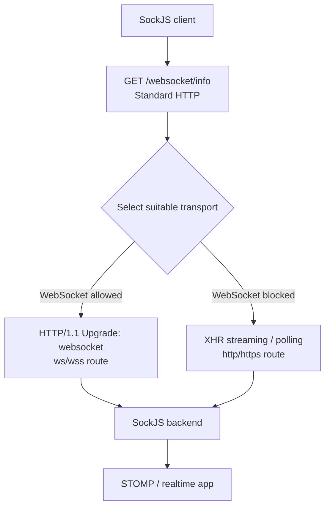
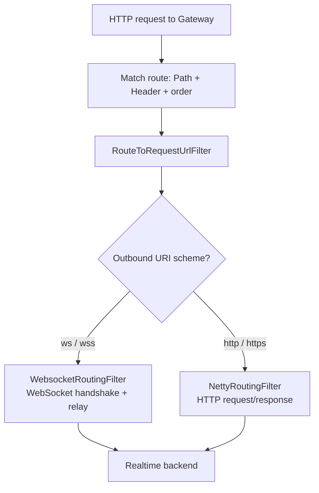
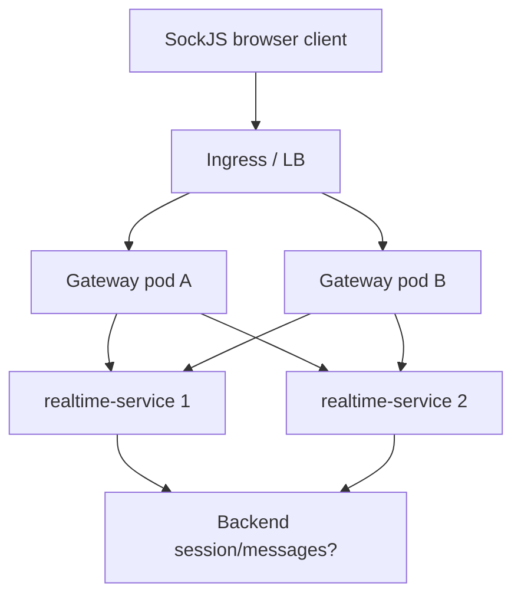

# Dedicated HTTP Routing for Fallback Mechanisms Like SockJS

Not every real-time connection can sustain **WebSocket** from browser to backend. A corporate proxy may strip the `Upgrade` header, a network appliance may drop long-lived connections, or a browser/client may have restricted capabilities. **SockJS** solves part of this problem by preferring WebSocket and falling back to **HTTP streaming** or **HTTP long polling** when necessary. However, fallback only works if the **API Gateway has a real HTTP routing path**, not just a `ws://` route.

In **Spring Cloud Gateway Server WebFlux**, `WebsocketRoutingFilter` forwards connections when the outbound URI scheme is `ws` or `wss`; ordinary HTTP traffic flows through HTTP routing. Therefore, a SockJS endpoint typically needs **two coexisting branches**:

1. **WebSocket branch** for `Upgrade: websocket` handshake requests, routed to the backend via `ws://` or `wss://`.
2. **HTTP branch** for `GET /info`, XHR streaming, XHR polling, `POST .../xhr_send` requests, and preflight when needed, routed to the backend via `http://` or `https://`.

This lesson belongs to the **WebSocket and Streaming** chapter in the **SPRING_CLOUD_GATEWAY** module. Routing must coordinate with route predicates, the filter chain, path/header rewrites, service discovery/load balancing, authentication, rate limiting, circuit breakers/retries, TLS, and observability to avoid bugs like "WebSocket works but fallback fails," "`/info` returns 200 yet clients reconnect forever," or "fallback traffic accidentally enters WebsocketRoutingFilter."

**After this lesson, you will be able to:**

- Distinguish raw WebSocket, SockJS WebSocket transport, HTTP streaming, and HTTP polling.
- Recognize SockJS URLs and understand why creating an HTTP route only for `/info` is usually insufficient for **full** fallback.
- Write two WebFlux routes using **`Header=Upgrade`** predicates and explicit **`order`** to serve the same prefix together.
- Preserve paths, queries, methods, and bodies of SockJS HTTP transports.
- Configure a SockJS backend, SockJS/STOMP frontend, and verify CORS/Origin, TLS, sticky sessions, and timeouts.
- Test handshakes, `/info`, HTTP polling/streaming, multi-instance distribution, and failure scenarios independently.

> **Version scope:** Primary examples use **Spring Cloud Gateway Server WebFlux 5.x** with the `spring.cloud.gateway.server.webflux.routes` namespace; Gateway Server WebFlux 4.3.x typically uses `spring.cloud.gateway.routes`. Do not copy WebSocket config from **Gateway Server MVC** to WebFlux: the two products have different filter/routing stacks. The `Upgrade`-based branching pattern targets the **classic HTTP/1.1 WebSocket handshake**; if using HTTP/2 WebSocket extended CONNECT, verify support and matching predicates against your actual ingress/Gateway/server.

## 1. Why Does SockJS Fallback Need an Additional HTTP Route?

WebSocket starts with an HTTP handshake and transitions into a bidirectional connection:

```http
GET /websocket/000/abc123/websocket HTTP/1.1
Host: api.example.com
Connection: Upgrade
Upgrade: websocket
Sec-WebSocket-Version: 13
Sec-WebSocket-Key: dGhlIHNhbXBsZSBub25jZQ==
Origin: https://app.example.com
```

Once the handshake succeeds, the server usually returns **`101 Switching Protocols`**, and client/server exchange WebSocket frames. Data after the handshake **is no longer separate HTTP requests**.

SockJS fallback is different: the client can send **multiple consecutive HTTP requests** to the same endpoint:

- `GET /websocket/info` to fetch transport capabilities.
- `GET /websocket/{server-id}/{session-id}/xhr_streaming` opening a long-lived HTTP response to receive messages.
- `GET /websocket/{server-id}/{session-id}/xhr` performing a single polling round.
- `POST /websocket/{server-id}/{session-id}/xhr_send` sending messages from client to server.
- `OPTIONS` preflight in certain cross-origin scenarios.

These requests **have no WebSocket handshake**. If Gateway sends them into a `uri: ws://...` route, `WebsocketRoutingFilter` may attempt an inappropriate WebSocket handshake instead of HTTP proxying, breaking fallback.



**Core rule:** SockJS provides a **WebSocket-like API feel** on the client, while the underlying transport can be HTTP. Gateway must branch by **actual transport type**, not just because an endpoint name contains `websocket`.

## 2. Four Concepts Often Lumped Together

| Mechanism | Transport between client and Gateway | Typical HTTP status | Characteristics |
| --- | --- | --- | --- |
| Raw WebSocket | HTTP handshake → WebSocket frames | `101` on successful upgrade | Long-lived bidirectional connection |
| SockJS WebSocket transport | HTTP handshake to a SockJS sub-URL → frames | `101` | Includes SockJS framing/protocol layer |
| SockJS XHR streaming | Long-lived HTTP GET response stream + POST to send messages | Usually `200` with long-lived response | Does not use `Upgrade` |
| SockJS XHR polling | Multiple HTTP GET/POST calls over the same session | Per transport/request, typically 2xx | Does not hold a WebSocket connection |
| Server-Sent Events (SSE) | HTTP GET with `text/event-stream` | `200`, long-lived stream | **Not** SockJS; server → client only |
| Custom long polling | Hanging HTTP GET that returns and re-polls | Usually `200`/`204` per API | Does not necessarily follow SockJS protocol |

**SockJS ≠ STOMP ≠ WebSocket ≠ SSE.**

- **WebSocket** is a bidirectional wire transport protocol.
- **SockJS** provides transport negotiation/fallback and its own framing.
- **STOMP** is an application-layer messaging protocol; it can run over raw WebSocket or over SockJS.
- **SSE** is a separate HTTP streaming API with its own routing/timeout requirements.

An application can use raw WebSocket without SockJS; in that case you do not need to invent a fallback HTTP route just to "have two routes." The prerequisite is that frontend and backend actually implement SockJS or a similar HTTP fallback.

## 3. Recognizing the Complete SockJS URL Structure

Per Spring Framework docs, a SockJS client usually **starts with `GET /info`**, and subsequent transport requests follow:

```text
https://host/myEndpoint/{server-id}/{session-id}/{transport}
```

If the public endpoint is `https://api.example.com/websocket`, an active session may generate:

| Sample request | Transport | Required route |
| --- | --- | --- |
| `GET /websocket/info?t=...` | Capability probe | **HTTP** |
| `OPTIONS /websocket/info` | CORS preflight if triggered | **HTTP/CORS handler** |
| `GET /websocket/000/abc123/websocket` + `Upgrade: websocket` | SockJS WebSocket | **WS/WSS** |
| `GET /websocket/000/abc123/xhr_streaming` | HTTP streaming | **HTTP/HTTPS** |
| `GET /websocket/000/abc123/xhr` | HTTP polling | **HTTP/HTTPS** |
| `POST /websocket/000/abc123/xhr_send` | Send messages over HTTP | **HTTP/HTTPS** |
| `GET /websocket/iframe.html` if required by transport/version | Iframe support resource | **HTTP/HTTPS** |

**Naming note:** In **server URLs**, suffixes are typically `xhr_streaming`, `xhr`, and `xhr_send`. In **SockJS JavaScript client** options, transport names may appear as `xhr-streaming` or `xhr-polling`. Do not confuse underscores in URLs with hyphens in client config.

`{server-id}` and `{session-id}` are generated/used by SockJS; Gateway **must not** strip or alter them arbitrarily with `StripPrefix`/`RewritePath`. Those values can be essential when the backend tracks sessions per instance.

### Why Isn't `/info` Enough?

If you only define an HTTP route:

```yaml
- id: sockjs-info
  uri: http://localhost:3001
  predicates:
    - Path=/websocket/info/**
```

`GET /websocket/info` will succeed, yet requests like `/websocket/000/abc123/xhr_streaming` and `.../xhr_send` **do not match `/websocket/info/**`**. If the other route is `ws://...` with `Path=/websocket/**`, HTTP fallback traffic gets misrouted into the WebSocket branch.

**Verifying `/info` returns 200 is necessary, but insufficient to prove SockJS fallback works end-to-end.**

## 4. How Does WebsocketRoutingFilter Differ from Netty HTTP Routing?

Spring Cloud Gateway Server WebFlux processes requests through route predicates and the filter chain. `RouteToRequestUrlFilter` constructs the outbound URI from the route's URI; a route with scheme `lb:ws://...` may pass through `ReactiveLoadBalancerClientFilter` to pick an instance before connecting.

Key GlobalFilters:

| Component | When does it participate? | Meaning for SockJS |
| --- | --- | --- |
| `RoutePredicateHandlerMapping` | Finds route matching Path, Header, Host, Method | Splits WS vs. HTTP branches |
| `RouteToRequestUrlFilter` | Builds `GATEWAY_REQUEST_URL_ATTR` | Determines outbound scheme |
| `ReactiveLoadBalancerClientFilter` | URI has `lb` prefix | Selects backend instance |
| `WebsocketRoutingFilter` | Target URI has scheme `ws` or `wss` | Proxies WebSocket handshake/session |
| `NettyRoutingFilter` | Target URI is `http` or `https` | Proxies HTTP fallback like `/info`, XHR |
| `NettyWriteResponseFilter` | Matching HTTP client response | Writes HTTP response back to client |
| `GlobalFilter` / `GatewayFilter` | Follows combined filter order | Security/rate limits/headers/path mutations |



**Do not just add `Upgrade: websocket` to a request and expect `uri: http://...` to always be handled by `WebsocketRoutingFilter` in Gateway WebFlux.** WebFlux docs tie the WS filter to the outbound URI scheme. Gateway **Server MVC** documents a separate mechanism that converts `http`/`https` with an Upgrade header; do not mix the two docs.

**Do not confuse route ID with routing scheme:** a route named `websocket-http` still proxies over HTTP if its URI is `http://...`; an ID never enables WebSocket.

## 5. Minimal Pattern in Spring Cloud Gateway Docs

Gateway WebFlux 5.1 documentation provides a two-route illustration:

```yaml
spring:
  cloud:
    gateway:
      server:
        webflux:
          routes:
            # HTTP route for SockJS info probing
            - id: websocket_sockjs_route
              uri: http://localhost:3001
              predicates:
                - Path=/websocket/info/**

            # WebSocket route
            - id: websocket_route
              uri: ws://localhost:3001
              predicates:
                - Path=/websocket/**
```

**What is right:** This example illustrates the rule that **you need a normal HTTP route alongside the WS route** when using SockJS fallback. It cleanly separates `http` and `ws` schemes.

**Limit in real apps:** SockJS HTTP traffic does not stop at `/info`. When browsers fall back to `xhr_streaming`, `xhr`, and `xhr_send`, you must ensure **all HTTP fallback URLs** proxy to the HTTP backend instead of falling into the catch-all WS route. With overlapping prefixes, route ordering and the `Upgrade` predicate must be designed explicitly.

Accordingly, the pattern below expands that idea into **two routes separated by WebSocket Upgrade**, serving one public prefix without swallowing XHR requests.

## 6. Complete Two-Route Config: WS Upgrade First, HTTP Fallback Second

Assume:

- Gateway WebFlux runs on `localhost:8080`.
- The SockJS/STOMP backend runs on `localhost:3001`.
- The public SockJS endpoint is `/websocket`.
- The backend also registers SockJS endpoint `/websocket`, so **no path rewrite is needed yet**.
- WebSocket uses an HTTP/1.1 handshake with header `Upgrade: websocket`.
- Requests without an Upgrade header must be proxied over HTTP.

```yaml
spring:
  cloud:
    gateway:
      server:
        webflux:
          routes:
            # WebSocket branch: matches Upgrade handshakes only.
            - id: sockjs-ws-upgrade
              order: -10
              uri: ws://localhost:3001
              predicates:
                - Path=/websocket/**
                - Header=Upgrade, (?i)websocket

            # HTTP branch: /info, xhr_streaming, xhr, xhr_send, OPTIONS...
            - id: sockjs-http-fallback
              order: 10
              uri: http://localhost:3001
              predicates:
                - Path=/websocket/**
```

### How This Configuration Branches

1. `GET /websocket/info` **without Upgrade** → fails `sockjs-ws-upgrade` → matches `sockjs-http-fallback` → HTTP proxy.
2. `GET /websocket/000/s1/websocket` with `Upgrade: websocket` → matches WS branch (lower order) → `WebsocketRoutingFilter`.
3. `GET /websocket/000/s1/xhr_streaming` **without Upgrade** → enters HTTP route.
4. `POST /websocket/000/s1/xhr_send` **without Upgrade** → enters HTTP route; body is forwarded via HTTP.
5. `OPTIONS /websocket/info` or `OPTIONS` transport path → handled by CORS/preflight handler or HTTP route depending on config; **not the WebSocket route**.

`Header=Upgrade, (?i)websocket` uses the **Header route predicate factory** with a **Java regular expression**; `(?i)` enables case-insensitive matching on the header value. In the YAML shortcut syntax, the comma separates header name and regex.

**Caution:** Some clients/proxies may send unusual `Upgrade` values, multiple tokens, or varying normalization. For standard HTTP/1.1 handshakes, the single token `websocket` is typical. If your regex accepts token lists, design and test it separately and **never** treat the Upgrade header alone as proof of a valid handshake; Gateway/backend still verify the remaining standard headers.

### Why Must `order` Be Set?

Both routes declare `Path=/websocket/**`; a WebSocket handshake also matches the HTTP route's Path predicate. Setting:

- WS `order: -10` → evaluated first when the Upgrade condition matches.
- HTTP `order: 10` → acts as fallback for regular HTTP requests.

Without controlling route order, WebSocket requests can match the HTTP route, causing `400/404/426` handshake failures or plain HTTP responses instead of `101`.

**Route order** controls which route wins when multiple route predicates match, **not `GatewayFilter` order**. Changing `StripPrefix` or `SetPath` only transforms paths after a route is selected and never replaces the Upgrade predicate.

## 7. Decision Table for the Section 6 Configuration

| Request | Upgrade header | Expected route | Outbound scheme | Correct signal |
| --- | --- | --- | --- | --- |
| `GET /websocket/info` | None | `sockjs-http-fallback` | `http` | JSON/info response |
| `GET /websocket/info?t=123` | None | HTTP fallback | `http` | Query preserved |
| `GET /websocket/000/s1/websocket` | `websocket` | `sockjs-ws-upgrade` | `ws` | `101` when backend accepts |
| `GET /websocket/000/s1/xhr_streaming` | None | HTTP fallback | `http` | Streaming 2xx response |
| `GET /websocket/000/s1/xhr` | None | HTTP fallback | `http` | Protocol-valid polling response |
| `POST /websocket/000/s1/xhr_send` | None | HTTP fallback | `http` | POST reaches the right SockJS session |
| `OPTIONS /websocket/...` | None | HTTP/CORS | `http` or CORS handler | Valid preflight |
| `GET /websocket/000/s1/websocket` | None | HTTP fallback | `http` | Not treated as an upgraded WebSocket |
| `GET /other` | None | Neither route above | — | Other route/404 depending on app |

Do not assert every HTTP fallback request always returns `200`: depending on protocol, session state, Origin, CSRF, and backend, it can return `204`, `400`, `401`, or `404`. Verify first that **the request enters the HTTP branch** rather than falling into WebSocket routing.

## 8. Sample Backend with SockJS: Spring WebSocket/STOMP on the Servlet Stack

Gateway WebFlux can proxy to a **Spring MVC/Servlet backend** implementing SockJS. This is an illustrative choice matching Spring Framework docs. **The backend does not have to be WebFlux** just because Gateway uses Reactor Netty.

Example in `realtime-service`:

```java
package example.realtime;

import org.springframework.context.annotation.Configuration;
import org.springframework.messaging.simp.config.MessageBrokerRegistry;
import org.springframework.web.socket.config.annotation.EnableWebSocketMessageBroker;
import org.springframework.web.socket.config.annotation.StompEndpointRegistry;
import org.springframework.web.socket.config.annotation.WebSocketMessageBrokerConfigurer;

@Configuration(proxyBeanMethods = false)
@EnableWebSocketMessageBroker
public class RealtimeWebSocketConfig
        implements WebSocketMessageBrokerConfigurer {

    @Override
    public void registerStompEndpoints(StompEndpointRegistry registry) {
        registry.addEndpoint("/websocket")
            .setAllowedOriginPatterns("http://localhost:8080")
            .withSockJS();
    }

    @Override
    public void configureMessageBroker(MessageBrokerRegistry registry) {
        registry.setApplicationDestinationPrefixes("/app");
        registry.enableSimpleBroker("/topic");
    }
}
```

If the frontend runs on a **different origin from Gateway**, allow that frontend origin on **both Gateway and backend** per your deployment topology and real tests. In the local example, the frontend uses `http://localhost:8080`, so the backend permits that origin; do not copy that allowlist blindly to production.

Mandatory points:

- `registry.addEndpoint("/websocket").withSockJS()` enables the SockJS endpoint on the backend.
- The backend must listen on port `3001` (or matching configuration).
- Adding a Gateway WS route alone **does not create** a SockJS endpoint on the backend.
- The SockJS server uses multiple sub-paths under `/websocket`, such as `/info` and `/{server}/{session}/{transport}`.
- STOMP destinations `/app/*` and `/topic/*` belong to the **payload/message protocol**, not Gateway URL routes like `/websocket/info`.

A demo STOMP controller:

```java
package example.realtime;

import org.springframework.messaging.handler.annotation.MessageMapping;
import org.springframework.messaging.handler.annotation.SendTo;
import org.springframework.stereotype.Controller;

@Controller
public class DemoMessageController {

    @MessageMapping("/ping")
    @SendTo("/topic/pong")
    public String ping(String message) {
        return "pong: " + message;
    }
}
```

This example only tests message flow; STOMP destination authentication/authorization must be configured separately before production. Never broadcast PII or tokens to public topics.

### Distinguishing Frontend Endpoints from STOMP Destinations

```text
Gateway public SockJS endpoint:
  http://localhost:8080/websocket

SockJS requests auto-generated by the client:
  /websocket/info
  /websocket/000/{session}/websocket
  /websocket/000/{session}/xhr_streaming
  /websocket/000/{session}/xhr_send

STOMP application destination:
  /app/ping

STOMP subscription destination:
  /topic/pong
```

**Do not create `Path=/app/**` or `Path=/topic/**` routes in Gateway** just for STOMP messages to flow. After the handshake, STOMP frames travel inside the WebSocket/SockJS transport, not as standalone HTTP URLs.

## 9. SockJS Frontend: Testing WebSocket and Forcing HTTP Fallback

In a frontend app with `sockjs-client` and `@stomp/stompjs` installed (using an appropriate bundler), connect through Gateway using the **HTTP/HTTPS** URL of the SockJS endpoint:

```javascript
import SockJS from "sockjs-client";
import { Client } from "@stomp/stompjs";

const client = new Client({
  // SockJS auto-generates /info URLs and picks websocket/xhr transports.
  webSocketFactory: () =>
    new SockJS("http://localhost:8080/websocket"),

  reconnectDelay: 5000,

  onConnect: () => {
    client.subscribe("/topic/pong", message => {
      console.log("Received:", message.body);
    });

    client.publish({
      destination: "/app/ping",
      body: "hello"
    });
  },

  onStompError: frame => {
    console.error("STOMP error:", frame.headers["message"]);
  }
});

client.activate();

// On unmount or application shutdown:
// await client.deactivate();
```

**Do not pass `ws://...` to `new SockJS(...)` as if it were `new WebSocket(...)`.** The SockJS client starts with an HTTP/HTTPS endpoint and selects transports automatically, including WebSocket where allowed.

### Forcing XHR Polling to Prove the HTTP Route Works

In a test environment, create a connection restricted to `xhr-polling`:

```javascript
const fallbackClient = new Client({
  webSocketFactory: () =>
    new SockJS(
      "http://localhost:8080/websocket",
      null,
      { transports: ["xhr-polling"] }
    ),

  reconnectDelay: 3000,

  onConnect: () => {
    console.log("Connected through SockJS HTTP fallback");
  }
});

fallbackClient.activate();
```

Open **Browser DevTools → Network → Fetch/XHR** and observe `/websocket/info` plus URLs containing `/xhr` or `/xhr_send`. Do not expect a connection in the WS tab when `xhr-polling` is forced.

**This is the most important test:** a working WebSocket connection does not prove the HTTP fallback route is right; you must force an HTTP transport to verify it independently.

### Common Frontend Pitfalls

- Call `client.deactivate()` when leaving a screen to prevent reconnect loops and leaked connections.
- When the frontend runs over HTTPS, the SockJS endpoint must also use **HTTPS** to avoid mixed content.
- `reconnectDelay` is not Gateway Retry; every reconnect is a **new session/handshake** initiated by the client.
- In production, never log tokens/PII via `console.error` or append access tokens to URL queries without proper safeguards.

## 10. Public Prefix Differs from Backend Prefix: Preserve SockJS Session Paths

Suppose the public API exposes SockJS under `/api/realtime/websocket`, while the backend registers `/websocket`.

Here **both routes** must rewrite/strip prefixes **identically**, so WebSocket and HTTP fallback hit the exact same backend endpoint.

```yaml
spring:
  cloud:
    gateway:
      server:
        webflux:
          routes:
            - id: realtime-ws
              order: -10
              uri: ws://localhost:3001
              predicates:
                - Path=/api/realtime/websocket/**
                - Header=Upgrade, (?i)websocket
              filters:
                - StripPrefix=2

            - id: realtime-http-fallback
              order: 10
              uri: http://localhost:3001
              predicates:
                - Path=/api/realtime/websocket/**
              filters:
                - StripPrefix=2
```

Walkthrough:

```text
Public:
  /api/realtime/websocket/info
  /api/realtime/websocket/000/s1/websocket
  /api/realtime/websocket/000/s1/xhr_streaming
  /api/realtime/websocket/000/s1/xhr_send

After StripPrefix=2 (drops "api" and "realtime"):
  /websocket/info
  /websocket/000/s1/websocket
  /websocket/000/s1/xhr_streaming
  /websocket/000/s1/xhr_send
```

If you put `StripPrefix=2` only on the WS route and omit it on the HTTP route, `/info` or `xhr_send` reaches the backend with the wrong path and returns `404`. Conversely, `StripPrefix=3` drops the `websocket` segment registered by the backend.

**Do not rewrite** `{server-id}`, `{session-id}`, and `{transport}` arbitrarily. They are SockJS protocol elements. Also preserve query parameters, POST bodies, and content types.

### When Should You Use RewritePath?

`RewritePath` helps when the public prefix change is more complex than dropping leading segments. However, regex replacements require careful YAML escaping and testing across the WebSocket URL, `/info`, XHR polling, and POSTs. When dropping a fixed number of leading segments, `StripPrefix=2` is much clearer.

## 11. With Service Discovery: HTTP and WebSocket Use Different Schemes

In microservices, rather than hardcoding `localhost:3001`, you can use service discovery.

For example:

```yaml
spring:
  cloud:
    gateway:
      server:
        webflux:
          routes:
            - id: realtime-ws
              order: -10
              uri: lb:ws://realtime-service
              predicates:
                - Path=/websocket/**
                - Header=Upgrade, (?i)websocket

            - id: realtime-http
              order: 10
              uri: lb://realtime-service
              predicates:
                - Path=/websocket/**
```

- `lb:ws://realtime-service`: URI for the `lb`-prefixed WebSocket route so LoadBalancer selects a service instance.
- `lb://realtime-service`: standard logical URI for HTTP fallback through LoadBalancer (defaulting to outbound HTTP/HTTPS per service instance/security config).
- Requires the Spring Cloud LoadBalancer starter and an instance source (Eureka, Consul, Kubernetes, or `SimpleDiscoveryClient`).
- The backend URI scheme matters: **`lb://realtime-service` does not turn all HTTP fallback traffic into WebSocket**.

### Limits to Understand

**One HTTP request ≠ one SockJS session.** XHR polling involves multiple sequential requests within one session. If LoadBalancer distributes them randomly across instances keeping session state only in memory, a follow-up request can hit instance B even though the session started on A, causing `404` or lost messages.

SockJS URLs contain `{server-id}`, which can assist cluster routing, yet **Spring Cloud LoadBalancer does not guarantee sticky sessions automatically just because that segment exists**.

Solutions you may need:

1. Session affinity at ingress/LB via cookies or a server-supported mechanism.
2. Deterministic instance selection based on a stable session key where architecture allows.
3. Backends supporting shared session state/messaging brokers; consider a broker relay/persistence for STOMP.
4. Readiness checks and graceful shutdown during rolling deployments.
5. Testing long polling across multiple backend replicas, not just a single WebSocket connection.

**Warning:** An in-memory STOMP simple broker inside each backend does not create a cross-cluster pub/sub system. `lb://...` only solves instance picking, not shared session/broadcast state.

## 12. HTTP Fallback CORS and WebSocket Origin Are Two Separate Layers

This is a common root cause behind "`/info` works yet the browser cannot connect."

### WebSocket: Origin Is Checked at Handshake

Per Spring Cloud Gateway Server WebFlux 5.1 docs, **browsers do not enforce standard XHR CORS on WebSocket handshakes**, so `WebsocketRoutingFilter` enforces its own **Origin** policy. By default, same-origin or requests without `Origin` are permitted; cross-origin requests can receive **`403 Forbidden`**.

If the frontend lives at `https://app.example.com` and Gateway at `https://api.example.com`, Gateway WebFlux may require:

```yaml
spring:
  cloud:
    gateway:
      server:
        webflux:
          websocket:
            allowed-origins:
              - https://app.example.com
```

This is an **illustrative exact-origin allowlist**. When patterns are needed, 5.x offers `allowed-origin-patterns`; avoid `*` in production. The SockJS backend also needs a compatible Origin policy so it doesn't reject the handshake after Gateway accepts it.

**Origin is not authentication.** Non-browser clients can send or omit any Origin. Authenticate users/sessions, authorize STOMP destinations, and enforce backend data permissions separately.

### HTTP Fallback: CORS for XHR Streaming/Polling

HTTP fallback executes **ordinary HTTP requests**, so browsers can check:

- `Access-Control-Allow-Origin` matching the frontend origin.
- `Access-Control-Allow-Credentials` when cookies/session credentials are sent.
- `Access-Control-Allow-Methods` for required `GET`, `POST`, and `OPTIONS`.
- `Access-Control-Allow-Headers` for application headers.
- Consistent preflight and actual responses across Gateway, ingress, and backend.

Spring's SockJS server can emit CORS headers for HTTP transports when cross-origin is enabled. If Gateway or a Servlet filter already sets CORS headers, SockJS can avoid duplicates per framework behavior.

**Never let ingress, Gateway, and backend all write `Access-Control-Allow-Origin` independently**: browsers reject duplicate or conflicting header values. Pick one responsible layer and ensure the final response matches the contract.

### CORS/Origin Error Table

| Symptom | Likely cause |
| --- | --- |
| `GET /info` 200 in curl, CORS error in browser | Curl does not enforce browser CORS |
| WebSocket 403 yet XHR info OK | Gateway/backend WebSocket Origin policy |
| OPTIONS 404/403 | Preflight unhandled by route/handler, or blocked by security |
| Browser reports multiple `Access-Control-Allow-Origin` | Gateway/backend/ingress all emitting the header |
| Cookies missing on fallback | SameSite, Secure, domain/path, CORS credentials |
| Same-origin works, cross-origin fails | Origin allowlists out of sync |
| HTTP fallback works, WS fails behind proxy | Upgrade headers stripped by ingress or TLS/Origin mismatch |

## 13. Reverse Proxy, Forwarded Headers, and TLS

In production, browsers may connect to:

```text
Browser:
  https://api.example.com/websocket/info
  wss://api.example.com/websocket/.../websocket

Ingress (TLS termination):
  http://gateway:8080/websocket/info
  ws://gateway:8080/websocket/.../websocket

Gateway:
  http://realtime-service/...    for HTTP fallback
  ws://realtime-service/...      for WebSocket
```

Using TLS at the public edge and internal HTTP above is **illustrative only**. Production has its own requirements for internal mTLS/TLS, truststores, and network policies.

### Checklist of Points to Verify

1. Ingress must support **WebSocket Upgrade** and forward required HTTP/1.1 handshake headers.
2. Configure **idle/read timeouts** long enough for WS and long polling/streaming.
3. External proxies must pass/prevent spoofing of `Forwarded` or `X-Forwarded-*` per trust boundaries.
4. Behind a proxy, Spring Cloud Gateway may need `server.forward-headers-strategy` configured for your infrastructure so same-origin checks compute the public scheme/Host accurately.
5. Frontend URLs over HTTPS must never point SockJS to insecure `http://` (mixed content).
6. When Gateway connects over HTTPS/WSS to backends, verify cert chains and hostname/SNI; never disable TLS verification to "fix WebSocket."
7. Never let clients steer outbound `ws://`/`http://` URIs via untrusted Host/headers/paths, preventing SSRF/open proxies.

**Do not equate client→Gateway TLS with Gateway→backend TLS.** If the backend requires WSS, configure `wss://` or matching `lb`/secure flags and test the handshake through Gateway.

## 14. Authentication, Cookies, CSRF, and STOMP CONNECT

SockJS fallback can be trickier than raw WebSocket when sessions and authentication are involved.

### Three Authorization Layers

| Layer | Responsibility |
| --- | --- |
| Gateway/Spring Security | Permit handshake and HTTP fallback endpoints per identity/route policy |
| SockJS/STOMP server | Bind principal to session; validate CONNECT/subscribe/send per protocol |
| Business backend | Verify user/tenant permission to read/send messages; never trust arbitrary headers |

**Do not** open `/websocket/info` anonymously and assume `.../xhr_send` is safe too. Conversely, blocking `/info` by requiring an `Authorization` header that browser SockJS cannot send will break startup before negotiation begins.

### Browser SockJS and the Authorization Header

The SockJS JavaScript client typically **provides no API to attach arbitrary HTTP headers** across every transport like a regular HTTP client. Therefore, designing "every `/info` and `xhr_send` request must carry an `Authorization: Bearer ...` injected by SockJS" may be unworkable.

Common approaches:

- Authenticate via **cookie/session** with appropriate domain/SameSite/Secure attributes and CSRF protection.
- Authenticate STOMP `CONNECT` via a messaging interceptor/security layer while still protecting HTTP endpoints from anonymous abuse.
- Use a BFF/token-exchange layer or dedicated endpoint design if avoiding cookies.

**Never put long-lived JWTs into query strings** just to bypass custom HTTP header restrictions. URLs leak into proxy logs, history, and monitoring. If short-lived URI tokens are unavoidable, enforce strict TTLs, scopes, single-use rules, and log redaction.

### CSRF on SockJS POSTs

Spring Security docs for servlet WebSocket note that with STOMP/SockJS, POST transports can be subject to web-layer CSRF as well as CSRF on STOMP `CONNECT`. Exact integration depends on server and Spring Security versions; **never disable CSRF application-wide** just to let `xhr_send` through.

If an HTTP-layer exception is needed for SockJS transports, scope it strictly to the **SockJS endpoint**, keep CONNECT protection (or equivalent) active, and test cross-site requests. Restricting `Origin` plus auth/authorization **does not replace** proper CSRF defenses.

## 15. Long Polling/Streaming and Timeout Policies

Ordinary HTTP requests finish quickly. SockJS XHR streaming or polling can **hold connections open** waiting for server messages.

If Gateway's global HTTP client response timeout is too short, fallback connections may drop prematurely:

```yaml
spring:
  cloud:
    gateway:
      server:
        webflux:
          httpclient:
            connect-timeout: 1000   # milliseconds
            response-timeout: 5s     # java.time.Duration, global
```

In Gateway WebFlux documentation, **route metadata** uses different units:

- `metadata.connect-timeout`: **milliseconds**.
- `metadata.response-timeout`: **milliseconds**.
- A **negative** route `response-timeout` is documented as **disabling the global response timeout for that route**.

An example **exclusively for HTTP SockJS fallback**:

```yaml
- id: sockjs-http-fallback
  order: 10
  uri: http://localhost:3001
  predicates:
    - Path=/websocket/**
  metadata:
    response-timeout: -1
```

**Operational warning:** `response-timeout: -1` does not mean "connections live forever." Ingress, LBs, backends, browsers, proxies, and socket idle timeouts still apply. Disabling response timeouts is only safe alongside **explicit lifecycle, idle policies, heartbeats, connection caps, and monitoring**.

Alternatively, pick a route timeout long enough (e.g., `60000` = 60 seconds) and verify it against real long polling/streaming. Never write `5` intending 5 seconds: in **route metadata**, `5` means **5 ms**.

### WebSocket Timeouts Differ from HTTP Fallback Timeouts

After the handshake, WebSocket has a long-lived lifecycle with frames/ping-pong/heartbeats. HTTP client `response-timeout` for the Netty HTTP proxy is not "the exact lifetime limit of every WebSocket session." Check:

- Ingress idle timeout.
- Transport-level WebSocket ping/pong and STOMP/SockJS heartbeats.
- Backend session/transport timeouts.
- Concurrent connection limits and socket file descriptors.
- Data/frame size limits and send rates.
- Graceful shutdown and reconnect backoff.

**Never** enable automatic retries for an HTTP streaming response that has already started sending bytes. Unlike retrying an uncommitted JSON GET, it can duplicate messages or violate session state.

## 16. RateLimiter, CircuitBreaker, and Retry on the Fallback Branch

For standard JSON APIs, Gateway can attach `RequestRateLimiter`, `CircuitBreaker`, and `Retry` per route. For SockJS, however:

- A **WebSocket session** can stay open for hours after one handshake.
- An **HTTP polling session** generates many HTTP requests just to maintain one logical session.
- `GET /info` and `POST /xhr_send` have very different frequencies and costs.
- An already streaming response cannot be transparently retried like JSON.
- Every frontend reconnect creates a **new session**; unintended retries spike connection churn.

### What Should Be Rate-Limited?

| Component | Control strategy |
| --- | --- |
| WebSocket handshake | Cap handshakes/new sessions per identity/trusted IP |
| SockJS `GET /info` | Curb excessive probing without blocking legitimate clients |
| SockJS `xhr_send` | Enforce per-user/session message rates at the backend |
| Long-polling requests | Monitor request rates and concurrent open requests |
| Persistent WS session | Cap connections/identity, message sizes, buffers, and idle time |
| Reconnect loops | Client exponential backoff/jitter; alert on failure spikes |

A uniform "N requests/sec" rate limiter across `/websocket/**` can unfairly penalize SockJS polling because one session emits far more HTTP requests than native WebSocket. Classify endpoints/transports and measure real traffic before setting quotas.

### Avoid Retry on SockJS POSTs and Long Streaming

- `POST /.../xhr_send` carries a body and message-delivery side effects: non-idempotent retries can duplicate messages.
- `GET /.../xhr_streaming` is a long-lived response: once committed, retry cannot cleanly restart "from the beginning."
- Failed WebSocket handshakes require client **reconnect with backoff**, not assuming Gateway Retry replays a failed session.
- Circuit breakers can help throttle new handshakes when backends fail, but test filter scope and fallback responses; a JSON `fallbackUri` is not a valid SockJS session.

**Never copy a REST API's `Retry`/`CircuitBreaker` block onto WebSocket/SockJS routes without protocol-level integration tests.**

## 17. Minimal Test Sequence with curl and Browser

### 17.1. Test the Backend First

Before debugging Gateway, hit the SockJS backend directly:

```bash
curl -i \
  "http://localhost:3001/websocket/info"
```

If the backend truly enables SockJS at `/websocket`, you receive a JSON response containing transport fields such as `websocket`, `cookie_needed`, and implementation metadata.

If direct calls return `404`, the bug is in backend path/server config or SockJS isn't enabled; tweaking Gateway routes cannot conjure up a missing endpoint.

### 17.2. Test the HTTP Branch Through Gateway

```bash
curl -i \
  "http://localhost:8080/websocket/info"

curl -i \
  -H "Origin: http://localhost:8080" \
  "http://localhost:8080/websocket/info"
```

Verify:

- Response comes from the SockJS backend, not a `404` route mismatch.
- JSON/info body and response headers look right.
- No `101 Switching Protocols` on a plain HTTP info request.
- Logs/traces show route ID `sockjs-http-fallback`.

### 17.3. Test HTTP Preflight If Frontend Is Cross-Origin

```bash
curl -i -X OPTIONS \
  "http://localhost:8080/websocket/info" \
  -H "Origin: https://app.example.com" \
  -H "Access-Control-Request-Method: GET"
```

Do not inspect only the HTTP status; check `Access-Control-Allow-*` headers and consistency with backend/ingress. Preflights handled by the WebFlux CORS handler may **bypass parts of the `GatewayFilter` chain** and therefore not log identically to normal HTTP routes.

### 17.4. Test the WebSocket Handshake

Use a browser/WS client compatible with SockJS or a handshake test tool; when the backend accepts the WS route, expect **HTTP `101`**. Sending requests via an HTTP client without `Sec-WebSocket-Key`, `Connection`, or `Sec-WebSocket-Version` will be rejected **even if the right route matched**.

Sample handshake request to verify headers:

```http
GET /websocket/000/session123/websocket HTTP/1.1
Host: localhost:8080
Connection: Upgrade
Upgrade: websocket
Sec-WebSocket-Version: 13
Sec-WebSocket-Key: dGhlIHNhbXBsZSBub25jZQ==
Origin: http://localhost:8080
```

**Do not send `curl -H "Upgrade: websocket"` alone and conclude the backend is broken if 101 doesn't appear.** WebSocket handshakes require the full header set; even a 101 does not prove STOMP/SockJS frames work. Use a SockJS-aware client and verify actual message exchange.

### 17.5. Force HTTP Fallback in the Frontend

Use `transports: ["xhr-polling"]` from section 9. Open the Network panel and verify:

1. `GET /websocket/info`.
2. `GET /websocket/{server}/{session}/xhr`.
3. `POST /websocket/{server}/{session}/xhr_send` when publishing messages.
4. Backend receives and returns messages per STOMP/SockJS.
5. Selected route is **HTTP fallback**, not WS.
6. No reconnect storms or CORS/CSRF errors.

Calling `GET /websocket/000/test/xhr` with `curl` without a valid SockJS session can return `404`/`400`. That **does not prove the route is broken**. Use a SockJS client to establish a real session.

## 18. Testing Route Order and Transport Separation

Suggested acceptance test table:

| Test | Request/condition | Expectation |
| --- | --- | --- |
| T1 | `GET /websocket/info` | Matches HTTP route and returns info |
| T2 | `GET /websocket/info?t=1` | Query parameters preserved |
| T3 | `Upgrade: websocket` handshake to SockJS WS URL | Matches WS route, valid handshake |
| T4 | `xhr-polling` forced on frontend | Uses HTTP route, STOMP flow succeeds |
| T5 | `xhr-streaming` forced on frontend | HTTP stream not cut prematurely |
| T6 | `POST .../xhr_send` | Body reaches right session, no duplicate retries |
| T7 | Cross-origin OPTIONS | Proper CORS headers/status |
| T8 | Disallowed Origin | WS blocked per policy; HTTP CORS matches policy |
| T9 | Backend down | No infinite retry/reconnect storm |
| T10 | Two backend instances behind `lb` | SockJS sessions don't bounce unexpectedly across instances |
| T11 | TLS termination at ingress | Public scheme/Origin/forwarded headers accurate |
| T12 | Rolling deploy of backend | Reconnects use backoff; clean session lifecycle |
| T13 | Route prefix changed | `StripPrefix` matches on both WS and HTTP |
| T14 | High load/rate limiting | HTTP fallback not unfairly starved by quotas |
| T15 | Missing Upgrade on `.../websocket` | Not mistakenly treated as a valid WS connection |

### Measuring Which Route Actually Matched

Do not guess from `Path` alone. When two routes share a prefix, verify `routeId` in Gateway metrics/logs and inspect routes via read-only Actuator if enabled:

```bash
# Only from a secured management network when Actuator is exposed.
curl -s \
  http://localhost:8080/actuator/gateway/routes

curl -s \
  http://localhost:8080/actuator/gateway/routes/sockjs-ws-upgrade

curl -s \
  http://localhost:8080/actuator/gateway/routes/sockjs-http-fallback
```

Actuator may live on a separate management port rather than 8080. Never expose route configs revealing upstream topology to the Internet.

**Do not try using a `GlobalFilter` to "switch WS back to HTTP" for an XHR request after the wrong route matched.** Separating routes cleanly up front with predicates and order is far easier to reason about.

## 19. Multi-Replica Operations: Session Affinity and Graceful Draining

With one Gateway replica and one SockJS backend, local tests pass easily. On Kubernetes, both tiers scale independently:



A WebSocket session is a **long-lived TCP connection**; once established, it stays pinned to one Gateway pod and one backend connection until closed. HTTP polling, however, consists of **many requests**, each potentially traversing a different Gateway/backend.

Production questions:

1. Does the SockJS backend store session state locally?
2. Are HTTP polling `GET` and `POST xhr_send` requests for the same `session-id` routed to the same backend?
3. When a backend pod shuts down, how do open connections close?
4. Does ingress enforce sticky routing or pure round-robin per request?
5. Is broker message state shared via an external broker?
6. On reconnect, do clients use backoff/jitter, clean up old sessions, and re-verify permissions?

**Never claim** that configuring `lb://realtime-service` guarantees sticky sessions. Design affinity/shared state or choose a scalable session/backend architecture.

### Heartbeats and Health

SockJS includes transport/protocol heartbeats; STOMP negotiates its own heart-beats. Heartbeats help detect dead peers and keep certain middleboxes alive, yet **do not replace** application health/readiness or backpressure controls.

Before removing a pod:

- Pull it out of readiness before accepting new connections/sessions.
- Allow drain time for existing connections to finish or close gracefully.
- Avoid severing every long poll simultaneously, which triggers reconnect storms.
- Monitor active WS sessions, in-flight HTTP polls, and error/reconnect rates.
- Ensure clients reconnect with exponential backoff + jitter.

## 20. Observability Must Separate WebSocket and HTTP Fallback

Measuring only `GET /websocket/info` misses the heaviest workloads: long-lived connections and HTTP polling.

| Metric/log | Purpose |
| --- | --- |
| Route IDs `sockjs-ws-upgrade` and `sockjs-http-fallback` | View transport mix |
| WebSocket handshakes and `101` counts | Track WS upgrade success rate |
| `403` from Origin policy | Detect CORS/Origin misconfigs or abuse |
| `GET /info` errors/latency | Monitor negotiation phase |
| XHR polling/streaming request counts | Detect when fallback is actually active |
| Open connections/long-polls count | Track socket/memory usage |
| HTTP `4xx/5xx` on fallback | Separate session, CORS, and backend errors |
| WebSocket close codes | Analyze timeouts, auth, protocol, and size errors |
| Backend instance and session correlation | Spot non-sticky routing |
| Ingress idle timeouts/disconnects | Spot middleboxes dropping connections |
| Reconnect attempt rate | Catch thundering herds |
| Payload size / send buffers / backpressure | Prevent memory exhaustion |
| Rate-limit `429` and circuit breaker state | Catch overly tight policies |

**Do not assume the framework exports all these metrics out of the box.** Some require instrumentation across ingress, Gateway, backend, and clients. Use route IDs, transport types, outcomes, and service instance IDs with bounded cardinality; avoid **SockJS session IDs**, JWTs, tokenized URLs, or raw IPs as metric labels.

When debugging, temporarily raise log levels in staging with a unified trace ID. Never enable full body/frame logging in production: messages may carry private data or secrets.

## 21. Troubleshooting: Symptoms and Root Causes

| Symptom | Possible cause | How to check |
| --- | --- | --- |
| `GET /info` 404 | Wrong prefix/path, SockJS disabled on server, missing HTTP route | Test backend directly, check route ID |
| `/info` 200 yet fallback fails | Only `/info/**` has HTTP route; `xhr/xhr_send` hit WS route | Force xhr-polling, add catch-all HTTP route |
| WebSocket handshake returns 404/400 | WS route shadowed by HTTP route, missing Upgrade, wrong backend endpoint | Check Header predicate, order, backend |
| WebSocket `403` cross-origin | Gateway/backend Origin allowlist | Inspect `Origin` and allowed origins |
| Browser CORS error on XHR | Wrong/duplicate HTTP fallback CORS, blocked OPTIONS | Inspect preflight and `Access-Control-Allow-*` |
| Client reconnects endlessly | WS blocked by proxy, fallback missing, CSRF/session broken | Browser Network tab + backend logs |
| `xhr_send` returns 404 | Request hit wrong instance or session missing | Trace session ID on backend, check affinity |
| `xhr_send` 403 | CSRF/auth policy mismatch | Inspect security and STOMP CONNECT |
| `xhr_streaming` drops after seconds | Gateway/ingress response timeout too short | Compare route metadata and ingress idle timeout |
| WS stays up, HTTP fallback gets no messages | HTTP routing/session state/cookie broken | Force XHR and check GET/POST share session |
| Browser mixed-content error | HTTPS page calling HTTP SockJS | Switch public URL to HTTPS |
| Backend WSS TLS handshake fails | Wrong truststore/certificate/SNI | Fix TLS; never disable cert validation |
| CORS passes yet WS gets 403 | CORS and WS Origin are separate layers | Check Gateway websocket origin allowlist |
| Cross-origin cookies missing | SameSite/Secure/domain/credentials | DevTools Cookies and Request headers |
| XHR response buffered before display | Ingress/proxy buffering/compression | Disable buffering appropriately and retest streaming |
| No WebSocket 101 in curl test | Curl missing handshake headers or backend rejected protocol | Use a real SockJS/WebSocket client |
| RateLimiter returns 429 for polling | Quota mismatched for transport mix | Split routes/transports and measure rates |
| Duplicate messages after retry | Retried `POST xhr_send`, reconnect logic, or non-idempotent app | Disable blind retries, check message IDs |
| Breaks only with multiple backend pods | Sessions not sticky or broker not shared | Test LB, affinity, shared state |
| STOMP subscription gets no topic messages | Backend broker config/destination/security | Separate STOMP destinations from HTTP paths |
| WS works locally via Gateway, fails behind ingress | Upgrade forwarding/idle timeout/trusted headers | Compare direct vs. ingress handshake |
| `lb:ws://` route returns 503 | Discovery has no instances or bad URI config | Check registry/LoadBalancer |
| Misrouted after adding new REST APIs | Path overlap/route order | Inspect `/actuator/gateway/routes` and route IDs |

### Short Debugging Workflow

1. **Backend:** does direct `GET /websocket/info` work? Did the backend call `withSockJS()`?
2. **Routes:** do WS `ws/wss` and HTTP `http/https` share the endpoint path? Are the Upgrade header and order right?
3. **XHR:** force `xhr-polling` to observe which branch requests hit; never stop at `/info`.
4. **Browser security:** WebSocket Origin, HTTP CORS, cookies, and CSRF.
5. **Transport:** do Upgrade headers survive ingress; are TLS and forwarded headers accurate?
6. **Timeouts/streaming:** do Gateway, proxy, or backend cut long polls/streams early?
7. **Scale:** do HTTP requests of the same SockJS session hit the same backend or share state?
8. **Policies:** are retries, rate limiters, or circuit breakers causing resends or broken sessions?
9. **Observability:** route IDs, selected instances, session lifecycles, and close codes.

## 22. Reinforcement Exercises

### Exercise 1 — Choosing the Route for HTTP Fallback

Given two routes:

```yaml
- id: info-http
  uri: http://localhost:3001
  predicates:
    - Path=/websocket/info/**

- id: websocket-all
  uri: ws://localhost:3001
  predicates:
    - Path=/websocket/**
```

**Question:** When the SockJS client switches to `GET /websocket/000/s1/xhr_streaming`, will the request definitely go over HTTP?

**Answer:** No. That URL is not under `/websocket/info/**`, yet it matches `/websocket/**`. You need an **HTTP fallback route covering all HTTP transports**, plus predicates/order distinguishing the WebSocket handshake.

### Exercise 2 — Classifying URLs

| URL | Route |
| --- | --- |
| `GET /websocket/info` | HTTP |
| `GET /websocket/001/s1/websocket` with Upgrade | WS |
| `GET /websocket/001/s1/xhr` | HTTP |
| `POST /websocket/001/s1/xhr_send` | HTTP |

**Question:** Should you add `Method=GET` to the catch-all HTTP route?

**Answer:** If you add `Method=GET`, `POST xhr_send` will fail to match the HTTP route. If you filter methods, include `GET`, `POST`, and any needed `OPTIONS`; the baseline config in section 6 leaves the HTTP fallback route unrestricted by method.

### Exercise 3 — Inverted Order

An HTTP route with `order=-10` has `Path=/websocket/**`, and a WS route with `order=10` has the same Path and Header Upgrade.

**Question:** Can the HTTP route hijack the WS handshake?

**Answer:** Yes. The broad HTTP route is evaluated first. The WS route needs a lower order (higher priority) and an accurate Header predicate.

### Exercise 4 — Public Prefix Differs from Backend

Public path is `/api/realtime/websocket/info`, and backend SockJS path is `/websocket/info`.

**Question:** Which routes need `StripPrefix=2`?

**Answer:** **Both WS and HTTP fallback.** Applying it to only one route leaves one transport working and the other hitting 404/session mismatches.

### Exercise 5 — Security

Frontend is at `https://app.example.com`, Gateway at `https://api.example.com`, and backend uses cookie authentication.

**Question:** Is adding CORS `Access-Control-Allow-Origin` on the HTTP route enough?

**Answer:** No. WebSocket has its own Origin policy; configure allowed origins on Gateway and backend, proper SameSite/Secure/CORS credentials on cookies, CSRF/STOMP CONNECT if applicable, and destination authorization.

### Exercise 6 — Load Balancing

There are two backend instances A/B. `GET xhr_streaming` for session S hits A; `POST xhr_send` for the same session S hits B; B cannot find the session.

**Question:** Should you raise Retry to 5 to fix this?

**Answer:** No. This is a **session affinity/state** issue. Use sticky routing or an appropriate shared session/broker design; blind retries add load and risk duplicate messages.

### Exercise 7 — Streaming Timeout

Global response timeout is `5s`; the HTTP fallback route sets `metadata.response-timeout: 5000`.

**Question:** Does that guarantee XHR streaming stays alive for 60 seconds?

**Answer:** No. Route metadata `5000` means 5 seconds, and proxies/backends also enforce timeouts. Choose a timeout large enough for the transport or disable the global timeout per route cleanly alongside idle/connection limits.

### Exercise 8 — Statuses 200 and 101

`GET /websocket/info` returns 200 and the WS handshake returns 101, yet the client receives no messages.

**Question:** Is routing definitely 100% correct already?

**Answer:** Not yet. Verify STOMP CONNECT/SUBSCRIBE/SEND, backend broker config, auth/CSRF, session state, transport framing, and actual requests in fallback mode.

### Quick Self-Check Questions

**1. Does a SockJS client always use WebSocket when the backend enables `withSockJS()`?**

> No. The client negotiates transports and can pick HTTP streaming or polling when WebSocket is unavailable.

**2. Why does the WS route need `ws://`?**

> In Gateway Server WebFlux, `WebsocketRoutingFilter` activates when the outbound URI scheme is `ws` or `wss`.

**3. Why shouldn't the HTTP fallback route be limited to `/info`?**

> Because XHR streaming/polling and `xhr_send` use other sub-URLs under the same SockJS endpoint.

**4. Is `Origin` equivalent to JWT authentication?**

> No. It is a browser cross-origin signal, not proof of identity.

**5. Is HTTP polling guaranteed to stay on the same Gateway/backend instance?**

> No. If backend session state is local, you need session affinity or shared state; default LoadBalancer does not guarantee SockJS session stickiness.

**6. Should `POST xhr_send` be auto-retried on timeout?**

> Not by default. The initial request may already have delivered the message; retrying risks duplicating side effects.

## 23. Checklist Before Operating SockJS Fallback Through Gateway

- [ ] Backend genuinely enables **SockJS** (e.g., `withSockJS()`), not just raw WebSocket.
- [ ] Public and backend endpoint prefixes are confirmed.
- [ ] Created a **WS/WSS route** for handshakes and an **HTTP/HTTPS route** for fallback.
- [ ] HTTP route covers `/info`, `xhr_streaming`, `xhr`, `xhr_send`, and any support assets.
- [ ] HTTP/1.1 handshake branched via `Header=Upgrade, (?i)websocket` with explicit route order.
- [ ] Verified `Connection: Upgrade`, `Sec-WebSocket-Key`, and `Sec-WebSocket-Version` pass through ingress.
- [ ] Avoided restricting HTTP fallback solely to GET because `xhr_send` uses POST.
- [ ] Applied `StripPrefix`/`RewritePath` **identically** to both routes when changing public prefixes.
- [ ] Never stripped/rewrote `{server-id}`, `{session-id}`, or transport segments against protocol rules.
- [ ] Used the proper config namespace for Gateway WebFlux 5.x/4.3.x without copying Gateway MVC behavior.
- [ ] When using `lb:ws://` and `lb://`, verified discovery/LoadBalancer dependencies and backend instances.
- [ ] Never assumed SockJS HTTP sessions are sticky solely from load balancing.
- [ ] Tested the browser SockJS client in both WebSocket mode and **forced `xhr-polling`/`xhr-streaming`**.
- [ ] Verified `GET /info`, POST `xhr_send`, and live stream/polling responses rather than only `/info` 200.
- [ ] Configured WebSocket Origin allowlist and HTTP CORS separately without duplicates or `*` with credentials.
- [ ] Verified cookie SameSite/Secure, authentication, STOMP destination authorization, and CSRF.
- [ ] Secured TLS, trusted proxy forwarded headers, and kept certificate validation enabled.
- [ ] Verified HTTP response timeouts, ingress idle timeouts, SockJS heartbeats, and streaming buffering.
- [ ] Avoided blindly retrying SockJS POSTs or already committed streaming responses.
- [ ] Set fair rate limits and connection limits across HTTP polling and WebSocket sessions.
- [ ] Monitored WebSocket `101`/`403`, HTTP fallback `2xx/4xx/5xx`, reconnects, open sessions, and proxy errors.
- [ ] Tested multi-pod backends, rolling deployments, sticky sessions/shared brokers, and graceful draining.
- [ ] Never logged JWTs/session IDs/full payloads as metric labels.
- [ ] Prepared runbooks distinguishing routing, CORS/Origin, TLS, auth, timeouts, and SockJS protocol errors.

## Conclusion

When using **SockJS as a fallback for WebSocket**, **Spring Cloud Gateway Server WebFlux** must distinguish **WebSocket handshakes** from **SockJS's regular HTTP requests**. `WebsocketRoutingFilter` handles `ws/wss` URIs, while `GET /info`, `xhr_streaming`, `xhr`, and `POST xhr_send` require an appropriate `http/https` branch. Thus, defining only a WebSocket route — or adding an HTTP route solely for `/info` — is not enough for full fallback operation.

A clean, predictable setup uses **two routes sharing the same prefix**: a higher-priority WS route matching `Upgrade: websocket` followed by a catch-all HTTP route. Whenever the public path differs from the backend, both routes must apply identical rewrites/stripping. Always test using a **SockJS client forced into `xhr-polling`**, not just `curl /info` or a `101` handshake, since each test covers only half the protocol.

Finally, HTTP fallback brings its own requirements around **CORS, CSRF, cookies, response timeouts, HTTP streaming, session affinity, retries, and rate limits**. Coordinating route predicates, filter ordering, service discovery, TLS, authentication, and observability allows the API Gateway to serve real-time clients reliably even when WebSocket transport is blocked.

## References

- [Spring Cloud Gateway Server WebFlux 5.1 — Websocket Routing Filter and SockJS HTTP fallback](https://docs.spring.io/spring-cloud-gateway/reference/spring-cloud-gateway-server-webflux/global-filters.html)
- [Spring Cloud Gateway Server WebFlux 4.3 — Global Filters and Websocket Routing](https://docs.spring.io/spring-cloud-gateway/reference/4.3/spring-cloud-gateway-server-webflux/global-filters.html)
- [Spring Cloud Gateway Server WebFlux — Header Route Predicate Factory](https://docs.spring.io/spring-cloud-gateway/reference/spring-cloud-gateway-server-webflux/request-predicates-factories.html)
- [Spring Framework — SockJS Fallback, /info, URL structure, CORS](https://docs.spring.io/spring-framework/reference/web/websocket/fallback.html)
- [Spring Framework — Enable STOMP, withSockJS()](https://docs.spring.io/spring-framework/reference/web/websocket/stomp/enable.html)
- [Spring Security — WebSocket Security, Origin, and SockJS CSRF](https://docs.spring.io/spring-security/reference/servlet/integrations/websocket.html)
- [Spring Cloud Gateway Server WebFlux — HTTP Timeouts](https://docs.spring.io/spring-cloud-gateway/reference/spring-cloud-gateway-server-webflux/http-timeouts-configuration.html)
- [Spring Cloud Gateway Server WebFlux — Route Metadata Configuration](https://docs.spring.io/spring-cloud-gateway/reference/spring-cloud-gateway-server-webflux/route-metadata-configuration.html)
- [Spring Cloud Gateway Server WebFlux — Actuator API](https://docs.spring.io/spring-cloud-gateway/reference/spring-cloud-gateway-server-webflux/actuator-api.html)
