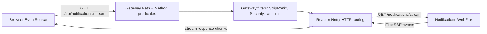

# Server-Sent Events and Continuous Response Streaming Through Spring Cloud Gateway

## 1. The Problem: Pushing Updates from Microservices to Clients Without Constant Polling

In a microservices architecture, **Spring Cloud Gateway** receives HTTP requests, chooses routes via **route predicates**, runs the **GatewayFilter/GlobalFilter chain**, rewrites paths/headers, uses service discovery/load balancing, and can enforce authentication, rate limiting, circuit breakers, retries, TLS, and request observability. Some APIs return JSON and close the response immediately; others must **keep the connection open and stream data incrementally over time**.

For example, an order management dashboard wants to display `ORDER_CREATED`, `PAYMENT_CONFIRMED`, and `SHIPPED` statuses as soon as services emit events. If the browser polls `GET /orders/status` every two seconds, the system processes many HTTP requests even when nothing has changed. One alternative is **Server-Sent Events (SSE)**: the client opens a single HTTP GET, and the server pushes **multiple server → client events** over the open response.

```mermaid
sequenceDiagram
    participant B as Browser EventSource
    participant G as Spring Cloud Gateway
    participant N as Notifications service
    B->>G: GET /api/notifications/stream
    G->>N: GET /notifications/stream
    N-->>G: HTTP 200 + Content-Type: text/event-stream
    G-->>B: HTTP headers; connection stays open
    N-->>G: id: 101 / event: notification / data: {...}
    G-->>B: SSE event 101
    N-->>G: : heartbeat
    G-->>B: SSE heartbeat comment
    N-->>G: id: 102 / event: notification / data: {...}
    G-->>B: SSE event 102
    Note over B,N: Stream continues until disconnect/cancel/failure
```

**Learning outcomes:**

1. Distinguish **SSE**, WebSocket, polling, and standard JSON responses.
2. Read the `text/event-stream` format accurately: `data`, `event`, `id`, `retry`, blank lines, and heartbeats.
3. Return `Flux<ServerSentEvent<?>>` from a **Spring WebFlux backend** and proxy it through **Gateway Server WebFlux** without buffering the entire body.
4. Configure routes/paths, `streaming-media-types`, connect/response timeouts, proxy buffering layers, and keepalives.
5. Handle `EventSource` reconnects, `Last-Event-ID`, replay, duplicate/out-of-order events, and backpressure limits.
6. Protect streams with TLS, authentication/authorization/CORS, connection limits, and safe observability.
7. Test with `curl -N`, browsers, network failure scenarios, and multiple replicas.

> **Scope:** Examples target **Spring Cloud Gateway Server WebFlux 4.3+/5.x** and a Spring WebFlux backend. In newer releases, routes live under `spring.cloud.gateway.server.webflux.routes`; WebFlux 4.2 and earlier typically use `spring.cloud.gateway.routes`. Gateway Server **Web MVC** handles streaming and configuration differently; do not copy Java/WebFlux routing APIs verbatim to MVC.

## 2. How Does SSE Differ from WebSocket and HTTP JSON?

| Characteristic | Standard HTTP JSON | SSE | WebSocket |
|---|---|---|---|
Initial access protocol | HTTP request/response | **HTTP GET** with a long-lived open response | HTTP handshake/upgrade or equivalent over HTTP/2 |
Transmission direction | One request → one response | **Unidirectional: server → client** | **Bidirectional** |
Data format | JSON body per API | UTF-8 `text/event-stream`, line-based fields | Text/binary frames |
Simple browser API | `fetch()` | `EventSource` | `WebSocket` |
Browser auto-reconnect | Application implements | `EventSource` has built-in spec reconnect logic | Application typically implements |
Resume after network drop | Designed per API | `Last-Event-ID` is a **cursor signal**; replay designed by backend | Designed by application/protocol |
Heartbeat | New HTTP request or other mechanism | Comment line `: keepalive` | Ping/pong control frames |
Best-fit use cases | CRUD, one-shot status fetches | Notifications, progress, dashboards, near-real-time logs | Two-way chat, collaboration, real-time control |

**SSE does not use `ws://`/`wss://`.** In Gateway, SSE flows through standard **HTTP/HTTPS** routes while the response body is streamed incrementally. WebSocket requires dedicated WebSocket routing/upgrade; setting `uri: ws://...` for an SSE endpoint is the wrong technology choice.

SSE is also not "the server pushing a new HTTP response every second." A single HTTP response can stay open for minutes or hours, carrying many event frames, while HTTP headers are sent **only once** when the response starts.

### 2.1. Network-Level View

```text
Client                Gateway                  Backend
  | GET /stream           |                       |
  |---------------------->| GET /stream            |
  |                       |---------------------->|
  |                       |  HTTP 200, headers     |
  | HTTP 200, headers     |<----------------------|
  |<----------------------|                       |
  |                       |  data: event A\\n\\n    |
  |<----------------------|<----------------------|
  |                       |  : heartbeat\\n\\n     |
  |<----------------------|<----------------------|
  |                       |  data: event B\\n\\n    |
  |<----------------------|<----------------------|
  |       ... same HTTP response / live connection ...       |
```

Over HTTP/1.1, a response without a known `Content-Length` is typically sent via **chunked transfer encoding**. Over HTTP/2, data travels in **DATA frames** without HTTP/1.1 `Transfer-Encoding: chunked`. Never hardcode hop-by-hop headers like `Connection` or `Transfer-Encoding` to "enable SSE"; let the HTTP server and client handle framing per protocol.

## 3. The `text/event-stream` Format: Every Event Must End with a Blank Line

An SSE response starts with headers:

```http
HTTP/1.1 200 OK
Content-Type: text/event-stream;charset=UTF-8
Cache-Control: no-store, no-transform

retry: 3000
id: 101
event: order-update
data: {"orderId":"A-42","status":"PAID"}

: keep-alive

id: 102
event: order-update
data: {"orderId":"A-42","status":"SHIPPED"}

```

The snippet above illustrates the **wire format**. An SSE event ends at the **blank line** after its block; if the server writes multiple consecutive `data:` lines, the browser joins them with newlines into one event data string. Comment lines starting with `:` do not dispatch JavaScript events, yet keep the transport active.

| SSE field | Example | Meaning |
|---|---|---|
`data:` | `data: {"status":"PAID"}` | Event payload, typically JSON serialized **into a single string** |
`event:` | `event: order-update` | Event name for `addEventListener("order-update", ...)` |
`id:` | `id: 101` | ID/cursor remembered by browser to send `Last-Event-ID` on reconnect |
`retry:` | `retry: 3000` | Suggested reconnect delay **in milliseconds**; must be a valid non-negative integer |
`: ...` | `: heartbeat` | Comment/keepalive line, not dispatched as an event |
Blank line | After fields | Terminates the block and dispatches the event to the parser |

**An ID is not a delivery guarantee.** Writing `id: 101` helps the browser **track the cursor**, yet the **backend must actively store/replay events from durable storage** to resend event 102 if the connection drops mid-stream. If the backend only emits `Flux.interval()` without storing history, reconnects **lose events** even when `Last-Event-ID` is sent.

**Never inject uncontrolled newlines** into raw `data:` lines without proper encoding. In Spring WebFlux, prefer `ServerSentEvent<T>` and the message writer to avoid producing malformed frames.

### 3.1. `Last-Event-ID` on Reconnect

```http
GET /api/notifications/stream HTTP/1.1
Host: api.example.test
Accept: text/event-stream
Last-Event-ID: 102
```

`EventSource` sends this header **when automatically reconnecting** after receiving `id: 102`. Gateway normally forwards inbound headers on standard HTTP proxy routes; custom filters or ingresses may drop it if they strip headers or replace requests.

The backend must treat the **cursor as untrusted client input**: bound length, validate charset/format, verify tenant/stream scope and history read permissions, and handle expired cursors. Never let a client pass an arbitrary cursor to read another tenant's events.

### 3.2. `retry:` Is Not Gateway HTTP POST Retry

`retry: 3000` belongs to the **SSE protocol**, instructing the browser when to reconnect. It **differs** from Gateway's `Retry` `GatewayFilter`: the filter replays a backend HTTP call, increasing downstream attempts; once a response has started streaming, retries cannot safely stitch onto the response body.

Browser `EventSource` includes built-in reconnects, yet **lacks arbitrary jitter/exponential backoff** like a custom client. At high scale, when a server drops many connections at once, plan for reconnect storms, quotas, backoff, and client/app throttling.

## 4. Spring WebFlux Backend Emitting `Flux<ServerSentEvent<?>>`

The backend uses Spring WebFlux; a controller with `produces=MediaType.TEXT_EVENT_STREAM_VALUE` is the direct way to make Spring use the SSE message writer and emit elements incrementally over time.

### 4.1. Minimal Backend Dependencies

```xml
<!-- pom.xml of Notifications backend, not Gateway -->
<dependency>
    <groupId>org.springframework.boot</groupId>
    <artifactId>spring-boot-starter-webflux</artifactId>
</dependency>
```

Spring Boot/Cloud dependency management must match your system version. The backend needs `@SpringBootApplication`/`main` and a port configuration to run, for example:

```yaml
# application.yml of Notifications service
server:
  port: 8081
```

### 4.2. Demo Controller with Events and Heartbeats

```java
package com.example.notifications.demo;

import java.time.Duration;
import java.util.Map;
import java.util.concurrent.atomic.AtomicLong;

import org.springframework.http.MediaType;
import org.springframework.http.codec.ServerSentEvent;
import org.springframework.http.server.reactive.ServerHttpResponse;
import org.springframework.web.bind.annotation.GetMapping;
import org.springframework.web.bind.annotation.RestController;
import reactor.core.publisher.Flux;

@RestController
public class NotificationStreamController {

    // DEMO ONLY: per-JVM counter; not a durable event log.
    private final AtomicLong nextId = new AtomicLong();

    @GetMapping(value = "/notifications/stream",
                produces = MediaType.TEXT_EVENT_STREAM_VALUE)
    public Flux<ServerSentEvent<Map<String, Object>>> stream(
            ServerHttpResponse response) {

        response.getHeaders().setCacheControl("no-store, no-transform");
        // Hint for Nginx in environments honoring this header.
        response.getHeaders().set("X-Accel-Buffering", "no");

        Flux<ServerSentEvent<Map<String, Object>>> updates =
            Flux.interval(Duration.ZERO, Duration.ofSeconds(2))
                .map(tick -> {
                    long eventId = nextId.incrementAndGet();
                    return ServerSentEvent.<Map<String, Object>>builder()
                        .id(Long.toString(eventId))
                        .event("notification")
                        .retry(Duration.ofSeconds(3))
                        .data(Map.of(
                            "eventId", eventId,
                            "message", "Demo update"))
                        .build();
                });

        Flux<ServerSentEvent<Map<String, Object>>> heartbeats =
            Flux.interval(Duration.ofSeconds(10))
                .map(ignored ->
                    ServerSentEvent.<Map<String, Object>>builder()
                        .comment("heartbeat")
                        .build());

        return Flux.merge(updates, heartbeats);
    }
}
```

**What this example actually does:**

1. Spring WebFlux emits a `text/event-stream` response with HTTP 200 and sends each `ServerSentEvent`; it **never calls `collectList()`**.
2. `Flux.interval` emits an initial event promptly and then roughly every two seconds; heartbeat comments run roughly every ten seconds.
3. `ServerSentEvent.builder().id(...).event(...).data(...).retry(...)` populates the exact SSE fields.
4. `Cache-Control: no-store, no-transform` prevents caching stream data and tells intermediaries not to transform payloads; `X-Accel-Buffering: no` is an **Nginx-specific** hint, not a universal reverse-proxy standard.
5. `nextId` increments only inside the current backend JVM and **never persists events to a database or Redis**. If the service restarts or scales to multiple replicas, IDs can repeat; **never use this sample as a production resume solution**.
6. `Flux.interval` is a non-blocking demo requiring no `Thread.sleep()`. When the client disconnects, the subscription cancels; real applications must clean up external resources properly.

To emit real business events, the backend should subscribe/compose from a **publisher with explicit replay, authorization, backpressure, and retention policies**, such as an event log or broker, rather than generating isolated ticks per client.

### 4.3. Never Use `collectList()` on an Infinite Stream

```java
// WRONG: Flux.interval never completes -> collectList never finishes.
return Flux.interval(Duration.ofSeconds(1))
    .collectList();
```

`collectList()` waits for **all** items before returning a response, defeating streaming and potentially accumulating memory forever. On an infinite stream, the app never emits a complete body, causing client/proxy timeouts. Stream a `Flux` directly with explicit lifetime and size bounds.

### 4.4. Do Not Return `Mono<String>` Expecting SSE

`Mono<String>` emits at most **one item** (or empty) and completes the response; it never produces a continuous update stream. A `Flux<String>` with `produces=text/event-stream` serializes each item as a data-only SSE event, though if you need `id`/`event`/`retry`, use `Flux<ServerSentEvent<T>>` for an explicit contract.

## 5. Gateway WebFlux Routes SSE as a Streaming HTTP Response

For SSE, the incoming Gateway request is an HTTP GET. Route predicates select the destination like a normal JSON API; **`NettyRoutingFilter`** forwards the HTTP request to the backend and **`NettyWriteResponseFilter`** streams the response back to the client through the reactive pipeline. When streaming is recognized properly, bytes must be **flushed incrementally** without waiting for the entire response to end.



### 5.1. Dependencies for Gateway

```xml
<!-- In Gateway pom.xml, using a compatible Spring Boot/Cloud BOM -->
<dependency>
    <groupId>org.springframework.cloud</groupId>
    <artifactId>spring-cloud-starter-gateway-server-webflux</artifactId>
</dependency>
<dependency>
    <groupId>org.springframework.boot</groupId>
    <artifactId>spring-boot-starter-actuator</artifactId>
</dependency>
```

`spring-boot-starter-actuator` is **optional** for observability; a basic SSE route does not need Redis, the WebSocket starter, or Resilience4j just to proxy `text/event-stream`. If the route targets `lb://notifications-service`, add `spring-cloud-starter-loadbalancer` and a service instance source per your architecture.

Gradle:

```groovy
dependencies {
    implementation 'org.springframework.cloud:spring-cloud-starter-gateway-server-webflux'
    implementation 'org.springframework.boot:spring-boot-starter-actuator'
}
```

### 5.2. `application.yml` for a Dedicated SSE Route

```yaml
# Gateway Server WebFlux 4.3+/5.x — local demo, backend localhost:8081
server:
  port: 8080

spring:
  cloud:
    gateway:
      server:
        webflux:
          # List of MIME types Gateway recognizes as streaming.
          streaming-media-types:
            - text/event-stream
          httpclient:
            connect-timeout: 2000       # Milliseconds
          routes:
            - id: notifications-sse
              uri: http://localhost:8081
              predicates:
                - Path=/api/notifications/stream
                - Method=GET
              filters:
                - StripPrefix=1
              metadata:
                connect-timeout: 2000
                response-timeout: -1
```

Explanation:

1. `Path=/api/notifications/stream` and `Method=GET` keep the SSE route separate from `POST /api/notifications` or other JSON endpoints.
2. `StripPrefix=1` strips `/api`: the backend receives `GET /notifications/stream`, matching the section 4 controller.
3. `uri: http://localhost:8081` targets the demo backend, **not `ws://`**. In Docker/Kubernetes, replace localhost with real service DNS or `lb://notifications-service` paired with Spring Cloud LoadBalancer.
4. `streaming-media-types` is a property in Gateway Server WebFlux 5.x configuration properties. List `text/event-stream` explicitly so streaming responses are recognized; never change the MIME type to `application/json` just because `data` holds JSON.
5. `metadata.response-timeout: -1` is documented in Gateway as **disabling the global HTTP client response timeout for that route**. This is a **demo setting for long-lived streams**, **not a blanket recommendation to disable all timeouts in production**.
6. `connect-timeout: 2000` is in **milliseconds**; do not confuse it with global `response-timeout`, which uses `java.time.Duration` such as `5s`. In per-route metadata, response timeout takes **milliseconds** or a negative value to disable the global timeout per docs.

**Never mistake `response-timeout=-1` for "immortal connections."** Ingresses, load balancers, firewalls, CDNs, browsers, and backends enforce their own **idle/absolute connection timeouts**. Network partitions, server restarts, pod evictions, TLS closures, or proxy buffering can still break streams. Gateway needs dedicated connection limits, auth, and resource policies.

### 5.3. When a Short Global Response Timeout Is Set

Suppose JSON APIs use:

```yaml
spring:
  cloud:
    gateway:
      server:
        webflux:
          httpclient:
            connect-timeout: 1000
            response-timeout: 5s
```

If the SSE route inherits an unsuitable global config, you may see streams close/time out. In Gateway WebFlux, docs allow overriding per route:

```yaml
# Place inside the SSE route definition only:
metadata:
  connect-timeout: 2000
  response-timeout: -1
```

**Verify with testing:** exactly when timeouts fire depends on Reactor Netty, response lifecycle, filters, and Gateway version. Do not simply read a property and assume a stream with heartbeats will live forever; test real streams **longer than timeout thresholds** at both Gateway and ingress.

### 5.4. Equivalent Java DSL

In Gateway WebFlux, routes can also be built via `RouteLocatorBuilder`:

```java
package com.example.gateway.routes;

import static org.springframework.cloud.gateway.support.RouteMetadataUtils.CONNECT_TIMEOUT_ATTR;
import static org.springframework.cloud.gateway.support.RouteMetadataUtils.RESPONSE_TIMEOUT_ATTR;

import org.springframework.cloud.gateway.route.RouteLocator;
import org.springframework.cloud.gateway.route.builder.RouteLocatorBuilder;
import org.springframework.context.annotation.Bean;
import org.springframework.context.annotation.Configuration;

@Configuration(proxyBeanMethods = false)
public class NotificationRoutes {

    @Bean
    RouteLocator sseRoute(RouteLocatorBuilder builder) {
        return builder.routes()
            .route("notifications-sse", r -> r
                .path("/api/notifications/stream")
                .and()
                .method("GET")
                .filters(f -> f.stripPrefix(1))
                .uri("http://localhost:8081")
                .metadata(CONNECT_TIMEOUT_ATTR, 2000)
                .metadata(RESPONSE_TIMEOUT_ATTR, -1))
            .build();
    }
}
```

This **replaces** the YAML route of the same ID; do not define both in one test app. `streaming-media-types` can still stay in YAML. Route order, filter order, global filters, and WebFlux security still follow Gateway's standard routing logic.

### 5.5. Gateway HTTP Routes and WebSocket Routes Differ

For comparison, a **real WebSocket route** uses `ws://` or `wss://` with `WebsocketRoutingFilter`:

```yaml
# WebSocket routing example, DISTINCT from SSE:
- id: chat-websocket
  uri: ws://localhost:8082
  predicates:
    - Path=/api/chat/ws
  filters:
    - StripPrefix=1
```

This is **a single route item**, which belongs under `routes:` in YAML if used. It does not replace `notifications-sse`; `ws://` is not HTTP SSE. For SSE, browsers use `EventSource`, not WebSocket Upgrade.

## 6. "Chunked/Batched" Streaming Is Usually Caused by Proxy Buffering or Serialization

You emit `Flux.interval(2s)`, yet the client sees 5–10 events arrive in a burst after 30 seconds. Do not blame Gateway immediately: data can be buffered in the backend codec, a custom filter, Gateway, ingress, a CDN, or the client/output viewer itself.

### 6.1. Places Where Streaming Can Break

| Layer | Common bug | How to inspect |
|---|---|---|
Backend WebFlux | Using `collectList()`, `block()`, or returning `application/json` collection | Hit backend directly with `curl -N` |
Backend message writer | Omitting `produces=text/event-stream` or broken event delimiters | Inspect `Content-Type` and spacing between events |
Custom Gateway filter | Buffering full body before writing, or `ModifyResponseBody` on infinite stream | Temporarily disable filter in test env; time each chunk |
Global/local response cache | Trying to cache an endless 200 response or altering body/headers | **Never attach `LocalResponseCache`** to SSE; disable global HTTP cache |
Gateway streaming recognition | Wrong MIME type or routing config | Verify `streaming-media-types` and response headers |
Nginx/reverse proxy | `proxy_buffering on`, short read timeout | Dedicated SSE location block; compare direct vs. proxy |
CDN/WAF/load balancer | Connection/stream duration caps or buffering | Check provider docs, headers, and timeout measurements |
Client console | `curl` buffers stdout unless `-N` is passed | Use `curl -N -i` or browser DevTools/Network |
Compression | Proxy/gzip holds bytes until buffer fills before flushing | Check `Content-Encoding` and flush behavior; disable compression for streams if needed |

### 6.2. Nginx: Example SSE Location Disabling Buffering

Example config for an **Nginx ingress/reverse proxy** (do not put this in Gateway's `application.yml`):

```nginx
location /api/notifications/stream {
    proxy_pass http://gateway-internal:8080;
    proxy_http_version 1.1;
    proxy_set_header Host $host;

    proxy_buffering off;
    proxy_cache off;
    proxy_read_timeout 1h;
}
```

This snippet illustrates only directives affecting streaming. Production requires TLS, network/identity headers, security/CORS, allowed upstreams, and SLA-appropriate timeouts. `proxy_read_timeout 1h` does not mean every connection stays alive for an hour automatically: it depends on read activity and other timeouts; **do not set overly long timeouts globally across all APIs**.

The backend `X-Accel-Buffering: no` header is honored by **some Nginx setups**, yet does not guarantee other CDNs/proxies disable buffering. Test the full client → ingress → Gateway → backend path.

### 6.3. Heartbeats Must Traverse All Network Layers

When no business events fire, a comment line:

```text
: heartbeat

```

pushes bytes across the connection to reset proxy **idle read timeouts**. However, heartbeats only help if **actually flushed** to the proxy and client. They do not bypass **absolute connection lifetimes**, solve network partitions, replace TLS keepalives, or guarantee the client is still reading properly.

Do not send heartbeats at excessive frequencies: 100,000 clients × 1 heartbeat/second creates significant traffic and encoding CPU. Choose a cadence based on the shortest meaningful idle timeout along the path and capacity — e.g., 15–30 seconds in some systems — and measure under load.

### 6.4. Never Set a Fixed `Content-Length` on an Infinite Stream

Long-lived SSE responses do not have a known total body length upfront. Never set a fixed `Content-Length`, and never buffer the whole body to calculate length. Let WebFlux/Netty send chunks or DATA frames appropriate for the HTTP version.

## 7. Browser `EventSource`: Reading Events, Reconnecting, and Closing

### 7.1. Same-Origin Client

When the dashboard is served from the same origin as Gateway:

```javascript
// Runs in the browser; no WebSocket library needed.
const source = new EventSource("/api/notifications/stream");

source.addEventListener("open", () => {
  console.log("SSE connected");
});

source.addEventListener("notification", (event) => {
  const payload = JSON.parse(event.data);
  console.log("event id:", event.lastEventId, "message:", payload.message);
  // Update UI keyed by event id to avoid duplicate inserts.
});

source.addEventListener("error", () => {
  // Network errors do not always mean the stream is permanently closed.
  // readyState: CONNECTING (0), OPEN (1), CLOSED (2).
  console.warn("SSE state:", source.readyState);
});

// When the component/page no longer needs the stream:
function stopNotifications() {
  source.close(); // Stops ongoing connection and reconnect attempts.
}
```

Because the backend emits `event: notification`, the browser uses `addEventListener("notification", ...)`. `source.onmessage` only receives **unnamed events**; listening solely to `onmessage` misses named events.

`EventSource` automatically attempts reconnects per HTTP/`retry:` rules when allowed after network drops. Yet it **does not understand business event semantics**, does not deduplicate automatically, cannot detect missing IDs, and does not retain history once the browser creates a fresh `EventSource`.

### 7.2. No Arbitrary Bearer Header in Native `EventSource`

The browser's native `EventSource(url)` **offers no option to set an arbitrary `Authorization: Bearer ...` header**. Two common workarounds:

1. **Same-origin BFF/session cookie**: the browser attaches eligible cookies when opening SSE; Gateway validates the session/OAuth2 login and, if needed, relays an audience-scoped token downstream. Cookies need `Secure`, `HttpOnly`, `SameSite`, and proper CSRF/cookie policies.
2. **`fetch()`-based streaming client**: can attach Bearer headers, but you must manually implement `ReadableStream`, UTF-8 decoding across chunk boundaries, SSE parsing, reconnects, and `Last-Event-ID`. This is **no longer** automatic native `EventSource`.

**Never put access tokens in URL query strings** like `/stream?token=eyJ...`: URLs appear in browser history, reverse proxy logs, analytics, traces, and referrers. If browsers interact with pure bearer APIs, use a BFF or fetch streaming with safely managed credentials.

### 7.3. Cross-Origin SSE and Cookies

If the dashboard is at `https://dashboard.example.test` and Gateway at `https://api.example.test`, requests are **cross-origin**. When cookies must be sent, native clients use:

```javascript
const source = new EventSource(
  "https://api.example.test/api/notifications/stream",
  { withCredentials: true }
);
```

Gateway must enable **CORS strictly for allowed origins**, allow credentials if the cookie model requires them, and never use a wildcard origin when `allowCredentials=true`:

```yaml
# Under spring.cloud.gateway.server.webflux in Gateway.
globalcors:
  cors-configurations:
    '[/api/notifications/stream]':
      allowedOrigins:
        - https://dashboard.example.test
      allowedMethods:
        - GET
      allowedHeaders:
        - Last-Event-ID
        - Authorization
      allowCredentials: true
```

This is a **fragment under `spring.cloud.gateway.server.webflux`**, not a standalone root YAML file. Verify `Access-Control-Allow-Origin` returns the exact origin, plus `Access-Control-Allow-Credentials` and actual cookie policies. CORS is strictly a **browser policy**; CLI clients can still send HTTP, so Gateway/backend still need authentication and authorization.

Cross-site cookies may require `SameSite=None; Secure`; browser third-party cookie restrictions can still block cookies unexpectedly. Whenever feasible, prefer a same-origin API via BFF to avoid CORS/cookie complexity.

### 7.4. Never Forget to Close Connections

Every `EventSource` holds an open HTTP stream/connection. When a tab or component unmounts, call `source.close()`; in SPAs, clean up in lifecycle hooks. Never instantiate `new EventSource(...)` on every render without closing old ones — that opens dozens of streams for one user.

Under HTTP/1.1, browsers cap concurrent connections per domain (commonly around **6 connections** shared across tabs). HTTP/2 multiplexes multiple streams over one connection up to negotiated concurrent stream limits; **do not assume HTTP/2 is unlimited**. Measure connections and multi-tab usage.

## 8. True Resumption: `Last-Event-ID` Does Not Guarantee Replay by Itself

### 8.1. Why Isn't the `AtomicLong` Demo Enough?

The section 4 controller emits fresh events per subscription. If a client receives `id: 12`, loses connectivity, and reconnects to:

- The same pod: `AtomicLong` may be at 18, yet events 13–17 **were never stored** for replay.
- Another pod: its counter may start from 1, causing **duplicate IDs or out-of-order sequences**.
- After a restart: IDs reset without persistent storage.

Therefore, never claim that sending `Last-Event-ID: 12` makes the server automatically "resume cleanly from 13." **Gateway merely forwards the header; the Notifications service owns recovery.**

### 8.2. Production Design Using an Event Log

The baseline solution uses a **durable event store** (append-only database log, Kafka topic with cursor semantics, Redis Streams, or an equivalent event service), scoped and authorized per tenant:

```mermaid
sequenceDiagram
    participant B as Browser
    participant G as Gateway
    participant S as Notifications
    participant E as Durable event store
    B->>G: GET /stream, Last-Event-ID: 102
    G->>S: Forward Last-Event-ID: 102
    Note over S: Authenticate user/tenant; validate cursor
    S->>E: Read authorized events AFTER cursor 102
    E-->>S: events 103,104
    S-->>G: SSE id 103, id 104
    G-->>B: SSE events 103,104
    Note over S,E: Atomically bridge catch-up and live updates
    E-->>S: new event 105
    S-->>G: SSE id 105
    G-->>B: SSE event 105
```

Design contract:

| Question | Decision required |
|---|---|
What does `id` represent? | A unique sequence/offset within a **stream scope**; never rely solely on `System.currentTimeMillis()` as a global ID |
Which stream does `Last-Event-ID` belong to? | Validate user/tenant permissions and stream ID; never read another user's stream |
No cursor supplied? | Emit a current snapshot or events within a defined retention window |
Cursor too old and compacted/expired? | Signal a **full resync** via an explicit protocol instead of silently dropping data |
Reconnect lands on a different pod? | Use **shared** state/replay storage, never per-pod memory |
Transitioning from replay to live? | Avoid a **gap** between the two phases that drops or duplicates events uncontrollably |
Client receives duplicate events? | Consumers must be **idempotent**: deduplicate by event/aggregate version |
Events arrive out of order? | Order/reconcile sequences per domain; detect gaps and resync |
How long to retain history? | Retention policy, deletion rights, storage load, and read permissions |

### 8.3. Pseudocode Illustrating Replay Protocol

```text
PSEUDOCODE — NOT directly runnable Java:

principal = requireAuthenticatedUser()
streamScope = authorizeNotificationStream(principal, requestedStream)
cursor = validateCursor(Last-Event-ID, streamScope)

subscription = eventStore.openAtomicCatchupAndLiveSubscription(
    streamScope,
    afterExclusive = cursor
)

for each event in subscription (ordered):
    if event.authorizedFor(principal):
        emitSse(id=event.sequence, event="notification", data=event.payload)
    else:
        doNotExposeEvent()

onClientDisconnect:
    disposeSubscription()
```

**Atomicity / zero-gap handoff is a design requirement**, not an automatic property of `Flux.concat(replay, live)`. If you snapshot the log, read history, and then subscribe live separately, events arriving between those two steps are lost. The backend/broker must provide offset/cursor and subscription primitives guaranteeing an exact boundary.

### 8.4. Handling Invalid Cursors

Clients can set `Last-Event-ID` arbitrarily via `curl`; it is not proof of identity. Reject oversized strings, invalid characters, out-of-retention cursors, or cursors belonging to another stream/tenant. Return HTTP `400`/`409` **before starting the stream**, or emit a contract-defined control/resync event after opening; never silently replay another user's data.

A `204 No Content` response carries special meaning in the EventSource spec: it instructs the browser **to stop reconnecting**. Use it only to intentionally terminate a subscription, never whenever a stream is temporarily idle.

## 9. Backpressure, Queues, and Resource Limits

Spring WebFlux/Reactor propagates downstream **demand** signals through pipelines. However, data from event brokers, socket buffers, and browsers does not automatically obey a single end-to-end cap. SSE can become a memory leak vector when clients read slowly.

### 9.1. Risk When One Client Is Too Slow

```text
Producer: 1000 events/s
Slow client: 20 events/s
Unbounded per-client queue: grows ~980 events/s
After 10 minutes: hundreds of thousands of queued events / connection
```

Never place an **unbounded** `onBackpressureBuffer()` on a high-rate continuous publisher and assume it is safe. Define:

- **Max queued events per subscriber** and memory budget.
- **Overflow policy:** drop oldest/latest, fail/disconnect so client reconnects/replays, or throttle producers where possible.
- Can **events be lost**? Latest-metric dashboards can coalesce; financial ledgers must never silently drop events.
- **Event payload size**, JSON serialization throughput, buffer/flush behavior, and CPU load.
- Concurrent connection counts and fan-out (how many clients receive each event).

### 9.2. Do Not Use `Flux.interval` as a Durable Audit Source

`Flux.interval` is great for teaching non-blocking streams, yet **is not a durable event store**. When downstream falls behind, timer backpressure behavior can emit errors; your app must handle error signaling, disconnect, and resume. Never assume every tick reaches the browser.

### 9.3. Proper Ways to Reduce Pressure

| Measure | When appropriate | Trade-off |
|---|---|---|
Throttle/slow emission | Dashboards needing updates only every few seconds | Higher display latency |
Coalesce by key | Only **latest state** per order matters | Drops intermediate states |
Bound queues and disconnect slow readers | Durable replay exists for reconnects | Browsers may reconnect more often |
Compact payload encoding | Many connections, large JSON events | Requires versioned schemas |
Cap connections per principal/tenant | Prevent one account opening thousands of streams | Requires cross-replica coordination for global quotas |
Cap max duration and require reconnect | Token/session expiry, rotation, resource cleanup | Requires replay and retry policies |
Dedicated worker/broker | Massive fan-out, multi-region | Higher infrastructure cost and ops complexity |

Token-bucket `RequestRateLimiter` typically limits **HTTP requests opening streams**; it **does not** count individual `data:` events or cap open SSE connections. Enforce **active subscription** quotas and per-user/tenant concurrency limits separately.

## 10. Authentication, Authorization, CORS, and Sensitive Data

### 10.1. Protect Streams at Connection Start

Private APIs must verify users/sessions/tokens **before starting the SSE response body**. Example JWT Resource Server in Gateway Server WebFlux:

```xml
<!-- Add to Gateway pom.xml when using bearer JWTs -->
<dependency>
    <groupId>org.springframework.boot</groupId>
    <artifactId>spring-boot-starter-oauth2-resource-server</artifactId>
</dependency>
```

```yaml
# Part of Gateway application.yml (under spring:)
security:
  oauth2:
    resourceserver:
      jwt:
        issuer-uri: https://idp.example.test/realms/shop
        audiences:
          - notifications-api
```

The snippet above is a **fragment under `spring:`**; it does not sit under `spring.cloud.gateway...`. Backends must still validate issuer/audience/scopes and resource permissions per contract; Gateway validation does not tell the backend which tenant streams a user may read.

```java
package com.example.gateway.security;

import org.springframework.context.annotation.Bean;
import org.springframework.context.annotation.Configuration;
import org.springframework.security.config.Customizer;
import org.springframework.security.config.web.server.ServerHttpSecurity;
import org.springframework.security.web.server.SecurityWebFilterChain;

@Configuration(proxyBeanMethods = false)
public class StreamSecurity {
    @Bean
    SecurityWebFilterChain apiSecurity(ServerHttpSecurity http) {
        return http
            // For stateless Bearer APIs only; DO NOT apply as-is to cookie sessions.
            .csrf(csrf -> csrf.disable())
            .authorizeExchange(ex -> ex
                .pathMatchers("/api/notifications/stream")
                    .hasAuthority("SCOPE_notifications.read")
                .anyExchange().denyAll())
            .oauth2ResourceServer(oauth2 ->
                oauth2.jwt(Customizer.withDefaults()))
            .build();
    }
}
```

Spring Security normally maps JWT scopes to `SCOPE_...` authorities. If a token has the right `issuer` yet targets another backend `aud`, the backend must still reject it; never skip audience validation just because Gateway passed it. This **Bearer API pattern** works with `curl` and clients able to set Authorization headers; **native browser `EventSource` does not send arbitrary Bearer headers** as explained in section 7.

### 10.2. Once Response Starts, HTTP Status Cannot Be Changed Arbitrarily

The stream opens with HTTP `200`, headers are flushed, and some events have left Gateway. If later:

- The user's permissions are revoked;
- The backend fails;
- Redis/broker stops;
- Gateway/ingress closes the stream;

you **cannot switch the already committed 200 response into HTTP 401/500** on that same response. You can emit a schema-defined **SSE control/error event while the connection is still writable and data emission is permitted**, then close the connection; clients must handle that event type. On network failures where writing fails, recovery relies on reconnect and state tracking.

**Auth policy for long-lived connections:** JWTs/sessions can expire **while a stream remains open**. Decide whether to enforce a max connection lifetime, run periodic revalidation, or close and force reconnect on expiry. Never assume a single auth check at GET time guarantees immediate revocation.

### 10.3. Trust Boundaries Across Gateway

- Never trust client-supplied `Last-Event-ID`, `X-User-Id`, or `X-Tenant-Id` as proof of identity.
- Never embed tokens inside `data:` payloads without an extraordinary design reason; never log raw JWTs, cookies, or SSE payloads containing PII.
- Backends may be directly reachable if networking allows, so they must protect resources and identities themselves.
- Use HTTPS for client → Gateway, and HTTPS/mTLS or service mesh policies for Gateway → backend per architecture; TLS on one hop does not encrypt the other.
- Restrict CORS to trusted origins, never treating CORS as authentication.
- Audit data retention, user logout behavior, and cleanup when subscriptions cancel.

## 11. Circuit Breakers, Retries, Caching, Request Size, and Body Filters with SSE

| Gateway component | Reality with a long-lived SSE stream | Notes |
|---|---|---|
`Retry` | An HTTP GET might retry **before the response starts** in certain cases | Never assume retries can safely stitch streams after body commit; rely on `EventSource` reconnect + replay |
`CircuitBreaker` | Can handle connect/timeout errors or pre-stream statuses | Short TimeLimiters on **unbounded streams** cut healthy streams; isolate policies |
`LocalResponseCache` | SSE is HTTP 200 with a long/infinite body | **Never enable response caching** for SSE; disable global caches on the route |
`ModifyResponseBody` | Typically buffers/deserializes the entire body | Avoid full-body rewrite filters on infinite streams; breaks flushing/backpressure |
`RequestRateLimiter` | Counts **stream-opening requests**, not individual SSE events | Add separate active-stream limits |
`RequestSize` | SSE GET requests usually have no body | Does not bound event counts/response bytes; limit bandwidth and payload sizes at producer |
`SetResponseHeader` | Can set cache/security headers before commit | Never overwrite `Content-Type` to `application/json` or clobber vital headers |
`StripPrefix`/`RewritePath` | Transforms request path before routing | Does not interfere with backend event framing |
`WebsocketRoutingFilter` | Meant for `ws://`/`wss://` WebSocket | Unneeded for SSE over HTTP |

**Safer pattern:** isolate SSE into a **dedicated route** free of Retry, response body caching, or short TimeLimiters, tuned with explicit timeouts, heartbeats, and connection caps. Never slap one global default filter stack onto all APIs expecting JSON, uploads, SSE, and WebSockets to behave identically.

## 12. Hands-On End-to-End Testing with `curl -N`

### 12.1. Preparation

Run two applications:

- **Notifications backend:** `localhost:8081`, exposing `/notifications/stream` from section 4.
- **Gateway Server WebFlux:** `localhost:8080`, exposing route `/api/notifications/stream` from section 5.

In the first part, use a **sandbox environment without sensitive data** and without enabling section 10's security chain. Once JWT/security is enabled, obtain a real token from a test IdP and pass `Authorization: Bearer ...` to `curl`. Examples do not automatically start an IdP/registry or mint tokens.

### 12.2. Test the Backend Directly First

```bash
# -N / --no-buffer: make curl print bytes to stdout immediately as received.
# --max-time: end the test after 20 seconds; the stream itself is infinite.
curl --http1.1 -N -i --max-time 20 \
  -H 'Accept: text/event-stream' \
  http://localhost:8081/notifications/stream
```

Expected output:

```text
HTTP/1.1 200 OK
Content-Type: text/event-stream;charset=UTF-8
Cache-Control: no-store, no-transform
X-Accel-Buffering: no

id: 1
event: notification
retry: 3000
data: {"eventId":1,"message":"Demo update"}

id: 2
event: notification
retry: 3000
data: {"eventId":2,"message":"Demo update"}

...
: heartbeat

```

This output **illustrates the format**, not exact byte-for-byte output. JSON key order, headers, event IDs, and heartbeat timing may vary. If the server served prior clients, `AtomicLong` will start above 1.

Because `--max-time 20` intentionally interrupts a long-lived stream, `curl` exits with code **28 (operation timed out)**. In this test, that **is not necessarily a backend failure**; observe when events printed before the timeout.

### 12.3. Test Through Gateway

```bash
curl --http1.1 -N -i --max-time 20 \
  -H 'Accept: text/event-stream' \
  http://localhost:8080/api/notifications/stream
```

Expected when configured properly:

1. Response shows status `200` and `Content-Type: text/event-stream`.
2. `notification` events appear **incrementally** instead of arriving in one lump at the end.
3. Body includes `id`, `event`, `retry`, `data`, and heartbeat comments from the backend.
4. Gateway stripped `/api`; the backend `/notifications/stream` handler received the request.
5. Stopping the client with `Ctrl+C` or `--max-time` cancels/closes the stream; verify server cleanup.

**What to measure:** compare **arrival timing of each event** directly against the backend vs. through Gateway. If the backend emits every 2 seconds while Gateway delivers batches every 30 seconds, investigate buffering/flushing at Gateway or ingress.

### 12.4. Printing Timestamps as Each Line Arrives

In a Bash/Linux shell with `date`:

```bash
curl --http1.1 -N -sS --max-time 16 \
  http://localhost:8080/api/notifications/stream |
  while IFS= read -r line; do
    printf '%s  %s\n' "$(date +%H:%M:%S)" "$line"
  done
```

This **approximates** when lines reach the terminal, not exact byte-level network timing. `curl -N` disables curl's stdout buffering, though shell pipes, codecs, and runtime environments still add variance. For load tests, capture timestamps across client, Gateway, and backend with proper correlation/trace IDs.

### 12.5. Testing `Last-Event-ID`: The Demo **Does Not Replay**

```bash
# Verify the client sends the header to Gateway.
curl --http1.1 -N -i --max-time 10 \
  -H 'Accept: text/event-stream' \
  -H 'Last-Event-ID: 42' \
  http://localhost:8080/api/notifications/stream
```

The demo controller in section 4 **ignores `Last-Event-ID` and lacks a durable event store**, so it **does not replay from event 43 onward** in any true resume sense. This test proves we sent the header, **not yet that Gateway forwarded it downstream**; verify end-to-end using a test backend that logs/echoes **controlled metadata only** or an endpoint implementing `Last-Event-ID` logic.

When building real replay, test:

1. Emit events 101–105 and confirm the client received ID 102.
2. Disconnect **before the client receives** 103–105.
3. Reconnect with `Last-Event-ID: 102` and verify the backend emits 103, 104, 105 per permissions.
4. Repeat across a **different Gateway pod** and after a **backend restart** to prove state lives in durable storage.
5. Test duplicate IDs, invalid cursors, expired retention, and events belonging to other tenants.

### 12.6. Testing Already Committed Headers/Response

Keep an SSE stream running, then stop the backend. Observe:

- Client `EventSource` emits `error` and transitions to `CONNECTING`.
- The existing connection already sent `200`; Gateway cannot change it to `503` after the body began.
- When the browser reconnects, the new request receives 5xx/connection failure reflecting current Gateway/backend state.
- When the backend returns, the browser reconnects per `retry` if policy/user-agent allows.
- Never assume reconnecting means **every** missed event arrived; test `Last-Event-ID`/replay separately.

If `CircuitBreaker` guards the route, test both when the breaker is **OPEN** and when a stream **opens then fails mid-stream**; HTTP statuses and fallback behavior differ between the two.

### 12.7. Testing Through Ingress/Nginx

If an ingress sits in front of Gateway:

```bash
# Direct Gateway (within allowed test network)
curl -N -i --max-time 20 http://localhost:8080/api/notifications/stream

# Through real test-environment HTTPS ingress domain:
curl -N -i --max-time 20 \
  https://api.test.example.test/api/notifications/stream
```

Use valid hostnames/CAs for your environment; never pass `-k`/`--insecure` to skip TLS verification. If direct Gateway streams smoothly while ingress batches events, check `proxy_buffering`, response compression, idle timeouts, and CDN settings. For HTTP/2, swap `--http1.1` for `--http2` to compare if your curl/infrastructure supports it.

### 12.8. Testing Authentication

After enabling the JWT Resource Server from section 10:

```bash
# Missing token: Gateway Security should reject before opening the stream.
curl -i http://localhost:8080/api/notifications/stream

# Real token from test environment with matching issuer/audience/scope:
curl --http1.1 -N -i --max-time 15 \
  -H "Authorization: Bearer $TOKEN_VALID" \
  http://localhost:8080/api/notifications/stream
```

On a protected bearer API, missing/invalid tokens typically receive `401`; valid tokens lacking `notifications.read` typically receive `403`. Only authorized bearer requests proxy the stream. Native browser `EventSource` requires BFF/cookies or fetch streaming for credentials rather than copying `curl -H`.

## 13. What to Monitor with Thousands of SSE Connections?

SSE differs from short JSON requests because one request can live a very long time; counting only requests/second misses **active connections** and queued outbound memory.

| Metric | Operational question | Notes |
|---|---|---|
SSE active connections/streams | How many clients currently hold open streams? | Group by route, pod, tenant tier; avoid raw per-user tags |
Connect/auth successes, `401`/`403` | Can users open connections? | Separate auth failures from backend errors |
TTFB / time-to-first-event | How fast does the first event arrive after connect? | Use heartbeats to measure pipe latency when idle |
Event delivery latency | How long from event source to browser? | Requires event timestamps and clock sync |
Events produced vs. delivered | Are there backlogs, drops, gaps, or fan-out bugs? | Never equate backend emission with browser receipt |
Reconnect rate and `Last-Event-ID` distribution | Are connections flapping? | Slice by client/app version and idle timeouts |
Slow clients/queue utilization | Is OOM looming? | Enforce buffer caps and overflow policies |
Pod/Netty connection pool, file descriptors | How many sockets is Gateway holding? | Each SSE stream pins long-lived resources |
Gateway/ingress close reasons | Who closed the connection? | Track cancellations, timeouts, upstream resets, TLS |
Auth/session expiration | Are streams outliving revoked permissions? | Enforce connection lifetime/reauth policies |
Pre-stream HTTP errors | Any `429`, `502`/`503`, or OPEN circuit breakers? | Distinct from mid-stream failures |

Spring Cloud Gateway exposes metrics via Micrometer/Actuator, yet **HTTP request metrics may record only upon request completion**; on long-lived streams, never confuse completed HTTP requests with active SSE connections. Instrument Gateway, backend, and ingress appropriately.

### 13.1. Cleaning Up Subscriptions in WebFlux

When a backend allocates a broker/Redis pub-sub/Kafka consumer or per-client listener, it must **release resources when the subscription cancels**. Reactor provides `doFinally` to observe terminal signals:

```java
// Illustrative snippet attached to an existing SSE publisher.
return streamFlux.doFinally(signalType -> {
    // Decrement active stream gauge here; release subscriptions/handles.
    // Never invoke blocking I/O on the event loop.
    log.debug("SSE stream finished: {}", signalType);
});
```

`streamFlux` and `log` must exist in your real controller/service. `doFinally` fires on complete/error/cancel, though concrete resource cleanup must tie cleanly to publisher lifecycles or `usingWhen`/equivalent; never fire-and-forget `subscribe()` calls that leak uncancelled subscriptions.

### 13.2. Safe Logging

Log **route ID, instance ID, stream type, pre-commit response status, open/close timestamps, cancellation reasons, and trace/request IDs**. Never log `Authorization`, `Cookie`, full `data:` JSON containing PII, other tenants' cursors, or unverified identity headers. When enabling Netty `wiretap` for debugging, assess payload exposure risks and restrict it to controlled sandboxes.

### 13.3. Load Balancing and Multiple Replicas

With `uri: lb://notifications-service`, service discovery/load balancing picks an instance when **opening** the SSE request. An active connection stays pinned to that instance until closed; LoadBalancer **does not route individual events** across replicas inside one HTTP response.

On reconnect, clients may land on a different backend replica. **Session affinity** reduces path churn yet does not replace **durable cursors/replay**; pods still restart or scale down. For tens of thousands of subscribers and heavy fan-out, use a proper broker/pub-sub layer so all replicas receive events to broadcast.

## 14. Common Errors Matrix

| Symptom | Likely cause | Remediation |
|---|---|---|
`curl` gets batches of events every 30s | Backend `collectList`, stdout buffering, Gateway/ingress compression, or proxy buffering | Compare `curl -N` directly and across each hop; disable buffering on SSE route |
Client fails to dispatch events despite seeing `data:` | Missing trailing blank line, wrong encoding, or listening only to `onmessage` for named events | Check SSE framing and `addEventListener(eventName, ...)` |
`Content-Type: application/json` | Wrong backend mapping or filter overwriting header | Set `produces=TEXT_EVENT_STREAM_VALUE`; preserve `text/event-stream` |
Gateway returns 404 while direct backend returns 200 | Path/Method/`StripPrefix` mismatch, route order, or Security | Verify `/api/...` → `/notifications/...`, Actuator, and HTTP method |
Stream closes after exactly 5s or 60s | Global/per-route response timeout, ingress idle timeout, TimeLimiter, or CDN | Check timeout layers, test heartbeats, and tune route metadata |
Heartbeats appear on backend but not client | Proxy buffering or flush misconfigured | Check Nginx `proxy_buffering`, `X-Accel-Buffering`, and Gateway streaming media types |
Browser `EventSource` omits Bearer token | Native API lacks custom Authorization headers | Use session/BFF or fetch streaming with parser/reconnect |
Cross-origin browser reports CORS error | Origin/cookie/`allowCredentials`/SameSite mismatch | Configure exact CORS origin, HTTPS, credentials policy, and Security |
`curl` sees events yet browser sees none | CORS, named events, auth, proxy, or MIME type | Inspect DevTools Network, `EventSource` listeners, and response headers |
Client reconnects yet misses events | No durable event store / cursor ignored | Implement replay with `Last-Event-ID` and gap-free handoff |
Client sees duplicate events | At-least-once replay, reconnect race, or duplicate producer | Make consumers idempotent by stream/event ID and business version |
Pod A at ID 12, Pod B at ID 1 | Per-JVM counter/offset, not distributed | Use durable stream-scoped IDs and shared event store |
Fast Redis/Kafka producer causes Gateway OOM | Unbounded fan-out buffer, slow clients | Cap queues; enforce drop/disconnect/resync policies and connection quotas |
`429` triggers only when opening SSE, not per event | `RequestRateLimiter` limits HTTP requests | Add separate active-stream quotas and event-volume limits |
JWT expires yet stream continues | Validated only at GET handshake | Design connection lifetimes, re-auth, and revocation |
Backend errors after HTTP 200 while client sees 200 | HTTP headers already committed | Emit SSE control event/close + reconnect; never mutate committed status |
WebSocket filter fails on SSE | Used `ws://` instead of HTTP, or confused with WebSocket upgrade | Route SSE over `http://`/`https://` |
SSE works directly yet fails through CDN | CDN lacks long-lived stream support or buffers/times out | Adjust CDN policy, bypass caching/transforms, or route via SSE-capable path |

## 15. Checklist for Operating SSE Through Spring Cloud Gateway

1. **Confirm unidirectional need:** pick SSE when browsers only receive events; choose WebSocket if genuine long-lived bidirectional traffic is required.
2. **SSE compliance:** HTTP GET, `200`, `Content-Type: text/event-stream`, UTF-8, blocks terminated by blank lines.
3. **Reactive backend:** return `Flux<ServerSentEvent<?>>` or data-only SSE; never call `collectList()`/`block()` on the event loop.
4. **Right HTTP route:** `uri: http(s)://...` or `lb://...`, with `Path`/`Method` and `StripPrefix` matching the backend.
5. **Isolate streaming route:** set `streaming-media-types: [text/event-stream]` where needed; never use WebSocket routing for SSE.
6. **Intentional timeouts:** set connect timeout, per-route response timeout, proxy/CDN idle timeouts, and max lifetime; never disable all timeouts unboundedly.
7. **Flush/heartbeats:** verify bytes cross every hop with `curl -N`; disable proxy buffering/compression that batches chunks on the SSE path.
8. **No response caching:** never attach `LocalResponseCache` or full-body buffering filters to infinite streams.
9. **Reconnect/replay:** define event IDs, retention, `Last-Event-ID`, full resync, and deduplication; test pod failover.
10. **Authorization:** verify user/tenant/scope at stream open and enforce expiry policies; never trust client-asserted cursors or identity headers.
11. **Browser security:** native `EventSource` has no Authorization header option; use BFF/cookies or fetch streaming with proper parsing and exact CORS origins.
12. **Resource limits:** cap active connections per principal, queues/backpressure, bandwidth/event sizes, slow-consumer handling, and handshake rate limits.
13. **Never fake post-commit errors:** do not try changing a committed status; separate pre- vs. post-response errors and define control events if needed.
14. **Observe properly:** track active streams, reconnects, event latency, gaps/drops, memory/Netty sockets, broker lag, and cancellations.
15. **Failure drills:** kill backend, restart Gateway, fail over pods, hit ingress timeouts, expire tokens, open many browser tabs, and test slow readers.

## 16. Practice Questions and Answers

**Q1 — Choosing a protocol.** An admin page only needs to display order status updates pushed from the server, without continuously streaming data back. Should you consider SSE or WebSocket?

**Answer:** **SSE** is usually simpler because it uses HTTP GET and unidirectional streaming. WebSocket fits better when real-time bidirectional exchange over one connection is required, such as chat or collaboration.

**Q2 — MIME type.** The backend returns `Flux<ServerSentEvent<Notification>>` yet sets `Content-Type: application/json`. Should you leave it like that?

**Answer:** No. For native browser `EventSource` to parse events properly, the response must use `Content-Type: text/event-stream`, with events formatted per the SSE spec. In WebFlux use `produces=MediaType.TEXT_EVENT_STREAM_VALUE`.

**Q3 — Event delimiter.** A backend emits `data: hello\n` without a trailing blank line ending the block. What happens?

**Answer:** The browser may hold the pending event without dispatching it. A blank line must terminate each SSE event (`data: hello\n\n`); use `ServerSentEvent`/message writers to avoid manual string-formatting mistakes.

**Q4 — Named events.** The backend emits `event: notification`, while the frontend only registers `source.onmessage`. Why do no events show up?

**Answer:** `onmessage` only handles the default `message` event type. For named events, register `source.addEventListener("notification", handler)`.

**Q5 — Gateway URL.** Clients call `/api/notifications/stream`, and the backend handles `/notifications/stream`. Which filter fits?

**Answer:** `StripPrefix=1` drops the `/api` segment. The route URI stays HTTP/HTTPS, never `ws://`.

**Q6 — Timeouts.** JSON APIs use a 5-second global response timeout, while SSE must stay open for minutes. What should you do?

**Answer:** Configure a dedicated route with `metadata.response-timeout: -1` if you want to disable the global Gateway response timeout per docs, and tune other timeout layers to match SLAs. Always test in practice; `-1` does not disable ingress, firewall, or client timeouts.

**Q7 — Batched delivery.** `Flux.interval(2s)` runs smoothly on the backend, yet clients get 15 events all at once every 30 seconds through Nginx. Where do you investigate?

**Answer:** Compare `curl -N` directly against backend, Gateway, and ingress; check `proxy_buffering`, compression/flushing, `X-Accel-Buffering`, and streaming MIME types. Never "fix" it with `collectList()`, which worsens buffering.

**Q8 — Heartbeat.** Does `: heartbeat` trigger a JavaScript `notification` event?

**Answer:** No. It is an SSE comment line meant to keep the connection active without dispatching a data event to the browser. It still must actually flush to prevent idle timeouts.

**Q9 — Browser Bearer.** Can you call `new EventSource(url, {headers:{Authorization:"Bearer ..."}})` in native browser JS?

**Answer:** No. Native `EventSource` does not support custom request headers like that. Choose same-origin sessions/BFF or use `fetch()` streaming with custom SSE parsing and reconnect logic.

**Q10 — Token in query.** Why is `/stream?access_token=...` poor security practice?

**Answer:** URLs leak into proxy/access logs, monitoring, browser history, analytics, and telemetry. Pass credentials via model-appropriate headers/cookies over HTTPS with proper authorization.

**Q11 — Replay.** The backend only uses `AtomicLong` and `Flux.interval`, and the browser reconnects with `Last-Event-ID: 42`. Does the backend automatically guarantee sending 43 onward?

**Answer:** No. The ID/cursor lets the client report its position, yet the backend needs a **durable event log**, access checks, and a gap-free replay/catch-up algorithm.

**Q12 — Multiple pods.** A client disconnects from Notifications pod A and reconnects to B; why can IDs repeat?

**Answer:** `AtomicLong` per JVM is local state. Production needs stable stream-scoped IDs from a shared source and durable replay; sticky sessions do not replace that.

**Q13 — Status after commit.** The stream returned HTTP 200 and sent 10 events, then the backend crashes. Can Gateway rewrite the old response status to 503?

**Answer:** No. Headers are already committed. Close the stream, handle errors/reconnects, and optionally emit a control/error event while bytes can still flow; HTTP 503 can only apply to a **new response** or pre-commit failures.

**Q14 — Backpressure.** A producer emits 1,000 events/sec while one client reads 20/sec. Should you use an unbounded `onBackpressureBuffer()`?

**Answer:** No. The queue can grow without bound and trigger OOM. Set buffer caps, overflow policies, coalescing where valid, disconnect + replay, or producer throttling.

**Q15 — Rate limiting.** Gateway enforces `RequestRateLimiter` at 5 HTTP requests/sec while a user holds 100 open SSE connections. Has Gateway capped open streams at 5?

**Answer:** No. A requests/second token bucket is not a **concurrency limiter**; long-lived connections require dedicated active-stream limits, especially per principal and across Gateway replicas.

**Q16 — Auth expiry.** A JWT was valid when SSE opened, then expires 15 minutes later while the stream stays open. Has the system automatically revoked access on every event?

**Answer:** Not necessarily. Authentication is typically checked at connect time; you must design connection lifetimes, revalidation, revocation, and stream closure per policy.

**Q17 — HTTP/2.** Does using HTTP/2 for SSE eliminate stream and resource limits?

**Answer:** No. HTTP/2 multiplexes streams, yet concurrent streams are negotiated; servers still have CPU, memory, socket, buffer, and policy limits.

**Q18 — Retry.** Why shouldn't you attach a default `Retry` filter hoping to stitch an SSE stream cleanly after event 102?

**Answer:** The response is already committed; Gateway cannot splice a fresh backend response seamlessly onto the old body. Use client reconnect + `Last-Event-ID` + replay, testing deduplication and missed events.

## 17. Official References

- [Spring Framework WebFlux – Controller Return Values](https://docs.spring.io/spring-framework/reference/web/webflux/controller/ann-methods/return-types.html): `Flux<ServerSentEvent>`, streaming media types, and how WebFlux encodes/flushes items.
- [Spring Framework – ServerSentEvent API](https://docs.spring.io/spring-framework/docs/current/javadoc-api/org/springframework/http/codec/ServerSentEvent.html): `id`, `event`, `data`, `retry`, `comment`.
- [Spring Cloud Gateway 5.1 – Configuration Properties](https://docs.spring.io/spring-cloud-gateway/reference/5.1/configprops.html): `spring.cloud.gateway.server.webflux.routes`, `streaming-media-types`, timeouts, and filter flags.
- [Spring Cloud Gateway – HTTP Timeouts Configuration](https://docs.spring.io/spring-cloud-gateway/reference/spring-cloud-gateway-server-webflux/http-timeouts-configuration.html): global connect/response timeouts, per-route metadata, and negative values disabling global response timeout.
- [Spring Cloud Gateway – Global Filters](https://docs.spring.io/spring-cloud-gateway/reference/spring-cloud-gateway-server-webflux/global-filters.html): `NettyRoutingFilter`, `NettyWriteResponseFilter`, and the filter chain.
- [Spring Cloud Gateway – Route Predicate Factories](https://docs.spring.io/spring-cloud-gateway/reference/spring-cloud-gateway-server-webflux/route-predicate-factories.html): `Path`/`Method`, route selection.
- [Spring Cloud Gateway – StripPrefix GatewayFilter](https://docs.spring.io/spring-cloud-gateway/reference/spring-cloud-gateway-server-webflux/gatewayfilter-factories/stripprefix-factory.html): stripping prefixes so backends receive the right path.
- [Spring Security – Reactive OAuth2 Resource Server JWT](https://docs.spring.io/spring-security/reference/reactive/oauth2/resource-server/jwt.html): JWT validation, scope mapping, and protecting WebFlux APIs.
- [WHATWG HTML Living Standard – Server-sent events](https://html.spec.whatwg.org/multipage/server-sent-events.html): wire protocol, `Last-Event-ID`, browser reconnects, `retry`, and special response statuses.
- [MDN – EventSource](https://developer.mozilla.org/en-US/docs/Web/API/EventSource): browser API, close, reconnect, and unidirectional delivery.
- [MDN – Using server-sent events](https://developer.mozilla.org/en-US/docs/Web/API/Server-sent_events/Using_server-sent_events): `data`/`id`/`event`/`retry`, comment heartbeats, and HTTP/1.1 vs. HTTP/2 connections.
- [Reactor Core – Backpressure](https://projectreactor.io/docs/core/release/reference/coreFeatures/subscribe-backpressure.html): reactive demand and constraints when producers outpace subscribers.

**Takeaway:** **SSE is a long-lived HTTP response with `Content-Type: text/event-stream`**, not WebSocket. A WebFlux backend emits `Flux<ServerSentEvent<?>>` incrementally; Gateway WebFlux must **proxy and flush as a stream**, route HTTP on the right path, and apply streaming-specific timeout and buffering policies. Browser `EventSource` automatically reconnects and sends `Last-Event-ID`, yet **does not create replay or exactly-once delivery by itself**—that belongs to the backend/event store and client idempotency. Enforce auth/authorization, bound active connections and backpressure, verify directly and through ingress with `curl -N`, and monitor long-lived streams before production deployment.
