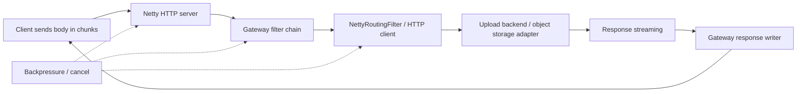
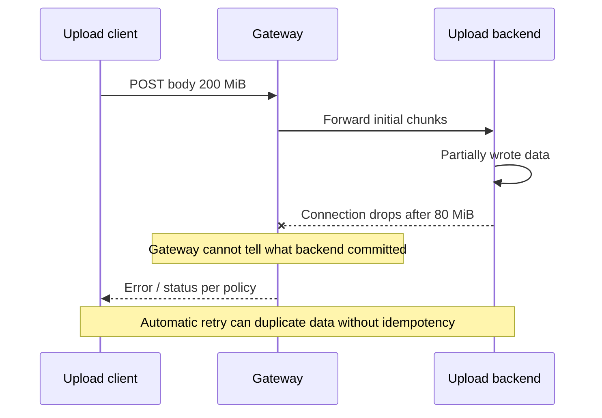

# Streaming Uploads/Downloads and the Impact of Body Filters in Spring Cloud Gateway

An API Gateway may forward tiny requests, yet it may also have to handle **multi-gigabyte file uploads**, **large downloads**, or **event streams lasting minutes or hours**. In those cases, the difference between *forwarding data as a stream* (**streaming**) and *reading the entire body into memory* (**buffering/aggregation**) determines service availability, latency, memory usage, and client-disconnect behavior.

In **SPRING_CLOUD_GATEWAY**, Gateway Server WebFlux combines Spring WebFlux, Reactor, and Reactor Netty to process HTTP reactively with backpressure. However, a filter that reads or transforms the body improperly can erase that streaming advantage. This lesson belongs to the **WebSocket and Streaming** chapter and focuses on **streaming uploads/downloads and body-filter impact**: spotting accidental buffering, designing safe filters, protecting memory and latency, and running long-lived load tests.

Throughout, Gateway enforces route predicates, the filter chain, path/header mutations, service discovery (`lb://`), authentication, rate limiting, circuit breakers, retries, TLS, and observability. Each feature can affect streaming, yet **you should never make Gateway hold entire files or streams in RAM just for convenience when inspecting bodies**.

> **Scope:** Content targets **Spring Cloud Gateway Server WebFlux**. Gateway Server MVC uses the Servlet stack and a different extension model. Starter names, `spring.cloud.gateway.*` namespaces, codec behavior, filter factories, and timeouts can differ across Spring Cloud release trains. Examples are technical patterns to verify against your **actual Gateway/Boot/Reactor Netty versions**, not a guarantee that every API streams identically.

## 1. How Does Streaming Differ from Buffering?

Suppose a client uploads a `2 GiB` file to `POST /api/files/upload`.

**Streaming** means Gateway processes data incrementally as chunks (`DataBuffer`) flow through the pipeline. It **does not need to hold the entire 2 GiB body in memory at once** just to forward it. Socket buffers, TLS buffers, queues, connection pools, and working buffers are still needed; "streaming" **does not mean zero bytes of memory**.

**Buffering/aggregation** means a component reads and collects chunks into one large object, such as a `String`, `byte[]`, composite `DataBuffer`, or decoded JSON value. Retained memory grows with body size and concurrent requests.

| Criterion | Streaming | Full-body buffering |
|---|---|---|
| When backend starts receiving data | Possibly before client finishes uploading | Typically after reading/aggregating the whole body |
| Extra memory in Gateway | Depends on bounded buffers and peer speeds | Can scale with body size × concurrent requests |
| First-byte/first-chunk latency | Usually lower when infrastructure supports it | Usually waits until aggregation completes |
| Per-chunk processing | Natural | May lose chunk boundaries |
| Full JSON/body transformation | Hard or requires streaming parsers | Easier for small bodies |
| Retrying partially sent requests | Complex; replay not guaranteed | Replayable if cached, at high memory cost |
| Risks on large uploads/downloads | Backpressure, timeouts, cancellation, proxy buffering | OOM, GC pressure, codec memory limits |

File-transfer APIs usually **do not need Gateway to understand file contents**. Gateway can authenticate the request, check quotas, and route via trusted metadata, letting the backend/object storage receive and process the bytes.

### Streaming Flow Through Gateway WebFlux



This diagram is a **pipeline model**; it does not imply chunks keep their original sizes or boundaries across HTTP/Netty. Network framing, TLS, codecs, and HTTP transfer encoding can split or coalesce bytes differently.

## 2. Uploads, Downloads, SSE, and WebSocket Are Not the Same Protocol

Within the **WebSocket and Streaming** chapter, distinguish these traffic patterns:

| Traffic type | Connection/data direction | Example | Sensitive areas |
|---|---|---|---|
| HTTP upload | Client → backend | PUT binary, POST multipart | Large bodies, replay, request limits |
| HTTP download | Backend → client | CSV, PDF, object download | Response chunking, Range, headers |
| **SSE** (Server-Sent Events) | Primarily server → client over HTTP | `text/event-stream` | Long-lived connections, event flushing, heartbeats |
| NDJSON / streamed JSON lines | Server → client or streamed upload | `application/x-ndjson` | Line boundaries, per-record parsing |
| **WebSocket** | Connection upgraded to bidirectional frame/message channel | Chat, bidirectional notifications | HTTP handshake/Upgrade, frame/message limits |
| gRPC/HTTP/2 streaming | HTTP/2 and dedicated protocol semantics | RPC streams | Distinct from HTTP/1.1 chunked |

**HTTP body filters are not equivalent to WebSocket frame filters.** After a WebSocket handshake, data travels in **WebSocket frames** via the matching routing path (`ws://`/`wss://` where Gateway supports it). A filter reading `ServerHttpRequest.getBody()` like an HTTP upload will not automatically read frames of an upgraded connection.

## 3. Routing Uploads/Downloads Without Touching the Body

Suppose Gateway Server WebFlux fronts two services:

- `upload-service` handles `POST /upload/**`;
- `download-service` serves `GET /download/**`.

In release trains using the `spring.cloud.gateway.routes` syntax:

```yaml
spring:
  cloud:
    gateway:
      routes:
        - id: upload-stream
          uri: lb://upload-service
          predicates:
            - Path=/api/files/upload/**
            - Method=POST
          filters:
            - StripPrefix=2

        - id: download-stream
          uri: lb://download-service
          predicates:
            - Path=/api/files/download/**
            - Method=GET
          filters:
            - StripPrefix=2
```

With this configuration:

```text
POST /api/files/upload/media       → POST /upload/media
GET  /api/files/download/report42  → GET  /download/report42
```

`StripPrefix=2` merely drops the two path segments `api` and `files` without reading the body. `Path` and `Method` route predicates do not consume the upload stream either.

**Practical requirement:** have a matching `DiscoveryClient`/LoadBalancer to resolve `lb://`. For a single-backend lab, temporarily use `http://localhost:9090`. Never attach `CacheRequestBody` or `ModifyRequestBody` just because a route carries uploads.

### Important Headers to Preserve

- `Content-Type`: payload format, including `boundary` for multipart.
- `Content-Length` or transfer encoding: HTTP framing; total length may be unknown when streaming.
- `Content-Encoding`: gzip or other encoding; must match actual wire bytes.
- `Authorization`/cookies: forward downstream only per approved trust boundaries.
- `Content-Range`/`Range`: essential for partial uploads/downloads when supported by APIs.
- `Expect: 100-continue`: behavior is determined by client/server/proxies; never assume every Gateway version preserves it identically.

**Never overwrite `Content-Length`** with the length of a single chunk or the pre-rewrite body length. If you alter byte sizes, let the pipeline produce proper HTTP framing/headers or recompute them explicitly.

## 4. DataBuffer, Flux, and Backpressure in WebFlux

In Spring WebFlux, `ServerHttpRequest.getBody()` returns a `Flux<DataBuffer>`, not a single `byte[]`. Each `DataBuffer` wraps a region of bytes; some implementations wrap pooled Netty buffers with **reference counting**.

```java
Flux<DataBuffer> body = exchange.getRequest().getBody();
```

That snippet illustrates the signature only. To understand the pipeline:

1. The HTTP source emits `DataBuffer` items as data arrives and subscribers request demand.
2. Reactor operators can observe, transform, or combine buffers.
3. The routing filter streams the body to the outbound HTTP client following the reactive lifecycle.
4. Backpressure throttles upstream stages when downstream slows down.
5. When a client aborts, cancellation propagates through subscriptions; **there is no guarantee every backend side effect stops instantaneously**.

### "Non-Blocking" Does Not Mean "Non-Buffering"

Code using `Mono`/`Flux` can still buffer the entire body:

```java
// ANTI-PATTERN: on large bodies, joins every byte into one buffer.
return DataBufferUtils.join(exchange.getRequest().getBody())
    .flatMap(joined -> {
        // ... process joined, then handle lifecycle/replay ...
        return Mono.empty();
    });
```

This snippet **is not a complete filter** and must not be used as-is in production. `DataBufferUtils.join(...)` can retain huge payloads; use the overload bounded by `maxByteCount` and handle ownership/release properly when aggregation is genuinely required. Also, if you consume the request body without re-emitting it, downstream receives an empty body.

**One subscriber does not always mean one request:** filters can be re-invoked by Retry or bodies re-subscribed in certain processing chains. Code holding state, counting bytes, or reading the full body must account for replay and cancellation semantics.

### Who Owns a DataBuffer?

When a filter **merely observes** a buffer and passes it untouched down the chain, downstream pipelines normally own its lifecycle. When a filter **retains**, **drops**, or **allocates new `DataBuffer` instances**, you must handle retain/release per framework rules to avoid memory leaks or `IllegalReferenceCountException`.

Rules:

- Never call `DataBufferUtils.release(buffer)` before passing that buffer downstream.
- Never stash a `DataBuffer` in a cache/list and reuse it after the source releases it without retaining ownership properly.
- If you filter out a buffer and do not forward it, release it per the implementation's contract.
- Never call `subscribe()` on the request body just to log it and leave routing to subscribe a second time.
- Never move pooled buffers to another thread or outlive the request lifecycle without managing reference counts.

For complex Java code needing buffering/replay, prefer official Gateway integrations or Spring Framework helpers rather than managing Netty reference counts manually.

## 5. Impact of Body Filters in Gateway

Various filters interact with the body directly or indirectly:

| Filter / technique | Reads body? | Potential impact on large uploads/downloads |
|---|---|---|
| `StripPrefix` / `RewritePath` | No | Typically no body buffering |
| `AddRequestHeader` / `SetRequestHeader` | No | Typically no body buffering |
| `CacheRequestBody` | **Yes** | Caching/decoding request body can retain large payloads |
| `ModifyRequestBody` | **Yes** | Decodes, transforms, re-encodes; can break streaming |
| `ModifyResponseBody` | **Yes** | Transforms response; can buffer output before replying to client |
| Body-based route predicate | Yes if implementation reads body | May require caching so downstream can read again |
| `Retry` with body | May need to retain/replay body | Increases memory and outbound attempts |
| `LocalResponseCache` | Caches eligible responses | Unsuitable by default for unbounded live streams |
| Custom body-logging filter | Usually yes | Easily breaks streams or leaks sensitive data |
| `RequestSize` / ingress upload limit | Enforces size cap | Does not replace safe streaming design; check behavior/version |

**Impact is not a fixed property of a filter name across all Gateway versions.** For example, a response converter may stream differently depending on types. Verify **whether it aggregates or retains payloads in RAM/disk, alters bytes/headers, or triggers re-subscription/retries**.

## 6. CacheRequestBody: Reading and Storing for Reuse Is Not Free

`CacheRequestBody` is typically used when downstream filters need to read the request body again. In supporting Gateway versions, you can declare `bodyClass` to specify the target conversion type:

```yaml
spring:
  cloud:
    gateway:
      routes:
        - id: small-json-inspection
          uri: http://localhost:9090
          predicates:
            - Path=/api/json/**
            - Method=POST
          filters:
            - name: CacheRequestBody
              args:
                bodyClass: java.lang.String
```

Its purpose is inspecting the body as a `String` and keeping it for later steps, **not optimizing a 2 GiB upload**. Actual retained size depends on codecs, decoding, and implementation.

In specific flows, the cached body may be stored in an exchange attribute like `ServerWebExchangeUtils.CACHED_REQUEST_BODY_ATTR`; **do not treat that attribute as a universal public contract across every custom filter and release train**. Use official APIs and verify lifecycle cleanup.

### When Does CacheRequestBody Make Sense?

- Small JSON bodies with an explicit size cap.
- Genuine business need to inspect contents before routing.
- Tests verifying the body forwards **completely** after filter inspection.
- Bounded RAM/concurrency and codec aggregation limits.
- No sensitive request bodies stored/traced/logged outside policy.

### When Should It Be Avoided?

- Large file or multipart uploads.
- Continuous NDJSON streams.
- SSE (which is a response stream, not a request body to cache).
- WebSocket frames.
- APIs requiring low time-to-first-byte and bounded memory.
- Requests without size limits at ingress/Gateway/backend.

**Raising `spring.codec.max-in-memory-size` to "fix" a `DataBufferLimitException` is not a default solution.** It permits larger single aggregations, yet **fails to bound total memory across concurrent requests** and does not make the pipeline stream.

## 7. ModifyRequestBody: Fits Small JSON, Not Large Files by Default

`ModifyRequestBody` reads the incoming body as one type and produces a new body of another type. In Gateway Server WebFlux, this filter is configured **via Java DSL** in many versions. Example illustrating `String` transformation for a small JSON endpoint:

```java
import org.springframework.context.annotation.Bean;
import org.springframework.http.MediaType;
import org.springframework.cloud.gateway.route.RouteLocator;
import org.springframework.cloud.gateway.route.builder.RouteLocatorBuilder;
import reactor.core.publisher.Mono;

@Bean
RouteLocator smallJsonRoute(RouteLocatorBuilder builder) {
    return builder.routes()
        .route("small-json-transform", r -> r
            .path("/api/json/**")
            .filters(f -> f.modifyRequestBody(
                String.class,
                String.class,
                MediaType.APPLICATION_JSON_VALUE,
                (exchange, body) -> Mono.justOrEmpty(body)
            ))
            .uri("http://localhost:9090"))
        .build();
}
```

This only **demonstrates the transformation mechanism** without changing data: it returns the original content. Decoding the entire body into a `String` may require aggregation; use it only on endpoints with **small request-size limits**. Never apply it to large files just to "pass through a filter."

### Consequences of Altering Bytes

If a filter adds or removes content, check:

- Is the old `Content-Length` still accurate?
- Do `Content-Type` and charset match the new payload?
- Does `Content-Encoding` still reflect compressed bytes?
- Do `Digest`/checksum headers, request signatures, or signature canonicalization break?
- For multipart, are `boundary` and part headers regenerated accurately?
- Does the backend verify an HMAC/signature over the raw body? Changing bytes invalidates old signatures.

**Never alter the body while leaving metadata tied to the old body intact.** For end-to-end signed requests, Gateway should normally **leave bodies untouched**, or operate under an explicitly redesigned signing/verification contract.

### When the Body Is Empty

Some `ModifyRequestBody` APIs represent an absent body with a publisher like `Mono.empty()`. Do not coerce an empty body into literal `"null"` or an empty string when the backend distinguishes **no body** from a **JSON null body**. Test absent bodies, zero-byte bodies, JSON null, and malformed bodies.

## 8. ModifyResponseBody: Risk of Breaking Streamed Downloads

A backend can generate and stream an HTTP response incrementally, such as a CSV exported batch by batch. If Gateway uses `ModifyResponseBody` to turn the entire response into a `String` or JSON object for text replacement, it may have to **wait for most or all of the response** before replying.

In many Gateway Server WebFlux versions, `ModifyResponseBody` is likewise configured via **Java DSL** and fits **small, bounded** response bodies best.

DSL illustration:

```java
@Bean
RouteLocator smallResponseRoute(RouteLocatorBuilder builder) {
    return builder.routes()
        .route("small-response-transform", r -> r
            .path("/api/small-response/**")
            .filters(f -> f.modifyResponseBody(
                String.class,
                String.class,
                (exchange, body) -> Mono.justOrEmpty(body)
            ))
            .uri("http://localhost:9090"))
        .build();
}
```

This is also an identity transform, **not a streaming filter**. Input/output types and codecs dictate how the body materializes.

### Why Are Large Downloads Easily Hurt?

1. Clients receive data only once the filter emits output; reading everything first increases **time to first byte (TTFB)**.
2. Each concurrent download can pin a huge response in memory.
3. If the client cancels mid-transfer, the pipeline must clean up buffers and backend work.
4. If bytes change, `Content-Length`, `Content-Encoding`, `ETag`, and `Content-Range` can become invalid.
5. Response post-processing filters may run **after the response commits**, when status/headers can no longer be changed arbitrarily.

**Never use `ModifyResponseBody(String.class, ...)` for large ZIP/PDF/video files or unbounded SSE** without verifying that the implementation streams cleanly within memory limits.

## 9. Observing a Streaming Body Without Consuming It

Suppose you want to count total bytes Gateway forwards without reading the body before routing. At the WebFlux layer, `ServerHttpRequestDecorator` can **observe each `DataBuffer` as it passes** while letting downstream subscribers consume the buffers.

Technical illustration in a Gateway Server WebFlux app:

```java
package example.gateway.streaming;

import java.util.concurrent.atomic.AtomicLong;

import org.slf4j.Logger;
import org.slf4j.LoggerFactory;
import org.springframework.cloud.gateway.filter.GatewayFilterChain;
import org.springframework.cloud.gateway.filter.GlobalFilter;
import org.springframework.core.Ordered;
import org.springframework.core.io.buffer.DataBuffer;
import org.springframework.http.server.reactive.ServerHttpRequestDecorator;
import org.springframework.stereotype.Component;
import org.springframework.web.server.ServerWebExchange;
import reactor.core.publisher.Flux;
import reactor.core.publisher.Mono;

@Component
public final class UploadByteCounterFilter implements GlobalFilter, Ordered {

    private static final Logger log =
        LoggerFactory.getLogger(UploadByteCounterFilter.class);

    @Override
    public int getOrder() {
        return 0; // Example; verify actual order when deploying.
    }

    @Override
    public Mono<Void> filter(
            ServerWebExchange exchange,
            GatewayFilterChain chain) {

        AtomicLong observedBytes = new AtomicLong();

        ServerHttpRequestDecorator request =
            new ServerHttpRequestDecorator(exchange.getRequest()) {
                @Override
                public Flux<DataBuffer> getBody() {
                    return super.getBody()
                        .doOnNext(buffer ->
                            observedBytes.addAndGet(
                                buffer.readableByteCount()));
                }
            };

        ServerWebExchange decorated =
            exchange.mutate().request(request).build();

        return chain.filter(decorated)
            .doFinally(signal ->
                log.debug("upload stream observedBytes={}, signal={}",
                    observedBytes.get(), signal));
    }
}
```

This code **never calls `read(...)` on `DataBuffer`, never joins the body, never calls `subscribe()`, and never retains buffers for replay**. It only inspects `readableByteCount()` as buffers flow to downstream subscribers.

**Important limitations:**

- This is a **simple observation pattern**, not a billing/quota-grade byte counter.
- A `GlobalFilter` participates only on matched Gateway routes; it does not measure requests blocked earlier by Security.
- A request body may never be subscribed if a route/filter aborts early, leaving the count at 0.
- If `Retry` or body re-subscription occurs downstream of the decorator, bytes can be counted multiple times; distinguish **client bytes**, **downstream bytes**, and **outbound attempts**.
- `doFinally` does not guarantee all bytes have finished flushing to the backend.
- Log only aggregate bytes, signals, and valid route/correlation IDs; never log raw bodies, tokens, or cookies.
- Always test cancellation, empty bodies, multipart, load, and leak detection on your target runtime version.

To measure production throughput accurately, instrument the HTTP server/client, Netty metrics, or official observability hooks rather than treating a custom filter like this as the sole source of truth.

## 10. Multipart/Form-Data Uploads: Boundaries, Parts, and Memory

A browser upload typically sends:

```http
POST /api/files/upload/media HTTP/1.1
Content-Type: multipart/form-data; boundary=----example-boundary
Content-Length: 52428800
```

The body contains multiple parts with their own headers and bytes. When Gateway acts purely as a **pass-through proxy**, it does not need to parse multipart into `FilePart` objects and reassemble them. If a custom filter invokes multipart decoding APIs to inspect individual parts, the framework may use **buffering and/or temporary storage** depending on codecs and config.

### Two Strategies

| Goal | Approach |
|---|---|
| Auth, quotas, route upload to backend | Authenticate/route via metadata first; **do not parse files** in Gateway |
| Virus scanning / true MIME / file metadata inspection | Route to a dedicated **upload service**, or a purpose-built streaming/scanner pipeline |
| Modifying a small form field | Consider handling in the backend rather than the Gateway proxy |
| Very large uploads | Enforce limits at ingress and backend; consider direct-to-object-storage uploads via short-lived URLs/tokens |
| Resumable/restartable uploads | Design a multipart/resumable API with offsets/checksums/idempotency; do not rely on generic HTTP retries |

### Never Alter Multipart Boundaries Arbitrarily

If a filter rebuilds a multipart body while leaving the old boundary in `Content-Type`, the backend fails to parse it. Similarly, if a filter merges/splits chunks and alters bytes while keeping old checksums or `Content-Length`, uploads fail or corrupt data.

**Never inject Spring WebFlux `FilePart` handling directly into a custom `GatewayFilter` without managing ownership and temp-file lifecycles.** Abstractions meant for controller uploads are rarely suitable inside a proxy.

## 11. Upload Size Limits and Codec Memory Limits

Upload design requires multiple layers of limits:

| Layer | Control | Why it is needed |
|---|---|---|
| CDN/Ingress/WAF | Request body limit, read timeout, rate/connection caps | Block abusive uploads before Gateway |
| Gateway route | `RequestSize` or version-matched request-size policy | Keep out-of-policy payloads off backends |
| Spring WebFlux codec | `max-in-memory-size` for **aggregation/decoding** operations | Cap how much a codec buffers at once |
| Upload backend | File size, file type, user/tenant quotas, checksums | Enforce business rules |
| Object storage | Multipart/part sizes, quotas, lifecycles | Protect storage tier |
| Network/TLS | Timeouts, bandwidth, connection limits | Prevent resource pinning |

Illustrative config for Gateway supporting `RequestSize`:

```yaml
spring:
  cloud:
    gateway:
      routes:
        - id: upload-with-size-policy
          uri: http://localhost:9090
          predicates:
            - Path=/api/files/upload/**
          filters:
            - name: RequestSize
              args:
                maxSize: 100MB
```

**Verify exact `RequestSize` semantics on your Gateway version**: it may inspect `Content-Length` or use a filter-specific mechanism; **do not assume chunked streams without a declared length always stop cleanly at byte 100,000,000**. Test requests with and without `Content-Length`, HTTP chunked transfers, multipart, and mid-stream aborts.

### `DataBufferLimitException`

If a body filter attempts to decode a huge JSON/file exceeding in-memory limits, it throws `DataBufferLimitException` or similar. Proper remediation:

1. Identify **which filter/codec is aggregating**.
2. For large files/uploads, **remove the aggregation step** and stream properly.
3. For small JSON, set an intentional body cap sized for concurrency.
4. Never raise codec limits endlessly just to silence errors.
5. Monitor heap, Netty direct memory, GC, pending connections, and upload concurrency.

`max-in-memory-size` **is not a total upload quota** for a streaming route that never decodes the entire body.

## 12. Streaming Downloads, Range Requests, and HTTP Metadata

For file downloads, Gateway should preserve HTTP representation semantics. A client can send:

```http
GET /api/files/download/report42 HTTP/1.1
Range: bytes=0-1048575
Accept: application/octet-stream
```

A range-capable backend replies:

```http
HTTP/1.1 206 Partial Content
Content-Range: bytes 0-1048575/8388608
Content-Length: 1048576
Content-Type: application/octet-stream
Accept-Ranges: bytes
ETag: "report42-v3"
```

**Never turn `206 Partial Content` into `200 OK`, nor alter/coalesce bytes into a different body while keeping `Content-Range`.** If a response filter modifies bytes, all representation metadata must be recomputed or stripped.

### Critical Fields

- `Content-Length`: if transformed bytes change size, the old header becomes wrong.
- `Content-Encoding`: gzipped bodies cannot be treated as plain text.
- `ETag` / `Last-Modified`: validators must match the actual representation.
- `Content-Range` and status `206`: must match the delivered byte range.
- `Accept-Ranges`: advertise range support only if supported end-to-end.
- `Content-Disposition`: sanitize filenames and encoding; never reflect untrusted input.
- `Cache-Control`: private responses need strict policies; never accidentally enable shared caching.
- `Access-Control-Expose-Headers`: browser JS can only read response headers exposed by CORS.

For large files, the best strategy is usually **not modifying response bodies in Gateway**, preserving `Content-Range`/`ETag` and letting the download service or object storage handle delivery.

## 13. SSE and NDJSON: Streams That Should Never Wait for Completion

**SSE** uses an HTTP response with `Content-Type: text/event-stream`. The server emits individual events, e.g.:

```text
event: progress
data: {"percent":10}

event: progress
data: {"percent":20}

: heartbeat

event: completed
data: {"percent":100}

```

Each event ends with a **blank line** per SSE format. Streams can stay open indefinitely; `heartbeat` helps proxies/clients recognize the connection is alive, subject to timeouts and buffering.

**NDJSON** sends multiple JSON objects one per line:

```text
{"id":1,"state":"started"}
{"id":2,"state":"running"}
{"id":3,"state":"finished"}
```

This is a **stream of JSON documents**, not a single JSON array. Any body transform treating the whole stream as one `String` or POJO waits until completion, destroying streaming.

### SSE Route Without Body Filters

```yaml
spring:
  cloud:
    gateway:
      routes:
        - id: events-stream
          uri: lb://event-service
          predicates:
            - Path=/api/events/**
            - Method=GET
          filters:
            - StripPrefix=1
```

Client test:

```bash
curl -N -i "http://localhost:8080/api/events/orders"
```

Depending on the backend, `curl -N` disables cURL's own output buffering so lines print immediately. It **does not disable buffering in Gateway, ingress, TLS proxies, or the backend**.

### Streaming Responses Need Proper Timeouts

An SSE response may **never complete**, so an overly short `response-timeout` or ingress/proxy idle timeout will drop the connection. Conversely, setting every timeout to "infinite" risks exhausting connection pools and resources.

Clarify:

- Which timeout governs **waiting for the first byte**, which governs **idle gaps between chunks**, and which sets **total lifetime**.
- Whether heartbeats fit within proxy idle timeouts.
- Whether browsers/`EventSource` reconnect and pass `Last-Event-ID` to resume.
- Whether the backend cancels work when clients disconnect.
- Whether concurrent connections and fan-out are capped to prevent memory/FD exhaustion.

**Do not equate `spring.cloud.gateway.httpclient.response-timeout` with an exact lifetime cap for every stream type**; behavior varies by Reactor Netty/Gateway version and I/O type. Test SSE across every real hop, including ingress and TLS termination.

## 14. WebSocket: How Does It Differ from HTTP Body Streaming?

A WebSocket connection begins with an HTTP handshake, upgrades protocols, and exchanges bidirectional **frames/messages**.

In Gateway WebFlux supporting WebSocket routing, routes can use `ws://` or `wss://`:

```yaml
spring:
  cloud:
    gateway:
      routes:
        - id: chat-websocket
          uri: lb:ws://chat-service
          predicates:
            - Path=/ws/chat/**
```

**Version note:** `lb:ws://` combines load balancing and WebSocket in supporting Gateway releases. On other versions, check the docs for `Websocket Routing Filter`/`ReactiveLoadBalancerClientFilter`. Never route all WebSocket traffic over `http://` assuming upgrades work automatically.

### Key Differences

| HTTP body streaming | WebSocket |
|---|---|
| HTTP request/response bodies pass through filter chain | Post-upgrade, data flows as WebSocket frames |
| `ModifyRequestBody` transforms HTTP request payloads | Not a transformer for WebSocket frames |
| `Content-Length`/`Transfer-Encoding` govern HTTP framing | WebSocket has its own framing |
| HTTP Retry can replay requests | Cannot safely auto-reconnect/replay messages |
| SSE is typically server → client | WebSocket is bidirectional |
| HTTP statuses/response headers work pre-commit | Post-handshake, frame errors cannot simply swap HTTP status |

Spring Security/CORS/origin checks must be resolved **at handshake time**; per-message/action authorization remains the backend WebSocket app's job. Never treat the WebSocket `Origin` header as proof of identity; verify sessions/tokens and trust boundaries per design.

A rate limiter on the handshake request **does not automatically limit WebSocket messages/second** once connected. To stop abuse, the backend or a purpose-built message-aware gateway must enforce message/frame size limits, per-connection budgets, and close policies.

## 15. Retry, CircuitBreaker, and Fallbacks on Upload/Download Streams

Retries are especially dangerous on **partially transmitted** streams.

### Upload Interrupted Mid-Stream



If `Retry` must replay a body, Gateway may need to **cache the request body** or rely on pipeline body replay. For large uploads, that carries huge memory overhead; if the backend already wrote part of the file before the reset, retrying can create duplicate files or corrupted data.

**Disable Retry by default on non-idempotent POST uploads.** If retries are required, design **resumable uploads** with part IDs, checksums, idempotency keys, explicit commit semantics, and cleanup in the upload service.

### Download Failing After Response Commit

```text
Backend returns 200 and sends first 3 MiB
    ↓
Gateway already sent headers + 3 MiB to client
    ↓
Backend drops connection
    ↓
Cannot reliably replace committed response with a fresh HTTP 503 JSON fallback
```

Circuit breakers/fallbacks can help before a response commits, yet once bytes have streamed to the client, changing status or body is no longer feasible. Define a partial-download contract, let **clients retry using `Range`** if supported by the backend, or let clients detect checksum/length mismatches.

### Interactions

| Mechanism | Streaming caveat |
|---|---|
| `RequestRateLimiter` | Usually limits **requests**, not bytes/sec or WebSocket messages |
| `Retry` | May force body buffering/replay; risks duplicate side effects |
| `CircuitBreaker` | Long streams produce different latency/error semantics than short calls |
| `FallbackHeaders` | Passes error metadata to fallbacks; cannot fix committed responses |
| `LocalResponseCache` | Unsuitable by default for SSE/unbounded streams or private files |
| `lb://` | Selects an instance; never migrates active streams if an instance dies |
| TLS/mTLS | Protects hops, adding handshake, buffer, and timeout overhead |
| Spring Security | AuthN/AuthZ before routing; backend must still enforce object/file permissions |

## 16. Timeouts, Backpressure, and Cancellation in Production

A streaming connection involves three distinct timers:

1. **Connect timeout:** how long Gateway waits to connect to the backend.
2. **Read/response idle timeout:** how long to wait for the next bytes/chunks before declaring a stall.
3. **Total lifetime/deadline:** how long the entire upload/download is permitted to run.

Setting any of these too low kills legitimate slow-network transfers. Leaving them unbounded lets slow clients pin connections, memory, and file descriptors indefinitely (**slow upload / slow client**).

### Budgets Must Match API Type

| API | Policy suggestion |
|---|---|
| Small JSON | Short timeouts and bounded codec `max-in-memory-size` |
| Large file upload | Duration/idle limits sized for file scale; concurrency and byte caps |
| Large file download | Origin wait timeout, client-disconnect cleanup, Range/checksums |
| SSE | Heartbeats + matching idle policy, max connections, and reconnect strategy |
| WebSocket | Handshake timeout, frame/message size caps, ping/pong/idle, max connections |
| Multi-tenant platform | Byte quotas and concurrency quotas per trusted principal/tenant |

**Backpressure regulates flow between publisher and subscriber**, yet cannot replace bandwidth quotas, request-size caps, timeouts, or infrastructure safeguards. A filter that calls `subscribe()`, uses unbounded queues, or buffers everything defeats backpressure.

### When Clients Cancel Requests

Canceling an HTTP request usually triggers a cancellation signal in the reactive pipeline, yet:

- The backend may already have committed a file or DB transaction.
- The TCP socket may linger briefly if buffering/retrying.
- Caches or temporary files may require explicit cleanup.
- Some external jobs ignore downstream cancellation.
- Cancellation never proves side effects did not happen.

Design dedicated **idempotency, cleanup, and job status tracking** for long-running operations.

## 17. Direct Testing of Uploads/Downloads Through Gateway

### Lab Environment

Assume:

- Gateway WebFlux runs at `http://localhost:8080`.
- The test upload/download backend runs at `http://localhost:9090`.
- Direct HTTP routes to the backend match `/api/files/upload/**` and `/api/files/download/**`.
- The test backend exposes an endpoint writing files and returning checksums, plus an endpoint streaming files/chunks.
- No CDN cache or buffering reverse proxy sits in front during baseline tests.
- You are authorized to run large-payload tests in an environment **free of personal data**.

**Never use files containing real secrets** for memory benchmarks or payload logging.

### Step 1 — Create a Test File and Measure Size

On POSIX environments you can run:

```bash
# Generate 32 MiB of dummy data. Never use production files.
dd if=/dev/zero of=upload-test.bin bs=1M count=32
wc -c upload-test.bin
```

On Windows use an equivalent test-environment tool. The goal is a deterministic payload for comparison, not mandating an exact 32 MiB size.

### Step 2 — Upload Directly to the Backend

```bash
curl -i -X POST \
  -H "Content-Type: application/octet-stream" \
  --data-binary "@upload-test.bin" \
  "http://localhost:9090/upload/media"
```

The test backend must expose `POST /upload/media`. Record received bytes, checksum, upload duration, and memory baseline.

### Step 3 — Upload Through Gateway Without Body Filters

```bash
curl -i -X POST \
  -H "Content-Type: application/octet-stream" \
  --data-binary "@upload-test.bin" \
  "http://localhost:8080/api/files/upload/media"
```

With the `StripPrefix=2` route from section 3, the backend receives `/upload/media`. Compare:

- Bytes received and checksum at the backend.
- HTTP status and response body.
- Latency, throughput, and Gateway CPU/memory.
- Whether any limit/timeout fired in ingress or Gateway.
- Whether Gateway memory grows roughly proportional to total file size × concurrency.

A **correct** result does not require identical chunk counts or `Transfer-Encoding` on every hop, yet **payload bytes and HTTP contract must match**.

### Step 4 — Test Multipart

```bash
curl -i \
  -F "description=demo" \
  -F "file=@upload-test.bin;type=application/octet-stream" \
  "http://localhost:8080/api/files/upload/media"
```

This test requires a backend supporting `multipart/form-data`. Verify `description`, filename, byte count, and a valid `Content-Type` boundary. When Gateway leaves bodies untouched, the backend still parses every part cleanly.

### Step 5 — Download and Compare Checksums

```bash
curl -fS \
  -o download-via-gateway.bin \
  "http://localhost:8080/api/files/download/report42"

# When a matching direct endpoint is available:
curl -fS \
  -o download-direct.bin \
  "http://localhost:9090/download/report42"

sha256sum download-via-gateway.bin download-direct.bin
```

For the same backend version and immutable resource, checksums must match. If the resource can change during testing, pin an ETag/version or immutable object.

### Step 6 — Range Request

```bash
curl -i \
  -H "Range: bytes=0-1023" \
  "http://localhost:8080/api/files/download/report42"
```

If the backend supports byte ranges and Gateway preserves metadata, verify `206`, `Content-Range`, byte count, and `ETag`. Do not assume every backend supports Range; if a backend returns `200` with the full file, verify that backend contract.

### Step 7 — Verify SSE Flushes Chunks Early

```bash
curl -N -i --max-time 12 \
  "http://localhost:8080/api/events/orders"
```

Compare arrival timestamps of each `data:` event against calling the event backend directly. If events arrive only when the stream closes or after long buffering gaps, inspect codecs/body filters, ingress proxy buffering, compression, and flushing.

### Step 8 — Compare With and Without Body Filters

Strictly on a **lab route** with bounded small payloads:

1. Measure baseline streaming with no body filters.
2. Enable `CacheRequestBody` with `String` on a small test route; monitor heap/GC.
3. Enable `ModifyRequestBody` via Java DSL on a small JSON route; measure TTFB and memory.
4. Ramp concurrent requests within safe bounds, recording peak memory and any `DataBufferLimitException`.
5. Never run these aggregation tests on huge files or in production just to prove the system can break.

**Goal:** demonstrate which body filters raise memory/latency and choose **no body filters** on streaming routes whenever unnecessary.

## 18. Correctness and Resilience Test Matrix

| Case | What to assert |
|---|---|
| 0-byte upload | Backend receives an empty body, never literal `"null"` |
| Binary upload with `0x00` bytes | Not treated as UTF-8 text or byte-corrupted |
| Multi-chunk upload | Byte count and checksum hold regardless of chunk boundaries |
| Multipart upload | Boundary, form fields, and files parsed properly by backend |
| Client aborts mid-upload | Gateway/backend clean up cleanly without resource leaks |
| Backend aborts mid-download | Client sees appropriate error/truncation; never mutates post-commit to 503 |
| Range download `206` | `Content-Range`, bytes, length, and validators match |
| Gzip/identity | `Content-Encoding` matches actual wire bytes |
| Long-lived SSE | Events flush immediately without waiting for stream end |
| NDJSON | Lines stream continuously without forcing full JSON aggregation |
| WebSocket upgrade | Handshake succeeds, frames route cleanly, no HTTP body transforms applied |
| `RequestSize` exceeded | Policy triggers for `Content-Length` and chunked cases per version |
| Codec memory limit | Oversized JSON rejected or handled per policy without OOM |
| Retry + POST upload | No duplicate side effects on connection drops |
| `LocalResponseCache` | Never caches private or unbounded streams as shared entries |
| JWT/cookies/tenants | Zero permission/file leakage across users and tenants |
| 50+ concurrent uploads (bounded lab) | Memory/FD/GC/latency tracked without unbounded growth |
| Multiple Gateway instances | Routing, headers, checksums, and timeouts stay consistent |
| Real TLS/ingress | No unintended buffering; aligned idle timeouts |

Measure across **client, Gateway, and backend**, not just a `200` status. A server might return HTTP 200 early and fail while writing; tests must verify the **final outcome** and cleanup.

## 19. Troubleshooting Body-Filter Failures

| Symptom | Common cause | What to check |
|---|---|---|
| Large upload hits `DataBufferLimitException` | Filter/codec aggregating body | Check for `CacheRequestBody`/`ModifyRequestBody` or multipart decoding |
| Downstream receives empty body | Custom filter consumed body without replay | Inspect single subscription and request decorators |
| Gateway heap/direct memory spikes | Body caching/buffering/retry under high concurrency | Heap/direct memory, Netty leak detector, GC |
| SSE stream outputs only at end | Response body aggregated or proxy-buffered | Disable body transforms; check flushing per hop |
| Backend multipart parser rejects boundary | Body modified while `Content-Type` stayed unchanged | Compare raw body/headers and encoding |
| Download fails checksum | Filter altered bytes or compression/encoding mismatch | Compare checksums directly at backend vs. Gateway |
| `206` returns wrong byte count | Range handling or body transform broke `Content-Range` | Test partial bytes and metadata |
| `Content-Length` mismatch | Body size changed while old header stayed | Inspect framing and content metadata |
| Retries create duplicate files | POST upload replayed after backend already wrote | Design idempotency/resumable uploads |
| SSE hits 504 despite healthy backend | Timeout/idle policy incompatible with streaming | Check Netty, ingress timeouts, and heartbeats |
| Client disconnects yet backend keeps writing | Cancellation did not stop started side effects | Check cleanup/idempotency and backend logs |
| WebSocket handshake fails | Scheme/upgrade/proxy differs from HTTP route | Check `ws/wss`, headers, LB, and Origin/auth |
| WebSocket frames bypass body filter | Frames are not HTTP request bodies | Use WebSocket-message-aware components |
| `Authorization` lost while forwarding | Wrong header filter or security policy | Check trust boundaries and filter ordering |
| All uploads hit one unhealthy instance | Discovery/LoadBalancer or connection pool issue | Log instance IDs, metrics, and health |
| Works only without TLS | Proxy/TLS buffering, timeouts, certificate trust | Test end-to-end through ingress |
| Attempted status change after sending bytes | Response already committed | Design a streaming error contract |

### Six Investigative Questions

1. Is the request/response truly **streaming**, or is the body decoded/joined/cached somewhere?
2. Which factory in the **route filter chain** reads/mutates the body; are any default/global filters active?
3. Is Gateway retaining too many `DataBuffer` instances or replaying bodies via `Retry`?
4. Do `Content-Length`, `Content-Encoding`, `Content-Range`, and `Content-Type` match the post-filter bytes?
5. Did the timeout occur at the **client, ingress, Gateway HTTP client, or backend**?
6. Did the error happen **before or after response commit**; do we need a different resume/checksum/idempotency design?

Never diagnose from HTTP 200 alone, and never enable raw request/response body logging in production just to "see clearly."

## 20. Pre-Production Checklist

- [ ] I distinguish HTTP uploads, downloads, SSE/NDJSON, and WebSocket frames.
- [ ] I know streaming **avoids full-body aggregation**, yet still uses network/TLS/Netty buffers.
- [ ] I understand `Flux<DataBuffer>`, pooled buffer lifecycles, backpressure, and cancellation.
- [ ] I never call `subscribe()`, `block()`, or retain `DataBuffer` beyond its lifecycle without managing ownership.
- [ ] I never call unbounded `DataBufferUtils.join(...)` on large uploads.
- [ ] I classify `CacheRequestBody`/`ModifyRequestBody`/`ModifyResponseBody` by aggregation risk.
- [ ] I avoid body transforms on large files/SSE/unbounded streams just to log payloads.
- [ ] I configure `RequestSize`, ingress size limits, and `spring.codec.max-in-memory-size` for their proper roles.
- [ ] I preserve multipart boundaries and HTTP framing/content headers when bytes are unchanged.
- [ ] When modifying bodies, I update `Content-Length`, `Content-Encoding`, `ETag`, signatures, and checksums.
- [ ] I test HTTP `Range`/`206`/`Content-Range` for downloads when APIs support ranges.
- [ ] I understand `Retry` on bodies can force buffering/replay and duplicate side effects.
- [ ] I retry uploads only when the backend provides explicit idempotency/resumable contracts.
- [ ] I never expect fallbacks to rewrite status/body after a response commits.
- [ ] I implement heartbeats, idle/timeout policies, and reconnect/resume for long-lived streams.
- [ ] I do not mistake HTTP-request rate limiting for byte quotas or WebSocket message quotas.
- [ ] I enforce per-user/tenant file access at both Gateway and backend, never trusting spoofed headers.
- [ ] I manage TLS, service discovery, slow clients, connection pools, and max concurrency.
- [ ] I monitor TTFB, throughput, backend bytes, heap, direct memory, GC, and connection counts.
- [ ] I test cancellations, partial uploads, multipart, Range, SSE, WebSocket, and multi-instance end-to-end.
- [ ] I never log raw file bytes, access tokens, session cookies, or sensitive data.
- [ ] I have a plan to disable body filters or roll back if memory leaks or data corruption appear.

## Official References

- [Spring Cloud Gateway Reference](https://docs.spring.io/spring-cloud-gateway/reference/) — sections on **CacheRequestBody**, **ModifyRequestBody**, **ModifyResponseBody**, **RequestSize**, **Retry**, WebSocket routing, and Gateway Server WebFlux by version.
- [Spring Framework — WebFlux](https://docs.spring.io/spring-framework/reference/web/webflux.html) — request/response streaming, multipart, SSE, and reactive HTTP.
- [Spring Framework — Data Buffers and Codecs](https://docs.spring.io/spring-framework/reference/core/databuffer-codec.html) — `DataBuffer`, `DataBufferUtils`, reference counting, and codec limits.
- [Spring Framework — WebSocket](https://docs.spring.io/spring-framework/reference/web/webflux-websocket.html) — WebSocket handshake, messages, and lifecycle.
- [Project Reactor Reference](https://projectreactor.io/docs/core/release/reference/) — `Flux`/`Mono`, backpressure, cancellation, and operator behavior.
- [Reactor Netty Reference](https://projectreactor.io/docs/netty/release/reference/) — HTTP client/server, connection pooling, timeouts, and metrics.
- [RFC 9110 — HTTP Semantics](https://www.rfc-editor.org/rfc/rfc9110) — framing/representation metadata, Range requests, `206` status, and validators.
- [MDN — Server-sent events](https://developer.mozilla.org/en-US/docs/Web/API/Server-sent_events/Using_server-sent_events) — SSE format and `EventSource` connections.

**Takeaway:** In Gateway Server WebFlux, uploads/downloads and SSE flow incrementally through a **`Flux<DataBuffer>`** pipeline, yet any filter that reads, caches, or transforms the whole body can **turn streaming into buffering**, spiking memory and TTFB latency. Prefer **routing by path/headers without touching bytes**, transform only small bounded bodies, respect reference counting and cancellation, preserve HTTP metadata, and test end-to-end across checksums, Range, SSE, timeouts, and aborts. For WebSocket, **post-handshake frames are a separate model**, never an HTTP request body for `ModifyRequestBody`.
