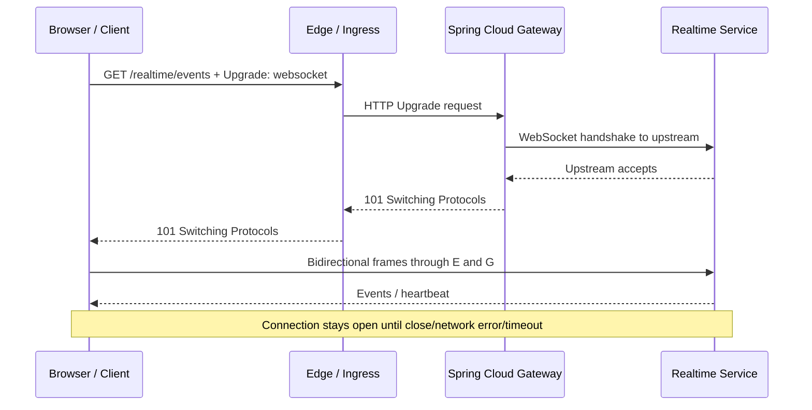
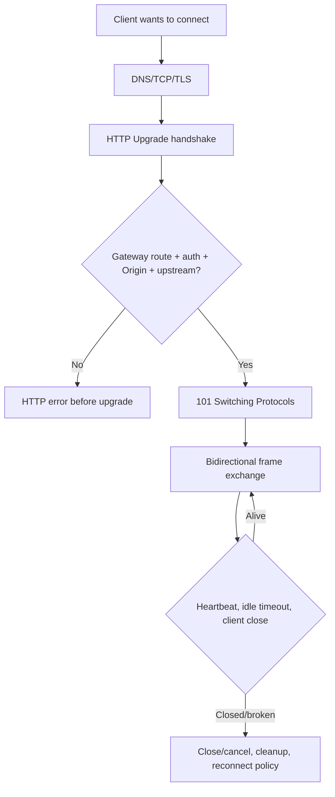
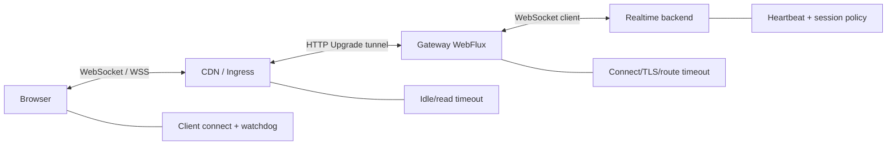
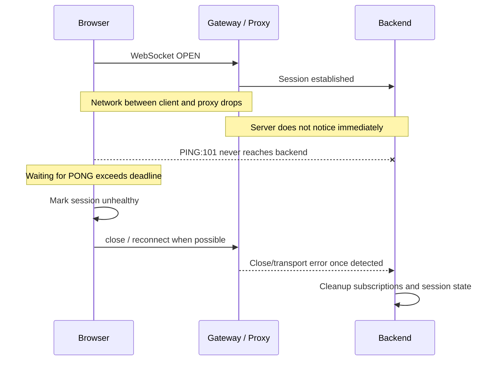
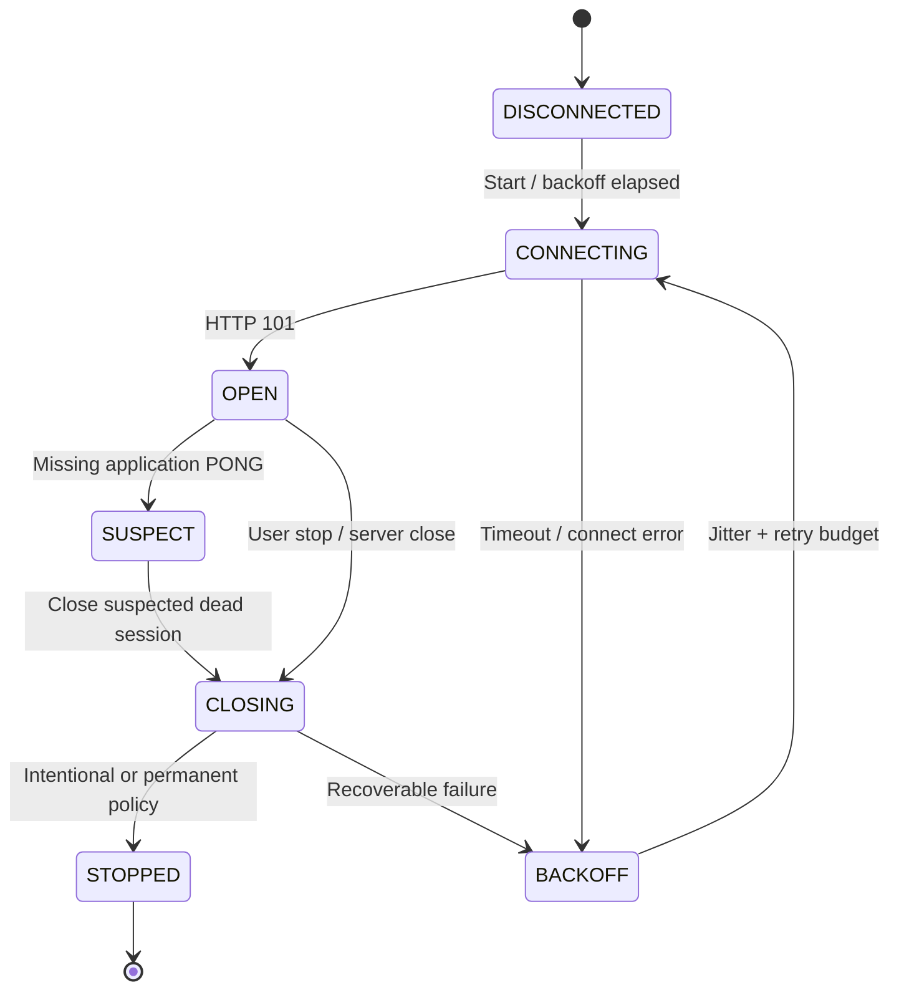
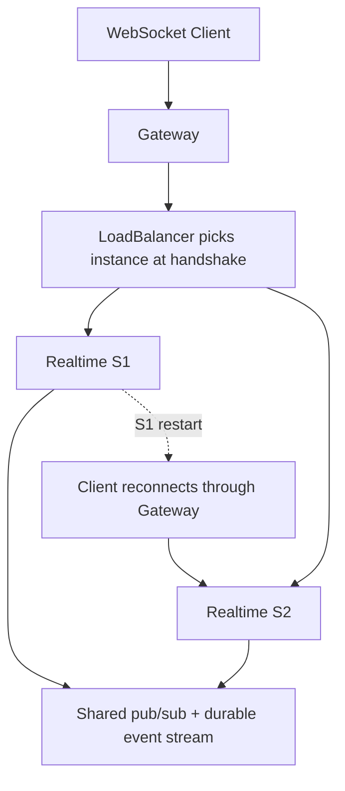
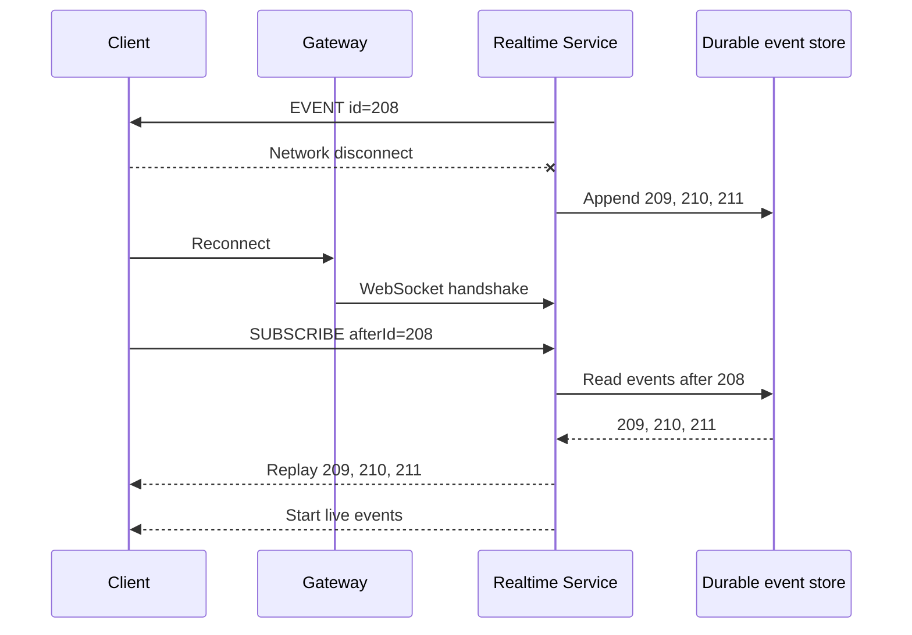

# Timeouts, Heartbeats, and Client Disconnects in Spring Cloud Gateway

A **WebSocket** connection often lasts for minutes, hours, or until the user closes the app. Throughout that lifetime, Gateway, reverse proxies, load balancers, backends, and browsers all participate in keeping the bidirectional channel alive. A connection may receive **HTTP 101 Switching Protocols**, only to break later when mobile networks switch, a proxy hits an idle timeout, a backend restarts, or a device enters power-saving mode.

Therefore, "WebSocket is open" does not mean "the link will stay alive forever." A resilient design must answer three questions:

1. **Where are the timeouts?** Is it a connect/handshake timeout, idle timeout between frames, application session lifetime, or an individual operation timeout?
2. **Which heartbeat proves what?** Protocol-level Ping/Pong only checks a specific hop; application-level heartbeats can verify the path all the way to the backend and business responsiveness.
3. **What happens when a client disconnects?** Close the session, cancel subscriptions, release resources, decide whether to reconnect, recover missed data, and avoid duplicating operations.

This lesson belongs to the **WebSocket and Streaming** chapter of the `SPRING_CLOUD_GATEWAY` module. The context is an API Gateway routing via predicates/filter chains, transforming paths/headers, doing service discovery and load balancing, while coordinating JWTs, rate limiting, retries, circuit breakers, TLS, and observability to run microservices safely.

> **Scope:** Prioritizes **Spring Cloud Gateway Server WebFlux** with Reactor Netty and WebSocket routing. Gateway Server MVC has a different WebSocket stack and configuration limits; do not copy MVC properties to WebFlux. Timeout/heartbeat values below are for learning and testing, not mandatory defaults for every version or infrastructure.

## 1. Why Does WebSocket Have a Different Lifecycle from Standard HTTP Requests?

With standard HTTP, a client sends a request, the backend returns a response, and the request ends. With WebSocket over HTTP/1.1, the client requests an **Upgrade**, the server accepts with **101 Switching Protocols**, and the connection then carries bidirectional WebSocket frames.



Once upgraded:

- The model is no longer "one WebSocket message equals one new HTTP request."
- HTTP status codes like 401/429/503 primarily occur **before** the handshake succeeds.
- Subsequent traffic travels inside **WebSocket frames**: text, binary, or control frames.
- An HTTP client response timeout does not automatically equal the idle timeout of the entire WebSocket session.
- Picking an upstream once at connect time does not mean each message gets re-load-balanced.

### 1.1. Defining Five Key Time Milestones

| Milestone | Explanation | Example |
| --- | --- | --- |
| **TCP connect timeout** | Time to establish the network connection to Gateway/upstream. | Host or service unreachable. |
| **TLS handshake timeout** | Time to negotiate TLS for `wss://` or HTTPS/TLS to backend. | Certificate or network unresponsive. |
| **HTTP Upgrade handshake deadline** | Time waiting to receive protocol upgrade acceptance. | Waiting for 101 or getting 401/403/502. |
| **Idle timeout** | Time without qualifying data/frames on a hop. | Proxy closes tunnel after silence. |
| **Application heartbeat deadline** | Time client/server tolerates missing an app liveness reply. | No `PONG:42` received within 12 seconds. |

In addition, there are **maximum session duration**, **JWT expiration time**, **presence TTL**, and **individual command deadlines**. Never collapse all of these into one number and call it "WebSocket timeout."

## 2. WebSocket Routing in Gateway Server WebFlux

Spring Cloud Gateway Server WebFlux provides **WebSocket Routing Filter**. When the routed URI uses scheme `ws` or `wss`, WebSocket routing forwards the session downstream. To choose an instance via Spring Cloud LoadBalancer, Gateway documentation supports the `lb:ws://service-id` prefix.

Example with a Realtime Service registered under service ID `realtime-service`:

```yaml
spring:
  cloud:
    gateway:
      server:
        webflux:
          routes:
            - id: realtime-websocket
              uri: lb:ws://realtime-service
              predicates:
                - Path=/realtime/**
              filters:
                - StripPrefix=1
```

Routing example:

```text
Client:
  wss://api.example.com/realtime/events

Gateway:
  Route realtime-websocket
  StripPrefix=1

Backend:
  WebSocket /events on one instance of realtime-service
```

**Note:** `wss://` from browser to Gateway only proves TLS for the **client–Gateway hop**. Upstream in this example uses `lb:ws://`; securing the Gateway–backend hop depends on network/trust boundaries, TLS/mTLS, or secure routing configs deployed. Never claim the entire journey is encrypted solely because the browser uses WSS.

### 2.1. Route Namespace Depends on Version

- Older Gateway WebFlux generations typically use `spring.cloud.gateway.routes`.
- Newer generations use `spring.cloud.gateway.server.webflux.routes`.
- Gateway Server MVC uses its own namespace, APIs, and WebSocket proxy characteristics.

When a route fails to work, verify the **exact server variant** and starter/dependencies first rather than copying the new namespace into an older app or vice versa.

### 2.2. Handshake Differs from Frame Transmission



A `RequestRateLimiter` allowing the handshake does not mean subsequent messages are rate-limited. If frame-rate or business-action limits are required, the backend must enforce dedicated policies on **received messages**.

## 3. Layer-by-Layer Timeout Map

In practice, "WebSocket drops after 60 seconds" can come from multiple layers:



| Layer | Common limit types | What to measure |
| --- | --- | --- |
| **Browser/client** | Connection establishment deadline, heartbeat deadline, page lifecycle, background timer throttling. | `readyState`, open duration, `CloseEvent`, heartbeat RTT. |
| **CDN/reverse proxy/ingress** | Idle read timeout, connection draining, HTTP Upgrade support, maximum lifetime. | Tunnel close timestamps and proxy logs. |
| **Gateway** | Upstream connection/TLS handshake, routing errors, session close/cancel conditions. | Route ID, upstream connect errors, active sessions. |
| **WebSocket backend** | Application inactivity, heartbeats, session permissions, message size, and max sessions. | Last activity, session close reason, resource cleanup. |
| **Network/TCP** | NAT mappings, Wi-Fi ↔ cellular switches, proxy/firewall resets, broken transport. | TCP reset/FIN, packet loss, detection latency. |
| **Deployment infrastructure** | Rolling restarts, pod termination grace period, readiness/draining. | Close codes, reconnect surges, instance restarts. |

**There is no single global timeout knob** guaranteeing every WebSocket connection stays alive for 30 minutes. Each hop enforces its own policy; the lowest threshold or any anomaly closes the session first.

### 3.1. Idle Timeout Is Not Necessarily "Maximum Connection Age"

- **Idle timeout:** resets upon receiving qualifying activity; heartbeats can keep the connection alive.
- **Maximum connection age:** closes after a fixed duration regardless of heartbeats.
- **Session/token expiry:** requires re-authentication or closes the session when identity policy demands.
- **Business operation timeout:** a command fails to complete on time; may not require closing the entire WebSocket.

If Gateway runs fine for 30 minutes while ingress enforces a **15-minute maximum connection lifetime**, increasing heartbeat frequency will not keep connections alive past 15 minutes.

## 4. Do Not Confuse HTTP Timeouts with WebSocket Idle Timeouts

Spring Cloud Gateway Server WebFlux exposes HTTP client settings such as:

- `spring.cloud.gateway.server.webflux.httpclient.connect-timeout`: outbound connect timeout in the version's unit, typically **milliseconds**.
- `spring.cloud.gateway.server.webflux.httpclient.response-timeout`: timeout governing HTTP responses per the HTTP client contract.
- `spring.cloud.gateway.server.webflux.httpclient.ssl.handshake-timeout`: outbound TLS negotiation timeout.
- Some routes also support `connect-timeout`/`response-timeout` metadata for HTTP routing.

**Do not assume setting `response-timeout: 10s` automatically closes every WebSocket session after 10 seconds of silence.** After HTTP Upgrade, the path is a WebSocket session; timeout behavior depends on implementation and proxy hops. Verify by testing on your exact version.

### 4.1. Actual WebSocket Settings in Gateway WebFlux

In newer WebFlux branches, configuration metadata includes:

```yaml
spring:
  cloud:
    gateway:
      server:
        webflux:
          httpclient:
            websocket:
              proxy-ping: true
              max-frame-payload-length: 65536
```

**Exact explanation:**

- `proxy-ping` controls **forwarding WebSocket Ping frames downstream** in the WebSocket HTTP client; in newer branch docs, the documented default is `true`.
- `max-frame-payload-length` bounds **one frame's payload** in the corresponding client/config, **not** a timeout, business message quota, or total size of a fragmented message.
- `65536` merely illustrates a limit to tune per application; never apply it to all binary/streaming workloads without measuring.

In older branches, the prefix may be `spring.cloud.gateway.httpclient.websocket.*`. Do not use `spring.cloud.gateway.server.webmvc.websocket.*` properties as guidance for Server WebFlux.

### 4.2. `proxy-ping: true` Does Not Mean Gateway Auto-Generates Heartbeats

`proxy-ping` **is not an automatic 20-second Ping scheduler**. It governs how WebSocket ping frames are proxied across the hop. To emit periodic heartbeats, implement them in **client/server**, using Ping/Pong-capable WebSocket APIs or **application-level heartbeats**, and verify in practice.

Even when a Ping receives a Pong, that usually proves only **the peer answered on the checked hop**, not that all backend business processing is healthy.

### 4.3. A WebSocket Session Can Be Open While the Backend Is Unhealthy

For example, a proxy may answer Ping/Pong on one hop, or the backend event loop may be stalled and unable to emit business data. The client sees `readyState === OPEN` while the stream makes no progress.

Observability must therefore distinguish:

- Transport still exchanges control frames.
- Backend application actively processes and replies to heartbeats.
- Backend still emits business events/acks within SLO latency.

## 5. NGINX Ingress: Idle Read Timeout Example

When using NGINX as a reverse proxy in front of Gateway, NGINX docs describe proxying Upgrade connections and `proxy_read_timeout`. A minimal snippet for a WebSocket location:

```nginx
location /realtime/ {
    proxy_pass http://gateway_upstream;
    proxy_http_version 1.1;
    proxy_set_header Upgrade $http_upgrade;
    proxy_set_header Connection "upgrade";

    proxy_read_timeout 75s;
}
```

**Caveat:** This is an illustrative fragment for a specific NGINX site config; newer setups or nginx-ingress/CDN platforms have their own syntax and requirements around `proxy_http_version`.

In NGINX semantics, `proxy_read_timeout` is the **interval between successive reads from upstream**; it is not total download duration or a shared bidirectional timer. If upstream sends nothing within that window, NGINX closes the connection. Thus, a client streaming messages **upstream-only** with zero server replies can still hit the proxy's idle timeout.

### 5.1. Picking Heartbeats to Fit Proxy Read Timeouts

Suppose ingress closes after **75 seconds** with no data from Gateway/upstream. A reference design:

```text
Ingress proxy_read_timeout:       75 s
Application heartbeat interval:   20 s
Expected PONG deadline:           12 s
Client reconnect backoff:         max 30 s, with jitter
```

When the server returns `PONG` within the valid interval, upstream bytes keep the proxy tunnel active. However, not all CDNs/ingresses define "activity" identically, and some enforce hard maximum lifetimes regardless of frames; measure via integration tests.

**Never set the heartbeat interval equal to the idle timeout.** Network jitter, GC pauses, browser background throttling, or scheduling delays will cause frames to arrive too late.

### 5.2. Other Hops Have Different Idle Timeouts

If the chain is:

```text
Browser → CDN → NGINX → Gateway → Backend
```

check at minimum:

- Idle timeout between browser and CDN.
- Idle timeout/tunnel policy from CDN to NGINX.
- `proxy_read_timeout`, `proxy_send_timeout`, and Upgrade settings in NGINX.
- Connection hold behavior in Gateway's WebSocket client/server.
- Backend session inactivity policy and TCP keepalive.

The proper solution is designing against the **lowest effective threshold** with heartbeats visible across all hops that need keepalive, rather than tuning only one parameter in Gateway.

## 6. Two Heartbeat Types: Protocol Ping/Pong and Application-Level

WebSocket includes protocol-level **control frames** Ping/Pong. Additionally, apps can define text/binary messages like `PING:123` and `PONG:123`.

| Criterion | **WebSocket Ping/Pong control frames** | **Application heartbeat** |
| --- | --- | --- |
| Data type | WebSocket protocol frame. | Text/binary message per app schema. |
| Who can send? | WebSocket server/client APIs supporting control frames. | Any client/server permitted to send data messages. |
| Does native browser `WebSocket` have `ping()`? | **No.** Browsers expose no public API to send control Pings. | Can call `socket.send(...)` like any message. |
| What peer/hop it tests | Depends on where Ping/Pong is handled or proxied. | Can require the **backend app** to receive and reply. |
| Business value | Does not verify app command processing. | Can exercise app event loops, subscriptions, or session permissions. |
| Overhead | Lightweight, bounded control-frame payload. | Requires formatting/parsing/validation; needs quotas and abuse limits. |

### 6.1. Ping/Pong Control Frames

The WebSocket spec defines Ping/Pong as control frames. Upon receiving Ping, a peer normally responds with Pong echoing the payload. However, **a proxy/WebSocket stack may answer control frames at an intermediate hop**, depending on variant and implementation. Therefore, a Pong is not ironclad proof that the backend processed a business request.

In **Gateway WebFlux**, `httpclient.websocket.proxy-ping` controls forwarding pings downstream on supporting versions; in **Gateway Server MVC**, Servlet WebSocket/proxy mechanics can differ significantly. Never transfer assumptions blindly from one variant to the other.

### 6.2. Application Heartbeat

A minimal contract:

```text
Client → Backend: "PING:42"
Backend → Client: "PONG:42"
```

Applications may include:

- A non-sensitive `sessionId`.
- Sequence/correlation ID to match Ping with Pong.
- Timestamp to measure RTT (never for authorization).
- Stream offset/`lastEventId` for resume.
- Protocol version and heartbeat policy code.

**Never put JWTs, API keys, or personal data inside heartbeats.** A heartbeat only needs to prove the session is responsive; keep payloads tiny.

### 6.3. Heartbeats Are Not Authentication

A client sending `PING:42` does not prove permission to read a stream. Authenticate at the handshake and authorize messages/subscriptions separately. If a token/session is revoked while WebSocket is open, the backend needs session lifetime or revalidation policies rather than treating a valid Pong as proof of ongoing authorization.

## 7. Diagram for Detecting "Half-Open" Connections

On mobile networks, losing connectivity may not immediately generate close frames to both sides:



**Half-open** is a state where one side still believes the connection is live while the other has lost connectivity. Default TCP keepalive can detect dead peers too slowly for real-time UX; application heartbeats usually detect them faster.

Still, apps should not treat **a single ultra-short missed Ping** as a guaranteed failure: backgrounded devices, suspended processes, GC pauses, or network jitter can delay heartbeats. Choose **miss thresholds**, deadlines, and reconnect policies based on SLOs and user conditions.

## 8. Browser Native WebSocket: API Limitations to Know

Browsers expose `WebSocket` with these states:

| `readyState` | Number | Meaning |
| --- | ---: | --- |
| `WebSocket.CONNECTING` | 0 | Connecting / handshake in progress. |
| `WebSocket.OPEN` | 1 | Ready to send/receive messages. |
| `WebSocket.CLOSING` | 2 | Closing handshake in progress. |
| `WebSocket.CLOSED` | 3 | Closed or could not open. |

Key events:

- `open`: handshake succeeded.
- `message`: data message arrived for the app.
- `error`: error occurred; browsers usually omit detailed connection error reasons.
- `close`: connection closed, providing `event.code`, `event.reason`, and `event.wasClean`.

**The browser WebSocket API provides no public `ping()`/`pong()` control-frame methods.** If an app needs a watchdog in JavaScript, use an application heartbeat like `PING:<id>`/`PONG:<id>`.

### 8.1. Browsers Also Forbid Arbitrary `Authorization` Headers

`new WebSocket("wss://...")` has no option to pass arbitrary `Authorization: Bearer ...` headers like `fetch`. Architectures typically use cookies/sessions, very short-lived handshake tickets, or a protocol-level application auth step.

Never put **long-lived access tokens** in the WebSocket query string because URLs appear in access logs, history, and telemetry. Never abuse `Sec-WebSocket-Protocol` as storage for arbitrary raw secrets just to bypass browser API limits. Pick a security-reviewed auth pattern with bounded scope and retention.

### 8.2. `bufferedAmount` Does Not Mean "Processed by Backend"

Browser `socket.bufferedAmount` counts bytes queued locally for sending that have not yet left the browser onto the network. A value of `0` **does not prove** the backend received, processed, or committed a command.

When WebSocket sends side-effecting business commands, require **application acknowledgments**, sequence/operation IDs, and backend idempotency. `bufferedAmount` only helps detect congestion in the client's local send queue.

## 9. JavaScript Example: Safe Heartbeat, Watchdog, and Reconnect

The following illustrates a **browser-side WebSocket manager**. It uses `PING:<sequence>` application heartbeats, waits for `PONG:<sequence>`, caps reconnects with jittered exponential backoff, and stops reconnecting once the client explicitly closes.

```javascript
function createRealtimeSocket(url, onData) {
  let ws = null;
  let stopped = false;
  let retryCount = 0;
  let sequence = 0;
  let awaitingPong = null;

  let connectTimer = null;
  let pingTimer = null;
  let pongTimer = null;
  let reconnectTimer = null;

  const CONNECT_TIMEOUT_MS = 10_000;
  const HEARTBEAT_MS = 20_000;
  const PONG_TIMEOUT_MS = 12_000;
  const MAX_BACKOFF_MS = 30_000;
  const BUFFER_LIMIT_BYTES = 1_000_000;

  function clearSessionTimers() {
    clearTimeout(connectTimer);
    clearInterval(pingTimer);
    clearTimeout(pongTimer);
    connectTimer = null;
    pingTimer = null;
    pongTimer = null;
    awaitingPong = null;
  }

  function scheduleReconnect() {
    if (stopped || reconnectTimer !== null) return;

    // Full jitter: prevents thousands of clients from reconnecting simultaneously.
    const cap = Math.min(
      MAX_BACKOFF_MS,
      1000 * 2 ** Math.min(retryCount++, 5)
    );
    const delay = Math.random() * cap;

    reconnectTimer = setTimeout(() => {
      reconnectTimer = null;
      connect();
    }, delay);
  }

  function sendHeartbeat(current) {
    if (stopped || current !== ws) return;
    if (current.readyState !== WebSocket.OPEN) return;
    if (awaitingPong !== null) return; // Do not stack overlapping pings.

    sequence += 1;
    const id = String(sequence);
    awaitingPong = id;

    current.send("PING:" + id);

    pongTimer = setTimeout(() => {
      if (current !== ws || awaitingPong !== id) return;

      // Close suspected dead session; onclose handles reconnect.
      if (current.readyState === WebSocket.OPEN) {
        current.close(4000, "heartbeat timeout");
      }
    }, PONG_TIMEOUT_MS);
  }

  function connect() {
    if (stopped) return;

    const current = new WebSocket(url);
    ws = current;

    connectTimer = setTimeout(() => {
      if (current === ws &&
          current.readyState === WebSocket.CONNECTING) {
        current.close(); // Abort attempt that failed to finish handshake.
      }
    }, CONNECT_TIMEOUT_MS);

    current.addEventListener("open", () => {
      if (current !== ws) return;
      clearTimeout(connectTimer);
      connectTimer = null;
      retryCount = 0;

      pingTimer = setInterval(
        () => sendHeartbeat(current),
        HEARTBEAT_MS
      );
    });

    current.addEventListener("message", (event) => {
      if (current !== ws) return;

      const value = String(event.data);

      if (value.startsWith("PONG:") &&
          value.slice(5) === awaitingPong) {
        clearTimeout(pongTimer);
        pongTimer = null;
        awaitingPong = null;
        return;
      }

      onData(value);
    });

    current.addEventListener("error", () => {
      // Browser does not guarantee detailed error reasons.
      // Wait for close event to clean up/reconnect.
    });

    current.addEventListener("close", (event) => {
      if (current !== ws) return;
      clearSessionTimers();
      ws = null;

      if (stopped) return;
      if (event.code === 1000 || event.code === 1008) {
        // Normal / policy violation: requires a dedicated workflow.
        return;
      }

      scheduleReconnect();
    });
  }

  function sendBusinessMessage(message) {
    if (!ws || ws.readyState !== WebSocket.OPEN) {
      return false;
    }
    if (ws.bufferedAmount > BUFFER_LIMIT_BYTES) {
      // Stop pushing data into an unbounded local queue.
      return false;
    }

    ws.send(message);
    return true;
  }

  function stop() {
    stopped = true;
    clearTimeout(reconnectTimer);
    reconnectTimer = null;
    clearSessionTimers();

    const current = ws;
    ws = null;
    if (current &&
        (current.readyState === WebSocket.OPEN ||
         current.readyState === WebSocket.CONNECTING)) {
      current.close(1000, "client shutdown");
    }
  }

  return { connect, sendBusinessMessage, stop };
}

// Usage example in an application:
const realtime = createRealtimeSocket(
  "wss://api.example.com/realtime/events",
  (data) => console.log("Realtime message:", data)
);
realtime.connect();

// When the user leaves the screen/session: realtime.stop().
```

### 9.1. What Does This Snippet Illustrate?

- **Browser handshake timeout:** if stuck `CONNECTING` past the threshold, proactively abort the attempt.
- **One in-flight heartbeat:** avoid firing new Pings before the previous Pong arrives.
- **Watchdog:** on missing Pong within deadline, the client closes the session.
- **Jittered reconnect:** prevents all clients from reconnecting simultaneously after an outage.
- **Manual shutdown:** never reopens once the user leaves the screen.
- **Minimal backpressure:** rejects new business messages when the browser send queue grows too large.
- **Business messages:** never auto-replayed; resending write commands requires dedicated acknowledgments and idempotency.

### 9.2. Limits to Address for Production

This is a **learning example**, not a complete production reconnect library:

- On half-open links, the browser may delay `close`; calling `close()` **does not guarantee the network closes immediately**. Add watchdog recovery/session caps and test in reality.
- Background browser tabs can **throttle `setInterval` and `setTimeout`**; never rely on high-precision timers for liveness.
- After long disconnects, clients need a mechanism to **resume event streams from an offset** and avoid duplicates.
- If the server closes with a custom code or `1008` due to expired auth, branch into controlled **credential refresh/re-auth** rather than reconnecting infinitely with a stale token.
- Multi-tab environments must avoid opening dozens of redundant connections per tab.
- The `onData` callback must validate size/schema and handle exceptions; never inject raw socket data directly into dangerous HTML.
- Clients may treat `navigator.onLine`/visibility as hints, never as authoritative network checks.

### 9.3. Why Should You Not Auto-Resend Every Business Message on Reconnect?

Suppose a socket sends `createOrder`, the server commits, and the ACK is lost. If the client reconnects and sends a fresh command with a new ID, two orders are created. Use a durable **operation ID/idempotency key** across reconnects, backend deduplication, and status lookup APIs. Heartbeat Ping/Pong **is not a business command ACK**.

## 10. WebFlux Backend: Replying to Application Heartbeats

So the section 9 client can measure the path all the way to the **backend app**, Realtime Service can handle `PING:<sequence>` text messages and return `PONG:<sequence>`.

A minimal `WebSocketHandler`:

```java
import java.util.concurrent.atomic.AtomicInteger;

import org.springframework.web.reactive.socket.WebSocketHandler;
import org.springframework.web.reactive.socket.WebSocketMessage;
import org.springframework.web.reactive.socket.WebSocketSession;

import reactor.core.publisher.Flux;
import reactor.core.publisher.Mono;

public final class HeartbeatWebSocketHandler implements WebSocketHandler {

    private final AtomicInteger activeSessions = new AtomicInteger();

    @Override
    public Mono<Void> handle(WebSocketSession session) {
        activeSessions.incrementAndGet();

        Flux<WebSocketMessage> replies = session.receive()
            .filter(message ->
                message.getType() == WebSocketMessage.Type.TEXT)
            .map(WebSocketMessage::getPayloadAsText)
            .filter(text ->
                text.startsWith("PING:") &&
                text.length() <= 40)
            .map(text ->
                session.textMessage("PONG:" + text.substring(5)));

        return session.send(replies)
            .doFinally(signal -> activeSessions.decrementAndGet());
    }

    public int activeSessions() {
        return activeSessions.get();
    }
}
```

**How to read it:**

1. `session.receive()` is the stream of incoming data messages to the backend.
2. Filters text messages and replies only to demo-formatted heartbeats.
3. `session.send(replies)` writes outgoing reply WebSocket messages.
4. `doFinally` decrements the counter on completion/cancellation/error.
5. Never call `block()` or standalone `subscribe()` inside the handler.

**Major limitations:** This sample **only handles heartbeats**; it lacks chat logic, per-message authorization, message-size limits, a session registry, server-side liveness timeouts, or production error mapping. Nor does it **proactively emit heartbeats** when a client goes completely silent; detecting dead clients from the backend requires a separate timeout/heartbeat policy.

### 10.1. Registering the Handler on a URL

In the Spring WebFlux backend app, register the handler via handler mapping:

```java
import java.util.Map;

import org.springframework.context.annotation.Bean;
import org.springframework.context.annotation.Configuration;
import org.springframework.web.reactive.HandlerMapping;
import org.springframework.web.reactive.handler.SimpleUrlHandlerMapping;
import org.springframework.web.reactive.socket.server.support.WebSocketHandlerAdapter;

@Configuration
public class RealtimeWebSocketConfig {

    @Bean
    HandlerMapping webSocketMapping(HeartbeatWebSocketHandler handler) {
        SimpleUrlHandlerMapping mapping = new SimpleUrlHandlerMapping();
        mapping.setUrlMap(Map.of("/events", handler));
        mapping.setOrder(-1);
        return mapping;
    }

    @Bean
    WebSocketHandlerAdapter webSocketHandlerAdapter() {
        return new WebSocketHandlerAdapter();
    }

    @Bean
    HeartbeatWebSocketHandler heartbeatHandler() {
        return new HeartbeatWebSocketHandler();
    }
}
```

This is a **Realtime Service sample**, not a custom Gateway filter. When Gateway's route applies `StripPrefix=1`, client `/realtime/events` reaches backend `/events` as shown.

### 10.2. `receive()` Completes When the Client Closes

In the WebFlux WebSocket model, `session.receive()` completes when the connection closes. When a handler wires inbound/outbound streams properly, on client disconnect:

- Inbound completes or emits an error.
- Outbound publisher is cancelled.
- Reactive subscriptions terminate.
- Resources, user presence, session registries, and upstream subscriptions must be cleaned up.

Never keep a client's `session` or `Flux` forever in a static collection without cleanup, or the system will leak memory even after sockets close.

### 10.3. `doFinally` Fits Small Synchronous Cleanup

`doFinally` works well for decrementing counters, removing entries from an in-memory map, or recording quick metrics. **Never use it for blocking I/O** such as synchronous JDBC database writes or HTTP Redis calls on the event loop.

If cleanup requires reactive I/O guaranteed to complete, build a dedicated lifecycle/cleanup pipeline handling cancellation and timeouts. When storing **presence with Redis TTL**, TTL/reconciliation is still needed because node crashes skip `doFinally`.

## 11. When Clients Disconnect: Close Frames, TCP Resets, and Silent Failures

Not every disconnect looks the same.

### 11.1. Client Closes Intentionally

When a user leaves the page, the app calls:

```javascript
socket.close(1000, "Leaving page");
```

This initiates the **WebSocket closing handshake**. On a clean close, both sides see the appropriate close code and release the session.

Browsers only permit callers to pass `1000` or custom codes `3000–4999` to `close(code, reason)`. Never try sending `1006` as a close code because `1006` is reserved for locally observed abnormal closure and must not be sent in a close frame.

### 11.2. Sudden Network Drop

When a client turns off Wi-Fi, sleeps, or a NAT gateway drops mappings:

- Gateway/backend may **not receive a close frame immediately**.
- Some sessions receive a TCP reset/FIN, while others wait for keepalive/idle timeouts.
- Clients typically observe `CloseEvent.code === 1006` on abnormal drops.
- Application heartbeats/lease timeouts detect dead sessions faster.

**Absence of an immediate close event does not prove the socket is alive.** Enforce resource caps and half-open handling.

### 11.3. Gateway or Backend Restart

Rolling deployments close WebSocket sessions. Clients should expect to reconnect with backoff and **resume subscriptions** rather than assuming sessions survive pod restarts. Close codes may be 1001/1012/1013 or abnormal depending on which side closed and whether proxies forwarded the close frame.

### 11.4. Security/Policy Closure

The backend may close connections when user permissions are revoked or messages violate policy. If the backend uses `1008 Policy Violation` or a contract-defined custom code, clients must not infinitely auto-retry with the same credentials. Refresh auth or display an appropriate error.

### 11.5. Close Status Is Not an HTTP Response Status

**Once 101 completes**, there is no way to return HTTP `401`/`429` as a new HTTP response on the same WebSocket session. On message quota violations, the app can emit an error event and close with a matching WebSocket code, or reject the command per schema depending on the contract.

Never wrap an HTTP status inside JSON and call it "WebSocket handshake returned 429" after the connection has already upgraded.

## 12. Key Close Codes and Reconnect Policies

| Close code | Common meaning | Suggested handling |
| --- | --- | --- |
| `1000` | Normal Closure. | Typically **do not** auto-reconnect if initiated by user/app shutdown. |
| `1001` | Going Away. | Bounded reconnect if the service/app still needs the stream. |
| `1002` | Protocol Error. | Inspect protocol/schema/version; avoid infinite retries. |
| `1003` | Unsupported Data. | Client sent an unsupported message type; fix client. |
| `1005` | Reserved: no status code present. | May appear in observation; **never send** on the wire. |
| `1006` | Abnormal Closure, no valid close frame received. | Reconnect with backoff and investigate network/proxy. **Never send**. |
| `1007` | Invalid frame payload data, e.g., bad UTF-8. | Fix payload/protocol; do not retry the same bad payload. |
| `1008` | Policy Violation. | Usually halt auto-reconnect; handle authentication/policy. |
| `1009` | Message Too Big. | Shrink payload; never infinitely retry the same message. |
| `1011` | Unexpected server condition. | Bounded retries allowed; inspect server metrics. |
| `1012` | Service Restart. | Reconnect with backoff + jitter; resume stream. |
| `1013` | Try Again Later. | Retry per policy after waiting; avoid storms. |
| `1015` | Reserved: TLS handshake failure in observation. | Diagnose TLS/CA; **never send** on the wire. |
| `3000–4999` | Application/private codes by contract. | Client/server agree on semantics and recovery. |

**Do not deduce the exact cause from one code alone.** A proxy may drop a connection without forwarding the backend's close frame, causing the client to see `1006` even though the backend sent a clean code earlier. `event.wasClean` also reflects only browser-observed framing, never guaranteeing business operations committed.

### 12.1. A Reconnect State Machine



If a session loses authorization, transition to **AUTH_REQUIRED** (or equivalent) instead of backing off and reconnecting with an invalid token.

## 13. Server-Side: Managing Presence, Subscriptions, and Cleanup

WebSockets usually hold resources that must be freed:

- Mapping session ID → user/tenant/room.
- Subscriptions to Redis Pub/Sub, Kafka, Reactor `Flux`, or message brokers.
- Active connection counters per route, tenant, and instance.
- Online/offline presence.
- Buffers for unsent messages.
- Heartbeat timers, authorization refresh timers, and inactivity watchdogs.
- References to long-running backend tasks.

### 13.1. Do Not Use In-Memory Presence as Cluster Truth

When Gateway or backend runs multiple replicas:

```text
User u1 → Gateway A → Realtime instance S1
User u2 → Gateway B → Realtime instance S2
```

If room membership lives only in S1's `ConcurrentHashMap`, S2 has no visibility into all sessions in that chat room. If S1 crashes, its map vanishes without firing "offline" events to S2.

Viable designs use:

- A local session registry managing only that instance's own subscriptions.
- A shared presence store with **leases/TTLs**, combining heartbeat renewals and expiry.
- Pub/Sub or stream brokers to fan out across instances.
- Reconciliation when a node crashes without running cleanup hooks.

### 13.2. Cleanup Should Be Idempotent

A session can fire multiple termination signals from close, error, and cancellation. Cleanup functions must be safe under repeated calls:

```text
cleanup(sessionId):
    removeLocalSessionIfPresent(sessionId)
    cancelSubscriptionsIfPresent(sessionId)
    decrementCounterOnlyOnce(sessionId)
    publishOfflineOnlyIfLeaseOwnershipStillValid(sessionId)
```

This is **pseudocode**; never decrement a shared counter inside three separate callbacks without a guard.

### 13.3. Do Not Equate Disconnect with Logout

A user closing a tab disconnects the WebSocket, yet **that is not a logout**. Login sessions/cookies/JWTs may remain valid. Presence, authentication sessions, and business subscriptions are three distinct lifecycles.

### 13.4. Graceful Shutdown

When stopping a backend or Gateway for deployment:

1. Stop accepting new connections on the draining instance.
2. Provide a transition window aligned with the termination grace period.
3. If the protocol allows, emit a maintenance/reconnect notice event.
4. Close open sessions via supported mechanisms.
5. Cancel subscriptions and flush required durable state.
6. Clients reconnect to another instance with jitter.
7. The backend uses replay offsets/last event IDs to recover missed events.

Never promise "zero disconnects" during rolling deployments. The realistic goal is **controlled reconnects with zero business data loss**.

## 14. Load Balancing with `lb:ws://` and Long-Lived Connections

Gateway selects an upstream instance **when establishing the WebSocket session**. Once connected:

- Session frames continue flowing over the established connection.
- Individual messages are not load-balanced across different backends.
- When the upstream instance dies, the WebSocket session breaks.
- Reconnecting clients may land on a different instance.
- Session state kept solely on the old instance does not exist on the new instance.



### 14.1. Do Sticky Sessions Solve Everything?

No. Sticky routing can reduce instance switching during reconnects, yet cannot survive pod restarts, scaling, regional failovers, or network disruptions. If the business requires "no missed messages," you need **replay/resume** from a shared durable store or protocol, not just sticky sessions.

### 14.2. Many Long-Lived Connections Change Capacity Planning

A Gateway handles many short HTTP requests via connection pooling, whereas WebSockets hold connections open:

- File descriptors/sockets scale with active sessions.
- TLS, ping/pong, and frame proxying still consume CPU/network.
- Buffers/slow consumers create memory pressure.
- An instance can show low HTTP RPS while holding tens of thousands of active connections.
- A single rollout can trigger a **reconnect surge** larger than normal traffic.

Measure active sessions, fan-out rates, and message bytes, not just `requests/second`.

## 15. Backpressure and Slow Consumers

Even while a socket is `OPEN`, a client can read slower than the backend sends. For example, the server pushes 500 notifications/sec while the browser renders only 50/sec:

```text
Inbound 500 events/s
UI processes 50 events/s
Queue backlog grows ≈ 450 events/s
→ Raises memory, latency, and connection-drop risk
```

Spring WebFlux/Reactor provides reactive stream backpressure between publishers/subscribers inside the JVM, yet that does not mean the entire network/browser enforces end-to-end business-message backpressure. The traditional browser `WebSocket` API offers no pipeline-wide backpressure.

### 15.1. Bounding Strategies

- Cap frame/message sizes, connections, subscriptions, and events/sec per user/tenant.
- Use bounded buffers, drop/coalesce policies for droppable events, or close slow consumers when required.
- For lossless data, write to a durable stream and let clients resume instead of buffering infinitely in RAM.
- Let clients send explicit demand/acks/windows at the application protocol layer if needed.
- Monitor `bufferedAmount` on browsers and queue depths on backends.
- Never use unbounded `onBackpressureBuffer()` on an infinite real-time source.

### 15.2. Heartbeats Can Get Stuck Behind Congestion Too

An application `PONG` queued behind thousands of business messages can arrive late, tricking the client into thinking the session died while the link is still up. Prioritize control/heartbeat messages in queues or choose deadlines reflecting worst-case latency.

Likewise, if a backend suffers a long GC pause, an overly tight heartbeat timeout causes the entire fleet of clients to reconnect at once, piling on load.

## 16. How Does WebSocket Differ from SSE and HTTP Streaming?

The **WebSocket and Streaming** chapter also covers **Server-Sent Events (SSE)** and HTTP streaming.

| Criterion | WebSocket | SSE / `text/event-stream` |
| --- | --- | --- |
| Communication | Bidirectional on an upgraded connection. | Primarily server → client over a long-lived HTTP response. |
| Handshake | WebSocket Upgrade, typically HTTP 101. | HTTP GET returning `200` with `text/event-stream`. |
| Heartbeat | Control Ping/Pong or application heartbeat. | Server-sent comment/keep-alive event. |
| Browser client | `WebSocket` API; must implement reconnects. | `EventSource` has built-in reconnect semantics, needing server/proxy config. |
| Resume | App protocol defines offsets/acks. | Has `id:`/`Last-Event-ID`, though backend must store and replay data. |
| Client → server | Sends WebSocket messages. | Requires separate HTTP requests to send data. |
| Timeouts | Idle timeouts across WebSocket tunnel hops. | HTTP streaming response timeouts, buffering, and proxy idle behavior. |
| Security | Authenticate handshake and per-message/operation when needed. | Authenticate HTTP request/authorization for stream and each event's data. |

**Never use WebSocket Ping/Pong settings to solve SSE issues**, because SSE has no WebSocket control frames.

### 16.1. Comment-Style SSE Heartbeats

An SSE stream can emit keep-alive comments:

```text
: keep-alive

id: event-123
event: notification
data: {"message":"order-ready"}

: keep-alive

```

Lines starting with a colon are **SSE comments**; browser `EventSource` does not pass them to application `message` handlers as business events. Servers can emit comments periodically to stop proxies from timing out idle HTTP responses, though infrastructure buffering and timeouts must still be tested.

### 16.2. WebFlux SSE Example

```java
import java.time.Duration;

import org.springframework.http.MediaType;
import org.springframework.http.codec.ServerSentEvent;
import org.springframework.web.bind.annotation.GetMapping;
import org.springframework.web.bind.annotation.RestController;

import reactor.core.publisher.Flux;

@RestController
public class HeartbeatSseController {

    @GetMapping(
        value = "/events",
        produces = MediaType.TEXT_EVENT_STREAM_VALUE
    )
    public Flux<ServerSentEvent<String>> events() {
        return Flux.interval(Duration.ofSeconds(20))
            .map(tick -> ServerSentEvent.<String>builder()
                .comment("keep-alive")
                .build());
    }
}
```

**Limits:** This only emits SSE keepalives; it emits no business events, provides no `id` for resume, and includes no auth/authorization or cleanup. `Flux.interval` cancels/completes with the HTTP connection lifecycle, yet provides no data durability.

When routing SSE over HTTP in Gateway, check `response-timeout`, reverse-proxy buffering/compression, and `Cache-Control` headers. SSE does not "automatically run through WebSocket Routing Filter" simply because both stream data.

### 16.3. `Last-Event-ID` Does Not Replay Events Automatically

Browser `EventSource` sends `Last-Event-ID` on reconnect, yet **the backend must read that event ID and query a durable event log** to recover missed events. If the backend only generates data in RAM and restarts, no magic recovers it.

## 17. Authentication, Origin, and Safety Policies

The WebSocket handshake is an HTTP request, so Spring Security/authentication runs before upgrade. Once 101 succeeds, however, long-lived sessions carry distinct risks.

### 17.1. Origin Differs from CORS Preflight

Per Spring Cloud Gateway WebFlux docs, the WebSocket routing filter checks the handshake `Origin`; browsers do not apply traditional **CORS preflight** to WebSocket like `fetch`. In newer WebFlux branches, configuration can use:

```yaml
spring:
  cloud:
    gateway:
      server:
        webflux:
          websocket:
            allowed-origins:
              - "https://app.example.com"
```

Newer Gateway WebFlux branch docs state it defaults to accepting same-origin or handshakes without an `Origin` header; disallowed cross-origin handshakes receive `403` before upgrade.

**Important:**

- `Origin` is a browser signal to check, never a substitute for authentication since non-browser clients can send or omit it freely.
- Origin config must be an explicit allowlist; avoid wildcards for cookie-authenticated systems.
- Behind a reverse proxy, determining the true host/scheme depends on `Forwarded`/`X-Forwarded-*` trust boundaries and forward-header config.
- If handshake returns 403, do not jump to blaming backend heartbeats.

### 17.2. JWT Expiring Mid-Session

A JWT can be valid when the handshake starts and expire minutes later while the WebSocket remains open. Whether the session closes immediately does not happen automatically from JWT expiration alone without enforcement logic.

Options depending on threat model:

1. Cap **maximum session lifetime** within permitted auth lifetimes.
2. Backend proactively closes or requests **re-authentication** per policy.
3. Re-check permissions on **each sensitive command/subscription**.
4. On token revocation, use revocation events/revalidation instead of waiting for natural disconnects.

Never let application heartbeats extend access indefinitely without a matching identity-refresh policy.

### 17.3. Quotas Are Not Only at Handshake

Route-level `RequestRateLimiter` caps **new HTTP handshakes**; it does not deduct tokens for every message on an open WebSocket. Add:

- Max concurrent sessions/user.
- Max subscriptions/session.
- Backend message/command rate limits.
- Max payload size and bounded outgoing queues.
- Protection against continuous messaging causing heartbeat abuse.
- User/tenant/event-type authorization policies.

### 17.4. Where Do Circuit Breakers and Retries Apply?

Never assume a Gateway `Retry` or `CircuitBreaker` governs each post-upgrade WebSocket frame like separate HTTP requests. On an open session, recovery lives in the WebSocket client/backend protocol: close, reconnect, resume, and idempotent handling. Route-level filters affect the handshake or initial routing path per version, **never replacing** application-level recovery.

## 18. Recovering Data Streams After Reconnect

Heartbeats solve "detecting connection loss." They **do not solve** "which events were missed."

Suppose a client received event 208, lost connectivity for 5 seconds, and the server emitted 209, 210, and 211:



### 18.1. Required Building Blocks

- Stable, ordered **event IDs/offsets** per stream/partition.
- Store or broker with sufficient retention for replay.
- Authenticated subscribe/resume API with `afterId`/cursor bound to access permissions.
- Mechanism preventing **gaps between replay and live subscription**, such as log tailing or atomic cursor capture.
- Client-side deduplication for potentially re-delivered events.
- Explicit policy when a cursor is too old / past retention.

### 18.2. At-Least-Once and Duplicate Events

An event may be delivered once and re-delivered on reconnect. Clients should deduplicate by **event ID**, never assuming "two identical payloads" are the same event. For write commands, use separate idempotency keys/operation IDs; event IDs and command IDs are distinct concepts.

### 18.3. Unexpected Drops Should Not Duplicate Business Actions

If the connection drops after sending `CONFIRM_PAYMENT` before receiving an ACK, reconnecting and sending a fresh command can duplicate the side effect. The backend needs **idempotent operations** and status lookup endpoints, not just socket reconnection.

## 19. Observability: Measure Both Handshakes and Session Lifecycles

A useful WebSocket dashboard looks far beyond HTTP request counts.

| Metric | What it reveals |
| --- | --- |
| Handshake attempts / successes / failures per route | Auth, Origin, DNS, service discovery, and TLS errors. |
| Handshake latency p50/p95/p99 | Slow connections, upstream connects, or 101 responses. |
| Active WebSocket sessions per instance/route | Capacity and connection leaks. |
| Session lifetime distribution | Drops at fixed thresholds like 60s vs. organic user exits. |
| Close codes and abnormal closure rate | 1000, 1001, 1006, 1008, 1011, 1012... |
| Heartbeat RTT and deadline misses | Application-path latency, congestion, or false positives. |
| Reconnect attempts / backoff durations | Reconnect storms after outages. |
| Frames/messages in/out and bytes | Traffic volume and network capacity. |
| Outbound queue depth / dropped events | Slow consumers/backpressure. |
| Resume offset gaps / replay failures | Data recovery reliability. |
| Backend instance shutdowns/restarts | Correlation with dropped session spikes. |
| Proxy idle timeouts/reset counts | Pinpointing which hop cuts connections. |

Metric names like `gateway_websocket_sessions_active` or `realtime_heartbeat_rtt_seconds` are **design suggestions**, not a claim that Spring Cloud Gateway emits all of them out of the box. Instrumentation may span browser, ingress, Gateway, and backend.

### 19.1. Never Mistake HTTP 101 for a Successful Full Session

HTTP 101 only confirms the handshake. It tells you nothing about:

- How many events the client received.
- Whether the backend processed heartbeats.
- How long the session stayed open.
- How many messages dropped.
- Whether clients resumed cleanly after reconnects.

A Gateway with 99.9% handshake success still delivers terrible real-time UX if 80% of connections drop after 60 seconds.

### 19.2. Trace by Connection ID Without Sensitive Data

Generate an internal connection ID at handshake and include it in structured Gateway/backend logs with proper authorization. Never use raw tokens, emails, session cookies, or individual user IDs as high-cardinality metric labels.

For hour-long WebSockets, keeping one distributed trace open for an hour can be unwieldy; separate metrics, logs, and application event tracing using protected correlation IDs.

### 19.3. Separate Pre-101 and Post-101 Error Codes

- **Before 101:** 401/403 from auth or Origin, 404 route mismatch, 429 rate limiter, 502/503 upstream failure.
- **After 101:** WebSocket close codes, EOF/reset, heartbeat timeout, application error frames.

A browser WebSocket `error` event rarely exposes detailed HTTP status codes; use ingress/Gateway logs and DevTools Network tab to diagnose handshake failures.

## 20. End-to-End Testing Workflow

Assume:

- Browser calls `wss://api.staging.example/realtime/events`.
- Gateway WebFlux routes `realtime-websocket` to `lb:ws://realtime-service`.
- NGINX ingress sets `proxy_read_timeout 75s`.
- Backend `/events` answers `PING:<id>` with `PONG:<id>`.
- Browser sends heartbeats every 20 seconds and waits up to 12 seconds for Pong.

**Run network-disruption and pod-kill tests only in isolated staging environments, never directly against production.**

### 20.1. Verify the Handshake

Open the browser and inspect Network → WS:

1. Are the `wss://` URI and post-`StripPrefix` path right?
2. Did the handshake return `101 Switching Protocols`?
3. On 401/403, fix auth and Origin before tuning heartbeats.
4. On 404, check Path predicates/backend handlers.
5. On 502/503, check service discovery, upstream instances, and TLS.

WebSocket CLI tools like `wscat`/`websocat` (if installed in test environments) also help inspect frames. `curl -i` helps check parts of the HTTP handshake, yet cannot act as a full WebSocket test client handling Ping/Pong and frames.

### 20.2. Verify Application Heartbeats

In WS frames, expect:

```text
Client -> Server: PING:1
Server -> Client: PONG:1

Client -> Server: PING:2
Server -> Client: PONG:2
```

If protocol-level Pong returns without application `PONG:1`, the backend may not be processing messages; inspect the proxy path and handler.

### 20.3. Simulate Idle Timeouts

In staging, **temporarily** disable application heartbeats and leave the connection silent longer than the idle threshold. Observe:

- Which hop closes first?
- Does the client see `1006` or another code?
- Do Gateway and backend receive cancellation/close?
- Does active session count drop or leak?
- Does re-enabling heartbeats keep sessions stable?

Never draw conclusions solely from browser timers; correlate proxy, Gateway, and backend logs with synchronized timestamps.

### 20.4. Simulate Network Loss

Toggle Wi-Fi/switch networks or use a network-fault injector on a test client. Verify:

- Client detects heartbeat timeout per policy.
- No rapid tight reconnect loop occurs.
- Old session cleans up on backend or expires via TTL per policy.
- Client resumes events from the exact offset after reconnecting.
- Committed business commands do not duplicate.

### 20.5. Simulate Backend Restarts

Perform a rolling restart of one Realtime Service instance:

- Sessions on that instance close.
- Clients reconnect with jitter and load balance onto healthy instances.
- Permissions/tenant context and subscription authorization remain intact.
- Clients resume from the right event ID without increasing consumer/subscription leaks.

### 20.6. Test Background Browser Tabs

Leave a tab in the background for a long time and return. Because browsers throttle background timers, confirm the app does not:

- Flag every backgrounded client as "offline" merely due to throttled timers.
- Open multiple duplicate WebSockets when the tab regains focus.
- Keep using a dead socket after heartbeat timeout without recovering state.
- Resend side-effecting commands without idempotency.

### 20.7. Test Slow Consumers

Run a test client that reads messages slowly. Measure queue depth/`bufferedAmount`, event-drop policies, memory, and session counts. A healthy system can **close slow consumers in a controlled manner** to protect the cluster rather than exhausting RAM.

## 21. Test Matrix and Acceptance Criteria

| Scenario | What to verify |
| --- | --- |
| Valid `lb:ws://` route | Request reaches a backend instance; not caught by HTTP routes. |
| Client-side WSS | TLS handshake succeeds; host/certificate valid. |
| Disallowed Origin | Handshake rejected before 101 per policy. |
| Invalid JWT | Blocked from session; never "try heartbeats to authenticate." |
| Overly slow handshake | Client/gateway aborts attempt on deadline with clear error. |
| Proxy idle threshold | Verified exact close timing when downstream traffic stops. |
| Protocol Ping/Pong | Checks hop returning Pong without assuming backend processing. |
| Application `PING/PONG` | Backend replies with matching sequence, not just proxy Pong. |
| Delayed Pong | Client handles watchdog/backoff without reconnect storms. |
| Browser background | Does not spawn duplicate sessions on tab focus. |
| Normal close 1000 | No auto-reconnect when app intentionally ended the session. |
| Abnormal close 1006 | Retries with backoff, caps, and telemetry. |
| Policy close 1008 | Does not infinitely retry with bad credentials/payloads. |
| Close due to restart | Client reconnects, resubscribes, resumes events. |
| Half-open network drop | Server cleans up or expires lease TTL; client doesn't hang forever. |
| Slow consumer | Bounded queues, metrics, and clear close/drop policy. |
| Message size exceeds policy | Rejected/closed per protocol without exhausting memory. |
| Multiple Gateway replicas | Reconnects can switch instances while state/resume stay intact. |
| JWT expires mid-session | Re-auth/close behavior matches tested contract. |
| Per-message quotas | Backend limits commands/frames, not just handshakes. |
| Business command after timeout | Idempotency/operation ACK prevents duplicate execution. |
| SSE stream | Keepalive comments and HTTP buffering/timeouts work independently. |
| Rolling deploy | Zero growth in memory leaks, subscription leaks, or reconnect surges. |

## 22. Common Errors and Remedies

| Symptom | Possible cause | How to inspect |
| --- | --- | --- |
| WebSocket opens then drops after 60s. | Proxy idle/read timeout or max lifetime. | Inspect ingress/CDN logs, traffic direction, test heartbeats. |
| Client sends Ping yet NGINX still times out. | Only client→upstream traffic exists; zero upstream→proxy data. | Ensure backend emits replies/heartbeats and inspect `proxy_read_timeout`. |
| Pong seen yet backend stops sending events. | Pong handled by an intermediate hop or app stalled. | Use app `PING/PONG` and measure business-event latency. |
| `proxy-ping: true` set yet no periodic Pings appear. | Property controls proxying, not an auto-scheduler. | Implement heartbeats in endpoint/client. |
| Calling browser `socket.ping()` throws error. | Browsers lack a control Ping method. | Send application heartbeats via `send()`. |
| 403 when opening WebSocket. | Origin policy or Spring Security rejected handshake. | Check allowed origins, JWT, Cookies, forwarded headers. |
| 401 after long connection. | HTTP status cannot appear as a new response post-upgrade. | Separate new-handshake logs from close/app messages. |
| `readyState=OPEN` yet stream freezes. | Half-open link, stalled app, broken subscriptions. | Heartbeat watchdog, business offsets, backend metrics. |
| Browser sees 1006 after backend restart. | Close frame lost through proxy or TCP reset. | Correlate restart/ingress logs with session close. |
| Server never marks user offline. | Half-open undetected; cleanup skipped on crash. | Presence leases/TTLs and reconciliation. |
| Reconnect creates duplicate orders. | Client resent command with a new operation ID. | Idempotency keys and result reconciliation. |
| Changing `httpclient.response-timeout` doesn't change drop time. | Not the timeout governing WebSocket session life. | Identify real timeout at ingress/transport/backend. |
| Client reconnects thousands of times instantly. | Missing backoff/jitter/retry budget. | Full jitter, caps, and readiness/draining policy. |
| Reconnecting to another backend loses events. | Session state kept locally without resume. | Durable event streams, cursors, broker fan-out. |
| Slow messages spike memory. | Unbounded queues, slow consumers. | Bounded buffers, drop/coalesce, close policies. |
| Client heartbeats succeed yet token expired. | Liveness differs from auth validity. | Session lifetime/re-auth/per-command authorization. |
| `lb://` route acts like HTTP, not WebSocket. | Wrong scheme/route config or Upgrade handling. | Use `ws/wss` and `lb:ws://` per WebFlux version. |
| SSE drops after proxy timeout. | SSE uses HTTP response streaming, not WebSocket. | Comment keepalives, buffering, and HTTP timeouts. |
| Many 101 responses yet users report lag. | Measuring only handshakes, not frame/session health. | Heartbeat RTT, active sessions, queues, resume gaps. |

## 23. Applied Exercises with Answers

### Exercise 1 — Heartbeats and Proxy Read Timeouts

NGINX has `proxy_read_timeout 60s`. A client sends `PING` every 20 seconds, yet the server never sends any data back. Why might it still drop around 60 seconds?

**Answer:** NGINX `proxy_read_timeout` measures waits between reads from upstream. Client-to-server traffic does not create upstream-to-proxy bytes. The backend must emit visible data/Pongs across the hop, or timeouts must be adjusted accordingly.

### Exercise 2 — `proxy-ping`

A developer enables `spring.cloud.gateway.server.webflux.httpclient.websocket.proxy-ping=true` expecting Gateway to emit Ping every 15 seconds automatically. Is that accurate?

**Answer:** No. That property governs proxying Ping frames per version; it is not an automatic heartbeat scheduler.

### Exercise 3 — Ping in Browsers

The frontend calls `socket.ping()` on native `WebSocket` and throws an error. How should this be fixed?

**Answer:** The browser native WebSocket API does not expose control Ping. Implement application-level heartbeats such as `socket.send("PING:42")` with backend replying `PONG:42`.

### Exercise 4 — Close Code 1006

Browsers receive `CloseEvent.code = 1006`. Should the backend send close frame 1006 for consistency?

**Answer:** No. 1006 is a reserved locally observed code for abnormal closure and must never be sent on the wire. Backends close with valid codes; proxy/network errors still cause browsers to observe 1006.

### Exercise 5 — User Leaves the Screen

A user clicks "Leave room," the frontend closes the socket with `1000`, and the app immediately auto-reconnects. What is wrong?

**Answer:** Failure to distinguish intentional closure from recoverable errors. After user stop / `1000` per contract, stop retries and clean up timers/subscriptions.

### Exercise 6 — Backend Does Not Receive Close Immediately

A mobile client suddenly loses signal, yet the backend shows the user online for several minutes. Is that definitely a backend bug?

**Answer:** Not necessarily. Half-open links may not deliver FIN/close frames promptly. Add server-side liveness timeouts, presence leases/TTLs, and post-expiry cleanup.

### Exercise 7 — JWT Expires Mid-WebSocket Session

A JWT is valid at handshake and expires after 5 minutes. Since heartbeats still return Pong, is the user automatically entitled to keep accessing all data?

**Answer:** No. Liveness does not replace access control. The backend needs session expiration/re-auth policies or per-command/subscription authorization checks.

### Exercise 8 — Retrying a Payment Command

A client sends `PAY`, the ACK drops, the socket reconnects, and the client sends it again as a new operation. What is the risk?

**Answer:** Double-charging. Require a stable operation ID/idempotency key and status lookup APIs, not just transport reconnects.

### Exercise 9 — LB Routes and Instances

Gateway picks instance S1 at handshake, and S1 later restarts. Will the next message automatically jump to S2 on the same socket?

**Answer:** No. The connection to S1 breaks; the client must reconnect, get load-balanced again, and resume subscriptions from an offset.

### Exercise 10 — SSE vs. WebSocket

An SSE endpoint returns `text/event-stream` over HTTP GET. Can idle disconnects be solved with `WebSocket Ping`?

**Answer:** No. SSE does not use WebSocket frames; the server can emit SSE keepalive comments and must tune HTTP buffering/timeouts.

### Exercise 11 — Growing Buffers

The server pushes fast and browser `bufferedAmount` climbs high. Does that prove the backend has not committed messages yet?

**Answer:** No. `bufferedAmount` measures unsent bytes queued inside the browser, not business ACKs. Separate flow control/backpressure from business acknowledgments.

### Exercise 12 — Origin and CORS

A browser opens a WebSocket from a disallowed origin and gets 403. Will adding CORS `OPTIONS` preflight definitely fix it?

**Answer:** No. WebSocket handshakes do not use fetch-style CORS preflights; check WebSocket Origin policy, JWT/cookies, and reverse-proxy forwarded headers.

### Exercise 13 — Load Balancer Holding 10,000 Active Sockets

Gateway shows only a few hundred HTTP RPS, yet memory and file descriptors climb. Can you conclude from RPS alone that plenty of capacity remains?

**Answer:** No. WebSockets stay open long-term and consume resources by active sessions, queues, TLS, and fan-out. Measure active connections, lifetimes, and slow consumers.

### Exercise 14 — Delayed Pong Under Server Load

Pong is delayed 15 seconds during a backend GC pause, while clients enforce a 2-second deadline, causing thousands of simultaneous reconnects. What should change?

**Answer:** Size deadlines for real SLOs/jitter and worst-case latency, apply backoff, full jitter, and bounded reconnects, and investigate backend pauses/queue pressure. Never make watchdogs hyper-sensitive.

### Exercise 15 — Missing Data on Resume

A client received event 208, disconnected, and after reconnecting the server only emits live event 212. Were heartbeats and reconnects enough?

**Answer:** No. You need event IDs/cursors, a durable log, replay of 209–211, and gap/duplicate handling if business rules forbid event loss.

## 24. Pre-Production Operations Checklist

- [ ] Confirmed **Spring Cloud Gateway Server WebFlux** and used `ws/wss` or `lb:ws://` per version.
- [ ] Gateway route `Path`, `StripPrefix`, and backend WebSocket endpoint align.
- [ ] WebSocket HTTP Upgrade is supported across CDN/ingress/proxies with valid TLS/certificates.
- [ ] Distinguished connect timeout, TLS handshake, Upgrade handshake, idle timeout, and max session lifetime.
- [ ] Never assumed HTTP `response-timeout` governs WebSocket session lifetime.
- [ ] Measured idle thresholds at every hop, especially upstream-to-proxy data flow.
- [ ] Heartbeat interval is safely below timeouts with margin for jitter/GC/background throttling.
- [ ] Understood `proxy-ping` is proxy behavior, not an automatic Ping scheduler.
- [ ] Browser/client uses **application heartbeats** when needed instead of calling `socket.ping()`.
- [ ] Application Ping/Pong tracks sequences/timeouts without stacking overlapping pings.
- [ ] Clients distinguish intentional closures, auth/policy closures, and network failures.
- [ ] Never sent close codes 1005/1006/1015 on the wire; handled 1000/1008/1011/1012/1013 per policy.
- [ ] Reconnects enforce retry budgets, backoff, jitter, and stop when users leave sessions.
- [ ] Guarded against half-open connections, background timer throttling, and slow consumers.
- [ ] Session cleanup cancels subscriptions, buffers, timers, and presence leases without memory leaks.
- [ ] Multi-replica setups use shared pub/sub/state or resume independent of sticky sessions.
- [ ] Event IDs/cursors and durable replay exist when event loss across reconnects is unacceptable.
- [ ] Side-effecting business commands use idempotency/ACKs; heartbeats never substitute for business confirmations.
- [ ] AuthN/AuthZ enforced at handshake and per message/session lifetime as needed.
- [ ] WebSocket Origin allowlist properly configured without arbitrary CORS wildcards/cookies.
- [ ] Browser tokens/cookies protected; never placed long-lived secrets in URLs or subprotocols arbitrarily.
- [ ] Capped max active sessions, frame/message sizes, send queues, and per-message rates.
- [ ] Instrumented 101/error handshakes, active sessions, session duration, 1006s, heartbeat RTT, reconnects, and resume gaps.
- [ ] Tested idle timeouts, network switches, pod restarts, rolling deploys, background tabs, auth expiry, and CORS/Origin.
- [ ] For SSE, verified HTTP streaming keepalives/buffering/`Last-Event-ID` separately without mixing WebSocket settings.
- [ ] Disabled wiretap/raw frame logging containing JWTs, cookies, or sensitive messages in production.

## 25. References for Version Verification

When implementing, cross-check against official reference docs and your exact environment:

1. **Spring Cloud Gateway Server WebFlux — WebSocket Routing Filter and allowed origins:**  
   https://docs.spring.io/spring-cloud-gateway/reference/spring-cloud-gateway-server-webflux/global-filters.html
2. **Spring Cloud Gateway — Configuration Properties** (check `httpclient.websocket.proxy-ping`, `max-frame-payload-length`, timeouts/SSL):  
   https://docs.spring.io/spring-cloud-gateway/reference/configprops.html
3. **Spring Framework WebFlux — WebSocket handler, receive/send, session lifecycle:**  
   https://docs.spring.io/spring-framework/reference/web/webflux-websocket.html
4. **NGINX — WebSocket proxying and idle read timeout:**  
   https://nginx.org/en/docs/http/websocket.html
5. **MDN — WebSocket API, browser limitations, CloseEvent codes, and bufferedAmount:**  
   https://developer.mozilla.org/en-US/docs/Web/API/WebSockets_API

Never use WebMVC documentation to infer WebFlux limits. If running an older branch, open the **exact version's** documentation rather than applying every property from `latest`.

## 26. Summary

**Timeouts, heartbeats, and client disconnects** are three facets of the same problem that cannot substitute for one another. WebSocket spans distinct phases: **TCP/TLS**, **HTTP Upgrade 101**, **long-lived frame sessions**, and **close/cancellation**. Each proxy, Gateway, and backend has its own timeouts; an HTTP response timeout is not a WebSocket idle timeout. Gateway WebFlux's `httpclient.websocket.proxy-ping` governs handling/forwarding Ping frames, **not** scheduling automatic heartbeats.

On the browser, native `WebSocket` **exposes no Ping control-frame API**. Applications can implement `PING:<sequence>`/`PONG:<sequence>`, watchdogs, and reconnects with exponential backoff and jitter. Servers must distinguish clean client closes, half-open drops, auth/policy failures, and backend restarts, cleaning up subscriptions and presence safely. After reconnecting, **event cursors/replay** and **business command idempotency** are what prevent lost or duplicated data.

By combining `lb:ws://` routes, hop-aligned timeouts, application heartbeats, graceful closure, authorization, backpressure, replay, and observability, `SPRING_CLOUD_GATEWAY` serves real-time connections reliably without mistaking an open socket for a healthy application stream.
