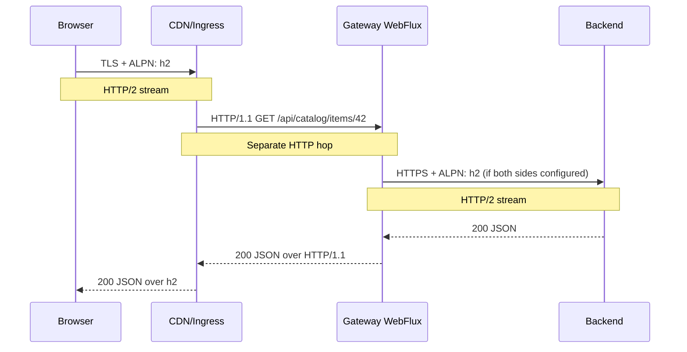
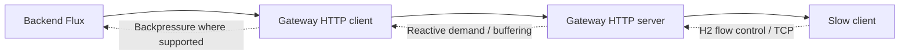

# HTTP/2 and End-to-End Support Conditions Across Hops

## 1. The Problem: Client-Side HTTP/2 Does Not Mean the Backend Uses HTTP/2

In microservices architectures, **Spring Cloud Gateway** handles route predicates, the filter chain, path/header transformations, service discovery, authentication, rate limiting, circuit breakers, retries, TLS, and request observability. Within the **WebSocket and Streaming** chapter, a very practical question arises: *When a browser connects via HTTP/2 to the edge, do all calls, WebSockets, and streams automatically travel over HTTP/2 to the microservice?*

**No.** A reverse proxy or Gateway can **terminate one HTTP connection** and **open a separate HTTP connection** upstream. Protocols are negotiated **independently on each hop**.

For example:

```text
Browser ─── h2 + TLS ───> Ingress / Load Balancer
                              │
                        HTTP/1.1 + TLS
                              │
                              v
                      Spring Cloud Gateway
                              │
                        HTTP/1.1 or h2/h2c
                              │
                              v
                         catalog-service
```

Browser DevTools showing `h2` on a request **only proves the connection to the immediate receiver** (typically a CDN or Ingress). It **does not prove** Gateway receives HTTP/2 or `catalog-service` receives HTTP/2. Even an HTTP/2 client request can be proxied as HTTP/1.1 while remaining completely valid functionally.

After this lesson, you will be able to:

1. Distinguish **HTTP/1.1**, **HTTP/2 over TLS (`h2`)**, and **cleartext HTTP/2 (`h2c`)**.
2. Model **each hop** independently: client ↔ CDN/ingress ↔ Gateway ↔ backend, including TLS termination and ALPN.
3. Configure **inbound HTTP/2** in Spring Boot WebFlux, keeping it separate from Gateway's **outbound HTTP client** configuration.
4. Verify the **actually negotiated** protocol using `curl`, backend logs, and per-hop checks.
5. Distinguish plain HTTP/2, **SSE/streaming**, **HTTP/1.1 Upgrade WebSocket**, and **WebSocket over HTTP/2 (RFC 8441)**.
6. Design timeouts, flow control, TLS, auth, filter chains, and observability when running HTTP/2 in production.

> **Scope:** Examples target **Spring Cloud Gateway Server WebFlux 5.0.x** under namespace `spring.cloud.gateway.server.webflux`, compatible Spring Boot 4.x, and Reactor Netty. Certificate/keystore snippets and addresses are **lab examples**; no real certificates or services are generated/run while authoring this article. Server Web MVC runs on a Servlet runtime, so check that variant's container/capabilities before applying.

## 2. What Does HTTP/2 Solve, and What Does It Not Solve?

HTTP/2 changes **how HTTP messages are represented on the wire**: binary framing, multiple **streams** over one TCP connection, HPACK header compression, flow control, and stream prioritization. It still carries familiar HTTP semantics such as method, status, URI, and headers.

| Aspect | HTTP/1.1 | HTTP/2 |
|---|---|---|
| Wire format | Textual request/response start line + headers | Binary frames; header blocks, DATA, SETTINGS, RST_STREAM... |
| Concurrent requests | Multiple connections; pipelining rarely used | **Multiplexing** many streams on one connection |
| Header compression | No protocol-level HPACK | HPACK, stateful **per connection** |
| Flow control | No HTTP/2 WINDOW_UPDATE | **Stream**- and **connection**-level windows |
| TLS | HTTP/1.1 runs over HTTP or HTTPS | `h2` over TLS, `h2c` over cleartext |
| Classic WebSocket | `Upgrade: websocket`, 101 response | Does not reuse H1 Upgrade directly; needs Extended CONNECT if WS runs over H2 |
| Server-Sent Events | Yes, long-lived response | Yes, DATA frames of an open stream |
| Standard gRPC | Not built for native gRPC | gRPC normally requires HTTP/2, trailers, and streaming semantics |

**HTTP/2 does not automatically make an application non-blocking.** If a custom `GatewayFilter` calls `block()`, a backend runs slow synchronous queries, or a proxy buffers the whole response before sending, stalls still happen. HTTP/2 also **never fixes** broken auth, timeouts, misconfigured circuit breakers, huge payloads, or authorization flaws.

### 2.1. An HTTP/2 Stream Is Not a WebSocket Session

- **HTTP/2 stream:** an independent HTTP exchange inside an HTTP/2 connection; it can be a JSON GET, SSE, a download, or a gRPC call.
- **WebSocket session:** a bidirectional connection/message protocol distinct from standard HTTP request-response; usually started via **HTTP/1.1 Upgrade** in Spring Cloud Gateway WebFlux `ws://` / `wss://` routes.
- **Reactor `Flux`/`Mono`:** an asynchronous Java abstraction; **not** an HTTP/2 stream itself, though `Flux` items can serialize incrementally into a response.

Do not conflate `Flux<ServerSentEvent<?>>`, an HTTP/2 stream, and WebSocket. All three have distinct lifecycles, framing, backpressure, and client types.

## 3. Four Conditions Required for a Hop to Run HTTP/2

A hop from A to B uses HTTP/2 only when all conditions hold **on that exact hop**:

1. **Hop A's client** supports and is configured to try HTTP/2 (H2 or H2C).
2. **Hop B's server** exposes a compatible HTTP/2 listener/protocol handler.
3. **Matching negotiation:** TLS + ALPN for `h2`, or an appropriate H2C mechanism for cleartext.
4. **Network/TLS/proxies do not interfere:** certificates, trust, SNI, hostnames, firewalls, reverse proxies, and policies all permit it.

Moreover, for **application features** like WebSocket, gRPC, or SSE, hops must support the **specific exchange model**, not just basic H2 framing.

### 3.1. TLS, ALPN, h2, and h2c

| Term | What is it? | Notes with Gateway |
|---|---|---|
| `h2` | HTTP/2 over TLS | Client/server negotiate via **ALPN** during the TLS handshake |
| `h2c` | Cleartext HTTP/2 | Use only on trusted internal networks allowed by policy; no TLS protection |
| `ALPN` | TLS extension negotiating application protocol | Can resolve to `h2` or `http/1.1` |
| `SNI` | TLS extension selecting certificate/site by hostname | Distinct from ALPN; SNI does not enable HTTP/2 |
| `H2C upgrade` | Starts HTTP/1.1 then asks to switch to H2C | Requires both client and server to support the upgrade flow |
| `H2C prior knowledge` | Client speaks H2C directly | No H1 fallback if the peer doesn't understand it |

**Never confuse H2C upgrade with WebSocket Upgrade:** both mention HTTP/1.1 Upgrade, yet their **target protocols differ**. H2C is not WebSocket.

### 3.2. One Chain Can Use Three Different Protocols



Each hop has its own **TCP connection pool**, timeouts, TLS handshakes, and concurrent stream caps. Hop A's HTTP/2 frames **are not "tunneled raw" through Gateway by default**; HTTP request/response semantics are proxied and re-emitted at the boundary.

### 3.3. Per-Hop Compatibility Matrix

| Client → Ingress | Ingress → Gateway | Gateway → backend | Can the system work? |
|---|---|---|---|
| H2 TLS | H1 TLS | H1 TLS | **Yes**, a very common topology |
| H2 TLS | H1 cleartext on trusted network | H1 HTTPS | **Yes** at protocol level; assess security of cleartext hop |
| H2 TLS | H2 TLS | H1 HTTP | **Yes** at protocol level; note final backend hop is unencrypted |
| H1 TLS | Internal H2C | H2 TLS | **Yes**, if proxy knows to open H2C on middle hop |
| H2 TLS | H2 TLS | H2 TLS | **Yes**, if *every* client, server, and proxy supports it |
| H2 TLS | H1 TLS | Gateway enables inbound H2 yet outbound is H1 | **Still works with H1 outbound**; inbound H2 does not force backend H2 |
| H2 TLS | H2C prior knowledge yet server is H1 only | Any | **Protocol error** on Ingress → Gateway hop |

**Key point:** "HTTP/2 end-to-end across hops" is **a set of conditions you must verify**, never the automatic result of flipping one switch on a CDN.

## 4. Configuring Spring Boot WebFlux to Accept HTTP/2 (Inbound)

### 4.1. Spring Boot Controls the Server-Side Listener

On Gateway Server WebFlux with Reactor Netty, Spring Boot supports:

```yaml
server:
  port: 8443
  http2:
    enabled: true
  ssl:
    key-store: file:./certs/gateway-local.p12
    key-store-type: PKCS12
    key-store-password: ${GATEWAY_KEYSTORE_PASSWORD}
```

This configures **Gateway's own HTTPS listener**. With TLS and a certificate, Spring Boot/Netty can negotiate `h2` via ALPN with supporting clients; H1 clients can still use H1 when the server/stack allows H1 fallback.

**This is not yet the Gateway → backend client configuration.** Even a route `uri: https://backend.internal` does not automatically guarantee Gateway uses HTTP/2 outbound.

### 4.2. Lab Certificates — Never for Production

On a development machine, learners can generate `certs/gateway-local.p12` with a lab-only keystore password:

```bash
mkdir -p certs
keytool -genkeypair \
  -alias gateway-local \
  -keyalg RSA -keysize 2048 \
  -validity 7 \
  -storetype PKCS12 \
  -keystore certs/gateway-local.p12 \
  -storepass changeit -keypass changeit \
  -dname 'CN=localhost,OU=Lab,O=Training,L=Local,ST=Local,C=VN' \
  -ext 'SAN=dns:localhost,ip:127.0.0.1'

export GATEWAY_KEYSTORE_PASSWORD=changeit
```

**Note:** The command above targets Unix-style shells in a hands-on lab; on PowerShell, adjust syntax and environment variables. Never commit keystores, private keys, or passwords to Git; production must use certificates from a trusted CA, a secret manager, and rotation workflows.

### 4.3. When TLS Terminates at Ingress

If TLS terminates at ingress and Gateway receives cleartext:

```yaml
# Internal Gateway behind ingress; enable only on controlled networks.
server:
  port: 8080
  http2:
    enabled: true
```

Leaving SSL off means **Spring Boot can accept `h2c`**; however, ingress must also be configured to **actually open H2C to Gateway**. Many ingresses default to proxying HTTP/1.1, so traffic remains H1. Do not enable `h2c` on Gateway expecting proxies to switch protocols automatically.

**Security trade-off:** `h2c` does not encrypt traffic between ingress and Gateway. Use it only inside trusted networks or where an overlay/mTLS protects transport per policy. Never expose public H2C on the Internet just to avoid configuring TLS.

### 4.4. Verifying ALPN and Actual Protocol Version from a Client

```bash
# Expect h2 if Gateway TLS and curl support HTTP/2.
curl --noproxy '*' -vk --http2 \
  'https://localhost:8443/actuator/health'

# Compare HTTP/1.1 on the same listener.
curl --noproxy '*' -vk --http1.1 \
  'https://localhost:8443/actuator/health'

# Print only curl's HTTP version instead of inferring from body.
curl --noproxy '*' -sk --http2 \
  -o /dev/null -w 'HTTP %{http_version} code %{http_code}\n' \
  'https://localhost:8443/actuator/health'
```

Use `-k` **strictly in self-signed labs**; production must verify certificates properly. If Actuator health isn't added/exposed yet, hit a **configured application route** instead of relying on the default health endpoint. `curl --http2` **attempts** HTTP/2 rather than always forcing H2 if client/server fall back to H1; check `%{http_version}` and ALPN in verbose output.

### 4.5. Testing H2C with curl in Internal Environments

```bash
# Applies only when the cleartext HTTP server genuinely supports H2C prior knowledge.
curl --noproxy '*' -v --http2-prior-knowledge \
  'http://127.0.0.1:8080/actuator/health'
```

If the server only speaks HTTP/1.1, H2C prior-knowledge requests fail without fallback. `--http2` and `--http2-prior-knowledge` are **not identical** over cleartext; verify curl and server versions. Never use H2C on an unapproved production hop.

## 5. Gateway Sending HTTP/2 to Backends: Separate Outbound Configuration

### 5.1. Why Isn't `server.http2.enabled` Enough?

A Spring Cloud Gateway Server WebFlux application plays **two roles simultaneously**:

| Role | Primary component | Related configuration |
|---|---|---|
| **HTTP server** (receives requests from client/ingress) | Reactor Netty `HttpServer` configured by Spring Boot | `server.http2.enabled`, `server.ssl.*` |
| **HTTP client** (sends requests to backends) | Reactor Netty `HttpClient` managed by Gateway | `spring.cloud.gateway.server.webflux.httpclient.*` and `HttpClientCustomizer` |
| **WebSocket proxy client** | WebSocket routing infrastructure | `ws://` / `wss://` and WebSocket settings |

Reactor Netty docs state clearly that **`HttpClient` defaults to HTTP/1.1** and needs explicit protocol config to opt into HTTP/2. Therefore, even when clients reach Gateway over H2, backends still receive H1 unless Gateway's HTTP client is customized.

**Do not confuse** `server.http2.enabled` (inbound server) with `spring.cloud.gateway.server.webflux.httpclient.*` (outbound). Gateway 5.0.x config properties cover timeouts, TLS, proxies, connection pools, and WebSocket options — never **invent** a property like `httpclient.http2.enabled` expecting the framework to honor it.

### 5.2. Gateway's `HttpClientCustomizer`

To try H2 **for outbound HTTPS routes**, Spring Cloud Gateway provides the `HttpClientCustomizer` interface:

```java
package com.example.gateway;

import org.springframework.cloud.gateway.config.HttpClientCustomizer;
import org.springframework.context.annotation.Bean;
import org.springframework.context.annotation.Configuration;
import reactor.netty.http.HttpProtocol;

@Configuration
public class GatewayOutboundProtocolConfig {

    @Bean
    HttpClientCustomizer preferHttp2ForOutboundHttps() {
        return client -> client.protocol(
            HttpProtocol.HTTP11,
            HttpProtocol.H2
        );
    }
}
```

Meaning:

- `HttpProtocol.HTTP11` and `HttpProtocol.H2` let the TLS client **negotiate H2 or fall back to HTTP/1.1** via ALPN when backends support it.
- With a route like `uri: https://catalog.internal.test:8444`, Gateway's HTTP client still needs **valid TLS trust/certs**; calling `.protocol(H2)` alone never replaces TLS configuration.
- This `HttpClientCustomizer` **applies to Gateway's shared HTTP client**, not just one route by default. You must **test every affected route** so you don't accidentally break H1 routes, corporate proxies, or H2-incompatible upstreams.
- `HttpProtocol.H2` **is not** `H2C`. Routes using cleartext `http://` need explicit H2C policy/design rather than expecting H2 TLS over an HTTP URL.

A customizer bean fits well inside a **dedicated profile/staging environment targeting H2-capable HTTPS upstreams**. Do not turn it on blindly in a mixed Gateway serving HTTP, HTTPS, WebSocket, and legacy services without testing compatibility.

### 5.3. Example HTTPS Route to an H2-Capable Backend

```yaml
spring:
  cloud:
    gateway:
      server:
        webflux:
          routes:
            - id: catalog-https
              uri: https://catalog.internal.test:8444
              predicates:
                - Path=/api/catalog/**
                - Method=GET
              filters:
                - StripPrefix=2
          httpclient:
            connect-timeout: 2000
            response-timeout: 5s
            ssl:
              handshake-timeout: 10s
              # If the backend uses a private CA, configure trusted CA here:
              # trusted-x509-certificates:
              #   - file:./certs/internal-ca.crt
```

Mandatory requirements:

1. Backend hostname `catalog.internal.test` must resolve **from Gateway's environment**.
2. Backend listener `8444` must enable TLS and HTTP/2/ALPN, or support HTTP/1.1 fallback.
3. Gateway must **trust the certificate chain** and verify hostname/SNI properly. Private CAs must be distributed securely.
4. The `HttpClientCustomizer` from section 5.2 must be active; outbound TLS config must apply to the right hop.
5. Logs/metrics/authorized packet traces must verify the **negotiated ALPN** for Gateway → backend, not just client → Gateway.

In production, never set `use-insecure-trust-manager: true` or disable hostname verification to "make H2 work." When TLS handshakes or ALPN fail, fix trust, DNS, SNI, TLS ciphers/protocols, or server config instead of disabling verification.

### 5.4. Testing Outbound `h2c` Strictly in Isolated Environments

If a lab backend truly supports **H2C prior knowledge** on `http://localhost:8081`, you can use a **separate configuration profile**:

```java
package com.example.gateway;

import org.springframework.cloud.gateway.config.HttpClientCustomizer;
import org.springframework.context.annotation.Bean;
import org.springframework.context.annotation.Configuration;
import org.springframework.context.annotation.Profile;
import reactor.netty.http.HttpProtocol;

@Configuration
@Profile("h2c-lab")
public class GatewayH2cLabConfig {

    @Bean
    HttpClientCustomizer h2cOnlyOutbound() {
        return client -> client.protocol(HttpProtocol.H2C);
    }
}
```

When using `HttpProtocol.H2C` **alone**, Reactor Netty runs in **prior-knowledge** mode with no automatic H1 fallback. Apply this only on a lab Gateway whose backends all support H2C. To try H2C upgrade with H1 fallback, the API lets you pass **`HTTP11, H2C`** together, though you must test the exact server/proxy on that hop.

**Never enable both beans** from sections 5.2 and 5.4 in the same profile expecting customizer ordering to sort out every case. For mixed-protocol upstreams, design dedicated client/provider configs or keep HTTP/1.1 outbound when there is no specific need.

### 5.5. When Should You Avoid Forcing H2 from Gateway to Backends?

Keeping HTTP/1.1 outbound is often sensible when:

- Gateway already uses connection pooling and backends have low latency.
- Ingress and Gateway sit on an internal network with ample bandwidth.
- Backends only speak HTTP/1.1 and SSE works smoothly.
- Enabling H2 complicates TLS, corporate proxies, testing, or WebSocket traffic.
- No metrics show H2 improves throughput/latency over H1.

**H2 is a transport/performance choice**, not a mandatory goal on every hop. What is mandatory is **protocols supported by each side and secured properly**.

## 6. Full Lab: HTTP/2 Client → Gateway → HTTP/1.1 Backend

This first lab demonstrates a very common **mixed** setup. We enable H2 **on Gateway inbound** while leaving the backend on default H1, showing clearly that backend protocols cannot be inferred from the client side.

### 6.1. Dependencies

Create two Spring Boot apps using compatible BOMs:

```xml
<!-- Project gateway-demo -->
<dependency>
  <groupId>org.springframework.cloud</groupId>
  <artifactId>spring-cloud-starter-gateway-server-webflux</artifactId>
</dependency>

<!-- Project stream-demo, declared in a SEPARATE POM -->
<dependency>
  <groupId>org.springframework.boot</groupId>
  <artifactId>spring-boot-starter-webflux</artifactId>
</dependency>
```

Pick only the matching starter per project; do not add Servlet/Web MVC starters into Gateway WebFlux just for SSE. If Spring Boot versions rename starter artifacts, follow your exact version's BOM and docs.

### 6.2. WebFlux Backend with JSON and SSE

The **stream-demo** app runs on port `8081`. `StreamDemoApplication.java`:

```java
package com.example.stream;

import java.time.Duration;
import java.util.Map;
import org.springframework.boot.SpringApplication;
import org.springframework.boot.autoconfigure.SpringBootApplication;
import org.springframework.http.MediaType;
import org.springframework.http.codec.ServerSentEvent;
import org.springframework.web.bind.annotation.GetMapping;
import org.springframework.web.bind.annotation.PathVariable;
import org.springframework.web.bind.annotation.RestController;
import reactor.core.publisher.Flux;

@SpringBootApplication
@RestController
public class StreamDemoApplication {

    public static void main(String[] args) {
        SpringApplication.run(StreamDemoApplication.class, args);
    }

    @GetMapping("/items/{id}")
    public Map<String, String> item(@PathVariable String id) {
        return Map.of("id", id, "service", "stream-demo");
    }

    @GetMapping(path = "/ticks", produces = MediaType.TEXT_EVENT_STREAM_VALUE)
    public Flux<ServerSentEvent<String>> ticks() {
        return Flux.interval(Duration.ofSeconds(1))
            .take(6)
            .map(index -> ServerSentEvent.<String>builder()
                .id(Long.toString(index))
                .event("tick")
                .data("tick-" + index)
                .build());
    }
}
```

**Backend** configuration:

```yaml
server:
  port: 8081
  # Keep HTTP/1.1 (do not enable HTTP/2 on this lab's backend).
spring:
  application:
    name: stream-demo
```

Because the backend returns **SSE** via `Flux`, the response stays open for several seconds emitting events one by one. It still works over HTTP/1.1; **SSE does not require HTTP/2**.

### 6.3. Gateway Inbound TLS + H2, Outbound H1

In **gateway-demo**, using the lab certificate from section 4.2:

```yaml
server:
  port: 8443
  http2:
    enabled: true
  ssl:
    key-store: file:./certs/gateway-local.p12
    key-store-type: PKCS12
    key-store-password: ${GATEWAY_KEYSTORE_PASSWORD}

spring:
  application:
    name: gateway-demo
  cloud:
    gateway:
      server:
        webflux:
          routes:
            - id: catalog-http1-backend
              uri: http://127.0.0.1:8081
              predicates:
                - Path=/api/catalog/**
                - Method=GET
              filters:
                - StripPrefix=2

            - id: sse-http1-backend
              uri: http://127.0.0.1:8081
              predicates:
                - Path=/api/events/**
                - Method=GET
              filters:
                - StripPrefix=2
```

**Do not load section 5's `HttpClientCustomizer`** in this lab: its goal is demonstrating H2 inbound with H1 outbound. `localhost` in backend URIs assumes Gateway and backend share a machine; in Docker/Kubernetes, use a hostname/Service reachable from Gateway.

### 6.4. Testing JSON and SSE on Inbound HTTP/2

```bash
# Direct H1 backend
curl --noproxy '*' -sS -i --http1.1 \
  'http://127.0.0.1:8081/items/42'

# Frontend connecting H2 TLS to Gateway
curl --noproxy '*' -sk --http2 \
  -o /dev/null -w 'client-to-gateway HTTP/%{http_version} status %{http_code}\n' \
  'https://localhost:8443/api/catalog/items/42'

# SSE without stdout buffering; prints events every second.
curl --noproxy '*' -k -N --http2 \
  'https://localhost:8443/api/events/ticks'
```

Illustrative SSE output:

```text
id:0
event:tick
data:tick-0

id:1
event:tick
data:tick-1

...
```

**Right conclusion:** `curl` shows client → Gateway used H2 if `%{http_version}` prints `2`, and SSE arrives incrementally. **That alone does not prove Gateway → backend used H1**; in this lab, since the backend has HTTP/2 off and no outbound H2 customizer is active, that hop is expected to be H1. In real deployments, verify via **backend access logs, authorized ALPN/packet inspection, or outbound client telemetry**.

### 6.5. Enabling H2C on the Backend Does Not Switch Gateway Outbound

If you later add `server.http2.enabled: true` to the cleartext backend, the backend **becomes capable of accepting H2C**, yet Gateway's HTTP client still uses H1. To test outbound H2C, configure the protocol via section 5.4 in a safe lab network; never infer from server capability that the client switched protocols.

## 7. WebSocket: Working HTTP/2 GETs Do Not Mean WebSocket Uses H2

### 7.1. Classic HTTP/1.1 WebSocket

RFC 6455 WebSocket normally starts with an HTTP/1.1 request:

```http
GET /ws/echo HTTP/1.1
Host: gateway.example.test
Upgrade: websocket
Connection: Upgrade
Sec-WebSocket-Key: <random-base64>
Sec-WebSocket-Version: 13
```

If accepted, the server replies `101 Switching Protocols` and exchanges **WebSocket frames** over the upgraded connection. In Spring Cloud Gateway Server WebFlux, routes with `uri: ws://...` or `wss://...` are handled by **Websocket Routing Filter**.

Example WebFlux route:

```yaml
# Snippet under spring.cloud.gateway.server.webflux.routes:
- id: websocket-echo
  uri: ws://127.0.0.1:8081
  predicates:
    - Path=/ws/**
  filters:
    - StripPrefix=1
```

The client calls `wss://localhost:8443/ws/echo` (TLS at Gateway), while Gateway calls `ws://127.0.0.1:8081/echo` to the lab backend. **`wss` to Gateway does not automatically turn Gateway → backend into `wss`**; choose `wss://` upstream when architecture requires encryption/mTLS.

### 7.2. WebFlux WebSocket Echo Backend for Hands-On Practice

In **stream-demo :8081** from section 6, add a configuration class:

```java
package com.example.stream;

import java.util.Map;
import org.springframework.context.annotation.Bean;
import org.springframework.context.annotation.Configuration;
import org.springframework.web.reactive.HandlerMapping;
import org.springframework.web.reactive.handler.SimpleUrlHandlerMapping;
import org.springframework.web.reactive.socket.WebSocketHandler;

@Configuration
public class WebSocketEchoConfig {

    @Bean
    HandlerMapping echoWebSocketMapping() {
        WebSocketHandler echo = session ->
            session.send(
                session.receive()
                    .map(message -> message.getPayloadAsText())
                    .map(session::textMessage)
            );

        SimpleUrlHandlerMapping mapping = new SimpleUrlHandlerMapping();
        mapping.setUrlMap(Map.of("/echo", echo));
        mapping.setOrder(-1);
        return mapping;
    }
}
```

With standard Spring Boot WebFlux auto-configuration, `WebSocketHandlerAdapter` is already declared by WebFlux config; the class above only adds `HandlerMapping`. If building WebFlux infrastructure manually without default WebFlux config, register the adapter from `org.springframework.web.reactive.socket.server.support.WebSocketHandlerAdapter`. Never register a duplicate bean when the framework already provides one.

The WebSocket backend only **echoes messages**; it is not a secured chat app. Production requires limits on payload sizes, connections, user/tenant permissions, Origin, and timeouts; never echo secrets.

After adding the WebSocket route to Gateway and running the backend, test with a WebSocket client:

```bash
# Example only if websocat is installed; use -k ONLY in self-signed labs.
websocat -k wss://localhost:8443/ws/echo
# Type: hello
# Expected reply: hello
```

If testing from a browser, `new WebSocket("wss://localhost:8443/ws/echo")` needs a browser-trusted certificate; failures due to certificates do not prove the WebSocket route is wrong.

### 7.3. HTTP/2 Forbids Hop-by-Hop Upgrade Headers

Per **RFC 9113**, HTTP/2 **forbids** connection-specific headers such as `Connection`, `Keep-Alive`, `Proxy-Connection`, `Transfer-Encoding`, and `Upgrade`. Therefore:

```text
HTTP/1.1 WebSocket:
  GET + Connection: Upgrade + Upgrade: websocket
  Response 101 Switching Protocols

HTTP/2 WebSocket (RFC 8441):
  Extended CONNECT + :protocol = websocket
  No H1-style Connection/Upgrade/101 handshake
```

**Never** try to "fix" an H2 request by manually injecting `Connection: Upgrade` or `Upgrade: websocket` with Gateway's `AddRequestHeader`. That produces a malformed H2 message. You need a proxy/framework that **genuinely understands** the negotiated handshake type.

### 7.4. WebSocket over HTTP/2 per RFC 8441

RFC 8441 defines **Extended CONNECT** to bootstrap WebSocket over an HTTP/2 stream:

1. The H2 server advertises `SETTINGS_ENABLE_CONNECT_PROTOCOL = 1`.
2. The H2 client sends Extended CONNECT only after the peer advertises support.
3. The request uses pseudo-headers `:method=CONNECT` and `:protocol=websocket` alongside `:scheme`, `:authority`, and `:path` per spec.
4. After a successful handshake, WebSocket frames flow inside **one H2 stream** while other H2 streams multiplex on the same connection.

**Conceptual** example, not raw text headers to paste into curl:

```text
:method = CONNECT
:protocol = websocket
:scheme = https
:authority = gateway.example.test
:path = /ws/echo
origin = https://app.example.test
```

**Important confirmation limit:** Gateway Server WebFlux 5.0.x docs describe proxying WebSockets via `ws/wss` routes, **without guaranteeing every combination of Reactor Netty, Spring Cloud Gateway, Ingress, and browsers supports RFC 8441 end-to-end**. Simply enabling H2 on the HTTP server via `server.http2.enabled` **does not prove Extended CONNECT is implemented across WebSocket handlers/ingresses**.

To design high-reliability WebSockets:

- If a hop only supports **WebSocket H1 Upgrade**, configure that hop to use HTTP/1.1 for WebSocket and test it; **ordinary HTTP requests** can still use H2.
- If **RFC 8441** is required, verify the server advertises the SETTING, browsers/clients support it, CDN/Ingress proxies CONNECT, and the backend handles it.
- **Never infer** a WebSocket session runs over H2 just because JSON GET requests show `h2`.
- Inspect handshake/method/protocol on each observable hop; the JavaScript WebSocket API does not expose whether H1 or Extended CONNECT was used.

### 7.5. Origin and Authentication on WebSocket

Browser WebSocket handshakes **do not use fetch-style CORS like ordinary HTTP APIs**; server/Gateway must check `Origin` properly. Gateway WebFlux 5.0.x provides properties to configure allowed WebSocket origins:

```yaml
spring:
  cloud:
    gateway:
      server:
        webflux:
          websocket:
            allowed-origins:
              - https://app.example.test
```

These are **sample values**, not a real production origin list. Never set broad wildcards without justification; always enforce handshake authentication and authorization, restrict tokens/cookies forwarded upstream, rate-limit **connection attempts**, and cap message sizes.

**TLS termination note:** when Gateway sits behind ingress, origin/same-origin checks depend on the host/scheme Gateway observes; trust `Forwarded`/`X-Forwarded-*` only from authenticated proxies, never arbitrary Internet clients.

### 7.6. WebSocket Routes Are Not Turned into HTTP/2 by `HttpClientCustomizer`

Section 5's `HttpClientCustomizer` configures the **Reactor Netty outbound HTTP client** for HTTP routes. The WebSocket proxy uses separate WebSocket routing infrastructure. Therefore, never assume `ws://`/`wss://` WebSockets run over HTTP/2 just because `client.protocol(H2)` is set. Both capabilities **must be tested independently**.

## 8. SSE, NDJSON, and Streaming over HTTP/2

### 8.1. SSE Works Over Both HTTP/1.1 and HTTP/2

**Server-Sent Events (SSE)** is an HTTP response with `Content-Type: text/event-stream` that stays open to push events from server to browser. It is **unidirectional** server-to-client; for continuous two-way traffic, use WebSocket or another protocol.

| Feature | SSE | WebSocket |
|---|---|---|
| Channel | Long-lived HTTP response | WebSocket session |
| Direction | Server → client | Bidirectional |
| Content | Text event stream | Text/binary message frames |
| HTTP/2 | Sent as DATA frames on one H2 stream | Requires RFC 8441 if actually using H2 |
| Proxy over H1 | Yes | Yes, requires Upgrade |
| Recovery | `EventSource` auto-reconnects / `Last-Event-ID` | Application must define reconnect/ack |
| Buffering | Proxies can delay delivery if buffering bodies | Separate message/frame/session caps |

Once an HTTP/2 stream opens for SSE, data can stream **DATA frame by DATA frame**, without HTTP/1.1 `Transfer-Encoding: chunked`. If Gateway or ingress waits for the **entire response body** before flushing, users still see batched events despite using H2.

### 8.2. Avoid Buffering Streaming Responses

Certain filters or proxy behaviors easily break SSE:

- Improper body rewrites/aggregations (e.g., custom `ModifyResponseBody` reading the full `Flux`).
- CDN/Ingress **proxy buffering** or compression that fails to flush promptly.
- Response/idle timeouts shorter than the gap between events.
- Slow consumers causing buffers to grow when `flow control` is ignored.
- Connection pools, retries, or circuit breakers configured like short requests without accounting for started streams.

For public SSE:

```http
HTTP/2 200
content-type: text/event-stream
cache-control: no-cache

id: 1
event: tick
data: tick-1
```

On H2, the snippet above is a **logical representation**; the wire format uses **binary frames**, with no literal `HTTP/2 200` status line like HTTP/1.1. Never cite it as a raw byte capture.

### 8.3. Verifying Events Arrive in Real Time

```bash
# -N disables curl stdout buffering.
curl --noproxy '*' -k -N --http2 \
  'https://localhost:8443/api/events/ticks'

# Compare when forcing HTTP/1.1 on the same Gateway.
curl --noproxy '*' -k -N --http1.1 \
  'https://localhost:8443/api/events/ticks'
```

Watch **when each event appears**. If all 6 events dump together after 6 seconds, investigate proxy buffering or response aggregation; never blame "H2 is broken" just from the protocol label.

### 8.4. NDJSON and gRPC Are Not the Same Stream Type

- **NDJSON** emits newline-delimited JSON objects over HTTP/1.1 or HTTP/2, requiring clients to parse incrementally and proxies never to buffer the whole body.
- **gRPC** typically relies on HTTP/2, `application/grpc`, message framing, and trailers like `grpc-status`. A standard **HTTP proxy Gateway** must not be assumed gRPC-aware in every config.
- If the Gateway → backend hop **downgrades to HTTP/1.1**, standard gRPC calls fail because HTTP/2 semantics—especially trailers/streaming—are lost. For gRPC, use an end-to-end gRPC-capable proxy/gateway and test with `grpcurl`/real clients across every hop.
- gRPC-Web is a different protocol requiring translator/gateway support; it is **not equivalent** to native gRPC over H2.

**Rule:** HTTP/2 enables stream multiplexing, yet **each streaming app/protocol** keeps technical requirements that a single HTTP/2 toggle never solves alone.

## 9. Header Translation Between HTTP/1.1 and HTTP/2

### 9.1. H2 Pseudo-Headers

HTTP/2 expresses certain HTTP/1.1 request-line/Host components via **pseudo-headers**, such as:

```text
:method = GET
:scheme = https
:authority = api.example.test
:path = /api/catalog/items/42
```

`:method`, `:scheme`, `:authority`, and `:path` carry HTTP protocol semantics; they are **not** ordinary request headers to inject via `AddRequestHeader`. Gateway/server adapters parse requests into HTTP objects and emit outbound requests matching the next hop's protocol.

### 9.2. Hop-by-Hop Headers Forbidden in H2

Per RFC 9113, an HTTP/2 message **must not contain**:

```text
Connection
Keep-Alive
Proxy-Connection
Transfer-Encoding
Upgrade
```

The exception `TE` on HTTP/2 requests may carry only the value `trailers`. When bridging H1 → H2, intermediaries **must strip connection-specific headers**. Never force Gateway to preserve `Transfer-Encoding: chunked` from H1 onto H2; HTTP/2 DATA frames carry the body with `END_STREAM` signaling completion.

| H1 source | H2 target | Proper result |
|---|---|---|
| `Host: api.example.test` | `:authority=api.example.test` | Mapped by framework/proxy per protocol |
| `Connection: keep-alive` | No Connection header | Hop-by-hop headers not forwarded |
| `Transfer-Encoding: chunked` | DATA frames | No `transfer-encoding: chunked` sent |
| `Upgrade: websocket` | Disallowed on H2 | Use H1 Upgrade or Extended CONNECT if supported |
| `TE: trailers` | Valid on H2 requests | Trailers need proper end-to-end handling |
| `Authorization: Bearer ...` | Standard HTTP header | Still a sensitive credential; never log/relay recklessly |

### 9.3. Header Filters Do Not Negotiate HTTP/2

Gateway's `AddRequestHeader`, `SetRequestHeader`, or `RemoveRequestHeader` **modify HTTP metadata**, never changing the TCP/TLS channel's protocol stack. For example:

```yaml
filters:
  - AddRequestHeader=X-Gateway-Route,catalog
```

does not make the backend receive H2. Conversely, injecting `Connection: Upgrade` onto an H2 HTTPS route makes the request malformed. **Protocol negotiation belongs to the server/client transport**, not content-mutating `GatewayFilter`s.

### 9.4. Forwarded Headers and TLS Termination

An ingress terminating TLS may send:

```http
Forwarded: proto=https;host=api.example.test
X-Forwarded-Proto: https
X-Forwarded-Host: api.example.test
```

Spring Boot can be configured to process forwarded headers per deployment:

```yaml
server:
  forward-headers-strategy: framework
```

**Security requirement:** Trust these headers only from **proxies inside an approved trust boundary**. Internet clients can forge `X-Forwarded-*` headers; ingress must strip/overwrite untrusted client data. Forwarded headers help compute accurate schemes/hosts for redirects, cookies, Origin checks, and URL generation, yet **never carry ALPN or guarantee upstream uses HTTP/2**.

### 9.5. H2 Header Compression Does Not Replace Encryption

HPACK shrinks header blocks on **one H2 connection**, whereas TLS encrypts wire bytes across **a specific TLS hop**. HPACK never protects payloads over a cleartext `h2c` hop; if Gateway terminates TLS and calls backends over cleartext H1, credentials on the internal hop are exposed to eavesdropping.

**Never let `TokenRelay`/Authorization copy to untrusted upstream routes**, even when the first hop used secure `h2`.

## 10. Timeouts, Backpressure, and HTTP/2 Multiplexing

### 10.1. Multiplexing Cuts Connection Count, Not Resource Limits

One H2 TCP connection can carry many streams. Yet servers and clients are still bounded by:

- `SETTINGS_MAX_CONCURRENT_STREAMS`: max concurrent streams per connection.
- `WINDOW_UPDATE` and flow-control windows: bytes permitted in flight.
- Connection pools, max connections, pending acquires, and TLS handshakes.
- CPU for HPACK and TLS encryption/decryption, header/body sizes.
- Slow receivers, H2 stream resets, TCP congestion, and **TCP-level head-of-line blocking** on packet loss.

Never confuse "multiplexing many streams" with "one connection can serve infinite clients." For many long-lived SSE/WebSocket/gRPC sessions, bound concurrent streams, memory footprint, and lifetimes.

### 10.2. Response Timeouts When Streams Stay Open

Gateway WebFlux lets you configure the Netty HTTP client:

```yaml
spring:
  cloud:
    gateway:
      server:
        webflux:
          httpclient:
            connect-timeout: 2000
            response-timeout: 30s
            pool:
              metrics: true
```

Use this example strictly as a **measurement starting point**. For SSE with sparse events or hour-long streams, verify **how `response-timeout` is actually evaluated in your Reactor Netty/Gateway version**, while factoring in Ingress/LB, service mesh, and client idle timeouts. Never blindly raise all timeouts to infinity.

**Design timeout budgets per hop**:

```text
Client timeout
  > Ingress upstream idle / stream timeout (per use case)
  > Appropriate Gateway network / response timeout
  > Appropriate backend processing / heartbeat interval
```

That inequality is a **design guideline**, not a universal law: some timeouts measure idle time, others total duration. For infinite streams, pair **heartbeats**, reconnects, and clean cancellation rather than a short total deadline.

### 10.3. Backpressure Operates Across Multiple Layers



**There is no strict 1:1 mapping** between Reactive Streams demand and H2 `WINDOW_UPDATE`. Reactor Netty, gateway filters, TLS, OS sockets, and proxies all hold buffers. The goal is avoiding unbounded reads from upstream when downstream cannot keep up.

Anti-patterns:

```java
// WRONG in a filter for streaming responses:
return responseBody.collectList()
    .flatMap(allChunks -> {
        // The entire stream may now sit in RAM,
        // or never finish on infinite SSE.
        return writeResponse(allChunks);
    });
```

This is a **structural anti-pattern**, not a complete Java method. For response streaming, rely on streaming/backpressure-capable proxies/filters and avoid `block()`, standalone `subscribe()`, or unbounded `collectList()`.

### 10.4. Retry, Circuit Breaker, and Already-Started Streams

For short JSON GETs, retrying connection errors is often acceptable. For streams:

- The request may already have flushed headers and partial body bytes to the client; **it cannot restart** as if nothing was sent.
- An HTTP/2 stream can receive `RST_STREAM` or a connection `GOAWAY`; clients must distinguish single-stream resets from connection drops.
- Auto-retrying an SSE/gRPC/WebSocket stream can duplicate events/messages, change identities, or break ordering.
- Circuit breakers can gate **starting** a stream, yet cannot turn errors **after response commit** into a fresh JSON fallback.

For SSE, rely on event IDs, idempotent consumers, and reconnect semantics. For WebSocket, define protocol heartbeats, reconnects, and application ACKs. For gRPC, scope retries strictly by gRPC status, deadlines, and idempotency.

### 10.5. Heartbeats at Which Layer?

| Heartbeat | What does it check? | What does it not prove? |
|---|---|---|
| TCP keepalive | OS-level TCP connection liveness | Backend is still processing business logic |
| H2 PING | HTTP/2 peer on one connection responds | All H2 streams or backend instances are healthy |
| WebSocket Ping/Pong | WS peer on one hop/session responds | Business backend behind Gateway is alive if Gateway answers pong itself |
| SSE comment/heartbeat | Bytes still flow over the HTTP stream | New or accurate business data |
| Application ping/ACK | App-level business protocol | Everything else upstream is completely healthy |

**Never equate H2 PING with WebSocket ping**, and never treat transport keepalives as business health checks.

## 11. Operational Safety and Per-Hop Observability

### 11.1. Data Worth Collecting

| Hop | What to observe | How to verify |
|---|---|---|
| Client → CDN/Ingress | HTTP version/ALPN, TLS/SNI, status | Browser DevTools, `curl -v -w` to edge |
| Ingress → Gateway | Upstream proxy protocol, TLS, upstream connection info | Ingress logs/config + Gateway inbound access logs |
| Gateway → backend | HTTP client protocol/ALPN, pool, TLS/trust, downstream status | Gateway outbound metrics/logs and backend inbound protocol logs |
| SSE | Event arrival intervals, disconnect/cancel, buffering | `curl -N` + client timestamps |
| WebSocket | Handshake result, frame counts, close codes, heartbeats | WebSocket client + Gateway/backend WS logs |
| H2 transport | Active streams, resets, GOAWAY, connection failures | Reactor Netty/Ingress metrics and approved traces/packet captures |

**A single `HTTP/2` log line at the edge never proves end-to-end HTTP/2.** You need **per-hop** evidence. Similarly, Gateway returning 200 does not prove H2 was used, nor that gRPC trailers passed cleanly.

### 11.2. Useful Commands to Check ALPN and Client Support

```bash
# Check whether curl supports HTTP/2 (typically lists "HTTP2" under Features).
curl --version

# Check ALPN directly against the lab Gateway TLS listener.
openssl s_client -connect localhost:8443 \
  -servername localhost -alpn h2,http/1.1 < /dev/null

# ALPN result of the CLIENT connection, not Gateway -> backend.
curl --noproxy '*' -vk --http2 \
  'https://localhost:8443/api/catalog/items/42'
```

OpenSSL prints the negotiated protocol (e.g., `ALPN protocol: h2`) if present; also check certificate verification results. Do not confuse **TLS ALPN h2** with **HTTP application status**. In self-signed labs, `curl -k` skips cert checks for testing only; **never use `-k` in production**.

To prove **Gateway → backend h2**, collect two measurements:

1. From **Gateway's environment**, connect directly over TLS/H2 to the backend with an H2-capable client and verify ALPN/certificates.
2. On real proxied requests, inspect **backend access protocol** and/or **Gateway outbound client telemetry** to prove Gateway actually picked H2 instead of inferring from direct reachability.

Step (1) proves backend **capability**, while step (2) proves Gateway's **actual usage**.

### 11.3. Access Logs Differ from Tracing

- **Access logs** record request protocol, method/path, status, and latency at each listener; never log full query strings carrying PII.
- **Distributed tracing** links hops via trace IDs; it does not automatically capture ALPN/protocol versions unless instrumented.
- **Gateway metrics** record route ID, URI, status, HTTP method, and connection pools; protocol tag availability depends on library/version.
- **Network captures** over TLS hide inner HTTP frames without decryption keys/permissions; ALPN remains visible in handshakes, though captures require security approval.

Never enable broad Netty wiretap/TRACE in production: it leaks `Authorization`, cookies, request bodies, WebSocket messages, and personal data. When debugging, tightly scope duration/targets and mask data per organizational policy.

### 11.4. Set Timeouts and Limits to Prevent Resource Exhaustion

An H2 Gateway multiplexes many streams onto one connection, yet each SSE/WS stream still holds state, buffers, and downstream connections/sessions. Enforce:

- Reasonable caps on connections/streams, header sizes, frame/message sizes, and body sizes.
- Handshake, idle, heartbeat, and shutdown/drain timeouts.
- Rate limits keyed on real identities (user/client), not solely IPs or TCP connection counts.
- Protection against oversized payloads, malformed H2 frames, and stream floods via patched reverse proxies/HTTP servers.
- Monitoring of memory/GC, Netty event-loop utilization, pool saturation, and backpressure.

**H2 multiplexing does not replace quotas or bulkheads.** A single client can open many long-lived streams and exhaust resources if left uncapped.

## 12. Diagnosing When HTTP/2 or Streaming Fails to Behave as Expected

### 12.1. Symptom-to-Cause Table

| Symptom | Possible cause | Where to check |
|---|---|---|
| Browser shows `h2` yet Gateway logs `HTTP/1.1` | Ingress/CDN terminated H2 and proxied H1 | Inspect upstream protocol between edge and Gateway before touching backend |
| `curl --http2` still prints `1.1` | Listener lacks H2, ALPN fell back, curl lacks H2, or TLS/proxy in between | `curl --version`, `curl -v`, server HTTP/2/TLS config |
| `--http2-prior-knowledge` fails immediately | H2C disabled on server or proxy speaks H1 only | Verify H2C listener; test direct inside permitted network |
| Gateway H2 inbound yet backend gets H1 | Outbound HTTP client lacks H2 enabled | Check `HttpClientCustomizer`, backend capability, and Gateway → backend hop logs |
| Gateway forces outbound H2 and upstream handshake fails | Backend H1-only, bad TLS trust/SNI, or ALPN mismatch | Test direct `curl --http2` to backend; inspect certs and client protocols |
| Internal H2C fails while H1 works | Using `H2C` prior knowledge against H1-only or H2C-Upgrade-only server | Distinguish `H2C` vs. `HTTP11,H2C`; test with matching curl flags |
| HTTP GET JSON succeeds over H2 yet WebSocket fails | Gateway/Ingress lacks RFC 8441 or H1 Upgrade blocked | Check handshake per hop; isolate WS route over H1 Upgrade |
| WebSocket response isn't 101 in H1 case | Wrong path, `ws/wss` URI, Origin reject, or non-WS backend | Check handshake headers/status and route matching |
| WebSocket RFC 8441 CONNECT rejected | Peer doesn't advertise `SETTINGS_ENABLE_CONNECT_PROTOCOL` or lacks Extended CONNECT | Inspect H2 SETTINGS, `:protocol`, and proxy features |
| WebSocket blocked with 403 | Origin or security policy rejected | Check allowed origins, auth/session, trusted forwarded headers |
| WS connects then drops after idle | Proxy/LB idle timeout or missing heartbeat/keepalive | Check close codes, per-hop heartbeats, and per-hop timeouts |
| SSE delivers all events in one burst | Proxy buffering, response aggregation, or client stdout buffering | Use `curl -N`; disable buffering on controlled proxies |
| SSE drops after a fixed interval | Response/idle timeout, H2 stream reset, or edge timeout | Compare Gateway, backend, ingress, and client timeouts |
| gRPC fails through Gateway while REST works | H1 hop downgrade or incompatible trailers/gRPC routing | Use a gRPC-aware proxy and test native clients/trailers end-to-end |
| HTTP/2 protocol error after adding custom header | Forwarded `Connection`/`Upgrade`/`Transfer-Encoding` or malformed header | Strip hop-by-hop headers; let framework emit pseudo-headers |
| H2 stream resets mid-flight | Peer cancel, flow-control/concurrency limit, or backend crash | Correlate `RST_STREAM`, logs, status, and client cancellations |
| Requests still slow despite H2 | TCP packet loss, stream concurrency cap, blocked event loop, or overloaded backend | Inspect TCP metrics, pools, p99, event-loop, and backend saturation |
| `curl -k` works yet browser fails | Self-signed/hostname cert mismatch, trust, or mixed content | Trust lab cert cleanly; configure production CA |
| Redirect emits `http://` after ingress TLS termination | Forwarded scheme/host ignored or spoofed | Configure trusted proxy and `server.forward-headers-strategy` |
| One Gateway instance negotiates h2, another h1 | Inconsistent rollout, config, or TLS versions | Compare individual pods/instances and pin test requests |

### 12.2. Per-Hop Investigation Workflow

1. **Draw the real topology:** Browser → CDN → Ingress → Gateway → service mesh → backend. Do not skip mesh sidecars; they terminate hops too.
2. For each hop, record **source client, destination server, port, TLS on/off, ALPN/H2C, and actual protocol**.
3. From the client, run `curl -v --http2` and record `%{http_version}`; verify certs/TLS.
4. At ingress, inspect the **upstream protocol**: a client-facing `listen http2` does not automatically open H2 to backends.
5. At Gateway, verify **inbound** `server.http2.enabled` separately from **outbound** `HttpClientCustomizer`.
6. From Gateway's environment, test H2/H2C directly against the backend with a suitable client while verifying certificates.
7. Send a real proxied request and inspect **what protocol the backend received**, plus route ID, status, and latency.
8. For SSE/WS/gRPC, verify **streaming/handshake semantics**, not just JSON GETs.
9. Compare timeouts, retries, buffering, TLS, auth, header filters, and response commits on every hop.
10. Conclude with **recovery** tests (backend restarts, ingress recycles, cancellations/reconnects) using secret-free traces.

### 12.3. Per-Hop Operational Inventory Table

| Hop | TLS? | ALPN/H2C? | Actual protocol | Evidence |
|---|---|---|---|---|
| Browser → Edge | Fill observed | Fill observed | H1/H2 | DevTools + edge logs |
| Edge → Ingress | Fill observed | Fill observed | H1/H2/H2C | Proxy access/upstream logs |
| Ingress → Gateway | Fill observed | Fill observed | H1/H2/H2C | Gateway inbound logs |
| Gateway → Backend | Fill observed | Fill observed | H1/H2/H2C | Backend inbound logs/ALPN |
| Gateway → WS service | Fill observed | H1 Upgrade or RFC 8441? | `ws/wss` handshake transport | WS handshake logs |

This is an **inventory template**, not a claim that any given system has all those hops. Every row must be verified and have an owner for config and telemetry.

## 13. Integration Test Matrix

A proper protocol test suite needs **positive tests**, **negative tests**, and **streaming tests**.

| ID | Scenario | Expected outcome |
|---|---|---|
| T1 | HTTPS Gateway with `server.http2.enabled=true`, curl `--http2` | ALPN negotiates H2 if client/server/TLS support it |
| T2 | Same listener called with `--http1.1` | H1 works if server permits fallback |
| T3 | Gateway H2 inbound, HTTP/1.1 backend | JSON succeeds; backend protocol not mislabeled H2 |
| T4 | Backend enables H2 while Gateway outbound stays default | Verified actual traffic may still be H1 |
| T5 | Gateway HTTP client `HTTP11,H2` with H2 TLS backend | Negotiates H2; verified at **backend inbound** |
| T6 | Gateway outbound forces `H2`, backend is H1-only | Handshake/protocol fails rather than silently falling back |
| T7 | H2C prior knowledge to H1 server | Rejected/protocol error as expected |
| T8 | H2C to trusted backend, both sides configured | Connection verified as actual H2C |
| T9 | SSE `/api/events/ticks` over H2 | Events arrive every second without waiting for full body |
| T10 | Same SSE over H1 | Still works; H2 is not mandatory |
| T11 | WebSocket `wss://...` proxied via H1 Upgrade | Handshake succeeds, echoes text, closes cleanly |
| T12 | WebSocket requesting H2 RFC 8441 without peer support | Fails or uses H1 if path/config allows; never promises H2 |
| T13 | WebSocket with bad Origin | Rejected per policy, not relying solely on REST CORS |
| T14 | Proxy injects `Connection: Upgrade` onto H2 request | Invalid header detected/stripped |
| T15 | Slow backend streaming / slow client reader | Backpressure/buffers stay bounded; timeouts behave cleanly |
| T16 | Client cancels mid-SSE stream | Gateway/backend handle cancel and free resources |
| T17 | Upstream closes connection / sends H2 GOAWAY | Client/Gateway observe error and reconnect per policy |
| T18 | Many concurrent H2 streams | Concurrency/flow control enforced without bypassing quotas |
| T19 | Expired/wrong-hostname backend TLS certificate | Gateway rejects handshake without disabling verification |
| T20 | Multiple Gateway instances deployed | Consistent protocols/TLS/configs or clear rollout policy |
| T21 | Native gRPC across an H1-only hop | Test fails, confirming gRPC-aware/H2 proxy is required |
| T22 | CDN/Ingress buffers SSE | Event timing differences caught and proxy fixed |

### 13.1. Timing Individual Events

`curl -N` disables stdout buffering, yet to measure inter-event gaps accurately, use an SSE/WebSocket client recording **per-event timestamps** or a real-time stream logger. Compare:

```text
Client timestamp                 Event
00:00:01.002                     tick-0
00:00:02.005                     tick-1
00:00:03.003                     tick-2
...
```

This is an **illustration**, not an observed run. If Ingress batches traffic, the SSE server itself may still be emitting steadily; compare backend emission logs against client arrival timestamps.

### 13.2. What Do Negative Tests Prove?

With H2, **an expected failure when forcing an incompatible protocol** proves the two sides **are incompatible**, not that Gateway has "poor performance." For instance:

- Forcing H2C prior knowledge against an HTTP/1.1-only listener → expected error.
- Forcing H2 over TLS when the peer offers only H1 → no ALPN H2, fails when fallback is disallowed.
- Sending H1 WebSocket Upgrade on a hop accepting only H2 Extended CONNECT → handshake fails.
- Sending forbidden H2 connection headers → rejected as malformed.

Never "fix" these by disabling TLS or switching every proxy to cleartext H2C. Pick a **mutually supported protocol on each hop**.

## 14. Checklist for Bringing HTTP/2 + Streaming to Production

- [ ] Clear topology diagram **client → edge → ingress → Gateway → backend**, including service mesh.
- [ ] Each hop's **actual protocol** verified from the hop's server side, not just the client side.
- [ ] `server.http2.enabled` set on the **right server listener** receiving H2.
- [ ] Gateway outbound H2 (if needed) configured separately, never inferred from inbound flags.
- [ ] TLS certificate chains, hostnames/SNI, ALPN, and truststores verified on **every TLS hop**.
- [ ] H2C used strictly on policy-approved internal networks, never exposing sensitive cleartext to the Internet.
- [ ] H1-only/legacy backend routes cleanly segmented or given fallback when using `HttpClientCustomizer`.
- [ ] Proxies strip forbidden hop-by-hop headers before HTTP/2 and never manually fabricate pseudo-headers.
- [ ] WebSocket `ws/wss` routes verified with **actual handshakes** (H1 Upgrade or RFC 8441 where supported).
- [ ] Origin, auth, cookies/`TokenRelay`, and tenant authorization enforced on WebSocket.
- [ ] SSE uses `text/event-stream`, heartbeats/reconnects, and never buffers full bodies.
- [ ] gRPC uses only gRPC-aware H2/trailer paths, never assuming an H1 proxy is equivalent.
- [ ] Timeouts/circuit breakers/retries designed for **stream lifecycles**, not mechanically copied from short GETs.
- [ ] Caps enforced on concurrent streams/connections, body/header sizes, WS frame sizes, and memory.
- [ ] Tracing and metrics distinguish routes, hops, protocols, resets, latency, cancellations, and TLS failures.
- [ ] Never log raw `Authorization`/`Cookie` headers, WebSocket messages, or PII-bearing stream bodies.
- [ ] Tested multi-instance rollouts, rolling restarts, GOAWAY, slow consumers, and recovery.

## 15. Exercises and Self-Check Questions

**Exercise 1 — One Protocol per Hop.** Browser DevTools reports `h2` for `GET /api/catalog/items/42`. Ingress logs upstream `HTTP/1.1`, and backend logs `HTTP/1.1`. Is this a misconfiguration? Why or why not?

**Exercise 2 — Enabling Inbound.** An engineer adds `server.http2.enabled: true` to Gateway, yet the backend still sees H1. Explain why and name what must be configured next if outbound H2 is required.

**Exercise 3 — ALPN.** Compare `h2` over TLS with cleartext `h2c`. On which hop does ALPN occur when Ingress terminates TLS?

**Exercise 4 — H2C.** Distinguish H2C prior knowledge from H2C upgrade. Why can `curl --http2-prior-knowledge` fail against a server that accepts H1?

**Exercise 5 — TLS.** Gateway has route `uri: https://catalog.internal.test:8444` and an H2 customizer, yet the handshake fails hostname verification. May you set `use-insecure-trust-manager: true` in production to fix it?

**Exercise 6 — WebSocket.** Route `uri: ws://localhost:8081` works with HTTP/1.1 Upgrade. Why doesn't enabling an HTTP/2 server suddenly make WebSockets run over H2?

**Exercise 7 — RFC 8441.** What are the main requirements for Extended CONNECT WebSocket over HTTP/2? Can a peer that omits `SETTINGS_ENABLE_CONNECT_PROTOCOL` be assumed to support it?

**Exercise 8 — Headers.** Why should `Connection: Upgrade`, `Upgrade: websocket`, and `Transfer-Encoding: chunked` not be forwarded onto HTTP/2 requests?

**Exercise 9 — SSE.** Backend emits one event per second; the browser receives all of them together after 6 seconds. Name three possible buffering points and how to isolate them.

**Exercise 10 — HTTP/2 Multiplexing.** Why can't a single H2 connection carry infinite streams? Name three limits or resource constraints.

**Exercise 11 — Stream Timeouts.** SSE stays open 20 minutes, yet Ingress has a 60-second idle timeout and the server emits events every 90 seconds. What happens, and what are two solutions?

**Exercise 12 — gRPC.** A gRPC frontend calls an H2-capable backend through Gateway, with an HTTP/1.1-only proxy in between. Is this configuration compatible with native gRPC?

**Exercise 13 — Observability.** Direct `curl` H2 to the backend succeeded. Does that prove Gateway outbound uses H2? What other evidence is needed?

**Exercise 14 — Security.** TLS terminates at ingress, followed by H2C across an untrusted shared network carrying bearer tokens. What is the risk?

**Exercise 15 — Multiple Instances.** Clients sometimes negotiate `h2` and sometimes only `h1` after a rolling deploy. Propose a diagnostic workflow.

**Exercise 16 — Streaming Failure.** After Gateway sends three SSE events, the backend closes the connection. Can Gateway safely retry and return a fresh response from the start?

**Exercise 17 — Hop Table.** Fill in section 12.3's table for a system with H2 CDN, H1 Ingress, H1 Gateway inbound, and H2 backend. Identify who is responsible for enabling H2 on the final hop.

### Suggested Answers

1. **Not necessarily a bug.** H2 on client → ingress with H1 on subsequent hops is completely valid if app requirements are met; weigh security and performance goals.
2. `server.http2.enabled` only configures inbound. Outbound H2 requires an H2-enabled HTTP client (`HttpClientCustomizer`) plus compatible backend TLS/ALPN/trust.
3. `h2` uses TLS + ALPN; `h2c` uses cleartext upgrade/prior knowledge. ALPN is negotiated **separately on each TLS connection**, never passing transparently through ingress.
4. Prior knowledge speaks H2C immediately without H1 fallback; upgrade starts in H1 and requests a switch. An H1-only server rejects H2C prior knowledge.
5. **No.** Fix the certificate SAN, hostname, SNI, or CA trust rather than disabling TLS verification.
6. H1 WebSocket Upgrade uses `GET/101/Upgrade`; H2 WebSocket requires RFC 8441 Extended CONNECT and support across all involved components. `server.http2.enabled` alone does not provide it.
7. The peer must advertise `SETTINGS_ENABLE_CONNECT_PROTOCOL=1`, and the client sends Extended CONNECT with `:protocol=websocket` and valid pseudo-headers. Without advertisement, support cannot be assumed.
8. RFC 9113 forbids hop-by-hop/connection-specific headers in H2; H2 WebSockets use a different handshake, and H2 bodies travel in DATA frames.
9. Backend encoder, Gateway response/body filter, Ingress/CDN buffering, or client stdout buffering. Use `curl -N` and log emission/arrival timestamps per hop.
10. `SETTINGS_MAX_CONCURRENT_STREAMS`, HTTP/2 flow-control windows, memory/CPU/connection pools, and TCP congestion all impose limits.
11. The stream gets cut at **60 seconds idle**. Emit SSE heartbeats faster than the idle timeout or adjust timeouts with policy/monitoring.
12. **Not compatible by default.** Native gRPC requires HTTP/2 and trailers; use a gRPC-aware/H2 proxy end-to-end.
13. **Insufficient**; direct curl only proves backend support. Check backend logs for the protocol Gateway sent and Gateway outbound ALPN/telemetry.
14. H2C is unencrypted; bearer tokens can be sniffed, especially on shared networks. Use per-hop TLS/mTLS or a policy-approved trusted network.
15. Compare pod versions, `server.http2.enabled`, certs/ALPN, ingress routing, TLS configs, and listener capabilities; probe each pod individually.
16. Not trivially. Headers are committed and the client already received partial data; retrying risks duplicate events. Use event IDs/`Last-Event-ID` and idempotent reconnect logic.
17. CDN has H2 inbound while Ingress uses H1 to Gateway. Enable outbound H2 on **Gateway's HTTP client** and H2 server on the backend; verify TLS/ALPN/H2C on each hop.

## Official References

- [Spring Boot 4.0 — Embedded Web Servers / Configure HTTP/2](https://docs.spring.io/spring-boot/4.0/how-to/webserver.html) — `server.http2.enabled`, TLS/`h2`, cleartext/`h2c`, Reactor Netty, and container-specific support.
- [Spring Cloud Gateway Server WebFlux 5.0 — The HttpClientCustomizer](https://docs.spring.io/spring-cloud-gateway/reference/5.0/spring-cloud-gateway-server-webflux/http-client.html) — customizing the outbound HTTP client via `HttpClientCustomizer`.
- [Spring Cloud Gateway 5.0 — Configuration Properties](https://docs.spring.io/spring-cloud-gateway/reference/5.0/configprops.html) — `spring.cloud.gateway.server.webflux.httpclient.*`, TLS, timeouts, pools, and WebSocket options.
- [Spring Cloud Gateway Server WebFlux 5.0 — Global Filters / Websocket Routing Filter](https://docs.spring.io/spring-cloud-gateway/reference/5.0/spring-cloud-gateway-server-webflux/global-filters.html) — `ws/wss` routes, `lb:ws`, WebSocket routing, and allowed origins.
- [Spring Framework — WebFlux WebSockets](https://docs.spring.io/spring-framework/reference/web/webflux-websocket.html) — `WebSocketHandler`, WebFlux adapter, and session lifecycle.
- [Spring Framework — WebFlux HTTP Streaming](https://docs.spring.io/spring-framework/reference/web/webflux/controller/ann-methods/return-types.html) — `Flux`, `ServerSentEvent`, and streaming responses.
- [Reactor Netty — HTTP Server, HTTP/2](https://projectreactor.io/docs/netty/release/reference/http-server.html) — `HttpProtocol.HTTP11/H2/H2C`, TLS, ALPN, and server protocol support.
- [Reactor Netty — HTTP Client, HTTP/2](https://projectreactor.io/docs/netty/release/reference/http-client.html) — H1 default, H2/H2C config, protocol selection, and client negotiation.
- [RFC 9113 — HTTP/2](https://www.rfc-editor.org/rfc/rfc9113.html) — streams, framing, flow control, connection-specific headers, GOAWAY, and RST_STREAM.
- [RFC 8441 — Bootstrapping WebSockets with HTTP/2](https://www.rfc-editor.org/rfc/rfc8441.html) — `SETTINGS_ENABLE_CONNECT_PROTOCOL`, Extended CONNECT, and `:protocol=websocket`.
- [RFC 6455 — The WebSocket Protocol](https://www.rfc-editor.org/rfc/rfc6455.html) — HTTP/1.1 Upgrade/101 and WebSocket framing.
- [MDN — Server-Sent Events](https://developer.mozilla.org/en-US/docs/Web/API/Server-sent_events/Using_server-sent_events) — event-stream formatting, `EventSource`, and reconnects.
