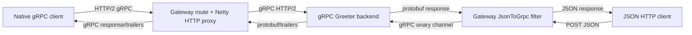
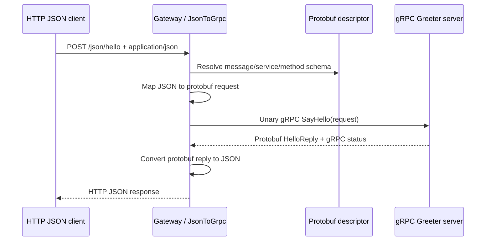
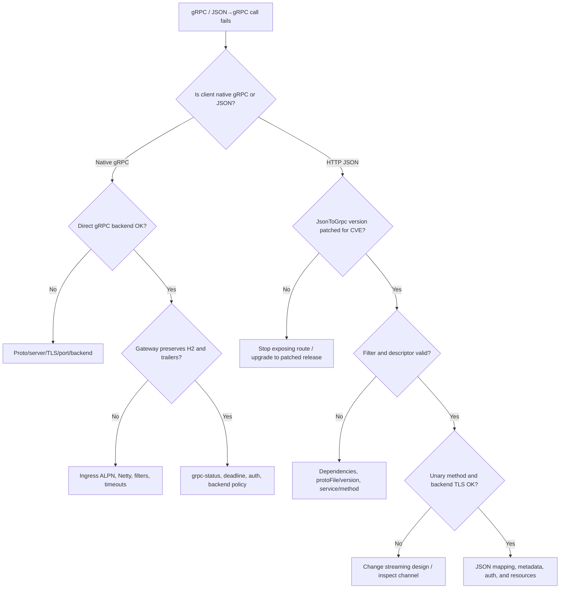

# gRPC Proxy Limits and the JsonToGrpc Filter by Supported Version

In microservices architectures, **Spring Cloud Gateway** is commonly used to match routes by path/host/header, transform paths or headers, discover backends via service discovery, authenticate callers, rate-limit traffic, and apply retries, circuit breakers, TLS, and observability at the API edge. When a backend speaks **gRPC**, engineering teams face questions absent from ordinary REST JSON APIs: does Gateway preserve **HTTP/2** to the backend? Does it preserve **gRPC trailers** and `grpc-status`? Can it translate **JSON from a browser into a gRPC call**? And if the call is **streaming**, which components actually support it?

Two models are frequently confused:

1. **Pure gRPC proxying (*gRPC pass-through / transparent routing*):** the client sends a gRPC request over HTTP/2; Gateway selects a route and forwards the traffic to the gRPC server. Gateway does not necessarily read `.proto` files or convert JSON.
2. **`JsonToGrpc` GatewayFilter:** the client sends **HTTP JSON**; the filter uses a protobuf descriptor to turn JSON into a gRPC request, invokes the configured method, and converts the reply back to JSON. Per current Gateway WebFlux documentation, **this filter does not support streaming**.

Both paths target the same backend ecosystem yet **differ in HTTP contract, code path, dependencies, streaming capability, and operational risk**. This lesson belongs to the **WebSocket and Streaming** chapter of the **SPRING_CLOUD_GATEWAY** module; it focuses specifically on **gRPC proxy limits and the `JsonToGrpc` filter by supported version**.

> **Scope:** Prioritizes **Spring Cloud Gateway Server WebFlux** on Reactor Netty. Gateway Server Web MVC, Spring Integration gRPC, Spring gRPC client/server, and gRPC-aware ingresses/proxies are separate technologies whose **API/config names cannot be substituted interchangeably**. Spring Cloud Gateway starter names and namespaces change across release trains; always verify against your actual dependencies and version docs.

> **Security advisory updated November 24, 2026:** Spring disclosed **CVE-2026-59425 (High)** on **November 19, 2026**: the `JsonToGrpc` filter in affected Gateway releases creates a new `ManagedChannel` per request without closing or reusing it, leaking sockets/resources and risking **denial of service**. Affected ranges and official patches are detailed in **section 14**. **Never expose this filter on public routes using an affected version.** Source: [Spring Security Advisory CVE-2026-59425](https://spring.io/security/cve-2026-59425/).

## 1. The Problem: One Gateway Serving Both REST JSON and gRPC

Suppose a system includes a `greeter-service` defining RPC `Greeter.SayHello`:

```proto
syntax = "proto3";

package demo.greeter.v1;

service Greeter {
  rpc SayHello (HelloRequest) returns (HelloReply);
}

message HelloRequest {
  string name = 1;
}

message HelloReply {
  string message = 1;
}
```

A **native gRPC client** wants to call the method through Gateway:

```text
gRPC client
  -- HTTP/2 + application/grpc + protobuf -->
Spring Cloud Gateway
  -- HTTP/2 + gRPC framing/trailers -->
greeter-service
```

An **HTTP JSON client** wants to invoke the same business logic without generated gRPC stubs:

```text
HTTP JSON client
  -- POST /json/hello {"name":"Ada"} -->
Spring Cloud Gateway / JsonToGrpc
  -- gRPC unary SayHello(HelloRequest) -->
greeter-service
  -- HelloReply protobuf -->
Gateway converts to JSON {"message":"Hello, Ada"}
```

For WebSocket or server streaming, interaction differs fundamentally: multiple messages flow within one connection or RPC. **`JsonToGrpc` is neither a WebSocket proxy, a gRPC-Web proxy, nor a general-purpose JSON↔gRPC streaming engine.**

### Learning Outcomes

- Distinguish native gRPC, gRPC-Web, WebSocket, and HTTP JSON→gRPC.
- Know the **HTTP/2, ALPN/TLS, URI, method, and header/trailer** requirements for gRPC proxying.
- Configure pure gRPC routes while understanding **compatibility limits when proxying streaming**.
- Configure `JsonToGrpc` for unary RPCs with `service`, `method`, and `protoDescriptor`.
- Distinguish **`protoFile`/Java DSL** changes across documentation generations.
- Build a test matrix covering unary/streaming, deadlines, cancellation, statuses, TLS, LoadBalancer, and security.
- Identify **CVE-2026-59425**, select patched versions, and monitor `ManagedChannel` resources.

## 2. gRPC Is Not WebSocket, Even Though Both Stream

| Protocol/mechanism | Transport channel | Typical data format | Call/connection model |
| --- | --- | --- | --- |
| **Native gRPC** | HTTP/2 (typically TLS+h2) | Protobuf binary + gRPC framing | Unary, server streaming, client streaming, bidirectional streaming. |
| **gRPC-Web** | Browser-friendly HTTP transport | gRPC-Web framing, typically binary/text variants | Client/proxy limitations apply; not equivalent to native bidi streaming. |
| **WebSocket** | HTTP Upgrade on HTTP/1.1 or stack-specific mechanism | Text/binary frames per app | Long-lived full-duplex; lacks native gRPC method/trailer semantics. |
| **REST/JSON** | Typically HTTP/1.1 or HTTP/2 | JSON/HTTP body | Standard HTTP request/response; streaming needs separate mechanisms. |
| **`JsonToGrpc`** | Inbound HTTP JSON, outbound gRPC channel | Converts JSON ↔ protobuf via descriptor | **Unary**, streaming unsupported per official docs. |

Never infer "Gateway supports WebSocket" means it automatically supports **gRPC streaming** or turns gRPC-Web into native gRPC. WebSocket proxies typically use `ws://`/`wss://` URIs and WebSocket routing paths; native gRPC uses HTTP/2 with `application/grpc` and distinct semantics.

### Four RPC Types

```proto
service Telemetry {
  // 1 request, 1 response
  rpc GetStatus (StatusRequest) returns (StatusReply);

  // 1 request, multiple responses
  rpc WatchStatus (StatusRequest) returns (stream StatusReply);

  // Multiple requests, 1 response
  rpc UploadEvents (stream Event) returns (UploadSummary);

  // Multiple requests, multiple responses in both directions
  rpc ChatEvents (stream Event) returns (stream Event);
}
```

**Not every RPC type maps onto a single JSON HTTP POST.** One HTTP JSON body represents a unary request cleanly, whereas server, client, and bidirectional streaming require different framing, flow control, cancellation, and streaming semantics.

## 3. Two Paths Through Gateway



| Question | Pure gRPC proxy | `JsonToGrpc` |
| --- | --- | --- |
| Does Gateway need `.proto` files? | Typically **no** when merely proxying opaque gRPC bytes. | **Yes**, a descriptor matching the service/method. |
| What is inbound? | Native gRPC/HTTP/2. | HTTP JSON request. |
| What is outbound? | HTTP/2 gRPC proxy to backend. | gRPC client/channel invoking a specific method. |
| Response to client? | gRPC framing and statuses/trailers. | JSON response converted from protobuf. |
| Supports streaming? | **Must verify each type on exact stack/version**; designed for pass-through gRPC, yet no blanket guarantee across all proxies/filters. | **No**, per `JsonToGrpc` documentation. |
| Needs gRPC Java libs in Gateway? | Not necessarily for opaque proxying; Spring showed examples without proto/gRPC dependencies. | Requires version-compatible filter, protobuf/gRPC/marshalling dependencies. |
| Main risks | HTTP/2 negotiation, trailers, deadlines, cancellation, flow control, proxy buffering. | Descriptor mismatch, JSON mapping, memory/channel lifecycle, no streaming. |

Spring announced gRPC/HTTP/2 support in Gateway **since 3.1.0 (Spring Cloud 2021.0.0)** with transparent routing examples requiring no proto definitions in Gateway. Still, a 2021 engineering blog post is not a blanket guarantee that **every modern gRPC feature** works across all versions. Source: [Spring Cloud Gateway and gRPC](https://spring.io/blog/2021/12/08/spring-cloud-gateway-and-grpc/).

## 4. HTTP/2 and TLS: Baseline Requirements for Native gRPC

Native gRPC relies on **HTTP/2** to multiplex streams over a connection and carry metadata, data frames, and trailers. Both Gateway's inbound listener and the Gateway→backend hop must preserve matching protocols and semantics.

### H2 vs. H2C

| Transport | Characteristics | Practice |
| --- | --- | --- |
| **`h2`** | HTTP/2 over TLS, usually negotiated via ALPN. | Preferred for client→Gateway and Gateway→backend, especially in production. |
| **`h2c`** | Cleartext HTTP/2. | Available in certain runtimes/infrastructures; **do not assume your Gateway version supports end-to-end h2c gRPC proxying**. |
| **HTTP/1.1** | Lacks native gRPC HTTP/2 transport mechanics. | Cannot be faked by merely adding `Content-Type: application/grpc`. |

In the original gRPC support blog, Spring noted **Gateway required h2 with TLS for the supported example**, even though Reactor Netty supports h2c. Newer Spring Boot/Netty versions support h2c in other contexts. **Do not generalize Reactor Netty capabilities into guarantees for all Gateway variants**; verify against your exact version and test.

### Enabling Inbound HTTP/2 and TLS on Gateway

```yaml
server:
  port: 8443
  http2:
    enabled: true
  ssl:
    enabled: true
    key-store-type: PKCS12
    key-store: classpath:certs/gateway-lab.p12
    key-store-password: ${GATEWAY_KEYSTORE_PASSWORD}
    key-password: ${GATEWAY_KEY_PASSWORD}
```

This is a **test-environment snippet**; the keystore must be generated/provisioned outside this lesson with matching hostname/SANs. Production uses secret management and certificate rotation — never commit passwords or keystores containing private keys to Git.

**Setting `server.http2.enabled: true` only configures inbound HTTP/2 capability in the Spring Boot runtime.** It **does not automatically switch** outbound HTTP client routes to H2, guarantee ingress/CDN uses H2 to Gateway, or translate gRPC-Web.

### Hops to Verify

```text
Native gRPC Client
   ⇅ TLS ALPN h2
Ingress / Load Balancer (if present)
   ⇅ gRPC/HTTP2 per supported topology
Gateway WebFlux (Reactor Netty)
   ⇅ TLS ALPN h2
gRPC backend :6565
```

If ingress terminates TLS and issues an **HTTP/1.1** request to Gateway, native gRPC breaks even though client→ingress used H2. For gRPC-preserving ingresses, verify TLS termination/re-encryption, protocol selection, ALPN, and trailer support.

### Never Disable Certificate Verification to Fix Errors

`grpcurl -insecure` and configs like `useInsecureTrustManager` appear in blogs/demos, yet **are unfit for production**. Provision proper CAs/truststores to clients and Gateway, verify hostnames/SNIs, and use mTLS when backends or internal policies require it.

## 5. What Does a Native gRPC Request Look Like?

A native unary gRPC call is typically an HTTP/2 POST with:

```http
:method: POST
:scheme: https
:path: /demo.greeter.v1.Greeter/SayHello
:authority: grpc.example.internal
content-type: application/grpc
te: trailers
grpc-timeout: 5S
```

This is a **conceptual view of HTTP/2 pseudo-headers and metadata**; raw requests carry binary gRPC-framed payloads and HTTP/2 frames, not plain text HTTP. `grpc-timeout` may be omitted if the client sets no deadline.

### Field Meanings

| Component | Meaning | What proxies must watch |
| --- | --- | --- |
| `:path` | Fully qualified gRPC service/method. | `RewritePath`/`StripPrefix` can break method dispatch. |
| `:authority` | HTTP/2 authority; ties to TLS SNI/backend routing. | Never override Host/authority against backend cert mismatch. |
| `content-type: application/grpc` | Identifies native gRPC payload. | Never rewrite to `application/json` on proxy routes. |
| `te: trailers` | Compatibility metadata for gRPC trailers. | Hop-by-hop header filters can strip/break it; must test. |
| `grpc-timeout` | Deadline/time budget. | Proxies must not drift deadlines or retry past budget. |
| `grpc-encoding` | Compression if enabled. | Never alter compression without decoding/re-encoding. |
| `grpc-status`/`grpc-message` | gRPC result in trailers (or headers on certain failures). | Never judge success from HTTP status alone. |

### HTTP 200 Does Not Mean gRPC OK

A gRPC server can return:

```text
HTTP/2 :status = 200
content-type = application/grpc
... response DATA ...
trailers:
    grpc-status = 7
    grpc-message = Permission denied
```

`grpc-status=7` is **`PERMISSION_DENIED`**, even though HTTP carries `:status=200`. If Gateway/ingress/metrics record only HTTP 200, you will mismeasure RPC failure rates.

**Verifying `grpc-status` in trailers is a separate acceptance requirement**, especially for `UNAUTHENTICATED`, `PERMISSION_DENIED`, `DEADLINE_EXCEEDED`, `UNAVAILABLE`, and `RESOURCE_EXHAUSTED`.

## 6. Pure gRPC Route: Preserve the Method Path

Server WebFlux route example when `greeter-service` listens for gRPC TLS on `localhost:6565`:

```yaml
spring:
  cloud:
    gateway:
      server:
        webflux:
          routes:
            - id: grpc-greeter-native
              uri: https://localhost:6565
              predicates:
                - Path=/demo.greeter.v1.Greeter/**
                - Method=POST
```

**Why omit `StripPrefix`?** Native gRPC clients send `:path` `/demo.greeter.v1.Greeter/SayHello`; backend gRPC dispatchers usually need that exact path to resolve the service/method. Stripping a segment triggers `UNIMPLEMENTED` or routing failures.

Spring docs show `Path=/**` forwarding all gRPC traffic to one backend. In production, scope routes explicitly to **service/method namespaces and hostnames/API scopes** when hosting multiple backends to prevent accidental catch-alls.

### Routing via Service Discovery

When Spring Cloud LoadBalancer, a `ServiceInstance` source, and controlled TLS setup exist, you can consider:

```yaml
uri: lb://greeter-service
```

However, **`lb://` does not automatically guarantee H2/TLS**: scheme inference/conversion depends on instance metadata, service discovery, and implementation/version. For gRPC TLS, verify TLS trust, hostname, port, instance metadata, and outbound protocol on your exact Gateway version. When load-balancing across gRPC replicas, test per-RPC routing, connection pooling, stream affinity, deadlines, and instance failure mid-stream.

### HTTP(S) URI Alone Is Not Enough

`NettyRoutingFilter` handles `http`/`https` downstream URIs, whereas native gRPC requires **HTTP/2** and gRPC trailers. If outbound client config accidentally defaults to HTTP/1.1, a route with `https://...` still fails to proxy gRPC properly.

## 7. Limits When Proxying Native gRPC: Do Not Lump Everything Under "Streaming OK"

**Proxying gRPC over HTTP/2** has been demonstrated by Spring since Gateway 3.1.x, yet these four call types vary widely in difficulty:

| Call type | Payload | Risks with intermediate Gateway/proxy | What to verify |
| --- | --- | --- | --- |
| **Unary** | One request, one response. | HTTP/2, gRPC message framing, trailers/status, TLS. | Happy path and error gRPC statuses. |
| **Server streaming** | One request, multiple response DATA frames. | Buffering, backpressure, idle timeouts, trailing closure, client cancellation. | Message order/count, timing, status trailers. |
| **Client streaming** | Multiple request messages, one response. | Request-body aggregation, flow control, half-close, max message size. | Backend receives all messages and closes cleanly. |
| **Bidirectional streaming** | Both sides emit messages concurrently. | Full-duplex data, half-close, cancellation, per-stream flow control, proxy limits. | Independent directions, disconnects, trailers, and deadlines. |

**Never assume** a passing unary test guarantees the other three streaming modes work on your version. In some versions/frameworks, seemingly harmless HTTP filters can buffer bodies and break streaming semantics.

### Specific Design Constraints to Address

1. **End-to-end negotiated HTTP/2:** every hop must support H2 properly without downgrading to HTTP/1.1 in the middle.
2. **Trailers:** `grpc-status`/`grpc-message` must not be dropped by Netty or proxies when forwarding responses.
3. **Half-close/cancellation:** when the client stops sending request messages while awaiting replies, upstream must see end-of-request; when the client cancels, the backend must be notified promptly.
4. **Flow control/backpressure:** large streams must never buffer unboundedly in Gateway or ingress.
5. **Deadlines and idle timeouts:** long-lived server streams can be cut by HTTP client, load balancer, ingress, firewall, or keepalive timeouts.
6. **Compression:** when `grpc-encoding` is active, proxies/filters must not corrupt framed payloads.
7. **Connection reuse:** many gRPC streams share an HTTP/2 connection; manage `MAX_CONCURRENT_STREAMS` and lifecycles.
8. **HTTP errors vs. gRPC errors:** distinguish pre-stream errors from error gRPC trailers emitted after HTTP status 200.

### WebSocket Support Does Not "Patch" gRPC

A `wss://chat-service` route with `WebsocketRoutingFilter` does not turn a gRPC stream into WebSocket. Even though both involve message streams, **gRPC framing, HTTP/2 multiplexing, message/trailer semantics, and protobuf contracts** differ completely.

If browsers only speak gRPC-Web, deploy a **gRPC-Web-aware proxy/adapter** or compatible client stack. Do not expect WebSocket routes or `JsonToGrpc` to handle `application/grpc-web`.

## 8. What `JsonToGrpc` Does and Does Not Do

`JsonToGrpc` is a **`GatewayFilterFactory`** in Spring Cloud Gateway WebFlux that uses a protobuf descriptor to construct **a gRPC call** from inbound HTTP JSON and convert the gRPC reply back to outbound JSON. Gateway 5.0.x/5.1.x docs list these parameters:

- **`service`**: short name of the protobuf service handling the call.
- **`method`**: method name inside the service.
- **`protoDescriptor`**: location of the protobuf descriptor set file generated by `protoc`.

In 3.1.x docs or some older branches, there was also a **`protoFile`** parameter (the `.proto` source file), and Java DSL had different parameter ordering. **Do not assume legacy configs or old overloads remain required or available on 5.0.x/5.1.x.**

Source: [JsonToGrpc GatewayFilter Factory — Spring Cloud Gateway WebFlux](https://docs.spring.io/spring-cloud-gateway/reference/spring-cloud-gateway-server-webflux/gatewayfilter-factories/jsontogrpc-factory.html).

### Conversion Flow



The arrow to the descriptor represents **logical schema lookup/decoding**, not a per-request network call to fetch the descriptor. Initialization/descriptor parsing and channel overhead must be verified per version and patch.

### Unary Scope

With proto:

```proto
rpc SayHello (HelloRequest) returns (HelloReply);
```

one JSON request maps to one protobuf request, and one protobuf response maps back to JSON.

Conversely, methods such as:

```proto
rpc WatchStatus (StatusRequest) returns (stream StatusReply);
rpc UploadEvents (stream Event) returns (UploadSummary);
rpc ChatEvents (stream Event) returns (stream Event);
```

**are not supported by `JsonToGrpc` per official docs**, even though the gRPC backend supports them and native gRPC pass-through on some Gateway versions has been tested with streaming scenarios.

**Do not try attaching `JsonToGrpc` to a server-streaming route expecting it to turn messages into SSE or WebSocket frames.** That requires a dedicated purpose-built adapter.

## 9. Protobuf Descriptor: Essential Metadata Source for `JsonToGrpc`

`JsonToGrpc` needs to know which **protobuf message schema** maps to JSON fields and which service/method to invoke. Thus, you must compile a **descriptor set** from `.proto` files.

### 9.1. Sample Definition

Place `src/main/proto/greeter.proto` in a sample project:

```proto
syntax = "proto3";

package demo.greeter.v1;

option java_multiple_files = true;
option java_package = "demo.greeter.v1";

service Greeter {
  rpc SayHello (HelloRequest) returns (HelloReply);
}

message HelloRequest {
  string name = 1;
}

message HelloReply {
  string message = 1;
}
```

Here `package` defines the fully qualified RPC name `demo.greeter.v1.Greeter/SayHello`. In filter config, current WebFlux docs use the **short service name `Greeter`** and `method: SayHello`; if your Gateway version requires the fully qualified name, check its reference/source and test.

### 9.2. Generating a Descriptor Set with `protoc`

Illustrative build command:

```bash
protoc \
  --proto_path=src/main/proto \
  --include_imports \
  --descriptor_set_out=src/main/resources/proto/greeter.pb \
  src/main/proto/greeter.proto
```

**Explanation:**

- `--proto_path` points to the root directory for resolving `import`s.
- `--descriptor_set_out` generates a **binary descriptor set** file — **not a Java class, not JSON, and not a server**.
- `--include_imports` bundles imported schemas so schema resolution succeeds when protobuf dependencies exist.
- The output file must be **packaged or mounted** at a path Gateway can read.
- The `protoc` version must match your application's protobuf schema/toolchain.

The output directory must exist beforehand or be created by the build. **Never hand-edit bytes** in `.pb` files; regenerate descriptors in build pipelines and track hashes/versions.

### 9.3. Descriptor Location at Deployment

Gateway docs show:

```yaml
protoDescriptor: file:proto/hello.pb
```

`file:` is a filesystem resource location. Inside containers/k8s, **relative paths depend on the working directory**, not automatically JAR resources. In production, use an explicitly mounted and controlled path, e.g.:

```yaml
protoDescriptor: file:/etc/gateway/proto/greeter.pb
```

Pick a resource prefix/location **supported by your exact version**. Never assume every implementation understands `classpath:` or hot-reloads descriptors from JARs. Ensure proper read permissions and keep files synchronized with Gateway/proto revisions.

### 9.4. When Proto Schemas Evolve

If the backend adds/removes/renames fields, renames methods, or changes packages, the descriptor can go out of sync. For instance, changing:

```proto
message HelloRequest {
  string first_name = 1;
}
```

while HTTP JSON clients still send `{"name":"Ada"}` causes mapping errors or wrong behavior. For schema evolution:

- Version **proto files/descriptors** alongside route configs.
- Prefer backward-compatible protobuf changes per protobuf rules.
- Test JSON field names, `snake_case`/`camelCase`, default values, unknown fields, enums, repeated/map/well-known types.
- Never assume unknown JSON fields are harmless; parser strictness depends on implementation.
- Never enable a new route before the backend service/method and descriptor are live on every replica.

## 10. Configuring `JsonToGrpc` on Gateway WebFlux 5.x

**Unary JSON→gRPC** example using the same TLS Greeter backend on port `6565` and mounted descriptor:

```yaml
spring:
  cloud:
    gateway:
      server:
        webflux:
          routes:
            - id: json-greeter-unary
              uri: https://localhost:6565
              predicates:
                - Path=/json/hello
                - Method=POST
              filters:
                - name: JsonToGrpc
                  args:
                    service: Greeter
                    method: SayHello
                    protoDescriptor: file:/etc/gateway/proto/greeter.pb
```

In this setup:

1. Client sends HTTP `POST /json/hello` with `Content-Type: application/json`.
2. Route matches on `Path`/`Method`.
3. `JsonToGrpc` uses the protobuf descriptor to invoke unary `Greeter.SayHello` on the configured backend.
4. Backend returns `HelloReply`; Gateway converts the reply to JSON.

**This is a configuration snippet, not a self-running system:** you must build the Greeter gRPC backend, provision TLS certs, mount the descriptor, include filter dependencies, configure Security/CORS/body-size/timeouts, and boot Gateway with the right BOM.

### Why Is `StripPrefix=2` Not Used?

`JsonToGrpc` resolves service/method from `args` and acts as a **dedicated bridge**; it does not borrow the HTTP JSON request path to construct the gRPC path. Omitting `StripPrefix` avoids confusion here. For native gRPC proxying, `/demo.greeter.v1.Greeter/SayHello` must be preserved as shown in section 6.

### Why Is the URI Still HTTPS?

The filter needs the gRPC target to open its channel/call. `uri: https://localhost:6565` denotes a **gRPC server over TLS** in the lab. Whether `lb://service` works and how the filter reads resolved host/port from routing attributes depend on implementation/version, so adding discovery requires **real integration testing** rather than assuming JSON→gRPC routes behave identically to native HTTP proxies.

## 11. Configuration Differences Across Documentation Generations

### 5.0.x/5.1.x — Parameters per Current Reference

```yaml
filters:
  - name: JsonToGrpc
    args:
      service: Greeter
      method: SayHello
      protoDescriptor: file:/etc/gateway/proto/greeter.pb
```

### Some 3.1.x/4.x Releases — Docs Include `protoFile`

```yaml
spring:
  cloud:
    gateway:
      routes:
        - id: json-greeter-legacy-example
          uri: https://localhost:6565
          predicates:
            - Path=/json/hello
          filters:
            - name: JsonToGrpc
              args:
                protoDescriptor: file:proto/greeter.pb
                protoFile: file:proto/greeter.proto
                service: Greeter
                method: SayHello
```

**Do not treat this as a guarantee for every 4.x release**, as APIs and bindings evolved across release trains. `3.1.x` docs include `protoFile`; `5.0.5` docs show three arguments (`service`, `method`, `protoDescriptor`). Check the source/reference of your exact artifact and test startup and binding dry-runs.

### Gateway 5.x Documentation Java DSL Example

```java
import org.springframework.cloud.gateway.route.RouteLocator;
import org.springframework.cloud.gateway.route.builder.RouteLocatorBuilder;
import org.springframework.context.annotation.Bean;
import org.springframework.context.annotation.Configuration;

@Configuration
public class JsonGrpcRoutes {

    @Bean
    RouteLocator grpcBridgeRoutes(RouteLocatorBuilder builder) {
        return builder.routes()
            .route("json-greeter-unary", r -> r
                .path("/json/hello")
                .filters(f -> f.jsonToGRPC(
                    "Greeter",
                    "SayHello",
                    "file:/etc/gateway/proto/greeter.pb"))
                .uri("https://localhost:6565"))
            .build();
    }
}
```

In `5.0.5/5.1.x`, docs call `jsonToGRPC(service, method, protoDescriptor)`. Older versions with `protoFile` may have different overloads/parameter orders. **Never declare the same route ID in both Java DSL and YAML simultaneously**, and never use this code before verifying your version includes the CVE patch described in section 14.

## 12. Dependencies: Pure gRPC Proxy vs. `JsonToGrpc` Differ

### 12.1. Native gRPC Proxy

In Spring's transparent proxy example, Gateway **does not need to import proto classes or generated gRPC stubs** simply to forward traffic. It needs:

- **Gateway Server WebFlux** and Reactor Netty on a supporting release train.
- **HTTP/2 + TLS** configured properly on inbound and outbound.
- Working route predicates/routing/Netty client against a real gRPC backend.
- Optional architecture pieces: Spring Security, LoadBalancer/`DiscoveryClient`, Micrometer/Actuator.

In newer lines, the Gateway WebFlux starter is typically:

```xml
<dependency>
    <groupId>org.springframework.cloud</groupId>
    <artifactId>spring-cloud-starter-gateway-server-webflux</artifactId>
</dependency>
```

Older lines may use `spring-cloud-starter-gateway`. Use a **Spring Boot-compatible Spring Cloud BOM** and verify managed Netty/Reactor versions; never pull in random Netty jars just to "enable gRPC."

### 12.2. `JsonToGrpc` Bridge

When enabling `JsonToGrpc`, Gateway must handle:

1. HTTP JSON request bodies.
2. Protobuf descriptors and JSON↔protobuf conversion.
3. gRPC channels, method descriptors, and gRPC invocations.
4. Serialization of protobuf replies back to JSON.

Thus, beyond the starter, you need **the gRPC/Protobuf/JSON-mapping libraries actually used by your version's implementation**. Artifacts commonly seen in examples/integration tests include:

| Dependency group | Purpose | Notes |
| --- | --- | --- |
| `io.grpc:grpc-netty` or framework-used variant | gRPC transport/channel. | Use compatible managed versions; avoid mixing shaded/unshaded netty carelessly. |
| `io.grpc:grpc-protobuf` | gRPC protobuf marshalling. | Pair with compatible gRPC Java/protobuf versions. |
| `io.grpc:grpc-stub` | Generated stubs when code invokes gRPC directly. | May be unnecessary when the bridge uses dynamic method descriptors; verify at runtime. |
| `com.google.protobuf:protobuf-java` and `protobuf-java-util` | Descriptors, protobuf messages, JSON utilities. | Check proto3/well-known types and converter compatibility. |
| Jackson JSON / protobuf dataformat | Reads JSON, converts data per implementation. | **Heavily version-dependent**, including proto3 handling. |
| `spring-boot-starter-actuator` | Health/metrics/tracing if configured. | Not required for the filter to exist. |

Do not interpret this table as "adding all of the above suffices regardless of version." A Spring Cloud Gateway project issue recorded a missing `ProtobufFactory` error in `4.1.0` without Jackson Protobuf dataformat and also noted proto3 limitations in that dependency/mechanism. Inspect **dependency trees, actual runtime behavior, and compatibility** instead of adding one artifact and assuming all protobuf versions work. Discussion source: [Gateway issue #3424](https://github.com/spring-cloud/spring-cloud-gateway/issues/3424).

### Reference Dependency Excerpt

```xml
<dependencies>
    <dependency>
        <groupId>org.springframework.cloud</groupId>
        <artifactId>spring-cloud-starter-gateway-server-webflux</artifactId>
    </dependency>
    <!-- Add only the gRPC/Protobuf artifacts actually needed
         and compatible with your JsonToGrpc version. -->
    <dependency>
        <groupId>io.grpc</groupId>
        <artifactId>grpc-netty</artifactId>
    </dependency>
    <dependency>
        <groupId>io.grpc</groupId>
        <artifactId>grpc-protobuf</artifactId>
    </dependency>
    <dependency>
        <groupId>com.google.protobuf</groupId>
        <artifactId>protobuf-java-util</artifactId>
    </dependency>
</dependencies>
```

**This snippet is not a standalone runnable POM.** gRPC/protobuf versions must be managed by a compatible BOM or dependency management. Some starters do not bundle all dependencies, and some dependencies appear only in integration tests or server/mock modules. Pick artifacts based on **the exact APIs invoked by the filter** in your version.

### Is `grpcurl` Needed Inside Gateway?

No. `grpcurl` is a **standalone client testing CLI**, not a Spring Cloud Gateway runtime library. You can use it to:

- Call the gRPC backend directly.
- Call through Gateway's native gRPC proxy.
- Verify trailers/status, reflection/proto, TLS, and timeouts.

For `JsonToGrpc`, an HTTP client like `curl`/Postman suffices for testing the JSON frontend; keep a gRPC client around to test the backend directly too.

## 13. TLS for `JsonToGrpc` and gRPC Channel Management

Gateway WebFlux `JsonToGrpc` docs note that the filter creates a `NettyChannel` using the **default `TrustManagerFactory`**. Docs also mention customizing trust via a `GrpcSslConfigurer` bean, e.g., with `GRPCSSLContext`. However, never copy `trustAllCerts()` examples into production.

### Distinguish the Two Outbound Clients

A Gateway may maintain:

- **Reactor Netty `HttpClient`** for native HTTP/gRPC pass-through routes.
- **gRPC Java `ManagedChannel`/Netty channel** created by `JsonToGrpc` to call backends.

Therefore, configuring truststores/SSL only on Netty's routing HTTP client **does not necessarily** alter the trust policy of `JsonToGrpc`'s gRPC channel. Check filter-specific SSL configuration for your exact version and test certificate verification.

### Production Requirements

- The gRPC backend holds a valid certificate for the target hostname/SNI.
- Gateway trusts the proper root/intermediate CAs with a certificate rotation process.
- If using mTLS, Gateway's client certificate/identity is provisioned and audited separately.
- Never hardcode private keys/client secrets in route YAML, metadata, or logs.
- Never use `InsecureTrustManagerFactory`, `trustAllCerts`, or `grpcurl -insecure` to bypass TLS verification in production.
- Monitor channel counts, open sockets, file descriptors, heap/direct memory, and request load.
- Verify your version patches **CVE-2026-59425** before exposing any `JsonToGrpc` route.

### Never Create a `ManagedChannel` per Request in Custom Code

If writing a custom bridge instead of using the filter:

```java
// Pseudocode illustrating an anti-pattern:
return request -> {
    ManagedChannel channel =
        NettyChannelBuilder.forAddress(host, port).build();
    // Invokes RPC and forgets to shut down channel -> leaks sockets/resources.
};
```

This is an **anti-pattern**, neither production code nor proper filter usage. gRPC channels are expensive resources whose lifecycles must be managed, reused per policy, connection-capped, and shut down cleanly on application exit. Use a patched Gateway version instead of "fixing" leaks by raising file descriptor limits.

## 14. Version-Specific Security: CVE-2026-59425

On **November 19, 2026**, Spring published **High — CVE-2026-59425, "Spring Cloud Gateway JsonToGrpc Filter Leaks gRPC ManagedChannel Resources."**

### Mechanism and Impact

Per the advisory, `JsonToGrpc` in affected releases creates a `Netty-backed ManagedChannel` **for every HTTP request** traversing the filter without closing or reusing it, leaving socket/channel resources allocated after the request completes. If the route is callable by untrusted sources, sending many requests can cause **denial of service** via resource exhaustion.

**The CVE's scope is explicit:** only applications **exposing routes configured with `JsonToGrpc`** on affected versions are impacted. Never state that "every Gateway app has this bug," nor conflate it with native gRPC proxy routes **that do not use `JsonToGrpc`**.

### Affected Version Ranges — Per Advisory of November 19, 2026

| Spring Cloud Gateway | Affected versions | Patched version announced by Spring | Distribution |
| --- | --- | --- | --- |
| 5.0.x line | `5.0.0–5.0.4` | `5.0.5` | **OSS** |
| 5.0 enterprise line | `5.0.0–5.0.4` | `5.0.4.1` | **Enterprise Support only** |
| 4.3.x line | `4.3.0–4.3.6` | `4.3.7` | **Enterprise Support only** |
| 4.2.x line | `4.2.0–4.2.10` | `4.2.11` | **Enterprise Support only** |
| 3.1.x line | `3.1.4–3.1.14` | `3.1.15` | **Enterprise Support only** |

This reflects **details at advisory publication time**, not an eternal "latest version" table. Check newer patches and security advisories before picking a production version. Official source: [Spring CVE-2026-59425](https://spring.io/security/cve-2026-59425/).

### Recommended Actions

1. Inventory Gateway apps running `JsonToGrpc` and verify their **actual runtime version** (not just article numbers or intended BOMs).
2. Cross-check affected ranges against the security advisory.
3. **Upgrade to the matching supported patched version** — Spring's recommended remediation. The 5.0 line has OSS patch `5.0.5`; listed fixes for 4.3/4.2/3.1 are Enterprise Support releases per advisory.
4. Keep access control and rate limiting to reduce abuse, but **never treat them as a fix for the leak**.
5. After upgrading, measure throughput, `ManagedChannel`/socket counts, file descriptors, and long-running unary bridge load.
6. Ensure rollbacks never revert to a vulnerable release during unrelated incidents.

**Never declare "patched"** simply because restarting Gateway temporarily drops socket counts or because `RedisRateLimiter` was added; the bug persists as long as a vulnerable version serves requests.

### Relationship to Streaming Limits

The `ManagedChannel` leak affects **unary `JsonToGrpc` routes**; streaming is not required to trigger it. Conversely, patching the leak **does not add streaming support**. These are **two independent boundaries**:

- **Capability:** `JsonToGrpc` does not support streaming per reference docs.
- **Security/availability:** run a CVE-patched version whenever exposing the unary bridge.

## 15. Authentication, Authorization, and Avoiding Credential Misuse

gRPC and `JsonToGrpc` enter through the same Gateway, yet should not blindly share one credential policy:

| Entry path | Identity Gateway sees | What to verify |
| --- | --- | --- |
| Native gRPC client with bearer metadata | HTTP/2 gRPC metadata typically carries `authorization`. | Validate JWT/opaque token at Gateway/backend per policy without losing metadata. |
| JSON browser client with session cookie | Spring Security OAuth2 Login/BFF identifies user. | Cookie/CSRF/CORS, authorized client/`TokenRelay` if required. |
| JSON client with bearer JWT | Spring Security Resource Server validates inbound token. | Explicitly decide how outbound gRPC metadata carries identity. |
| Internal M2M client | Service identity / mTLS / client credentials. | Audience/scopes and service-level backend authorization. |

### `JsonToGrpc` Does Not Automatically Relay User JWTs to gRPC Metadata

A JSON→gRPC filter **does not automatically guarantee** every inbound HTTP header (like `Authorization` or trace headers) becomes gRPC metadata matching backend security policy. When the backend needs user identity:

- Validate inbound tokens first at Gateway.
- Decide which methods need user delegation, service tokens, or no tokens.
- Configure a supported metadata-forwarding bridge/interceptor (if supported by version), or write a dedicated adapter.
- Verify with safe integration tests which metadata the backend actually receives, **without logging raw tokens**.
- Never blindly promote client-supplied `X-User-Id` into trusted gRPC metadata.

If the filter lacks the metadata propagation you need, **do not hack around it with random route header mutations**; build a dedicated BFF/gRPC adapter with an explicit authorization model.

### Do Not Treat `JsonToGrpc` as an Authorization Boundary

A route matching `Path=/json/hello` does not authorize calling `Greeter.SayHello`. Spring Security, quotas, and backend authorization must run at the proper layers. For sensitive gRPC methods, enforce **service/method-level** policies and resource caps, not just JSON path matching.

### CORS/CSRF

When browsers call the JSON endpoint cross-origin:

- Handle CORS preflight `OPTIONS` ahead of auth rules incompatible with preflight.
- Gateway 401/403/429/5xx responses also need CORS headers if browsers must read statuses.
- With session cookies, **CORS does not replace CSRF protection** on POSTs.
- Avoid wildcard origins on credentialed CORS.

Native gRPC clients do not use browser CORS the same way; **CORS never protects a native gRPC API from untrusted callers**.

## 16. Deadlines, Timeouts, and Cancellation

In gRPC, a **deadline** is the RPC's time budget. A short unary call and a 30-minute status-monitoring stream have very different requirements.

| Type | Where applied | Meaning |
| --- | --- | --- |
| **gRPC deadline/`grpc-timeout`** | gRPC client/call | Bounded completion budget; expiry returns `DEADLINE_EXCEEDED`. |
| **Gateway HTTP client connect/response timeout** | Reactor Netty or separate gRPC channel | Bounds connect/data-wait times; can raise transport errors. |
| **Ingress/LB idle timeout** | Proxies before/after Gateway | Can drop long-lived streams during quiet periods. |

### Illustrative Timeline

```text
Client sets gRPC deadline: 10 seconds
0s    client calls /Greeter/SayHello
0.1s  Gateway matches route
0.3s  Gateway sends upstream
5s    backend still processing
10s   deadline expires -> client cancels/aborts RPC
10s+  backend should be notified of cancellation if proxy supports it
```

If Gateway retries without preserving deadlines, retries can fire after the client has already canceled. If ingress idle timeouts are shorter than valid server-streaming gaps, streams close early even when the backend is healthy.

### Mandatory Tests

- Client cancels a unary RPC while waiting; does the backend abort work and free resources?
- Client cancels a server stream after N messages; does the stream close in Gateway and backend?
- Client streaming finishes sending and half-closes; does the backend receive the terminal signal?
- 1-second deadline while backend takes 3 seconds: what are the final gRPC status and latency?
- Does a Gateway transport timeout turn failures into HTTP 502/504 instead of `grpc-status`?
- Do retries/circuit breakers exceed the caller's budget?

Never fix every problem by setting all timeouts to infinity: that piles up hung connections and resources when backends stall.

## 17. Retry and CircuitBreaker: `grpc-status` Differs from HTTP Status

Spring Cloud Gateway provides `Retry`, `CircuitBreaker`, and HTTP timeouts. However, gRPC communicates logical outcomes via **`grpc-status` in trailers**, so deciding "did the request fail?" differs from HTTP APIs relying on `5xx`.

| Event | Possible HTTP status | gRPC status | Meaning |
| --- | --- | --- | --- |
| Unary RPC succeeded | `200` | `OK (0)` | True success. |
| Caller unauthorized | Often `200` | `PERMISSION_DENIED (7)` | Permission error; never blindly retry. |
| Wrong service/method | Often `200` | `UNIMPLEMENTED (12)` | Check proto and method path. |
| Backend overloaded | Often `200` | `RESOURCE_EXHAUSTED (8)` | Resource/quota limit hit. |
| Backend transiently unavailable | Often `200` | `UNAVAILABLE (14)` | Retryable only if idempotent and deadline remains. |
| Deadline expired | HTTP 200 or transport error | `DEADLINE_EXCEEDED (4)` | Never retry past budget. |
| TLS handshake failed before gRPC | `502/503` or connect error | Possibly no trailers | Transport/TLS failure. |

### Do Not Assume Gateway Retry Understands `grpc-status`

A `Retry` filter configured for HTTP `500/502/503` will **not treat HTTP 200 with `grpc-status=14` as a retryable error**. When a proxy returns HTTP 503 on broken connections, the gRPC client SDK may also be retrying itself, creating **stacked retry amplification**.

Recommendations:

1. Pick explicitly **which layer owns retries**: gRPC client, Gateway, service mesh, or SDK.
2. Retry only **safe, idempotent** RPCs within active budgets and deadlines.
3. Bound attempts and use exponential backoff with jitter.
4. Never naively retry streaming calls: partially processed messages can create side effects.
5. Track incoming RPC counts separately from downstream attempts.
6. Test real gRPC trailer errors, not just mocked HTTP 500s.

### CircuitBreaker Does Not Automatically Read Every gRPC Trailer

The `CircuitBreaker` `GatewayFilter` watches exceptions/HTTP failures per implementation. It **does not automatically inspect `grpc-status` on every gRPC call**. For circuit breaking by gRPC status code, use a gRPC-aware interceptor/proxy or instrumentation verified on your exact version.

### Never Use Body Filters That Break Streaming

Filters that read/cache/modify entire HTTP bodies (such as `ModifyRequestBody`, `ModifyResponseBody`) can buffer streams, destroy backpressure, or wait for stream completion. Native gRPC proxy routes should use only filters verified **not to alter binary framing, HTTP/2 trailers, or half-close semantics**.

## 18. Rate Limiting and Resource Caps on gRPC Routes

`RequestRateLimiter` limits **incoming HTTP/RPC requests**, yet a gRPC stream can carry thousands of messages inside **one RPC**. A single token consumed at stream start does not count messages or bytes across the stream's lifetime.

| Layer | Limit unit | Example |
| --- | --- | --- |
| **Gateway `RequestRateLimiter`** | Incoming HTTP/RPC requests | 10 RPCs/s per client. |
| **Concurrent stream limit** | Active gRPC streams | Prevent one client holding hundreds of long-lived streams. |
| **Message size limit** | Bytes/protobuf message | Prevent OOM payloads. |
| **Message/byte throughput** | Messages or bytes/s | Protect gRPC streaming ingestion. |
| **Deadline/idle timeout** | RPC duration | Clean up hung streams. |
| **Backend business quota** | Tenant/account operations | Protect business rules and resource entitlements. |

A route + user `RedisRateLimiter` **does not limit event counts** inside `UploadEvents(stream Event)`. Enforce limits inside gRPC servers/interceptors or a gRPC-aware proxy.

### `KeyResolver` and gRPC Identity

A `KeyResolver` reading `exchange.getPrincipal()` works only when Spring Security authenticated inbound metadata compatibly. If a native gRPC route merely forwards bearer metadata without Gateway establishing a principal, the resolver returns empty; rejection or empty-key behavior depends on config/version.

Never use caller-supplied raw `X-Customer-ID` as a quota key. For `JsonToGrpc` JSON endpoints, use Spring Security Resource Server or OAuth2 Login BFF per topology while still enforcing separate authorization at the gRPC backend.

### HTTP 429 Differs from `RESOURCE_EXHAUSTED`

`RequestRateLimiter` normally returns **HTTP 429 Too Many Requests** when Gateway rejects a call, whereas gRPC servers report **`RESOURCE_EXHAUSTED (8)`** via gRPC trailers. Native gRPC clients can perceive a plain HTTP 429 response as a transport/protocol error. If gRPC-native semantics are required, use a gRPC-aware limiter or test error mapping across real client SDKs.

## 19. Service Discovery and Load Balancing

A gRPC service can run multiple instances; Gateway's `lb://service-id` route integrates with Spring Cloud LoadBalancer per version and discovery setup. However, HTTP/2 multiplexing places **many streams onto one connection**.

Questions to verify:

1. Does load balancing pick an instance per request or reuse pooled connections? Are active streams spread evenly?
2. Does `ServiceInstance` carry accurate TLS scheme, host, port, and SNI for the gRPC server?
3. When a gRPC pod restarts, how are long-lived streams drained or canceled?
4. Is the service ID allowlisted so credentials never route outside trust boundaries?
5. Do retries/fallbacks respect deadlines and prevent duplicate writes?
6. Do backend replicas share compatible protobuf APIs and descriptors?

For multi-hour bidirectional streaming, connection-aware balancing, mTLS, or complex graceful stream draining, consider a **gRPC-aware ingress/proxy/client load balancer**. That doesn't mean Spring Cloud Gateway cannot handle gRPC; choose based on **verified capabilities** of your actual stack.

## 20. gRPC Metadata, Trailers, and HTTP Header Filters

A gRPC request can carry:

```text
content-type: application/grpc
te: trailers
grpc-timeout: 5S
grpc-encoding: gzip
authorization: Bearer [redacted]
x-request-id: [correlation]
```

**Never log verbatim** headers containing credentials. Spring Cloud Gateway runs `HttpHeadersFilters` before downstream routing. Historical docs for `RemoveHopByHopHeadersFilter` list `TE` among hop-by-hop headers. In gRPC, `te: trailers` plays a critical role, so never assume HTTP proxy success means trailers and metadata pass through intact.

Before changing header sanitization:

- Check source/reference docs for your exact version.
- Test both successful and failing unary RPCs with `grpcurl`.
- Verify `grpc-status`/`grpc-message` arrive properly at the gRPC client.
- Test server streaming ending with an error after several messages.
- Never disable all hop-by-hop sanitization just to "fix TE" without evaluating request smuggling and proxy behavior.

### `RewritePath`, Authority, and TLS

- The native gRPC path `/package.Service/Method` carries protocol meaning.
- `PreserveHostHeader`/`SetRequestHeader=Host` affects authority and TLS virtual hosting.
- `Authorization` must never forward to backends with different audiences/trust boundaries.
- `grpc-timeout` must be handled properly when proxies consume part of the deadline before forwarding upstream.

Never treat a client-supplied `Content-Type` header as proof that the caller is authenticated.

## 21. Observability: Measure Both HTTP Status and `grpc-status`

| Signal | Reason |
| --- | --- |
| Route ID and known gRPC service/method | Distinguish RPCs and target backends. |
| Gateway replica and revision | Detect config drift during rollouts. |
| HTTP protocol `h2`/`h2c`, TLS errors | Diagnose ALPN and certificates. |
| HTTP status | Spot transport/proxy failures. |
| **`grpc-status`** | Catch application errors when HTTP status is still 200. |
| Deadlines/cancellations, active streams | Track long-lived RPCs. |
| Open sockets/file descriptors/`ManagedChannel`s | Catch resource leaks and regressions. |
| gRPC message byte sizes | Control memory and throughput. |
| Retries/circuit breakers/429s | Separate resilience/quotas from business errors. |

System-instrumented event example (**not Gateway's default log**):

```text
traceId:           [opaque id]
routeId:           grpc-greeter-native
gatewayPod:        gateway-a
rpcService:        demo.greeter.v1.Greeter
rpcMethod:         SayHello
transport:         h2
httpStatus:        200
grpcStatus:        UNAVAILABLE
upstreamService:   greeter-service
latencyMs:         [measured]
```

Never log bearer tokens, cookies, PII-bearing protobuf payloads, raw credential metadata, or file descriptors/secrets into public dashboards. Avoid high-cardinality metric tags like user/customer IDs. Spring/Micrometer emits HTTP observations, yet **does not automatically read `grpc-status` trailers in Gateway metrics**; add instrumentation at gRPC clients/backends or gRPC-aware proxies as needed.

### Detecting Leaks After Upgrading `JsonToGrpc`

Run bounded unary load and watch completed requests, open sockets, `ManagedChannel` instances, file descriptors, heap/direct memory, and orphan channel warnings. After load stops, resource counts must stabilize per the patched version's lifecycle. **Observability does not replace upgrading:** CVE-2026-59425 must be fixed by running a patched release.

## 22. Hands-On Practice A: Verifying Native gRPC Proxying

### 22.1. Environment

| Component | Lab address | Role |
| --- | --- | --- |
| gRPC Greeter backend | `localhost:6565` over TLS/h2 | Implements `demo.greeter.v1.Greeter/SayHello`. |
| Spring Cloud Gateway WebFlux | `localhost:8443` over TLS/h2 | Defines route `grpc-greeter-native`. |
| `grpcurl` | Test machine | Invokes native gRPC directly and via Gateway. |
| `src/main/proto/greeter.proto` | Test file | Describes service/method when backend disables reflection. |
| Lab CA/certificates | Files created by test team | Lets clients trust Gateway and backend certs. |

**Never use production credentials**, never disable TLS verification in production, and never assume a gRPC server is running just because `.proto` exists. The backend must be built, started, and configured with TLS/HTTP2 on your chosen gRPC stack.

### 22.2. Test the Backend First

If the gRPC server disables reflection, `grpcurl` can use the proto file:

```bash
grpcurl \
  -cacert ./certs/lab-ca.pem \
  -import-path src/main/proto \
  -proto greeter.proto \
  -d '{"name":"Ada"}' \
  localhost:6565 \
  demo.greeter.v1.Greeter/SayHello
```

With a mock backend implementing greeting logic, expected response:

```json
{"message":"Hello, Ada"}
```

This is **output returned by the mock backend**, not a built-in default of gRPC or Spring Gateway. If direct calls fail, fix the server, certificates, or proto before debugging Gateway.

### 22.3. Call Through Gateway

```bash
grpcurl \
  -cacert ./certs/lab-ca.pem \
  -import-path src/main/proto \
  -proto greeter.proto \
  -d '{"name":"Ada"}' \
  localhost:8443 \
  demo.greeter.v1.Greeter/SayHello
```

Verify:

1. Gateway accepts **HTTP/2 h2** and picks `grpc-greeter-native`.
2. `:path` reaching the backend stays `/demo.greeter.v1.Greeter/SayHello`.
3. Backend receives a valid protobuf-framed gRPC request.
4. Response and `grpc-status=OK` reach the client cleanly.
5. Zero HTTP/1.1 downgrade or gRPC trailer loss occurs.
6. Authorization metadata and sensitive protobuf bodies are never logged.

### 22.4. Test Intentional gRPC Errors

In the mock backend, trigger `PERMISSION_DENIED` or `UNAVAILABLE`. Call through Gateway with `grpcurl -vv` or a gRPC client inspecting statuses/metadata:

```bash
grpcurl -vv \
  -cacert ./certs/lab-ca.pem \
  -import-path src/main/proto \
  -proto greeter.proto \
  -d '{"name":"deny-test"}' \
  localhost:8443 \
  demo.greeter.v1.Greeter/SayHello
```

**Note:** `"deny-test"` triggers an error only if **the mock backend is coded** to reject that value. Do not think special strings are a built-in gRPC feature. The goal is proving Gateway preserves gRPC error statuses/trailers instead of turning them into success or dropping details.

### 22.5. Disable HTTP/2 as a Negative Control

Strictly in an isolated lab, test a Gateway without H2 negotiation. Native gRPC clients receive a transport/protocol error distinct from a gRPC application error. Afterward, restore valid TLS/H2 settings.

**Never test by disabling TLS or certificate validation in environments with real users.**

## 23. Hands-On Practice B: JSON Request → Unary gRPC with `JsonToGrpc`

### 23.1. Prerequisites

1. Select a **Spring Cloud Gateway version patched for `CVE-2026-59425`**, such as `5.0.5` in the OSS 5.0 release train per advisory.
2. Run the unary Greeter backend from section 22 with TLS and `SayHello`.
3. Compile the protobuf descriptor `greeter.pb` from `greeter.proto`.
4. Ensure Gateway has the required dependencies/filter factory and read access to `file:/etc/gateway/proto/greeter.pb` or your test path.
5. Confirm route `json-greeter-unary` is loaded, has no duplicate route IDs, and has no other filter breaking JSON/response contracts.
6. Configure auth, rate limits, and body-size limits, especially on Internet-facing endpoints.

### 23.2. Generate the Descriptor

```bash
protoc \
  --proto_path=src/main/proto \
  --include_imports \
  --descriptor_set_out=src/main/resources/proto/greeter.pb \
  src/main/proto/greeter.proto
```

Mount/copy the descriptor file to the exact path Gateway reads at runtime; building into `src/main/resources` **does not automatically place a file at `/etc/gateway/proto/greeter.pb` inside a container**.

### 23.3. Call the HTTP JSON Endpoint

```bash
curl --http2 -i \
  --cacert ./certs/lab-ca.pem \
  -H "Content-Type: application/json" \
  -d '{"name":"Ada"}' \
  "https://localhost:8443/json/hello"
```

Expected response when everything works and the mock replies:

```http
HTTP/2 200
content-type: application/json

{"message":"Hello, Ada"}
```

**This response is illustrative, not a guarantee of exact headers/body/error mapping across every version.** `curl --http2` tests only inbound HTTP JSON; outbound still uses the filter's separate gRPC unary channel, not a native proxy of curl's request.

### 23.4. Test Invalid Inputs

Send malformed JSON:

```bash
curl --http2 -i \
  --cacert ./certs/lab-ca.pem \
  -H "Content-Type: application/json" \
  -d '{"name":' \
  "https://localhost:8443/json/hello"
```

The backend may **never be invoked** if JSON parsing fails in Gateway. Exact HTTP status codes depend on exception handlers, filter version, and Security; **do not assume it is always 400**. Check status, safe error logs, and backend counters.

Test next:

- JSON missing a required field per application contract.
- Unknown JSON fields or wrong field types.
- Payloads exceeding configured body-size limits.
- Proto descriptors with mismatched methods or packages.
- Backend returning `UNAVAILABLE` and `PERMISSION_DENIED`.
- Invalid backend TLS certificate.

### 23.5. Streaming Tests Must Be Classified as Unsupported

Never try turning:

```proto
rpc WatchStatus (StatusRequest) returns (stream StatusReply);
```

into a "JSON stream" just by setting:

```yaml
method: WatchStatus
```

In reviews, mark it **Not Supported by `JsonToGrpc`** per reference docs. If the business genuinely needs streaming JSON, pick **a purpose-built streaming adapter** or use native gRPC/gRPC-Web with appropriate capabilities.

## 24. Hands-On Practice C: Four RPC Types Through Native Proxy

Extend the mock gRPC server with:

```proto
syntax = "proto3";

package demo.telemetry.v1;

message Ping { string text = 1; }
message Pong { string text = 1; }

service Telemetry {
  rpc Unary (Ping) returns (Pong);
  rpc ServerStream (Ping) returns (stream Pong);
  rpc ClientStream (stream Ping) returns (Pong);
  rpc BidiStream (stream Ping) returns (stream Pong);
}
```

**This is an additional test proto** requiring backend implementations. Call each RPC directly with a gRPC client, then through Gateway's native proxy, and compare results.

| RPC type | Test input | What to verify |
| --- | --- | --- |
| Unary | One Ping | One Pong, `grpc-status=OK`. |
| Server streaming | One Ping | N messages in order, not buffered until stream end. |
| Client streaming | Send N Pings then half-close | Server receives all N and returns one Pong. |
| Bidirectional | Interleave sending Pings and reading Pongs | Both directions run deadlock-free; clean close/cancel. |

### Incorporate Transport and Cancellation Tests

- Keep streams running longer than any intermediate test proxy's default idle timeout; check for premature cuts.
- Pause reading responses to observe memory and backpressure.
- Disconnect the client mid-stream and verify the backend cancels and frees resources per design.
- Have the backend fail with a gRPC error after 2–3 messages; inspect trailers.
- Restart a backend instance mid-stream; observe error propagation and reconnect policies.
- Test message compression when using `grpc-encoding`.
- Measure active streams, heap/direct memory, TCP connections, and file descriptors.

**Concluding "native streaming supported" applies only to the exact tested combination:** Gateway version, Spring Boot, Reactor Netty, ingress/LB, gRPC backend, TLS config, filter chain, client SDK, and RPC type. Never mark all gRPC streaming supported based on one passing unary test.

## 25. Acceptance Matrix by Version and Path

| ID | Test | Pass criteria |
| --- | --- | --- |
| G01 | Gateway version verified from runtime | Boot/Cloud/Gateway/Netty recorded accurately, not read from wrong-branch docs. |
| G02 | `JsonToGrpc` route on CVE-affected version? | Deployment blocked or upgraded to patched release. |
| G03 | Native gRPC unary TLS/h2 | RPC succeeds with intact gRPC trailers. |
| G04 | Native gRPC without HTTP/2 | Failure clearly detected, no false success. |
| G05 | Invalid gRPC backend certificate | Connection rejected without disabling verification. |
| G06 | Native gRPC `PERMISSION_DENIED` error | Client receives `grpc-status=7` or exact equivalent error. |
| G07 | Native gRPC `UNAVAILABLE` error | Client receives exact gRPC status; retry policy measured. |
| G08 | Wrong gRPC method/path called | Never misrouted to another method; backend returns proper error. |
| G09 | Server streaming | Zero lost/duplicated messages; trailers intact. |
| G10 | Client streaming | Half-close and end-of-stream reply work cleanly. |
| G11 | Bidirectional streaming | Independent directions, no unbounded buffering. |
| G12 | Client cancels stream | Gateway and backend free resources cleanly. |
| G13 | Short gRPC deadline | Retries do not outlive requested budget. |
| G14 | Ingress downgrades H2 to H1 | Incompatible config detected/blocked. |
| G15 | `lb://` to gRPC backend | Discovery, scheme, host, TLS, and service ID valid. |
| J01 | JSON unary `JsonToGrpc` | Accurate JSON→protobuf→JSON round trip. |
| J02 | Missing descriptor file | Clear startup/request failure, no silent false success. |
| J03 | Stale descriptor / wrong package | Mapping failure caught before rollout. |
| J04 | Malformed JSON | Controlled error without leaking stack traces/secrets. |
| J05 | Oversized JSON payload | Body/resource limits enforced. |
| J06 | `JsonToGrpc` streaming method | Marked unsupported; never deployed outside docs. |
| J07 | Outbound gRPC metadata/Authorization | Backend receives expected identity or route blocked if bridge lacks support. |
| J08 | `ManagedChannel`/socket count under load | Remains bounded on patched version. |
| J09 | Browser CORS preflight & CSRF | Credentials protected; errors readable per policy. |
| J10 | Legacy line requiring `protoFile` | Version-matched YAML/Java args; never mix 3.x and 5.x examples. |
| S01 | `RateLimiter` on native route | Distinguishes HTTP 429 vs. gRPC `RESOURCE_EXHAUSTED`. |
| S02 | Retry/CircuitBreaker | Never relies solely on HTTP 200 to judge gRPC OK. |
| S03 | Two Gateway replicas | Synced configs/certs/descriptors and per-pod metrics. |
| S04 | Rolling upgrade | Never reverts to a CVE release; smoke tests and rollback plan ready. |

## 26. Troubleshooting gRPC and `JsonToGrpc`

| Symptom | Possible cause | Remediation |
| --- | --- | --- |
| Direct `grpcurl` fails against server | Backend down, wrong proto/service/method, bad TLS/cert. | Fix backend and direct calls before checking Gateway. |
| Direct gRPC works, fails through Gateway | HTTP/2/ALPN lost, ingress downgraded to H1, filter stripped headers/trailers. | Inspect h2, TLS, proxies, and gRPC statuses per hop. |
| RPC returns HTTP 200 yet client errors | Non-zero `grpc-status` in trailers. | Measure `grpc-status`, not just HTTP status. |
| `UNIMPLEMENTED` | Wrong gRPC `:path` or service/method; `StripPrefix` altered path. | Preserve `/package.Service/Method`; inspect registered services. |
| `DEADLINE_EXCEEDED` | Tight deadline, slow backend, proxy idle timeout, retries exceeded budget. | Compare deadlines, HTTP timeouts, backend latency, and stream timing. |
| `UNAVAILABLE` during backend pod replacement | Discovery/LB lag, H2 connection draining, TLS, or server not ready. | Monitor instance health, connect errors, and graceful shutdown. |
| Status trailers lost | Header filter/proxy or ingress stripped gRPC trailers. | Run negative `grpcurl -vv` tests on exact Netty/Gateway version. |
| Native server stream drops after minutes | Idle timeout, keepalive, or proxy buffering. | Test hop by hop; measure active streams and cancellations. |
| Bidi stream deadlocks | Half-close/flow control/full duplex broken. | Test client/server streams separately; use gRPC-aware proxy if needed. |
| JSON request 404 at Gateway | `Path`/`Method` predicate mismatch. | Check route predicates, route ordering, and exact POST method. |
| JSON route fails to recognize `JsonToGrpc` factory | Wrong Gateway variant, filter version, auto-config bean, or starter. | Check version-matched reference and dependencies. |
| `NoClassDefFoundError: ProtobufFactory` | Missing JSON/protobuf dataformat dependency in some older versions. | Check dependency tree, issue #3424, and proto3 compatibility. |
| Cannot read `protoDescriptor` | Relative path wrong for working directory, missing mount, bad permissions. | Check resource location, mounts, hashes, and permissions. |
| Failed resolving `service`/`method` | Missing service/method in descriptor; short vs. full name differs by version. | Check proto package/service/method and actual filter binding. |
| JSON fields ignored or parse errors | Schema evolution, unknown fields, JSON mapping differences. | Test descriptor and field naming; never assume backward compatibility. |
| Backend receives call yet JSON reply wrong | Conversion/field mapping, content type, or another response filter. | Compare JSON output directly against mock protobuf reply. |
| JSON route needs streaming, gets single reply | `JsonToGrpc` does not support streaming. | Switch to a streaming adapter/transport instead of forcing the filter. |
| Open sockets/FDs grow per request | Resource/channel leak; possibly **CVE-2026-59425** on affected releases. | **Upgrade to patched version** and test resource lifecycle. |
| Backend misses `Authorization` metadata | Bridge does not pass/map headers into gRPC metadata as expected. | Inspect Security, interceptor/bridge support, and backend auth. |
| Browser reports CORS on JSON endpoint | Unhandled OPTIONS or error responses missing CORS headers. | Configure CORS processor at right layer; never disable CSRF casually. |
| `429` before native gRPC backend | Gateway `RequestRateLimiter`, not gRPC `RESOURCE_EXHAUSTED`. | Review quota policy and gRPC client error mapping. |
| `lb://` returns `503` | No service instances or wrong port/scheme metadata. | Check `DiscoveryClient`/LoadBalancer, TLS, and registration. |
| JSON endpoint breaks after upgrade | DSL/args `protoFile`/`service` changed across lines; incompatible deps. | Check new version reference and test JSON unary before rollout. |

### Investigation Flowchart



## 27. Architecture Decision Table

| Need | Preferred option to evaluate | What not to do |
| --- | --- | --- |
| Native gRPC unary inside microservices | Gateway WebFlux HTTP/2 TLS proxy **once tested**, or gRPC-aware ingress/proxy. | Merely swap `Content-Type` and proxy over HTTP/1.1. |
| Native gRPC server streaming | HTTP/2 pass-through tested for trailers, deadlines, flow control; or gRPC-aware proxy. | Assume passing unary guarantees streaming passes. |
| Long-lived native gRPC bidi streaming | gRPC-aware proxy/mesh or Gateway proven full-duplex on your exact version. | Attach body-modifying JSON filters. |
| Browser sends JSON to call unary gRPC | **Patched** `JsonToGrpc` or a dedicated REST→gRPC adapter. | Use a CVE-vulnerable `JsonToGrpc` or treat it as streaming-capable. |
| Browser uses gRPC-Web | gRPC-Web client + supporting translator/proxy. | Treat gRPC-Web as native gRPC or WebSocket. |
| Browser needs real-time stream from gRPC backend | Contract-matched SSE/WebSocket/gRPC-Web server-streaming adapter. | Add `JsonToGrpc` expecting continuous JSON frames. |
| Complex multi-tenant user delegation | BFF/adapter with controlled auth and metadata propagation. | Blindly copy raw `Authorization` to backends. |
| Per-message/byte quotas inside streams | gRPC-aware limiter/interceptor/mesh. | Rely solely on a token bucket at RPC start. |
| Protecting multi-region edge streaming | Capacity planning, load balancing, drain policies, and full observability. | Rely on `lb://` without testing H2/TLS/stream lifetimes. |

### Decision Rule

**Protocol and streaming capabilities come first; pick the `GatewayFilter` second.** For unary JSON, `JsonToGrpc` is viable once running a patched release. For native bidirectional streaming, the core concern is **transport/flow control/trailers**, not JSON conversion. For browser gRPC-Web, deploy a proper translator.

## 28. Release Train and Version Compatibility Checks

| Item | What to check in the exact version |
| --- | --- |
| **Spring Cloud Gateway Server WebFlux** | Starter, Reactor Netty, route DSL/namespace, `NettyRoutingFilter`, HTTP/2 support. |
| **Spring Boot / Reactor Netty** | Inbound `server.http2.enabled`, SSL/ALPN, outbound HTTP/2 config. |
| **Spring Cloud Gateway 3.1.x** | Legacy gRPC proxy/`JsonToGrpc` docs, `protoFile`, CVE range if applicable. |
| **Spring Cloud Gateway 4.x** | WebFlux vs. MVC split, `JsonToGrpc` args/dependencies, advisories/security patches. |
| **Spring Cloud Gateway 5.0.x/5.1.x** | `server.webflux` namespace, three-arg `JsonToGrpc`, bug fixes, and new advisories. |
| **gRPC Java / Protobuf** | Compatible versions, generated code, descriptor/schema evolution, codecs. |
| **Jackson/protobuf converter** | Whether `ProtobufFactory` or parser supports proto3 and well-known types. |
| **Security and TLS** | Inbound auth, outbound channel trust, client certificates, token metadata. |
| **LB/Service discovery** | `lb://` mapping, TLS scheme, service instance ports and hostnames. |
| **Ingress/CDN/service mesh** | Preserves H2/trailers and long-lived streams? Terminates/translates gRPC-Web? |

### What Must Never Be Inferred from Version Numbers

A newer version exposing the `JsonToGrpc` API **does not automatically mean streaming is supported**. `5.0.5/5.1.0` docs still explicitly state **streaming is not supported**. Similarly, Spring Boot supporting h2c in certain server modes does not guarantee Gateway proxies gRPC over h2c end-to-end in every release.

In particular, **CVE patches and streaming support are two separate questions**. Record your exact running release, monitor dated security advisories, and run a POC on the exact artifact.

## 29. Production Deployment Checklist

### A. Model Selection and Protocol Control

- [ ] Decided whether the route is a **native gRPC proxy**, **HTTP JSON→gRPC unary**, or a **gRPC-Web/WebSocket/SSE adapter**.
- [ ] Never treated WebSocket and gRPC streaming as the same protocol.
- [ ] For native gRPC, proved **HTTP/2 TLS/ALPN** on every hop with zero H1 downgrades.
- [ ] On native routes, preserved `/package.Service/Method`, metadata, and `grpc-status` trailers.
- [ ] Tested all four RPC types, especially stream half-close, cancellation, errors after N messages, and flow control.
- [ ] Sized idle timeouts, deadlines, and connection/stream budgets for the workload.
- [ ] Avoided body-buffering filters on long-lived streams unless proven compatible.

### B. `JsonToGrpc` and Dependencies

- [ ] Checked **Spring CVE-2026-59425** and upgraded to a patched version for the release train.
- [ ] Scoped `JsonToGrpc` routes strictly to **unary RPCs**, never promising streaming.
- [ ] Selected gRPC/Protobuf/JSON mapping dependencies matching the exact implementation/version.
- [ ] Verified `protoDescriptor` exists, matches schema, is properly mounted/readable, and is versioned with backend contracts.
- [ ] Verified `service`/`method`/`protoDescriptor` args (`protoFile` only if required by version).
- [ ] Tested JSON fields/defaults/unknown fields/proto3 semantics with real requests/responses.
- [ ] Verified HTTP JSON error mapping and gRPC statuses rather than relying solely on HTTP 200.
- [ ] Monitored `ManagedChannel` lifecycles, open sockets, file descriptors, and memory under stress tests.

### C. Security, Resilience, Discovery

- [ ] Verified inbound OAuth2/JWT/mTLS identity while enforcing service/method and resource permissions at the backend.
- [ ] For `JsonToGrpc`, proved Authorization/tracing metadata propagates per policy rather than guessing.
- [ ] Prevented token leakage to URIs/service IDs outside trust boundaries with egress allowlists.
- [ ] Verified TLS trust/hostnames/SNIs on both inbound and outbound gRPC channels; never used trust-all.
- [ ] When using `lb://`, validated backend instances, schemes/ports, and certificates.
- [ ] Never treated `RequestRateLimiter`/`RedisRateLimiter` as message-rate or concurrent-stream limits.
- [ ] Aligned `Retry`/`CircuitBreaker` with HTTP status vs. `grpc-status` limits; avoided blind streaming write replays.
- [ ] Enforced message-size, concurrency, flow-control, and deadline guards on backends.
- [ ] Configured appropriate CORS/CSRF policies on browser JSON endpoints.

### D. Observability and Rollout

- [ ] Instrumented HTTP + gRPC status/latency/trailers per route ID and bounded gRPC service/method labels.
- [ ] Never logged bearer tokens, session cookies, PII-bearing protobuf bodies, or raw user IDs in metric tags.
- [ ] Monitored active H2 connections/streams and resource utilization under load.
- [ ] Tested direct backend, Gateway native proxy, and `JsonToGrpc` JSON bridge **independently**.
- [ ] Kept Gateway replicas synced on certs/descriptors/configs with post-rollout smoke tests.
- [ ] Ensured rollbacks never restore a CVE-vulnerable `JsonToGrpc` release.
- [ ] Prepared runbooks for TLS/ALPN errors, lost trailers, deadlines, bad descriptors, `grpc-status` errors, and resource leaks.

## 30. Self-Check Questions

1. How do native gRPC proxying and `JsonToGrpc` differ in inbound/outbound formats and dependencies?
2. Why does native gRPC use HTTP/2 and `Content-Type: application/grpc` yet remain distinct from WebSocket?
3. How does `grpc-status` differ from HTTP `:status`? Can an RPC fail while HTTP status is 200?
4. Why must the gRPC method path `/package.Service/Method` stay intact when configuring `StripPrefix`/`RewritePath`?
5. Why doesn't `server.http2.enabled: true` prove a gRPC backend receives H2 through Gateway?
6. How do `h2` and `h2c` differ? Why must Gateway version limitations be verified?
7. What are native gRPC's unary, server streaming, client streaming, and bidi streaming modes?
8. Why doesn't `JsonToGrpc` stating **streaming is not supported** mean "no gRPC proxy can stream"?
9. What roles do `service`, `method`, and `protoDescriptor` play in `JsonToGrpc`?
10. How does a `.pb` descriptor file differ from a `.proto` file and generated Java stubs?
11. What do `protoc --descriptor_set_out` and `--include_imports` provide?
12. Why isn't `protoFile` guaranteed to be required on Gateway 5.0.x/5.1.x?
13. Why might old documentation's `jsonToGRPC(...)` Java DSL be incompatible with newer overloads?
14. Which filter does **CVE-2026-59425** affect, what is the resource leak mechanism, and what is the announced 5.0 OSS patch?
15. Can merely adding a rate limiter or restarting treat CVE-2026-59425 as fixed?
16. Why might Netty HTTP client trust config not apply to `JsonToGrpc`'s gRPC `ManagedChannel`?
17. In JSON→gRPC, is the user's HTTP `Authorization` header automatically relayed as gRPC metadata?
18. For server streaming, how must timeouts, cancellations, backpressure, and trailers be tested?
19. Does an HTTP 5xx-based Gateway `Retry` automatically retry `grpc-status=UNAVAILABLE` inside HTTP 200?
20. How does a native gRPC client perceive Gateway's HTTP 429 differently from a backend's `RESOURCE_EXHAUSTED`?
21. Why doesn't an `lb://greeter-service` route guarantee the right TLS scheme and H2 automatically?
22. Can browser gRPC-Web be handled by default `JsonToGrpc` or WebSocket filters?
23. Why isn't gRPC reflection mandatory when testing with `grpcurl -proto`?
24. Which metrics detect socket/`ManagedChannel` leaks under load?
25. When should you pick a gRPC-aware ingress/proxy or dedicated adapter instead of a plain Gateway HTTP route?

## 31. Official References and Version Tracking

Use these links to verify **exact versions and update dates**; always confirm API/property/behavior changes against your real dependencies:

- [Spring Cloud Gateway — JsonToGrpc GatewayFilter Factory (WebFlux)](https://docs.spring.io/spring-cloud-gateway/reference/spring-cloud-gateway-server-webflux/gatewayfilter-factories/jsontogrpc-factory.html) — current parameters and note that **streaming is not supported**.
- [Spring Cloud Gateway 5.0.x — JsonToGrpc](https://docs.spring.io/spring-cloud-gateway/reference/5.0/spring-cloud-gateway-server-webflux/gatewayfilter-factories/jsontogrpc-factory.html) — `service`, `method`, `protoDescriptor` config and Java DSL reference.
- [Spring Cloud Gateway and gRPC — Spring Blog, Dec 8, 2021](https://spring.io/blog/2021/12/08/spring-cloud-gateway-and-grpc/) — context on gRPC support since 3.1.0, HTTP/2+TLS, and transparent proxying.
- [Spring Security Advisory CVE-2026-59425, Nov 19, 2026](https://spring.io/security/cve-2026-59425/) — `ManagedChannel` leak/DoS, affected ranges, and patches by distribution channel.
- [Spring Cloud Gateway — Configuration Properties](https://docs.spring.io/spring-cloud-gateway/reference/configprops.html) — namespaces, HTTP client, TLS, Netty, and filter enable flags.
- [Spring Cloud Gateway Server WebFlux — Global Filters](https://docs.spring.io/spring-cloud-gateway/reference/spring-cloud-gateway-server-webflux/global-filters.html) — `NettyRoutingFilter`, load balancing, and write-response.
- [Spring Cloud Gateway Server WebFlux — TLS and SSL](https://docs.spring.io/spring-cloud-gateway/reference/spring-cloud-gateway-server-webflux/tls-and-ssl.html) — trust management, certificates, and handshakes.
- [Spring Cloud Gateway Server WebFlux — How to Include](https://docs.spring.io/spring-cloud-gateway/reference/spring-cloud-gateway-server-webflux/starter.html) — starters and variants.
- [Spring Cloud Gateway — 3.1.x Reference](https://docs.spring.io/spring-cloud-gateway/docs/3.1.10/reference/html/) — historical reference showing `protoFile` and no streaming support for the filter.
- [Spring Cloud Gateway issue #3424: JsonToGrpc dependencies](https://github.com/spring-cloud/spring-cloud-gateway/issues/3424) — example missing Jackson `ProtobufFactory` in 4.1.0; an issue report, **not a universal support contract across versions**.
- [Spring gRPC — Server reference](https://docs.spring.io/spring-grpc/reference/server.html) — for building gRPC backends separate from Gateway.
- [gRPC Core concepts](https://grpc.io/docs/what-is-grpc/core-concepts/) — unary/streaming, deadlines, metadata.
- [gRPC over HTTP/2 protocol](https://github.com/grpc/grpc/blob/master/doc/PROTOCOL-HTTP2.md) — framing, paths, trailers/status, and wire protocol.
- [gRPC-Web specification](https://github.com/grpc/grpc/blob/master/doc/PROTOCOL-WEB.md) — distinguishing native gRPC from gRPC-Web.

**Takeaway:** **Pure gRPC proxying through Spring Cloud Gateway Server WebFlux** and **`JsonToGrpc`** serve two distinct contracts. Native gRPC requires verifying HTTP/2, TLS, metadata/trailers, deadlines, and each streaming mode on your exact version; `JsonToGrpc` translates **HTTP JSON into unary gRPC** via a protobuf descriptor and **does not support streaming** per current docs. Before exposing a `JsonToGrpc` route, check **CVE-2026-59425** and upgrade to the proper patched release. A secure microservices gateway also needs route predicate control, filter-chain discipline, service discovery, authorization, rate limiting, retry/circuit-breaker tuning, memory/channel lifecycle management, and **`grpc-status`-aware observability**, not just HTTP status codes.
