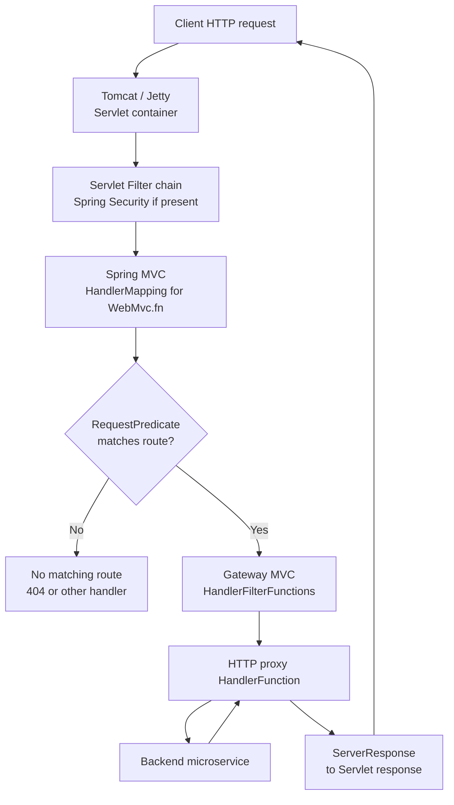
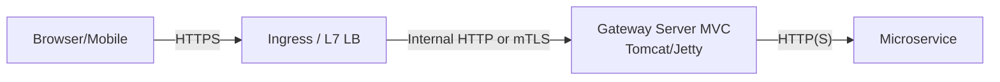
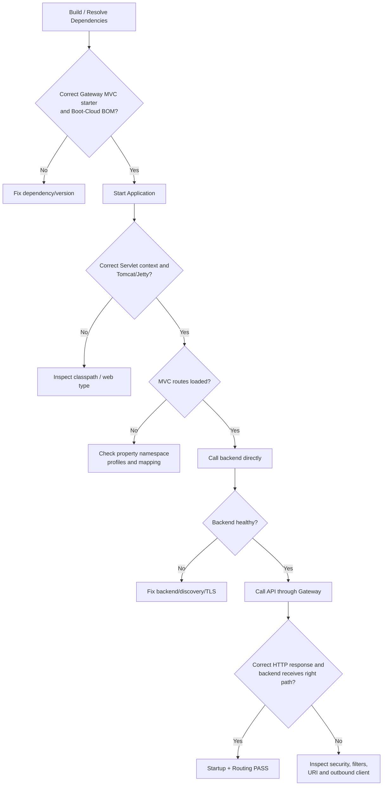

# Initializing the Right Starter and Choosing a Servlet Runtime

A development team wants to place **Spring Cloud Gateway** in front of its microservices, while their system uses **Spring MVC, Spring Security Servlet, and Tomcat**. If they create the project using a starter meant for **Gateway Server WebFlux** and just add `spring-boot-starter-web`, the application may hit dependency conflicts, launch the wrong web application type, or fail to load routes. Conversely, if they choose **Gateway Server Web MVC** yet copy WebFlux `GlobalFilter`/`ServerWebExchange` examples, the code will not match the API or execution model.

This lesson in the **Server Web MVC** chapter of the **SPRING_CLOUD_GATEWAY** module explains how to choose the **right starter, compatible Spring Boot/Spring Cloud versions, and right Servlet runtime** to stand up an API Gateway. From that foundation, the Gateway can consistently handle route predicates, filter chains, path/header transformations, service discovery, authentication/authorization, rate limiting, circuit breakers, retries, TLS, and request observability.

**Expected outcome:** After this lesson, you can create a simple Gateway MVC application running on Tomcat or Jetty, verify requests are proxied to a backend, determine whether an application runs on the Servlet or reactive stack, distinguish starters across versions, and prepare the proper foundation for adding security and observability.

> **Scope:** This lesson covers **Spring Cloud Gateway Server Web MVC**, not **Gateway Server WebFlux**, **Spring Cloud Gateway Proxy Exchange**, or a plain Spring MVC app with `@RestController`. Primary examples target Spring Cloud Gateway 5.x/Spring Boot 4.x, while highlighting differences in the 4.2/4.3 lines. Do not mix artifacts/properties from different documentation branches without verifying compatibility.

## 1. Distinguishing Three Easily Confused Concepts

**Spring Web MVC (Spring MVC)** is Spring Framework's **Servlet API**-based web framework. Spring Boot can run a Spring MVC application on an embedded Servlet container such as Tomcat or Jetty.

**Spring Cloud Gateway Server Web MVC** is an **API Gateway Server** variant running on Spring MVC using **WebMvc.fn**: routes are `RouterFunction`/`HandlerFunction` definitions paired with appropriate predicates and filter functions. It provides routing, proxying, and cross-cutting Gateway concerns.

**Spring Cloud Gateway Server WebFlux** is the API Gateway variant built on **Spring WebFlux, Reactor, and the reactive model**, typically running on Reactor Netty. It has a different filter mechanism, request/response model, and runtime architecture.

| Question | Gateway Server Web MVC | Gateway Server WebFlux |
| --- | --- | --- |
| Request processing foundation | **Servlet stack + Spring Web MVC/WebMvc.fn** | **Reactive stack + Spring WebFlux/Project Reactor** |
| Request/response types in handlers | `ServerRequest` and `ServerResponse` from `org.springframework.web.servlet.function` | `ServerWebExchange`, `ServerHttpRequest`, `ServerHttpResponse` |
| Java-based routing | `RouterFunction<ServerResponse>`, Gateway MVC handler functions | `RouteLocator`/`GatewayFilter`/reactive route DSL |
| Common filter extensions | Servlet Filter, `HandlerFilterFunction`, MVC filter functions | `WebFilter`, `GlobalFilter`, `GatewayFilter` |
| Security config | `SecurityFilterChain` and `HttpSecurity` | `SecurityWebFilterChain` and `ServerHttpSecurity` |
| Primary runtime | **Tomcat, Jetty**, or version-compatible Servlet container | **Reactive Netty** in standard Gateway WebFlux setup |
| Newer Spring Cloud Gateway starter | `spring-cloud-starter-gateway-server-webmvc` | `spring-cloud-starter-gateway-server-webflux` |
| Common packaging | Executable JAR + embedded Servlet container | Executable JAR + reactive Netty |
| Spring Boot app type | `WebApplicationType.SERVLET` | `WebApplicationType.REACTIVE` |

**Key point:** Choosing MVC or WebFlux is **choosing a runtime and programming platform**, not renaming keys in YAML. Having a reactive library accidentally appear on the classpath **does not automatically turn Gateway MVC into a WebFlux Gateway**; conversely, having Tomcat in a project does not prove MVC routes are configured properly.

### 1.1. Server Web MVC Is Not Proxy Exchange

Spring Cloud Gateway also has a **Proxy Exchange** variant, which uses a specialized proxy object inside annotation-declared handlers. It is useful for controller-level proxying cases, but it is **not synonymous** with the **Gateway Server** product that provides route definitions and corresponding filter factories.

When the goal is to build a **centralized entry gateway** for multiple microservices with route predicates, rewrites/filters, and dedicated operations, choose **Gateway Server Web MVC** if a Servlet architecture has been selected. Do not substitute the Proxy Exchange dependency for Server Web MVC.

### 1.2. Request Processing Architecture



In Web MVC, routes are processed over **Servlet request/response**. A `RouterFunction` can use Gateway MVC's dedicated HTTP proxy handler instead of always writing a `@RestController` for every route. Security, path rewriting, load balancing, and observability must be placed correctly in this flow.

## 2. Starter Names Change Across Spring Cloud Gateway Lines

One of the most common initialization mistakes is picking a starter from a guide written for a **different version**.

| Gateway line | Starter for **Server Web MVC** | Enable/disable MVC Gateway | Common MVC route namespace |
| --- | --- | --- | --- |
| **5.x** | `org.springframework.cloud:spring-cloud-starter-gateway-server-webmvc` | `spring.cloud.gateway.server.webmvc.enabled` | `spring.cloud.gateway.server.webmvc.routes` |
| **4.3.x** | `org.springframework.cloud:spring-cloud-starter-gateway-server-webmvc` | `spring.cloud.gateway.server.webmvc.enabled` | `spring.cloud.gateway.server.webmvc.routes` |
| **4.2.x** | `org.springframework.cloud:spring-cloud-starter-gateway-mvc` | `spring.cloud.gateway.mvc.enabled` | `spring.cloud.gateway.mvc.routes` |
| **WebFlux (not this lesson's topic)** | `spring-cloud-starter-gateway-server-webflux` on newer lines | WebFlux properties | `spring.cloud.gateway.server.webflux.routes` (newer) |

In **Gateway 4.2**, older documentation referred to the product as **Server MVC**. From **4.3** onward, the product name **Server Web MVC** and artifact `-server-webmvc` are used. Artifact names are part of the dependency contract, not automatic aliases across releases.

In much older docs and blog posts, you may also see:

- `spring-cloud-starter-gateway`: primarily the older reactive Gateway starter; **do not use in place of MVC**.
- `spring-cloud-starter-gateway-mvc`: valid on certain older MVC lines; **not automatically right for Gateway 5.x**.
- `spring-boot-starter-web`: only the Spring Boot web/MVC starter (older name); **does not itself provide full Gateway MVC capabilities**.
- `spring-boot-starter-webflux`: the reactive starter; **not the foundation to choose for Gateway MVC**.

### 2.1. Pick the Boot/Cloud BOM Before Picking Artifacts

Spring Cloud uses **release trains**; each train supports specific Spring Boot lines. For example, per the Spring Cloud compatibility matrix:

| Spring Boot | Corresponding Spring Cloud release train | Notes |
| --- | --- | --- |
| **4.0.x/4.1.x** | **2025.1.x (Oakwood)** | For the Spring Framework 7/Cloud Gateway 5.x branch; pick a compatible service release. |
| **3.5.x** | **2025.0.x (Northfields)** | Gateway 4.3.x line; uses the `-server-webmvc` starter. |
| **3.4.x** | **2024.0.x (Moorgate)** | Gateway 4.2.x line; uses the `-gateway-mvc` starter. |

**Do not pair Spring Boot 4.x with Spring Cloud 2024.0.x**, or pair Boot 3.4.x with Gateway 5.x just because "Maven resolves it." Failures can show up as dependency incompatibilities, missing classes, disabled auto-configuration, or routes failing to load.

**Safe rule:** Pick a Spring Boot release train officially supported by Spring Cloud; import the `spring-cloud-dependencies` BOM and let the BOM manage versions of Gateway and Spring Cloud dependencies. For long-lived releases, pin tested concrete versions and apply patch updates per maintenance policy.

### 2.2. Java Version

Spring Boot 3.x/4.x lines require modern Java (minimum Java 17 for these lines). Using **Java 21 LTS** is well suited for learning Gateway MVC, though you should still verify the actual JDK, Boot, Spring Framework, Servlet container, and CI image. **Do not use `javax.servlet.*` in modern Spring MVC**; Servlet APIs in Spring Framework 6+/Spring Boot 3+ use `jakarta.servlet.*`.

### 2.3. Why Not Pin Separate Versions for Every Dependency?

Dangerous example:

```xml
<!-- NOT RECOMMENDED: each artifact picking an arbitrary independent version. -->
<dependency>
    <groupId>org.springframework.cloud</groupId>
    <artifactId>spring-cloud-starter-gateway-server-webmvc</artifactId>
    <version>5.1.0</version>
</dependency>
<dependency>
    <groupId>org.springframework.boot</groupId>
    <artifactId>spring-boot-starter-webflux</artifactId>
    <version>3.5.0</version>
</dependency>
```

The snippet above **only illustrates an anti-pattern**, not a recommended configuration. A Gateway MVC app should not be pulled toward the WebFlux starter and incompatible framework components via mismatched versions. Instead, import the proper BOM/parent and declare needed dependencies **without specifying individual versions** unless there is a verified technical reason.

## 3. Minimal Maven Configuration for Gateway Server Web MVC

The example below targets **Spring Boot 4.1.x + Spring Cloud 2025.1.x**, using concrete versions **to illustrate compatibility**, not as a recommendation to freeze them across security patches. Before applying, check the latest patches for the exact release train.

### 3.1. `pom.xml` for a Standalone Application

```xml
<?xml version="1.0" encoding="UTF-8"?>
<project xmlns="http://maven.apache.org/POM/4.0.0"
         xmlns:xsi="http://www.w3.org/2001/XMLSchema-instance"
         xsi:schemaLocation="http://maven.apache.org/POM/4.0.0
             https://maven.apache.org/xsd/maven-4.0.0.xsd">
    <modelVersion>4.0.0</modelVersion>

    <parent>
        <groupId>org.springframework.boot</groupId>
        <artifactId>spring-boot-starter-parent</artifactId>
        <version>4.1.0</version>
        <relativePath/>
    </parent>

    <groupId>com.example</groupId>
    <artifactId>gateway-mvc-demo</artifactId>
    <version>0.0.1-SNAPSHOT</version>
    <name>gateway-mvc-demo</name>

    <properties>
        <java.version>21</java.version>
        <spring-cloud.version>2025.1.5</spring-cloud.version>
    </properties>

    <dependencyManagement>
        <dependencies>
            <dependency>
                <groupId>org.springframework.cloud</groupId>
                <artifactId>spring-cloud-dependencies</artifactId>
                <version>${spring-cloud.version}</version>
                <type>pom</type>
                <scope>import</scope>
            </dependency>
        </dependencies>
    </dependencyManagement>

    <dependencies>
        <dependency>
            <groupId>org.springframework.cloud</groupId>
            <artifactId>spring-cloud-starter-gateway-server-webmvc</artifactId>
        </dependency>
        <dependency>
            <groupId>org.springframework.boot</groupId>
            <artifactId>spring-boot-starter-webmvc-test</artifactId>
            <scope>test</scope>
        </dependency>
    </dependencies>

    <build>
        <plugins>
            <plugin>
                <groupId>org.springframework.boot</groupId>
                <artifactId>spring-boot-maven-plugin</artifactId>
            </plugin>
        </plugins>
    </build>
</project>
```

**Why is only one main Gateway MVC starter needed?**

- It pulls in the Gateway Server Web MVC components and the corresponding web stack per that version line's dependency graph.
- You do not need to add `spring-cloud-starter-gateway-server-webflux`.
- You do not need to add `spring-boot-starter-webflux` "so the Gateway can HTTP proxy."
- In the Boot 4.x line, the web starter for MVC is named `spring-boot-starter-webmvc`; the Gateway MVC starter typically brings the appropriate dependencies with it. Other starters can be added for dedicated features, but check the dependency tree instead of guessing.
- `spring-boot-starter-webmvc-test` is the corresponding test starter on the Boot 4 branch. In Boot 3.x, test setups typically use `spring-boot-starter-test`.

When starting a small sample app, this clean baseline helps isolate whether an issue comes from Gateway MVC or an optional dependency. Add Security, Actuator, LoadBalancer, CircuitBreaker, Redis, and so on **only after identifying actual requirements**.

### 3.2. Spring Boot 3.5.x / Gateway 4.3.x Variant

If your project is on **Boot 3.5.x**, use the compatible **Spring Cloud 2025.0.x** release train, still selecting:

```xml
<dependency>
    <groupId>org.springframework.cloud</groupId>
    <artifactId>spring-cloud-starter-gateway-server-webmvc</artifactId>
</dependency>
```

However, the parent/BOM must be replaced with a **compatible version pair** for Boot 3.5. Do not copy parent `4.1.0` from the example above and change only one artifact. MVC starters can change across release trains, so consult that branch's documentation.

### 3.3. Legacy Boot 3.4.x / Gateway 4.2.x Variant

For Gateway 4.2, the documented starter name is:

```xml
<dependency>
    <groupId>org.springframework.cloud</groupId>
    <artifactId>spring-cloud-starter-gateway-mvc</artifactId>
</dependency>
```

and configuration uses `spring.cloud.gateway.mvc.routes`. Use the Spring Cloud **2024.0.x** BOM compatible with Boot 3.4.x per the compatibility table. **This example is for the older line** and should not replace the newer artifact in Boot 4.

## 4. Equivalent Gradle Configuration

**Gradle Groovy DSL** example with Boot 4.1.x and Cloud 2025.1.x:

```groovy
plugins {
    id 'java'
    id 'org.springframework.boot' version '4.1.0'
    id 'io.spring.dependency-management' version '1.1.7'
}

group = 'com.example'
version = '0.0.1-SNAPSHOT'

java {
    toolchain {
        languageVersion = JavaLanguageVersion.of(21)
    }
}

repositories {
    mavenCentral()
}

ext {
    set('springCloudVersion', '2025.1.5')
}

dependencyManagement {
    imports {
        mavenBom "org.springframework.cloud:spring-cloud-dependencies:${springCloudVersion}"
    }
}

dependencies {
    implementation 'org.springframework.cloud:spring-cloud-starter-gateway-server-webmvc'
    testImplementation 'org.springframework.boot:spring-boot-starter-webmvc-test'
}

tasks.named('test') {
    useJUnitPlatform()
}
```

Do not declare the Gateway starter version directly when the BOM manages it. Gradle Kotlin DSL also supports importing the BOM appropriately; do not copy Groovy syntax verbatim into `build.gradle.kts`.

### 4.1. A Rule When Supporting Multiple Projects

If a Maven project uses Boot 3.4.x and a Gradle project uses Boot 4.1.x, **the two projects do not necessarily share the same Gateway MVC artifact or YAML namespace**. Standardize documentation along this chain:

```text
JDK
  -> Spring Boot version
    -> Spring Cloud release train
      -> Gateway Server MVC starter
        -> Servlet container
          -> route namespace / APIs
```

On an initialization error, find **the first broken step in the chain**, rather than just seeing `No routes matched` in logs and editing `Path`.

## 5. Choosing the Servlet Runtime: Default Tomcat vs. Alternative Jetty

Spring Cloud Gateway Server Web MVC runs on a **Servlet runtime**, typically **Tomcat** or **Jetty**. This is a major difference from Gateway Server WebFlux, which uses Netty in its standard reactive setup.

### 5.1. Tomcat — The Starting Choice

With the proper Gateway MVC starter, the web MVC dependency normally brings an **embedded Servlet container** into the application. On standard Spring Boot, Tomcat is the default choice of the MVC starter.

**Practical advantages when starting out:**

- Simple setup, minimal transitive dependency exclusions.
- Fits Servlet Filter / Spring Security / Servlet stack applications naturally.
- Operations ecosystem and Boot docs provide clear guidance on thread pools, access logs, TLS, and graceful shutdown.

**Do not treat "Tomcat = faster/slower than Netty" as a universal rule.** Throughput depends on the HTTP client, TLS, keep-alive, payloads, thread pools, auth validation, backend latency, and load generation. Start with compatibility and measure realistic traffic.

### 5.2. Jetty — Switching Containers When Justified

To switch to Jetty, you must **exclude Tomcat** from the dependency graph and add the Boot-compatible **Jetty starter**. Maven example:

```xml
<dependency>
    <groupId>org.springframework.cloud</groupId>
    <artifactId>spring-cloud-starter-gateway-server-webmvc</artifactId>
    <exclusions>
        <exclusion>
            <groupId>org.springframework.boot</groupId>
            <artifactId>spring-boot-starter-tomcat</artifactId>
        </exclusion>
    </exclusions>
</dependency>

<dependency>
    <groupId>org.springframework.boot</groupId>
    <artifactId>spring-boot-starter-jetty</artifactId>
</dependency>
```

With Gradle:

```groovy
dependencies {
    implementation('org.springframework.cloud:spring-cloud-starter-gateway-server-webmvc') {
        exclude group: 'org.springframework.boot', module: 'spring-boot-starter-tomcat'
    }
    implementation 'org.springframework.boot:spring-boot-starter-jetty'
}
```

**Inspect the dependency tree after excluding.** If another dependency pulls Tomcat back in or no compatible Servlet container remains, startup may behave unexpectedly or fail. When choosing Jetty, update connector/TLS/thread-pool/access-log management settings according to your Boot/Jetty version; **do not copy `server.tomcat.*` properties and expect Jetty to use them**.

### 5.3. Can Undertow Be Used?

Some Spring Boot 3.x lines supported Undertow for Servlet web apps. However, support varies across Boot lines; current Boot 4.x documentation emphasizes Tomcat/Jetty. Therefore, this lesson **does not assume Undertow is available in every Boot/Gateway MVC version**. If your organization requires Undertow, verify the exact version's support matrix before designing around it.

### 5.4. Embedded JAR or External Servlet Container?

For Spring Boot Gateway apps, an **executable JAR + embedded Servlet container** is usually the simplest option to:

- Run the exact same artifact across local/staging/production.
- Configure ports, TLS, healthchecks, observability, and memory consistently.
- Scale multiple instances behind an ingress/load balancer.
- Roll out/roll back artifacts without relying on shared configuration of an external app server.

Because MVC is built on the Servlet stack, some WAR/external container models **may** be supported depending on Boot/Gateway lines and deployment constraints. That is not the default for this lab. **Do not confuse this with Gateway Server WebFlux**, which has its own reactive runtime requirements and cannot simply be deployed as a WAR on a Servlet container the way Servlet MVC can.

## 6. Enforcing the Correct Application Type: Servlet

Spring Boot has three web application types:

- **`WebApplicationType.SERVLET`:** launches the Servlet/MVC platform.
- **`WebApplicationType.REACTIVE`:** launches the reactive/WebFlux platform.
- **`WebApplicationType.NONE`:** does not start a web server.

When a project uses Gateway Server Web MVC, the choice is **Servlet**.

### 6.1. Explicitly Declaring It in Lesson Configuration

```yaml
spring:
  main:
    web-application-type: servlet
```

In a clean MVC starter project, Spring Boot usually auto-detects the Servlet stack without this property. Setting it explicitly is useful while learning or debugging mixed dependencies, but **it does not replace removing the wrong Gateway WebFlux dependency**.

### 6.2. Java Application Entry Class

```java
package com.example.gatewaymvc;

import org.springframework.boot.SpringApplication;
import org.springframework.boot.autoconfigure.SpringBootApplication;

@SpringBootApplication
public class GatewayMvcApplication {

    public static void main(String[] args) {
        SpringApplication.run(GatewayMvcApplication.class, args);
    }
}
```

This class looks like a standard Boot application because Servlet auto-configuration and the Gateway starter wire the infrastructure. **You do not need to manually construct `DispatcherServlet`, `ServletWebServerFactory`, or `RouterFunctionMapping`** just to run the starter example.

### 6.3. Do Not Rely on MVC Winning When Both WebFlux and MVC Are Present

In Spring Boot, if both Spring MVC and WebFlux are on the classpath, MVC generally takes precedence when inferring the application type. However:

- That **does not mean** Gateway WebFlux is running.
- A WebFlux dependency may only be present for `WebClient`, not a reactive web server.
- If **both Gateway server starters** are present, the context/classpath becomes unpredictable; remove one branch rather than relying on implicit precedence.
- If configuration forces `spring.main.web-application-type: reactive` in a Gateway MVC project, WebMvc.fn routes may fail to load as expected.

**Rule:** For a dedicated MVC gateway, choose **one server gateway flavor**, one primary stack, and one appropriate Servlet container. If you must host reactive/client utilities inside a Servlet app, distinguish a reactive HTTP client from the **server runtime**.

## 7. Configuring Your First MVC Route

Once you have the right starter and Servlet runtime, add `src/main/resources/application.yml`:

```yaml
spring:
  application:
    name: gateway-mvc-demo
  main:
    web-application-type: servlet
  cloud:
    gateway:
      server:
        webmvc:
          routes:
            - id: catalog-route
              uri: http://localhost:9090
              predicates:
                - Path=/api/catalog/**
              filters:
                - StripPrefix=1

server:
  port: 8080
```

Assume an HTTP backend runs at `http://localhost:9090` with endpoint `GET /catalog/ping`.

```text
Client:
    GET http://localhost:8080/api/catalog/ping

Gateway Server Web MVC:
    Path=/api/catalog/** matches catalog-route
    StripPrefix=1
    Path sent to backend: /catalog/ping

Backend:
    GET http://localhost:9090/catalog/ping
    HTTP 200, JSON {"service":"catalog"}
```

Key points:

1. `server.port: 8080` is the **Gateway's** Servlet container port, not the backend's port.
2. `uri: http://localhost:9090` is the target backend, used here to learn routing without service discovery.
3. `predicates: Path=/api/catalog/**` identifies matching routes.
4. `StripPrefix=1` removes the leading `api` segment from the path before forwarding. Do not apply it if the backend actually expects `/api/catalog/ping`.
5. This is the **Gateway MVC property prefix**: `spring.cloud.gateway.server.webmvc.routes`, distinct from `server.webflux.routes`.
6. New and old route configs **should not be declared side by side** as a "compatibility fallback"; the framework only reads the namespace for its version.

### 7.1. Backend Stub for Verification

In a **separate Spring Boot MVC application** running on port 9090, create a controller:

```java
package com.example.catalog;

import java.util.Map;
import org.springframework.web.bind.annotation.GetMapping;
import org.springframework.web.bind.annotation.RestController;

@RestController
public class CatalogDemoController {

    @GetMapping("/catalog/ping")
    public Map<String, String> ping() {
        return Map.of("service", "catalog");
    }
}
```

**Run the stub in a separate process/port**; do not put this controller inside the Gateway application itself and expect requests to port 9090 to magically appear. If both share one server port, the test no longer demonstrates network proxying. Never use a production backend for route experiments.

### 7.2. Run and Verification Sequence

1. Start the backend stub on 9090 and confirm calling `GET http://localhost:9090/catalog/ping` directly returns the expected JSON.
2. Start Gateway MVC on port 8080 and check logs for the Servlet container name.
3. Call the URL **through the Gateway**:

```bash
curl -i http://localhost:8080/api/catalog/ping
```

4. Verify status 200 and body:

```http
HTTP/1.1 200 OK
Content-Type: application/json

{"service":"catalog"}
```

5. Try a path with no matching route to verify `404` per configuration.
6. Stop the backend stub and call again: the Gateway may return a proxy/5xx error because the backend is unavailable, **which does not mean the route is missing**.

**These are expected lab responses**, not commands executed on this workspace. The HTTP status/headers when the backend fails depend on client/proxy config and your version's exception mapping.

### 7.3. Routes Do Not Replace Security

This initial example **does not configure authentication**, solely to let learners verify the starter and runtime. A production Gateway requires a `SecurityFilterChain`, issuer/audience validation, roles/scopes, HTTP method policies, TLS, and backend authorization.

Do not assume a `Path` predicate sufficiently restricts who can call an API. Predicates select routes; they are **not an authorization tool**.

## 8. Declaring Routes Using Java WebMvc.fn

Beyond `application.yml`, Gateway MVC can define routes using **Spring WebMvc.fn `RouterFunction`**. This helps when you want Java-structured routes, strongly typed filter functions, and code-level configuration control.

### 8.1. A `RouterFunction` Equivalent to the YAML Route

```java
package com.example.gatewaymvc.routes;

import org.springframework.context.annotation.Bean;
import org.springframework.context.annotation.Configuration;
import org.springframework.web.servlet.function.RouterFunction;
import org.springframework.web.servlet.function.ServerResponse;

import static org.springframework.cloud.gateway.server.mvc.filter
    .BeforeFilterFunctions.stripPrefix;
import static org.springframework.cloud.gateway.server.mvc.filter
    .BeforeFilterFunctions.uri;
import static org.springframework.cloud.gateway.server.mvc.handler
    .GatewayRouterFunctions.route;
import static org.springframework.cloud.gateway.server.mvc.handler
    .HandlerFunctions.http;

@Configuration
public class CatalogGatewayRoutes {

    @Bean
    RouterFunction<ServerResponse> catalogRoute() {
        return route("catalog-by-java")
            .GET("/api/catalog/**", http())
            .before(uri("http://localhost:9090"))
            .before(stripPrefix(1))
            .build();
    }
}
```

This Java snippet illustrates the **exact API style intended for Web MVC**:

- `RouterFunction<ServerResponse>` from `org.springframework.web.servlet.function`.
- `GatewayRouterFunctions.route("catalog-by-java")` creates a builder tagged with route ID metadata.
- `.GET("/api/catalog/**", http())` matches GET and uses `HandlerFunctions.http()` to proxy.
- `.before(uri(...))` sets the HTTP target.
- `.before(stripPrefix(1))` strips one path segment before forwarding downstream.

**Implementation note:** Do not run **both this Java route and the YAML route covering the same `Path` region simultaneously** in the lab expecting identical results every time. Both routes can match; handler/route ordering and matching rules make outcomes ambiguous without intentional design. To practice the Java DSL, **replace** the catalog YAML configuration or use a separate path.

### 8.2. Why Not Use Gateway WebFlux APIs?

The example below is a **different API**, not Web MVC:

```java
// WebFlux example — DO NOT use as an MVC RouterFunction.
@Bean
RouteLocator routes(RouteLocatorBuilder builder) {
    return builder.routes()
        .route("reactive", r -> r
            .path("/api/**")
            .uri("http://localhost:9090"))
        .build();
}
```

In WebFlux, `RouteLocator`, `GatewayFilter`, and `ServerWebExchange` serve the reactive stack. When choosing MVC, use `RouterFunction`/`HandlerFilterFunction` from **`org.springframework.web.servlet.function`**.

An application may contain some Reactor/`Mono` classes for other tasks, but **never treat the presence of a Reactor dependency as proof you are running the reactive Gateway Server**.

### 8.3. A Route URI Does Not Automatically Rewrite the Path

Gateway MVC documentation notes that **a path included in the route's target URI may be ignored** by the handler routing mechanism. Therefore, do not rely on:

```yaml
# DO NOT rely on /orders in the target as a dependable rewrite.
uri: http://localhost:9090/orders
predicates:
  - Path=/api/orders/**
```

to ensure the backend receives `/orders/42`. Use `StripPrefix`, `SetPath`, or `RewritePath` appropriately and **test the actual URL** at the backend. That is why the sample route uses `uri: http://localhost:9090` and an explicit `StripPrefix=1` filter.

### 8.4. Before / After / Advanced Filters in MVC

| Group | Common API type | Usage |
| --- | --- | --- |
| **Before filter** | `Function<ServerRequest, ServerRequest>` or factories in `BeforeFilterFunctions` | Modifies request path/headers/URI before HTTP proxying. |
| **After filter** | `BiFunction<ServerRequest, ServerResponse, ServerResponse>` or `AfterFilterFunctions` | Modifies response after the handler. |
| **Handler filter** | `HandlerFilterFunction<ServerResponse,ServerResponse>` | Wraps pre/post control or implements advanced logic. |
| **Advanced filters** | Factories such as Retry, CircuitBreaker, Body, Bucket4j, TokenRelay depending on dependencies/version | Have their own lifecycle and may require parameters/state/ordering. |

These classes live in the **Servlet/WebMvc.fn stack**. Do not copy WebFlux code using `ServerHttpResponseDecorator`, `DataBuffer`, or `Mono<Void>` into a `HandlerFilterFunction` expecting automatic translation between the two stacks.

## 9. Inspect the Dependency Tree Instead of Guessing the Runtime

A successful build is not enough. Two Gateway starters, multiple Servlet containers, or mismatched versions can still be pulled into the dependency graph.

### 9.1. Checking with Maven

The following commands are **instructions for learners to run in their own projects**, not commands executed on this lesson's workspace:

```bash
./mvnw dependency:tree \
  -Dincludes=org.springframework.cloud,org.springframework.boot
```

In Windows PowerShell, invoke the Maven wrapper with `.\mvnw.cmd` and the corresponding arguments.

Look for:

1. Is `spring-cloud-starter-gateway-server-webmvc` from the right release train present?
2. Are `spring-cloud-starter-gateway-server-webflux` or legacy reactive `spring-cloud-starter-gateway` present?
3. Is `spring-boot-starter-webmvc`/MVC stack present via transitive dependencies?
4. Is the chosen container Tomcat or Jetty, with no leftover container dependencies?
5. Was any Spring Boot/Spring Cloud artifact forced to a version outside the BOM?

If both Gateway flavors appear, **trace which dependency pulled them in and remove the unwanted branch**. Do not "fix" it by forcing `web-application-type: servlet` and leaving a tangled classpath behind.

### 9.2. Checking with Gradle

```bash
./gradlew dependencies --configuration runtimeClasspath
./gradlew dependencyInsight \
  --dependency spring-cloud-starter-gateway-server-webmvc \
  --configuration runtimeClasspath
./gradlew dependencyInsight \
  --dependency spring-boot-starter-tomcat \
  --configuration runtimeClasspath
```

Trace the actual dependency path: what is pulling Tomcat, Jetty, WebFlux, Netty, or an unexpected Spring Cloud version onto the classpath? `dependencyInsight` is invaluable when an added library unexpectedly alters the server runtime.

**Do not delete `reactor-core` just because you see the word "reactor"**: some libraries use Reactor as a utility/client. What matters is the **server flavor**, the Spring Boot application context, and the chosen Gateway route APIs.

### 9.3. Checking Effective Configuration

Configuration can be overridden by:

- `application-dev.yml` / `application-prod.yml`.
- Environment variables or command-line flags.
- Config Server / Kubernetes ConfigMap / secrets.
- Different profiles enabled in CI/staging.
- A different version's namespace that the framework ignores.

Therefore, verify the **effective** `spring.main.web-application-type`, `spring.cloud.gateway.server.webmvc.routes`, `server.port`, and all server/container properties in each environment.

Do not dump the entire environment publicly to inspect configuration: it may contain JWT signing keys, database passwords, or client secrets. Use access-restricted logs/Actuator and mask sensitive data.

## 10. Identifying the Servlet Runtime at Application Startup

When starting Gateway MVC, inspect logs and effective configuration:

| Symptom | Likely explanation | How to confirm |
| --- | --- | --- |
| Logs show **Tomcat** starting on port 8080 | Embedded Tomcat is the Servlet server. | Check dependency tree, `ServletWebServerApplicationContext`. |
| Logs show **Jetty** | Embedded Jetty was selected. | Verify Tomcat was excluded and Jetty version matches. |
| Logs mention **Netty** instead of a Servlet container | Might be running a reactive server or a Netty client. | Identify the actual web application context and server class, don't just grep one word. |
| App starts but `GET /api/catalog/ping` returns 404 | Route didn't match or wasn't loaded. | Check MVC starter/properties, route ID, path/method. |
| App starts and requests return 401 | Spring Security is protecting the URL. | Check `SecurityFilterChain` and test tokens; don't remove security to "fix routes." |
| App starts and returns 502/503 | Backend down, wrong URI, no instances, or TLS/network issue. | Call backend directly and inspect proxy exceptions. |

### 10.1. Lab Code to Inspect `WebApplicationContext`

You can log the context type via a startup bean **for learning environments only**, e.g.:

```java
package com.example.gatewaymvc;

import org.springframework.boot.ApplicationRunner;
import org.springframework.context.ApplicationContext;
import org.springframework.context.annotation.Bean;
import org.springframework.context.annotation.Configuration;
import org.springframework.boot.web.servlet.context
    .ServletWebServerApplicationContext;

@Configuration
class StartupTypeDiagnostics {

    @Bean
    ApplicationRunner applicationTypeInfo(ApplicationContext context) {
        return args -> {
            if (context instanceof ServletWebServerApplicationContext) {
                System.out.println("Gateway running with Servlet web context");
            } else {
                System.out.println(
                    "Unexpected context: " + context.getClass().getName());
            }
        };
    }
}
```

This snippet only checks the **web context type**; it does not prove routes work or requests reached the backend. In Boot 4, package/server APIs may change across minor versions; verify against the API of your version. In production, prefer structured logging and controlled health checks over `System.out.println`.

### 10.2. Clues from Threads and Request Handling

The Servlet container provides its thread model for handling requests. Under blocking I/O or slow handlers, Servlet server threads are a budget that must be managed.

**Do not glance at one thread name and conclude the entire architecture.** Within a single process, thread pools may exist for async tasks, HTTP clients, schedulers, log writers, or message brokers. Combine:

- Actual Servlet context;
- Dependencies/runtime;
- Request handler stack;
- Container and outbound HTTP client metrics.

### 10.3. MVC on Tomcat Does Not Mean All I/O Must Be Strictly Synchronous

Servlets support asynchronous request processing; some Gateway MVC features may leverage platform or HTTP client concurrency/asynchronous mechanisms. However, **the programming and configuration model is not WebFlux**, and must not be equated with Reactor Netty event-loop/backpressure semantics.

MVC is a sound choice when systems, libraries, teams, and infrastructure are already standardized on Servlet APIs. If very high throughput and many long-lived streams are primary requirements, benchmark both Gateway flavors before deciding rather than following a "reactive is always faster" slogan.

## 11. Thread Pools, Connection Pools, and Virtual Threads

When a Gateway acts as a proxy, end-to-end latency is more than predicate evaluation time:

\[
T_{\text{client}} \approx T_{\text{accept}} + T_{\text{security}}
  + T_{\text{gateway-filter}} + T_{\text{outbound}}
  + T_{\text{backend}} + T_{\text{response}}
\]

This is a **mental model**; stages can overlap and do not form a strict additive measurement. Still, it reminds us that each request can hold resources in **both the Servlet server and the outbound HTTP client**.

### 11.1. When Backends Slow Down, Servlet Threads and Connection Pools Must Be Analyzed Together

Suppose 200 concurrent requests hit a backend with 2-second latency. If the proxy path holds Servlet and HTTP client resources concurrently, you may observe:

- Servlet worker threads occupied.
- Outbound connections/pool hitting limits.
- Queues growing, p95/p99 climbing.
- Retries amplifying attempt counts.
- Circuit breakers and rate limiters failing to reduce latency if placed in the wrong spot.

**Do not solve every 503 by raising `server.tomcat.threads.max`.** Too many threads incur scheduling and memory overhead. Identify bottlenecks via thread dumps, server metrics, HTTP-client connection stats, backend timing, and load tests.

### 11.2. Container Configuration Must Match the Container Type

Example **for Tomcat** with illustrative values only:

```yaml
server:
  port: 8080
  tomcat:
    threads:
      max: 200
      min-spare: 10
```

If you switch to Jetty, properties under `server.tomcat.*` **serve no purpose**. Look up the corresponding Jetty properties in the Boot documentation for your exact version and re-benchmark before deciding.

### 11.3. Are Virtual Threads a Replacement for WebFlux?

In supported Boot/JDK lines, you may consider:

```yaml
spring:
  threads:
    virtual:
      enabled: true
```

Virtual threads can lower thread overhead for **many I/O-bound waiting tasks**, but they **do not turn MVC into WebFlux**. They do not automatically expand connection pools, database capacity, CPU, or memory, and they do not waive the need for rate limits or circuit breakers.

Before enabling them, evaluate interactions with the Servlet container, synchronous libraries, thread-local context, pinning/blocking behavior, observability, and JDK version. Compare p95/p99, throughput, and CPU/RSS under representative load; do not treat one flag as a "free optimization."

## 12. Spring Security in Servlet Gateway MVC

The Gateway can validate JWTs and authorize requests at the edge, but it must use **Spring Security Servlet** rather than WebFlux Security configuration.

### 12.1. Dependencies by Purpose

With Boot 4.x:

```xml
<!-- Enable these dependencies when security is actually needed. -->
<dependency>
    <groupId>org.springframework.boot</groupId>
    <artifactId>spring-boot-starter-security</artifactId>
</dependency>

<dependency>
    <groupId>org.springframework.boot</groupId>
    <artifactId>spring-boot-starter-oauth2-resource-server</artifactId>
</dependency>
```

If the Gateway participates in OAuth2 login/Token Relay as a client, you may also need `spring-boot-starter-oauth2-client` and appropriate authorized-client/IdP configuration. **Resource Server JWT and OAuth2 Client/Token Relay are two distinct roles** and do not enable each other automatically.

### 12.2. `SecurityFilterChain` with `HttpSecurity`

Example of a **Bearer-only Gateway API**:

```java
package com.example.gatewaymvc.security;

import org.springframework.context.annotation.Bean;
import org.springframework.context.annotation.Configuration;
import org.springframework.security.config.Customizer;
import org.springframework.security.config.annotation.web.builders.HttpSecurity;
import org.springframework.security.web.SecurityFilterChain;

@Configuration
public class GatewaySecurityConfiguration {

    @Bean
    SecurityFilterChain securityFilterChain(HttpSecurity http)
            throws Exception {
        http
            // Suitable only for APIs using Bearer tokens, not relying on
            // session cookies sent automatically by browsers.
            .csrf(csrf -> csrf.disable())
            .authorizeHttpRequests(authorize -> authorize
                .requestMatchers("/actuator/health").permitAll()
                .requestMatchers("/api/catalog/**").authenticated()
                .anyRequest().denyAll()
            )
            .oauth2ResourceServer(resourceServer ->
                resourceServer.jwt(Customizer.withDefaults()));
        return http.build();
    }
}
```

The example requires a valid issuer/JWK source and matching Resource Server configuration:

```yaml
spring:
  security:
    oauth2:
      resourceserver:
        jwt:
          issuer-uri: https://identity.example.test/issuer
```

**Note:** In a real project, you must also validate audience, scopes/roles, backend resource ownership, and trust for forwarded headers. `authenticated()` alone does not establish that a user may access every resource.

If the application uses **cookie sessions/browser login**, do not blindly disable CSRF by copying the Bearer-only setup above. Configure cookies, CSRF, CORS, and OIDC sessions to match your chosen model.

### 12.3. Comparing Servlet Security vs. Reactive Security

| Servlet Gateway MVC | Reactive Gateway WebFlux |
| --- | --- |
| `HttpSecurity` | `ServerHttpSecurity` |
| `SecurityFilterChain` | `SecurityWebFilterChain` |
| Servlet `FilterChain` | Reactive `WebFilter` chain |
| `HttpServletRequest`/`HttpServletResponse` | `ServerWebExchange`/reactive response |
| `@EnableWebSecurity` when needed | `@EnableWebFluxSecurity` when needed |

**Do not copy a class with `SecurityWebFilterChain` into MVC Gateway and assume Spring Security protects your routes.** In the Servlet stack, you need beans and request matchers aligned with the HTTP paths clients actually call.

### 12.4. Routing Does Not Grant New Access Rights

Suppose Route A has `Path=/api/catalog/**` and Route B has `Path=/api/**`. If the security chain only protects A while permitting the rest, B may inadvertently expose unintended endpoints. Use **default deny**, rules by path/method/authority, and test URLs that do not match any route as well.

Actuator management endpoints (if enabled) require separate security and network access restrictions. Never let clients send forged identity headers such as `X-User-Id` and treat them like a verified JWT.

## 13. Servlet Filters and `FormFilter`: Specific Caveats

Gateway MVC operates alongside the **Servlet Filter chain**. Filters run **before WebMvc.fn route matching** in their configured order and can mutate or consume the request.

Specifically for `application/x-www-form-urlencoded`, the Servlet container may parse form fields and merge them with query parameters into **request parameters**. Spring Cloud Gateway Server MVC provides **`FormFilter`** to reconstruct the form body appropriately for downstream services in such cases.

Gateway MVC documentation notes that custom Servlet Filters that read request parameters must be ordered **before `FormFilter`** to avoid breaking how the body is reconstructed.

Skeleton Servlet Filter illustrating ordering:

```java
import jakarta.servlet.Filter;
import jakarta.servlet.FilterChain;
import jakarta.servlet.ServletException;
import jakarta.servlet.ServletRequest;
import jakarta.servlet.ServletResponse;
import java.io.IOException;

import org.springframework.cloud.gateway.server.mvc.filter.FormFilter;
import org.springframework.core.Ordered;

class SampleServletFilter implements Filter, Ordered {

    @Override
    public int getOrder() {
        return FormFilter.FORM_FILTER_ORDER - 1;
    }

    @Override
    public void doFilter(
            ServletRequest request,
            ServletResponse response,
            FilterChain chain) throws IOException, ServletException {
        // Do not read the body unconditionally in this example.
        chain.doFilter(request, response);
    }
}
```

This illustrates **relative ordering per the documentation**, not a reason to add an empty Filter in production. When using real logging/security/form-parsing filters, know which filters call `getParameterMap()`, `getInputStream()`, or `getReader()`, and whether the body is consumed.

### 13.1. Servlet Filters vs. Gateway MVC `HandlerFilterFunction`

- Servlet Filters generally apply across a **broad servlet mapping**, before route matching.
- `HandlerFilterFunction` applies at the **WebMvc.fn handler/route chain**, handling the selected route.
- `SecurityFilterChain` participates via Servlet security infrastructure.
- Built-in Gateway MVC filters provide proxy-, rewrite-, and retry-specific capabilities right at the route layer.

**Do not turn everything into a Servlet Filter.** For instance, rate limiting by route ID, rewriting URIs only for `orders-api`, or Gateway fallbacks should normally use Gateway MVC filter functions or an equivalent mechanism—not a generic servlet filter that has no knowledge of which route will be selected.

### 13.2. When Request Bodies Are Read Too Early

A custom filter that reads the body to log raw JSON before the request reaches the Gateway can cause downstream services to receive an empty or truncated body unless proper wrappers/buffering are used. For sensitive payloads, logging whole bodies also creates token/PII exposure risks.

**Read only what is necessary**, respecting Servlet stack lifecycle and replay semantics. Never apply WebFlux `Flux<DataBuffer>`/`DataBufferUtils.join` guides directly to `HttpServletRequest` without proper adaptation.

## 14. TLS, Reverse Proxies, and Service Discovery Do Not Disappear in MVC

Choosing a Servlet runtime only decides the Gateway's HTTP server infrastructure; production requirements remain:

- **TLS** from client to Gateway or ingress; if terminating TLS at ingress, configure forwarded headers and trust boundaries accurately.
- **TLS/mTLS** from Gateway to backend where appropriate; do not disable certificate validation to work around errors.
- **Service discovery** when using `lb://service-name`, requiring LoadBalancer and a suitable DiscoveryClient/instance supplier.
- **Rate limiting/circuit breaker/retry** using the factories and dependencies of **Gateway MVC**, without mechanically copying reactive config.
- **Observability** across the Servlet container, Gateway routing, outbound HTTP client, and backend.

### 14.1. Moving from `http://` to `lb://`

The initial example route pointed to:

```yaml
uri: http://localhost:9090
```

With discovery:

```yaml
uri: lb://catalog-service
```

This requires a mechanism in the application context to resolve service instances and compatible **Spring Cloud LoadBalancer**/registry dependencies. Do not assume `lb://catalog-service` will work with only the Gateway MVC starter and no instance source.

**Do not treat a hostname inside an `lb` URI as proof TLS is enabled.** TLS is determined by scheme/transport and client trust/mTLS configuration; service discovery picks an instance rather than securing the outbound connection.

### 14.2. Reverse Proxy in Front of the Gateway

Typical flow:



You must decide:

- Who terminates TLS and who enforces HSTS/secure cookies?
- Which proxies does the Gateway trust for `Forwarded`/`X-Forwarded-*`?
- What Host/protocol/path do downstream services receive?
- Is the link between Gateway and backend protected?
- Do response `Location` headers need rewriting or does `Host` need preserving?

**Never blindly trust `X-Forwarded-Proto: https` sent by an Internet client.** An MVC app running Tomcat behind a proxy needs a proper forwarded-header strategy and network boundaries.

### 14.3. Service Discovery and Route Startup Are Separate Concerns

The Gateway may **start up successfully** even when backends/discovery have no instances, depending on routes and client types. Real errors appear when sending requests (e.g., 5xx). Conversely, invalid route configuration can cause startup to fail immediately.

Therefore, you need **two kinds of verification**:

1. **Startup readiness:** Servlet server is running and Gateway MVC route definitions loaded.
2. **End-to-end readiness:** Critical backends have instances, valid TLS trust, and proxied requests receive responses per contract.

Do not see "Tomcat started" in logs and conclude the Gateway is ready to serve all microservices.

## 15. Testing Initialization and Verifying the Servlet Runtime

A lesson on **starters and runtimes** should be verified across layers, from dependencies up to live HTTP traffic.

### 15.1. Ordered Verification Path



**Do not start with performance testing** before proving routes loaded and the target service receives the right path. Isolate each layer to pinpoint root causes easily.

### 15.2. Manual Testing with `curl`

Assuming the stub is on port 9090 and Gateway is on 8080:

```bash
# 1. Direct to backend
curl -i http://localhost:9090/catalog/ping

# 2. Through Gateway MVC (StripPrefix=1)
curl -i http://localhost:8080/api/catalog/ping

# 3. Unmatched path
curl -i http://localhost:8080/not-configured

# 4. Test another method to verify actual method rules
curl -i -X POST http://localhost:8080/api/catalog/ping
```

In the example YAML route, only a `Path` predicate is defined, **no `Method` predicate**, so POST can also match and be proxied; whether the backend returns 405 is up to the backend handler. If the Gateway should only match GET for this route:

```yaml
predicates:
  - Path=/api/catalog/**
  - Method=GET
```

**Do not conflate "route matched" with "backend accepts method."** These are two distinct layers. Likewise, 404 can mean either the Gateway found no route or the backend returned 404; check backend access logs or correlation IDs.

### 15.3. Testing with `@SpringBootTest`

For **end-to-end tests through the real Servlet container**, use:

```java
@SpringBootTest(
    webEnvironment = SpringBootTest.WebEnvironment.RANDOM_PORT
)
class GatewayMvcRoutingIT {
    // HTTP test client sends requests to the Gateway's random port.
    // Mock backend using WireMock/MockWebServer/standalone stub.
    // Assert status, response body, and proxied path/method.
}
```

This is a **test skeleton description**, not a standalone compilable class. It needs imports, test starters, a backend stub, injected URI/port properties, and proper assertions.

If you need to test the full HTTP request pipeline and Servlet filters, let Spring Boot start **`webEnvironment RANDOM_PORT`** rather than calling the `@Bean RouterFunction` method directly. Tests can send GETs via JDK `HttpClient`, `RestClient`, or a test HTTP client supported by your project.

**MockMvc** is useful for testing Spring MVC mappings and Servlet filters, but it does not by itself verify full network/backend TLS, discovery, connection pooling, or transport behavior. For a Gateway proxy, an integration test with a **real HTTP stub** is highly valuable.

### 15.4. Is `WebTestClient` Needed?

`WebTestClient` comes from the Spring WebFlux ecosystem and can be used against a live app over HTTP, but **it is not a reason to turn Server Web MVC into WebFlux**. Do not add the WebFlux Gateway starter just to "get `WebTestClient`."

In Servlet MVC projects, prefer an HTTP integration client, `MockMvc`, or test tools suited to your Boot version. For API security, use **Spring Security Servlet** test support; do not copy `mockJwt()` from reactive test configurations without verifying your test setup.

### 15.5. Minimum Test Matrix

| ID | Scenario | Expected verification |
| --- | --- | --- |
| S1 | Valid Boot/Cloud BOM pair | Dependencies resolve without conflicts. |
| S2 | Newer Web MVC starter loaded | Server Web MVC infrastructure and routes active. |
| S3 | No Gateway WebFlux starter added | No unintended second gateway flavor. |
| S4 | Default embedded Tomcat | Servlet WebApplicationType; server listening on expected port. |
| S5 | Switch to Jetty with Tomcat excluded | Only desired Servlet container runs. |
| S6 | `spring.main.web-application-type=servlet` | Starts with correct context. |
| S7 | Experimentally set to `reactive` | Detects misconfiguration; not treated as valid MVC setup. |
| S8 | Valid YAML `server.webmvc.routes` | `/api/catalog/**` route loads and matches. |
| S9 | Wrong prefix `server.webflux.routes` | Recognizes MVC routes were not loaded. |
| S10 | Wrong starter `-gateway-mvc` on newer line | Detects version-mismatched dependency. |
| S11 | Direct backend stub returns 200 | Upstream ready before Gateway tests. |
| S12 | GET through Gateway, `StripPrefix=1` | Backend gets `/catalog/ping`, client gets expected JSON. |
| S13 | Backend stopped or timing out | Proxy error distinguished from unmatched route. |
| S14 | Unmatched path | Returns 404 or fallback handler per contract. |
| S15 | Path predicate only, no Method predicate | POST may still match; backend decides 405. |
| S16 | Spring Security enabled, missing token | 401/redirect per policy, no bypass. |
| S17 | Valid JWT lacking authority | 403 per security rule, not a route error. |
| S18 | `lb://` with no instances | Discovery/LoadBalancer failure identified separately. |
| S19 | Ingress sends forwarded headers | Scheme, Host, redirects, and cookies handled safely. |
| S20 | Servlet Filter reads form parameters | `FormFilter` and downstream form body stay intact. |
| S21 | Load test 100 concurrent requests | Measure Servlet threads/outbound pool/p99, no OOM. |
| S22 | Switch Tomcat ↔ Jetty | Server config and tests still match container. |
| S23 | Disable `server.webmvc.enabled` | MVC Gateway does not register routes as expected. |
| S24 | Actuator or management port enabled | No unauthorized write access via public interface. |

### 15.6. PASS Criteria Must Be Concrete

Never write "PASS because the app didn't crash." A minimal test report should include:

```text
Boot version: 4.1.x
Spring Cloud train: 2025.1.x
Gateway flavor: Server Web MVC
Gateway starter: spring-cloud-starter-gateway-server-webmvc
Web application type: SERVLET
Servlet container: Tomcat (embedded)
Gateway port: 8080
Backend target: http://localhost:9090
Route ID: catalog-route
Request: GET /api/catalog/ping
Expected upstream path: /catalog/ping
Actual result: [fill in after running test]
Security mode: [anonymous test/Bearer-only/cookie session]
```

Bracketed fields **must be filled in with observed results**; do not treat the template above as an executed report. This lesson does not require building/testing while authoring Markdown; learners run verification in their own environment.

## 16. Troubleshooting Startup and Routing: Common Issues

### 16.1. "Tomcat runs, but Gateway always returns 404"

Check in order:

1. Is the artifact `spring-cloud-starter-gateway-server-webmvc` right for the version in use?
2. Is `spring.cloud.gateway.server.webmvc.enabled` set to `false`?
3. Does YAML use `spring.cloud.gateway.server.webmvc.routes`, or accidentally `server.webflux.routes`/`mvc.routes` from another version?
4. Does the active profile contain the routes, and are there YAML indentation errors?
5. Do `Path`/`Method`/`Host` predicates match the actual request?
6. Is another Java route or handler taking precedence?
7. Did the backend receive the request and return 404, or did the Gateway return 404 before going upstream?

Do not add `@RestController("/api/catalog/**")` to "rescue" the route before finding the root cause: that creates a local MVC handler instead of proxying and masks the misconfiguration.

### 16.2. "ApplicationContext fails due to two web stacks"

Usually caused by having **Gateway Server Web MVC + Gateway Server WebFlux** in the dependency graph, or mismatched Spring Boot/Cloud versions. Use Maven `dependency:tree` or Gradle `dependencyInsight` to locate the source, keeping only one Gateway server flavor and one official BOM pair.

**Do not fix this by randomly excluding Reactor/Netty JARs**, as that can break an HTTP client or another library. Know which artifacts are server starters and which are client dependencies.

### 16.3. "Unknown property `spring.cloud.gateway.mvc.routes`"

If using Gateway 4.3/5.x, the legacy prefix `spring.cloud.gateway.mvc.routes` is not the prefix used in newer documentation. Switch to:

```yaml
spring:
  cloud:
    gateway:
      server:
        webmvc:
          routes: []
```

The `routes: []` snippet only illustrates **property placement**, not a config with real routes. On 4.2, use the legacy prefix from the 4.2 docs. Do not modify a Boot 3/Gateway 4.2 project using 5.x docs while ignoring the artifact change.

### 16.4. "`NoClassDefFoundError: jakarta.servlet…` or `javax.servlet…`"

This can indicate Servlet API/Boot/Framework incompatibility or a missing server starter in the dependency graph.

- Spring 6+/Boot 3+ use **`jakarta.servlet.*`**.
- A library still referencing `javax.servlet.*` may be too old or built for a different stack.
- Find the dependency containing the offending class and upgrade to a compatible version; **do not add both namespaces as a temporary patch**.
- Verify the executable JAR includes an embedded Servlet container, or a WAR uses a compatible external container.

### 16.5. "RouterFunction/handler bean not found"

Check:

- Is `@Configuration` within the Spring Boot application's component scan?
- Are return types/imports `org.springframework.web.servlet.function.RouterFunction`/`ServerResponse`, rather than `org.springframework.web.reactive.function.server`?
- Did you use WebMvc.fn's `GatewayRouterFunctions.route` or `RouterFunctions.route`?
- Did you invoke `HandlerFunctions.http()` and `BeforeFilterFunctions.uri(...)` per your version's API?
- Do you have the Gateway MVC dependency, or only `spring-webmvc`?

If a developer accidentally imports reactive classes, code may compile in a mixed project yet **not be picked up by Gateway MVC's handler mapping as expected**.

### 16.6. "Backend URL has `/prefix`, yet requests arrive at the wrong path"

Per Gateway MVC guidance, paths inside a route URI may be ignored during proxying. **Do not rely on URI paths for rewriting**; use `StripPrefix`, `SetPath`, or `RewritePath` with exact values.

Verify:

```text
Client path:  /api/catalog/ping
StripPrefix: 1
Backend path: /catalog/ping
```

If the backend expects `/ping`, strip two segments instead of one. If you want to preserve `/api/catalog/ping`, do not strip. **Setting the right segment count** is what matters, not changing ports.

### 16.7. "After adding Spring Security, all requests get 401"

When `spring-boot-starter-security` is present, Spring Boot secures endpoints automatically. This is safe default behavior, **not broken routing**.

Define an explicit `SecurityFilterChain` for public vs. protected URLs, configure Resource Server JWT or OIDC Client according to role, and test:

- Anonymous requests;
- Expired/invalid JWTs;
- Valid JWTs missing scopes;
- Valid JWTs with sufficient permissions;
- Sensitive HTTP methods;
- Actuator management endpoints.

**Never set `anyRequest().permitAll()` in production just to make `curl` return 200.**

### 16.8. "Switched to Jetty, yet logs still show Tomcat"

An exclusion may be incomplete because another dependency pulls Tomcat back in. Use dependency insight and inspect the effective runtime and startup logs of the actual embedded server. Do not tune `server.jetty.*` properties while the running container is still Tomcat.

### 16.9. "503 on `lb://catalog-service`"

Do not assume the MVC starter is wrong. Check:

- Is a compatible Spring Cloud LoadBalancer dependency present?
- Is there a DiscoveryClient/ServiceInstanceListSupplier with the right service name?
- Does the registry have healthy instances?
- Are backend TLS trust/hostname/port valid?
- Does the Gateway have adequate outbound connection capacity and timeout budget?

A valid route can **fail to serve** if the backend service has no instances. Separate route-matching errors from service-resolution errors.

### 16.10. "Form POST to backend loses payload"

The Servlet container may parse form parameters and interfere with replaying the form body. Check whether custom Servlet Filters read parameters early, their order relative to Gateway MVC's `FormFilter`, and how the backend receives content-type/encoded bodies. Do not use DataBuffer/WebFlux guides directly to diagnose Servlet request streams.

## 17. Choosing a Servlet Runtime Based on Operational Conditions

There is no single optimal choice for every organization. Useful criteria:

| Criterion | Tomcat | Jetty | What truly decides |
| --- | --- | --- | --- |
| **Boot MVC default** | Typically the default choice. | Requires swapping dependencies. | Simplicity and infrastructure standards. |
| **Team familiarity** | Widely known. | Good fit if org already runs Jetty. | Ability to debug/thread-dump/manage TLS. |
| **Servlet compatibility** | Servlet API per Boot version. | Servlet API per Boot version. | Compatibility of libraries, Boot, and Servlet container. |
| **Thread/connector tuning** | Tomcat properties. | Jetty properties. | Benchmarking representative load, not just defaults. |
| **TLS/mTLS** | Supported, depends on version/config. | Supported, depends on version/config. | Certificate management, trust, rotation. |
| **Observability** | Thread/request metrics/access logs. | Thread/request metrics/access logs. | Instrumentation and dedicated dashboards. |
| **Deployment** | Easy embedded JAR. | Easy embedded JAR. | Kubernetes/VM and rollout strategy. |
| **WebSocket/streaming** | Supported per stack/version. | Supported per stack/version. | App contract, Gateway config, and tests. |

### 17.1. When to Choose Gateway MVC

- The organization already relies heavily on **Spring MVC / Servlet filters / Spring Security Servlet** and ops teams know Tomcat/Jetty well.
- You want a gateway built with **WebMvc.fn** and easy reuse of Servlet testing tools.
- You integrate synchronous/blocking components with an established capacity plan.
- APIs are primarily standard HTTP request/response traffic without strict reactive architectural requirements.

### 17.2. When to Consider Gateway WebFlux

- Applications and teams are already standardized on WebFlux/Reactor/Netty.
- You need a reactive pipeline with heavy concurrent non-blocking operations and corresponding features.
- You use custom filters built on `GatewayFilter`, `GlobalFilter`, and `ServerWebExchange`.
- Benchmarks show WebFlux better fits the real workload and the team can operate a reactive runtime.

**Do not migrate a Servlet app to WebFlux just to follow a trend**, nor pick MVC simply because one library uses a blocking API. An edge Gateway must be designed around workload, security, operations, and total cost.

### 17.3. Reliability Goes Beyond Choosing a Container

An MVC gateway that "starts cleanly" can still cause outages if:

- The auth chain allows overly broad access;
- Target URIs are unrestricted, creating SSRF risks;
- Missing rate limiting lets backends get overwhelmed;
- Retrying POSTs causes duplicate writes;
- Circuit breaker fallbacks leak data;
- TLS between Gateway and backend goes unverified;
- Logs record raw `Authorization`/`Cookie`/PII;
- Healthchecks, metrics, and shutdown/drain strategies are missing.

**Starters and Servlet runtimes are necessary, not sufficient** for a secure API Gateway.

## 18. Practice Exercises with Guided Answers

### Exercise A — Choosing the Right Starter

A project uses **Spring Boot 4.1.x** and needs a Servlet Gateway with Tomcat. A colleague suggests `spring-cloud-starter-gateway-mvc` and `spring-boot-starter-webflux`.

**Answer:** Choose the compatible Spring Cloud 2025.1.x release train, use `spring-cloud-starter-gateway-server-webmvc` and the Servlet MVC stack; do not add the WebFlux starter unless there is a specific client need. Artifact `-gateway-mvc` belongs to older MVC 4.2 docs.

### Exercise B — Routes Vanish After Upgrading

A system upgrades Gateway from 4.2 to 4.3 while keeping `spring.cloud.gateway.mvc.routes`. The app starts, but routes do not load.

**Answer:** Check the upgrade guide and switch to the `spring.cloud.gateway.server.webmvc.routes` namespace and `-server-webmvc` starter. Update the matching BOM/Boot compatibility as well, not only the property name.

### Exercise C — Tomcat or Netty?

Logs show a Reactor Netty client when the Gateway sends HTTP requests, while startup shows Tomcat and a Servlet context. Can you conclude the Gateway is running WebFlux?

**Answer:** No. An HTTP client can use a reactive library inside a Servlet app. Verify `WebApplicationType.SERVLET`, the server starter dependency, and MVC handler mappings.

### Exercise D — Wrong `StripPrefix` Count

The client calls `/api/catalog/ping`. The backend expects `/ping`, yet the config has `StripPrefix=1`.

**Answer:** Stripping one prefix segment removes only `api`, leaving `/catalog/ping`. Here you need `StripPrefix=2` or an equivalent rewrite; always check the original path and actual segment count.

### Exercise E — Switching to Jetty

A team adds `spring-boot-starter-jetty` while leaving transitive Tomcat intact, hitting container errors on startup.

**Answer:** Exclude `spring-boot-starter-tomcat` from the dependency tree, confirm no other transitive path pulls it back in, apply Jetty-specific configuration, and re-run integration tests.

### Exercise F — JWT Security in MVC

A learner defines a `SecurityWebFilterChain` bean with `ServerHttpSecurity` and notices MVC endpoints do not behave as expected.

**Answer:** Use `SecurityFilterChain` and `HttpSecurity` from Spring Security Servlet, configuring matchers and JWT Resource Server appropriately. Test 401, 403, and valid requests.

### Exercise G — Servlet Filter Reading Forms

An audit filter calls `request.getParameterMap()` on every POST before proxying, and backends report missing form bodies.

**Answer:** Inspect the interaction between Servlet request parameters and `FormFilter`, ordering, and body reconstruction. Do not read forms/bodies unconditionally just for logging; test actual downstream bytes.

### Exercise H — Ingress TLS

Ingress terminates HTTPS; Gateway MVC receives plain HTTP from ingress. A developer trusts any client-sent `X-Forwarded-Proto` header to build HTTPS redirects.

**Answer:** Trust forwarded headers only from authenticated/configured trusted proxy boundaries. Never let users choose the scheme or host for redirects; protect internal hops with TLS/mTLS when needed.

### Exercise I — Build Succeeds, Yet 503

Gateway MVC has route `lb://catalog-service`, with no discovery client and no service instances.

**Answer:** The right starter does not supply backend instances by itself. You need a compatible LoadBalancer/discovery/instance supplier, or switch to a static HTTP URI in the lab to isolate errors.

### Exercise J — Why Not Add Both Gateway Starters?

A team wants to "support both reactive and servlet" in a single API Gateway process, so they add both `-server-webflux` and `-server-webmvc`.

**Answer:** The two variants have different runtimes, route APIs, and filters; they should not be combined just as a "fallback." Pick one server flavor for the app and build appropriate clients/services, or run separate Gateway deployments if there is a clear requirement.

## 19. Project Initialization Checklist Before Building an API Gateway

1. **Identify runtime:** Servlet/Tomcat or Jetty, not confused with reactive Netty.
2. **Pick compatible Boot/Cloud pair:** pin a supported release train/BOM.
3. **Pick the right starter:** `spring-cloud-starter-gateway-server-webmvc` for Gateway MVC 4.3/5.x; older starter only for 4.2.
4. **Do not mix two gateway server flavors:** trace and remove unintended dependencies.
5. **Confirm Java/Jakarta:** appropriate JDK, `jakarta.servlet.*` for modern frameworks.
6. **Verify embedded server:** default Tomcat or Jetty replacement with proper exclusions.
7. **Confirm web type:** `WebApplicationType.SERVLET` and Servlet application context.
8. **Use right property namespace:** `spring.cloud.gateway.server.webmvc.routes` on newer lines.
9. **Have one isolated test route:** explicit `Path`, `uri`, `StripPrefix`.
10. **Have a separate backend stub:** verify network proxying via `curl`/integration tests.
11. **Use the right Java DSL:** WebMvc.fn `RouterFunction<ServerResponse>`/`HandlerFunctions.http()` when needed.
12. **Configure Servlet Security:** `HttpSecurity`, `SecurityFilterChain`, JWT/roles/scopes, and backend authorization.
13. **Check Servlet Filters:** `FormFilter` order, no indiscriminate body reading.
14. **Plan capacity:** thread pools, outbound connections, timeouts, retries/circuit breakers, backend throughput.
15. **Protect TLS and header trust:** never trust `Host`/`X-Forwarded-*` from untrusted sources.
16. **Verify two-layer readiness:** app/context/routes loaded and backend actually responding.
17. **Secure operations:** Actuator, secrets, access logs, rate limiting, and observability.
18. **Establish testing and rollback paths:** run integration/security/load tests before rollout, keep dependency lock/BOM and release artifacts.

## 20. Takeaways

1. **Gateway Server Web MVC runs on the Servlet stack and WebMvc.fn**, not Gateway WebFlux on Reactor Netty.
2. **Choose the starter matching your version:** 4.3/5.x use `spring-cloud-starter-gateway-server-webmvc`; 4.2 uses the older name `spring-cloud-starter-gateway-mvc`.
3. **Spring Boot and Spring Cloud must be paired in supported combinations**; import the Spring Cloud BOM rather than pinning arbitrary incompatible versions.
4. **Tomcat is the common starting point**, while Jetty is an alternative requiring dependency exclusions and its own configuration.
5. **`WebApplicationType.SERVLET` belongs with MVC**; setting a property does not replace fixing the dependency tree.
6. **Gateway MVC routes use `spring.cloud.gateway.server.webmvc.routes`** on newer lines; do not copy WebFlux or legacy MVC namespaces.
7. **WebMvc.fn uses `RouterFunction` and `HandlerFilterFunction`**, whereas WebFlux uses `GatewayFilter`, `GlobalFilter`, and `ServerWebExchange`.
8. **Successful server startup does not mean routing works**: verify with a backend stub, paths/methods, filters, and real HTTP responses.
9. **Security, TLS, quotas, retries, discovery, and observability** remain full design responsibilities even on a Servlet runtime.

**Practical conclusion:** Initializing Spring Cloud Gateway Server Web MVC properly means choosing **one consistent Servlet platform**, a **version-appropriate starter**, a **compatible Spring Boot–Spring Cloud BOM**, and an **explicit container**. Starting from a single `Path=/api/catalog/**` route with `StripPrefix` to a backend stub, prove all three facts: **the app runs on Servlet**, **the route is handled by Gateway MVC**, and **the request reaches the backend with the right path and headers**. Only once that baseline is verified should you layer on authentication, rate limiting, circuit breakers, retries, TLS, and metrics in a controlled manner.

### Official References

- [Spring Cloud Gateway Server Web MVC — How to Include Starter](https://docs.spring.io/spring-cloud-gateway/reference/spring-cloud-gateway-server-webmvc/starter.html): `spring-cloud-starter-gateway-server-webmvc` artifact, enable property, and Tomcat/Jetty.
- [Spring Cloud Gateway 4.2 — Server MVC Starter](https://docs.spring.io/spring-cloud-gateway/reference/4.2/spring-cloud-gateway-server-mvc/starter.html): legacy `spring-cloud-starter-gateway-mvc` artifact and matching prefix.
- [Spring Cloud Gateway Server Web MVC — How It Works](https://docs.spring.io/spring-cloud-gateway/reference/spring-cloud-gateway-server-webmvc/how-it-works.html): WebMvc.fn `RouterFunctions`, HTTP proxy `HandlerFunctions`, and filter functions.
- [Spring Cloud Gateway Server Web MVC — Java Routes API](https://docs.spring.io/spring-cloud-gateway/reference/spring-cloud-gateway-server-webmvc/java-routes-api.html): Java DSL for `RouterFunction`/`HandlerFunctions.http`.
- [Spring Cloud Gateway Server Web MVC — StripPrefix Filter](https://docs.spring.io/spring-cloud-gateway/reference/spring-cloud-gateway-server-webmvc/filters/stripprefix.html): corresponding YAML and Java filter configuration.
- [Spring Cloud Gateway Server Web MVC — Working with Servlets and Filters](https://docs.spring.io/spring-cloud-gateway/reference/spring-cloud-gateway-server-webmvc/working-with-servlets-and-filters.html): servlet form parameters and `FormFilter` ordering.
- [Spring Cloud Gateway Server Web MVC — Spring Security Integration](https://docs.spring.io/spring-cloud-gateway/reference/spring-cloud-gateway-server-webmvc/spring-security.html): `SecurityFilterChain`, JWT Resource Server, and URL policy.
- [Spring Cloud Gateway — Configuration Properties](https://docs.spring.io/spring-cloud-gateway/reference/configprops.html): `spring.cloud.gateway.server.webmvc.*` namespace.
- [Spring Cloud Release Train Compatibility](https://spring.io/projects/spring-cloud/): Spring Cloud ↔ Spring Boot matrix, BOM, and release train selection guide.
- [Spring Boot — Embedded Web Servers](https://docs.spring.io/spring-boot/how-to/webserver.html): choosing Tomcat/Jetty and swapping embedded Servlet containers.
- [Spring Boot — Build Systems](https://docs.spring.io/spring-boot/reference/using/build-systems.html): Spring MVC starters in Boot 4 and dependency management.
