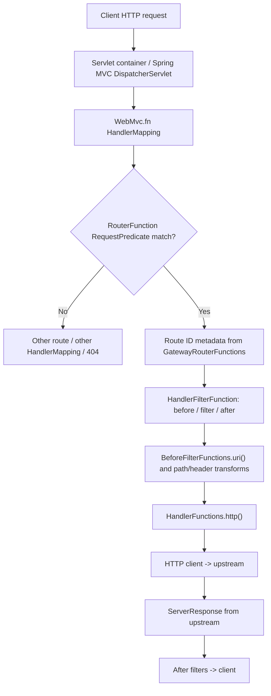

# GatewayRouterFunctions, RouterFunction, and HandlerFunctions.http()

## 1. Problem: Declaring an API Gateway in Java on the Servlet Stack

In a microservices architecture, **SPRING_CLOUD_GATEWAY** centralizes **predicate-based routing**, **request/response filtering**, path/header transformation, `lb://` integration with service discovery, authentication, rate limiting, circuit breakers, retries, TLS, and traffic observability. Alongside **Gateway Server WebFlux** built on Reactor Netty, Spring Cloud Gateway provides **Gateway Server Web MVC**, designed for applications using **Spring MVC and a Servlet runtime**.

Consider a simple requirement:

```text
Client                         Gateway Server MVC             Catalog Backend
GET /edge/catalog/items/42 --> :8080                         :9001
                               | route predicate GET/path |
                               | stripPrefix(2)           |
                               | add gateway headers      |
                               +------ GET /items/42 -------->
                               <--------- 200 OK -------------
<------- 200 + response header
```

Instead of declaring every route in YAML, we can use **Java functional routes**:

```java
@Bean
RouterFunction<ServerResponse> catalogRoute() {
    return GatewayRouterFunctions.route("catalog_http")
            .GET("/edge/catalog/**", HandlerFunctions.http())
            .before(BeforeFilterFunctions.uri("http://127.0.0.1:9001"))
            .before(BeforeFilterFunctions.stripPrefix(2))
            .build();
}
```

The three APIs in the title play distinct roles:

- `GatewayRouterFunctions.route("catalog_http")` **initializes a builder** for a Gateway MVC route with a route ID.
- `RouterFunction<ServerResponse>` is the **built result**, used by Spring MVC to locate the handler matching a request.
- `HandlerFunctions.http()` is the **HTTP proxy handler** that forwards to the upstream specified via a request attribute, typically set by `BeforeFilterFunctions.uri(...)`.

This lesson belongs to the **Server Web MVC** chapter. The focus is on understanding the relationships between these APIs, how to write runnable routes, how to compose predicates/before/after filters, and how to verify **actual requests reaching the backend**, rather than merely memorizing syntax.

### Learning Objectives

After this lesson, you will be able to:

1. Distinguish **Gateway Server MVC** from **Gateway Server WebFlux** in terms of runtime, route types, request/response types, and filters.
2. Explain why `GatewayRouterFunctions.route(id)` is more useful than `RouterFunctions.route()` when route metadata is needed.
3. Read and write `RouterFunction<ServerResponse>` with `.GET(...)`, `.route(predicate, handler)`, `.before(...)`, `.after(...)`, and `.build()`.
4. Use `HandlerFunctions.http()` and `BeforeFilterFunctions.uri(...)` properly; avoid the deprecated `http(String)` API.
5. Combine `StripPrefix`, `AddRequestHeader`, `RemoveRequestHeader`, and `AddResponseHeader` according to security contracts.
6. Create a compatible Spring Boot/Cloud Maven project and two example styles: a Java DSL route and an equivalent YAML route.
7. Test with `curl` and real HTTP integration tests to distinguish route misses, method mismatches, and upstream errors.
8. Apply identity, rate limiting, TLS, retry, circuit breaker, and observability controls when scaling to production.

> **Version scope:** Spring Cloud Gateway **Server Web MVC 4.3.x** (part of Spring Cloud 2025.0.x), Spring Boot **3.5.x**, and JDK 17+. The Maven starter is `spring-cloud-starter-gateway-server-webmvc`. `*.0` numbers in the lab illustrate compatible pairs and **are not recommendations for the latest patch**. Do not replace with a WebFlux starter or copy WebFlux Java APIs into MVC.

## 2. How Do Gateway Server MVC and Gateway Server WebFlux Differ?

Both variants handle many common API Gateway duties, yet **they do not share the same programming pipeline**.

| Aspect | **Gateway Server Web MVC** | **Gateway Server WebFlux** |
| --- | --- | --- |
| Web stack | **Spring MVC**, **Servlet**, WebMvc.fn. | Spring WebFlux, Project Reactor/Reactive Streams. |
| Common HTTP runtime | Servlet container such as **Tomcat**, Jetty. | Reactor Netty. |
| Programmatic route | `RouterFunction<ServerResponse>` from `org.springframework.web.servlet.function`. | `RouteLocator`, `RouteLocatorBuilder` from Gateway WebFlux. |
| Request object | `ServerRequest` (Spring WebMvc.fn). | `ServerWebExchange`, `ServerHttpRequest`. |
| Forwarding handler | `HandlerFunctions.http()` (MVC). | Netty routing and reactive Gateway filter chain. |
| Custom filters | `HandlerFilterFunction`, `Function<ServerRequest,ServerRequest>`, `BiFunction<ServerRequest,ServerResponse,ServerResponse>`. | `GatewayFilter`, `GlobalFilter`, `Mono<Void>`. |
| Routing predicate | `RequestPredicate` and `GatewayRequestPredicates`. | `RoutePredicateFactory`, request exchange. |
| Starting Java DSL | `GatewayRouterFunctions.route("id")`. | `RouteLocatorBuilder.routes()`. |
| YAML prefix 4.3 | `spring.cloud.gateway.server.webmvc.routes`. | `spring.cloud.gateway.server.webflux.routes`. |
| Starter 4.3 | `spring-cloud-starter-gateway-server-webmvc`. | `spring-cloud-starter-gateway-server-webflux`. |

**Do not confuse the two `RouterFunction` types with the same name in Spring Framework:** MVC uses `org.springframework.web.servlet.function.RouterFunction`; WebFlux functional endpoints use `org.springframework.web.reactive.function.server.RouterFunction`. This lesson uses **Servlet MVC** exclusively.

Likewise, do not add both Gateway starters into a single demo and guess which stack Spring Boot picks. Doing so confuses auto-configuration, server runtime, and route APIs. Choose **one clear architecture** matching system requirements.

### 2.1. MVC Does Not Mean "Lacking Gateway Features"

Gateway MVC still supports route predicates, before/after filters, path/header transformations, load-balancing integrations, retries/circuit breakers, security controls, and management features via supported extensions. However, **Java syntax and individual filter capabilities do not necessarily match WebFlux**. For instance, a reactive `GatewayFilterFactory` is not a drop-in replacement for an MVC `HandlerFilterFunction`.

MVC fits well when an organization already uses the Servlet stack, Spring MVC, and synchronous libraries with explicit compatibility requirements. Under high load, timeouts, or streaming, you still must measure thread/connection/resource limits of the Servlet runtime; do not assume switching to MVC automatically solves performance.

## 3. How the WebMvc.fn Gateway Works

Gateway Server MVC **does not** send requests through WebFlux's `FilteringWebHandler`. A route is a **Spring WebMvc.fn `RouterFunction`**, integrated into Spring MVC's handler lookup mechanism.



Key points:

1. **`RequestPredicate`** decides which requests match the route (method/path/host/header/query/time, etc.).
2. The builder can attach route ID metadata, used by Gateway MVC features that identify routes.
3. **Before filters** transform the request or request attributes before the handler proxies.
4. **`http()`** reads the target URI from a request attribute to create an outbound HTTP request.
5. **After filters** process `ServerResponse` before returning it to the client.

In `WebMvc.fn`, `ServerRequest` and `ServerResponse` are relatively immutable functional abstractions; some Gateway implementations keep internal mutable state to support proxying. When customizing requests, use `ServerRequest.from(request)...build()` or the provided `BeforeFilterFunctions` rather than mutating objects arbitrarily.

### 3.1. Role of `RouterFunction<ServerResponse>`

A `RouterFunction<T extends ServerResponse>` represents a function that finds a handler for a request. Conceptually:

```text
RouterFunction<ServerResponse>
       |
       +-- RequestPredicate: GET /edge/catalog/**
       |
       +-- HandlerFunction: HTTP forwarding
       |
       +-- Before/After filter layers
```

Spring Boot detects `RouterFunction<ServerResponse>` beans in the `ApplicationContext` and plugs them into the WebMvc.fn processing pipeline. Therefore, Java DSL routes are typically declared in a `@Configuration` class via `@Bean` methods.

**Do not return `Mono<ServerResponse>` or use `ServerWebExchange` in this MVC route.** Those types belong to the reactive stack and do not match the contract here.

## 4. `RouterFunctions.route()` vs. `GatewayRouterFunctions.route(id)`

Spring Framework provides the base builder:

```java
import static org.springframework.web.servlet.function.RouterFunctions.route;
import static org.springframework.cloud.gateway.server.mvc.filter.BeforeFilterFunctions.uri;
import static org.springframework.cloud.gateway.server.mvc.handler.HandlerFunctions.http;

@Bean
RouterFunction<ServerResponse> basicMvcGatewayRoute() {
    return route()
            .GET("/basic", http())
            .before(uri("http://127.0.0.1:9001"))
            .build();
}
```

This is a valid route on Spring WebMvc.fn using the Gateway MVC handler and before filter.

Gateway MVC also provides a specialized builder:

```java
import static org.springframework.cloud.gateway.server.mvc.handler.GatewayRouterFunctions.route;
import static org.springframework.cloud.gateway.server.mvc.filter.BeforeFilterFunctions.uri;
import static org.springframework.cloud.gateway.server.mvc.handler.HandlerFunctions.http;

@Bean
RouterFunction<ServerResponse> namedMvcGatewayRoute() {
    return route("basic_mvc_route")
            .GET("/basic", http())
            .before(uri("http://127.0.0.1:9001"))
            .build();
}
```

**Core difference:** `GatewayRouterFunctions.route(String routeId)` creates a `RouterFunctions.Builder` and adds a before filter that stores the **route ID** in request metadata/attributes. Several advanced filters and observability features rely on that metadata. This is **not** a renamed reactive `RouteLocatorBuilder`.

If you use both snippets above simultaneously and both match `GET /basic`, you will have **two overlapping functional routes**, making it hard to tell which route was chosen. In practice, choose **one** form, preferring `GatewayRouterFunctions.route(id)` for real API Gateways.

### 4.1. Route ID, Path, and URI Have Three Distinct Responsibilities

| Component | Example | What is it used for? |
| --- | --- | --- |
| Route ID | `catalog_http` | Route identifier and Gateway metadata. |
| Path predicate | `/edge/catalog/**` | Condition on the **inbound** request. |
| Target URI | `http://127.0.0.1:9001` | **Outbound** host/port/scheme. |
| Path filter | `stripPrefix(2)` | Alters the **outbound path**. |
| `http()` | Proxy handler | Sends request to target after transformations. |

In Gateway MVC, the documentation warns that **paths included in the target route URI may be ignored**; to change the path, use an appropriate path filter instead of relying on `uri("https://host/api/v1")` prepending `/api/v1` to every request.

## 5. `HandlerFunctions.http()`: The HTTP Forwarding Handler

A route with handler `http()` means **proxy the request downstream**, rather than handling content locally inside the Gateway like a regular controller.

```java
import static org.springframework.cloud.gateway.server.mvc.handler.HandlerFunctions.http;
import static org.springframework.cloud.gateway.server.mvc.filter.BeforeFilterFunctions.uri;

return GatewayRouterFunctions.route("catalog_http")
        .GET("/edge/catalog/**", http())
        .before(uri("http://127.0.0.1:9001"))
        .build();
```

In the MVC 4.3 pipeline, `http()` is not passed a URL directly. It retrieves the **destination URI** from a request attribute (used internally via `MvcUtils.GATEWAY_REQUEST_URL_ATTR`), populated by the `uri(...)` before filter or an appropriate upstream-selection step.

### 5.1. Why Avoid `http("https://...")`?

The Java Routes API documentation confirms that as of **Gateway 4.1.7**, the `HandlerFunctions.http(String)` and `HandlerFunctions.http(URI)` overloads are marked **deprecated**. The recommended pattern is:

```java
// Recommended on Gateway MVC 4.3:
route("catalog_http")
        .GET("/edge/catalog/**", http())
        .before(uri("https://catalog.example.test"))
        .build();
```

Instead of:

```java
// Do not use as a template for new code:
route("catalog_http")
        .GET("/edge/catalog/**", HandlerFunctions.http(
                "https://catalog.example.test"))
        .build();
```

Reason: separating the target URI into a before filter keeps it consistent with the **route request URL attribute**, especially when subsequent filters modify the URI or apply load balancing. If you forget `uri(...)` and no other filter sets the target, `http()` may lack a valid target URI to proxy; **test real outbound calls** rather than discovering this on the first production request.

### 5.2. `http()` Is Not `RouterFunctions.route()`

Their names appear near each other, yet their responsibilities are independent:

- `route()`: builder that **defines matching and handler**.
- `http()`: **handler** of a route that performs HTTP forwarding.
- `uri(...)`: **before filter** providing the upstream address.
- `.build()`: finalizes the builder into a `RouterFunction<ServerResponse>`.

You can replace `http()` with a custom `HandlerFunction` to return a local response, but then you **do not get proxy behavior**. In this lesson, use `http()` so you actually observe requests reaching the backend.

## 6. `RequestPredicate`: GET/Path and Composite Conditions

The most readable syntax:

```java
return GatewayRouterFunctions.route("catalog_http")
        .GET("/edge/catalog/**", http())
        .before(uri("http://127.0.0.1:9001"))
        .build();
```

It matches **GET** and path `/edge/catalog/**`. Sending a `POST` to the same URL will **not select** this route. Spring MVC may return 404 or 405 depending on other mappings; do not treat one specific HTTP status as sole proof of which route matched.

Beyond method-specific builders, there is a general form accepting a `RequestPredicate`:

```java
import org.springframework.http.HttpMethod;
import org.springframework.web.servlet.function.RequestPredicates;
import org.springframework.web.servlet.function.ServerResponse;
import org.springframework.web.servlet.function.RouterFunction;

// Illustrative form inside a @Bean method:
return GatewayRouterFunctions.route("catalog_http")
        .route(
            RequestPredicates.path("/edge/catalog/**")
                .and(RequestPredicates.method(HttpMethod.GET)),
            HandlerFunctions.http())
        .before(BeforeFilterFunctions.uri("http://127.0.0.1:9001"))
        .build();
```

Conditions can be combined with `.and()`/`.or()` per `RequestPredicate` semantics. Gateway MVC also provides `GatewayRequestPredicates` to check Host, Header, Query, time, and other Gateway conditions.

**Do not treat unverified `?user=alice`, `X-Tenant`, or `X-Forwarded-For` values as authorization proof.** Predicates only pick routes; they do not authenticate principals. If two routes differ by `Host`/header, understand the proxy trust boundary and matching order to prevent bypasses.

### 6.1. URI Template Variables from Paths

Example:

```java
return GatewayRouterFunctions.route("item_http")
        .GET("/edge/catalog/items/{itemId}", http())
        .before(uri("http://127.0.0.1:9001"))
        .build();
```

The `{itemId}` variable extracted by the Path predicate is stored in request attributes under WebMvc.fn conventions (`RouterFunctions.URI_TEMPLATE_VARIABLES_ATTRIBUTE`). Gateway provides a helper:

```java
Map<String, Object> variables = MvcUtils.getUriTemplateVariables(request);
Object itemId = variables.get("itemId");
```

In real code, import:

```java
import java.util.Map;
import org.springframework.cloud.gateway.server.mvc.common.MvcUtils;
```

This variable is **extracted from the request URL**, not a verified user claim. If you use it to construct paths or headers sent to the backend, validate its format and enforce authorization accordingly.

## 7. `.before`, `.after`, `.filter`: Transforming Requests and Responses

Spring WebMvc.fn offers three hook points:

| API | Conceptual function type | Used for |
| --- | --- | --- |
| `.before(...)` | `Function<ServerRequest, ServerRequest>` | Modifies request/attributes before invoking handler. |
| `.after(...)` | `BiFunction<ServerRequest, ServerResponse, ServerResponse>` | Modifies response once handler completes. |
| `.filter(...)` | `HandlerFilterFunction<ServerResponse, ServerResponse>` | Wraps handler, can run pre/post logic or short-circuit. |

Gateway MVC provides:

- `BeforeFilterFunctions` for `uri`, `stripPrefix`, `addRequestHeader`, `removeRequestHeader`, etc.
- `AfterFilterFunctions` for `addResponseHeader`, `removeResponseHeader`, etc.
- `FilterFunctions` and specialized filter classes for more complex MVC filters.

**Unlike WebFlux:** you do not need `Mono<Void>` or `GatewayFilterChain` here. WebMvc.fn functional handlers/filters primarily operate on `ServerRequest`, `ServerResponse`, and `HandlerFunction`.

### 7.1. Composing Built-in MVC Filters

```java
return GatewayRouterFunctions.route("catalog_http")
        .GET("/edge/catalog/**", HandlerFunctions.http())
        .before(BeforeFilterFunctions.uri("http://127.0.0.1:9001"))
        .before(BeforeFilterFunctions.stripPrefix(2))
        .before(BeforeFilterFunctions.addRequestHeader(
                "X-Gateway-Lab", "server-mvc"))
        .after(AfterFilterFunctions.addResponseHeader(
                "X-Gateway-Route", "catalog_http"))
        .build();
```

If a client sends:

```http
GET /edge/catalog/items/42?lang=vi HTTP/1.1
Host: localhost:8080
```

then the backend is expected to receive:

```http
GET /items/42?lang=vi HTTP/1.1
X-Gateway-Lab: server-mvc
```

and the client additionally receives `X-Gateway-Route: catalog_http` in the response. Other headers and transport metadata managed by the HTTP proxy/container are not necessarily preserved byte-for-byte from inbound.

### 7.2. Why Order Matters

- `uri(...)` sets the destination.
- `stripPrefix(2)` alters the inbound path before proxying.
- `addRequestHeader(...)` adds metadata to the outbound request.
- `addResponseHeader(...)` modifies the response before returning it to the client.

When composing filters that touch the same header/path or load balancing, **order can change the outcome**. MVC documentation on `StripPrefix` notes that path-modifying steps must run before certain load-balancing filters to avoid malformed URIs. Verify with an echo backend and integration tests rather than assuming reactive WebFlux ordering.

**Symptoms of wrong order:** the backend receives `/edge/catalog/items/42` instead of `/items/42`, the route matches yet the outbound URL is wrong, or an added response header has the wrong value.

### 7.3. Do Not Turn `AddRequestHeader` into an Authentication Mechanism

In the example, `X-Gateway-Lab` is a demo marker, not an identity. If a header is `X-Authenticated-User` or `X-Tenant-Id`, a client could send a forged value before reaching the Gateway.

In production:

1. Validate JWT/session/API key **before** building identity headers.
2. Remove/overwrite client-sent headers of the same name using the appropriate filter.
3. Protect Gateway → backend with TLS/mTLS/network policy so no direct bypass exists.
4. Have the backend still check authorization per resource/tenant.
5. Never log raw tokens, cookies, secrets, or sensitive request bodies.

`AddRequestHeader` **appends** a value; it does not automatically remove existing values. For headers needing trusted provenance, do not merely "add" alongside forged values hoping the backend picks the right one.

## 8. Combining Two or More `RouterFunction` Beans

An application can define multiple `RouterFunction<ServerResponse>` beans:

```java
@Bean
RouterFunction<ServerResponse> catalogRoute() {
    return GatewayRouterFunctions.route("catalog_http")
            .GET("/edge/catalog/**", HandlerFunctions.http())
            .before(BeforeFilterFunctions.uri("http://127.0.0.1:9001"))
            .before(BeforeFilterFunctions.stripPrefix(2))
            .build();
}

@Bean
RouterFunction<ServerResponse> publicStatusRoute() {
    return GatewayRouterFunctions.route("public_status")
            .GET("/edge/status", HandlerFunctions.http())
            .before(BeforeFilterFunctions.uri("http://127.0.0.1:9001"))
            .before(BeforeFilterFunctions.stripPrefix(1))
            .build();
}
```

Each route should have a **unique route ID**, sufficiently narrow predicates, and controlled upstreams. If two routes overlap, the framework applies ordering/registration rules; never rely solely on method order in Java source files. In the lab below, declare **only one bean** to keep tests unambiguous.

**Note on `@RequestMapping`:** Spring MVC can also serve `@RestController` controllers in the same application. A URL that misses a Gateway `RouterFunction` is not guaranteed to return 404 if another MVC controller matches. Testing route misses requires understanding all handler mappings in the application.

## 9. Hands-On: Minimal Gateway Server MVC Project

We will build two standalone programs on a learning machine:

- **Gateway MVC**: Spring Boot with `spring-cloud-starter-gateway-server-webmvc`, listening on `127.0.0.1:8080`.
- **EchoBackend**: a small HTTP server using the JDK, listening on `127.0.0.1:9001`, printing what actually gets proxied.

Route `catalog_http` will match:

```text
GET /edge/catalog/**
```

and forward:

```text
GET /edge/catalog/items/42?lang=vi
    |
    | GatewayRouterFunctions.route("catalog_http")
    | .GET("/edge/catalog/**", http())
    | .before(uri("http://127.0.0.1:9001"))
    | .before(stripPrefix(2))
    v
GET http://127.0.0.1:9001/items/42?lang=vi
```

We will also add one Gateway-controlled request header and one response header to prove both before and after filters execute.

### 9.1. Maven `pom.xml`

Requires **Java 17+**, Maven, and `curl`. `pom.xml`:

```xml
<?xml version="1.0" encoding="UTF-8"?>
<project xmlns="http://maven.apache.org/POM/4.0.0"
         xmlns:xsi="http://www.w3.org/2001/XMLSchema-instance"
         xsi:schemaLocation="http://maven.apache.org/POM/4.0.0
                             https://maven.apache.org/xsd/maven-4.0.0.xsd">
    <modelVersion>4.0.0</modelVersion>

    <parent>
        <groupId>org.springframework.boot</groupId>
        <artifactId>spring-boot-starter-parent</artifactId>
        <version>3.5.0</version>
        <relativePath/>
    </parent>

    <groupId>com.example</groupId>
    <artifactId>gateway-mvc-functional-lab</artifactId>
    <version>0.0.1-SNAPSHOT</version>

    <properties>
        <java.version>17</java.version>
    </properties>

    <dependencyManagement>
        <dependencies>
            <dependency>
                <groupId>org.springframework.cloud</groupId>
                <artifactId>spring-cloud-dependencies</artifactId>
                <version>2025.0.0</version>
                <type>pom</type>
                <scope>import</scope>
            </dependency>
        </dependencies>
    </dependencyManagement>

    <dependencies>
        <dependency>
            <groupId>org.springframework.cloud</groupId>
            <artifactId>spring-cloud-starter-gateway-server-webmvc</artifactId>
        </dependency>
        <dependency>
            <groupId>org.springframework.boot</groupId>
            <artifactId>spring-boot-starter-test</artifactId>
            <scope>test</scope>
        </dependency>
    </dependencies>

    <build>
        <plugins>
            <plugin>
                <groupId>org.springframework.boot</groupId>
                <artifactId>spring-boot-maven-plugin</artifactId>
            </plugin>
        </plugins>
    </build>
</project>
```

Notes:

- `spring-cloud-starter-gateway-server-webmvc` pulls in the appropriate Gateway MVC and Spring MVC components; no WebFlux starter is needed.
- Spring Boot 3.5.x uses an appropriate Servlet runtime, such as embedded Tomcat.
- `spring-boot-starter-test` supports JUnit, AssertJ, and `TestRestTemplate`/integration tests later.
- The `spring-cloud-dependencies` BOM manages Spring Cloud dependencies on a Boot-compatible release train.
- Do not mix `spring-cloud-starter-gateway-server-webflux`, `spring-boot-starter-webflux`, and `spring-cloud-starter-gateway-server-webmvc` into the lab expecting the Java DSL to run on a single stack.

**Version note:** `3.5.0`/`2025.0.0` is an illustrative release pair and does not imply it includes the latest bug/security fixes. In operations, pick an organization-supported patch/release train and verify compatibility.

### 9.2. Spring Boot Entry Point

Create `src/main/java/com/example/gateway/GatewayMvcApplication.java`:

```java
package com.example.gateway;

import org.springframework.boot.SpringApplication;
import org.springframework.boot.autoconfigure.SpringBootApplication;

@SpringBootApplication
public class GatewayMvcApplication {

    public static void main(String[] args) {
        SpringApplication.run(GatewayMvcApplication.class, args);
    }
}
```

Keep the route configuration class in the same `com.example.gateway` package or a subpackage so Spring Boot scans the beans. You do not need to create a Controller for `/edge/catalog/**`; the functional `RouterFunction` handles this path.

### 9.3. Complete Java DSL Route

Create `src/main/java/com/example/gateway/GatewayMvcRoutes.java`:

```java
package com.example.gateway;

import org.springframework.beans.factory.annotation.Value;
import org.springframework.context.annotation.Bean;
import org.springframework.context.annotation.Configuration;
import org.springframework.web.servlet.function.RouterFunction;
import org.springframework.web.servlet.function.ServerResponse;

import static org.springframework.cloud.gateway.server.mvc.handler.GatewayRouterFunctions.route;
import static org.springframework.cloud.gateway.server.mvc.handler.HandlerFunctions.http;
import static org.springframework.cloud.gateway.server.mvc.filter.BeforeFilterFunctions.uri;
import static org.springframework.cloud.gateway.server.mvc.filter.BeforeFilterFunctions.stripPrefix;
import static org.springframework.cloud.gateway.server.mvc.filter.BeforeFilterFunctions.removeRequestHeader;
import static org.springframework.cloud.gateway.server.mvc.filter.BeforeFilterFunctions.addRequestHeader;
import static org.springframework.cloud.gateway.server.mvc.filter.AfterFilterFunctions.addResponseHeader;

@Configuration
public class GatewayMvcRoutes {

    @Bean
    RouterFunction<ServerResponse> catalogHttpRoute(
            @Value("${lab.backend.uri:http://127.0.0.1:9001}")
            String backendUri) {

        return route("catalog_http")
                .GET("/edge/catalog/**", http())
                .before(uri(backendUri))
                .before(stripPrefix(2))
                // Remove client-set marker before the Gateway re-applies it.
                .before(removeRequestHeader("X-Gateway-Lab"))
                .before(addRequestHeader("X-Gateway-Lab", "server-mvc"))
                .after(addResponseHeader(
                        "X-Gateway-Route", "catalog_http"))
                .build();
    }
}
```

**Line-by-line walkthrough:**

1. `@Bean` registers a `RouterFunction<ServerResponse>` with Spring MVC.
2. `route("catalog_http")` provides route ID metadata for Gateway.
3. `.GET("/edge/catalog/**", http())` pairs the method/path predicate with the HTTP proxy handler.
4. `.before(uri(backendUri))` sets the upstream, read from `lab.backend.uri` (defaulting to localhost).
5. `.before(stripPrefix(2))` strips `edge` and `catalog` from the outbound path.
6. `.before(removeRequestHeader("X-Gateway-Lab"))` removes any client-sent header of the same name.
7. `.before(addRequestHeader(...))` writes the Gateway-controlled demo marker downstream to the backend.
8. `.after(addResponseHeader(...))` adds a marker to the response for the client.
9. `.build()` finalizes the functional route.

**Never use `X-Gateway-Lab` as an authentication signal.** It only proves the filter ran. If a backend relies on a security-meaningful internal header, beyond removing/overwriting it you must authenticate the caller, protect the Gateway→backend hop with TLS/mTLS/network policy, and block direct access to the backend.

`@Value` lets integration tests spin up an HTTP backend on a random port instead of hardcoding port `9001` during tests. In the manual lab, if `lab.backend.uri` is unset, the annotation falls back to the default.

### 9.4. `application.yml` Dedicated to the Java DSL

Create `src/main/resources/application.yml`:

```yaml
server:
  port: 8080

spring:
  application:
    name: gateway-mvc-functional-lab

# Do not declare spring.cloud.gateway.server.webmvc.routes here:
# the catalog_http route is already created by the Java RouterFunction @Bean.
```

This example uses Spring MVC/Tomcat on port 8080. Setting `spring.cloud.gateway.server.webmvc.enabled=true` is unnecessary because the starter enables Gateway MVC via auto-configuration. To **disable** Gateway MVC in an app carrying the starter, documentation provides `spring.cloud.gateway.server.webmvc.enabled=false`.

**Do not copy the equivalent YAML route in Section 11 into the same app that defines the Java bean above**, or you will have two routes with identical predicates and unpredictable behavior. Practice the two declaration styles **separately**.

### 9.5. JDK `EchoBackend`: Observing Paths and Headers

Create `EchoBackend.java` in a **separate test directory outside the Spring Boot project**:

```java
import com.sun.net.httpserver.HttpServer;
import java.net.InetSocketAddress;
import java.nio.charset.StandardCharsets;
import java.util.concurrent.atomic.AtomicInteger;

public class EchoBackend {

    public static void main(String[] args) throws Exception {
        AtomicInteger counter = new AtomicInteger();

        HttpServer server = HttpServer.create(
                new InetSocketAddress("127.0.0.1", 9001), 0);

        server.createContext("/", exchange -> {
            int number = counter.incrementAndGet();

            String method = exchange.getRequestMethod();
            String path = exchange.getRequestURI().getRawPath();
            String query = exchange.getRequestURI().getRawQuery();
            String gatewayLab = exchange.getRequestHeaders()
                    .getFirst("X-Gateway-Lab");

            String body = "origin-request=" + number + "\n"
                    + "method=" + method + "\n"
                    + "path=" + path + "\n"
                    + "query=" + query + "\n"
                    + "x-gateway-lab=" + gatewayLab + "\n";

            System.out.println("BACKEND #" + number
                    + " " + method + " " + path
                    + " source=" + gatewayLab);

            byte[] bytes = body.getBytes(StandardCharsets.UTF_8);

            exchange.getResponseHeaders().set(
                    "Content-Type", "text/plain; charset=UTF-8");
            exchange.getResponseHeaders().set(
                    "X-Origin-Request-No", Integer.toString(number));

            exchange.sendResponseHeaders(200, bytes.length);
            try (var response = exchange.getResponseBody()) {
                response.write(bytes);
            }
        });

        server.start();
        System.out.println("EchoBackend ready on 127.0.0.1:9001");
    }
}
```

The backend intentionally prints `X-Gateway-Lab` to prove the **final header** reaching downstream. It performs no authentication and holds no real data. In production, never log raw `Authorization`, cookies, tokens, private headers, or sensitive response bodies in this manner.

### 9.6. Running Both Programs

Open two terminals:

```bash
# Terminal A, separate directory containing EchoBackend.java
java EchoBackend.java

# Terminal B, Spring Boot directory containing pom.xml
mvn spring-boot:run
```

With the Maven Wrapper: `./mvnw spring-boot:run` (Linux/macOS) or `mvnw.cmd spring-boot:run` (Windows). Ensure ports `8080` and `9001` are free; Gateway and backend run on the same lab machine/network namespace.

### 9.7. Happy Path: Method, Path, and Headers

Open terminal C:

```bash
curl -i \
  -H "X-Gateway-Lab: attacker-value" \
  "http://127.0.0.1:8080/edge/catalog/items/42?lang=vi"
```

Expected key parts of the response:

```http
HTTP/1.1 200 OK
Content-Type: text/plain; charset=UTF-8
X-Gateway-Route: catalog_http

origin-request=1
method=GET
path=/items/42
query=lang=vi
x-gateway-lab=server-mvc
```

The `origin-request` count changes if the backend was called earlier. **Do not compare header ordering verbatim**: the Servlet container and HTTP proxy may automatically attach `Date`, `Connection`, `Transfer-Encoding`, or other headers.

What to verify:

- Header `X-Gateway-Route: catalog_http` reached the **client**.
- Backend received **path `/items/42`**, not `/edge/catalog/items/42`.
- Backend received query `lang=vi`, untouched by `StripPrefix`.
- Backend received `X-Gateway-Lab=server-mvc`, without `attacker-value` from the client.
- The backend terminal printed **one** new `BACKEND #...` line.

If all of these hold, `GatewayRouterFunctions.route`, `RouterFunction`, `HandlerFunctions.http()`, `uri`, before filters, and after filters worked together successfully.

### 9.8. When Path Does Not Match Any Route

```bash
curl -i "http://127.0.0.1:8080/unknown"
```

If no other controller/handler exists, expect 404. The backend counter **does not increment**.

Do not confuse a route miss with the backend itself returning 404. If the Gateway matches a route, calls the backend, and the backend returns 404, the client also sees 404. To tell them apart, inspect backend logs/counters or distributed traces.

### 9.9. When HTTP Method Does Not Match

```bash
curl -i -X POST \
  "http://127.0.0.1:8080/edge/catalog/items/42"
```

The route is declared `.GET(...)`, with no POST handler in this demo. Spring MVC may return 404/405 depending on handler mappings. More importantly, the POST request **is not forwarded to EchoBackend**.

This shows why predicates do not enforce authorization: method/path matching only selects a route; a state-changing POST endpoint in production still requires identity, permissions, CSRF policy when using sessions, idempotency, and input validation.

### 9.10. When the Backend Stops

Stop the EchoBackend process while keeping Gateway running, then test:

```bash
curl -i "http://127.0.0.1:8080/edge/catalog/items/42"
```

The result is typically a gateway/server error when the outbound connection fails, but **do not hard-assume 500/502/503/504** across all versions or when retries/circuit breakers are active. Check logs, exception root causes, connect/response timeouts, and fallback policies. Never "fix" it by disabling TLS verification or skipping auth.

### 9.11. Testing a Route Without `uri(...)`

Only in an isolated lab, **temporarily remove**:

```java
.before(uri(backendUri))
```

Then restart and call the route. Without another before filter or metadata setting the destination URI, `HandlerFunctions.http()` **no longer has a valid target** as in normal configuration. That is a route design mistake, not a valid backend response. Restore `uri(backendUri)` after the experiment.

## 10. Automating Verification with an HTTP Integration Test

A unit test checking `RouterFunction.route(request)` in a mock context can verify predicates, yet does not prove the HTTP proxy runs. An integration test should observe:

1. Gateway **actually** opens a random Servlet HTTP port.
2. EchoBackend **actually** opens a random HTTP port during the test.
3. `@DynamicPropertySource` injects the upstream port into `@Value("${lab.backend.uri:...}")`.
4. The test client sends an HTTP request to the Gateway and checks body/headers.
5. The backend counter confirms **whether proxying occurred**.

### 10.1. Integration Test Code (Spring Boot 3.5)

Create `src/test/java/com/example/gateway/GatewayMvcIntegrationTest.java`:

```java
package com.example.gateway;

import java.io.IOException;
import java.io.UncheckedIOException;
import java.net.InetSocketAddress;
import java.nio.charset.StandardCharsets;
import java.util.concurrent.atomic.AtomicInteger;

import com.sun.net.httpserver.HttpServer;

import org.junit.jupiter.api.AfterAll;
import org.junit.jupiter.api.Test;
import org.springframework.beans.factory.annotation.Autowired;
import org.springframework.boot.test.context.SpringBootTest;
import org.springframework.boot.test.web.client.TestRestTemplate;
import org.springframework.http.HttpEntity;
import org.springframework.http.HttpHeaders;
import org.springframework.http.HttpMethod;
import org.springframework.http.HttpStatus;
import org.springframework.http.ResponseEntity;
import org.springframework.test.context.DynamicPropertyRegistry;
import org.springframework.test.context.DynamicPropertySource;

import static org.assertj.core.api.Assertions.assertThat;

@SpringBootTest(
        webEnvironment = SpringBootTest.WebEnvironment.RANDOM_PORT)
class GatewayMvcIntegrationTest {

    private static final AtomicInteger BACKEND_CALLS =
            new AtomicInteger();

    private static final HttpServer BACKEND = startBackend();

    private static HttpServer startBackend() {
        try {
            HttpServer server = HttpServer.create(
                    new InetSocketAddress("127.0.0.1", 0), 0);

            server.createContext("/", exchange -> {
                int callNo = BACKEND_CALLS.incrementAndGet();

                String method = exchange.getRequestMethod();
                String path = exchange.getRequestURI().getRawPath();
                String query = exchange.getRequestURI().getRawQuery();
                String marker = exchange.getRequestHeaders()
                        .getFirst("X-Gateway-Lab");

                String text = "method=" + method + "\n"
                        + "path=" + path + "\n"
                        + "query=" + query + "\n"
                        + "x-gateway-lab=" + marker + "\n";

                byte[] bytes = text.getBytes(StandardCharsets.UTF_8);
                exchange.getResponseHeaders().set(
                        "Content-Type", "text/plain; charset=UTF-8");
                exchange.getResponseHeaders().set(
                        "X-Origin-Request-No", Integer.toString(callNo));

                exchange.sendResponseHeaders(200, bytes.length);
                try (var body = exchange.getResponseBody()) {
                    body.write(bytes);
                }
            });

            server.start();
            return server;
        } catch (IOException ex) {
            throw new UncheckedIOException(ex);
        }
    }

    @DynamicPropertySource
    static void backendUri(DynamicPropertyRegistry registry) {
        registry.add("lab.backend.uri", () ->
                "http://127.0.0.1:" + BACKEND.getAddress().getPort());
    }

    @Autowired
    TestRestTemplate client;

    @AfterAll
    static void shutdown() {
        BACKEND.stop(0);
    }

    @Test
    void forwardsPathQueryAndSanitizedHeader() {
        int before = BACKEND_CALLS.get();

        HttpHeaders headers = new HttpHeaders();
        headers.set("X-Gateway-Lab", "attacker-value");

        ResponseEntity<String> response = client.exchange(
                "/edge/catalog/items/42?lang=vi",
                HttpMethod.GET,
                new HttpEntity<Void>(headers),
                String.class);

        assertThat(response.getStatusCode()).isEqualTo(HttpStatus.OK);
        assertThat(response.getHeaders().getFirst("X-Gateway-Route"))
                .isEqualTo("catalog_http");

        assertThat(response.getBody())
                .contains("method=GET")
                .contains("path=/items/42")
                .contains("query=lang=vi")
                .contains("x-gateway-lab=server-mvc")
                .doesNotContain("attacker-value");

        assertThat(BACKEND_CALLS.get()).isEqualTo(before + 1);
    }

    @Test
    void unmatchedPathDoesNotCallBackend() {
        int before = BACKEND_CALLS.get();

        ResponseEntity<String> response = client.getForEntity(
                "/not-routed", String.class);

        assertThat(response.getStatusCode())
                .isEqualTo(HttpStatus.NOT_FOUND);
        assertThat(BACKEND_CALLS.get()).isEqualTo(before);
    }

    @Test
    void unsupportedMethodDoesNotCallBackend() {
        int before = BACKEND_CALLS.get();

        ResponseEntity<String> response = client.postForEntity(
                "/edge/catalog/items/42",
                new HttpEntity<>("payload"),
                String.class);

        // Can be 404 or 405 depending on handler mappings.
        assertThat(response.getStatusCode().is4xxClientError()).isTrue();
        assertThat(BACKEND_CALLS.get()).isEqualTo(before);
    }
}
```

### 10.2. Why Does This Test Properly Verify "MVC Gateway"?

- `@SpringBootTest(RANDOM_PORT)` boots a real **Servlet application**, not a WebFlux test slice.
- `TestRestTemplate` sends HTTP requests to the live Gateway port.
- JDK `HttpServer` listens on port **0** (OS-assigned ephemeral port), avoiding reliance on a fixed `:9001` backend.
- `@DynamicPropertySource` supplies `lab.backend.uri` before the route bean is constructed.
- Assertions check the **request reaching the backend** via body and `AtomicInteger`, not just HTTP 200.
- The unmatched-route test verifies **0 calls** reached the backend.
- The spoofed-header test proves `removeRequestHeader`/`addRequestHeader` enforce the contract.

If a real project already defines a `@RequestMapping("/not-routed")` controller, switch the 404 test to a URL guaranteed to have no handler. This test code assumes the lab project **only has the functional route from Section 9**.

**Avoid parallel test execution** when asserting deltas against a class-wide `AtomicInteger`. JUnit 5 runs test methods sequentially by default; if CI enables parallel execution, separate counters by request ID or force sequential execution for the test class. For production-grade tests, add timeouts and structured assertions for TLS/errors to prevent hanging tests.

### 10.3. Running the Test in Your Learning Project

```bash
mvn -Dtest=GatewayMvcIntegrationTest test
```

With Maven Wrapper:

```bash
./mvnw -Dtest=GatewayMvcIntegrationTest test
```

**Scope distinction:** these are example commands for **learners** to run in their own Maven project. Worker STEP 4 writes the Markdown lesson and **does not run Maven/Gradle builds or Content QA STEP 6 on the content repository**.

### 10.4. Which Tests Should You Expand Next?

| Test | Input | Assertion |
| --- | --- | --- |
| Valid request | GET `/edge/catalog/items/42` | Backend receives path `/items/42` and one HTTP call. |
| Query string | `?lang=vi` | Backend receives the exact expected query. |
| Spoofed marker | Client sends `X-Gateway-Lab: attacker-value` | Backend sees only `server-mvc`. |
| Response after filter | Valid GET | Client receives `X-Gateway-Route: catalog_http`. |
| Route miss | GET `/not-routed` | 404 in lab, 0 backend calls. |
| Method mismatch | POST to GET-only route | 4xx, 0 backend calls. |
| Upstream down | Backend port not listening | Gateway reports error, not treated as route miss. |
| Timeout | Backend intentionally slower than timeout | Error/fallback per config, no thread leaks. |
| Path injection | Path with encoded slashes/dot segments | Disallowed paths are not forwarded upstream. |
| Multi-route overlap | Two similar routes | Right route selected by order/conditions; no auth bypass. |

Do not write tests that snapshot all HTTP headers verbatim: the Servlet container and proxy may alter `Date`, `Connection`, `Transfer-Encoding`, and `Content-Length`. Assert **contracts on path, method, protected headers, status/body, and backend invocation count**.

## 11. Equivalent Declaration Using `application.yml`

**Gateway Server MVC** also supports declarative routes in YAML. If you prefer configuration over Java DSL, **delete or disable** `@Bean catalogHttpRoute(...)` from Section 9.3, and declare:

```yaml
server:
  port: 8080

spring:
  application:
    name: gateway-mvc-yaml-lab
  cloud:
    gateway:
      server:
        webmvc:
          routes:
            - id: catalog_yaml
              uri: http://127.0.0.1:9001
              predicates:
                - Path=/edge/catalog/**
                - Method=GET
              filters:
                - StripPrefix=2
                - RemoveRequestHeader=X-Gateway-Lab
                - AddRequestHeader=X-Gateway-Lab, server-mvc
                - AddResponseHeader=X-Gateway-Route, catalog_yaml
```

Comparison:

| Java DSL | Equivalent YAML |
| --- | --- |
| `route("catalog_http")` | `id: catalog_yaml` (renamed for easy distinction). |
| `.GET("/edge/catalog/**", http())` | `Path=/edge/catalog/**` + `Method=GET`. |
| `.before(uri("http://..."))` | `uri: http://127.0.0.1:9001`. |
| `.before(stripPrefix(2))` | `StripPrefix=2`. |
| `.before(removeRequestHeader(...))` | `RemoveRequestHeader=...`. |
| `.before(addRequestHeader(...))` | `AddRequestHeader=...`. |
| `.after(addResponseHeader(...))` | `AddResponseHeader=...`. |
| `.build()` | Definition auto-bound by Gateway at startup. |

**Do not mix prefixes:** MVC 4.3 uses `spring.cloud.gateway.server.webmvc.routes`. WebFlux 4.3 uses `spring.cloud.gateway.server.webflux.routes`; older Gateway 4.1/4.2 examples used `spring.cloud.gateway.mvc.routes`. Using the wrong namespace lets the app start **without the intended routes**.

Java DSL shines when routes are constructed conditionally from Spring beans or need custom functions. YAML fits purely declarative routes where targets/paths/filters change via configuration management. Both styles must undergo the same testing and security review.

### 11.1. Why Not Register Identical Java and YAML Routes?

If both match `GET /edge/catalog/**`, there are two candidates. Ambiguities arise:

- Which route actually executes?
- Is the response marker `catalog_http` or `catalog_yaml`?
- How is ordering resolved between a `RouterFunction` bean and a config-defined route?
- If one route has an auth filter/rate limit while the other does not, is there a bypass?

A different route name **does not resolve overlapping predicates**. In practice, enable only one style at a time; in real deployments, govern route IDs, paths/methods/hosts, and ordering/priority per your version's semantics.

## 12. Extending `GatewayRouterFunctions` with Custom Filters

When you want a simple `HandlerFilterFunction` (for example, requiring `X-Request-Id`), wrap `HandlerFunctions.http()` using `.filter(...)`. The snippet below **only illustrates the functional API contract**, not an authentication layer.

```java
import org.springframework.http.HttpStatus;
import org.springframework.web.servlet.function.RouterFunction;
import org.springframework.web.servlet.function.ServerResponse;

import static org.springframework.cloud.gateway.server.mvc.handler.GatewayRouterFunctions.route;
import static org.springframework.cloud.gateway.server.mvc.handler.HandlerFunctions.http;
import static org.springframework.cloud.gateway.server.mvc.filter.BeforeFilterFunctions.uri;

@Bean
RouterFunction<ServerResponse> guardedRoute() {
    return route("guarded_demo")
            .GET("/guarded/**", http())
            .before(uri("http://127.0.0.1:9001"))
            .filter((request, next) -> {
                String id = request.headers()
                        .firstHeader("X-Request-Id");

                if (id == null || !id.matches("[A-Za-z0-9_-]{1,32}")) {
                    return ServerResponse
                            .status(HttpStatus.BAD_REQUEST)
                            .body("Missing or invalid request ID");
                }

                return next.handle(request);
            })
            .build();
}
```

When `X-Request-Id` is missing or invalid, the filter **does not call** `next.handle(request)`: the request is rejected at the Gateway with 400. When valid, the filter lets the HTTP proxy handler proceed.

**Security note:** a client-supplied `X-Request-Id` does not prove caller authorization. Do not use it as a user ID, tenant ID, or per-account rate-limit key. For authentication/authorization, use **Spring Security on the Servlet stack** backed by verified principals/JWTs/sessions, and enforce authorization at the backend.

### 12.1. Custom Before Filter

Spring MVC's functional API allows `.before(...)` with `Function<ServerRequest, ServerRequest>`. For example:

```java
.before(request -> org.springframework.web.servlet.function.ServerRequest
        .from(request)
        .header("X-Lab-Stage", "mvc-before")
        .build())
```

This is a **request transform**, not a WebFlux `GatewayFilterChain` snippet. When adding headers derived from untrusted input, bound lengths and sanitize values; when replacing security headers, remove/overwrite untrusted values rather than appending duplicates.

### 12.2. Custom After Filter

With `.after(...)`, the function receives both request and response:

```java
.after((request, response) -> {
    response.headers().set("X-Lab-Stage", "mvc-after");
    return response;
})
```

It differs from `before` in having `ServerResponse` to adjust. Never assume a response is safe or cacheable simply because an after filter sets a status or header. Test error responses, upstream timeouts, and Servlet response commit boundaries.

For complex logic involving request/response bodies, retries, or streaming, prefer official filters and current documentation: body handling, connection lifecycles, and content lengths are more involved than `ServerRequest.from(...)`.

### 12.3. Do Not Use WebFlux `GatewayFilter` Verbatim

Code like this belongs to **WebFlux**:

```java
// This illustrates a DIFFERENT API, DO NOT use in Gateway Server MVC:
GatewayFilter filter = (exchange, chain) ->
        chain.filter(exchange).then(...);
```

Gateway Server MVC expects `HandlerFilterFunction<ServerResponse, ServerResponse>` or functional before/after APIs. Likewise, **`ServerWebExchange` and `Mono<Void>` are not part of MVC's `RouterFunction<ServerResponse>`**.

## 13. Service Discovery and `lb://` in MVC Java Routes

In the lab, the target was fixed at `http://127.0.0.1:9001`. In microservices, upstreams can be resolved via Spring Cloud LoadBalancer and service discovery.

For **Gateway Server MVC**, the Java DSL uses **`LoadBalancerFilterFunctions.lb("service-id")`**:

```java
import org.springframework.web.servlet.function.RouterFunction;
import org.springframework.web.servlet.function.ServerResponse;

import static org.springframework.cloud.gateway.server.mvc.handler.GatewayRouterFunctions.route;
import static org.springframework.cloud.gateway.server.mvc.handler.HandlerFunctions.http;
import static org.springframework.cloud.gateway.server.mvc.filter.BeforeFilterFunctions.stripPrefix;
import static org.springframework.cloud.gateway.server.mvc.filter.LoadBalancerFilterFunctions.lb;

@Bean
RouterFunction<ServerResponse> catalogDiscoveryRoute() {
    return route("catalog_discovery")
            .GET("/services/catalog/**", http())
            .before(stripPrefix(2))
            .filter(lb("catalog-service"))
            .build();
}
```

**Explanation:**

- `lb("catalog-service")` uses Spring Cloud LoadBalancer to select an instance for the service ID.
- `http()` remains the HTTP proxy handler; do not call `http("lb://...")`.
- `stripPrefix(2)` runs before `lb(...)` so the transformed path is reflected accurately in the final URL.
- Running this for real requires **`spring-cloud-starter-loadbalancer`** and a compatible `ServiceInstance` source (DiscoveryClient/Eureka/Consul/Kubernetes or static service instances).
- Do not hard-assume HTTP 503/404 in every missing-instance scenario when error handling is customized; verify your version/LoadBalancer policy.

**This is a standalone example and will not run automatically against the loopback backend from Section 9.** It works only when service discovery/load balancing is configured in a real project. Do not drop it into the lab project without `catalog-service` and mistake the resulting 5xx for a bug in `GatewayRouterFunctions`.

### 13.1. Equivalent YAML Service Discovery

```yaml
spring:
  cloud:
    gateway:
      server:
        webmvc:
          routes:
            - id: catalog_discovery
              uri: lb://catalog-service
              predicates:
                - Path=/services/catalog/**
                - Method=GET
              filters:
                - StripPrefix=2
```

Use **only** the Java route or the corresponding YAML route, never duplicate definitions. Spring Cloud LoadBalancer still needs proper endpoint/instance configuration, and backends must still validate JWTs/tenants and resource permissions.

**Specifically:** do not arbitrarily put `@LoadBalanced` on Gateway's internal HTTP client to replace `lb(...)`. Gateway Server MVC uses a framework-managed proxy client; instance selection belongs in the **Gateway LoadBalancer filter / URI scheme**, while `@LoadBalanced` is for an application's own client beans when needed.

## 14. Pitfalls When Moving from WebFlux to MVC

A team familiar with Spring Cloud Gateway WebFlux can easily carry mismatched assumptions into MVC.

| Assumption... | Reality in Server Web MVC |
| --- | --- |
| Every Java route uses `RouteLocatorBuilder`. | MVC uses `RouterFunction<ServerResponse>`, built via `GatewayRouterFunctions.route(id)`. |
| `ServerWebExchange` is available in custom MVC filters. | MVC uses `ServerRequest`/`ServerResponse`. |
| `HandlerFunctions.http("https://host")` is the modern standard. | URI/String overloads are deprecated; use `http()` + `before(uri(...))`. |
| `RouterFunctions.route()` and `GatewayRouterFunctions.route(id)` are identical. | Gateway's builder attaches route ID metadata needed by several advanced filters. |
| `uri("https://host/base")` always prepends `/base` to request paths. | MVC docs warn target URI paths may be ignored; use path filters. |
| `Mono<Void>` drives before/after MVC filters. | WebMvc.fn filters use synchronous functional interfaces, not reactive chains. |
| `spring.cloud.gateway.server.webflux.routes` applies to MVC too. | MVC uses `spring.cloud.gateway.server.webmvc.routes`. |
| `ReactiveLoadBalancerClientFilter` selects instances in MVC. | Use `LoadBalancerFilterFunctions.lb` or `lb://` config. |
| Any header added via Gateway is a trusted identity. | Client headers need sanitization; auth must validate first. |
| A matched route guarantees backend returns 200. | DNS/TCP/TLS errors, timeouts, empty discovery, or downstream 4xx/5xx can occur. |

If an older project has many custom WebFlux filters, migration is more than swapping dependencies. **Redesign filter logic** around the Servlet request/response lifecycle, thread model, timeouts/cancellation, and contract tests. Use the rate-limiting/circuit-breaker/retry mechanisms appropriate to your MVC version instead of copying classes from reactive `org.springframework.cloud.gateway.filter.*`.

## 15. Operational Safety: Auth, Quotas, Retries, Circuit Breakers, and TLS

### 15.1. Authentication/Authorization Is Not Built into Functional Routes

A route:

```java
route("public_or_protected")
        .GET("/api/**", http())
        .before(uri("https://backend.example.test"))
        .build();
```

only describes **routing**, not caller permissions. With Servlet/MVC, integrate **Spring Security Servlet FilterChain** to verify JWTs/sessions/OAuth2, declare endpoint/method rules and auth-appropriate CSRF policies, and keep per-resource/tenant authorization in the backend.

If endpoints use bearer tokens, validate `iss`, `aud`, `exp`, and signature/scopes; if using cookies/sessions, protect state-changing requests against CSRF. Never treat `?user=alice` or `X-User-Id: alice` as a trusted identity.

### 15.2. Rate Limiting and Retries

Rate limiters protect per-client/account quotas or total capacity. Retries create additional outbound attempts and can overload backends if misused.

- Derive rate-limit keys from verified principals or trusted proxy/IP policies.
- Clarify whether quotas count **client requests** or **downstream attempts**.
- Never blindly retry 400/401/403/429 or non-idempotent POST/PATCH calls.
- Use backoff/jitter and cap retry counts.
- Verify filter order, `429`/fallback outcomes, and backend HTTP call counts via integration tests.

### 15.3. Circuit Breakers and Fallbacks

Circuit breakers limit cascading failures when upstreams are slow or down; fallbacks must use appropriate status codes and semantics—never return a fake HTTP 200 for a failed write transaction. A fallback must never bypass personal-data access controls. Use Resilience4j/Spring Cloud CircuitBreaker APIs **meant for Server MVC** in your version, rather than copying reactive `GatewayFilterFactory` classes.

### 15.4. TLS/mTLS, Proxy Trust, and Forwarded Headers

- Ensure client→Gateway and Gateway→backend hops are protected by TLS as appropriate for the environment.
- When using mTLS, verify certificate chains, hostnames/SANs, trust stores, and key rotation.
- Never enable trust-all or disable hostname verification to silence 5xx errors.
- Trust `Forwarded`/`X-Forwarded-For` only from controlled ingress/proxy chains; do not let clients spoof IPs to evade quotas.
- Constrain target URIs and service discovery via allowlists so the Gateway never becomes an **open proxy or SSRF vector**.
- Do not forward unrelated tokens/cookies upstream, and never write raw credentials into logs or metrics.

### 15.5. Observability and HTTP Contracts

To operate MVC Gateway safely, monitor:

- Stable route IDs; request counts/statuses, throughput, and p95/p99 latency.
- Backend target/service IDs and downstream attempt counts when retries run.
- Filter outcomes: path/header transforms, rate-limit rejections, circuit-breaker fallbacks.
- DNS/TCP/TLS/connect timeouts and response timeouts.
- Client request count vs. backend-received request count.
- Distinction between Gateway 404 (no route match) and backend 404 (proxied).

Never use URLs/queries containing tokens, user IDs, authorization headers, or unbounded correlation IDs as metric labels. In distributed microservices, validate trace IDs and avoid exposing private data in response headers.

## 16. Troubleshooting Table

| Symptom | Possible cause | What to check |
| --- | --- | --- |
| Cannot import `GatewayRouterFunctions` | Wrong starter/Gateway MVC version or accidental WebFlux import. | Use `spring-cloud-starter-gateway-server-webmvc`, package `server.mvc.handler`. |
| Incompatible `RouterFunction` | Imported `org.springframework.web.reactive.function.server` instead of `org.springframework.web.servlet.function`. | Switch to the WebMvc.fn type. |
| `HandlerFunctions.http()` does not proxy | Missing URI request attribute, missing `before(uri(...))`, backend down. | Check target URI and EchoBackend. |
| IDE marks `http(String)` deprecated | Using older overload. | Use `http()` paired with `BeforeFilterFunctions.uri()`. |
| GET path does not match | Wrong path predicate, bean not scanned, or another route matched first. | Check `@Configuration`, `@Bean`, path/method, route ID. |
| POST to GET route returns 404/405 | Method predicate does not match. | Expected per config; do not assume backend failed. |
| Backend receives path with `/edge/catalog` | Missing/wrong `stripPrefix(2)` or filter order. | Inspect EchoBackend `path`, verify segment count. |
| Added `/api/v1` to URI, yet path lacks prefix | Target URI path is ignored by Gateway MVC route mechanics. | Use `prefixPath`, `setPath`, or `rewritePath`. |
| Spoofed client header still reaches backend | Used only `AddRequestHeader` without removing/overwriting prior values. | Test `RemoveRequestHeader` + add/set and proxy trust. |
| Missing response marker | `after(addResponseHeader(...))` didn't run or another route ran. | Check route ID/handler mapping and final HTTP response. |
| App starts with two similar routes | Both Java `@Bean` and YAML enabled with overlapping predicates. | Disable one declaration style, check route overlap. |
| 502/503 when using `lb("catalog-service")` | Missing LoadBalancer, no instances, or backend network failure. | Check service registry, `spring-cloud-starter-loadbalancer`, and logs. |
| Exception around `@LoadBalanced` HTTP client | `@LoadBalanced` applied in the wrong place, conflicting with Gateway proxy client. | Keep `lb(...)` as the route's instance-selection mechanism. |
| 500/502 when backend uses HTTPS | Bad CA/SAN/SNI/trust store or connect timeout. | Keep TLS verification enabled; classify root cause. |
| Fast GET response yet backend wasn't hit | Cache/fallback/other route matched, or test didn't use real HTTP. | Verify backend counter, route selection, and filters. |
| `MockMvc` passes yet HTTP proxy fails | Test slice does not exercise the full outbound gateway pipeline. | Add `SpringBootTest(RANDOM_PORT)` with a real backend. |
| Wrong tenant's personal data appears | Broken auth/authorization/caching/header trust. | Disable caching on sensitive routes; check principal/tenant/backend policy. |

## 17. Testing and Deployment Checklist

### Basic Path Verification

- [ ] Maven includes the **Gateway Server Web MVC** starter from the right release train.
- [ ] `RouterFunction`/`ServerResponse` are imported from `org.springframework.web.servlet.function`.
- [ ] Gateway routes use `GatewayRouterFunctions.route("stable_id")`.
- [ ] Routes match the intended **HTTP method** and path.
- [ ] Forwarding handler is `HandlerFunctions.http()`, with target set via `BeforeFilterFunctions.uri(...)` or a load-balancing filter.
- [ ] `StripPrefix`/`RewritePath` produces the exact expected outbound path.
- [ ] Request headers are sanitized/transformed properly, never forwarding spoofed values.
- [ ] After filters add/remove response headers per contract.
- [ ] HTTP backend counter confirms requests are proxied once when retries are off.
- [ ] No route overlap exists between Java DSL and YAML.
- [ ] Route misses and method mismatches do not call upstream.

### Security, Resiliency, and Operations Checks

- [ ] JWT/session/authorization are enforced at Gateway and backend as needed.
- [ ] Route IDs/metadata are never treated as authentication principals.
- [ ] Trusted proxy headers, TLS/mTLS, and target URI allowlists are verified.
- [ ] Rate-limit keys are trustworthy, never allowing arbitrary client values to evade quotas.
- [ ] Retries use backoff, idempotency, and bounded attempts.
- [ ] Circuit breakers/fallbacks return proper statuses without leaking data.
- [ ] Private/`no-store` responses are not cached against policy.
- [ ] Route IDs, backend HTTP statuses, latency, timeouts, and error rates are monitored.
- [ ] No tokens, session cookies, PII, or passwords are written to logs or metric labels.
- [ ] Supported Boot/Cloud patches are used and behavior is tested on the actual artifact.

## 18. Self-Check Questions

**1. Does `GatewayRouterFunctions.route("catalog_http")` send an HTTP request upstream by itself?**

No. It creates a builder carrying route ID metadata. HTTP forwarding is handled by `HandlerFunctions.http()`, together with a before filter setting the target URI.

**2. Why is the bean return type `RouterFunction<ServerResponse>` rather than `RouteLocator`?**

Because Gateway **Server Web MVC** uses **Spring WebMvc.fn** on the Servlet stack. `RouteLocator`/`RouteLocatorBuilder` are the APIs typically used in Gateway WebFlux.

**3. Can `HandlerFunctions.http("http://backend")` be used on 4.3?**

That overload has been **deprecated** since 4.1.7. The recommended approach is `HandlerFunctions.http()` with `.before(BeforeFilterFunctions.uri("http://backend"))`.

**4. What happens if route `.GET("/edge/catalog/**", http())` receives a POST to the same path?**

A GET-only route does not match POST. In the lab app, this usually yields HTTP 4xx; the backend receives no POST request through this route.

**5. What does `.before(stripPrefix(2))` do to `/edge/catalog/items/42`?**

It removes the first two segments (`edge` and `catalog`), so the backend receives `/items/42`.

**6. How does `GatewayRouterFunctions.route(id)` differ from `RouterFunctions.route()`?**

The Gateway version attaches **route ID metadata** to request attributes so Gateway MVC features can identify the route. The Spring Framework version is the generic WebMvc.fn builder.

**7. Should the URI in `BeforeFilterFunctions.uri(...)` include `/api/v1` expecting it to auto-prefix paths?**

Do not rely on that assumption. MVC documentation warns that paths in the target route URI may be ignored; use `PrefixPath`, `SetPath`, or `RewritePath` when modifying paths.

**8. Which API should you choose to use `lb://catalog-service` in the Java DSL?**

Use `LoadBalancerFilterFunctions.lb("catalog-service")` combined with `http()` and appropriate Spring Cloud LoadBalancer/Discovery configuration; in YAML, use `uri: lb://catalog-service`.

**9. Why does adding `AddRequestHeader=X-Authenticated-User,...` not by itself prove a user is logged in?**

Because the header can be influenced by the client if not stripped/overwritten and no authentication step exists. You need Spring Security, a trusted principal, and protected Gateway–backend connectivity.

**10. What test is stronger than merely asserting client HTTP 200?**

An integration test with a **real HTTP backend**, asserting the path/query/headers received by the backend, the route response header, and exact increments of the request counter—alongside negative tests for unmatched methods/paths.

## Conclusion

In **Spring Cloud Gateway Server Web MVC**, **`GatewayRouterFunctions.route(id)`**, **`RouterFunction<ServerResponse>`**, and **`HandlerFunctions.http()`** form the core of the Java routing API:

- The Gateway builder defines the **route ID**, predicates, filters, and handler.
- `RouterFunction<ServerResponse>` is a **Spring WebMvc.fn route** used by Servlet/MVC infrastructure.
- `http()` is the **proxy handler**; the target URI comes from `BeforeFilterFunctions.uri(...)` or an appropriate upstream-selection filter.

Use `.GET`/`.route(RequestPredicate, HandlerFunction)` to match requests; `.before` to set URIs and transform paths/headers; and `.after` to adjust responses. Never copy WebFlux `RouteLocatorBuilder`, `ServerWebExchange`, or `Mono<Void>` into MVC. For real microservices, always test HTTP traffic all the way to the backend and maintain **authentication, authorization, rate limiting, circuit breakers, retries, TLS, and observability** as separate protection layers rather than mistaking route predicates or marker headers for trusted identity.

### Official References

- [Spring Cloud Gateway 4.3 — Server Web MVC: Java Routes API](https://docs.spring.io/spring-cloud-gateway/reference/4.3/spring-cloud-gateway-server-webmvc/java-routes-api.html)
- [Spring Cloud Gateway 4.3 — Server Web MVC: How It Works](https://docs.spring.io/spring-cloud-gateway/reference/4.3/spring-cloud-gateway-server-webmvc/how-it-works.html)
- [Spring Cloud Gateway 4.3 — Server Web MVC: Starter](https://docs.spring.io/spring-cloud-gateway/reference/4.3/spring-cloud-gateway-server-webmvc/starter.html)
- [Spring Cloud Gateway 4.3 — Gateway Request Predicates](https://docs.spring.io/spring-cloud-gateway/reference/4.3/spring-cloud-gateway-server-webmvc/gateway-request-predicates.html)
- [Spring Cloud Gateway 4.3 — Writing Custom Predicates and Filters](https://docs.spring.io/spring-cloud-gateway/reference/4.3/spring-cloud-gateway-server-webmvc/writing-custom-predicates-and-filters.html)
- [Spring Cloud Gateway 4.3 — MVC StripPrefix Filter](https://docs.spring.io/spring-cloud-gateway/reference/4.3/spring-cloud-gateway-server-webmvc/filters/stripprefix.html)
- [Spring Cloud Gateway 4.3 — MVC AddRequestHeader Filter](https://docs.spring.io/spring-cloud-gateway/reference/4.3/spring-cloud-gateway-server-webmvc/filters/addrequestheader.html)
- [Spring Cloud Gateway 4.3 — MVC AddResponseHeader Filter](https://docs.spring.io/spring-cloud-gateway/reference/4.3/spring-cloud-gateway-server-webmvc/filters/addresponseheader.html)
- [Spring Cloud Gateway 4.3 — MVC LoadBalancer Filter](https://docs.spring.io/spring-cloud-gateway/reference/4.3/spring-cloud-gateway-server-webmvc/filters/loadbalancer.html)
- [Spring Framework — WebMvc.fn Functional Endpoints](https://docs.spring.io/spring-framework/reference/web/webmvc-functional.html)
- [Spring Boot 3.5 — Testing Spring Boot Applications](https://docs.spring.io/spring-boot/3.5/reference/testing/spring-boot-applications.html)
- [Spring Cloud — Release Train & Spring Boot Compatibility](https://spring.io/projects/spring-cloud/)
