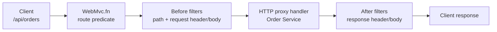

# Transforming Paths, Headers, and Bodies with Web MVC Filters

## Lesson Objectives

In the **Server Web MVC** chapter of **Spring Cloud Gateway**, we learn how to modify **paths**, **request/response headers**, and **HTTP bodies** using filters dedicated to **Spring Cloud Gateway Server Web MVC**. This Gateway deployment variant is built on **Spring MVC functional endpoints (`WebMvc.fn`)** and a **Servlet runtime**, not Reactor-based Gateway Server WebFlux.

This lesson focuses on three questions: *when should a request be transformed before sending upstream, when should a response be transformed before returning to the client, and how do those transformations affect HTTP semantics and security?*

After this lesson, you will be able to:

- Distinguish **Server Web MVC** from **Server WebFlux**, avoiding mixing Servlet `RouterFunction<ServerResponse>` with WebFlux `RouteLocator`/`GatewayFilter`.
- Configure Web MVC routes in the right namespace and pick **before filters** vs. **after filters** by processing stage.
- Use `StripPrefix`, `PrefixPath`, `SetPath`, and `RewritePath` to transform request URIs.
- Use `AddRequestHeader`, `SetRequestHeader`, `RemoveRequestHeader`, `AddResponseHeader`, `SetResponseHeader`, `RemoveResponseHeader`, and `RewriteResponseHeader`.
- Know why **`ModifyRequestBody` and `ModifyResponseBody` in Server Web MVC are configured only via the Java DSL** in current Spring docs rather than adding unsupported YAML strings.
- Determine how body rewrites affect **`Content-Type`, `Content-Length`, `Content-Encoding`, cache validators, and memory**.
- Design trusted-header policies protecting `Authorization`, `Cookie`, `Host`, `Forwarded`, and identity headers.
- Test rewritten URLs, headers seen at the backend, body serialization, response bodies, and 4xx/5xx cases.
- Choose when to use built-in filters and when to write a controlled custom Java filter.

> Scope is **Spring Cloud Gateway Server Web MVC**. Primary YAML examples use `spring.cloud.gateway.server.webmvc.routes` from newer Gateway lines; some older lines use `spring.cloud.gateway.mvc.routes`. Always verify your Spring Cloud release train, Spring Boot, and actual starter. Examples are for learning and do not replace authentication, rate limiting, circuit breakers, retries, TLS, or request observability.

## 1. Path of an HTTP Request Through Gateway MVC

Suppose the frontend calls:

```http
POST /api/orders HTTP/1.1
Host: api.example.com
Authorization: Bearer <access-token>
Content-Type: application/json
X-Request-Source: browser

{"itemId":"BOOK-42","quantity":1}
```

Meanwhile, the backend Order Service exposes:

```text
POST http://order-service:8080/orders
```

and expects a Gateway-controlled header:

```http
X-Gateway-Source: orders-edge
```

The Gateway can perform:

1. **Match route:** select the route accepting `/api/orders`.
2. **Before filters:** strip prefix `/api`, remove untrusted headers, set a new header; if configured via Java DSL, optionally read/transform the request body.
3. **HTTP proxy handler:** send the transformed request upstream.
4. **After filters:** adjust response headers or body before returning to the client.



Key takeaway: **route predicates do not rewrite URLs**. They select a route; pre-proxy filters change the request URI seen by the backend. Likewise, transforming a response body requires a filter that reads and re-encodes the representation, not just `SetResponseHeader`.

### 1.1. `Before` and `After` Are More Than Just Names

| Stage | Processable data | Examples |
| --- | --- | --- |
| **Predicate / matching** | Method, path, host, headers of incoming request | `Path=/api/orders/**` |
| **Before filter** | Request path, request headers, request body before HTTP proxy | `StripPrefix`, `SetRequestHeader`, `ModifyRequestBody` |
| **Proxy handler** | Sends request to backend and receives response | `HandlerFunctions.http()` |
| **After filter** | Response status/headers/body before returning to client | `AddResponseHeader`, `RewriteResponseHeader`, `ModifyResponseBody` |

In Web MVC's Java DSL, functions are grouped into:

```java
org.springframework.cloud.gateway.server.mvc.filter.BeforeFilterFunctions
org.springframework.cloud.gateway.server.mvc.filter.AfterFilterFunctions
```

This makes clear which step transforms requests and which transforms responses. **Do not model Web MVC filters after WebFlux's `AbstractGatewayFilterFactory`**: APIs, execution models, and lifecycles differ.

## 2. Prerequisites: Right Starter, Right Servlet Stack

For newer lines of Spring Cloud Gateway Server Web MVC, the Maven starter is typically:

```xml
<dependency>
    <groupId>org.springframework.cloud</groupId>
    <artifactId>spring-cloud-starter-gateway-server-webmvc</artifactId>
</dependency>
```

Use a Spring Cloud BOM compatible with your project's Spring Boot version instead of piecing together artifact versions manually.

**Version history note:** older lines used starter `spring-cloud-starter-gateway-mvc` and prefix `spring.cloud.gateway.mvc.routes`. Newer lines reorganized names under `server-webmvc`. When an example fails to run, check the docs for the **exact version you use** rather than adding both starters and both prefixes hoping one works.

| Property | Server Web MVC | Server WebFlux |
| --- | --- | --- |
| Web model | Servlet + Spring MVC `WebMvc.fn` | Reactive + Spring WebFlux |
| Sample router API | `RouterFunction<ServerResponse>` | `RouteLocator`, `RouteLocatorBuilder` |
| Functional routing response type | `org.springframework.web.servlet.function.ServerResponse` | WebFlux handler/response abstractions |
| Sample filter functions | `BeforeFilterFunctions`, `AfterFilterFunctions` | `GatewayFilter`, `GatewayFilterFactory`, `GlobalFilter` |
| Common runtime | Tomcat, Jetty, or compatible Servlet container | Typically Reactor Netty |
| Body transform | MVC Java DSL `modifyRequestBody`/`modifyResponseBody` | WebFlux `ModifyRequestBody`/`ModifyResponseBody` with different APIs |
| Avoid misusing | `Mono<Void>`, `ServerWebExchange`, `DataBuffer` as filter signatures | `jakarta.servlet.Filter`/MVC `ServerRequest` as drop-in APIs |

An application may contain reactive libraries for other purposes, but **that does not turn Gateway Server Web MVC into WebFlux**. In this lesson, Java code uses MVC functional endpoints and synchronous callbacks per the MVC API.

### 2.1. Minimal YAML Route

```yaml
spring:
  cloud:
    gateway:
      server:
        webmvc:
          routes:
            - id: orders-basic
              uri: http://localhost:9001
              predicates:
                - Path=/api/orders/**
              filters:
                - StripPrefix=1
```

With a test backend running on `localhost:9001`:

```text
Client calls: GET http://localhost:8080/api/orders/42
Backend sees: GET http://localhost:9001/orders/42
```

To use service discovery/load balancing, add dependencies and instance selection compatible with Web MVC; when practicing filters alone, a **static URI to a backend stub** separates path configuration from registry issues.

### 2.2. Java DSL: `GatewayRouterFunctions.route`

Equivalent Java route definition:

```java
package com.example.gateway;

import org.springframework.context.annotation.Bean;
import org.springframework.context.annotation.Configuration;
import org.springframework.web.servlet.function.RouterFunction;
import org.springframework.web.servlet.function.ServerResponse;

import static org.springframework.cloud.gateway.server.mvc.filter.BeforeFilterFunctions.stripPrefix;
import static org.springframework.cloud.gateway.server.mvc.filter.BeforeFilterFunctions.uri;
import static org.springframework.cloud.gateway.server.mvc.handler.GatewayRouterFunctions.route;
import static org.springframework.cloud.gateway.server.mvc.handler.HandlerFunctions.http;

@Configuration
class OrdersMvcGatewayRoutes {

    @Bean
    RouterFunction<ServerResponse> ordersBasicRoute() {
        return route("orders-basic")
            .GET("/api/orders/**", http())
            .before(uri("http://localhost:9001"))
            .before(stripPrefix(1))
            .build();
    }
}
```

This snippet uses `org.springframework.web.servlet.function.*`, **not** `org.springframework.web.reactive.function.server.*`. Before combining multiple routes, pick **one configuration mechanism per route ID**, avoiding declaring the same route in both YAML and Java DSL, which makes routing unpredictable.

## 3. Path Transformation: Choosing the Right Transform

Rewriting request paths is common when the Gateway exposes APIs under a shared prefix while backends use shorter paths.

| Filter | Parameter | Primary effect | When to use |
| --- | --- | --- | --- |
| `StripPrefix` | Number of segments to remove | Drops leading path segments | `/api/orders/42` → `/orders/42` |
| `PrefixPath` | Prefix to insert | Prepends a prefix to the path | `/orders/42` → `/internal/orders/42` |
| `SetPath` | URI template | Replaces path using template expanded from route variables | `/v1/users/42` → `/users/42` |
| `RewritePath` | Java regex + replacement | Rewrites path using regex with capture groups | `/legacy/abc` → `/new/abc` |

**Do not force one filter on every case.** `StripPrefix` is cleaner and less error-prone than regex when simply removing `/api`; `SetPath` fits explicit URI templates; `RewritePath` handles complex mappings.

### 3.1. `StripPrefix`

Example:

```yaml
spring:
  cloud:
    gateway:
      server:
        webmvc:
          routes:
            - id: strip-orders
              uri: http://localhost:9001
              predicates:
                - Path=/api/orders/**
              filters:
                - StripPrefix=1
```

Results:

| Client sends | `parts=1` | `parts=2` |
| --- | --- | --- |
| `/api/orders/42` | `/orders/42` | `/42` |
| `/api/orders` | `/orders` | `/` or equivalent root path per normalization |
| `/api/orders/42/items` | `/orders/42/items` | `/42/items` |

Count **path segments**, not characters. Do not include the query string in the segment count.

In Java DSL:

```java
.before(stripPrefix(1))
```

If the backend actually expects `/orders/42` yet the route uses `StripPrefix=2`, 404s will happen even though the Gateway matched the route. When debugging, always log **public path** and **upstream path** separately.

### 3.2. `PrefixPath`

The backend exposes:

```text
/internal/orders/42
```

while the public route is:

```text
/orders/42
```

Add:

```yaml
filters:
  - PrefixPath=/internal
```

so `/orders/42` is forwarded to the backend as `/internal/orders/42`.

Java DSL:

```java
.before(prefixPath("/internal"))
```

Do not confuse this with altering **host** or **scheme**. `PrefixPath` operates only on the path. Query strings, methods, authorization, and upstream URIs must be preserved/checked separately.

### 3.3. `SetPath` with URI Templates

With the route:

```yaml
predicates:
  - Path=/api/products/{productId}
filters:
  - SetPath=/products/{productId}
```

the client calls:

```text
/api/products/BOOK-42
```

and upstream sees:

```text
/products/BOOK-42
```

`SetPath` uses **URI template variables** extracted from the predicate, not Java regex replacements. If the path pattern has multiple segments or optional variables, test every valid pattern to ensure you do not produce URIs missing segments or shadow other routes.

### 3.4. `RewritePath` with Named Regex Captures

This rewrite fits when prefixes require regex transformation:

```yaml
spring:
  cloud:
    gateway:
      server:
        webmvc:
          routes:
            - id: rewrite-legacy
              uri: http://localhost:9001
              predicates:
                - Path=/legacy/**
              filters:
                - RewritePath=/legacy/?(?<segment>.*), /$\{segment}
```

Concept:

```text
/legacy/orders/42  →  /orders/42
/legacy/products   →  /products
```

`(?<segment>.*)` is a Java named regex capture group. `/${segment}` is the group replacement, yet **in YAML, Spring property placeholder expansion can misinterpret `${...}`**. Hence Spring Cloud Gateway docs typically write **`$\{segment}`** in YAML to escape it. In Java DSL, write the replacement normally:

```java
.before(rewritePath("/legacy/(?<segment>.*)", "/${segment}"))
```

Do not add quotes or escapes out of habit without checking the string **after YAML and Spring bind it**; tests are what prove real requests reach the right upstream path.

**Regex note:** `RewritePath` should only be used on well-defined routes. Overly broad regexes or unbounded inputs can misroute paths or burn CPU. Test `%2F` encoding, `/`, `?`, `#`, Unicode characters, and path traversal normalization across real boundaries rather than building a "URI sanitizer" with simple regex.

### 3.5. Ordering with Load Balancing

When the Java DSL combines `lb()` or dynamic target selection, Web MVC docs advise **rewriting the path before load balancing**, otherwise the final URI may be malformed.

Conceptually:

```text
Path predicate
  ↓
RewritePath / StripPrefix / SetPath
  ↓
LoadBalancer selects instance
  ↓
HTTP proxy to final upstream URL
```

With `lb:` URIs in YAML, Gateway has its own filter ordering mechanism. Never infer actual order merely from line order or arbitrarily mix Java DSL `lb()` with `uri(...)`. Always check the **HTTP path received by the test backend**.

## 4. Request Headers: Adding, Replacing, and Removing

HTTP headers affect authentication, caching, content negotiation, CORS, tracing, and how backends interpret requests. Every header change must answer **who owns the value** and **whether client input may be trusted**.

### 4.1. `AddRequestHeader`

```yaml
filters:
  - AddRequestHeader=X-Gateway-Label, orders-edge
```

This filter appends a value to `X-Gateway-Label`. When the header already exists, adding can leave the backend seeing **multiple values** under the same name.

Java DSL:

```java
.before(addRequestHeader("X-Gateway-Label", "orders-edge"))
```

Use when the backend accepts multi-value headers or adding a value matches the contract. **Do not use `AddRequestHeader` to set trusted identity headers** if a client can send another value first: the backend might read the first value, leading to header spoofing.

### 4.2. `SetRequestHeader`

```yaml
filters:
  - SetRequestHeader=X-Gateway-Source, orders-edge
```

This filter **replaces all values of that header** with the configured value. For example:

```http
X-Gateway-Source: client-forged
```

becomes after the filter:

```http
X-Gateway-Source: orders-edge
```

Appropriate for Gateway-owned headers, but only after **security review** of the header name. **Never set `Authorization`, `Cookie`, `Host`, or `X-Authenticated-User` arbitrarily** from unverified data.

### 4.3. `RemoveRequestHeader`

```yaml
filters:
  - RemoveRequestHeader=X-Debug-Mode
```

Appropriate when clients might send an internal header that backends must not receive. For instance, ingress/Gateway strips administrative, diagnostic, or untrusted client-hint headers.

To pass a **verified identity header** downstream:

1. Strip client-sent headers at the **trust boundary**.
2. Have Spring Security or an identity-aware component verify the caller.
3. Only then emit a header with trusted provenance per the backend contract.
4. Have the backend trust the header only over permitted networks/proxies, while still enforcing resource-level authorization.

`RemoveRequestHeader` alone does not produce safe identity propagation.

### 4.4. `MapRequestHeader` and Multiple Values

`MapRequestHeader` can copy values from one request header to another. Understand the difference between **copy**, **add**, and **set**.

Illustrative example:

```yaml
filters:
  - MapRequestHeader=X-Client-Locale, X-Locale
```

If `X-Client-Locale` is client-controlled, `X-Locale` is also **untrusted input**. Never map `X-Tenant-ID` to `X-Verified-Tenant` and treat it as authorization.

### 4.5. Request Header Comparison

| Filter | When header already exists | Purpose |
| --- | --- | --- |
| `AddRequestHeader` | May keep old value and append new value | Appending metadata |
| `SetRequestHeader` | Replaces old values | Gateway takes ownership of header |
| `RemoveRequestHeader` | Deletes all values for that name | Drops untrusted metadata |
| `MapRequestHeader` | Reads value from source header and adds to target per supported semantics | Controlled metadata forwarding |

HTTP header names are case-insensitive per protocol. Still, multiple values for **one name** carry distinct semantics; never concatenate or merge `Set-Cookie`, `Authorization`, or special headers casually.

## 5. Response Headers: Adjusting Before Returning to the Client

In the **after** phase, Gateway Web MVC can add, remove, or replace headers from the upstream response. This helps to:

- Standardize operational headers.
- Prevent leaking internal/debug backend headers.
- Adjust redirect `Location` headers to public API hosts/paths.
- Standardize policy headers when the Gateway truly owns them.

### 5.1. `AddResponseHeader`

```yaml
filters:
  - AddResponseHeader=X-Served-Via, gateway-mvc
```

Java DSL:

```java
.after(addResponseHeader("X-Served-Via", "gateway-mvc"))
```

If the upstream also returns `X-Served-Via`, the client may see **multiple values**. Avoid `Add` if the contract requires a single value.

### 5.2. `SetResponseHeader`

```yaml
filters:
  - SetResponseHeader=X-Api-Surface, public-v1
```

Replaces values of the same name with `public-v1`. This does not prove the backend implemented that version; it is only response metadata. For security headers like `Content-Security-Policy` or `Strict-Transport-Security`, evaluate scheme/TLS/ingress so you do not conflict with policies set by another security layer.

### 5.3. `RemoveResponseHeader`

```yaml
filters:
  - RemoveResponseHeader=X-Backend-Debug
```

Used to strip a header that should not be exposed externally. Security is more than filtering a few headers, however: upstreams can still leak internal details in bodies, `Location`, or error messages. Maintain testing and error sanitization across all layers.

### 5.4. `RewriteResponseHeader`

When a response header contains a substring to modify:

```yaml
filters:
  - 'RewriteResponseHeader=X-Trace-Info, secret=[^&]+, secret=REDACTED'
```

Suppose upstream returns:

```http
X-Trace-Info: mode=normal&secret=abc123&flag=true
```

After rewriting, the target is:

```http
X-Trace-Info: mode=normal&secret=REDACTED&flag=true
```

**Important note:** regex redaction on a single header is only an API demo. If an upstream can put sensitive data in multiple places or encodings, a regex like `secret=[^&]+` **cannot guarantee secrets never leak**. A better design is **never emitting secrets** into responses from the backend, or using an allowlist of safe headers.

### 5.5. `DedupeResponseHeader` and CORS

When both Gateway and backend add CORS headers, browsers may receive:

```http
Access-Control-Allow-Origin: https://app.example.com
Access-Control-Allow-Origin: https://app.example.com
```

Some Web MVC versions provide `DedupeResponseHeader` to handle duplicate values. However, **deduping does not replace CORS policy**:

- There must be a single clear **CORS owner**.
- `Access-Control-Allow-Credentials` must never be enabled for unintended origins.
- Preflight `OPTIONS` must be tested separately; a GET-only route may not handle preflight as expected.
- 401/403/429/503 responses also need proper CORS headers if the frontend must read errors.

When multiple layers (ingress/Spring Security/Gateway/backend) emit CORS headers, fix **the redundant emitter** rather than masking mistakes with broad regexes or deduping.

## 6. A YAML Route Combining Path and Headers

Practical example: public API `/api/orders/**`, backend `/orders/**`, with Gateway managing selected headers:

```yaml
spring:
  cloud:
    gateway:
      server:
        webmvc:
          routes:
            - id: orders-edge
              uri: http://localhost:9001
              predicates:
                - Path=/api/orders/**
              filters:
                - StripPrefix=1
                - RemoveRequestHeader=X-Internal-Operator
                - SetRequestHeader=X-Gateway-Source, orders-edge
                - AddResponseHeader=X-Served-Via, gateway-mvc
                - RemoveResponseHeader=X-Backend-Debug
```

Suppose the client sends:

```http
GET /api/orders/42 HTTP/1.1
X-Internal-Operator: true
X-Gateway-Source: client-forged
```

The backend will effectively see:

```http
GET /orders/42 HTTP/1.1
X-Gateway-Source: orders-edge
```

with no `X-Internal-Operator`, **assuming no other layer re-injects that header**. The returned response can contain `X-Served-Via: gateway-mvc` and no `X-Backend-Debug`.

### 6.1. Do Not Assume This Route Is Fully Secured

This example has not yet configured:

- Authentication/authorization with Spring Security.
- Inbound TLS and outbound TLS.
- Rate limits, concurrency limits, retries, or circuit breakers.
- Service discovery (the URI intentionally points to an HTTP backend stub).
- CORS, CSRF for cookies, quotas, and business validation.

In microservices, **header transformation does not replace authentication**. Having Order Service read `X-Gateway-Source` for logging is fine; using it as proof the user is an admin is a trust-boundary flaw.

## 7. Transforming Request Bodies: `ModifyRequestBody`

Unlike path/header filters that take YAML arguments, **`ModifyRequestBody` in Server Web MVC is documented by Spring for configuration via the Java DSL**.

Do not write:

```yaml
# Not a valid body transform configuration
# guaranteed in Gateway Server Web MVC:
filters:
  - ModifyRequestBody=String.class,Something
```

Body modification requires knowing:

- Input data type and output data type.
- `Content-Type` of the new representation.
- Whether message converters support those types.
- How empty/null bodies are handled.
- Whether payloads are large or streaming.

### 7.1. Java DSL Modifying a Text Body Before Upstream

Example test app trimming leading/trailing whitespace on text bodies before forwarding:

```java
package com.example.gateway;

import org.springframework.context.annotation.Bean;
import org.springframework.context.annotation.Configuration;
import org.springframework.http.MediaType;
import org.springframework.web.servlet.function.RouterFunction;
import org.springframework.web.servlet.function.ServerResponse;

import static org.springframework.cloud.gateway.server.mvc.filter.BeforeFilterFunctions.modifyRequestBody;
import static org.springframework.cloud.gateway.server.mvc.filter.BeforeFilterFunctions.uri;
import static org.springframework.cloud.gateway.server.mvc.handler.GatewayRouterFunctions.route;
import static org.springframework.cloud.gateway.server.mvc.handler.HandlerFunctions.http;

@Configuration
class RequestBodyMvcRoute {

    @Bean
    RouterFunction<ServerResponse> normalizedNotesRoute() {
        return route("normalized-notes")
            .POST("/api/notes", http())
            .before(uri("http://localhost:9001"))
            .before(modifyRequestBody(
                String.class,
                String.class,
                MediaType.TEXT_PLAIN_VALUE,
                (request, body) -> body == null ? "" : body.strip()
            ))
            .build();
    }
}
```

Suppose the client sends:

```http
POST /api/notes HTTP/1.1
Content-Type: text/plain; charset=UTF-8

    xin chào    
```

After transformation, upstream is expected to receive a **new text representation**:

```text
xin chào
```

This illustrates intentional transformation, **not a security sanitizer**. `String.strip()` does not block SQL injection, XSS, command injection, or malicious payloads.

**Important:** the example replaces null/empty bodies with an empty string per the demo endpoint's business rule. In real apps, distinguish **absent body** from **empty body** if the contract requires it; verify `null` callback and message converter behavior on your version.

### 7.2. What Do the Parameters Mean?

```java
modifyRequestBody(
    String.class,            // Input representation
    String.class,            // Output representation
    MediaType.TEXT_PLAIN_VALUE,
    (request, body) -> ...
)
```

| Part | Role |
| --- | --- |
| First `String.class` | Content type used to read/convert the request body |
| Second `String.class` | Content type after transformation |
| `MediaType.TEXT_PLAIN_VALUE` | Expected content type of the output |
| `(request, body) -> ...` | Java MVC callback transforming the body and optionally reading request metadata |

Exact callback signatures and overloads vary by **Gateway line**; on current lines, the MVC API uses a synchronous callback returning the object directly—**do not plug in WebFlux's `Mono.just(...)`**. Some docs mention `Mono.empty()` in empty-body prose even though Web MVC examples return synchronous objects; when prose and sample code disagree, trust Javadoc and compile tests against your exact dependency.

### 7.3. What If the Body Is a JSON Object?

Structural transformations should use typed DTOs:

```java
record ClientOrder(String itemId, int quantity) { }
record BackendOrder(String itemId, int quantity, String source) { }
```

The callback can construct:

```java
(request, incoming) -> new BackendOrder(
    incoming.itemId(),
    incoming.quantity(),
    "gateway-mvc"
)
```

once `incoming` has been deserialized as `ClientOrder`. That snippet alone is **not enough** for a standalone route: you must declare `modifyRequestBody(ClientOrder.class, BackendOrder.class, MediaType.APPLICATION_JSON_VALUE, ...)`, ensure Jackson/message converters support records, and enforce null checks, validation, and backend contracts.

**Do not make the Gateway the sole place enforcing business validation or authorization.** Backends must still verify quantities, item IDs, tenant ownership, and transaction safety.

### 7.4. When Not to Modify Request Bodies?

- Very large file uploads/multipart requests.
- Streaming HTTP requests needing low latency and bounded memory.
- Encrypted/compressed bodies where Gateway lacks a suitable decoder.
- Digitally signed payloads: altering bytes invalidates signatures/MACs.
- Requests with special `Content-Length`/`Transfer-Encoding` or requiring Retry replay.
- Logic accessing sensitive data that should not be decrypted at the edge.

In such cases, adjust the API contract or move transformation to the **backend/BFF** where proper data policies live, instead of buffering entire payloads inside the Gateway.

## 8. Transforming Response Bodies: `ModifyResponseBody`

For backend responses, use an **after filter** because the payload exists only after receiving the upstream response.

### 8.1. Java DSL Replacing a Text Segment

```java
package com.example.gateway;

import org.springframework.context.annotation.Bean;
import org.springframework.context.annotation.Configuration;
import org.springframework.http.MediaType;
import org.springframework.web.servlet.function.RouterFunction;
import org.springframework.web.servlet.function.ServerResponse;

import static org.springframework.cloud.gateway.server.mvc.filter.AfterFilterFunctions.modifyResponseBody;
import static org.springframework.cloud.gateway.server.mvc.filter.BeforeFilterFunctions.uri;
import static org.springframework.cloud.gateway.server.mvc.handler.GatewayRouterFunctions.route;
import static org.springframework.cloud.gateway.server.mvc.handler.HandlerFunctions.http;

@Configuration
class ResponseBodyMvcRoute {

    @Bean
    RouterFunction<ServerResponse> normalizeStatusTextRoute() {
        return route("normalize-status-text")
            .GET("/api/status-text", http())
            .before(uri("http://localhost:9001"))
            .after(modifyResponseBody(
                String.class,
                String.class,
                MediaType.TEXT_PLAIN_VALUE,
                (request, response, body) ->
                    body == null ? "" : body.replace(
                        "legacy:", "current:"
                    )
            ))
            .build();
    }
}
```

If upstream returns:

```http
HTTP/1.1 200 OK
Content-Type: text/plain

legacy:ready
```

the client can receive:

```http
HTTP/1.1 200 OK
Content-Type: text/plain

current:ready
```

Response headers such as `Content-Length` must reflect the **actual output bytes**, never keeping the size computed for the old body. Using the official factory routes the rewrite through MVC's pipeline properly, yet you must still test HTTP framing and specific message converters.

### 8.2. Why Is There a `response` Parameter?

In some overloads of MVC `modifyResponseBody`, the callback receives:

```java
(request, response, body) -> ...
```

This lets logic inspect the upstream response status or headers rather than only reading the body string. Even so, **do not treat `response` as license to arbitrarily mutate already-committed parts**. Signatures and helper methods can vary across versions; consult the Javadoc of your active dependency.

### 8.3. Do Not "Accidentally" Turn JSON Bodies into Invalid Text

For example, if upstream returns:

```json
{"message":"legacy:ready","count":3}
```

calling `.replace("legacy:", "current:")` across the entire JSON string can alter unintended parts; for complex structures, decode into a DTO/JSON tree, update **only allowed fields**, and re-encode.

For personal data, allowlist **only the fields** permitted in the response; avoid "stripping sensitive fields with regex," which can be bypassed via escaping, nested objects, or encodings.

### 8.4. Response Body Filters Are Not Fallbacks

`ModifyResponseBody` modifies the representation of an existing response. It does not invoke a fallback service, act as a circuit breaker, or retry upstream failures. When upstream returns 503 or times out, there may be no JSON body like in the 200 case; callbacks must handle nulls, error bodies, and status codes safely.

If you need a fallback response with completely different content, configure Web MVC error handling and `CircuitBreaker` separately instead of writing a callback that fakes `200 OK` during backend outages.

## 9. HTTP Framing: Modifying Bodies Requires Updating Metadata

This is the easiest place to introduce subtle bugs during content transformation.

### 9.1. `Content-Length` Is **Bytes**, Not Characters

Suppose:

```text
old body: "hello"
new body: "xin chào"
```

Java `String` character count does not necessarily equal **UTF-8 bytes** sent on the wire. Accented Vietnamese, emojis, and other characters can take multiple bytes.

```text
Content-Length = output representation size in bytes
```

If the old body's `Content-Length` remains after rewriting:

- Clients may read short or hang waiting for more bytes.
- Keep-alive connections can suffer framing corruption.
- Upstream/downstream proxies may reject or misparse the response.
- Tests that merely parse JSON sometimes miss framing bugs encountered by other HTTP clients/proxies.

**Never call `.length()` on a Java `String` to set `Content-Length`.** Let the framework/message converter calculate byte length or manage the header appropriately, then verify on the wire.

### 9.2. `Transfer-Encoding` Should Never Be Blindly Copied

When output body length is unknown ahead of time, HTTP/1.1 can use appropriate framing such as chunked transfer encoding. However, **never send conflicting headers together** or blindly copy `Transfer-Encoding` from an upstream response onto a transformed representation.

HTTP/2 uses different framing than HTTP/1.1; hop-by-hop headers like `Connection` must not be forwarded as end-to-end application metadata. The Gateway and HTTP proxy client/server must handle each hop per protocol rules.

### 9.3. `Content-Type` Must Describe the New Representation

If the output body becomes JSON:

```http
Content-Type: application/json
```

If plain text:

```http
Content-Type: text/plain; charset=UTF-8
```

Do not advertise JSON content type while serializing invalid bytes, or keep `application/gzip` after decompressing into text. For charsets, use compatible converters and test Unicode.

### 9.4. `Content-Encoding` and Compression

If upstream returns:

```http
Content-Encoding: gzip
```

then the body is a **gzip-encoded representation**. Never run a direct String replacement on compressed bytes while keeping `Content-Encoding: gzip`.

Strategies:

1. Avoid response body rewrites on compressed responses.
2. Ask upstream to return an uncompressed representation on routes being transformed, then recompress at an appropriate layer.
3. Use a pipeline with proper decoders/encoders, bound decompressed size, and test content negotiation.

Never assume `ModifyResponseBody` in every MVC version transparently decompresses and recompresses. Verify with tests involving `Accept-Encoding`, gzip/br, and actual response bytes.

### 9.5. Cache Validators, Ranges, and Signatures

After a body changes:

| Metadata | Issue | How to handle |
| --- | --- | --- |
| `ETag` | Hash/validator of old body is no longer accurate | Drop or recompute for the new representation |
| `Last-Modified` | May still reflect upstream source, yet semantics must be clear | Check cache contract |
| `Content-MD5` / Digest / signatures | No longer matches new bytes | Recompute/re-sign if permitted, or do not rewrite |
| `Content-Range` | Indicates byte range of old representation | Never rewrite in ways that break range semantics |
| `Cache-Control` | Response may contain per-user data | Verify private/public caching |
| `Vary` | Especially when representations vary by header | Preserve proper `Vary` to prevent cache poisoning |

**Never rewrite bodies of `206 Partial Content`, `304 Not Modified`, `204 No Content`, or `HEAD` using logic meant for full `200 OK` without checking HTTP semantics.** Those statuses/methods have strict body and metadata constraints.

## 10. Body Rewriting Has CPU, Memory, and Latency Costs

In Web MVC, body conversion normally involves Servlet request/response streams and HTTP message converters. Regardless of internal streaming/buffering details, **rewriting an entire JSON/text payload** usually forces the system to materialize enough content to parse or rebuild a new representation.

A single transform can increase:

- Memory held for input/output representations.
- CPU for JSON decoding/encoding, regexes, or compression.
- Latency before sending the first bytes to the client.
- Garbage collection pressure under high concurrency.
- Risk of encoding errors or oversized request/response failures.

Example:

```text
100 in-flight requests
× 10 MiB per JSON response
≈ 1 GiB of output data if one copy coexists in memory
```

Numbers illustrate scale only; object graphs, string encodings, and intermediate copies can push real memory usage **even higher**. Do not put body transformers in front of file downloads, video streams, SSE, or large multipart uploads just because "the Gateway has a filter."

### 10.1. When Not to Modify Bodies at the Gateway

| Scenario | Better approach |
| --- | --- |
| Large file uploads | Multipart streaming/resumable uploads and backend policies |
| Video/audio streaming | Never buffer entire representations; use streaming proxy |
| Long-lived SSE | Preserve HTTP stream and backpressure policies; do not buffer all events to rewrite |
| Compressed/signed documents | Keep bytes intact or process in the component owning the representation |
| APIs with sensitive PII | Use DTOs/allowlists at backend/BFF with security review |
| Idempotency/transactional calls | Let backend own business semantics; Gateway transforms only when safe |

### 10.2. Synchronous Does Not Mean Blocking Arbitrarily Is Okay

Server Web MVC uses the Servlet model rather than WebFlux's reactive Netty event loop. Still, a filter calling a slow HTTP client, querying a database, or parsing huge bodies will **tie up worker threads**, growing queues and p99 latency.

Do not turn a body transformer into a policy engine making per-request network calls without timeouts, circuit breakers, concurrency limits, or appropriate caching.

## 11. Security: Changing Headers/Paths Can Shift Trust Boundaries

Filters can alter requests in ways affecting authorization, routing, and data exposure:

```text
Path rewrite
  → can route from a public endpoint to an internal endpoint

SetRequestHeader
  → can overwrite security metadata

ModifyRequestBody
  → can alter fields the backend uses for authorization

ModifyResponseBody
  → can accidentally leak or mask sensitive data
```

### 11.1. Path-Based Security: Public Path vs. Backend Path

Example:

```text
Public: /api/admin/reports
Rewrite: /internal/reports
Backend: Admin Service
```

Spring Security at the Gateway may evaluate the **public path before rewriting** per security filter chain setup; the backend sees the rewritten path. Ensure both sides enforce consistent policies:

- Gateway protects `/api/admin/**` with authenticated principals/scopes.
- Backend still checks **report access permissions**.
- No other route can rewrite `/public/**` to `/internal/reports` and bypass protection.
- Route ordering/predicates create no bypass paths.

Never treat URL rewriting as an authorization mechanism. It only changes the URI forwarded upstream.

### 11.2. `Host` and `Forwarded` Differ from Ordinary Headers

Headers such as:

```http
Host: api.example.com
Forwarded: proto=https;host=api.example.com
X-Forwarded-For: ...
X-Forwarded-Proto: https
```

affect absolute URL generation, redirects, scheme detection, and client IP attribution. Never let clients send forwarded headers and trust them as edge-verified facts.

When the Gateway sits behind a load balancer/ingress, configure **trusted proxies** per framework capabilities, block bypass paths, and inspect how hops overwrite or append headers. When the goal is altering the **Host header**, look for purpose-built factories like `SetRequestHostHeader`/`PreserveHostHeader` for your version instead of blindly using `SetRequestHeader`.

### 11.3. `Authorization` and Cookies

Strictly avoid:

```yaml
filters:
  - AddRequestHeader=Authorization, Bearer some-secret
```

with secrets hardcoded in source configuration or colliding with user tokens. Token relay must be designed via **Spring Security/OAuth2** and your backend trust model, not concatenated from client-sent values.

Cookies/sessions have dedicated CSRF and `SameSite` threat models; header rewriting alone does not prevent CSRF. When combining CORS and cookie credentials, test preflight, actual requests, and error responses.

### 11.4. Header Injection and Client-Controlled Content

If a filter copies a query parameter or body field into an HTTP header:

```text
userInput → X-Custom-Header
```

validate control/CRLF characters, length, and a semantic allowlist. Never construct unbounded headers or copy unvalidated user input into redirect `Location` headers.

### 11.5. SSRF, Path Traversal, and Route Destinations

`RewritePath` must never build arbitrary target URLs from unverified input. Route URIs need scheme/host/service-ID allowlists; path rewrites must check encoded slashes/dot segments and normalization. Never let callers invoke:

```text
/api/redirect?target=http://internal-admin/
```

and turn `target` into an upstream URI without destination policy. That creates **SSRF** and bypasses network boundaries.

## 12. Interactions with Retry, CircuitBreaker, and Request Observability

A Gateway can pair path/header/body transforms with resilience mechanisms. However, **filter order and retry semantics** matter deeply.

### 12.1. Can Retries Re-Run Transformations?

For example, the logical pipeline:

```text
Transform request body
  ↓
Retry
  ↓
HTTP proxy
```

does not behave identically to:

```text
Retry
  ↓
Transform request body
  ↓
HTTP proxy
```

If a retry loop encloses body transformation, the callback may execute multiple times or require replaying the source body. An idempotent operation like `body.strip()` is stable across retries; an operation like `"count++"` or "generate a fresh idempotency key" produces **different payloads across attempts**.

**For POST/PUT/PATCH writes**, design idempotency at the backend. Simply being able to replay bytes does not make the business operation safe to retry.

### 12.2. CircuitBreaker and Fallbacks

On upstream failures, a CircuitBreaker can return a fallback per your MVC version's policy. A `ModifyResponseBody` designed to edit Order Service JSON **must not assume** fallback responses share the same JSON shape.

Test all of:

- Normal success responses.
- 4xx/5xx error responses.
- Circuit OPEN / fallback when no upstream response exists.
- Empty bodies, `HEAD`, and `204`.
- Response headers when CORS/security blocks requests before the route.

Never fake `200 OK` for payment transactions unconfirmed by the backend.

### 12.3. Separating Client Requests from Upstream Attempts

If Gateway receives one request while Retry calls the backend three times:

```text
Inbound requests = 1
Outbound HTTP attempts = 3
```

Whether `ModifyRequestBody` transforms payloads once before retry or on every attempt, telemetry must reflect it accurately. Never log raw bodies or tokens just to compare attempts.

**Recommended metrics:** route ID, method, HTTP status, p50/p95/p99 latency, retry count, upstream errors, body-transform errors, bytes transferred, and response framing failures.

Never attach raw URI queries, user IDs, or tokens as high-cardinality metric labels.

## 13. Testing with an Echo Backend

Before introducing complex JSON transformations, build a standalone stub backend on `localhost:9001` that can:

- Echo received **method and path**.
- Echo **selected request headers**, redacted.
- Echo the request body or return fixed text.
- Emit a response header such as `X-Backend-Debug`.
- Return `200`, `404`, `503`, `204`, and `Content-Encoding: gzip` on demand in separate tests.

### 13.1. Testing Paths and Headers with `curl`

With the YAML route from Section 6:

```bash
curl -i \
  -H "X-Internal-Operator: true" \
  -H "X-Gateway-Source: forged-client" \
  "http://localhost:8080/api/orders/42"
```

The test backend should verify:

```text
method              = GET
path                = /orders/42
X-Internal-Operator = absent
X-Gateway-Source    = orders-edge
```

The client response should include:

```http
X-Served-Via: gateway-mvc
```

and **no** `X-Backend-Debug` even if the backend emitted it. Checking status 200 alone is insufficient; the route might still reach the backend while filters failed to run.

### 13.2. Testing Request Bodies

With the Java route `normalized-notes`:

```bash
curl -i -X POST \
  "http://localhost:8080/api/notes" \
  -H "Content-Type: text/plain; charset=UTF-8" \
  --data-binary "   xin chào   "
```

The echo backend must receive the normalized body per policy:

```text
xin chào
```

Verify separately:

- Actual `Content-Type` at upstream.
- `Content-Length` in actual **bytes**.
- Unicode text and charsets.
- Empty request bodies.
- Oversized bodies / unsupported media types.
- Digitally signed requests if the system validates signatures.

### 13.3. Testing Response Bodies

With the Java route `normalize-status-text`, upstream returns:

```http
HTTP/1.1 200 OK
Content-Type: text/plain

legacy:ready
```

Test:

```bash
curl -i "http://localhost:8080/api/status-text"
```

Expected body:

```text
current:ready
```

Do not compare strings alone. Verify `Content-Type`, exact bytes, `Content-Length`/`Transfer-Encoding`, and cache headers. If upstream returns gzip, test to catch invalid transform pipelines or verify proper policy skipping.

## 14. Automated Testing: Verify Both Routing and Bytes on the Wire

### 14.1. Testing YAML Routes

An integration test can boot Gateway MVC via:

```java
@SpringBootTest(webEnvironment =
    SpringBootTest.WebEnvironment.RANDOM_PORT)
class GatewayMvcIntegrationTest {
    // Test client + backend stub need to start and bind the right port.
}
```

In real tests, use a **dedicated stub HTTP server** (WireMock, MockWebServer, or equivalent) to:

1. Receive requests from the Gateway.
2. Record method/path/headers/body.
3. Return controlled responses.
4. Let tests assert exact upstream call counts.

`MockMvc` works for testing the incoming side inside a Servlet app, but **it is not an upstream HTTP server**. For proxying, an integration test with a real backend stub proves network transport and HTTP framing far better.

### 14.2. Assertions to Include

```text
Given:
  public path = /api/orders/42
  client X-Gateway-Source = forged
  client X-Internal-Operator = true

When:
  GET Gateway /api/orders/42

Then backend:
  receives path = /orders/42
  receives X-Gateway-Source = orders-edge
  has no X-Internal-Operator

Then client:
  receives expected status/body
  receives X-Served-Via
  does not receive X-Backend-Debug
```

For Java body routes, add:

```text
POST /api/notes:
  Unicode input with whitespace
  → upstream body normalized exactly once
  → content type and framing valid

GET /api/status-text:
  upstream body legacy:ready
  → client body current:ready
  → no stale validators or content-length mismatch
```

### 14.3. Test Matrix

| Test case | Goal |
| --- | --- |
| Matching path | Route selected |
| Non-matching path | Wrong backend not called |
| `StripPrefix=1` and `=2` | Exact segment count stripped |
| `RewritePath` named group | `${...}` escaping and regex binding work |
| `SetPath` URI template | Route variables expanded properly |
| Client sends spoofed header | `SetRequestHeader` overwrites, `RemoveRequestHeader` deletes |
| Header case variations | Filter treats names case-insensitively |
| Multi-value headers | `Add` vs. `Set` matches contract |
| Debug response header | Not leaked through Gateway |
| CORS preflight | No duplicates or unintended origin widening |
| JSON request body | Decoded/validated/encoded cleanly |
| Unicode text | `Content-Length` matches UTF-8 bytes |
| Empty body | Null/empty callback behaves per policy |
| Gzipped response | Compressed bytes not corrupted as plain text |
| `204`, `HEAD`, `304`, `206` | No invalid body or framing added |
| Missing JWT / wrong authority | Security rejects; filters create no bypass |
| Large body | Size limits enforced and memory stays bounded |
| POST retry | No duplicate side effects |
| Backend timeout / 503 | No fake success or broken error body |
| Multiple Gateway replicas | Consistent filter behavior across instances |

### 14.4. Do Not Test Just to See a 200 Response

Seeing:

```http
HTTP/1.1 200 OK
```

does not prove `RewritePath`, `SetRequestHeader`, or `ModifyRequestBody` actually took effect. A backend might return 200 for any path or ignore headers. Tests must inspect **actual backend input** and **actual client output**.

## 15. Troubleshooting Common Failures

### 15.1. Configured `filters` in YAML Have No Effect

**Causes:** accidentally using WebFlux's `spring.cloud.gateway.routes`, missing Web MVC starter, wrong namespace for version, unmatched route predicate, or nonexistent filter name.

**Fix:** verify dependencies and versions, inspect runtime routes/Actuator if safely exposed, and compare requests arriving at the backend stub. Never mix starters just to get a filter working.

### 15.2. Backend Returns 404 After Adding `StripPrefix`

**Causes:** stripped too many segments, upstream path mismatch, or wrong route ID/predicate.

**Fix:** log/echo the redacted path at the backend, trace from `/api/orders/42` to `/orders/42`, and adjust `parts`; do not guess from client 404s without knowing whether Gateway or upstream returned 404.

### 15.3. `RewritePath` Sends Literal `${segment}`

**Causes:** wrong YAML placeholder escaping, regex did not match, or replacement/binding differences across versions.

**Fix:** use Spring's recommended syntax such as `/$\{segment}` with real integration tests, or switch to `StripPrefix`/`SetPath` for simpler cases.

### 15.4. Backend Still Sees Client's Spoofed Header

**Causes:** used `AddRequestHeader` instead of `SetRequestHeader`, filter did not run, or another proxy re-injected the value.

**Fix:** use `Set` when Gateway owns the header, strip untrusted values at ingress, and verify at the backend. Never treat client headers as identity.

### 15.5. Response Has Two `Access-Control-Allow-Origin` Headers

**Causes:** Spring Security, Gateway, ingress, and backend emitting CORS simultaneously.

**Fix:** designate one CORS owner, test OPTIONS/actual requests, and use dedupe only as a secondary safeguard; never use wildcard origins to hide errors.

### 15.6. Client Hangs After Body Transformation

**Causes:** stale `Content-Length` from old body, incompatible `Transfer-Encoding`, or converter bytes mismatching headers.

**Fix:** inspect raw HTTP bytes/headers with a real client, let the supported pipeline compute framing, and strip/recompute validators when representations change.

### 15.7. JSON Body Fails to Parse After Rewrite

**Causes:** callback returned text with JSON content type, serializer lacks support for output class, or text replacement broke escaping or nested JSON fields.

**Fix:** use DTOs/JSON trees with a proper codec, define clear input/output types, and test Unicode and schemas. Never manipulate structured JSON with regex.

### 15.8. Gateway Memory Spikes When `ModifyResponseBody` Is Enabled

**Causes:** bodies must be buffered, large payloads, high concurrency, or multiple string/JSON copies during transformation.

**Fix:** set size/concurrency limits, measure memory/GC, avoid rewriting files/streams, and consider moving transformation to the backend/BFF.

### 15.9. `Authorization` Header Disappears

**Causes:** route has `RemoveRequestHeader=Authorization`, a before/after filter overwrote tokens, or OAuth2 relay is misconfigured.

**Fix:** review security boundaries and token relay, separating caller credentials from service-to-service credentials; never fix by hardcoding tokens in YAML.

### 15.10. Response Filter Does Not Handle 401/503 as Expected

**Causes:** errors may be generated **before the route/proxy runs**, or error bodies/statuses differ from the 200 path contract. `After` filters are not global error handlers for every branch.

**Fix:** test Spring Security errors, rate limiters, circuit fallbacks, backend 5xx, and connection timeouts separately. Use error handling at the appropriate layer rather than assuming response body filters always execute.

## 16. Production Checklist

| Area | Questions to verify |
| --- | --- |
| **Starter** | Correct `spring-cloud-starter-gateway-server-webmvc`, Boot/Cloud BOM, and Servlet stack? |
| **Version** | Route prefix is `server.webmvc.routes` or legacy `mvc.routes` matching your version? |
| **Route matching** | `Path`/`Method`/`Host` accurate; route order doesn't shadow sensitive routes? |
| **Path transform** | `StripPrefix`/`PrefixPath`/`SetPath`/`RewritePath` tested against real URIs? |
| **Regex** | Named captures, YAML escaping, encoded paths, and URI normalization verified? |
| **Request headers** | `Add`/`Set`/`Remove` honor multi-value semantics and trust boundaries? |
| **Response headers** | Debug headers stripped; security/CORS headers have a single owner? |
| **Body Java DSL** | `ModifyRequestBody`/`ModifyResponseBody` use MVC overloads without Reactor APIs? |
| **Serialization** | Input/output classes, media types, charsets, and converters compatible? |
| **Framing** | `Content-Length`/`Transfer-Encoding`/`Content-Encoding` match output bytes? |
| **Caching** | `ETag`, `Last-Modified`, `Range`, `Vary`, and `Cache-Control` remain valid? |
| **Streaming** | Oversized payloads unbuffered; SSE/files/video handled appropriately? |
| **Security** | JWT/cookies/CSRF, forwarded headers, `Host`, and path-based authorization secure? |
| **Resilience** | Retry/CircuitBreaker never replay unsafe bodies or fake success? |
| **Observability** | Metrics for route/status/latency, body-transform errors, upstream attempts; no secrets logged? |
| **Capacity** | CPU, memory, Servlet threads, body sizes, and concurrency limits sized properly? |
| **Tests** | Backend stub verifies path/headers/body, raw HTTP framing, 4xx/5xx, Unicode, gzip, CORS? |

## 17. Practice Exercise with Solutions

### Scenario

A Web MVC Gateway exposes APIs:

```text
GET  /api/catalog/items/BOOK-42
POST /api/notes
```

Backends:

```text
GET  http://localhost:9001/items/BOOK-42
POST http://localhost:9001/api/notes
```

GET route:

```yaml
spring:
  cloud:
    gateway:
      server:
        webmvc:
          routes:
            - id: catalog-items
              uri: http://localhost:9001
              predicates:
                - Path=/api/catalog/items/**
                - Method=GET
              filters:
                - StripPrefix=2
                - RemoveRequestHeader=X-Internal-Operator
                - SetRequestHeader=X-Gateway-Source, catalog-edge
                - AddResponseHeader=X-Served-Via, gateway-mvc
```

**Questions:**

1. Why use `spring.cloud.gateway.server.webmvc.routes` instead of the WebFlux prefix on current MVC lines?
2. What path does `StripPrefix=2` turn `/api/catalog/items/BOOK-42` into?
3. If you only want to drop `/api`, should you use `StripPrefix=1` or `=2`?
4. How does `SetRequestHeader` differ from `AddRequestHeader` when a client already sent a header with the same name?
5. Which filter strips `X-Internal-Operator` before reaching the backend?
6. To add a response header, do you use before or after?
7. Should you use `RewritePath` to edit a JSON field in a request body?
8. Can `ModifyRequestBody` be configured via an arbitrary one-line YAML shortcut?
9. Why must you not set `Content-Length = newText.length()` after a body rewrite?
10. If upstream returns gzip, can you call `.replace()` directly on compressed bytes while keeping `Content-Encoding: gzip`?
11. If the response status is 204, may you add a JSON body just like on a normal 200 response?
12. Does Web MVC's `RouterFunction<ServerResponse>` live in `web.servlet.function` or `web.reactive.function.server`?
13. Does `SetRequestHeader=X-Authenticated-User, admin` grant genuine admin privileges?
14. If Gateway retries a POST with a body, does simply being able to replay bytes guarantee no duplicate data is created?
15. Why do you need a backend stub echoing path/headers/body instead of just checking that the client receives HTTP 200?

**Answers & Explanations:**

1. Because Server Web MVC's route properties and runtime differ from Server WebFlux; you must use the namespace matching your version.
2. **`/items/BOOK-42`**, because it strips the two segments `/api` and `/catalog`.
3. **`StripPrefix=1`**, because it strips only the first segment `/api`.
4. `Set` **replaces** existing values, whereas `Add` can produce multiple values.
5. **`RemoveRequestHeader`**.
6. **After**, because the response only exists after the upstream call.
7. **No.** `RewritePath` operates on URIs, not JSON body payloads.
8. **No**, per current Web MVC docs; use the **Java DSL** and appropriate codecs.
9. Because HTTP `Content-Length` counts **bytes**, and Java `String.length()` does not equal UTF-8 byte length.
10. **No.** Proper compression/decompression handling and testing are required; otherwise keep the body untouched.
11. **No.** Status 204 has semantics prohibiting a response body.
12. **`org.springframework.web.servlet.function`**.
13. **No.** Headers do not replace authentication/authorization and can be forged.
14. **No.** Idempotency protocols and backend deduplication are required.
15. Because routes/backends can still return 200 even when rewrites fail to apply; you must verify **upstream input** and **client output**.

## 18. Official References

- [Spring Cloud Gateway Server Web MVC — starter](https://docs.spring.io/spring-cloud-gateway/reference/spring-cloud-gateway-server-webmvc/starter.html): dependencies and Servlet/WebMvc.fn model.
- [RewritePath Filter](https://docs.spring.io/spring-cloud-gateway/reference/spring-cloud-gateway-server-webmvc/filters/rewritepath.html): regex, capture groups, and YAML escaping.
- [StripPrefix Filter](https://docs.spring.io/spring-cloud-gateway/reference/spring-cloud-gateway-server-webmvc/filters/stripprefix.html) and [SetPath Filter](https://docs.spring.io/spring-cloud-gateway/reference/spring-cloud-gateway-server-webmvc/filters/setpath.html): URI manipulation.
- [AddRequestHeader Filter](https://docs.spring.io/spring-cloud-gateway/reference/spring-cloud-gateway-server-webmvc/filters/addrequestheader.html), [SetRequestHeader Filter](https://docs.spring.io/spring-cloud-gateway/reference/spring-cloud-gateway-server-webmvc/filters/setrequestheader.html): request headers.
- [AddResponseHeader Filter](https://docs.spring.io/spring-cloud-gateway/reference/spring-cloud-gateway-server-webmvc/filters/addresponseheader.html), [SetResponseHeader Filter](https://docs.spring.io/spring-cloud-gateway/reference/spring-cloud-gateway-server-webmvc/filters/setresponseheader.html): response headers.
- [ModifyRequestBody Filter](https://docs.spring.io/spring-cloud-gateway/reference/spring-cloud-gateway-server-webmvc/filters/modifyrequestbody.html) and [ModifyResponseBody Filter](https://docs.spring.io/spring-cloud-gateway/reference/spring-cloud-gateway-server-webmvc/filters/modifyresponsebody.html): Java DSL for body rewriting.

## Summary

In **Spring Cloud Gateway Server Web MVC**, transforming **paths, request headers, and request bodies** is typically done with **before filters**, while transforming **response headers and response bodies** belongs to **after filters**. Factories such as `StripPrefix`, `PrefixPath`, `SetPath`, `RewritePath`, `Add/Set/RemoveRequestHeader`, and `Add/Set/RemoveResponseHeader` can be configured cleanly per route. When you need to transform **HTTP bodies**, use `ModifyRequestBody`/`ModifyResponseBody` via **Web MVC's Java DSL**, specifying exact input/output types, media types, and message converters.

What matters most is not merely "rewriting a string," but **preserving HTTP correctness and system safety**: post-rewrite routing must be accurate, headers must not leak data or spoof user identity, `Content-Length`/Encoding/`ETag` must match the new bytes, payloads must not be buffered unboundedly, and Security/Retry/CircuitBreaker must continue honoring their contracts. Verify against **real echo/stub backends and live HTTP responses**—never relying solely on valid YAML syntax or a 200 status—so your Gateway MVC serves microservices reliably and safely in operations.
