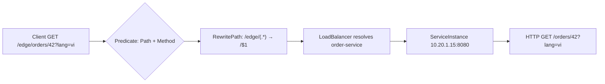
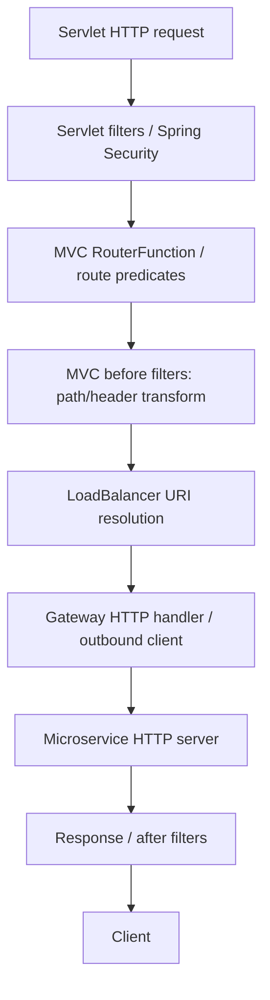

# LoadBalancer Filter and Coordination Order with Rewrite Filters

In **Spring Cloud Gateway Server Web MVC**, a request commonly undergoes three distinct operations: **route selection via predicates**, **request path transformation**, and **backend instance selection via Spring Cloud LoadBalancer**. If coordinated in the wrong order, the Gateway may pick `order-service` properly yet send `/edge/orders/42` instead of `/orders/42`, causing the backend to return `404` even when discovery, networking, and health checks are all healthy.

This lesson belongs to the **Server Web MVC** chapter and focuses on the **LoadBalancer filter**, `lb://...` URIs, `RewritePath`/`StripPrefix`/`SetPath` filters, and their ordering interactions. These concepts sit within Spring Cloud Gateway acting as an API Gateway for microservices: route predicates, filter chains, path/header modifications, service discovery, authentication, rate limiting, circuit breakers, retries, TLS, and request observability.

> **Scope:** Examples target **Spring Cloud Gateway Server Web MVC**, running on the **Spring MVC/Servlet stack**. Gateway Server WebFlux uses different APIs and filter chains. Dependency/starter names, configuration prefixes, `lb()` APIs, and internal ordering rules can vary across Spring Cloud Gateway versions. Verify against the live route runtime and integration tests; never treat the textual order of a few YAML lines as absolute proof of runtime filter execution order.

## 1. Why Does Filter Order Determine the Final URL?

Suppose the frontend calls:

```http
GET /edge/orders/42?lang=vi HTTP/1.1
Host: api.example.test
Authorization: Bearer <test-access-token>
```

Backend `order-service` exposes only:

```http
GET /orders/42?lang=vi HTTP/1.1
```

The Gateway must:

1. Match the request with `Path=/edge/orders/**` and `Method=GET`.
2. Strip the `/edge` prefix so the path becomes `/orders/42`.
3. Use `lb://order-service` to resolve an instance, e.g., `10.20.1.15:8080`.
4. Build the outbound URL `http://10.20.1.15:8080/orders/42?lang=vi`.
5. Proxy the request, receive the response, and return it to the client.



If LoadBalancer or outbound URL construction runs **before the path rewrite takes effect**, the final request risks keeping `/edge/orders/42` and receiving `404` from upstream. This is the exact class of bug that must be caught by real HTTP tests, not just reading route declarations.

### Distinguishing Four Concepts

| Step | Question | Deciding data |
| --- | --- | --- |
| **Route matching** | "Which route accepts this request?" | Incoming Path/Method/Host/Header/Query |
| **Path rewriting** | "Which path should upstream receive?" | `RewritePath`, `StripPrefix`, `SetPath`, `PrefixPath` |
| **Load balancing** | "Which service instance handles the request?" | `lb://service-id`, `ServiceInstance` list, selection strategy |
| **HTTP routing** | "Which full URL is called?" | Instance scheme, host/port, rewritten path, query/headers |

**LoadBalancer does not perform path rewriting**, and `RewritePath` does not discover server instances. The two mechanisms address completely separate layers.

## 2. Server Web MVC Architecture in Gateway

Server Web MVC builds on Spring MVC functional endpoint abstractions—typically `RouterFunction`/`ServerRequest`, **before filters**, and Gateway's HTTP handler. This differs from Gateway WebFlux, which uses reactive `ServerWebExchange`, `GatewayFilter`, `GlobalFilter`, and Netty mechanics.



The diagram shows the **intended logical order**. Exact class names and special-order behavior vary by Gateway release. Some before filters come from route properties or Java DSL, and the LoadBalancer filter may be inserted automatically when a URI uses the `lb` scheme.

| Aspect | Server Web MVC | Server WebFlux |
| --- | --- | --- |
| Stack | Servlet, Spring MVC | Reactive WebFlux |
| Common route API | `RouterFunction`/Gateway MVC DSL | `RouteLocatorBuilder`/reactive DSL |
| Request context | MVC `ServerRequest`/Servlet request | `ServerWebExchange` |
| Security | `SecurityFilterChain` + `HttpSecurity` | `SecurityWebFilterChain` + `ServerHttpSecurity` |
| Path transforms | MVC before-filter functions/factories | WebFlux `GatewayFilter` factories |
| LoadBalancer integration | MVC routing/LoadBalancer filter | Reactive LoadBalancer filter |
| Typical tests | Servlet integration, `MockMvc`, or real HTTP client | `WebTestClient`/reactive tests |

**Do not copy `ReactiveLoadBalancerClientFilter` or `SecurityWebFilterChain` into a Server MVC app.** Even when goals align, execution contexts and API types differ.

## 3. What Does the LoadBalancer Filter Handle?

`lb://order-service` is a **logical URI**. `order-service` is a service ID, not a concrete IP or hostname.

Suppose `DiscoveryClient` provides:

```text
order-service:
  - http://10.20.1.15:8080
  - http://10.20.1.16:8080
  - http://10.20.1.17:8080
```

When a request proceeds upstream, LoadBalancer selects a `ServiceInstance` and combines instance attributes with the request URI:

```text
Logical URI:
  lb://order-service

Rewritten request path:
  /orders/42

Query:
  lang=vi

Selected instance:
  10.20.1.16:8080

Effective target:
  http://10.20.1.16:8080/orders/42?lang=vi
```

**Selecting an instance does not guarantee the backend returns 200**: method, path, headers, authentication, permissions, TLS, and business logic can still fail.

### What LoadBalancer Does Not Replace

- Does not establish user permissions or decide whether a user can view an order.
- Does not strip `/edge` from paths automatically.
- Does not guarantee a retry attempt picks a different instance.
- Does not synchronize HTTP sessions or business state across instances.
- Does not immediately purge backends removed from discovery if still in connection pools/caches.
- Does not fix invalid SSL certificates, SNI, or truststores.
- Does not automatically drive CircuitBreaker to isolate failing instances.

Keeping these boundaries clear prevents misdiagnosing a rewrite `404` as a load-balancing bug.

## 4. Load-Balanced Targets with `lb://`

A declarative MVC route can use `lb://order-service` paired with path rewriting.

```yaml
spring:
  cloud:
    gateway:
      mvc:
        routes:
          - id: mvc-orders
            uri: lb://order-service
            order: 10
            predicates:
              - Path=/edge/orders/**
              - Method=GET
            filters:
              - RewritePath=/edge/(.*), /$1
```

This configuration shows the **`spring.cloud.gateway.mvc.routes` prefix used in some Server MVC lines**. In newer lines, the prefix moves to `spring.cloud.gateway.server.webmvc.routes`. Check the starter/configuration metadata of your pinned version rather than writing both simultaneously and assuming equivalence.

Expected semantics:

- Route ID is `mvc-orders`.
- Incoming `GET /edge/orders/42` matches the predicates.
- Path is rewritten to `/orders/42`.
- Logical URI `lb://order-service` resolves to an instance.
- HTTP request is proxied to the chosen instance with the new path.

**Required dependencies:** Gateway Server MVC and Spring Cloud LoadBalancer, plus an instance source such as a discovery server or configured instance supplier. An `lb://` route cannot invent instances when the service ID does not exist.

### Do Not Use Physical Hosts Instead of Service IDs Without Reason

`uri: http://localhost:8081` calls one fixed address directly; it suits isolated rewrite tests. `uri: lb://order-service` uses a registry/instance supplier and suits discovery. Both can share the same path rewrite while resolving outbound host/port differently.

## 5. Explicit `lb()` LoadBalancer Filter and Ordering

Depending on the version, Gateway Server MVC can expose `lb()` in its before-filter API/factory alongside `lb`-scheme URI resolution.

Logical sequence to achieve:

```text
Route: GET /edge/orders/**

Before filters in effective order:
  1. rewritePath("/edge/(.*)", "/$1")
  2. lb("order-service")

Handler:
  proxy to selected instance with path /orders/**
```

This is **pseudocode**, not a Java snippet guaranteed to compile across every release. When using `lb()`, place the rewrite **before outbound URL selection/construction**; exact ordering and automatic LoadBalancer filter insertion are crucial behaviors to verify per version.

### Should You Declare Both `lb://` and `lb()`?

Normally, pick one clear **source for the target service**. Never mix arbitrarily:

```text
Route URI: lb://order-service
Another filter: lb("inventory-service")
```

because two conflicting sources specify the destination. If your framework version requires combining a specific URI/filter pattern, follow that version's contract; never let custom code silently override the target service.

### "Placed After" Means Execution Phase, Not Just Line Order

Filters can be:

- Invoked across `before`/`after`/handler phases.
- Inserted automatically due to the `lb` scheme.
- Assigned special `order` or precedence values.
- Applied via default filters or custom routing extensions.

Therefore, YAML line order or `.before(...)` placement alone **is not enough** to prove the outbound URL was rewritten. Run integration tests observing the path received upstream.

## 6. Rewrite Before LoadBalancer Resolution: The Key Rule

Expected sequence of outcomes:

```text
T0 incoming:
  /edge/orders/42?lang=vi

T1 route matched:
  id=mvc-orders
  Path=/edge/orders/**
  Method=GET

T2 rewrite:
  /orders/42?lang=vi

T3 load balance:
  serviceId=order-service
  instance=10.20.1.15:8080

T4 outbound:
  GET http://10.20.1.15:8080/orders/42?lang=vi
```

An ordering bug can cause the target URI to be built from the old path:

```text
Target built early:
  http://10.20.1.15:8080/edge/orders/42?lang=vi

Rewrite runs late:
  path on a request object changed,
  but target URL already captured the old path

Backend receives /edge/orders/42 -> 404
```

This is a **failure mode example** to test against, not a claim that every Gateway version breaks when two lines are swapped. Verify with live HTTP requests to the backend on your active version.

### Why Not "Force LB Earlier for Speed"?

LoadBalancer must incorporate the final URL. Resolving a service slightly earlier offers negligible benefit compared to the risk of routing with the wrong path/URI. The goal is not instance-selection speed, but **right route, right target path, and right instance**.

### Diagnostic Rule

If the backend returns `404`, ask:

- Did it **receive the request**?
- Which **path** did it receive?
- Which **instance** received it?
- Which route matched?
- Did rewriting take effect before or after the outbound URL was constructed?

If the backend received no request and Gateway returned `503`, investigate discovery, circuit breakers, or connectivity before blaming path regexes.

## 7. Comparing Path Transformation Filters

| Filter | Meaning | Example |
| --- | --- | --- |
| `StripPrefix` | Drops the first N path segments | `/edge/orders/42` → `/orders/42` when N=1 |
| `RewritePath` | Rewrites path with regex | `/edge/(.*)` → `/$1` |
| `SetPath` | Sets path via template/value | Used when an explicit new path is needed |
| `PrefixPath` | Prepends a prefix to path | `/orders/42` → `/v1/orders/42` |
| `RewriteLocationResponseHeader` | Rewrites the **response** `Location` header | Does not alter request path before LB |

These filters are not interchangeable. **`RewriteLocationResponseHeader` does not replace `RewritePath`**; one alters response redirects while the other alters the request target.

### A. `StripPrefix` for Simple Prefixes

```yaml
filters:
  - StripPrefix=1
```

On paths:

```text
/edge/orders/42   -> /orders/42
/api/v2/orders/42 -> /v2/orders/42
```

`StripPrefix=1` drops **one segment**, not one character. If upstream expects `/orders/**` yet you configure `StripPrefix=2` on `/edge/orders/**`, the backend receives `/42`—a very common mistake.

### B. `RewritePath` for Regex Rules

```yaml
filters:
  - RewritePath=/edge/(.*), /$1
```

Regex capture group `(.*)` captures everything after `/edge/`, and `$1` inserts the first group in the replacement.

A stricter pattern:

```text
Regex:       ^/edge/(.*)$
Replacement: /$1

/edge/orders/42 -> /orders/42
/api/orders/42  -> does not match regex
```

Some named-capture-group syntaxes require escaping property-placeholder expressions in YAML. Using `$1` avoids named-placeholder syntax pitfalls; still test against the parser of your **exact Gateway MVC version**.

### C. Avoid Accidental Double Rewrites

```yaml
filters:
  - StripPrefix=1
  - RewritePath=/edge/(.*), /$1
```

After `StripPrefix=1`, the path is already `/orders/42`, so `/edge/(.*)` no longer matches. Reversing the order might cause the second filter to strip `/orders` too. Combine multiple transforms only under an explicit contract and test each step.

## 8. Do Route Predicates Evaluate the Original or Rewritten Path?

Suppose:

```yaml
predicates:
  - Path=/edge/orders/**
  - Method=GET
filters:
  - RewritePath=/edge/(.*), /$1
```

Route matching normally evaluates the **incoming path**:

```text
GET /edge/orders/42  -> matches
GET /orders/42       -> does not match this route
POST /edge/orders/42 -> does not match Method=GET
```

Only after matching do filters alter the path for upstream. If you change the predicate to `Path=/orders/**` thinking predicates inspect the post-rewrite path, the Gateway may **never run the rewrite** for public requests.

### `Host` Predicates Also Evaluate Incoming `Host`

`Host=api.example.test` checks the client's `Host` during route matching. Once LB selects `10.20.1.15`, the outbound `Host` may become the backend hostname or be adjusted per `PreserveHostHeader`/proxy policy. **Changing outbound `Host` does not re-run route matching.**

Never treat client-supplied `Host`/headers as proof of tenant authorization. Separate authentication and authorization are mandatory.

## 9. Java `RouterFunction` MVC: An Easy-to-Picture Skeleton

An MVC app can declare Gateway `RouterFunction` beans:

```java
@Configuration
public class OrdersMvcGatewayRoutes {

    @Bean
    RouterFunction<ServerResponse> ordersRoute() {
        return route("mvc-orders")
            .GET("/edge/orders/**", http())
            .before(rewritePath("/edge/(.*)", "/$1"))
            .before(uri("lb://order-service"))
            .build();
    }
}
```

This snippet expresses **ordering intent** using familiar Gateway `RouterFunctions`/`BeforeFilterFunctions` APIs: match the GET route, rewrite the request path, then route to the logical service.

**To compile:** add version-appropriate static imports/overloads from Gateway Server MVC, Spring MVC's `RouterFunction`/`ServerResponse`, and Spring context. In some versions, `uri` or `lb()` is expressed with a slightly different API; do not assume this skeleton compiles unchanged across every starter.

When using an explicit `lb()` filter, the intended chain looks like:

```java
// PSEUDOCODE for ordering; check the lb() API in your Gateway MVC version.
.before(rewritePath("/edge/(.*)", "/$1"))
.before(lb("order-service"))
```

Never mix a Gateway WebFlux Java snippet into MVC:

```java
// This is Gateway WebFlux builder style, not the MVC DSL.
builder.routes()
    .route("orders", r -> r.path("/edge/orders/**")
        .filters(f -> f.rewritePath("/edge/(.*)", "/$1"))
        .uri("lb://order-service"))
    .build();
```

Both styles perform rewriting, yet their lifecycles, request abstractions, and ordering differ.

## 10. What Pieces Make Up the Final Outbound URL?

At the outbound proxy step, Gateway combines:

```text
Request method   = GET
Target scheme    = http (or https per instance/policy)
Target authority = 10.20.1.15:8080
Transformed path = /orders/42
Query            = lang=vi

Effective URL:
  http://10.20.1.15:8080/orders/42?lang=vi
```

Many things can go wrong:

| Piece | Example failure | Symptom |
| --- | --- | --- |
| Method | POST instead of GET | `405` or wrong logic |
| Scheme | HTTP to an HTTPS-only backend | Connection/TLS failure |
| Host/port | Stale `ServiceInstance` | Connect refused/timeout |
| Rewritten path | `/edge/orders/42` | Upstream `404` |
| Query | Dropped `?include=items` | Wrong returned data |
| Encoding | Unintended `%2F` decoding | Wrong resource / path traversal |
| Headers | Stripped `Authorization` or wrong `Host` | `401/403`, virtual-host mismatch |
| Route order | Catch-all route wins | Wrong service called |

### Queries Must Be Preserved When Rewriting Paths Only

If the frontend sends:

```text
/edge/orders/42?include=items&lang=vi
```

the backend should normally receive:

```text
/orders/42?include=items&lang=vi
```

When writing custom filters or URI builders, distinguish raw paths/decoded paths, query strings, and percent-encoding. Never concatenate URIs with unchecked strings that drop `?` or double up `/`.

### Regex Must Never Turn Paths into Authorities

Never let clients supply a new host or scheme via query/headers that a rewrite filter turns into an arbitrary target URL. Enforce an allowlist of service IDs/hosts and anti-SSRF policies. `RewritePath` should alter only the path per the routing contract.

## 11. `ServiceInstance`, HTTPS, and `Host`

An instance may carry metadata:

```text
serviceId = order-service
host      = orders.internal.example
port      = 8443
secure    = true
```

Outbound URIs must align with TLS metadata, e.g.:

```text
https://orders.internal.example:8443/orders/42
```

**`lb://` is not a guarantee that all internal hops use HTTPS.** The outbound scheme depends on `ServiceInstance` and Gateway integration/version/policy. Verify explicitly whenever backends enforce mTLS or HTTPS-only.

| Failure | Root-cause layer | Do not "fix" by |
| --- | --- | --- |
| Certificate SAN mismatches host | TLS hostname verification | Disabling hostname checks |
| Truststore missing CA | TLS client trust | Changing `RewritePath` |
| Wrong SNI when connecting by IP | TLS host/SNI resolution | Increasing retries |
| Instance HTTP/HTTPS mismatch | Service metadata/scheme | Changing Path predicate |
| Backend returns 404 | Request target/path | Changing LoadBalancer algorithm |
| No instances available | Discovery/LoadBalancer | Tuning `StripPrefix` |

**LoadBalancer picking a valid host does not prove TLS succeeded**, and TLS succeeding does not prove the backend exposes the expected path.

## 12. Discovery Caches and Route Caches Have Independent Lifecycles

`order-service` might scale from two to four instances:

```text
T0: [A, B]
T1: backend scales out -> [A, B, C, D]
T2: LoadBalancer discovery/cache converges
```

The route definition `lb://order-service` does not necessarily change. Conversely, updating `RewritePath` and refreshing routes **does not automatically refresh** instance/DNS caches.

Several distinct layers exist:

- **Route definition/runtime cache**: active routes and filters.
- **Discovery/LoadBalancer instance cache**: list of backend endpoints.
- **DNS resolver**: hostname → IP.
- **HTTP client connection pool**: reusable TCP/TLS sockets.
- **Response cache**: cached response payloads.

Do not blame `RewritePath` when an instance just scaled in and an old request hits a retired IP; check the selected instance and discovery freshness.

### Retries Do Not Guarantee a Different Instance

The second attempt might pick A, B, or A again depending on LoadBalancer/Retry integration. A request retried after `503` must **preserve the exact rewritten path** per contract; if attempts carry different paths, look for state-mutation or filter re-execution bugs.

## 13. CircuitBreaker, Retry, and Filter Order

These filters can interact:

```text
Client request
  -> MVC route match
  -> RewritePath
  -> LoadBalancer / outbound attempt
  -> backend status/exception
  -> Retry or CircuitBreaker policy
  -> response/fallback
```

This diagram is a **functional model**, not a statement of the exact wrapper/filter order in any single release.

### Retry

- `retries: 2` usually means up to two retries after the first attempt (for eligible requests).
- For transient GET errors, retries can help, yet they never fix a wrong path.
- For state-changing POST/PATCH calls, require idempotency keys and replayable bodies.
- If Retry wraps LB at a different point, attempts may re-select instances or reuse state; test thoroughly.
- Bound backoff and total deadlines to prevent retry storms.

### CircuitBreaker

- An OPEN breaker can reject calls before an HTTP request ever leaves for the backend.
- Fallbacks may return HTTP `503` or a custom response.
- One breaker for an entire route can impact healthy instances too.
- A `404` from a bad rewrite is not necessarily counted as a failure by breaker policies.
- Never use a breaker to "hide" static mapping errors; fix the path/route instead.

### RateLimiter

A request rejected with `429` by a rate limiter may never reach LoadBalancer. Never treat a Gateway `429` as a backend failure or trigger immediate retries. Key rate limits on verified identity rather than client-sent `X-User-Id` headers.

## 14. Spring Security on Server MVC: Inspecting the Incoming Path

On the Servlet stack, Security can be configured as:

```java
@Configuration
public class GatewaySecurityConfiguration {

    @Bean
    SecurityFilterChain security(HttpSecurity http) throws Exception {
        http
            .authorizeHttpRequests(auth -> auth
                .requestMatchers(HttpMethod.GET, "/edge/orders/**")
                    .hasAuthority("SCOPE_orders.read")
                .anyRequest().authenticated())
            .oauth2ResourceServer(oauth2 ->
                oauth2.jwt(Customizer.withDefaults()));
        return http.build();
    }
}
```

This is an **MVC example**; add imports, dependencies, JWT issuer/audience/scope validation, and granular rules for remaining routes. `anyRequest().authenticated()` is not a complete production authorization policy for every API.

**Note:** Security filters typically inspect the **incoming path** `/edge/orders/**`. If you only protect `/orders/**` thinking of the post-rewrite path, you can expose the public route unintentionally. Backends still need authentication/authorization by resource and audience rather than relying solely on the Gateway.

### Tokens and `Host`

- `Authorization` may be stripped/replaced by filters depending on config; test what the backend actually receives.
- If `lb://order-service` is changed to a different service, never assume tokens carry a valid audience for the new service.
- `PreserveHostHeader` or forwarded host settings affect outbound `Host`, never turning `Host` into proof of authorization.
- Trust `Forwarded`/`X-Forwarded-*` only from trusted ingress/proxies, never client-supplied values.

## 15. Lab Setup: First Test Rewrites Against a Fixed Address

To isolate path bugs, temporarily use a fixed WireMock/HTTP test server at `http://localhost:8081`:

```yaml
spring:
  cloud:
    gateway:
      mvc:
        routes:
          - id: orders-fixed-test
            uri: http://localhost:8081
            predicates:
              - Path=/edge/orders/**
              - Method=GET
            filters:
              - RewritePath=/edge/(.*), /$1
```

When sending:

```bash
curl -i "http://localhost:8080/edge/orders/42?lang=vi"
```

The mock upstream must receive:

```text
GET /orders/42?lang=vi
```

This test answers "is the rewrite right?" free from instance-selection noise.

### Then Enable LoadBalancer

Switch the logical target URI:

```yaml
uri: lb://order-service
```

And supply at least one test `ServiceInstance` pointing to WireMock. Re-test the **exact same path**:

- Route matched.
- Chosen instance has the right host/port.
- Backend receives `/orders/42?lang=vi`.
- Path was not rewritten twice.
- No unexpected requests hit another service.

**Never check only client HTTP 200.** A 200 could come from a fallback, cache, or another route; verify the upstream request journal.

## 16. MVC Integration Test with a Real HTTP Upstream

A test snippet using `RestClient` and WireMock:

```java
@Test
void rewriteBeforeLoadBalancerUsesCorrectBackendPath() {
    // Fixture:
    // Gateway MVC runs on localhost:8080.
    // LoadBalancer test instance for order-service points to WireMock.
    // If Security is enabled, the request carries valid test credentials.

    wireMockServer.stubFor(
        get(urlPathEqualTo("/orders/42"))
            .willReturn(aResponse()
                .withStatus(200)
                .withHeader("Content-Type", "application/json")
                .withBody("{\"id\":\"42\"}")));

    RestClient client = RestClient.create();

    String body = client.get()
        .uri("http://localhost:8080/edge/orders/42?lang=vi")
        .retrieve()
        .body(String.class);

    assertThat(body).contains("\"id\":\"42\"");

    wireMockServer.verify(1,
        getRequestedFor(urlPathEqualTo("/orders/42"))
            .withQueryParam("lang", equalTo("vi")));
}
```

This snippet is **illustrative**: it needs JUnit, AssertJ, WireMock, a compatible `RestClient` version, a live HTTP server, and LoadBalancer/Security test fixtures. `MockMvc` can verify routes/predicates at the Servlet layer, but to prove outbound HTTP uses the right host and path, **integration tests over real HTTP with an upstream stub** are far clearer.

### Negative Tests You Cannot Skip

- Unmatched path.
- HTTP method disallowed by the route.
- `StripPrefix=2` causing the backend to receive the wrong path.
- Backend returning 404 even when the Gateway route matched.
- No service instance (Gateway fails before upstream).
- Invalid TLS certificate.
- Retry after 503 keeping the exact same rewritten path across all attempts.
- Gateway replicas with drifted config.

## 17. Test Matrix for Filter Order and Instance Selection

| Test | Input / condition | Expectation |
| --- | --- | --- |
| T1 | GET `/edge/orders/42` | Upstream receives `/orders/42` |
| T2 | GET `/edge/orders/42?lang=vi` | Query preserved per contract |
| T3 | GET `/orders/42` | Does not match the edge route |
| T4 | POST `/edge/orders/42` | Does not match GET-only route |
| T5 | `StripPrefix=1` | Strips one segment cleanly |
| T6 | `StripPrefix=2` | Test catches wrong `/42` path |
| T7 | `RewritePath` regex fails to match | Does not assume path changed |
| T8 | Duplicate Rewrite + StripPrefix | Test catches double rewrite |
| T9 | LoadBalancer with 1 instance | Right host/port/path |
| T10 | LoadBalancer with 2 instances | Path is right regardless of selected instance |
| T11 | No instances | Discovery failure distinguished from upstream 404 |
| T12 | HTTPS instance | TLS scheme/SNI/SAN/trust valid |
| T13 | Bad backend TLS certificate | Rejected; never disable verification |
| T14 | Overlapping route orders | Intended route takes precedence |
| T15 | `Host` predicate mismatch | Backend not called |
| T16 | Servlet Security 401 | Upstream receives 0 requests |
| T17 | User lacks `orders.read` | 403 per policy |
| T18 | One 503 retry | All attempts keep the right rewritten path |
| T19 | CircuitBreaker OPEN | No new upstream call when short-circuited |
| T20 | RateLimiter 429 | Not treated as upstream failure |
| T21 | Route with custom URI-modifying filter | Does not accidentally overwrite LB target |
| T22 | Two Gateway replicas | Identical route/filter behavior |
| T23 | Path with percent-encoding | No unsafe decoding or path traversal |
| T24 | Route URI contains a path prefix | Prefix not duplicated |
| T25 | Backend 307/308 response | `Location` matches public contract |
| T26 | Gateway MVC version upgrade | Config namespace and order still valid |
| T27 | Client sends `X-Forwarded-Host` | Does not cross trust boundary |
| T28 | Route matches yet body is fallback | Client 200 never mistaken for upstream success |

A strong test suite checks both **positive cases** and **failure cases**. In particular, assert **method, path, query, and upstream request count** to prove proxy correctness; final client status alone is never enough.

## 18. What to Observe in Production?

| Signal | Example | Meaning |
| --- | --- | --- |
| Gateway replica | `gateway-a` | Identifies serving process |
| Route ID | `mvc-orders` | Shows which route matched |
| Incoming method/path | `GET /edge/orders/42` | Predicate input |
| Effective rewritten path | `/orders/42` | Verifies path transform |
| Logical URI | `lb://order-service` | Target service ID |
| Selected instance | `10.20.1.15:8080` | LB choice |
| Outbound HTTP URI | `http://10.20.1.15:8080/orders/42` | Proof of rewrite + LB |
| Backend status | `200`/`404`/`503` | Upstream outcome |
| Gateway status | `200`/`404`/`503` | Final outcome seen by client |
| Retry attempts | `1`, `2`... | Distinguishes multiple calls |
| Breaker state | CLOSED/OPEN/HALF_OPEN | Shows whether calls were blocked before LB |
| Discovery age/health | Instance count / convergence lag | Spots stale instances |

Not all fields above are emitted automatically by Spring Cloud Gateway MVC under a single metric. Micrometer/Actuator, tracing, LoadBalancer logging, and test instrumentation offer complementary views. **Never put raw tokens, cookies, PII, or sensitive queries into labels.**

### When Only One Gateway Replica Fails

If `gateway-a` proxies cleanly while `gateway-b` always returns 404, compare:

- Starter and Spring Cloud Gateway versions.
- Route ID, predicates, `order`, and effective path transforms.
- Default filters and custom before-filters.
- Destination URIs.
- Deployment revisions and dynamic route refreshes.
- Discovery/LoadBalancer instance sources.
- Selected backend versions: one instance might not support a new path yet.

Never restart the entire backend fleet before gathering evidence.

## 19. Runbook When LoadBalancer Picks the Right Service Yet Requests Still Fail

1. **Identify the route stack:** Is it running Server Web MVC or WebFlux? Are starter and config prefix right?
2. **Inspect the incoming request:** What method, `Host`, path, and query arrived?
3. **Check route matching:** Do Path/Method/Host predicates match the **original** path?
4. **Check Security:** Did 401/403 happen before the route?
5. **Check path filters:** Are `RewritePath`/`StripPrefix`/`SetPath` duplicated or stripping the wrong segment count?
6. **Check effective order:** Did rewriting take effect before LB/outbound URL construction?
7. **Check the logical URI:** Does `lb://order-service` have the exact service ID? Are there conflicting `lb()` configs?
8. **Check the selected `ServiceInstance`:** Are host, port, scheme, and `secure` metadata accurate?
9. **Check backend access logs:** What method/path/query did upstream actually receive?
10. **If backend received nothing:** Investigate no-instance, circuit breaker, timeouts, TLS/connect, and rate limiting.
11. **If backend returned 404:** Investigate path, backend version, route order, and not-found business contract.
12. **If Retry triggered:** Count attempts and check path/instance per attempt; avoid retrying non-idempotent POSTs.
13. **If only one replica fails:** Compare route configs, refreshes, versions, and filters.
14. **After fixing:** Run fixed-URI tests then `lb://` tests, confirming exact outbound URLs and responses.

### Quick Diagnostic Table

| Symptom | Most likely cause | How to verify |
| --- | --- | --- |
| Backend sees `/edge/orders/42` | Rewrite didn't run or ran too late | Upstream request journal |
| Backend sees `/42` | `StripPrefix` too large / double rewrite | Compare transform chain |
| Backend gets nothing, Gateway returns 503 | No-instance, breaker/transport | LB metrics, traces |
| Backend gets right path yet returns 404 | Backend version/missing resource | API contract, backend logs |
| 401/403 before proxying | Servlet Security | Authn/authz logs |
| HTTPS handshake failure | Scheme/SNI/trust/cert | TLS client diagnostics |
| Only instance C fails | Backend rollout path mismatch | Correlate selected instance |
| Only `gateway-b` fails | Filter order / config drift | Per-replica route/runtime |
| Multiple retries still return 404 | Permanent path config bug | Do not raise retries |
| Redirect has wrong `Location` | Response `Location` rewrite needed | Do not use request rewrite for responses |
| Query string dropped | Custom URI builder bug | Compare raw path/query |

## 20. Applied Exercise: Deploying Two Orders Versions

An MVC Gateway sits in front of two services:

- `GET /edge/orders/**` → `order-service` expecting `/orders/**`.
- `GET /edge/v2/orders/**` → `order-service-v2` expecting `/v2/orders/**`.
- `order-service` runs two HTTP instances.
- `order-service-v2` runs two HTTPS instances.
- Gateway validates Bearer JWTs; GET requires scope `orders.read`.
- A catch-all route `Path=/edge/**` also exists.

### Part A — Route v1

```yaml
- id: mvc-orders-v1
  uri: lb://order-service
  order: 20
  predicates:
    - Path=/edge/orders/**
    - Method=GET
  filters:
    - RewritePath=/edge/(.*), /$1
```

Confirm `/edge/orders/42` becomes `/orders/42`.

### Part B — Route v2

Design `mvc-orders-v2` so `/edge/v2/orders/42` becomes `/v2/orders/42` targeting `lb://order-service-v2`. Do not use `StripPrefix=2` if the backend still expects the `v2` segment.

### Part C — Route Order

If the catch-all `Path=/edge/**` route has `order=0` while v1/v2 have `order=20`, it can steal traffic. Write a test proving which route ID matches and fix `order` per contract.

### Part D — TLS/Security

Use `SecurityFilterChain` to protect **incoming** `/edge/**`. For the v2 backend, verify `ServiceInstance` secure metadata, TLS certificate SAN, SNI, and truststore. Never relay a token with `aud=orders-v1` blindly to v2 if v2 does not accept that audience.

### Part E — Verification

1. GET v1 picks a v1 instance with outbound path `/orders/42`.
2. GET v2 picks a v2 instance with outbound path `/v2/orders/42`.
3. POST does not match GET-only routes.
4. Requests missing tokens never reach backends.
5. No-instance on v2 is classified as an LB failure, not path rewriting.
6. Wrong backend paths fail per contract; increasing retries does not fix them.
7. GET retries keep the same rewritten path on every attempt.
8. Both Gateway replicas share identical route/filter policies.
9. Percent-encoded characters and queries are forwarded cleanly.

### Self-Check Questions

1. Which three different questions do route matching, path rewriting, and LoadBalancer answer?
2. Why must rewrites take effect before outbound URL construction?
3. Is `lb://order-service` a backend IP address?
4. What is the difference between a route URI using `lb` and an explicit `lb()` filter?
5. Why should you never declare two conflicting service IDs on the same route?
6. What does `StripPrefix=1` do to `/edge/orders/42`?
7. What wrong path can `StripPrefix=2` produce?
8. How does `RewritePath` differ from `RewriteLocationResponseHeader`?
9. Does the `Path` predicate inspect the incoming or post-rewrite path?
10. Why is inspecting YAML order alone insufficient to prove runtime `lb()` ordering?
11. Does MVC use `SecurityFilterChain` or `SecurityWebFilterChain`?
12. Does a `401` at the Gateway prove LoadBalancer failed?
13. If Gateway has an `lb://` route with zero instances, does the backend receive requests?
14. Why doesn't a backend 404 necessarily mean the route predicate didn't match?
15. Will retries guarantee picking a different instance and fixing a 404?
16. Does a route refresh automatically refresh discovery/DNS caches?
17. How should `?lang=vi` be handled when a rewrite only changes the path?
18. When using an HTTPS backend, what must you check besides the path?
19. Why is asserting only client HTTP 200 in tests insufficient?
20. Which signals distinguish path mismatch, LB no-instance, TLS failure, and route ordering?
21. Why can two Gateway replicas produce different outcomes even with the same service ID?
22. When should you fix response `Location` instead of request `RewritePath`?

**Takeaway:** **Route predicates** pick the route, **`RewritePath`/`StripPrefix`/`SetPath`** decide the path the backend must receive, and **LoadBalancer** picks the service instance. In Spring Cloud Gateway **Server Web MVC**, the critical requirement is ensuring **path rewriting takes effect before LoadBalancer/outbound URL resolution**, whether using an `lb://` route URI or the `lb()` filter. Verify **incoming path → rewritten path → service ID → selected instance → effective outbound URI** with integration tests rather than guessing from configuration or checking only the final HTTP status.
