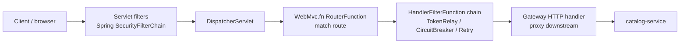
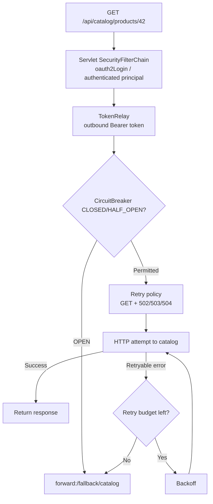
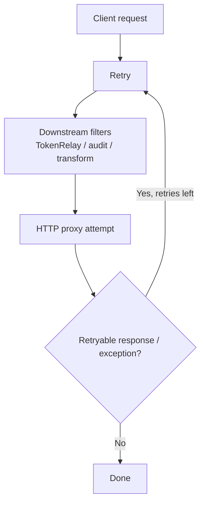
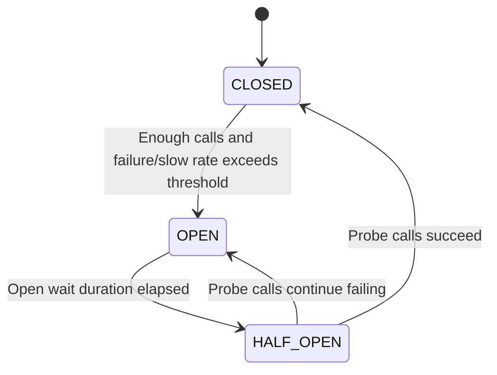
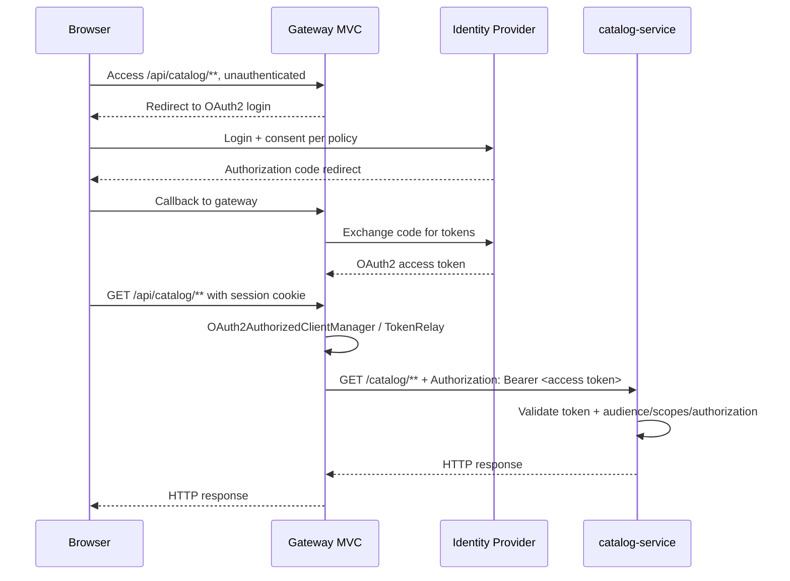
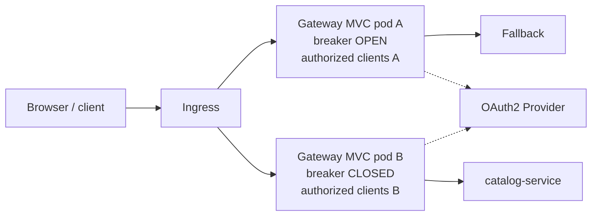

# Retry, CircuitBreaker, and TokenRelay on Web MVC

An **API Gateway** often handles three questions at the same time: if a backend fails transiently, should it **retry**; if a backend fails persistently, when should it **open the circuit**; and once a request is authenticated, how should it **relay the access token** properly. In **Spring Cloud Gateway Server Web MVC**, these three capabilities are provided by the **`Retry`**, **`CircuitBreaker`**, and **`TokenRelay`** filters.

For example, an employee logs into an admin app via OAuth2/OIDC and calls `GET /api/catalog/products/42`. The Gateway can retrieve the access token from the OAuth2 authorized client, attach it to the outbound request to `catalog-service`, conditionally retry a `503`, and return a clean `503` fallback if the service has not recovered. However, if those three filters are misordered or copied from **Gateway Server WebFlux** configurations, the system can retry a write operation multiple times, relay the wrong token, create a fallback loop, or confuse timeouts with circuit breakers.

This lesson belongs to the **Server Web MVC** chapter in the **SPRING_CLOUD_GATEWAY** module. Concepts such as route predicates, filter chains, path/header rewriting, service discovery, authentication, rate limiting, circuit breakers, retries, TLS, and request observability remain essential, yet **the execution API on Servlet/WebMvc.fn differs from WebFlux/Reactor Netty**.

**Lesson objectives:**

1. Understand the Gateway Server Web MVC pipeline and distinguish `HandlerFilterFunction` from reactive `GatewayFilter`.
2. Configure `Retry` for safe HTTP GETs; understand `retries`, `methods`, `statuses`/`series`, `exceptions`, `backoff`, and `cacheBody`.
3. Distinguish Spring Retry from Spring Framework 7 retry in Gateway MVC 5.1, including the switch to select the implementation.
4. Use `CircuitBreaker` with Resilience4j, `statusCodes`, `fallbackUri=forward:`, and `CLOSED`/`OPEN`/`HALF_OPEN` states.
5. Use `TokenRelay` with `oauth2Login()` or `clientRegistrationId`, understanding user vs. client tokens and trust boundaries.
6. Design filter ordering, deadlines, and retry budgets to avoid amplifying failures or leaking credentials.
7. Write YAML/Java DSL configurations, build a Servlet fallback controller, practice HTTP and OAuth2 testing, and monitor multiple Gateway replicas.

> **Version scope:** Primary examples target **Spring Cloud Gateway Server Web MVC 5.1.x** and Spring Framework 7, using namespace `spring.cloud.gateway.server.webmvc.routes`. In some 4.x branches, the legacy namespace is `spring.cloud.gateway.mvc.routes` and Retry internals differ; **verify your active release train before copying**. This lesson does not use `RouteLocatorBuilder`, `ServerWebExchange`, `Mono<Void>`, `GlobalFilter`, or Gateway WebFlux's `server.webflux.httpclient` properties.

## 1. Start with the Right Product: Server Web MVC, Not WebFlux

**Gateway Server Web MVC** runs on the **Spring MVC Servlet stack** and **Spring WebMvc.fn**. Typically, the application uses a Servlet container like Tomcat or Jetty, a `DispatcherServlet`, and `RouterFunction<ServerResponse>` beans for routing and proxying.



Comparison:

| Aspect | Gateway **Server Web MVC** | Gateway **Server WebFlux** |
| --- | --- | --- |
| Web stack | Servlet, Spring MVC, WebMvc.fn | Spring WebFlux, Reactor |
| HTTP handler | `HandlerFunctions.http()` | Routing/filtering via WebFlux Gateway |
| Route Java DSL | `RouterFunction<ServerResponse>`, `GatewayRouterFunctions.route(...)` | `RouteLocator`, `RouteLocatorBuilder` |
| Custom filters | `HandlerFilterFunction`, before/after functions | `GatewayFilter`, `GlobalFilter` |
| Security | `SecurityFilterChain`, `HttpSecurity` | `SecurityWebFilterChain`, `ServerHttpSecurity` |
| OAuth2 authorized client | Servlet OAuth2 client types | Reactive OAuth2 client types |
| Retry in Gateway 5.1 | Spring Retry or Spring Framework 7 retry | Reactor-based Gateway Retry |
| Circuit breaker integration | Servlet/filter function, Spring Cloud CircuitBreaker | Reactive filter, Reactor-based SCCB |
| Request body retry | `cacheBody` + `AdaptCachedBody` in MVC | Reactive request body cache/`DataBuffer` |
| HTTP client config | MVC Gateway's HTTP client settings | Reactor Netty `httpclient` properties |

**Consequence:** Do not paste `spring.cloud.gateway.server.webflux.routes` into MVC expecting routing to work. Nor should you swap a `HandlerFilterFunction` for a `GlobalFilter` just because both are called "Gateway filters."

### Starter and Release Train

MVC projects use the starter:

```xml
<dependency>
  <groupId>org.springframework.cloud</groupId>
  <artifactId>spring-cloud-starter-gateway-server-webmvc</artifactId>
</dependency>
```

Pick Spring Boot/Spring Cloud versions from a **compatible BOM/release train**, rather than pinning arbitrary individual starter versions. Do not blindly install both WebFlux and MVC Gateway starters: they are **two distinct proxy models** and can cause unexpected auto-configuration or property binding.

## 2. How Are WebMvc.fn Routes Built?

Spring Cloud Gateway MVC provides `GatewayRouterFunctions.route("routeId")`, storing the route ID in request metadata needed by advanced filters. HTTP targets can be declared via `BeforeFilterFunctions.uri(...)` and handled by `HandlerFunctions.http()`.

```java
import org.springframework.context.annotation.Bean;
import org.springframework.context.annotation.Configuration;
import org.springframework.web.servlet.function.RouterFunction;
import org.springframework.web.servlet.function.ServerResponse;

import static org.springframework.cloud.gateway.server.mvc.filter.BeforeFilterFunctions.uri;
import static org.springframework.cloud.gateway.server.mvc.handler.GatewayRouterFunctions.route;
import static org.springframework.cloud.gateway.server.mvc.handler.HandlerFunctions.http;

@Configuration(proxyBeanMethods = false)
class SimpleMvcGatewayRoutes {

    @Bean
    RouterFunction<ServerResponse> catalogRoute() {
        return route("catalog-read")
            .GET("/api/catalog/products/{id}", http())
            .before(uri("http://localhost:8081"))
            .build();
    }
}
```

When proxying, `HandlerFunctions.http()` reads the URI set by `uri()` from request attributes. MVC documentation recommends pairing `http()` with `before(uri(...))`; older `http(String)`/`http(URI)` overloads were deprecated in earlier releases.

**Separate two concerns:** Path predicates decide whether a public request matches the route; the URI sets the upstream destination. If the backend expects `/catalog/products/42` while clients call `/api/catalog/products/42`, add `StripPrefix` or an appropriate path-rewrite filter—`Retry`/`TokenRelay` themselves do not alter paths.

### Before, After, and Advanced Filters

- **Before filter functions** typically transform `ServerRequest` before proxying.
- **After filter functions** adjust `ServerResponse` once the handler returns.
- **Advanced filter functions** such as `Retry`, `CircuitBreaker`, and `TokenRelay` wrap the handler and act both before and after.

```text
Servlet security
  → WebMvc.fn route match
    → before/advanced filter chain
      → outbound HTTP handler
    ← response/exception
  ← Servlet response
```

Filters are composed via `RouterFunctions.Builder` and Gateway factories; always **verify actual ordering with integration tests**. Do not assume WebFlux `GlobalFilter`'s numeric `Ordered` rules apply identically to WebMvc.fn without verification.

## 3. Three Filters Solving Three Distinct Problems

| Filter | Decision | What it does NOT do |
| --- | --- | --- |
| **`Retry`** | Send another attempt after matching response status/exception? | Does not make POST safe; does not replace timeouts |
| **`CircuitBreaker`** | Allow new upstream calls when errors/slow calls exceed threshold? | Does not authenticate users; does not directly cap in-flight calls |
| **`TokenRelay`** | Which OAuth2 access token is attached to outbound requests? | Does not make tokens valid at the backend; does not retry |
| **SecurityFilterChain** | Who is authenticated and permitted on routes? | Does not replace backend authorization |
| **HTTP timeout** | How long does a single attempt wait? | Does not itself decide retry counts or breaker OPEN |
| **RateLimiter** | Has the client/tenant exceeded quota? | Does not fix upstream failures or refresh tokens |
| **Fallback** | What to return when proxy call fails? | Does not prove upstream rolled back side effects |

Conceptual flow for an authenticated GET:



This represents an **intended design**, not a guarantee that the framework always nests filters in the exact diagram order. Effective behavior depends on route configuration, actual filter order, response commit state, and version implementation.

## 4. `Retry` on Gateway Server Web MVC

`Retry` can re-attempt requests when HTTP responses or exceptions match policy. Gateway MVC 5.1 documentation lists:

| Parameter | Meaning |
| --- | --- |
| `retries` | Number of **additional** retries after the first attempt |
| `methods` | HTTP methods eligible for retry |
| `statuses` | Specific HTTP statuses, e.g., `SERVICE_UNAVAILABLE` |
| `series` | Status series, e.g., `SERVER_ERROR` |
| `exceptions` | Exception types that trigger retries |
| `cacheBody` | Whether to read/cache request body for replay |
| `backoff.firstBackoff` | Initial retry delay |
| `backoff.maxBackoff` | Maximum delay cap |
| `backoff.factor` | Backoff multiplier |

With `retries: 1`, there can be at most **2 outbound attempts**: the initial attempt plus one retry. With `retries: 3`, up to 4 attempts. Fewer attempts occur if an earlier attempt succeeds, policy doesn't match, the response is committed, the breaker is OPEN, or the client disconnects.

### Common Defaults in Gateway MVC 5.1

When a Retry filter is added without overrides:

- **`retries`:** 3.
- **`series`:** 5xx series.
- **`methods`:** GET.
- **`exceptions`:** `IOException`, `TimeoutException`, and `RetryException`.
- **`cacheBody`:** false.
- **`backoff`:** disabled.

These are **documented MVC defaults**, not recommendations to deploy unchanged to production. In particular, retrying 3 times on every 5xx can pile extra traffic onto an already overloaded backend.

### Lab Configuration for GET-Only Retry

```yaml
spring:
  cloud:
    gateway:
      server:
        webmvc:
          routes:
            - id: catalog-read
              uri: http://localhost:8081
              predicates:
                - Path=/api/catalog/**
                - Method=GET
              filters:
                - StripPrefix=1
                - name: Retry
                  args:
                    retries: 1
                    methods: GET
                    statuses: BAD_GATEWAY,SERVICE_UNAVAILABLE,GATEWAY_TIMEOUT
                    backoff:
                      firstBackoff: 100ms
                      maxBackoff: 300ms
                      factor: 2
```

**Notes:**

1. `retries: 1` allows up to 2 attempts on matching errors.
2. `methods: GET` prevents retrying `POST /api/catalog/**`.
3. `statuses` limits HTTP status codes; `exceptions` may still trigger retries per factory policy even when `statuses` doesn't match.
4. `backoff` paces concurrent retries; it does not cap the total end-to-end deadline.
5. `StripPrefix=1` strips `api` before proxying, so the backend receives `/catalog/**`.
6. Do not assume `500` will always be skipped or retried when `statuses` is set alongside default `series`; test effective configuration and explicitly clear unwanted series per your version.

**Do not retry HTTP 400/401/403/404 by default.** Those statuses generally indicate bad requests, missing authentication, forbidden access, or missing resources—not transient backend failures.

## 5. Spring Retry or Spring Framework 7 Retry?

In **Gateway Server Web MVC 5.1**, the Retry implementation depends on the classpath:

- When **Spring Retry** is on the classpath, the filter uses `GatewayRetryFilterFunctions` backed by Spring Retry by default.
- Without Spring Retry, the filter uses `FrameworkRetryFilterFunctions` backed by **Spring Framework 7**'s built-in Retry support.
- You can force Framework Retry even when Spring Retry is present via:

```yaml
spring:
  cloud:
    gateway:
      server:
        webmvc:
          use-framework-retry-filter: true
```

Spring Retry has moved to **maintenance-only**, and Gateway docs anticipate migrating exclusively to the Framework implementation in the future.

**Practical impact:**

- Both implementations share the same goal and configuration parameters documented for MVC.
- Do not assume **exception unwrapping, body replay, response handling, backoff, and metrics** behave identically between both engines.
- A transitive dependency pulling Spring Retry into your app can **change the active engine** without any YAML edits.
- Record the active version/engine at deployment time and re-run integration tests after upgrades.
- Do not use this property to "enable Retry"; it is an **engine selector**, while the retry policy itself belongs on the route filter.

### Comparison Table

| Scenario | Expected Retry engine on Gateway MVC 5.1 |
| --- | --- |
| No Spring Retry on classpath | Framework Retry (`FrameworkRetryFilterFunctions`) |
| Spring Retry present, no override | Spring Retry (`GatewayRetryFilterFunctions`) |
| Spring Retry present and `use-framework-retry-filter=true` | Framework Retry |
| Gateway MVC 4.x | **Check version-specific docs**, do not apply 5.1 rules blindly |
| Gateway WebFlux | This Servlet engine table **does not apply** |

## 6. Java DSL for Retry on Web MVC

One way to build the route with `RouterFunction<ServerResponse>`:

```java
import java.time.Duration;
import java.util.Set;

import org.springframework.context.annotation.Bean;
import org.springframework.context.annotation.Configuration;
import org.springframework.http.HttpMethod;
import org.springframework.http.HttpStatus;
import org.springframework.web.servlet.function.RouterFunction;
import org.springframework.web.servlet.function.ServerResponse;

import static org.springframework.cloud.gateway.server.mvc.filter.BeforeFilterFunctions.uri;
import static org.springframework.cloud.gateway.server.mvc.filter.RetryFilterFunctions.retry;
import static org.springframework.cloud.gateway.server.mvc.handler.GatewayRouterFunctions.route;
import static org.springframework.cloud.gateway.server.mvc.handler.HandlerFunctions.http;

@Configuration(proxyBeanMethods = false)
class RetryRoutes {

    @Bean
    RouterFunction<ServerResponse> retryCatalog() {
        return route("catalog-read")
            .GET("/api/catalog/products/{id}", http())
            .before(uri("http://localhost:8081"))
            .filter(retry(config -> config
                .setRetries(1)
                .setMethods(Set.of(HttpMethod.GET))
                .setSeries(Set.of(HttpStatus.Series.SERVER_ERROR))
                .setBackoff(
                    Duration.ofMillis(100),
                    Duration.ofMillis(300),
                    2)))
            .build();
    }
}
```

In this Java snippet, `SERVER_ERROR` covers the **entire 5xx series**, broader than the `502/503/504` list in Section 4's YAML. Choose only the error scope appropriate for your backend.

`RetryFilterFunctions.retry(...)` is the convenience API illustrated in MVC docs. Do not substitute `f.retry(...)` from WebFlux's `RouteLocatorBuilder`. If using `FrameworkRetryFilterFunctions` directly or needing specific behavior, check the exact package and signature for your version.

**Do not declare both Java and YAML routes with overlapping IDs/Paths** without explicit ordering intent; you risk testing the wrong filter chain.

## 7. Retrying Bodies in MVC: `cacheBody` and `AdaptCachedBody`

For `GET` requests without a body, resending is straightforward. However, `POST`/`PUT` requests can carry bodies whose underlying Servlet request stream cannot be re-read after the first attempt.

Gateway MVC documentation requires adding **`AdaptCachedBody`** when `cacheBody=true` is enabled so cached contents are forwarded downstream. **Lab-only** example:

```yaml
spring:
  cloud:
    gateway:
      server:
        webmvc:
          routes:
            - id: sample-write-retry-lab
              uri: http://localhost:8082
              predicates:
                - Path=/lab/echo
                - Method=POST
              filters:
                - name: Retry
                  args:
                    retries: 1
                    methods: POST
                    statuses: SERVICE_UNAVAILABLE
                    cacheBody: true
                    backoff:
                      firstBackoff: 100ms
                      maxBackoff: 300ms
                      factor: 2
                - name: AdaptCachedBody
```

Docs note the cached body is stored in request attribute **`MvcUtils.CACHED_REQUEST_BODY_ATT`** as a **`ByteArrayInputStream`**. This is **not** WebFlux's `Flux<DataBuffer>` or `ServerWebExchangeUtils.CACHED_REQUEST_BODY_ATTR`.

### Key Risks

- `cacheBody=true` forces the Gateway to **buffer the entire body in memory**.
- With large uploads/multiparts, concurrent requests can cause **memory pressure**.
- Being able to replay a body does not make backend business logic automatically idempotent.
- `Content-Length` and `Content-Type` must match actual bytes sent, especially when transforms are involved.
- Once part of a response is sent to the client, retries cannot arbitrarily "take bytes back."
- Streaming requests, file uploads, and financial writes need dedicated policies and should normally **disable Retry**.

**Risk example:** `POST /payments` times out after the backend already committed the payment. A second retry can create a duplicate transaction, even if routed to a different instance. You need an idempotency key checked **atomically in shared storage** at the backend, plus a lookup mechanism for uncertain outcomes.

## 8. `Retry` Re-Executes Filters Downstream of It

Gateway MVC docs emphasize: **Retry re-executes filters placed after it**. This affects both `TokenRelay` and custom filters.



If a filter sits **inside `Retry`**:

- It may execute multiple times for one logical request.
- If the filter writes audit records or business side effects, those writes get multiplied.
- If `TokenRelay` fetches/refreshes an authorized client, that overhead may repeat per attempt depending on chain placement.
- If a filter generates a random correlation ID each time, attempts lose trace continuity.
- If a filter relies on a consumed request body, replay must be wired properly.

**Design rule:** Separate work that must run **once per logical request** from work that should run **per outbound attempt**. Order filters intentionally, check version docs, and **count backend attempts** in tests rather than guessing from YAML lines.

## 9. `CircuitBreaker`: Opening the Circuit When Upstream Persistently Fails

`CircuitBreaker` uses Spring Cloud CircuitBreaker APIs; a common implementation is **Resilience4j**. The goal is to stop sending new requests into a failing/slow dependency rather than endlessly retrying.

Three states:

- **CLOSED:** forwards calls and records outcomes.
- **OPEN:** fails fast on new calls, typically routing to a fallback or `503` per error mapping.
- **HALF_OPEN:** after a wait duration, permits a limited number of probe calls to test recovery.



### Resilience4j Threshold Properties

| Property | Meaning |
| --- | --- |
| `slidingWindowType` | Count-based or time-based window |
| `slidingWindowSize` | Observation window size |
| `minimumNumberOfCalls` | Minimum calls needed before evaluating thresholds |
| `failureRateThreshold` | Failure percentage that trips the breaker |
| `slowCallDurationThreshold` | Duration above which a call counts as slow |
| `slowCallRateThreshold` | Slow-call percentage that trips the breaker |
| `waitDurationInOpenState` | Time spent in OPEN before probing |
| `permittedNumberOfCallsInHalfOpenState` | Number of permitted probe calls |

For example, with at least **10 calls** and a **50% failure threshold**, a single failed request **will not** open the breaker; once at least 10 calls are recorded in the window, 6 failures out of 10 can trip it to OPEN.

**`CircuitBreaker` does not directly cap concurrent in-flight requests.** While CLOSED, many requests can still execute in parallel. To protect backends from concurrency spikes, add separate bulkheads/concurrency limits, rate limiting, and connection pool bounds.

## 10. Configuring `CircuitBreaker` and HTTP `statusCodes`

A simple Gateway MVC route:

```yaml
spring:
  cloud:
    gateway:
      server:
        webmvc:
          routes:
            - id: catalog-breaker
              uri: http://localhost:8081
              predicates:
                - Path=/api/catalog/**
                - Method=GET
              filters:
                - StripPrefix=1
                - name: CircuitBreaker
                  args:
                    name: catalogBreaker
                    fallbackUri: forward:/fallback/catalog
                    statusCodes:
                      - 500
                      - BAD_GATEWAY
                      - SERVICE_UNAVAILABLE
                      - GATEWAY_TIMEOUT
```

### Why Must `statusCodes` Be Specified?

Two distinct failure categories exist:

1. **Exceptions:** connection refused, timeouts, HTTP client or filter exceptions.
2. **HTTP responses:** the backend explicitly returns `503 Service Unavailable` or `500 Internal Server Error`.

You should not treat every `5xx` HTTP response as a breaker exception automatically. Gateway MVC `CircuitBreaker` supports **`statusCodes`** so selected response statuses are recorded as failures per policy.

**Never add `400/401/403` to `statusCodes`**: these indicate validation, authentication, or authorization failures—not backend unavailability. Likewise, `404` typically means a missing resource and must not open the breaker simply because users requested invalid IDs.

### Resilience4j Docs and Starters: Note a Documentation Discrepancy

**Spring Cloud CircuitBreaker** documentation distinguishes:

```xml
<!-- For non-reactive applications, such as Servlet MVC -->
<dependency>
  <groupId>org.springframework.cloud</groupId>
  <artifactId>spring-cloud-starter-circuitbreaker-resilience4j</artifactId>
</dependency>
```

from `spring-cloud-starter-circuitbreaker-reactor-resilience4j` for **reactive** apps. However, at the time of writing, the **Gateway Server Web MVC CircuitBreaker Filter** page contained a snippet listing the **reactor** starter. That is a **discrepancy between the two official doc pages**; do not assume every version pair behaves identically.

For **Servlet MVC** projects, start from Spring Cloud CircuitBreaker's non-reactive guide, **verify `CircuitBreakerFactory` auto-configuration/beans, and run integration tests** on your exact Spring Cloud BOM. If the filter fails to initialize, inspect the dependency graph and versions rather than blindly adding both starters.

## 11. `fallbackUri` Using the `forward:` Scheme

Gateway Server Web MVC `CircuitBreaker` supports `fallbackUri`, using the documented **`forward:`** scheme. When a fallback triggers, Gateway forwards the request to a matching **Spring MVC controller/handler** or internal route.

```yaml
- name: CircuitBreaker
  args:
    name: catalogBreaker
    fallbackUri: forward:/fallback/catalog
```

A **Servlet MVC** fallback controller:

```java
import java.util.Map;

import org.springframework.http.CacheControl;
import org.springframework.http.HttpStatus;
import org.springframework.http.MediaType;
import org.springframework.http.ResponseEntity;
import org.springframework.web.bind.annotation.GetMapping;
import org.springframework.web.bind.annotation.RestController;

@RestController
class CatalogFallbackController {

    @GetMapping(
        path = "/fallback/catalog",
        produces = MediaType.APPLICATION_JSON_VALUE)
    ResponseEntity<Map<String, String>> catalogUnavailable() {
        return ResponseEntity
            .status(HttpStatus.SERVICE_UNAVAILABLE)
            .cacheControl(CacheControl.noStore())
            .body(Map.of(
                "code", "CATALOG_UNAVAILABLE",
                "message", "Service temporarily unavailable"));
    }
}
```

Lacking reliable substitute data, the controller returns `503` instead of a fake `200` success. If verified cached data is returned and allowed by the API contract, stale data may be served with clear metadata, provided cross-tenant leakage is prevented.

**MVC characteristics:** This fallback does not need `Mono<ResponseEntity<?>>`; use a standard Spring MVC `@RestController`. Gateway MVC docs note that the exception triggering fallback can be attached to request attribute `MvcUtils.CIRCUITBREAKER_EXECUTION_EXCEPTION_ATTR`, allowing handlers to record internal telemetry. **Never return raw exception messages, stack traces, or internal hostnames to clients.**

### Fallbacks Are Neither Retries Nor Authorization

- An OPEN breaker can invoke the fallback **immediately**, sending zero upstream requests.
- Fallbacks only substitute responses; they do not roll back database transactions.
- For `POST /payments`, never return "payment definitely failed" when the backend might have committed.
- Fallback routes/handlers must never accidentally forward back to the failing backend, creating a loop.
- If a fallback calls another service, that is a new dependency needing its own timeouts and security.
- Callers lacking permission (`403`) must never receive sensitive fallback data.
- Responses already committed cannot be replaced with a fresh fallback.

### Should `resumeWithoutError` Be Enabled?

Gateway MVC also offers `resumeWithoutError` for certain exception cases. Docs note that when enabled, unhandled exceptions can be swallowed into a successful response, whereas timeouts and OPEN breakers still yield their respective statuses. **Do not enable it by default for business APIs**; if fake success responses mask errors, availability metrics lie and clients may act unsafely. Prefer explicit fallbacks with accurate status codes and contracts.

## 12. Java DSL for `CircuitBreaker` on Web MVC

Using `CircuitBreakerFilterFunctions`:

```java
import java.net.URI;

import org.springframework.context.annotation.Bean;
import org.springframework.context.annotation.Configuration;
import org.springframework.web.servlet.function.RouterFunction;
import org.springframework.web.servlet.function.ServerResponse;

import static org.springframework.cloud.gateway.server.mvc.filter.BeforeFilterFunctions.uri;
import static org.springframework.cloud.gateway.server.mvc.filter.CircuitBreakerFilterFunctions.circuitBreaker;
import static org.springframework.cloud.gateway.server.mvc.handler.GatewayRouterFunctions.route;
import static org.springframework.cloud.gateway.server.mvc.handler.HandlerFunctions.http;

@Configuration(proxyBeanMethods = false)
class CircuitBreakerMvcRoutes {

    @Bean
    RouterFunction<ServerResponse> breakerRoute() {
        return route("catalog-breaker")
            .GET("/api/catalog/products/{id}", http())
            .before(uri("http://localhost:8081"))
            .filter(circuitBreaker(
                "catalogBreaker",
                URI.create("forward:/fallback/catalog")))
            .build();
    }
}
```

This follows the documented MVC API: `circuitBreaker(String, URI)`. It demonstrates fallback/exception handling without `statusCodes`; to count 5xx responses as failures, use YAML `statusCodes` as in Section 10 or the config overload supported in your version.

**Never use** WebFlux's `CircuitBreakerGatewayFilterFactory` or `RouteLocatorBuilder` as the basis for MVC routes.

## 13. Configuring Resilience4j for `catalogBreaker`

Illustrative configuration:

```yaml
resilience4j:
  circuitbreaker:
    instances:
      catalogBreaker:
        slidingWindowType: COUNT_BASED
        slidingWindowSize: 20
        minimumNumberOfCalls: 10
        failureRateThreshold: 50
        slowCallDurationThreshold: 2s
        slowCallRateThreshold: 60
        waitDurationInOpenState: 10s
        permittedNumberOfCallsInHalfOpenState: 3
```

Avoid overly twitchy settings: if each pod handles very low traffic, it may never reach `minimumNumberOfCalls`. Conversely, with `minimumNumberOfCalls=2`, two bad requests during startup can trip the breaker while the backend is actually healthy.

### `TimeLimiter` Is a Separate Limit Layer

Resilience4j provides `TimeLimiter` to bound execution duration depending on integration. Example:

```yaml
resilience4j:
  timelimiter:
    instances:
      catalogBreaker:
        timeoutDuration: 2500ms
```

**Condition:** This property affects requests only if the **Spring Cloud CircuitBreaker integration actually applies `TimeLimiter` to that execution**. Do not assume simply because YAML bound cleanly that Servlet requests are aborted at 2,500 ms; test timeouts against your exact starter/version.

Never copy `spring.cloud.gateway.server.webflux.httpclient.response-timeout` into MVC. **MVC has its own HTTP client/transport**; set timeouts on the actual MVC HTTP client, Servlet container, ingress, and SCCB/Resilience4j per your version's docs. What matters is the end-to-end **latency budget**, not similar-looking property names.

### Breaker State Across Multiple Replicas

Resilience4j `CircuitBreaker` typically keeps state **per JVM**. Three Gateway pods can share the breaker name `catalogBreaker` while one pod is OPEN and another is CLOSED because they observe different traffic and errors. Never use local circuit breakers in place of distributed rate limiters or global load shedding.

## 14. `TokenRelay` on Gateway Server Web MVC

`TokenRelay` attaches an **OAuth2 access token** to outbound service requests. When a user signs in via `oauth2Login()`, Gateway MVC retrieves the authorized client and forwards the token to the backend.



**Distinguish tokens clearly:**

- **Session cookie** (browser → Gateway) maintains login state on the Servlet app.
- **Access token** (Gateway → downstream) authenticates against resource servers.
- **OIDC ID token** primarily proves identity to the OAuth2 client; it **does not replace an access token**.
- **Refresh token**, if present, is a sensitive credential for renewing access tokens; **never forward it downstream** in normal API calls.

`TokenRelay` does not authenticate or authorize resources on behalf of the backend. The backend must still verify **issuer, signature/opaque introspection, expiration, audience, scopes/authorities, and resource ownership**.

## 15. `TokenRelay` Without `clientRegistrationId`

Once a user has signed in with `oauth2Login()`, Gateway MVC can use:

```yaml
spring:
  cloud:
    gateway:
      server:
        webmvc:
          routes:
            - id: catalog-oauth-user
              uri: http://localhost:8081
              predicates:
                - Path=/api/catalog/**
              filters:
                - StripPrefix=1
                - TokenRelay=
```

`TokenRelay=` is the shorthand without a registration ID, shown in MVC 5.1 docs. Its intent is to retrieve the **currently authenticated user's access token** from OAuth2 login / authorized client state.

Equivalent Java DSL:

```java
import org.springframework.context.annotation.Bean;
import org.springframework.context.annotation.Configuration;
import org.springframework.web.servlet.function.RouterFunction;
import org.springframework.web.servlet.function.ServerResponse;

import static org.springframework.cloud.gateway.server.mvc.filter.BeforeFilterFunctions.uri;
import static org.springframework.cloud.gateway.server.mvc.filter.TokenRelayFilterFunctions.tokenRelay;
import static org.springframework.cloud.gateway.server.mvc.handler.GatewayRouterFunctions.route;
import static org.springframework.cloud.gateway.server.mvc.handler.HandlerFunctions.http;

@Configuration(proxyBeanMethods = false)
class TokenRelayMvcRoutes {

    @Bean
    RouterFunction<ServerResponse> relayUserToken() {
        return route("catalog-user-token")
            .GET("/api/catalog/products/{id}", http())
            .before(uri("http://localhost:8081"))
            .filter(tokenRelay())
            .build();
    }
}
```

**Prerequisites:**

1. The app includes the OAuth2 Client starter and valid `spring.security.oauth2.client.*` config.
2. `OAuth2AuthorizedClientManager`/authorized clients are wired via Servlet integration.
3. The security filter chain authenticates users with `oauth2Login()`.
4. The authorized client holds a valid access token (refreshed if needed).
5. The downstream resource server **trusts that token's issuer, audience, and permissions**.

**Do not assume** an incoming `Authorization: Bearer incoming-jwt` authenticated via **resource-server JWT** will automatically be relayed unchanged by `TokenRelay=` when no user OAuth2 authorized client exists. Those are two different models; if Gateway acts purely as an OAuth2 Resource Server, verify the appropriate forwarding/token-exchange mechanism rather than treating both modes as identical.

## 16. `TokenRelay` With `clientRegistrationId`

If Gateway defines multiple OAuth2 client registrations, you can pick which client is used:

```yaml
spring:
  cloud:
    gateway:
      server:
        webmvc:
          routes:
            - id: catalog-with-registration
              uri: http://localhost:8081
              predicates:
                - Path=/api/catalog/**
              filters:
                - StripPrefix=1
                - TokenRelay=backend-api-client
```

Java DSL:

```java
return route("catalog-registration-token")
    .GET("/api/catalog/products/{id}", http())
    .before(uri("http://localhost:8081"))
    .filter(tokenRelay("backend-api-client"))
    .build();
```

`clientRegistrationId` must match an **actual registration name** in Spring Security OAuth2 Client. It is not a user ID, access token string, issuer URL, or backend hostname.

### User Token or Service Token?

A `ClientRegistration` may use authorization code or another grant such as client credentials depending on provider/config. Thus, a **token fetched by registration** does not automatically carry the end user's identity or permissions.

| Case | Downstream token represents |
| --- | --- |
| `TokenRelay=` after `oauth2Login()` | Normally the authenticated user's access token |
| `TokenRelay=backend-api-client` with authorization-code | Authorized client for that user/registration |
| Registration using `client_credentials` | Typically **service/client identity**, not a user |
| Gateway is a resource server receiving JWTs | Requires explicit forwarding/token exchange if no matching authorized client exists |

When a service requires **on-behalf-of / token exchange** to scope down audience/permissions for a backend, simply relaying the original token **does not perform token exchange**. In particular, avoid substituting a privileged service token for user tokens across all requests when the backend must enforce per-user authorization.

## 17. OAuth2 Client Configuration and Spring Security Servlet

To use `TokenRelay` with OAuth2 login, add:

```xml
<dependency>
  <groupId>org.springframework.boot</groupId>
  <artifactId>spring-boot-starter-security</artifactId>
</dependency>

<dependency>
  <groupId>org.springframework.boot</groupId>
  <artifactId>spring-boot-starter-oauth2-client</artifactId>
</dependency>
```

Example OIDC config for a test environment. **Environment variables must come from a secret manager**, never committed into source control:

```yaml
spring:
  security:
    oauth2:
      client:
        registration:
          gateway-login:
            provider: corporate-idp
            client-id: ${OAUTH_CLIENT_ID}
            client-secret: ${OAUTH_CLIENT_SECRET}
            authorization-grant-type: authorization_code
            scope: openid,profile
        provider:
          corporate-idp:
            issuer-uri: https://idp.example.com/realms/demo
```

The `issuer-uri` and registration are illustrative only; a real IdP needs valid discovery/token endpoints, redirect URIs, and client credentials.

A Servlet-style `SecurityFilterChain`:

```java
import org.springframework.context.annotation.Bean;
import org.springframework.context.annotation.Configuration;
import org.springframework.security.config.Customizer;
import org.springframework.security.config.annotation.web.builders.HttpSecurity;
import org.springframework.security.web.SecurityFilterChain;

@Configuration(proxyBeanMethods = false)
class MvcSecurityConfiguration {

    @Bean
    SecurityFilterChain securityFilterChain(HttpSecurity http)
            throws Exception {
        return http
            .authorizeHttpRequests(auth -> auth
                .requestMatchers("/api/**").authenticated()
                .anyRequest().permitAll())
            .oauth2Login(Customizer.withDefaults())
            .oauth2Client(Customizer.withDefaults())
            .build();
    }
}
```

This is a **minimal learning example**, not a full production security policy. In production, lock down `/fallback/**`, CSRF on state-changing requests, session fixation/cookies, Actuator endpoints, CORS, and per-API permissions. If backends require specific scopes, the login registration must request them and the resource server must validate them.

**Never use WebFlux's `SecurityWebFilterChain` or `ServerHttpSecurity`** in this Servlet app.

## 18. Authorized Client Persistence Across Multiple Gateway Pods

Gateway MVC **TokenRelay** docs note that the default implementation uses an **in-memory data store** and recommend customizing `OAuth2AuthorizedClientService` when greater durability is needed.

In a multi-pod Gateway cluster:

- A user logs in through pod A, storing the authorized client/token in A's memory.
- The next request lands on pod B, which cannot retrieve that authorized client if stored locally.
- Session cookies may be shared via `Spring Session`, yet **that does not automatically mean `OAuth2AuthorizedClientService` is shared**.
- Rolling deployments/pod restarts wipe local authorized-client state.
- Concurrent token refreshes across two pods must avoid races or credential overwrites.

Options:

1. Controlled session affinity, only if architecture permits.
2. A persistent, encrypted `OAuth2AuthorizedClientService`/repository tailored for Servlet OAuth2 clients.
3. Stateless/token-exchange designs when session-based login is unnecessary.
4. Check refresh-token rotation, encryption at rest, TTL, and eviction.
5. Integration-test logging in on pod A, calling APIs via pod B, restarting pod A, and expiring/refreshing access tokens.

**Do not drop WebFlux's `ReactiveOAuth2AuthorizedClientService` directly into the MVC Servlet stack.**

## 19. Ordering `TokenRelay`, `CircuitBreaker`, and `Retry`

Placing three filters next to each other does not guarantee they cooperate as intended. Ordering affects:

- Whether access tokens are fetched **once per logical request** or per retry attempt.
- Whether the breaker records **final post-Retry outcomes** or **each individual attempt**.
- Whether `Retry` sees fallback responses.
- Whether request bodies and custom audits re-run.
- Whether `5xx` statuses trip breaker failure counts before or after retries.

### Option A: Breaker Wrapping Retry

```text
TokenRelay
  └── CircuitBreaker
        └── Retry
              ├── outbound attempt #1
              └── outbound attempt #2, if retryable
```

Consequences **when the chain nests exactly like this**:

- `TokenRelay` fetches the authorized client outside the attempt loop.
- `CircuitBreaker` evaluates the logical call outcome after Retry; if the second attempt succeeds, the breaker may not count the first attempt as a separate breaker failure.
- Fallback runs after Retry exhausts/propagates an unhandled error, or when the breaker is OPEN.
- A `TimeLimiter` deadline applied at the breaker can span all attempts and backoff depending on integration.

### Option B: Retry Wrapping Breaker

```text
Retry
  └── CircuitBreaker
        └── TokenRelay
              └── outbound HTTP attempt
```

Possible consequences:

- Each retry enters the breaker, recording multiple calls per logical request.
- The breaker may OPEN earlier during a burst of errors.
- While OPEN, an overly broad `Retry` exception policy may pointlessly retry breaker rejections.
- If fallback returns a success-like response, an outer `Retry` may **stop retrying upstream**.
- `TokenRelay` may run multiple times, repeating authorized-client lookups/refreshes.

### Choosing an Approach

**An explainable starting point for GET:** `TokenRelay` on the outside, `CircuitBreaker` wrapping a short `Retry` inside, then the HTTP proxy. Still, never treat **YAML line order** or **`.filter(...)` call order** as proof across every internal callback when `before`/`after`, custom filters, and version differences interact.

Test at least:

1. Backend returns 503 then 200 → count attempts and breaker recorded outcomes.
2. Backend always returns 503 → fallback runs after max permitted attempts.
3. Breaker OPEN → backend receives **zero** new outbound requests.
4. Token expires between attempts → no credential leaks and no retrying 401.
5. Login session loses authorized client → fails cleanly, never silently degrades to anonymous.
6. 503 fallback → does not trigger an unintended Retry loop.

## 20. Combined YAML Configuration for a Read Route

Now that the individual filters are clear, here is an integrated **Gateway MVC 5.x** example for a read-only catalog API:

```yaml
spring:
  cloud:
    gateway:
      server:
        webmvc:
          routes:
            - id: catalog-protected-read
              uri: http://localhost:8081
              predicates:
                - Path=/api/catalog/**
                - Method=GET
              filters:
                - StripPrefix=1
                - TokenRelay=
                - name: CircuitBreaker
                  args:
                    name: catalogBreaker
                    fallbackUri: forward:/fallback/catalog
                    statusCodes:
                      - 502
                      - 503
                      - 504
                - name: Retry
                  args:
                    retries: 1
                    methods: GET
                    statuses: BAD_GATEWAY,SERVICE_UNAVAILABLE,GATEWAY_TIMEOUT
                    backoff:
                      firstBackoff: 100ms
                      maxBackoff: 300ms
                      factor: 2

            - id: orders-protected-write
              uri: http://localhost:8082
              predicates:
                - Path=/api/orders/**
                - Method=POST
              filters:
                - StripPrefix=1
                - TokenRelay=

resilience4j:
  circuitbreaker:
    instances:
      catalogBreaker:
        slidingWindowType: COUNT_BASED
        slidingWindowSize: 20
        minimumNumberOfCalls: 10
        failureRateThreshold: 50
        waitDurationInOpenState: 10s
        permittedNumberOfCallsInHalfOpenState: 3
```

**Prerequisites to run:** Gateway MVC, Spring Security OAuth2 Client with a valid registration, a CircuitBreaker implementation auto-configured for your version, lab backends listening on the ports, and an MVC fallback handler at `/fallback/catalog`. If using `lb://catalog-service` instead of static URIs, add Spring Cloud LoadBalancer and discovery instances.

**Route distinctions:**

- `catalog-protected-read` has bounded Retry; since it is GET, side-effect risk is low.
- `orders-protected-write` intentionally **omits Retry** to avoid re-sending order-creation POSTs when state is uncertain.
- `TokenRelay=` requires an OAuth2-authenticated user and an authorized client holding an appropriate access token.
- Breaker `statusCodes` and Retry `statuses` are **two independent policies**, even when listing the same codes.
- Fallback returns 503 with explicit JSON and leaks no credentials.
- `resilience4j` settings must be tested with the actual factory implementation.

**Warning:** This is an academic integration template. Before production, verify **actual filter ordering on Gateway MVC 5.x**, security/CSRF, authorized client persistence, and all timeouts; never assume every code path matches the conceptual diagram automatically.

## 21. When Incoming Requests Already Carry a JWT: Is `TokenRelay` Needed?

Two architectures are common.

### Architecture A: BFF/Gateway Performs OAuth2 Login

```text
Browser -- session cookie --> Gateway MVC oauth2Login()
Gateway MVC -- access token --> catalog-service
```

This is the classic `TokenRelay=` use case. The browser never needs to hold the access token; Gateway pulls the authorized client from Servlet OAuth2 Client state.

### Architecture B: Gateway Is an OAuth2 Resource Server

```text
Mobile client -- Authorization: Bearer JWT --> Gateway MVC
Gateway MVC -- ? --> catalog-service
```

If Gateway only configures `oauth2ResourceServer().jwt()`, authentication produces a `JwtAuthenticationToken`/resource-server context. **Do not assume** `TokenRelay=` will have a user OAuth2 authorized client to pull tokens from.

Choose explicitly:

- Forward the incoming Bearer header inside a controlled **trust boundary** if downstream is permitted to accept the same token/audience; enforce strip/spoof rules and let the backend validate the token too.
- Use **OAuth2 token exchange / on-behalf-of** if downstream requires a narrower audience or different scopes.
- Use a service token for machine-to-machine APIs without impersonating users.
- Avoid accidentally passing through incoming `Authorization` if the Gateway is attaching a new token: enforce **one authoritative token source**.

Because tokens carry broad access, **never log `Authorization` values**, never let clients choose `clientRegistrationId` via query/header, and never relay tokens to client-controlled URIs.

## 22. Timeouts, Retry Budgets, and Concurrency Limits

A GET request flowing through Gateway MVC faces multiple clocks:

| Layer | Example | Keep in mind |
| --- | --- | --- |
| Client timeout | 4 seconds | Client may disconnect before Gateway finishes |
| Ingress/reverse proxy | 3.5 seconds | Proxy timeout is not MVC retry timeout |
| Gateway HTTP client | 1 second/attempt | Depends on the MVC HTTP client used |
| Retry | 1 extra attempt | Up to 2 total attempts |
| Backoff | 100–300 ms | Adds directly to total latency |
| CircuitBreaker/TimeLimiter | 2.5 seconds if integration applies | May span the retry sequence or single attempts |
| Downstream service | Independent DB/HTTP timeouts | May keep running after Gateway times out |

Conceptual timing:

```text
Attempt #1: up to 1000 ms waiting on upstream
Backoff:     roughly 100 ms
Attempt #2: up to 1000 ms waiting on upstream
-------------------------------------
Roughly 2100 ms, excluding DNS/TLS/connect, pool acquire,
auth, Servlet scheduling, proxy overhead, and response write.
```

**Never** set every timeout to 10 seconds and add 3 retries: clients will abandon requests while the Gateway keeps hammering the backend.

In Servlet MVC:

- Blocking I/O/request processing consumes **Servlet threads**; size thread pools, connection pools, and queues.
- If using async Servlet, verify filters and security contexts propagate cleanly.
- Bulkheads/concurrency limits and connection pool caps prevent request pileups while the breaker is CLOSED.
- If a timeout fires after the backend received a POST, client cancellation **does not guarantee backend rollback**.
- Never apply WebFlux's `Reactor Netty response-timeout` to Servlet thinking latency is now bounded.

### Multi-Layer Retry Amplification

If Gateway sets `retries=1` (up to 2 calls) and a service retries its dependency **2 more times** (up to 3), one client request can generate **2 × 3 = 6** outbound attempts at the dependency if every layer executes fully. Client/mobile/ingress retries multiply it further.

Assign **one retry owner** per failure type whenever possible, enforce overall budgets, and use backoff/jitter at the right layers. Immediate retries on overload `503`s can turn minor blips into retry storms.

## 23. `TokenRelay` and Auth Errors: What Must Never Be Retried?

Four error categories must stay distinct:

| Status / error | Typical meaning | Retry? | Breaker failure? |
| --- | --- | --- | --- |
| `401 Unauthorized` | Missing/invalid/expired token | Normally **no** | Normally **no** |
| `403 Forbidden` | User/token lacks permissions | No | No |
| `429 Too Many Requests` | Quota exceeded | Do not retry immediately; apply client-side backoff | Should not count as backend failure |
| `404 Not Found` | Path/resource does not exist | Normally no | Normally no |
| `502 Bad Gateway` | Upstream gateway/proxy error | Conditionally | Normally yes |
| `503 Service Unavailable` | Upstream overloaded/down or breaker OPEN | Conditionally, small budget | Yes when reflecting upstream |
| `504 Gateway Timeout` | Upstream timed out | Conditionally | Normally yes |
| TCP connect timeout | Could not connect | Possible for GET | Possible |
| TLS certificate/hostname error | Broken trust or config | Never retry blindly | Config error signal |
| IdP unavailable fetching token | No valid token available | Do not use backend retries to fix | Do not count against catalog breaker by default |

**A request reaching a service with an access token bearing the wrong audience does not become valid on retry.** Fix scopes, audience, registration, or token exchange. Likewise, if `TokenRelay` cannot locate an authorized client, never silently forward the request stripped of `Authorization` for the backend to treat as anonymous on protected APIs.

**A `403` from the backend must never "fall back to public data"** when the requested resource is sensitive. Separate authN/authZ failures from dependency availability.

## 24. Observing and Testing with a Simulated Backend

A demo Servlet backend on `localhost:8081` can return `503` on initial attempts then `200` to observe Retry. **Run in staging/lab only**, never publicly:

```java
import java.util.Map;
import java.util.concurrent.atomic.AtomicInteger;

import org.springframework.http.HttpStatus;
import org.springframework.http.ResponseEntity;
import org.springframework.web.bind.annotation.GetMapping;
import org.springframework.web.bind.annotation.RequestMapping;
import org.springframework.web.bind.annotation.RestController;

@RestController
@RequestMapping("/catalog")
class CatalogTestBackend {

    private final AtomicInteger attempts = new AtomicInteger();

    @GetMapping("/products/42")
    ResponseEntity<Map<String, Object>> product42() {
        int attempt = attempts.incrementAndGet();

        if (attempt % 3 != 0) {
            return ResponseEntity
                .status(HttpStatus.SERVICE_UNAVAILABLE)
                .header("X-Test-Attempt", Integer.toString(attempt))
                .body(Map.of("attempt", attempt, "result", "retryable"));
        }

        return ResponseEntity
            .ok()
            .header("X-Test-Attempt", Integer.toString(attempt))
            .body(Map.of("attempt", attempt, "result", "ok"));
    }
}
```

With `retries=1`, one client GET can produce two backend attempts when the first returns 503. Since the backend returns 200 only on every third attempt, the final result **will not always be 200**; it depends on the counter and concurrent requests. What you must verify is the **number of requests reaching the backend**, not just the final response.

### Testing Unauthenticated Access

```bash
curl -i \
  http://localhost:8080/api/catalog/products/42
```

With `oauth2Login()` and `SecurityFilterChain` configured, browsers may receive a `302` redirect to login, while API clients may be handled differently depending on the security entry point. **Do not claim every anonymous request always returns 401**, as this is a browser-style OAuth2 login flow.

### Testing After OAuth2 Login

In a browser, log into the Gateway via your test IdP. Then call `/api/catalog/products/42` using a **valid session** and verify:

- Gateway selected the intended route.
- Backend received `Authorization: Bearer ...` from `TokenRelay`.
- Downstream **validated** the access token, not merely checking header presence.
- `Retry` did not retry `401/403`.
- Backend attempt counts stayed within policy.
- During sustained backend failures, the breaker tripped after enough samples and fallback ran.
- No access tokens, refresh tokens, session cookies, or raw principals appear in logs.

**Never paste real tokens into shared `curl` commands.** When scripting, store credentials outside source/history and use a test IdP.

### Testing with a `TokenRelay` Registration ID

Create a separate route using `TokenRelay=backend-api-client` with a real registration and compare downstream token claims:

| Check | `TokenRelay=` | `TokenRelay=backend-api-client` |
| --- | --- | --- |
| Token source | Authenticated user's authorized client | Named registration |
| Could it be a service token? | Normally a user token in `oauth2Login` flow | Yes, depending on grant |
| Audience/scopes | Per login registration/issued token | Per selected registration/issued token |
| Missing authorized client | Dedicated failure policy, must test | Dedicated failure policy, must test |
| Privilege risk | Relaying token to unintended backend | Using client-wide privilege instead of user |
| Must backend validate? | **Yes** | **Yes** |

Specifically, never infer from token claims alone that Gateway protected the endpoint; test Spring Security access rules and backend authorization.

## 25. Testing `CircuitBreaker` OPEN, HALF_OPEN, and Fallback

Set Resilience4j `minimumNumberOfCalls=10`, `failureRateThreshold=50`. Send enough failing backend calls to trip the breaker, then:

1. Record breaker state via Resilience4j metrics/events.
2. While OPEN, send a fresh GET and verify the backend receives **zero outbound requests**.
3. Verify the fallback returns the contracted status/body, never a fake 200.
4. After `waitDurationInOpenState`, bring the backend back up.
5. Send probe requests and observe HALF_OPEN → CLOSED.
6. If the backend keeps failing, confirm HALF_OPEN → OPEN.
7. Repeat with Retry enabled/disabled to verify whether the breaker counts logical calls or attempts.
8. Repeat across two Gateway pods to observe independent per-pod breaker state.

**Never infer OPEN solely from seeing `503` at the client.** A `503` can come from LoadBalancer no-instance, the backend itself, a fallback, or ingress; observe breaker state and backend attempt counters directly.

## 26. Testing Request Bodies, CSRF, and Idempotency

Even though the main focus is GET, keep a `POST /lab/echo` route with `Retry`/`AdaptCachedBody` in the lab to test bodies. Criteria:

- JSON POST sends the **exact bytes** on every attempt.
- Pre-commit 503 responses retry up to the configured count.
- Methods/statuses outside policy are never retried.
- Oversized bodies are rejected per configured limits.
- Gateway memory remains stable under concurrent requests.
- Spring Security CSRF follows Servlet policy rather than being globally disabled just to make the lab run.
- When backends have side effects, use idempotency keys and test against duplicate transactions.

**Distinction:** Spring Security `CsrfFilter` (Servlet) runs in the security chain, while `Retry` is a Gateway MVC filter function. Enabling Retry does not bypass CSRF, and requests failing CSRF never get proxied.

## 27. Production: Token Storage, TLS, and Multiple Replicas

These three filters impact both availability and security, so they cannot be operated in isolation.

### Access Tokens and TLS

- Every outbound target using `TokenRelay` must be a **trusted backend**; never relay tokens to client-supplied URIs.
- Verify TLS certificates/hostnames on Gateway → backend links; enable mTLS if policy requires.
- Never transmit access tokens over public HTTP or untrusted networks.
- Never log `Authorization`, `Cookie`, token responses, or client secrets.
- Restrict scopes/audience via least privilege; backends must never trust client-asserted `X-User-Id` headers.
- When tokens expire, let `OAuth2AuthorizedClientManager`/provider refresh per policy; never "retry 401 five times" to mask wrong audience/credentials.

### Multiple Gateway Replicas



- Breaker state is normally **local per pod**.
- Default in-memory `OAuth2AuthorizedClientService` is also **local**.
- Session persistence/affinity and authorized-client persistence must be designed consistently.
- Rolling deploys/instance replacements affect token state, breaker metrics, and recovery timing.
- Backend instances can be chosen via Spring Cloud LoadBalancer, yet next-instance retry **is not a default guarantee of MVC Retry**.
- Retries across multiple pods need jitter/backoff or global rate limiting to avoid synchronized load spikes.

### Actuator and Observability

Monitor:

| Signal | Used to |
| --- | --- |
| Route ID / HTTP status | Identify failing routes |
| Retry attempt count / backoff | Measure amplification |
| Breaker state / failure rate / slow-call rate | Track upstream health |
| Fallback count | Catch outages masked by substitute responses |
| OAuth2 token acquisition/refresh errors | Separate IdP issues from backend issues |
| Downstream 401/403 | Spot audience/scope/authorization mismatches |
| Servlet active threads / queue | Find MVC runtime bottlenecks |
| Outbound connection pool / timeouts | Measure network pressure |
| Route p95/p99 latency | Verify SLOs after retries/fallbacks |
| Session/authorized-client persistence errors | Catch multi-pod scaling issues |

Metric names depend on version and Resilience4j/Micrometer integrations; do not assume all fields are exported automatically. Protect Actuator/management endpoints with auth, RBAC, network isolation, and auditing. Never place raw tokens, principals, or PII-containing URLs into metric labels.

## 28. Quick Troubleshooting

| Symptom | Causes to inspect | Fix |
| --- | --- | --- |
| `Retry` filter unrecognized | Wrong WebFlux/MVC starter, factory/namespace, or version | Check Gateway MVC starter and route binding |
| Missing `CircuitBreaker` bean / startup failure | Missing SCCB implementation or wrong dependency variant | Check `CircuitBreakerFactory` auto-config and BOM |
| YAML routes not loaded | Used `server.webflux.routes` in MVC | Use `server.webmvc.routes` for 5.x |
| Spring Retry activates unexpectedly | Transitive dependency pulled Spring Retry | Inspect engine, set `use-framework-retry-filter` if appropriate |
| Repeated 503s yet breaker stays CLOSED | Too few samples or 503 missing from `statusCodes` | Inspect recorded outcomes |
| Breaker OPENS too quickly | Counting retry attempts, thresholds too low | Inspect filter order and metrics |
| Requests hang for seconds before fallback | `retries × timeout + backoff > deadline` | Lower attempts, design total timeout budget |
| Duplicate POST order writes | Retrying non-idempotent writes | Use deduplication/idempotency keys, reduce retries |
| Retried POST body empty or broken | `cacheBody`/`AdaptCachedBody` misconfigured | Use proper MVC body handling, test wire bytes |
| Gateway memory spikes quickly | Caching huge request bodies | Bound body sizes, avoid retrying uploads |
| OAuth2 login succeeds yet backend returns 401 | Token missing/wrong audience/scope or `TokenRelay` didn't run | Check authorized client and backend JWT validation |
| No token sent downstream | Missing `OAuth2AuthorizedClientManager`/registration, wrong filter | Check OAuth2 Client config |
| Client credentials sent instead of user token | Registration ID uses wrong grant | Pick grant/registration matching contract |
| Resource-server JWT not relayed as expected | `TokenRelay=` lacks an `oauth2Login` authorized client | Design explicit pass-through or token exchange |
| Pod A relays fine, pod B fails | Local authorized client/session state | Use tested shared persistence or affinity |
| 401s are being retried | Overly broad Retry policy | Exclude auth failures from Retry |
| Fallback falsely returns 200 | Handler masks upstream failure | Return 503 or explicitly labeled stale data |
| Forward fallback doesn't run | Wrong `forward:` path, unmatched handler, committed response | Test MVC controller and filter order |
| Repeated TLS handshake errors | Wrong truststore/SNI/hostname | Fix TLS; never disable verification |
| CPU/threads spike when backend is down | Blocking servlet calls and retry storms | Bound threads/concurrency, timeouts, backoff |
| 503 after `lb://` | No instances or discovery failure | Check LoadBalancer / service registry |

**Debugging sequence:** verify MVC starter and namespace → route ID → Servlet authentication/authorized client → outbound token/audience → Retry engine + methods/statuses → attempt count → breaker state and `statusCodes` → fallback handler → timeouts/TLS/backend → cluster consistency.

## 29. Practice Exercises

### Exercise 1 — Counting Attempts

A GET route sets `retries=2`; the backend continuously returns 503 with no OPEN breaker.

**Answer:** At most **3 attempts** from Gateway MVC for the logical request, provided the status matches policy and the response is uncommitted.

### Exercise 2 — Mixing Up WebFlux and MVC

```yaml
spring:
  cloud:
    gateway:
      server:
        webflux:
          routes:
            - id: catalog
              uri: http://localhost:8081
```

**Question:** Why is this wrong for the MVC 5.x starter?

**Answer:** That namespace belongs to **Gateway Server WebFlux**, not `spring.cloud.gateway.server.webmvc.routes`. Fix the prefix to match your MVC version.

### Exercise 3 — `TokenRelay` for a Logged-In User

The browser completed `oauth2Login()` and holds an authorized client. The route uses `TokenRelay=`.

**Answer:** Gateway attaches the user's OAuth2 access token to the outbound `Authorization` header. The backend **must still** validate the token and permissions.

### Exercise 4 — Inbound JWT on a Resource Server

A mobile client sends a Bearer JWT; Gateway enables only `oauth2ResourceServer().jwt()` with no OAuth2 authorized client.

**Question:** Does `TokenRelay=` guarantee forwarding that exact JWT downstream?

**Answer:** Do not assume so. Design explicit pass-through or token exchange within the trust boundary and verify with tests.

### Exercise 5 — Request Bodies and Retry

`POST /lab/echo` enables `retries=1` without `cacheBody`/`AdaptCachedBody`.

**Answer:** Do not rely on body replay working. In Gateway MVC, retrying requests with bodies is documented with `cacheBody=true` + `AdaptCachedBody`, carrying memory trade-offs.

### Exercise 6 — Circuit Breaker on HTTP Statuses

The backend returns 503 repeatedly, yet the breaker has no `statusCodes` and records no exceptions.

**Answer:** Inspect how failures are recorded; you likely need `statusCodes: [503]` and to verify recorded outcomes.

### Exercise 7 — `TokenRelay` `clientRegistrationId`

A route uses `TokenRelay=service-backend` with a `client_credentials` registration.

**Question:** Is the downstream token guaranteed to be a user token?

**Answer:** No. It may be a **service/client token**. If per-user permissions are needed, pick the right grant flow or token exchange.

### Exercise 8 — Bad Fallback for Payments

A payment POST times out; fallback returns `200 {"paid": false}`.

**Answer:** Gateway cannot tell whether the backend committed. Report an uncertain/pending status for reconciliation with an idempotency key rather than returning fake success.

### Exercise 9 — Two Pods and Token State

A user logs in via pod A; the next request hits pod B and `TokenRelay` cannot find the authorized client.

**Answer:** If authorized clients/sessions are stored in local memory, pod B lacks that state. Use shared persistence or session affinity per architecture.

### Quick Check Questions

**1. Does the MVC Retry filter use Mono/Flux directly like WebFlux Retry?**

> Different stack. Gateway MVC uses WebMvc.fn handler/filter functions; the Retry engine in MVC 5.1 can be Spring Retry or Spring Framework 7.

**2. Does `CircuitBreaker` automatically cap concurrent calls while CLOSED?**

> No. You need bulkheads/concurrency limits if backends are sensitive to in-flight concurrency.

**3. Does `TokenRelay` turn an under-scoped token into a privileged token?**

> No. Relaying a token is neither scope elevation nor token exchange.

**4. Why should 401/403 not be retried?**

> They normally represent authentication/authorization failures rather than transient network issues.

**5. In MVC, which scheme does `fallbackUri` support per docs?**

> `forward:`, typically targeting an MVC handler/controller.

**6. Why not copy `spring.cloud.gateway.server.webflux.httpclient.response-timeout`?**

> Because that configures Reactor Netty/WebFlux, not the timeout limits of the Servlet MVC HTTP client.

## 30. Checklist for Shipping All Three Filters to Production

- [ ] Confirmed **Gateway Server Web MVC** and starter `spring-cloud-starter-gateway-server-webmvc`.
- [ ] Used the right route namespace and Java DSL `RouterFunction`/`HandlerFilterFunction` instead of WebFlux APIs.
- [ ] Tracked Spring Boot/Spring Cloud/Framework versions without copying configs from incompatible lines.
- [ ] Understood MVC 5.1 Retry picks Spring Retry vs. Framework Retry based on the classpath.
- [ ] Configured `retries` explicitly, knowing `retries=1` means up to 2 attempts.
- [ ] Retried only recoverable methods, HTTP statuses, and exceptions.
- [ ] Bounded backoff/timeouts/deadlines to prevent multi-layer retry storms.
- [ ] Excluded POST/PATCH/payment/order writes from Retry unless valid backend idempotency exists.
- [ ] Paired `cacheBody` with `AdaptCachedBody` and request size/memory bounds when enabled.
- [ ] Accounted for Retry re-running filters positioned after it, avoiding multiplied audit/billing side effects.
- [ ] Used a Servlet-MVC-compatible Spring Cloud CircuitBreaker implementation and BOM; checked for doc starter mismatches.
- [ ] Listed failure `statusCodes` for the breaker while excluding 401/403/429.
- [ ] Tuned breaker thresholds, minimum calls, and HALF_OPEN probes to real traffic.
- [ ] Pointed `fallbackUri=forward:...` to a secured handler, avoiding loops and fake successes.
- [ ] Tested `TimeLimiter`/HTTP timeouts on the MVC integration rather than using WebFlux Netty properties.
- [ ] Used OAuth2 Client / Spring Security Servlet with `OAuth2AuthorizedClientManager` and real registrations.
- [ ] Distinguished user-token `TokenRelay=` from `TokenRelay=clientRegistrationId` per chosen grant.
- [ ] Avoided assuming incoming resource-server JWTs relay automatically via login-client state.
- [ ] Enforced issuer, audience, scope, and resource authorization at downstream resource servers.
- [ ] Never leaked access/refresh tokens into logs, URLs, trace labels, or untrusted backends.
- [ ] Verified inbound and outbound TLS without disabling certificate validation.
- [ ] Designed OAuth2 authorized-client/session persistence across multi-pod Gateway clusters.
- [ ] Accounted for per-pod local breaker state or added cluster-wide load shedding.
- [ ] Monitored retries/attempts, breaker OPEN/HALF_OPEN, fallbacks, downstream 401/403s, auth failures, and latency.
- [ ] Protected Actuator/management endpoints with auth, RBAC, network isolation, and auditing.
- [ ] Built integration tests for 503→200, sustained 503, breaker OPEN, missing tokens, wrong scopes, and large POST bodies.
- [ ] Tested IdP outages, backend timeouts, TLS failures, rolling restarts, and client cancellations.
- [ ] Considered technically complete only once Gateway routes properly, relays the right tokens, avoids duplicate side effects, and returns contracted fallbacks.

## Conclusion

On **Spring Cloud Gateway Server Web MVC**, **`Retry`** decides which failures may be re-attempted using **Spring Retry or Framework Retry** depending on classpath/version. **`CircuitBreaker`** uses Spring Cloud CircuitBreaker/Resilience4j to stop calling persistently failing upstreams, supporting `statusCodes` and `fallbackUri=forward:`. **`TokenRelay`** leverages **Servlet/Spring Security** OAuth2 Client support to attach access tokens for a registration or logged-in user to outbound requests.

These three filters solve **three separate problems** and do not replace one another. Retry does not ensure idempotency; circuit breakers do not replace concurrency caps; `TokenRelay` does not replace backend authorization or perform token exchange. **Filter ordering, response commits, token state, timeouts, and retry budgets** are design decisions that must be tested on your exact Gateway MVC release train.

Combined with route predicates, path/header transforms, service discovery, TLS, rate limiting, and observability, these filters help the API Gateway protect backends and propagate identity safely—instead of fueling retry storms, returning misleading fallbacks, or leaking access tokens.

## References

- [Spring Cloud Gateway Server Web MVC 5.1 — Starter and Servlet Architecture](https://docs.spring.io/spring-cloud-gateway/reference/spring-cloud-gateway-server-webmvc/starter.html)
- [Spring Cloud Gateway Server Web MVC — Java Routes API/WebMvc.fn](https://docs.spring.io/spring-cloud-gateway/reference/spring-cloud-gateway-server-webmvc/java-routes-api.html)
- [Spring Cloud Gateway Server Web MVC — Gateway Handler Filter Functions](https://docs.spring.io/spring-cloud-gateway/reference/spring-cloud-gateway-server-webmvc/gateway-handler-filter-functions.html)
- [Spring Cloud Gateway Server Web MVC — Retry Filter, Spring Retry vs Framework 7](https://docs.spring.io/spring-cloud-gateway/reference/spring-cloud-gateway-server-webmvc/filters/retry.html)
- [Spring Cloud Gateway Server Web MVC — CircuitBreaker Filter](https://docs.spring.io/spring-cloud-gateway/reference/spring-cloud-gateway-server-webmvc/filters/circuitbreaker-filter.html)
- [Spring Cloud Gateway Server Web MVC — TokenRelay Filter](https://docs.spring.io/spring-cloud-gateway/reference/spring-cloud-gateway-server-webmvc/filters/tokenrelay.html)
- [Spring Cloud Gateway Server Web MVC — Spring Security Integration](https://docs.spring.io/spring-cloud-gateway/reference/spring-cloud-gateway-server-webmvc/spring-security.html)
- [Spring Cloud CircuitBreaker — Resilience4j Starters and Configuration](https://docs.spring.io/spring-cloud-circuitbreaker/reference/spring-cloud-circuitbreaker-resilience4j/starters.html)
- [Spring Security Servlet — OAuth2 Client Authorized Clients](https://docs.spring.io/spring-security/reference/servlet/oauth2/client/authorized-clients.html)
- [Spring Security Servlet — OAuth2 Login](https://docs.spring.io/spring-security/reference/servlet/oauth2/login/index.html)
- [Spring Framework — WebMvc.fn / Functional Endpoints](https://docs.spring.io/spring-framework/reference/web/webmvc-functional.html)
